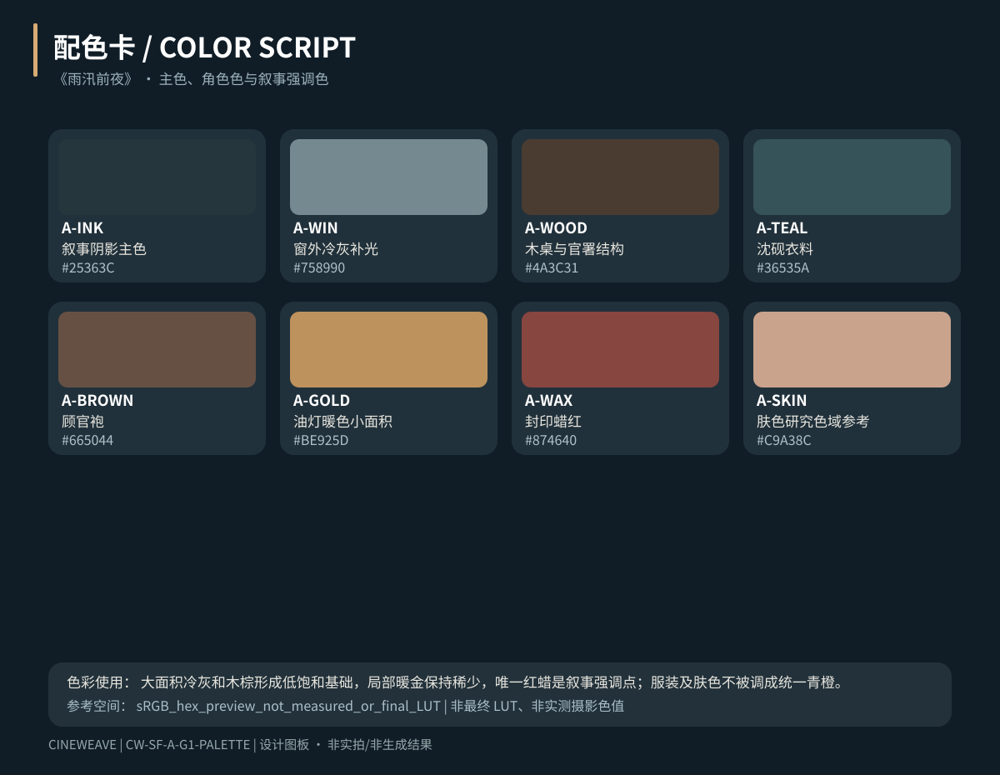
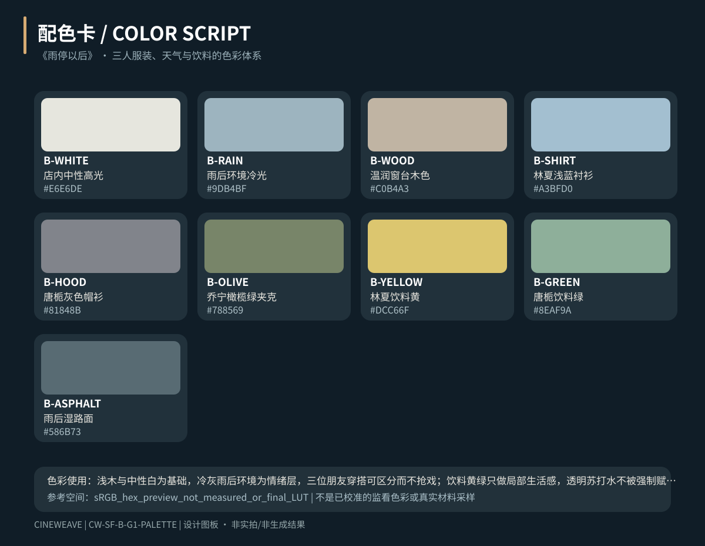

# CineWeave 阶段结果产物包 v1（两条完整文字制作案例）

**版本：**2026-10-16｜**运行范围：**G0–G7 完整场次设计包。两案例均为已实际写出的原创文字方案、矢量设计卡及待生成任务，不是已生成电影媒体。

**空白可复制交接模板：**[阶段产物清单模板 v1](stage-result-template-v1.md)，列出每个阶段的准确文件名、填写要求、验收条件与未完成边界。

**可执行机器清单：**[stage-artifacts-v1.json](stage-artifacts-v1.json)；运行 `npm run stage:check`（也可执行 `node scripts/check-stage-artifacts.mjs tests/evaluations/2026-10-16/stage-artifacts-v1.json`）。

**验收区分：**`design_ready` 表示能打开的设计成果和完整正文都存在，且已通过只读结构校验；`production_ready` 必须另有真实生成图、材质／光线测试视频、配音和可剪辑成片的媒体证据。本包 **production_ready = false**。

| 阶段 | 《雨汛前夜》 | 《雨停以后》 |
| --- | --- | --- |
| G0 · 导演故事卡 | [导演故事卡](artifacts/ancient/g0-director-beat-card.svg) | [导演故事卡](artifacts/modern/g0-director-beat-card.svg) |
| G1 · 风格卡 | [风格卡](artifacts/ancient/g1-style-card.svg) | [风格卡](artifacts/modern/g1-style-card.svg) |
| G1 · 配色卡 | [配色卡](artifacts/ancient/g1-palette-card.svg) | [配色卡](artifacts/modern/g1-palette-card.svg) |
| G1 · 材质卡 | [材质卡](artifacts/ancient/g1-material-card.svg) | [材质卡](artifacts/modern/g1-material-card.svg) |
| G1 · 灯光卡 | [灯光卡](artifacts/ancient/g1-lighting-card.svg) | [灯光卡](artifacts/modern/g1-lighting-card.svg) |
| G1 · 光位图 | [光位图](artifacts/ancient/g1-light-plot.svg) | [光位图](artifacts/modern/g1-light-plot.svg) |
| G1 · LookDev 测试板（待真实测试） | [LookDev 测试板（待真实测试）](artifacts/ancient/g1-looktest-board.svg) | [LookDev 测试板（待真实测试）](artifacts/modern/g1-looktest-board.svg) |
| G2 · 场景平面图 | [场景平面图](artifacts/ancient/g2-scene-map.svg) | [场景平面图](artifacts/modern/g2-scene-map.svg) |
| G3 · 走位与角色行为卡 | [走位与角色行为卡](artifacts/ancient/g3-blocking-board.svg) | [走位与角色行为卡](artifacts/modern/g3-blocking-board.svg) |
| G4 · 六镜分镜板（文字示意） | [六镜分镜板（文字示意）](artifacts/ancient/g4-storyboard-board.svg) | [六镜分镜板（文字示意）](artifacts/modern/g4-storyboard-board.svg) |
| G5 · 剪辑时间线及对白卡 | [剪辑时间线及对白卡](artifacts/ancient/g5-edit-timeline.svg) | [剪辑时间线及对白卡](artifacts/modern/g5-edit-timeline.svg) |
| G6 · 高风险试片任务卡 | [高风险试片任务卡](artifacts/ancient/g6-test-plan.svg) | [高风险试片任务卡](artifacts/modern/g6-test-plan.svg) |
| G7 · 六视角纸面评审卡 | [六视角纸面评审卡](artifacts/ancient/g7-review-card.svg) | [六视角纸面评审卡](artifacts/modern/g7-review-card.svg) |

## 正文与可编辑资料

- **《雨汛前夜》（CW-SF-A）**：[完整剧本、人物与道具资产、拍摄及分镜镜头卡、精确对白和剪辑接口](./ancient-full-flow.json)。各 G0–G7 阶段都可通过 JSON 路径定位全文，图板旁仍有可改母稿。
- **《雨停以后》（CW-SF-B）**：[完整剧本、人物与道具资产、拍摄及分镜镜头卡、精确对白和剪辑接口](./everyday-full-flow.json)。各 G0–G7 阶段都可通过 JSON 路径定位全文，图板旁仍有可改母稿。

## 实际概念色卡预览

《雨汛前夜》 · 8 色设计卡

《雨停以后》 · 9 色设计卡

## 当前仍处于「待生成／待验证」的任务

- 两案例的 LookDev 测试板都有实际可打开的 SVG 文件，但板上的测试格明确标记**未生成**。要从 `design_ready` 进入 `production_ready`，必须有实际材质对照图、主光／反打样片和人物受光测试结果。
- 分镜板是镜头功能、构图和时间边界的**视觉化设计成果**，不是每镜真正生成的电影首帧；正式生成与角色身份一致性仍须实际媒体校验。
- G6 已交付可执行的测试计划与失败规则；缺平台提交记录和生成候选，所以不能填写虚构 Take。
- G7 有实际的六视角纸面评审记录，但尚不能宣称真实视频、音轨和成片艺术效果通过。
- 在其他项目中，阶段要求按 [正式场次交付标准](../../../skills/cineweave-director/references/optional/scene-directing-pipeline.md#cineweave-阶段结果产物清单-v1没有文件不算完成) 执行，模板类型可按项目调整，但**不能用描述取代适用的结果产物**。

