# 家庭亲子时刻：14 条剧情与分镜

## F01《这个才好笑》

**45 秒｜坐姿与手部互动｜角色：澈澈、爸爸｜场景 L**

### 剧情正文

西窗的光落在客厅地垫上，澈澈坐在沙发前，爸爸盘腿坐在斜对面。爸爸把眼睛睁圆，鼓起脸颊，又慢慢缩成一个小小的噘嘴。澈澈没有笑，只低下巴仔细看，手指还捏着自己的衣角。爸爸换了个挑眉的表情，等了一会儿，见他依旧认真，终于呼出一口气，肩膀松下来。他用两手揉揉发酸的脸，掌根停在脸颊两边，不经意把嘴角挤成了一个歪歪的笑。澈澈先眨一下眼，忽然咯咯笑起来，身体向前晃了一点，又用手撑住地垫。爸爸停住手，愣着看他。笑声小下去，爸爸试着把掌根放回刚才的位置，可一看见澈澈还盯着自己，他就先笑漏了气。澈澈也重新笑起来。爸爸没再把脸挤得更怪，只放下手，向前凑近一点，两个人看着对方把这阵笑慢慢笑完。

### 导演与空间

**观察任务：**让观众从澈澈认真观察到突然发笑，发现亲密关系里无意的小动作比用力表演更好笑。

**空间与光位：**L客厅北墙沙发、西窗、东走廊、中央奶油地垫。澈澈坐在地垫北半部朝南，爸爸盘腿坐西南侧朝东北，两人相隔一臂。摄影始终在两人连线东南侧，宽镜中爸爸偏左、澈澈偏右；西窗漫射光落在两人西侧脸颊，背景沙发不换边。无手持玩具。

**人物表演：**澈澈能稳坐，双手可抓衣或撑垫，笑时保持坐骨着地；目光先查爸爸眉眼再落到手与脸接触。爸爸原本想逗他笑，主动做脸部小游戏，失败后真正歇一下，揉脸源自肌肉发酸。两人都允许停顿，不让澈澈机械地按大人指令笑。

### 节拍覆盖

- **F01-b1**：建立两人的相对位置与爸爸主动逗笑、澈澈认真观看的关系。 前态：澈澈坐地垫北部，双膝自然张开，右手捏衣角、左掌在左膝外撑垫。爸爸盘腿坐西南侧，双手落膝，正看澈澈。 后态：爸爸仍鼓腮，澈澈认真盯着他的眼鼻区域，手位未变。 → F01-S01

- **F01-b2**：展示爸爸用力设计的第二个表情仍没有换来笑声。 前态：爸爸鼓腮看澈澈，肩膀平稳，澈澈后脑在右前景，爸爸双手仍在膝上。 后态：爸爸嘴唇回松，眉毛还半抬着，等待已变成一点点疲惫。 → F01-S02

- **F01-b3**：让宝宝的专注与爸爸真正放松下来同时成立，为无意表情留空隙。 前态：澈澈认真看爸爸，右指捏连体衣、左掌撑垫；爸爸左前景眉毛略抬，尚未揉脸。 后态：爸爸双掌已来到脸旁但尚未压脸；澈澈目光落在掌根与脸颊的间隙。 → F01-S03

- **F01-b4**：无意揉脸形成真正刺激，宝宝在看清之后才开始笑。 前态：爸爸双手悬在脸旁，澈澈右手捏衣角、左掌撑垫，正盯着双掌。 后态：爸爸掌根轻贴两颊未继续揉，澈澈双掌在垫上、身体回到稳定坐姿，仍在笑。 → F01-S04

- **F01-b5**：爸爸想复制那个无意的表情，却被宝宝的笑先逗笑。 前态：爸爸掌根仍轻贴两颊，澈澈双掌撑垫，笑声开始变短。 后态：爸爸双手在膝上、自然笑，澈澈双掌仍在垫上，目光互相对着。 → F01-S05

- **F01-b6**：以共同笑完而非再制造怪脸收束关系。 前态：爸爸双手在膝上自然笑，澈澈稳坐双掌撑垫，抬眼看爸爸。 后态：爸爸双手落膝、澈澈双掌撑垫，笑意尚在但动作静下来。 → F01-S06

### 分镜构图板

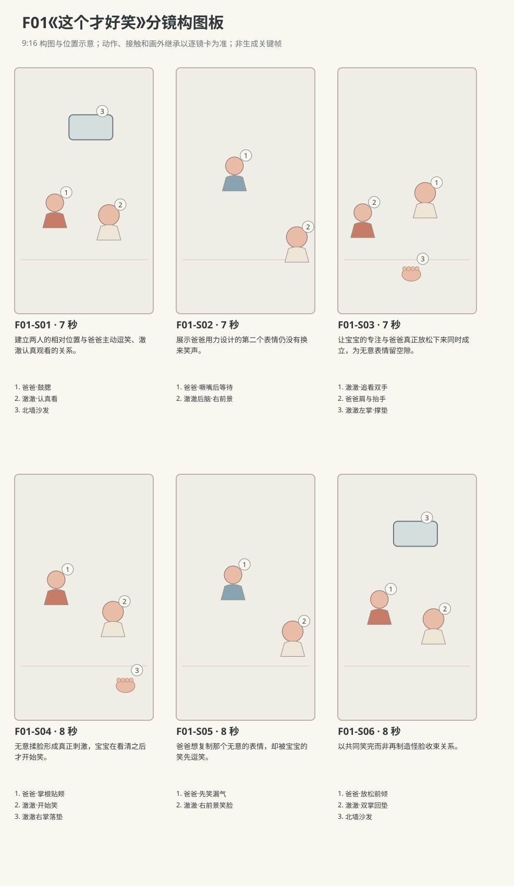

图示为构图位置示意；姿态、接触和画外继承以逐镜正文为准。

### 逐镜设计

#### F01-S01｜00—07 秒｜7 秒｜帧 [0, 168)

**镜头任务：**建立两人的相对位置与爸爸主动逗笑、澈澈认真观看的关系。

**景别、机位与构图：**中全景，机位离地约澈澈眼高，东南朝西北，爸爸左前景、澈澈右中景、沙发横在后景；留出两人之间的视线通道。

**摄影机与理由：**固定，先让观众看清距离和爸爸如何进入宝宝注意范围，不追表情。

**焦点：**两人面部共同清晰；爸爸抬头后澈澈视线仍可读。

**入态：**澈澈坐地垫北部，双膝自然张开，右手捏衣角、左掌在左膝外撑垫。爸爸盘腿坐西南侧，双手落膝，正看澈澈。

**动作与表演：**

- 3 秒：爸爸把肩膀放低到澈澈视线高度，缓慢睁圆眼睛；澈澈从爸爸衣领看向眼睛。

- 4 秒：爸爸鼓起两颊并保持，眼神等回应；澈澈微低下巴，仍捏着衣角，没有笑。

**声音：**爸爸一次轻吸气后闭口；澈澈平稳鼻息、棉布轻摩擦，远处环境底声，无对白无音乐。

**出态：**爸爸仍鼓腮，澈澈认真盯着他的眼鼻区域，手位未变。

**切点与承接：**在爸爸准备换表情的吸气前切近，保留澈澈未笑的事实。

**连续性：**画内可见两人坐骨着地及澈澈双手归属；无物件出入，后镜继承爸爸鼓腮终态。

**开始画面母稿：**

9:16竖幅，原创三维生活动画，圆润而有重量的造型，棉布细纹、柔和皮肤层次与可读的小表情；动作按真实生活物理及婴儿当下能力展开，不用成人化算计表情。澈澈为圆脸、深棕眼、短黑绒发、额前一小撮向右弯的头发，穿奶油色棉连体衣。爸爸短黑发，砖陶色棉衬衫、深灰长裤。本镜开始画面为单一瞬间：澈澈坐地垫北部，双膝自然张开，右手捏衣角、左掌在左膝外撑垫。爸爸盘腿坐西南侧，双手落膝，正看澈澈。 场次方位与光位：L客厅北墙沙发、西窗、东侧走廊、中央地垫。澈澈在地垫北半朝南，爸爸在西南侧朝东北；摄影始终在二人连线东南侧，宽镜爸爸左、宝宝右。西窗漫射为唯一主光，环境方位不反转。 摄影构图：中全景，机位离地约澈澈眼高，东南朝西北，爸爸左前景、澈澈右中景、沙发横在后景；留出两人之间的视线通道。 当前焦点：澈澈与爸爸当前互望的双眼、宝宝捏衣角的右指。只呈现上述起态，不把后续动作拼入一张画面。

**视频变化母稿：**

9:16竖幅，原创三维生活动画，圆润而有重量的造型，棉布细纹、柔和皮肤层次与可读的小表情；动作按真实生活物理及婴儿当下能力展开，不用成人化算计表情。澈澈为圆脸、深棕眼、短黑绒发、额前一小撮向右弯的头发，穿奶油色棉连体衣。爸爸短黑发，砖陶色棉衬衫、深灰长裤。制作一段7秒连续镜头。本段人物和能力：澈澈、爸爸，澈澈为R1。空间光位：L客厅北墙沙发、西窗、东侧走廊、中央地垫。澈澈在地垫北半朝南，爸爸在西南侧朝东北；摄影始终在二人连线东南侧，宽镜爸爸左、宝宝右。西窗漫射为唯一主光，环境方位不反转。 起态：澈澈坐地垫北部，双膝自然张开，右手捏衣角、左掌在左膝外撑垫。爸爸盘腿坐西南侧，双手落膝，正看澈澈。 摄影：中全景，机位离地约澈澈眼高，东南朝西北，爸爸左前景、澈澈右中景、沙发横在后景；留出两人之间的视线通道。 相机行为：固定，先让观众看清距离和爸爸如何进入宝宝注意范围，不追表情。 焦点：两人面部共同清晰；爸爸抬头后澈澈视线仍可读。 时间过程：第1阶段3秒：爸爸把肩膀放低到澈澈视线高度，缓慢睁圆眼睛；澈澈从爸爸衣领看向眼睛。；第2阶段4秒：爸爸鼓起两颊并保持，眼神等回应；澈澈微低下巴，仍捏着衣角，没有笑。。声音：爸爸一次轻吸气后闭口；澈澈平稳鼻息、棉布轻摩擦，远处环境底声，无对白无音乐。 终态：爸爸仍鼓腮，澈澈认真盯着他的眼鼻区域，手位未变。 连续性：画内可见两人坐骨着地及澈澈双手归属；无物件出入，后镜继承爸爸鼓腮终态。 不加未写出的对白、人物或道具。

#### F01-S02｜07—14 秒｜7 秒｜帧 [168, 336)

**镜头任务：**展示爸爸用力设计的第二个表情仍没有换来笑声。

**景别、机位与构图：**爸爸近景，东南侧略向西北，脸居左中，右画缘保留澈澈一小块后脑轮廓，爸爸双手膝上不入脸部区域。

**摄影机与理由：**固定；用脸部尺寸读懂鼓腮到噘嘴的变化，不用推镜夸大。

**焦点：**爸爸双眼与嘴角；澈澈前景轮廓轻虚。

**入态：**爸爸鼓腮看澈澈，肩膀平稳，澈澈后脑在右前景，爸爸双手仍在膝上。

**动作与表演：**

- 3 秒：爸爸慢慢呼掉腮里的气，嘴唇收成小圆口，眉毛向上抬。

- 4 秒：爸爸把小圆口偏向一侧又回正，等两拍，目光始终落在澈澈脸上。

**声音：**爸爸很轻的放气声、布料声，澈澈无笑声；无对白。

**出态：**爸爸嘴唇回松，眉毛还半抬着，等待已变成一点点疲惫。

**切点与承接：**随爸爸视线切向澈澈，核对回应而非继续加码表演。

**连续性：**画内爸爸未抬手；澈澈右手捏衣角、左掌撑垫在画外继承，位置不换。

**开始画面母稿：**

9:16竖幅，原创三维生活动画，圆润而有重量的造型，棉布细纹、柔和皮肤层次与可读的小表情；动作按真实生活物理及婴儿当下能力展开，不用成人化算计表情。澈澈为圆脸、深棕眼、短黑绒发、额前一小撮向右弯的头发，穿奶油色棉连体衣。爸爸短黑发，砖陶色棉衬衫、深灰长裤。本镜开始画面为单一瞬间：爸爸鼓腮看澈澈，肩膀平稳，澈澈后脑在右前景，爸爸双手仍在膝上。 场次方位与光位：L客厅北墙沙发、西窗、东侧走廊、中央地垫。澈澈在地垫北半朝南，爸爸在西南侧朝东北；摄影始终在二人连线东南侧，宽镜爸爸左、宝宝右。西窗漫射为唯一主光，环境方位不反转。 摄影构图：爸爸近景，东南侧略向西北，脸居左中，右画缘保留澈澈一小块后脑轮廓，爸爸双手膝上不入脸部区域。 当前焦点：爸爸鼓起的双颊与双眼，右前景宝宝后脑略虚。只呈现上述起态，不把后续动作拼入一张画面。

**视频变化母稿：**

9:16竖幅，原创三维生活动画，圆润而有重量的造型，棉布细纹、柔和皮肤层次与可读的小表情；动作按真实生活物理及婴儿当下能力展开，不用成人化算计表情。澈澈为圆脸、深棕眼、短黑绒发、额前一小撮向右弯的头发，穿奶油色棉连体衣。爸爸短黑发，砖陶色棉衬衫、深灰长裤。制作一段7秒连续镜头。本段人物和能力：澈澈、爸爸，澈澈为R1。空间光位：L客厅北墙沙发、西窗、东侧走廊、中央地垫。澈澈在地垫北半朝南，爸爸在西南侧朝东北；摄影始终在二人连线东南侧，宽镜爸爸左、宝宝右。西窗漫射为唯一主光，环境方位不反转。 起态：爸爸鼓腮看澈澈，肩膀平稳，澈澈后脑在右前景，爸爸双手仍在膝上。 摄影：爸爸近景，东南侧略向西北，脸居左中，右画缘保留澈澈一小块后脑轮廓，爸爸双手膝上不入脸部区域。 相机行为：固定；用脸部尺寸读懂鼓腮到噘嘴的变化，不用推镜夸大。 焦点：爸爸双眼与嘴角；澈澈前景轮廓轻虚。 时间过程：第1阶段3秒：爸爸慢慢呼掉腮里的气，嘴唇收成小圆口，眉毛向上抬。；第2阶段4秒：爸爸把小圆口偏向一侧又回正，等两拍，目光始终落在澈澈脸上。。声音：爸爸很轻的放气声、布料声，澈澈无笑声；无对白。 终态：爸爸嘴唇回松，眉毛还半抬着，等待已变成一点点疲惫。 连续性：画内爸爸未抬手；澈澈右手捏衣角、左掌撑垫在画外继承，位置不换。 不加未写出的对白、人物或道具。

#### F01-S03｜14—21 秒｜7 秒｜帧 [336, 504)

**镜头任务：**让宝宝的专注与爸爸真正放松下来同时成立，为无意表情留空隙。

**景别、机位与构图：**澈澈中近景，机位仍东南侧朝北略偏西，澈澈居右中，爸爸眉眼、嘴与肩颈留在左前景边缘，脸部不遮澈澈眼线，左下缘预留抬手通道；下缘包括澈澈衣角与撑垫左掌。

**摄影机与理由：**固定；在宝宝视线移动中等到爸爸呼气，不替宝宝做夸张反应。

**焦点：**澈澈眼睛；爸爸肩膀下降仍保留可辨轮廓。

**入态：**澈澈认真看爸爸，右指捏连体衣、左掌撑垫；爸爸左前景眉毛略抬，尚未揉脸。

**动作与表演：**

- 3 秒：澈澈看爸爸的眉毛，再把视线缓缓落到嘴上，嘴唇微分但没有发笑。

- 4 秒：爸爸呼气、放下肩膀，两只手从膝上抬向脸颊；澈澈眼睛跟着手向上看。

**声音：**爸爸自然叹出一小口气；衣袖掠动，澈澈轻鼻息，无对白无音乐。

**出态：**爸爸双掌已来到脸旁但尚未压脸；澈澈目光落在掌根与脸颊的间隙。

**切点与承接：**在掌根即将接触时切到能同时读脸和宝宝的二人镜，接完整触碰。

**连续性：**澈澈双手尚未换位；爸爸双手从画外膝位自左下缘进入脸旁后可见，膝部不作为本镜画内证据；后镜不得让手已提前揉过。

**开始画面母稿：**

9:16竖幅，原创三维生活动画，圆润而有重量的造型，棉布细纹、柔和皮肤层次与可读的小表情；动作按真实生活物理及婴儿当下能力展开，不用成人化算计表情。澈澈为圆脸、深棕眼、短黑绒发、额前一小撮向右弯的头发，穿奶油色棉连体衣。爸爸短黑发，砖陶色棉衬衫、深灰长裤。本镜开始画面为单一瞬间：澈澈认真看爸爸，右指捏连体衣、左掌撑垫；爸爸左前景眉毛略抬，尚未揉脸。 场次方位与光位：L客厅北墙沙发、西窗、东侧走廊、中央地垫。澈澈在地垫北半朝南，爸爸在西南侧朝东北；摄影始终在二人连线东南侧，宽镜爸爸左、宝宝右。西窗漫射为唯一主光，环境方位不反转。 摄影构图：澈澈中近景，机位仍东南侧朝北略偏西，澈澈居右中，爸爸眉眼、嘴与肩颈留在左前景边缘，脸部不遮澈澈眼线，左下缘预留抬手通道；下缘包括澈澈衣角与撑垫左掌。 当前焦点：澈澈观察爸爸的双眼、胸前右指与撑垫左掌。只呈现上述起态，不把后续动作拼入一张画面。

**视频变化母稿：**

9:16竖幅，原创三维生活动画，圆润而有重量的造型，棉布细纹、柔和皮肤层次与可读的小表情；动作按真实生活物理及婴儿当下能力展开，不用成人化算计表情。澈澈为圆脸、深棕眼、短黑绒发、额前一小撮向右弯的头发，穿奶油色棉连体衣。爸爸短黑发，砖陶色棉衬衫、深灰长裤。制作一段7秒连续镜头。本段人物和能力：澈澈、爸爸，澈澈为R1。空间光位：L客厅北墙沙发、西窗、东侧走廊、中央地垫。澈澈在地垫北半朝南，爸爸在西南侧朝东北；摄影始终在二人连线东南侧，宽镜爸爸左、宝宝右。西窗漫射为唯一主光，环境方位不反转。 起态：澈澈认真看爸爸，右指捏连体衣、左掌撑垫；爸爸左前景眉毛略抬，尚未揉脸。 摄影：澈澈中近景，机位仍东南侧朝北略偏西，澈澈居右中，爸爸眉眼、嘴与肩颈留在左前景边缘，脸部不遮澈澈眼线，左下缘预留抬手通道；下缘包括澈澈衣角与撑垫左掌。 相机行为：固定；在宝宝视线移动中等到爸爸呼气，不替宝宝做夸张反应。 焦点：澈澈眼睛；爸爸肩膀下降仍保留可辨轮廓。 时间过程：第1阶段3秒：澈澈看爸爸的眉毛，再把视线缓缓落到嘴上，嘴唇微分但没有发笑。；第2阶段4秒：爸爸呼气、放下肩膀，两只手从膝上抬向脸颊；澈澈眼睛跟着手向上看。。声音：爸爸自然叹出一小口气；衣袖掠动，澈澈轻鼻息，无对白无音乐。 终态：爸爸双掌已来到脸旁但尚未压脸；澈澈目光落在掌根与脸颊的间隙。 连续性：澈澈双手尚未换位；爸爸双手从画外膝位自左下缘进入脸旁后可见，膝部不作为本镜画内证据；后镜不得让手已提前揉过。 不加未写出的对白、人物或道具。

#### F01-S04｜21—29 秒｜8 秒｜帧 [504, 696)

**镜头任务：**无意揉脸形成真正刺激，宝宝在看清之后才开始笑。

**景别、机位与构图：**紧凑二人中景，东南侧机位，爸爸左、澈澈右，两张脸与爸爸两只掌根同框，下缘留澈澈右手到垫的路径。

**摄影机与理由：**固定；接触与反应在同一镜内完成，避免剪辑替代因果。

**焦点：**前3秒爸爸掌根和嘴角为重，随后小幅移焦澈澈双眼与张开的笑嘴；两人均留可辨清晰度。

**入态：**爸爸双手悬在脸旁，澈澈右手捏衣角、左掌撑垫，正盯着双掌。

**动作与表演：**

- 3 秒：爸爸闭一下眼，用两掌根轻揉脸颊，再停在两边，把嘴角不经意挤成歪笑。

- 2 秒：澈澈眨眼看清嘴角，嘴角先动，随后发出一声短笑。

- 3 秒：短笑连成咯咯声，澈澈向前晃一点，右手松开衣角落到右膝外地垫，爸爸立刻停住掌根看他。

**声音：**掌根擦脸细声先出现；第4秒后才有澈澈短笑，第6秒起接自然咯咯声。爸爸无对白，环境保持低。

**出态：**爸爸掌根轻贴两颊未继续揉，澈澈双掌在垫上、身体回到稳定坐姿，仍在笑。

**切点与承接：**笑声越过切点，转到爸爸对意外成功的反应。

**连续性：**同框实际可见右手由衣角到地垫，左掌始终接地；爸爸掌根仅压软组织。

**开始画面母稿：**

9:16竖幅，原创三维生活动画，圆润而有重量的造型，棉布细纹、柔和皮肤层次与可读的小表情；动作按真实生活物理及婴儿当下能力展开，不用成人化算计表情。澈澈为圆脸、深棕眼、短黑绒发、额前一小撮向右弯的头发，穿奶油色棉连体衣。爸爸短黑发，砖陶色棉衬衫、深灰长裤。本镜开始画面为单一瞬间：爸爸双手悬在脸旁，澈澈右手捏衣角、左掌撑垫，正盯着双掌。 场次方位与光位：L客厅北墙沙发、西窗、东侧走廊、中央地垫。澈澈在地垫北半朝南，爸爸在西南侧朝东北；摄影始终在二人连线东南侧，宽镜爸爸左、宝宝右。西窗漫射为唯一主光，环境方位不反转。 摄影构图：紧凑二人中景，东南侧机位，爸爸左、澈澈右，两张脸与爸爸两只掌根同框，下缘留澈澈右手到垫的路径。 当前焦点：爸爸尚未触脸的双掌、掌根与双颊间隙，以及澈澈看手的双眼。只呈现上述起态，不把后续动作拼入一张画面。

**视频变化母稿：**

9:16竖幅，原创三维生活动画，圆润而有重量的造型，棉布细纹、柔和皮肤层次与可读的小表情；动作按真实生活物理及婴儿当下能力展开，不用成人化算计表情。澈澈为圆脸、深棕眼、短黑绒发、额前一小撮向右弯的头发，穿奶油色棉连体衣。爸爸短黑发，砖陶色棉衬衫、深灰长裤。制作一段8秒连续镜头。本段人物和能力：澈澈、爸爸，澈澈为R1。空间光位：L客厅北墙沙发、西窗、东侧走廊、中央地垫。澈澈在地垫北半朝南，爸爸在西南侧朝东北；摄影始终在二人连线东南侧，宽镜爸爸左、宝宝右。西窗漫射为唯一主光，环境方位不反转。 起态：爸爸双手悬在脸旁，澈澈右手捏衣角、左掌撑垫，正盯着双掌。 摄影：紧凑二人中景，东南侧机位，爸爸左、澈澈右，两张脸与爸爸两只掌根同框，下缘留澈澈右手到垫的路径。 相机行为：固定；接触与反应在同一镜内完成，避免剪辑替代因果。 焦点：前3秒爸爸掌根和嘴角为重，随后小幅移焦澈澈双眼与张开的笑嘴；两人均留可辨清晰度。 时间过程：第1阶段3秒：爸爸闭一下眼，用两掌根轻揉脸颊，再停在两边，把嘴角不经意挤成歪笑。；第2阶段2秒：澈澈眨眼看清嘴角，嘴角先动，随后发出一声短笑。；第3阶段3秒：短笑连成咯咯声，澈澈向前晃一点，右手松开衣角落到右膝外地垫，爸爸立刻停住掌根看他。。声音：掌根擦脸细声先出现；第4秒后才有澈澈短笑，第6秒起接自然咯咯声。爸爸无对白，环境保持低。 终态：爸爸掌根轻贴两颊未继续揉，澈澈双掌在垫上、身体回到稳定坐姿，仍在笑。 连续性：同框实际可见右手由衣角到地垫，左掌始终接地；爸爸掌根仅压软组织。 不加未写出的对白、人物或道具。

#### F01-S05｜29—37 秒｜8 秒｜帧 [696, 888)

**镜头任务：**爸爸想复制那个无意的表情，却被宝宝的笑先逗笑。

**景别、机位与构图：**爸爸中近景，仍从东南侧拍，爸爸左中、澈澈右前景侧脸可辨，爸爸双手和嘴均在框内。

**摄影机与理由：**固定，保持喜剧来自停住、重试和笑漏气，不添加突兀变焦。

**焦点：**爸爸眼睛和掌根；澈澈侧脸保持轻浅景深中的可辨笑态。

**入态：**爸爸掌根仍轻贴两颊，澈澈双掌撑垫，笑声开始变短。

**动作与表演：**

- 3 秒：爸爸松开双手一点，眼睛睁大看澈澈，自己嘴角已经扬起；澈澈吸一小口气。

- 3 秒：爸爸试着把掌根放回原接触点，刚要挤嘴角，眼神撞上澈澈的眼睛，先笑漏一口气。

- 2 秒：爸爸随笑把手放到膝上，脸完全回松；澈澈又笑了一声。

**声音：**澈澈笑声先收、爸爸短促笑气后起，再接澈澈一次笑；无对白，无罐头笑声。

**出态：**爸爸双手在膝上、自然笑，澈澈双掌仍在垫上，目光互相对着。

**切点与承接：**沿双人的相互视线切回稍宽，给笑自然结束的空间。

**连续性：**爸爸手位由脸到膝清楚完成；画外澈澈右左掌均撑垫，未抓回衣角。

**开始画面母稿：**

9:16竖幅，原创三维生活动画，圆润而有重量的造型，棉布细纹、柔和皮肤层次与可读的小表情；动作按真实生活物理及婴儿当下能力展开，不用成人化算计表情。澈澈为圆脸、深棕眼、短黑绒发、额前一小撮向右弯的头发，穿奶油色棉连体衣。爸爸短黑发，砖陶色棉衬衫、深灰长裤。本镜开始画面为单一瞬间：爸爸掌根仍轻贴两颊，澈澈双掌撑垫，笑声开始变短。 场次方位与光位：L客厅北墙沙发、西窗、东侧走廊、中央地垫。澈澈在地垫北半朝南，爸爸在西南侧朝东北；摄影始终在二人连线东南侧，宽镜爸爸左、宝宝右。西窗漫射为唯一主光，环境方位不反转。 摄影构图：爸爸中近景，仍从东南侧拍，爸爸左中、澈澈右前景侧脸可辨，爸爸双手和嘴均在框内。 当前焦点：爸爸掌根轻贴双颊的接触处与澈澈右前景笑脸。只呈现上述起态，不把后续动作拼入一张画面。

**视频变化母稿：**

9:16竖幅，原创三维生活动画，圆润而有重量的造型，棉布细纹、柔和皮肤层次与可读的小表情；动作按真实生活物理及婴儿当下能力展开，不用成人化算计表情。澈澈为圆脸、深棕眼、短黑绒发、额前一小撮向右弯的头发，穿奶油色棉连体衣。爸爸短黑发，砖陶色棉衬衫、深灰长裤。制作一段8秒连续镜头。本段人物和能力：澈澈、爸爸，澈澈为R1。空间光位：L客厅北墙沙发、西窗、东侧走廊、中央地垫。澈澈在地垫北半朝南，爸爸在西南侧朝东北；摄影始终在二人连线东南侧，宽镜爸爸左、宝宝右。西窗漫射为唯一主光，环境方位不反转。 起态：爸爸掌根仍轻贴两颊，澈澈双掌撑垫，笑声开始变短。 摄影：爸爸中近景，仍从东南侧拍，爸爸左中、澈澈右前景侧脸可辨，爸爸双手和嘴均在框内。 相机行为：固定，保持喜剧来自停住、重试和笑漏气，不添加突兀变焦。 焦点：爸爸眼睛和掌根；澈澈侧脸保持轻浅景深中的可辨笑态。 时间过程：第1阶段3秒：爸爸松开双手一点，眼睛睁大看澈澈，自己嘴角已经扬起；澈澈吸一小口气。；第2阶段3秒：爸爸试着把掌根放回原接触点，刚要挤嘴角，眼神撞上澈澈的眼睛，先笑漏一口气。；第3阶段2秒：爸爸随笑把手放到膝上，脸完全回松；澈澈又笑了一声。。声音：澈澈笑声先收、爸爸短促笑气后起，再接澈澈一次笑；无对白，无罐头笑声。 终态：爸爸双手在膝上、自然笑，澈澈双掌仍在垫上，目光互相对着。 连续性：爸爸手位由脸到膝清楚完成；画外澈澈右左掌均撑垫，未抓回衣角。 不加未写出的对白、人物或道具。

#### F01-S06｜37—45 秒｜8 秒｜帧 [888, 1080)

**镜头任务：**以共同笑完而非再制造怪脸收束关系。

**景别、机位与构图：**二人中景，与S01同轴同方向，爸爸左、澈澈右，双人上身与澈澈撑垫双掌可见，沙发在后。

**摄影机与理由：**轻缓向前移动约一掌距离，触发于爸爸微倾身；目的是把共同笑声收近，不改角色大小关系。

**焦点：**两人眼睛同在清晰范围；不在最后一刻转移焦点。

**入态：**爸爸双手在膝上自然笑，澈澈稳坐双掌撑垫，抬眼看爸爸。

**动作与表演：**

- 3 秒：爸爸微倾身让脸更近一点，停在澈澈可看清的距离；澈澈笑得肩膀轻动。

- 3 秒：两人笑声渐短，澈澈抬起右手离垫，轻轻碰一下自己的嘴角，爸爸看着这个动作又短笑。

- 2 秒：澈澈把右掌放回右膝外地垫，两人带着未完全收起的笑对视。

**声音：**真实的双人笑声逐渐落回呼吸，末两秒只剩短鼻息与环境声；无对白无音乐。

**出态：**爸爸双手落膝、澈澈双掌撑垫，笑意尚在但动作静下来。

**切点与承接：**在末次呼吸后停住结束，不加文字、额外反应或新道具。

**连续性：**右手离垫再回垫全程可见；爸爸未碰宝宝，不产生切后接抱；西窗亮侧一致。

**开始画面母稿：**

9:16竖幅，原创三维生活动画，圆润而有重量的造型，棉布细纹、柔和皮肤层次与可读的小表情；动作按真实生活物理及婴儿当下能力展开，不用成人化算计表情。澈澈为圆脸、深棕眼、短黑绒发、额前一小撮向右弯的头发，穿奶油色棉连体衣。爸爸短黑发，砖陶色棉衬衫、深灰长裤。本镜开始画面为单一瞬间：爸爸双手在膝上自然笑，澈澈稳坐双掌撑垫，抬眼看爸爸。 场次方位与光位：L客厅北墙沙发、西窗、东侧走廊、中央地垫。澈澈在地垫北半朝南，爸爸在西南侧朝东北；摄影始终在二人连线东南侧，宽镜爸爸左、宝宝右。西窗漫射为唯一主光，环境方位不反转。 摄影构图：二人中景，与S01同轴同方向，爸爸左、澈澈右，双人上身与澈澈撑垫双掌可见，沙发在后。 当前焦点：双人自然笑脸与澈澈双掌接地的当前状态。只呈现上述起态，不把后续动作拼入一张画面。

**视频变化母稿：**

9:16竖幅，原创三维生活动画，圆润而有重量的造型，棉布细纹、柔和皮肤层次与可读的小表情；动作按真实生活物理及婴儿当下能力展开，不用成人化算计表情。澈澈为圆脸、深棕眼、短黑绒发、额前一小撮向右弯的头发，穿奶油色棉连体衣。爸爸短黑发，砖陶色棉衬衫、深灰长裤。制作一段8秒连续镜头。本段人物和能力：澈澈、爸爸，澈澈为R1。空间光位：L客厅北墙沙发、西窗、东侧走廊、中央地垫。澈澈在地垫北半朝南，爸爸在西南侧朝东北；摄影始终在二人连线东南侧，宽镜爸爸左、宝宝右。西窗漫射为唯一主光，环境方位不反转。 起态：爸爸双手在膝上自然笑，澈澈稳坐双掌撑垫，抬眼看爸爸。 摄影：二人中景，与S01同轴同方向，爸爸左、澈澈右，双人上身与澈澈撑垫双掌可见，沙发在后。 相机行为：轻缓向前移动约一掌距离，触发于爸爸微倾身；目的是把共同笑声收近，不改角色大小关系。 焦点：两人眼睛同在清晰范围；不在最后一刻转移焦点。 时间过程：第1阶段3秒：爸爸微倾身让脸更近一点，停在澈澈可看清的距离；澈澈笑得肩膀轻动。；第2阶段3秒：两人笑声渐短，澈澈抬起右手离垫，轻轻碰一下自己的嘴角，爸爸看着这个动作又短笑。；第3阶段2秒：澈澈把右掌放回右膝外地垫，两人带着未完全收起的笑对视。。声音：真实的双人笑声逐渐落回呼吸，末两秒只剩短鼻息与环境声；无对白无音乐。 终态：爸爸双手落膝、澈澈双掌撑垫，笑意尚在但动作静下来。 连续性：右手离垫再回垫全程可见；爸爸未碰宝宝，不产生切后接抱；西窗亮侧一致。 不加未写出的对白、人物或道具。

### 声音与剪辑

无语言对白、无配乐。前景保留爸爸轻呼气、掌根擦过面颊的细声、澈澈由单次短笑变成自然咯咯声；底层为西窗外很轻的远处城市空气声。笑声不能提前铺在观察镜头上。

正式台词：无；保留镜头声音中已写明的自然发声。

### 连续性与试片

- 连续性：爸爸始终坐西南侧，澈澈在北半地垫，摄影不越两人连线。

- 连续性：澈澈全片不持玩具；右手最初捏衣角，笑时右掌撑到右膝外地垫后才稳住身体。

- 连续性：揉脸是掌根接触脸颊软组织，手指在耳前外侧，不穿入眼口；表情不改变头骨与眼球形体。

- 连续性：西窗为唯一主光；脸部近景的亮侧不反转。

- 试片：F01-S01—S03静音试看：澈澈须显得在观察并非冷漠；若靠字幕才能知道爸爸等待回应，则失败。

- 试片：F01-S04—S05试片：爸爸掌根挤脸、澈澈视线落点与笑声起点须有清楚先后；若宝宝在接触前已笑或脸部融化，则失败。

- 试片：F01-S05—S06剪辑：右手撑垫状态与坐姿应接续；若切后双手突然回到衣角、身体悬浮，则失败。

**媒体待验证：**尚未生成画面、声音或成片；重点待验脸颊受压的局部形变、婴儿短笑的呼吸节律、右掌撑垫与重心回稳。

---

## F02《袖子借我一下》

**38 秒｜坐姿与手部互动｜角色：澈澈、妈妈｜场景 L**

### 剧情正文

客厅地垫旁，妈妈把出门包放在膝前，澈澈坐在她身侧，看一册蓝绿布书被放进去。妈妈扶一下地垫准备起身，左袖口却停住了。她低头，看见澈澈的右手紧紧握着那一小片蓝布，眼睛仍盯着包口，仿佛手里只是顺便留了一个位置。妈妈弯回膝盖，坐到离他更近的地方，用空着的右手继续整理。她放好布书，又把包侧面压平；澈澈握着袖口，目光随着她的手来回，偶尔搓一下布料。旁边的珊瑚色软环被他的左膝轻碰，翻倒在垫上。澈澈转头看见它，先伸出左手拿住，再把右手也凑过去，袖口便自然滑了出来。妈妈的左手终于空了，却没有马上起身。她看看回到原处的袖口，再看看正用两只手翻软环的澈澈，嘴角动了一下。她把包带理顺，在他旁边多坐了片刻。

### 导演与空间

**观察任务：**通过一截被握住又自然松开的袖口，拍出宝宝看人做事和妈妈短暂舍不得离开的生活停顿。

**空间与光位：**L客厅北墙沙发、西窗、东走廊、中央奶油地垫。澈澈坐地垫北半朝东南，妈妈跪坐他西侧同朝东南，出门布包F02-X01开口朝上在妈妈膝前偏南，P05布书在妈妈右手，P01珊瑚软环在澈澈左膝外偏东。摄影在南侧朝北略偏西，妈妈画左、澈澈画右，窗光来自画左。

**人物表演：**妈妈持续完成装包，左袖被握后改变坐姿而不拽走手臂；她并不靠夸张不舍传达情绪。澈澈右手抓袖、左手可撑垫和拿环，兴趣从妈妈装包自然转到软环，不理解或执行成人离别道理。

### 节拍覆盖

- **F02-b1**：交代妈妈装包、宝宝观察和软环尚未被注意。 前态：妈妈跪坐在澈澈西侧，右手拿P05，左手放膝上；澈澈右掌在右膝边、左掌撑垫，P01竖斜倚在澈澈左膝外，底缘接地垫。 后态：P05已在包内；妈妈左掌撑垫、臀部尚未离开脚跟，澈澈看向她左袖。 → F02-S01

- **F02-b2**：让抓袖成为被看见的小动作，妈妈先接收到牵扯再回应。 前态：妈妈左掌撑垫、袖口松在左腕上方，澈澈右手离袖口约一小掌，右掌已抬起。 后态：妈妈左肘已弯回，左掌不再承重，澈澈右手握袖无持续拉力。 → F02-S02

- **F02-b3**：妈妈调整自己的位置，装包任务继续而非被迫中断。 前态：妈妈半起身停住，左肘弯向澈澈，澈澈右手握左袖，左掌仍撑垫。 后态：妈妈已稳稳跪坐，左前臂在宝宝右侧可及处，右手在包口，宝宝握袖不变。 → F02-S03

- **F02-b4**：拍出宝宝享受握着袖口看妈妈做事的安静过程，并给软环改变位置的可见原因。 前态：澈澈右手握袖，妈妈右手在左下包口整理；P01竖斜倚在澈澈左膝外。 后态：澈澈头已转向左膝外软环，右手还握妈妈左袖，左掌准备离垫。 → F02-S04

- **F02-b5**：明确呈现兴趣转移如何让袖口自然释放。 前态：澈澈右手握袖、左掌正离地垫，P01平躺在其左膝外，妈妈左前臂放松。 后态：软环在澈澈双手中，妈妈左袖完全释放，左手仍停原处。 → F02-S05

- **F02-b6**：妈妈手臂自由后反而多停一会儿，自然结束这段陪伴。 前态：妈妈左手停在身旁、袖口已空，右手扶包，澈澈双手在胸前翻P01。 后态：妈妈双手一扶包一落膝，澈澈双手持环，各自继续眼前的小事。 → F02-S06

### 分镜构图板

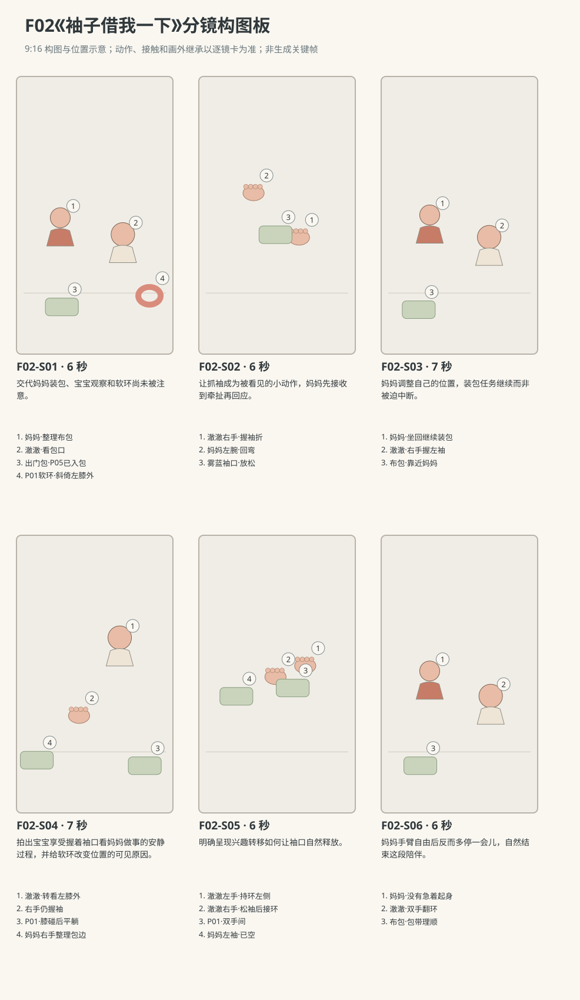

图示为构图位置示意；姿态、接触和画外继承以逐镜正文为准。

### 逐镜设计

#### F02-S01｜00—06 秒｜6 秒｜帧 [0, 144)

**镜头任务：**交代妈妈装包、宝宝观察和软环尚未被注意。

**景别、机位与构图：**中全景，南侧朝北略西，妈妈左、澈澈右，包在左下，软环在右下，后景北墙沙发。

**摄影机与理由：**固定，包口和袖口都留在构图内，为随后抓袖建立距离。

**焦点：**妈妈右手、包口和澈澈视线共同清晰。

**入态：**妈妈跪坐在澈澈西侧，右手拿P05，左手放膝上；澈澈右掌在右膝边、左掌撑垫，P01竖斜倚在澈澈左膝外，底缘接地垫。

**动作与表演：**

- 3 秒：妈妈右手把布书竖着放进开口的包，澈澈眼睛随书向下。

- 3 秒：妈妈右手按平布书露出的书角，左掌移到身旁地垫，身体稍前倾准备起身。

**声音：**棉布书擦过包衬的轻声、衣裤摩擦，无对白。

**出态：**P05已在包内；妈妈左掌撑垫、臀部尚未离开脚跟，澈澈看向她左袖。

**切点与承接：**在妈妈将开始抬臀时切接袖口关系。

**连续性：**布书去向、软环未动均画内可见；后镜继承包口敞开。

**开始画面母稿：**

9:16竖幅，原创三维生活动画，圆润而有重量的造型，棉布细纹、柔和皮肤层次与可读的小表情；动作按真实生活物理及婴儿当下能力展开，不用成人化算计表情。澈澈为圆脸、深棕眼、短黑绒发、额前一小撮向右弯的头发，穿奶油色棉连体衣。妈妈深棕低马尾，雾蓝棉上衣、米色长裤。本镜开始画面为单一瞬间：妈妈跪坐在澈澈西侧，右手拿P05，左手放膝上；澈澈右掌在右膝边、左掌撑垫，P01竖斜倚在澈澈左膝外，底缘接地垫。 场次方位与光位：L客厅北墙沙发、西窗、东走廊、中央地垫。澈澈在垫北半朝东南，妈妈位于其西侧也朝东南，布包工作区在妈妈膝前偏南。主摄影南侧朝北略西，妈妈左、宝宝右，西窗柔光由左入；道具当前位置只依本镜起态。 摄影构图：中全景，南侧朝北略西，妈妈左、澈澈右，包在左下，软环在右下，后景北墙沙发。 当前焦点：妈妈右手P05与敞开包口、澈澈看书的眼神。只呈现上述起态，不把后续动作拼入一张画面。

**视频变化母稿：**

9:16竖幅，原创三维生活动画，圆润而有重量的造型，棉布细纹、柔和皮肤层次与可读的小表情；动作按真实生活物理及婴儿当下能力展开，不用成人化算计表情。澈澈为圆脸、深棕眼、短黑绒发、额前一小撮向右弯的头发，穿奶油色棉连体衣。妈妈深棕低马尾，雾蓝棉上衣、米色长裤。制作一段6秒连续镜头。本段人物和能力：澈澈、妈妈，澈澈为R1。空间光位：L客厅北墙沙发、西窗、东走廊、中央地垫。澈澈在垫北半朝东南，妈妈位于其西侧也朝东南，布包工作区在妈妈膝前偏南。主摄影南侧朝北略西，妈妈左、宝宝右，西窗柔光由左入；道具当前位置只依本镜起态。 起态：妈妈跪坐在澈澈西侧，右手拿P05，左手放膝上；澈澈右掌在右膝边、左掌撑垫，P01竖斜倚在澈澈左膝外，底缘接地垫。 摄影：中全景，南侧朝北略西，妈妈左、澈澈右，包在左下，软环在右下，后景北墙沙发。 相机行为：固定，包口和袖口都留在构图内，为随后抓袖建立距离。 焦点：妈妈右手、包口和澈澈视线共同清晰。 时间过程：第1阶段3秒：妈妈右手把布书竖着放进开口的包，澈澈眼睛随书向下。；第2阶段3秒：妈妈右手按平布书露出的书角，左掌移到身旁地垫，身体稍前倾准备起身。。声音：棉布书擦过包衬的轻声、衣裤摩擦，无对白。 终态：P05已在包内；妈妈左掌撑垫、臀部尚未离开脚跟，澈澈看向她左袖。 连续性：布书去向、软环未动均画内可见；后镜继承包口敞开。 不加未写出的对白、人物或道具。

#### F02-S02｜06—12 秒｜6 秒｜帧 [144, 288)

**镜头任务：**让抓袖成为被看见的小动作，妈妈先接收到牵扯再回应。

**景别、机位与构图：**手部近景，南侧同轴，妈妈左袖从左上到中央，澈澈右手从右侧进入，地垫下方，妈妈左掌撑垫可见。

**摄影机与理由：**固定，不追妈妈起身上移，保留袖口与右指的受力关系。

**焦点：**澈澈右指闭合处及妈妈左腕布料褶皱。

**入态：**妈妈左掌撑垫、袖口松在左腕上方，澈澈右手离袖口约一小掌，右掌已抬起。

**动作与表演：**

- 2 秒：澈澈右指抓住袖口的一小折布，拇指压在布外侧。

- 2 秒：妈妈臀部微抬、左腕离垫一点，袖布轻绷，澈澈手臂只跟起一点。

- 2 秒：妈妈立刻停住并把左肘弯回，袖布重新松下来，澈澈仍握着。

**声音：**袖布被捏的细响，妈妈短促吸气后回到平稳呼吸；无对白。

**出态：**妈妈左肘已弯回，左掌不再承重，澈澈右手握袖无持续拉力。

**切点与承接：**在袖布重新松弛后切二人，观察妈妈选择坐回。

**连续性：**实际抓的是妈妈左袖而非皮肤或包带；澈澈左掌、P01与包在画外保持原位。

**开始画面母稿：**

9:16竖幅，原创三维生活动画，圆润而有重量的造型，棉布细纹、柔和皮肤层次与可读的小表情；动作按真实生活物理及婴儿当下能力展开，不用成人化算计表情。澈澈为圆脸、深棕眼、短黑绒发、额前一小撮向右弯的头发，穿奶油色棉连体衣。妈妈深棕低马尾，雾蓝棉上衣、米色长裤。本镜开始画面为单一瞬间：妈妈左掌撑垫、袖口松在左腕上方，澈澈右手离袖口约一小掌，右掌已抬起。 场次方位与光位：L客厅北墙沙发、西窗、东走廊、中央地垫。澈澈在垫北半朝东南，妈妈位于其西侧也朝东南，布包工作区在妈妈膝前偏南。主摄影南侧朝北略西，妈妈左、宝宝右，西窗柔光由左入；道具当前位置只依本镜起态。 摄影构图：手部近景，南侧同轴，妈妈左袖从左上到中央，澈澈右手从右侧进入，地垫下方，妈妈左掌撑垫可见。 当前焦点：澈澈抬起右指与妈妈左袖口之间尚未抓住的间隙。只呈现上述起态，不把后续动作拼入一张画面。

**视频变化母稿：**

9:16竖幅，原创三维生活动画，圆润而有重量的造型，棉布细纹、柔和皮肤层次与可读的小表情；动作按真实生活物理及婴儿当下能力展开，不用成人化算计表情。澈澈为圆脸、深棕眼、短黑绒发、额前一小撮向右弯的头发，穿奶油色棉连体衣。妈妈深棕低马尾，雾蓝棉上衣、米色长裤。制作一段6秒连续镜头。本段人物和能力：澈澈、妈妈，澈澈为R1。空间光位：L客厅北墙沙发、西窗、东走廊、中央地垫。澈澈在垫北半朝东南，妈妈位于其西侧也朝东南，布包工作区在妈妈膝前偏南。主摄影南侧朝北略西，妈妈左、宝宝右，西窗柔光由左入；道具当前位置只依本镜起态。 起态：妈妈左掌撑垫、袖口松在左腕上方，澈澈右手离袖口约一小掌，右掌已抬起。 摄影：手部近景，南侧同轴，妈妈左袖从左上到中央，澈澈右手从右侧进入，地垫下方，妈妈左掌撑垫可见。 相机行为：固定，不追妈妈起身上移，保留袖口与右指的受力关系。 焦点：澈澈右指闭合处及妈妈左腕布料褶皱。 时间过程：第1阶段2秒：澈澈右指抓住袖口的一小折布，拇指压在布外侧。；第2阶段2秒：妈妈臀部微抬、左腕离垫一点，袖布轻绷，澈澈手臂只跟起一点。；第3阶段2秒：妈妈立刻停住并把左肘弯回，袖布重新松下来，澈澈仍握着。。声音：袖布被捏的细响，妈妈短促吸气后回到平稳呼吸；无对白。 终态：妈妈左肘已弯回，左掌不再承重，澈澈右手握袖无持续拉力。 连续性：实际抓的是妈妈左袖而非皮肤或包带；澈澈左掌、P01与包在画外保持原位。 不加未写出的对白、人物或道具。

#### F02-S03｜12—19 秒｜7 秒｜帧 [288, 456)

**镜头任务：**妈妈调整自己的位置，装包任务继续而非被迫中断。

**景别、机位与构图：**二人中景，妈妈左、澈澈右，包口在左下，握袖点在画心略右。

**摄影机与理由：**缓慢下移少许，跟妈妈回坐的重心，让接地与靠近清楚。

**焦点：**妈妈看握袖点的眼神，再转澈澈看包口的眼神；握持始终可辨。

**入态：**妈妈半起身停住，左肘弯向澈澈，澈澈右手握左袖，左掌仍撑垫。

**动作与表演：**

- 3 秒：妈妈低头看袖口和澈澈的手，弯膝把臀部放回脚跟，左前臂松松落在身旁。

- 4 秒：妈妈把膝前的包用右手向自己拉近一点，继续拨正内袋；澈澈跟着右手看包口。

**声音：**妈妈坐回的一声轻呼气、裤布接垫声、布包拖动短声，无对白。

**出态：**妈妈已稳稳跪坐，左前臂在宝宝右侧可及处，右手在包口，宝宝握袖不变。

**切点与承接：**装包右手的动作延续到下一镜，保持日常节奏。

**连续性：**妈妈左袖从未被拽离；澈澈坐骨与左掌接地，未被带起；包只向西移动少许。

**开始画面母稿：**

9:16竖幅，原创三维生活动画，圆润而有重量的造型，棉布细纹、柔和皮肤层次与可读的小表情；动作按真实生活物理及婴儿当下能力展开，不用成人化算计表情。澈澈为圆脸、深棕眼、短黑绒发、额前一小撮向右弯的头发，穿奶油色棉连体衣。妈妈深棕低马尾，雾蓝棉上衣、米色长裤。本镜开始画面为单一瞬间：妈妈半起身停住，左肘弯向澈澈，澈澈右手握左袖，左掌仍撑垫。 场次方位与光位：L客厅北墙沙发、西窗、东走廊、中央地垫。澈澈在垫北半朝东南，妈妈位于其西侧也朝东南，布包工作区在妈妈膝前偏南。主摄影南侧朝北略西，妈妈左、宝宝右，西窗柔光由左入；道具当前位置只依本镜起态。 摄影构图：二人中景，妈妈左、澈澈右，包口在左下，握袖点在画心略右。 当前焦点：澈澈右指握妈妈左袖的接触处、妈妈察觉后的眼神。只呈现上述起态，不把后续动作拼入一张画面。

**视频变化母稿：**

9:16竖幅，原创三维生活动画，圆润而有重量的造型，棉布细纹、柔和皮肤层次与可读的小表情；动作按真实生活物理及婴儿当下能力展开，不用成人化算计表情。澈澈为圆脸、深棕眼、短黑绒发、额前一小撮向右弯的头发，穿奶油色棉连体衣。妈妈深棕低马尾，雾蓝棉上衣、米色长裤。制作一段7秒连续镜头。本段人物和能力：澈澈、妈妈，澈澈为R1。空间光位：L客厅北墙沙发、西窗、东走廊、中央地垫。澈澈在垫北半朝东南，妈妈位于其西侧也朝东南，布包工作区在妈妈膝前偏南。主摄影南侧朝北略西，妈妈左、宝宝右，西窗柔光由左入；道具当前位置只依本镜起态。 起态：妈妈半起身停住，左肘弯向澈澈，澈澈右手握左袖，左掌仍撑垫。 摄影：二人中景，妈妈左、澈澈右，包口在左下，握袖点在画心略右。 相机行为：缓慢下移少许，跟妈妈回坐的重心，让接地与靠近清楚。 焦点：妈妈看握袖点的眼神，再转澈澈看包口的眼神；握持始终可辨。 时间过程：第1阶段3秒：妈妈低头看袖口和澈澈的手，弯膝把臀部放回脚跟，左前臂松松落在身旁。；第2阶段4秒：妈妈把膝前的包用右手向自己拉近一点，继续拨正内袋；澈澈跟着右手看包口。。声音：妈妈坐回的一声轻呼气、裤布接垫声、布包拖动短声，无对白。 终态：妈妈已稳稳跪坐，左前臂在宝宝右侧可及处，右手在包口，宝宝握袖不变。 连续性：妈妈左袖从未被拽离；澈澈坐骨与左掌接地，未被带起；包只向西移动少许。 不加未写出的对白、人物或道具。

#### F02-S04｜19—26 秒｜7 秒｜帧 [456, 624)

**镜头任务：**拍出宝宝享受握着袖口看妈妈做事的安静过程，并给软环改变位置的可见原因。

**景别、机位与构图：**偏澈澈的中近景，南侧同轴，澈澈脸在右上，握袖点中央、包边左下、左膝与软环右下同框。

**摄影机与理由：**固定，让视线、搓布和轻碰软环均在一张画面中发生。

**焦点：**澈澈眼睛与握袖手；软环翻倒时缓缓移焦下方。

**入态：**澈澈右手握袖，妈妈右手在左下包口整理；P01竖斜倚在澈澈左膝外。

**动作与表演：**

- 3 秒：澈澈看妈妈右手压平包侧，右拇指在袖口布褶上轻搓，妈妈左臂随呼吸微动。

- 2 秒：澈澈调整左膝，膝外侧轻碰P01，软环从斜倚变成平躺。

- 2 秒：澈澈听见触垫轻响，头向左转，看见软环；右指仍握袖。

**声音：**包衬与袖口细摩擦先后可分；软环翻倒一声软扑，澈澈轻鼻音，无对白。

**出态：**澈澈头已转向左膝外软环，右手还握妈妈左袖，左掌准备离垫。

**切点与承接：**顺澈澈向下的目光切到拿环动作，不改变软环方位。

**连续性：**P01位置变化由左膝触碰产生；P05画外仍在包内，妈妈左臂未抽走。

**开始画面母稿：**

9:16竖幅，原创三维生活动画，圆润而有重量的造型，棉布细纹、柔和皮肤层次与可读的小表情；动作按真实生活物理及婴儿当下能力展开，不用成人化算计表情。澈澈为圆脸、深棕眼、短黑绒发、额前一小撮向右弯的头发，穿奶油色棉连体衣。妈妈深棕低马尾，雾蓝棉上衣、米色长裤。本镜开始画面为单一瞬间：澈澈右手握袖，妈妈右手在左下包口整理；P01竖斜倚在澈澈左膝外。 场次方位与光位：L客厅北墙沙发、西窗、东走廊、中央地垫。澈澈在垫北半朝东南，妈妈位于其西侧也朝东南，布包工作区在妈妈膝前偏南。主摄影南侧朝北略西，妈妈左、宝宝右，西窗柔光由左入；道具当前位置只依本镜起态。 摄影构图：偏澈澈的中近景，南侧同轴，澈澈脸在右上，握袖点中央、包边左下、左膝与软环右下同框。 当前焦点：澈澈右指搓袖的接触处与看包口的双眼。只呈现上述起态，不把后续动作拼入一张画面。

**视频变化母稿：**

9:16竖幅，原创三维生活动画，圆润而有重量的造型，棉布细纹、柔和皮肤层次与可读的小表情；动作按真实生活物理及婴儿当下能力展开，不用成人化算计表情。澈澈为圆脸、深棕眼、短黑绒发、额前一小撮向右弯的头发，穿奶油色棉连体衣。妈妈深棕低马尾，雾蓝棉上衣、米色长裤。制作一段7秒连续镜头。本段人物和能力：澈澈、妈妈，澈澈为R1。空间光位：L客厅北墙沙发、西窗、东走廊、中央地垫。澈澈在垫北半朝东南，妈妈位于其西侧也朝东南，布包工作区在妈妈膝前偏南。主摄影南侧朝北略西，妈妈左、宝宝右，西窗柔光由左入；道具当前位置只依本镜起态。 起态：澈澈右手握袖，妈妈右手在左下包口整理；P01竖斜倚在澈澈左膝外。 摄影：偏澈澈的中近景，南侧同轴，澈澈脸在右上，握袖点中央、包边左下、左膝与软环右下同框。 相机行为：固定，让视线、搓布和轻碰软环均在一张画面中发生。 焦点：澈澈眼睛与握袖手；软环翻倒时缓缓移焦下方。 时间过程：第1阶段3秒：澈澈看妈妈右手压平包侧，右拇指在袖口布褶上轻搓，妈妈左臂随呼吸微动。；第2阶段2秒：澈澈调整左膝，膝外侧轻碰P01，软环从斜倚变成平躺。；第3阶段2秒：澈澈听见触垫轻响，头向左转，看见软环；右指仍握袖。。声音：包衬与袖口细摩擦先后可分；软环翻倒一声软扑，澈澈轻鼻音，无对白。 终态：澈澈头已转向左膝外软环，右手还握妈妈左袖，左掌准备离垫。 连续性：P01位置变化由左膝触碰产生；P05画外仍在包内，妈妈左臂未抽走。 不加未写出的对白、人物或道具。

#### F02-S05｜26—32 秒｜6 秒｜帧 [624, 768)

**镜头任务：**明确呈现兴趣转移如何让袖口自然释放。

**景别、机位与构图：**双手与胸腹近景，南侧同轴，妈妈左袖在画左、澈澈双手中右、软环右下，脸下半缘可见。

**摄影机与理由：**固定，右手离袖到接环的整个路径不得切掉。

**焦点：**先左手抓环，再右指松袖；两接触点位于相近焦平面。

**入态：**澈澈右手握袖、左掌正离地垫，P01平躺在其左膝外，妈妈左前臂放松。

**动作与表演：**

- 2 秒：澈澈左手抓到软环外圈，把环抬到胸前。

- 2 秒：澈澈目光跟环上移，右指逐个放开袖布，袖口轻落回妈妈手腕。

- 2 秒：空出的右手靠向软环，双手各抓一侧，把环翻到边缘朝自己。

**声音：**软布环摩擦声、袖口松落细声，无对白无音乐。

**出态：**软环在澈澈双手中，妈妈左袖完全释放，左手仍停原处。

**切点与承接：**在袖口空下来的一拍切向妈妈，情绪反应建立在实际松手之后。

**连续性：**必须先左手持环、再右手松袖、最后右手碰环，不能同手双重占物。

**开始画面母稿：**

9:16竖幅，原创三维生活动画，圆润而有重量的造型，棉布细纹、柔和皮肤层次与可读的小表情；动作按真实生活物理及婴儿当下能力展开，不用成人化算计表情。澈澈为圆脸、深棕眼、短黑绒发、额前一小撮向右弯的头发，穿奶油色棉连体衣。妈妈深棕低马尾，雾蓝棉上衣、米色长裤。本镜开始画面为单一瞬间：澈澈右手握袖、左掌正离地垫，P01平躺在其左膝外，妈妈左前臂放松。 场次方位与光位：L客厅北墙沙发、西窗、东走廊、中央地垫。澈澈在垫北半朝东南，妈妈位于其西侧也朝东南，布包工作区在妈妈膝前偏南。主摄影南侧朝北略西，妈妈左、宝宝右，西窗柔光由左入；道具当前位置只依本镜起态。 摄影构图：双手与胸腹近景，南侧同轴，妈妈左袖在画左、澈澈双手中右、软环右下，脸下半缘可见。 当前焦点：澈澈左掌将离垫、右指仍握袖及左膝外平躺的P01。只呈现上述起态，不把后续动作拼入一张画面。

**视频变化母稿：**

9:16竖幅，原创三维生活动画，圆润而有重量的造型，棉布细纹、柔和皮肤层次与可读的小表情；动作按真实生活物理及婴儿当下能力展开，不用成人化算计表情。澈澈为圆脸、深棕眼、短黑绒发、额前一小撮向右弯的头发，穿奶油色棉连体衣。妈妈深棕低马尾，雾蓝棉上衣、米色长裤。制作一段6秒连续镜头。本段人物和能力：澈澈、妈妈，澈澈为R1。空间光位：L客厅北墙沙发、西窗、东走廊、中央地垫。澈澈在垫北半朝东南，妈妈位于其西侧也朝东南，布包工作区在妈妈膝前偏南。主摄影南侧朝北略西，妈妈左、宝宝右，西窗柔光由左入；道具当前位置只依本镜起态。 起态：澈澈右手握袖、左掌正离地垫，P01平躺在其左膝外，妈妈左前臂放松。 摄影：双手与胸腹近景，南侧同轴，妈妈左袖在画左、澈澈双手中右、软环右下，脸下半缘可见。 相机行为：固定，右手离袖到接环的整个路径不得切掉。 焦点：先左手抓环，再右指松袖；两接触点位于相近焦平面。 时间过程：第1阶段2秒：澈澈左手抓到软环外圈，把环抬到胸前。；第2阶段2秒：澈澈目光跟环上移，右指逐个放开袖布，袖口轻落回妈妈手腕。；第3阶段2秒：空出的右手靠向软环，双手各抓一侧，把环翻到边缘朝自己。。声音：软布环摩擦声、袖口松落细声，无对白无音乐。 终态：软环在澈澈双手中，妈妈左袖完全释放，左手仍停原处。 连续性：必须先左手持环、再右手松袖、最后右手碰环，不能同手双重占物。 不加未写出的对白、人物或道具。

#### F02-S06｜32—38 秒｜6 秒｜帧 [768, 912)

**镜头任务：**妈妈手臂自由后反而多停一会儿，自然结束这段陪伴。

**景别、机位与构图：**二人中景，与S03同机位，妈妈左、澈澈右、包左下，空袖口在两人之间。

**摄影机与理由：**固定，不推到泪眼；用妈妈没有立刻起身的全身事实表达。

**焦点：**妈妈从袖口到澈澈的视线；澈澈翻环保持清晰。

**入态：**妈妈左手停在身旁、袖口已空，右手扶包，澈澈双手在胸前翻P01。

**动作与表演：**

- 2 秒：妈妈看一眼松开的袖口，手腕轻轻翻回来。

- 2 秒：她抬眼看正研究软环的澈澈，笑意很小，臀部仍落在脚跟。

- 2 秒：妈妈用右手理顺包带，把左手放回膝上，继续坐在澈澈旁边。

**声音：**包带滑过棉布的短声、两人呼吸，安静结束；无对白。

**出态：**妈妈双手一扶包一落膝，澈澈双手持环，各自继续眼前的小事。

**切点与承接：**在妈妈左手落膝后结束，不补离开或依依不舍的告别。

**连续性：**袖口不再被抓；P01始终澈澈双手持有，P05仍在包内；无新增物件。

**开始画面母稿：**

9:16竖幅，原创三维生活动画，圆润而有重量的造型，棉布细纹、柔和皮肤层次与可读的小表情；动作按真实生活物理及婴儿当下能力展开，不用成人化算计表情。澈澈为圆脸、深棕眼、短黑绒发、额前一小撮向右弯的头发，穿奶油色棉连体衣。妈妈深棕低马尾，雾蓝棉上衣、米色长裤。本镜开始画面为单一瞬间：妈妈左手停在身旁、袖口已空，右手扶包，澈澈双手在胸前翻P01。 场次方位与光位：L客厅北墙沙发、西窗、东走廊、中央地垫。澈澈在垫北半朝东南，妈妈位于其西侧也朝东南，布包工作区在妈妈膝前偏南。主摄影南侧朝北略西，妈妈左、宝宝右，西窗柔光由左入；道具当前位置只依本镜起态。 摄影构图：二人中景，与S03同机位，妈妈左、澈澈右、包左下，空袖口在两人之间。 当前焦点：妈妈已经空下来的左袖口与澈澈双手中的P01。只呈现上述起态，不把后续动作拼入一张画面。

**视频变化母稿：**

9:16竖幅，原创三维生活动画，圆润而有重量的造型，棉布细纹、柔和皮肤层次与可读的小表情；动作按真实生活物理及婴儿当下能力展开，不用成人化算计表情。澈澈为圆脸、深棕眼、短黑绒发、额前一小撮向右弯的头发，穿奶油色棉连体衣。妈妈深棕低马尾，雾蓝棉上衣、米色长裤。制作一段6秒连续镜头。本段人物和能力：澈澈、妈妈，澈澈为R1。空间光位：L客厅北墙沙发、西窗、东走廊、中央地垫。澈澈在垫北半朝东南，妈妈位于其西侧也朝东南，布包工作区在妈妈膝前偏南。主摄影南侧朝北略西，妈妈左、宝宝右，西窗柔光由左入；道具当前位置只依本镜起态。 起态：妈妈左手停在身旁、袖口已空，右手扶包，澈澈双手在胸前翻P01。 摄影：二人中景，与S03同机位，妈妈左、澈澈右、包左下，空袖口在两人之间。 相机行为：固定，不推到泪眼；用妈妈没有立刻起身的全身事实表达。 焦点：妈妈从袖口到澈澈的视线；澈澈翻环保持清晰。 时间过程：第1阶段2秒：妈妈看一眼松开的袖口，手腕轻轻翻回来。；第2阶段2秒：她抬眼看正研究软环的澈澈，笑意很小，臀部仍落在脚跟。；第3阶段2秒：妈妈用右手理顺包带，把左手放回膝上，继续坐在澈澈旁边。。声音：包带滑过棉布的短声、两人呼吸，安静结束；无对白。 终态：妈妈双手一扶包一落膝，澈澈双手持环，各自继续眼前的小事。 连续性：袖口不再被抓；P01始终澈澈双手持有，P05仍在包内；无新增物件。 不加未写出的对白、人物或道具。

### 声音与剪辑

无对白无音乐。布书入包、棉袖被搓、包带滑落和软环轻触地垫的声音均短而低；妈妈坐回时自然呼气，结尾保留两人安静呼吸。

正式台词：无；保留镜头声音中已写明的自然发声。

### 连续性与试片

- 连续性：澈澈右手握妈妈左袖，不能左右手互换；妈妈右手全程承担装包。

- 连续性：P05从妈妈右手进入F02-X01后保持在包内，之后不凭空出现在地垫。

- 连续性：P01起始在澈澈左膝外偏东，先被左手拿起，右手必须释放袖口后才加入抓环。

- 连续性：妈妈起身只抬臀和伸膝一点，察觉牵扯立即回坐，不用拉扯宝宝前进制造笑点。

- 试片：F02-S02—S03试剪：先见袖口张力再见妈妈回坐，若妈妈尚未察觉就坐回或袖子拉长成橡皮则失败。

- 试片：F02-S04—S05：澈澈右手松袖到抓环需在可见动作里完成；若同一只手同时握袖和软环则失败。

- 试片：F02-S06静音观看：妈妈的停顿须是看袖口与宝宝后再理包带；若表演变成哭泣或强烈离别，则偏离本片。

**媒体待验证：**未生成媒体；待检验软袖口抓握形变、跪坐回落的衣裤接地、宝宝左右手接环与自然松手。

---

## F03《全家的静音比赛》

**55 秒｜坐姿与手部互动｜角色：澈澈、爸爸、妈妈｜场景 L**

### 剧情正文

客厅里，澈澈在停好的婴儿车中刚闭上眼。妈妈跪在地垫西边收出门包，爸爸抱着靠垫准备放回沙发。妈妈发现他闭眼，伸手示意爸爸轻一点，自己也放慢了拉拉链的速度。可拉链偏偏发出一声细响，她立刻停住，包夹在膝间，手还捏着拉头。爸爸侧身向沙发挪，靠垫擦过袖子，又赶紧把它托高，停成了一个举着胳膊的姿势。两人隔着地垫对看，都用空着的手示意对方先动，结果谁也没动成。妈妈一边护着包口，一边抬手让爸爸过去；爸爸歪着身子抱住靠垫，又把同样的手势还给她。澈澈已经睁开眼，先看妈妈张开的手掌，再抬眼看爸爸高高翘着的胳膊。他安静看了片刻，突然笑出一小声。两人同时转头，发现他正乐着。爸爸终于把靠垫放下，妈妈也松开夹包的膝盖，三个人的笑声先后挤出来。拉链这回正常拉完了，谁都没有再定住不动。

### 导演与空间

**观察任务：**由两位大人各自收拾时对安静的共同顾虑，长出一场无语言的小喜剧，宝宝的笑让紧绷姿态一起松开。

**空间与光位：**L客厅北墙沙发、西窗、东走廊。锁刹S01婴儿车在地垫东南边、朝西北，澈澈半躺于有支撑的布座。妈妈在垫西南边跪坐，面前F03-X02灰布拉链包、P05布书已放入；爸爸在垫西北边站着，双手抱F03-X01芥末色沙发靠垫，准备放回北沙发西端。摄影视点始终在东侧朝西北，妈妈画左下、爸爸画左后、澈澈画右；西窗光由左后漫入，不反打换边。

**人物表演：**妈妈要把出门包整理好，保留压平包角和操作拉链的独立过程；爸爸要把靠垫归位，保留转身、托住靠垫和寻找空处的任务。两人不是故意做戏逗宝宝，而是在怕弄响时用笨拙但可行的手势互相让路。澈澈半躺有背臀支撑，睁眼、寻声、短笑，身体不悬空坐起。

### 节拍覆盖

- **F03-b1**：三个人的任务与空间先成立，再从宝宝闭眼触发安静约定。 前态：澈澈半躺S01，眼睛将闭，妈妈右手扶灰包口，爸爸双手横抱靠垫准备转向沙发。 后态：妈妈双手在灰包上，爸爸抱垫面向沙发一半，澈澈仍闭眼半躺。 → F03-S01

- **F03-b2**：一个很小的拉链声使妈妈停在需要继续却不敢动的状态。 前态：妈妈左手压灰包角，右指捏拉头，P05已在包内，拉链尚开大半。 后态：妈妈右手悬在半拉的拉链上、包夹膝间，左掌半抬，目光投向爸爸。 → F03-S02

- **F03-b3**：爸爸继续自己的归位任务，靠垫摩擦令他的动作也暂时卡住。 前态：爸爸双手抱垫半转向北沙发，已看见妈妈左掌；双脚稳站地垫西北侧。 后态：爸爸左前臂托靠垫、左肘偏高，右掌向妈妈摊开，沙发尚未放垫。 → F03-S03

- **F03-b4**：两个独立任务短暂相互礼让，意外形成宝宝面前的可笑姿态。 前态：妈妈右手捏拉头、左掌半抬；爸爸左臂托靠垫、右掌摊向妈妈；澈澈闭眼。 后态：父母保持各自不对称的半动作，澈澈眼皮已松开一条缝。 → F03-S04

- **F03-b5**：宝宝清醒后先观察，再因熟悉大人的奇怪停姿发笑。 前态：澈澈头枕在支撑面，眼睛刚开一缝，车座和身体位置未变，父母仍保持半动作。 后态：澈澈睁眼笑着看父母，双肩已回落座面，仍半躺。 → F03-S05

- **F03-b6**：父母听见笑后各自完成一直悬着的动作，从紧张转为共同轻松。 前态：澈澈正在笑，妈妈右手捏拉头左掌抬着，爸爸左臂托垫右掌抬着。 后态：靠垫在沙发西端，灰包已闭合在垫上，父母双手都从冻结姿态解放。 → F03-S06

- **F03-b7**：让三个人真实地笑完，收束在各自放松而非追加笑料。 前态：妈妈跪坐灰包旁，爸爸站在已放好靠垫的沙发前，澈澈半躺笑，父母都已松开手势。 后态：爸爸坐沙发西端、妈妈坐垫西南、澈澈在锁刹车内睁眼，灰包与靠垫各已归位。 → F03-S07

### 分镜构图板

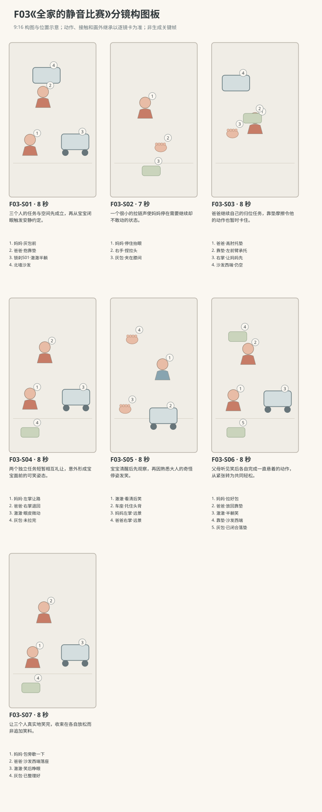

图示为构图位置示意；姿态、接触和画外继承以逐镜正文为准。

### 逐镜设计

#### F03-S01｜00—08 秒｜8 秒｜帧 [0, 192)

**镜头任务：**三个人的任务与空间先成立，再从宝宝闭眼触发安静约定。

**景别、机位与构图：**中全景，东侧朝西北，妈妈左下、爸爸左后靠沙发、婴儿车右中，完整车轮接地和三人目光可读。

**摄影机与理由：**固定，以同框交代每个人正在做自己的事。

**焦点：**三人均在可辨清晰范围，澈澈眼皮为视觉重心。

**入态：**澈澈半躺S01，眼睛将闭，妈妈右手扶灰包口，爸爸双手横抱靠垫准备转向沙发。

**动作与表演：**

- 3 秒：澈澈眼睛闭上，头仍落在布座支撑面；妈妈看见后停一下整理。

- 2 秒：妈妈抬左手，食指在自己唇前示意轻声，右手仍扶包；爸爸看见她点一点头。

- 3 秒：妈妈放下左手压平包角，爸爸放慢转身，两人分别继续原任务。

**声音：**衣料轻声、澈澈平稳呼吸，背景空气声；无对白无音乐。

**出态：**妈妈双手在灰包上，爸爸抱垫面向沙发一半，澈澈仍闭眼半躺。

**切点与承接：**由妈妈右手接近拉链切到包边，不跳过任务对象。

**连续性：**S01轮刹与承托画内建立；P05只露在包口，不再移出。

**开始画面母稿：**

9:16竖幅，原创三维生活动画，圆润而有重量的造型，棉布细纹、柔和皮肤层次与可读的小表情；动作按真实生活物理及婴儿当下能力展开，不用成人化算计表情。澈澈为圆脸、深棕眼、短黑绒发、额前一小撮向右弯的头发，穿奶油色棉连体衣。爸爸短黑发，砖陶色棉衬衫、深灰长裤；妈妈深棕低马尾，雾蓝棉上衣、米色长裤。本镜开始画面为单一瞬间：澈澈半躺S01，眼睛将闭，妈妈右手扶灰包口，爸爸双手横抱靠垫准备转向沙发。 场次方位与光位：L客厅北墙沙发、西窗、东走廊。锁刹S01车固定在地垫东南边朝西北，雾蓝布座、深灰框架，澈澈始终有头背臀支撑。妈妈活动区在西南、爸爸活动区在西北及沙发西端；摄影东侧朝西北，妈妈左下、爸爸左后、宝宝右，西窗光来自左后。灰包和靠垫的当前归属只依本镜起态。 摄影构图：中全景，东侧朝西北，妈妈左下、爸爸左后靠沙发、婴儿车右中，完整车轮接地和三人目光可读。 当前焦点：澈澈将闭的双眼及左右两个成人各自持物的手。只呈现上述起态，不把后续动作拼入一张画面。

**视频变化母稿：**

9:16竖幅，原创三维生活动画，圆润而有重量的造型，棉布细纹、柔和皮肤层次与可读的小表情；动作按真实生活物理及婴儿当下能力展开，不用成人化算计表情。澈澈为圆脸、深棕眼、短黑绒发、额前一小撮向右弯的头发，穿奶油色棉连体衣。爸爸短黑发，砖陶色棉衬衫、深灰长裤；妈妈深棕低马尾，雾蓝棉上衣、米色长裤。制作一段8秒连续镜头。本段人物和能力：澈澈、爸爸、妈妈，澈澈为R1。空间光位：L客厅北墙沙发、西窗、东走廊。锁刹S01车固定在地垫东南边朝西北，雾蓝布座、深灰框架，澈澈始终有头背臀支撑。妈妈活动区在西南、爸爸活动区在西北及沙发西端；摄影东侧朝西北，妈妈左下、爸爸左后、宝宝右，西窗光来自左后。灰包和靠垫的当前归属只依本镜起态。 起态：澈澈半躺S01，眼睛将闭，妈妈右手扶灰包口，爸爸双手横抱靠垫准备转向沙发。 摄影：中全景，东侧朝西北，妈妈左下、爸爸左后靠沙发、婴儿车右中，完整车轮接地和三人目光可读。 相机行为：固定，以同框交代每个人正在做自己的事。 焦点：三人均在可辨清晰范围，澈澈眼皮为视觉重心。 时间过程：第1阶段3秒：澈澈眼睛闭上，头仍落在布座支撑面；妈妈看见后停一下整理。；第2阶段2秒：妈妈抬左手，食指在自己唇前示意轻声，右手仍扶包；爸爸看见她点一点头。；第3阶段3秒：妈妈放下左手压平包角，爸爸放慢转身，两人分别继续原任务。。声音：衣料轻声、澈澈平稳呼吸，背景空气声；无对白无音乐。 终态：妈妈双手在灰包上，爸爸抱垫面向沙发一半，澈澈仍闭眼半躺。 连续性：S01轮刹与承托画内建立；P05只露在包口，不再移出。 不加未写出的对白、人物或道具。

#### F03-S02｜08—15 秒｜7 秒｜帧 [192, 360)

**镜头任务：**一个很小的拉链声使妈妈停在需要继续却不敢动的状态。

**景别、机位与构图：**妈妈半身中近景，东侧同向，包在下半画面、脸在左上，右后可见婴儿车局部不见全脸。

**摄影机与理由：**固定，拉链声发生时不震镜，避免把小声拍成惊吓。

**焦点：**右手拉头与包口；妈妈抬眼时轻移到眼睛。

**入态：**妈妈左手压灰包角，右指捏拉头，P05已在包内，拉链尚开大半。

**动作与表演：**

- 3 秒：妈妈慢慢拉过一小段，拉链发出一声短擦响；她当即停住。

- 2 秒：她把灰包轻夹在双膝之间，不让包侧晃，右手仍捏拉头。

- 2 秒：妈妈抬眼看澈澈，再看爸爸，左掌从包角抬起准备示意。

**声音：**第2—3秒一段短拉链擦声，随后立即留白；妈妈轻呼吸，无对白。

**出态：**妈妈右手悬在半拉的拉链上、包夹膝间，左掌半抬，目光投向爸爸。

**切点与承接：**跟她看爸爸的视线切过去，保持空间中的同侧方向。

**连续性：**妈妈右指不松拉头；画外澈澈仍闭眼、爸爸靠垫尚在双手，S01无位移。

**开始画面母稿：**

9:16竖幅，原创三维生活动画，圆润而有重量的造型，棉布细纹、柔和皮肤层次与可读的小表情；动作按真实生活物理及婴儿当下能力展开，不用成人化算计表情。澈澈为圆脸、深棕眼、短黑绒发、额前一小撮向右弯的头发，穿奶油色棉连体衣。爸爸短黑发，砖陶色棉衬衫、深灰长裤；妈妈深棕低马尾，雾蓝棉上衣、米色长裤。本镜开始画面为单一瞬间：妈妈左手压灰包角，右指捏拉头，P05已在包内，拉链尚开大半。 场次方位与光位：L客厅北墙沙发、西窗、东走廊。锁刹S01车固定在地垫东南边朝西北，雾蓝布座、深灰框架，澈澈始终有头背臀支撑。妈妈活动区在西南、爸爸活动区在西北及沙发西端；摄影东侧朝西北，妈妈左下、爸爸左后、宝宝右，西窗光来自左后。灰包和靠垫的当前归属只依本镜起态。 摄影构图：妈妈半身中近景，东侧同向，包在下半画面、脸在左上，右后可见婴儿车局部不见全脸。 当前焦点：妈妈右指捏住灰包拉头的接触处、左手压包角。只呈现上述起态，不把后续动作拼入一张画面。

**视频变化母稿：**

9:16竖幅，原创三维生活动画，圆润而有重量的造型，棉布细纹、柔和皮肤层次与可读的小表情；动作按真实生活物理及婴儿当下能力展开，不用成人化算计表情。澈澈为圆脸、深棕眼、短黑绒发、额前一小撮向右弯的头发，穿奶油色棉连体衣。爸爸短黑发，砖陶色棉衬衫、深灰长裤；妈妈深棕低马尾，雾蓝棉上衣、米色长裤。制作一段7秒连续镜头。本段人物和能力：澈澈、爸爸、妈妈，澈澈为R1。空间光位：L客厅北墙沙发、西窗、东走廊。锁刹S01车固定在地垫东南边朝西北，雾蓝布座、深灰框架，澈澈始终有头背臀支撑。妈妈活动区在西南、爸爸活动区在西北及沙发西端；摄影东侧朝西北，妈妈左下、爸爸左后、宝宝右，西窗光来自左后。灰包和靠垫的当前归属只依本镜起态。 起态：妈妈左手压灰包角，右指捏拉头，P05已在包内，拉链尚开大半。 摄影：妈妈半身中近景，东侧同向，包在下半画面、脸在左上，右后可见婴儿车局部不见全脸。 相机行为：固定，拉链声发生时不震镜，避免把小声拍成惊吓。 焦点：右手拉头与包口；妈妈抬眼时轻移到眼睛。 时间过程：第1阶段3秒：妈妈慢慢拉过一小段，拉链发出一声短擦响；她当即停住。；第2阶段2秒：她把灰包轻夹在双膝之间，不让包侧晃，右手仍捏拉头。；第3阶段2秒：妈妈抬眼看澈澈，再看爸爸，左掌从包角抬起准备示意。。声音：第2—3秒一段短拉链擦声，随后立即留白；妈妈轻呼吸，无对白。 终态：妈妈右手悬在半拉的拉链上、包夹膝间，左掌半抬，目光投向爸爸。 连续性：妈妈右指不松拉头；画外澈澈仍闭眼、爸爸靠垫尚在双手，S01无位移。 不加未写出的对白、人物或道具。

#### F03-S03｜15—23 秒｜8 秒｜帧 [360, 552)

**镜头任务：**爸爸继续自己的归位任务，靠垫摩擦令他的动作也暂时卡住。

**景别、机位与构图：**爸爸中景，东侧同向朝西北，爸爸居中央偏左，靠垫在胸侧，沙发西端在左后，妈妈抬起的左掌在左下前景边。

**摄影机与理由：**固定，爸爸只在机位内挪半步，不随他绕到反侧。

**焦点：**爸爸左前臂托垫接触与眼神，沙发接收位置可辨。

**入态：**爸爸双手抱垫半转向北沙发，已看见妈妈左掌；双脚稳站地垫西北侧。

**动作与表演：**

- 3 秒：爸爸轻挪半步靠近沙发，左前臂托垫、右手调整垫角；棉布擦过衬衫。

- 2 秒：听见摩擦声，他把靠垫稍抬离衣服，左肘抬到肩边，身体略向一侧歪但双脚踩稳。

- 3 秒：爸爸转眼看妈妈，右手从垫角松出，摊掌示意她先把包弄好，左前臂继续独自托垫。

**声音：**一次低而短的棉布摩擦；袜底挪地声，爸爸轻鼻息，无对白。

**出态：**爸爸左前臂托靠垫、左肘偏高，右掌向妈妈摊开，沙发尚未放垫。

**切点与承接：**在摊掌手势到位时切回三人空间，交代妈妈也在让他先动。

**连续性：**靠垫重量持续落在左前臂，右手可离开；双脚不悬起，妈妈握拉链在画外继承。

**开始画面母稿：**

9:16竖幅，原创三维生活动画，圆润而有重量的造型，棉布细纹、柔和皮肤层次与可读的小表情；动作按真实生活物理及婴儿当下能力展开，不用成人化算计表情。澈澈为圆脸、深棕眼、短黑绒发、额前一小撮向右弯的头发，穿奶油色棉连体衣。爸爸短黑发，砖陶色棉衬衫、深灰长裤；妈妈深棕低马尾，雾蓝棉上衣、米色长裤。本镜开始画面为单一瞬间：爸爸双手抱垫半转向北沙发，已看见妈妈左掌；双脚稳站地垫西北侧。 场次方位与光位：L客厅北墙沙发、西窗、东走廊。锁刹S01车固定在地垫东南边朝西北，雾蓝布座、深灰框架，澈澈始终有头背臀支撑。妈妈活动区在西南、爸爸活动区在西北及沙发西端；摄影东侧朝西北，妈妈左下、爸爸左后、宝宝右，西窗光来自左后。灰包和靠垫的当前归属只依本镜起态。 摄影构图：爸爸中景，东侧同向朝西北，爸爸居中央偏左，靠垫在胸侧，沙发西端在左后，妈妈抬起的左掌在左下前景边。 当前焦点：爸爸双手抱靠垫的接触、与妈妈掌势相接的眼神。只呈现上述起态，不把后续动作拼入一张画面。

**视频变化母稿：**

9:16竖幅，原创三维生活动画，圆润而有重量的造型，棉布细纹、柔和皮肤层次与可读的小表情；动作按真实生活物理及婴儿当下能力展开，不用成人化算计表情。澈澈为圆脸、深棕眼、短黑绒发、额前一小撮向右弯的头发，穿奶油色棉连体衣。爸爸短黑发，砖陶色棉衬衫、深灰长裤；妈妈深棕低马尾，雾蓝棉上衣、米色长裤。制作一段8秒连续镜头。本段人物和能力：澈澈、爸爸、妈妈，澈澈为R1。空间光位：L客厅北墙沙发、西窗、东走廊。锁刹S01车固定在地垫东南边朝西北，雾蓝布座、深灰框架，澈澈始终有头背臀支撑。妈妈活动区在西南、爸爸活动区在西北及沙发西端；摄影东侧朝西北，妈妈左下、爸爸左后、宝宝右，西窗光来自左后。灰包和靠垫的当前归属只依本镜起态。 起态：爸爸双手抱垫半转向北沙发，已看见妈妈左掌；双脚稳站地垫西北侧。 摄影：爸爸中景，东侧同向朝西北，爸爸居中央偏左，靠垫在胸侧，沙发西端在左后，妈妈抬起的左掌在左下前景边。 相机行为：固定，爸爸只在机位内挪半步，不随他绕到反侧。 焦点：爸爸左前臂托垫接触与眼神，沙发接收位置可辨。 时间过程：第1阶段3秒：爸爸轻挪半步靠近沙发，左前臂托垫、右手调整垫角；棉布擦过衬衫。；第2阶段2秒：听见摩擦声，他把靠垫稍抬离衣服，左肘抬到肩边，身体略向一侧歪但双脚踩稳。；第3阶段3秒：爸爸转眼看妈妈，右手从垫角松出，摊掌示意她先把包弄好，左前臂继续独自托垫。。声音：一次低而短的棉布摩擦；袜底挪地声，爸爸轻鼻息，无对白。 终态：爸爸左前臂托靠垫、左肘偏高，右掌向妈妈摊开，沙发尚未放垫。 连续性：靠垫重量持续落在左前臂，右手可离开；双脚不悬起，妈妈握拉链在画外继承。 不加未写出的对白、人物或道具。

#### F03-S04｜23—31 秒｜8 秒｜帧 [552, 744)

**镜头任务：**两个独立任务短暂相互礼让，意外形成宝宝面前的可笑姿态。

**景别、机位与构图：**三人中全景，与S01同轴，妈妈左下、爸爸左后、澈澈右中，父母空闲手的往返与身体姿态都不被遮挡。

**摄影机与理由：**固定；让一个手势被对方看见、再被退回，节奏来自人而非镜头。

**焦点：**父母手掌和脸在共同清晰区；澈澈车座保留可辨轮廓。

**入态：**妈妈右手捏拉头、左掌半抬；爸爸左臂托靠垫、右掌摊向妈妈；澈澈闭眼。

**动作与表演：**

- 3 秒：妈妈摇一下头，左掌朝沙发轻摆，示意爸爸先放好，右手和夹包膝盖没动。

- 3 秒：爸爸看她的手再看沙发，右掌又轻摆回来，左肘为托稳靠垫保持抬高；两人都停着。

- 2 秒：妈妈的左掌与爸爸右掌同时定在半空，两人抿住即将出来的笑；澈澈眼皮开始轻动。

**声音：**轻微袖布声后只留呼吸与环境底声，无对白；不加滑稽配乐。

**出态：**父母保持各自不对称的半动作，澈澈眼皮已松开一条缝。

**切点与承接：**切澈澈近景，接住从闭眼到看清面前人的过程。

**连续性：**妈妈右手、爸爸左前臂仍被各自任务占用；P05在包、车位、靠垫位置均不变。

**开始画面母稿：**

9:16竖幅，原创三维生活动画，圆润而有重量的造型，棉布细纹、柔和皮肤层次与可读的小表情；动作按真实生活物理及婴儿当下能力展开，不用成人化算计表情。澈澈为圆脸、深棕眼、短黑绒发、额前一小撮向右弯的头发，穿奶油色棉连体衣。爸爸短黑发，砖陶色棉衬衫、深灰长裤；妈妈深棕低马尾，雾蓝棉上衣、米色长裤。本镜开始画面为单一瞬间：妈妈右手捏拉头、左掌半抬；爸爸左臂托靠垫、右掌摊向妈妈；澈澈闭眼。 场次方位与光位：L客厅北墙沙发、西窗、东走廊。锁刹S01车固定在地垫东南边朝西北，雾蓝布座、深灰框架，澈澈始终有头背臀支撑。妈妈活动区在西南、爸爸活动区在西北及沙发西端；摄影东侧朝西北，妈妈左下、爸爸左后、宝宝右，西窗光来自左后。灰包和靠垫的当前归属只依本镜起态。 摄影构图：三人中全景，与S01同轴，妈妈左下、爸爸左后、澈澈右中，父母空闲手的往返与身体姿态都不被遮挡。 当前焦点：父母两只空闲手的停姿、各自仍被物件占用的另一只手。只呈现上述起态，不把后续动作拼入一张画面。

**视频变化母稿：**

9:16竖幅，原创三维生活动画，圆润而有重量的造型，棉布细纹、柔和皮肤层次与可读的小表情；动作按真实生活物理及婴儿当下能力展开，不用成人化算计表情。澈澈为圆脸、深棕眼、短黑绒发、额前一小撮向右弯的头发，穿奶油色棉连体衣。爸爸短黑发，砖陶色棉衬衫、深灰长裤；妈妈深棕低马尾，雾蓝棉上衣、米色长裤。制作一段8秒连续镜头。本段人物和能力：澈澈、爸爸、妈妈，澈澈为R1。空间光位：L客厅北墙沙发、西窗、东走廊。锁刹S01车固定在地垫东南边朝西北，雾蓝布座、深灰框架，澈澈始终有头背臀支撑。妈妈活动区在西南、爸爸活动区在西北及沙发西端；摄影东侧朝西北，妈妈左下、爸爸左后、宝宝右，西窗光来自左后。灰包和靠垫的当前归属只依本镜起态。 起态：妈妈右手捏拉头、左掌半抬；爸爸左臂托靠垫、右掌摊向妈妈；澈澈闭眼。 摄影：三人中全景，与S01同轴，妈妈左下、爸爸左后、澈澈右中，父母空闲手的往返与身体姿态都不被遮挡。 相机行为：固定；让一个手势被对方看见、再被退回，节奏来自人而非镜头。 焦点：父母手掌和脸在共同清晰区；澈澈车座保留可辨轮廓。 时间过程：第1阶段3秒：妈妈摇一下头，左掌朝沙发轻摆，示意爸爸先放好，右手和夹包膝盖没动。；第2阶段3秒：爸爸看她的手再看沙发，右掌又轻摆回来，左肘为托稳靠垫保持抬高；两人都停着。；第3阶段2秒：妈妈的左掌与爸爸右掌同时定在半空，两人抿住即将出来的笑；澈澈眼皮开始轻动。。声音：轻微袖布声后只留呼吸与环境底声，无对白；不加滑稽配乐。 终态：父母保持各自不对称的半动作，澈澈眼皮已松开一条缝。 连续性：妈妈右手、爸爸左前臂仍被各自任务占用；P05在包、车位、靠垫位置均不变。 不加未写出的对白、人物或道具。

#### F03-S05｜31—39 秒｜8 秒｜帧 [744, 936)

**镜头任务：**宝宝清醒后先观察，再因熟悉大人的奇怪停姿发笑。

**景别、机位与构图：**澈澈面部近景，东侧朝西北，车座弧线在左右下缘，画左远景保留父母高低两只手的虚影。

**摄影机与理由：**固定；把睁眼到笑的呼吸时间留完整。

**焦点：**澈澈双眼，脸颊和嘴角同平面；背景手势只作视线依据。

**入态：**澈澈头枕在支撑面，眼睛刚开一缝，车座和身体位置未变，父母仍保持半动作。

**动作与表演：**

- 3 秒：澈澈慢慢睁眼，先把视线放到左下妈妈的张掌，呼吸仍平稳。

- 2 秒：目光抬向左上爸爸的高肘与靠垫，嘴角先微微抬起。

- 3 秒：澈澈发出一声短笑，再连着笑两声，双肩轻动但背臀仍贴座面。

**声音：**先三秒安静呼吸，随后一声短笑及两声自然笑；父母此镜无笑声无对白。

**出态：**澈澈睁眼笑着看父母，双肩已回落座面，仍半躺。

**切点与承接：**第一串笑尾衔接父母一起转头的宽镜。

**连续性：**不可让宝宝突然直坐；父母手势与靠垫位置画外继承，不更换成其他鬼脸。

**开始画面母稿：**

9:16竖幅，原创三维生活动画，圆润而有重量的造型，棉布细纹、柔和皮肤层次与可读的小表情；动作按真实生活物理及婴儿当下能力展开，不用成人化算计表情。澈澈为圆脸、深棕眼、短黑绒发、额前一小撮向右弯的头发，穿奶油色棉连体衣。爸爸短黑发，砖陶色棉衬衫、深灰长裤；妈妈深棕低马尾，雾蓝棉上衣、米色长裤。本镜开始画面为单一瞬间：澈澈头枕在支撑面，眼睛刚开一缝，车座和身体位置未变，父母仍保持半动作。 场次方位与光位：L客厅北墙沙发、西窗、东走廊。锁刹S01车固定在地垫东南边朝西北，雾蓝布座、深灰框架，澈澈始终有头背臀支撑。妈妈活动区在西南、爸爸活动区在西北及沙发西端；摄影东侧朝西北，妈妈左下、爸爸左后、宝宝右，西窗光来自左后。灰包和靠垫的当前归属只依本镜起态。 摄影构图：澈澈面部近景，东侧朝西北，车座弧线在左右下缘，画左远景保留父母高低两只手的虚影。 当前焦点：澈澈半开的眼皮与车座头背支撑。只呈现上述起态，不把后续动作拼入一张画面。

**视频变化母稿：**

9:16竖幅，原创三维生活动画，圆润而有重量的造型，棉布细纹、柔和皮肤层次与可读的小表情；动作按真实生活物理及婴儿当下能力展开，不用成人化算计表情。澈澈为圆脸、深棕眼、短黑绒发、额前一小撮向右弯的头发，穿奶油色棉连体衣。爸爸短黑发，砖陶色棉衬衫、深灰长裤；妈妈深棕低马尾，雾蓝棉上衣、米色长裤。制作一段8秒连续镜头。本段人物和能力：澈澈、爸爸、妈妈，澈澈为R1。空间光位：L客厅北墙沙发、西窗、东走廊。锁刹S01车固定在地垫东南边朝西北，雾蓝布座、深灰框架，澈澈始终有头背臀支撑。妈妈活动区在西南、爸爸活动区在西北及沙发西端；摄影东侧朝西北，妈妈左下、爸爸左后、宝宝右，西窗光来自左后。灰包和靠垫的当前归属只依本镜起态。 起态：澈澈头枕在支撑面，眼睛刚开一缝，车座和身体位置未变，父母仍保持半动作。 摄影：澈澈面部近景，东侧朝西北，车座弧线在左右下缘，画左远景保留父母高低两只手的虚影。 相机行为：固定；把睁眼到笑的呼吸时间留完整。 焦点：澈澈双眼，脸颊和嘴角同平面；背景手势只作视线依据。 时间过程：第1阶段3秒：澈澈慢慢睁眼，先把视线放到左下妈妈的张掌，呼吸仍平稳。；第2阶段2秒：目光抬向左上爸爸的高肘与靠垫，嘴角先微微抬起。；第3阶段3秒：澈澈发出一声短笑，再连着笑两声，双肩轻动但背臀仍贴座面。。声音：先三秒安静呼吸，随后一声短笑及两声自然笑；父母此镜无笑声无对白。 终态：澈澈睁眼笑着看父母，双肩已回落座面，仍半躺。 连续性：不可让宝宝突然直坐；父母手势与靠垫位置画外继承，不更换成其他鬼脸。 不加未写出的对白、人物或道具。

#### F03-S06｜39—47 秒｜8 秒｜帧 [936, 1128)

**镜头任务：**父母听见笑后各自完成一直悬着的动作，从紧张转为共同轻松。

**景别、机位与构图：**三人中全景，东侧同机位，妈妈左下、爸爸左后、澈澈右中，沙发靠垫落点和灰包落点均在框。

**摄影机与理由：**固定，不能用切镜掩盖两个道具归位。

**焦点：**澈澈笑脸与父母转头同清晰；归位动作保持可读。

**入态：**澈澈正在笑，妈妈右手捏拉头左掌抬着，爸爸左臂托垫右掌抬着。

**动作与表演：**

- 2 秒：父母先后转头看澈澈，嘴角从绷住变成笑，手势都松下来。

- 3 秒：爸爸右手重新扶垫角、两手把靠垫放回北沙发西端，双脚不再挪；妈妈双膝放松，让灰包落回垫上。

- 3 秒：妈妈左手稳包、右手把拉链正常拉到底；爸爸双手落到身旁，看宝宝短笑。

**声音：**澈澈笑声持续后渐短，爸爸一声轻笑、妈妈轻笑接入；垫落沙发软扑、拉链完整短响，无对白。

**出态：**靠垫在沙发西端，灰包已闭合在垫上，父母双手都从冻结姿态解放。

**切点与承接：**在任务完成后留笑声，切稍近的共同休息状态。

**连续性：**两件道具的落点画内可见；宝宝始终S01，车轮不滚；三人的笑声不同步排队但不抢第一声。

**开始画面母稿：**

9:16竖幅，原创三维生活动画，圆润而有重量的造型，棉布细纹、柔和皮肤层次与可读的小表情；动作按真实生活物理及婴儿当下能力展开，不用成人化算计表情。澈澈为圆脸、深棕眼、短黑绒发、额前一小撮向右弯的头发，穿奶油色棉连体衣。爸爸短黑发，砖陶色棉衬衫、深灰长裤；妈妈深棕低马尾，雾蓝棉上衣、米色长裤。本镜开始画面为单一瞬间：澈澈正在笑，妈妈右手捏拉头左掌抬着，爸爸左臂托垫右掌抬着。 场次方位与光位：L客厅北墙沙发、西窗、东走廊。锁刹S01车固定在地垫东南边朝西北，雾蓝布座、深灰框架，澈澈始终有头背臀支撑。妈妈活动区在西南、爸爸活动区在西北及沙发西端；摄影东侧朝西北，妈妈左下、爸爸左后、宝宝右，西窗光来自左后。灰包和靠垫的当前归属只依本镜起态。 摄影构图：三人中全景，东侧同机位，妈妈左下、爸爸左后、澈澈右中，沙发靠垫落点和灰包落点均在框。 当前焦点：澈澈笑脸与父母尚未解开的持物姿态。只呈现上述起态，不把后续动作拼入一张画面。

**视频变化母稿：**

9:16竖幅，原创三维生活动画，圆润而有重量的造型，棉布细纹、柔和皮肤层次与可读的小表情；动作按真实生活物理及婴儿当下能力展开，不用成人化算计表情。澈澈为圆脸、深棕眼、短黑绒发、额前一小撮向右弯的头发，穿奶油色棉连体衣。爸爸短黑发，砖陶色棉衬衫、深灰长裤；妈妈深棕低马尾，雾蓝棉上衣、米色长裤。制作一段8秒连续镜头。本段人物和能力：澈澈、爸爸、妈妈，澈澈为R1。空间光位：L客厅北墙沙发、西窗、东走廊。锁刹S01车固定在地垫东南边朝西北，雾蓝布座、深灰框架，澈澈始终有头背臀支撑。妈妈活动区在西南、爸爸活动区在西北及沙发西端；摄影东侧朝西北，妈妈左下、爸爸左后、宝宝右，西窗光来自左后。灰包和靠垫的当前归属只依本镜起态。 起态：澈澈正在笑，妈妈右手捏拉头左掌抬着，爸爸左臂托垫右掌抬着。 摄影：三人中全景，东侧同机位，妈妈左下、爸爸左后、澈澈右中，沙发靠垫落点和灰包落点均在框。 相机行为：固定，不能用切镜掩盖两个道具归位。 焦点：澈澈笑脸与父母转头同清晰；归位动作保持可读。 时间过程：第1阶段2秒：父母先后转头看澈澈，嘴角从绷住变成笑，手势都松下来。；第2阶段3秒：爸爸右手重新扶垫角、两手把靠垫放回北沙发西端，双脚不再挪；妈妈双膝放松，让灰包落回垫上。；第3阶段3秒：妈妈左手稳包、右手把拉链正常拉到底；爸爸双手落到身旁，看宝宝短笑。。声音：澈澈笑声持续后渐短，爸爸一声轻笑、妈妈轻笑接入；垫落沙发软扑、拉链完整短响，无对白。 终态：靠垫在沙发西端，灰包已闭合在垫上，父母双手都从冻结姿态解放。 连续性：两件道具的落点画内可见；宝宝始终S01，车轮不滚；三人的笑声不同步排队但不抢第一声。 不加未写出的对白、人物或道具。

#### F03-S07｜47—55 秒｜8 秒｜帧 [1128, 1320)

**镜头任务：**让三个人真实地笑完，收束在各自放松而非追加笑料。

**景别、机位与构图：**三人中景，东侧略收近，妈妈画左前跪坐灰包旁，爸爸画左后站在沙发前，澈澈画右前在车内，三张脸均有独立空间；画左后保留爸爸由站立到落座的取景余量。

**摄影机与理由：**爸爸开始坐下时轻缓后移一点，给他的落座留空间，随后停稳。

**焦点：**三张脸在共同清晰范围，前后景不做夸张虚实切换。

**入态：**妈妈跪坐灰包旁，爸爸站在已放好靠垫的沙发前，澈澈半躺笑，父母都已松开手势。

**动作与表演：**

- 3 秒：爸爸顺势坐到沙发西端空座，双手落膝；妈妈把包带放平，抬眼再看爸爸。

- 3 秒：父母因刚才彼此让路的姿势又短笑，澈澈看看妈妈再看爸爸，跟着笑一小声。

- 2 秒：三人笑声慢下来，妈妈手扶灰包、爸爸靠回垫，澈澈安静睁眼看着他们。

**声音：**座垫受压轻声、三人渐缓的笑与呼吸，环境声回到可听；无对白无音乐。

**出态：**爸爸坐沙发西端、妈妈坐垫西南、澈澈在锁刹车内睁眼，灰包与靠垫各已归位。

**切点与承接：**在澈澈最后一次看回妈妈后结束，保留小笑余韵。

**连续性：**爸爸坐空座不坐靠垫边沿造成弹起；妈妈包未重开；宝宝全片姿态与朝向不变。

**开始画面母稿：**

9:16竖幅，原创三维生活动画，圆润而有重量的造型，棉布细纹、柔和皮肤层次与可读的小表情；动作按真实生活物理及婴儿当下能力展开，不用成人化算计表情。澈澈为圆脸、深棕眼、短黑绒发、额前一小撮向右弯的头发，穿奶油色棉连体衣。爸爸短黑发，砖陶色棉衬衫、深灰长裤；妈妈深棕低马尾，雾蓝棉上衣、米色长裤。本镜开始画面为单一瞬间：妈妈跪坐灰包旁，爸爸站在已放好靠垫的沙发前，澈澈半躺笑，父母都已松开手势。 场次方位与光位：L客厅北墙沙发、西窗、东走廊。锁刹S01车固定在地垫东南边朝西北，雾蓝布座、深灰框架，澈澈始终有头背臀支撑。妈妈活动区在西南、爸爸活动区在西北及沙发西端；摄影东侧朝西北，妈妈左下、爸爸左后、宝宝右，西窗光来自左后。灰包和靠垫的当前归属只依本镜起态。 摄影构图：三人中景，东侧略收近，妈妈画左前跪坐灰包旁，爸爸画左后站在沙发前，澈澈画右前在车内，三张脸均有独立空间；画左后保留爸爸由站立到落座的取景余量。 当前焦点：爸爸尚站在沙发前、妈妈包旁跪坐与宝宝笑脸。只呈现上述起态，不把后续动作拼入一张画面。

**视频变化母稿：**

9:16竖幅，原创三维生活动画，圆润而有重量的造型，棉布细纹、柔和皮肤层次与可读的小表情；动作按真实生活物理及婴儿当下能力展开，不用成人化算计表情。澈澈为圆脸、深棕眼、短黑绒发、额前一小撮向右弯的头发，穿奶油色棉连体衣。爸爸短黑发，砖陶色棉衬衫、深灰长裤；妈妈深棕低马尾，雾蓝棉上衣、米色长裤。制作一段8秒连续镜头。本段人物和能力：澈澈、爸爸、妈妈，澈澈为R1。空间光位：L客厅北墙沙发、西窗、东走廊。锁刹S01车固定在地垫东南边朝西北，雾蓝布座、深灰框架，澈澈始终有头背臀支撑。妈妈活动区在西南、爸爸活动区在西北及沙发西端；摄影东侧朝西北，妈妈左下、爸爸左后、宝宝右，西窗光来自左后。灰包和靠垫的当前归属只依本镜起态。 起态：妈妈跪坐灰包旁，爸爸站在已放好靠垫的沙发前，澈澈半躺笑，父母都已松开手势。 摄影：三人中景，东侧略收近，妈妈画左前跪坐灰包旁，爸爸画左后站在沙发前，澈澈画右前在车内，三张脸均有独立空间；画左后保留爸爸由站立到落座的取景余量。 相机行为：爸爸开始坐下时轻缓后移一点，给他的落座留空间，随后停稳。 焦点：三张脸在共同清晰范围，前后景不做夸张虚实切换。 时间过程：第1阶段3秒：爸爸顺势坐到沙发西端空座，双手落膝；妈妈把包带放平，抬眼再看爸爸。；第2阶段3秒：父母因刚才彼此让路的姿势又短笑，澈澈看看妈妈再看爸爸，跟着笑一小声。；第3阶段2秒：三人笑声慢下来，妈妈手扶灰包、爸爸靠回垫，澈澈安静睁眼看着他们。。声音：座垫受压轻声、三人渐缓的笑与呼吸，环境声回到可听；无对白无音乐。 终态：爸爸坐沙发西端、妈妈坐垫西南、澈澈在锁刹车内睁眼，灰包与靠垫各已归位。 连续性：爸爸坐空座不坐靠垫边沿造成弹起；妈妈包未重开；宝宝全片姿态与朝向不变。 不加未写出的对白、人物或道具。

### 声音与剪辑

无对白、无配乐。先有低环境声与缓慢呼吸；拉链擦响、棉靠垫摩擦应小而清楚，不做惊吓音效。澈澈第一声短笑打破静音，父母之后各自短笑，结尾拉链正常完成。

正式台词：无；保留镜头声音中已写明的自然发声。

### 连续性与试片

- 连续性：S01始终锁刹停在垫东南边朝西北，澈澈背、臀、腿在车座内承托，不滑座或悬空。

- 连续性：妈妈在西南、爸爸在西北，摄影在东侧；每个人视线与被看的具体人吻合。

- 连续性：P05已入灰包；妈妈右手捏拉链、左手打手势，爸爸左前臂托靠垫、右手打手势。

- 连续性：爸爸靠垫只能最终回到北墙沙发西端；妈妈包从膝间回地垫，不能切后换入爸爸手中。

- 试片：F03-S02—S04静音试看：须能分清妈妈装包、爸爸放靠垫两个任务；若两人只是同步摆怪姿势则失败。

- 试片：F03-S04—S05试剪：澈澈睁眼后有观察手掌与高肘的时间，再出现笑；若睡态直接跳到大笑则失败。

- 试片：F03-S06—S07：靠垫落沙发、灰包落垫与车架稳定须逐项连续；若宝宝随父母笑突然弹起离座则失败。

**媒体待验证：**未生成媒体；待验双成人不抢拍的手势时序、婴儿半躺头颈支撑、车架遮挡和安静场景下的低强度拟音。

---

## F04《全家福往哪看》

**45 秒｜坐姿与手部互动｜角色：澈澈、爸爸、妈妈｜场景 L**

### 剧情正文

客厅北墙沙发前，妈妈坐在澈澈左边，爸爸从另一边挪近，整理了一下自己的衣领，准备拍全家福。妈妈把手机举到前方，先看屏幕里的三张脸，再露出一个等拍照的笑。爸爸也抬眼看手机，澈澈却侧着头，一直望向西窗。妈妈按下快门，放低一点手机检查，随后看看澈澈，才发现他的目光根本不在镜头这里。爸爸轻轻挥一下手，想把他的注意引到手机上。澈澈看了手一瞬，又看回窗边。薄帘被风托起一小截，亮光缓慢滑过帘褶，澈澈的眼睛跟着走。爸爸循着他的视线望过去，自己也停住了。妈妈原本还想再招呼一次，见两人都看得专注，便重新把手机举好，身体不动，只把脸也转向窗边。她凭手感按了一下侧键。快门响起，画面留下三张朝着同一边的侧脸；薄帘还在他们视线尽头轻轻动着。

### 导演与空间

**观察任务：**父母从争取同一个镜头目光，转向接受宝宝正在看的事，让一张侧脸照自然成为全家福。

**空间与光位：**L客厅北墙沙发、西窗、东走廊、中央地垫。三人挨坐在垫北半，妈妈西侧、澈澈中央、爸爸东侧，均朝南；妈妈右手伸向南偏西举F04-X01手机自拍，左手落自己膝上。西窗薄帘在西侧轻摆，是澈澈看向的目标。主摄影始终在南侧，父母与宝宝画面从左到右保持妈妈、澈澈、爸爸；手机视点同在南偏西，不跨到北侧。

**人物表演：**妈妈负责取景、按实体音量键快门和查看预览，不拽宝宝下巴。爸爸负责挪好坐姿、让出宝宝的脸并短暂吸引注意，随后自己也被窗帘光影吸引。澈澈能稳坐，双掌在膝边可撑垫，对薄帘移动感兴趣，视线向自身右侧即房间西边。

### 节拍覆盖

- **F04-b1**：建立三人坐序与妈妈拍照、爸爸准备入镜的独立行动。 前态：妈妈右手把手机拿在胸前，澈澈双掌在膝外撑垫，爸爸在东侧正坐下，衣领一侧略翘。 后态：手机在妈妈右手前伸位置，父母准备看镜头，澈澈已转头看西窗。 → F04-S01

- **F04-b2**：第一张照片里父母看镜头、宝宝看别处的差异清楚可见。 前态：妈妈右臂前伸持手机，爸爸看手机镜头，澈澈双掌撑垫、脸转向西窗。 后态：第一张已拍，妈妈手机从前伸位降到肩前，澈澈仍看西窗。 → F04-S02

- **F04-b3**：父母发现问题并短暂试图吸引注意，但不把宝宝当需要纠正的对象。 前态：妈妈右手手机已降至肩前，爸爸坐东侧、双手在膝，澈澈脸向西。 后态：爸爸右手停在胸前将落，妈妈右手持手机胸前，澈澈重新看西窗。 → F04-S03

- **F04-b4**：把宝宝的兴趣对象具体化，并让爸爸真正加入观察。 前态：薄帘自然垂在西窗内侧，澈澈画右侧脸向窗；爸爸头还在从手机方向转来。 后态：帘脚回落仍轻摆，爸爸与澈澈共同朝西看；爸爸右手已落回膝。 → F04-S04

- **F04-b5**：妈妈改变拍照目标，重新取景并自然加入同一目光。 前态：爸爸与澈澈朝西窗看，妈妈右手手机在胸前，左手在膝，正观察他们。 后态：妈妈手机在南偏西自拍位，三人同时朝房间西侧看，准备按键。 → F04-S05

- **F04-b6**：以三人自然同看一处的侧脸照兑现全家福，不要求宝宝看镜头。 前态：妈妈右臂前伸举手机，三人身体朝南、脸朝西窗，澈澈双掌撑垫。 后态：定格就是本镜手机前摄快门时实际记录的非镜像三人西向侧脸帧，人物、眼神、手位与该瞬间完全一致。 → F04-S06

### 分镜构图板

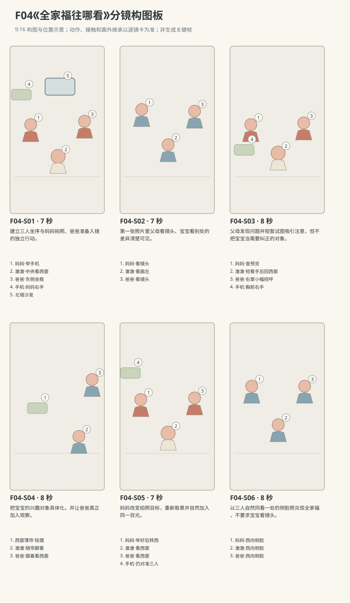

图示为构图位置示意；姿态、接触和画外继承以逐镜正文为准。

### 逐镜设计

#### F04-S01｜00—07 秒｜7 秒｜帧 [0, 168)

**镜头任务：**建立三人坐序与妈妈拍照、爸爸准备入镜的独立行动。

**景别、机位与构图：**中全景，南侧朝北，妈妈左、澈澈中、爸爸右，沙发后景；妈妈右手手机此刻位于胸前，画左前景留出右臂前伸的取景通道，薄帘只在画左边缘露出。

**摄影机与理由：**固定，给爸爸横向挪近保留空间，不裁掉宝宝坐姿。

**焦点：**三张脸与手机握持可辨，后景沙发稍柔。

**入态：**妈妈右手把手机拿在胸前，澈澈双掌在膝外撑垫，爸爸在东侧正坐下，衣领一侧略翘。

**动作与表演：**

- 3 秒：爸爸坐稳后拉平自己的衣领，向澈澈靠近一点又让开其脸前的空间。

- 4 秒：妈妈抬右臂把手机举到南偏西的自拍位，眼睛检查屏幕，左手留在膝上；澈澈看向画左窗帘。

**声音：**衣领、裤布与垫的摩擦声、远处空气声，无对白。

**出态：**手机在妈妈右手前伸位置，父母准备看镜头，澈澈已转头看西窗。

**切点与承接：**转到与手机同方向的正面三人镜，保留同一坐序。

**连续性：**手机一直妈妈右手，爸爸衣领已理平；澈澈双手不持物，坐骨稳定。

**开始画面母稿：**

9:16竖幅，原创三维生活动画，圆润而有重量的造型，棉布细纹、柔和皮肤层次与可读的小表情；动作按真实生活物理及婴儿当下能力展开，不用成人化算计表情。澈澈为圆脸、深棕眼、短黑绒发、额前一小撮向右弯的头发，穿奶油色棉连体衣。爸爸短黑发，砖陶色棉衬衫、深灰长裤；妈妈深棕低马尾，雾蓝棉上衣、米色长裤。本镜开始画面为单一瞬间：妈妈右手把手机拿在胸前，澈澈双掌在膝外撑垫，爸爸在东侧正坐下，衣领一侧略翘。 场次方位与光位：L客厅北墙沙发、西窗薄帘、东走廊、中央地垫。三人坐序从西到东为妈妈、澈澈、爸爸，身体朝南；手机始终只由妈妈右手操持。主摄影南侧、手机视点南偏西，均不跨北侧，妈妈画左、宝宝中央、爸爸右。西窗与轻摆薄帘固定在房间西侧，柔光来自画左；手机当前高度与人物头向以本镜起态为准。 摄影构图：中全景，南侧朝北，妈妈左、澈澈中、爸爸右，沙发后景；妈妈右手手机此刻位于胸前，画左前景留出右臂前伸的取景通道，薄帘只在画左边缘露出。 当前焦点：妈妈胸前右手手机、澈澈看窗的眼神与爸爸尚未理平的衣领。只呈现上述起态，不把后续动作拼入一张画面。

**视频变化母稿：**

9:16竖幅，原创三维生活动画，圆润而有重量的造型，棉布细纹、柔和皮肤层次与可读的小表情；动作按真实生活物理及婴儿当下能力展开，不用成人化算计表情。澈澈为圆脸、深棕眼、短黑绒发、额前一小撮向右弯的头发，穿奶油色棉连体衣。爸爸短黑发，砖陶色棉衬衫、深灰长裤；妈妈深棕低马尾，雾蓝棉上衣、米色长裤。制作一段7秒连续镜头。本段人物和能力：澈澈、爸爸、妈妈，澈澈为R1。空间光位：L客厅北墙沙发、西窗薄帘、东走廊、中央地垫。三人坐序从西到东为妈妈、澈澈、爸爸，身体朝南；手机始终只由妈妈右手操持。主摄影南侧、手机视点南偏西，均不跨北侧，妈妈画左、宝宝中央、爸爸右。西窗与轻摆薄帘固定在房间西侧，柔光来自画左；手机当前高度与人物头向以本镜起态为准。 起态：妈妈右手把手机拿在胸前，澈澈双掌在膝外撑垫，爸爸在东侧正坐下，衣领一侧略翘。 摄影：中全景，南侧朝北，妈妈左、澈澈中、爸爸右，沙发后景；妈妈右手手机此刻位于胸前，画左前景留出右臂前伸的取景通道，薄帘只在画左边缘露出。 相机行为：固定，给爸爸横向挪近保留空间，不裁掉宝宝坐姿。 焦点：三张脸与手机握持可辨，后景沙发稍柔。 时间过程：第1阶段3秒：爸爸坐稳后拉平自己的衣领，向澈澈靠近一点又让开其脸前的空间。；第2阶段4秒：妈妈抬右臂把手机举到南偏西的自拍位，眼睛检查屏幕，左手留在膝上；澈澈看向画左窗帘。。声音：衣领、裤布与垫的摩擦声、远处空气声，无对白。 终态：手机在妈妈右手前伸位置，父母准备看镜头，澈澈已转头看西窗。 连续性：手机一直妈妈右手，爸爸衣领已理平；澈澈双手不持物，坐骨稳定。 不加未写出的对白、人物或道具。

#### F04-S02｜07—14 秒｜7 秒｜帧 [168, 336)

**镜头任务：**第一张照片里父母看镜头、宝宝看别处的差异清楚可见。

**景别、机位与构图：**正面紧凑三人中景，南偏西朝东北，与手机前摄方向近似但保持主摄影非镜像坐序，三脸从左到右排列。

**摄影机与理由：**固定，让持自拍微小手臂稳定感来自人物，不做晃动特效。

**焦点：**三张脸共同清晰，澈澈侧向目光为差异中心。

**入态：**妈妈右臂前伸持手机，爸爸看手机镜头，澈澈双掌撑垫、脸转向西窗。

**动作与表演：**

- 3 秒：妈妈确认取景后也看镜头微笑，爸爸把头稍向中央靠近，澈澈只随窗帘轻抬眼。

- 2 秒：妈妈右指按手机侧键，短快门响起，澈澈不因快门立刻转头。

- 2 秒：妈妈笑容放松、开始降低手机，爸爸仍保持刚才的入镜坐姿。

**声音：**第4—5秒一次短快门，澈澈轻鼻息，衣料声；无对白。

**出态：**第一张已拍，妈妈手机从前伸位降到肩前，澈澈仍看西窗。

**切点与承接：**接妈妈降低手机查看结果的动作，不能切后手机突然换手。

**连续性：**第一快门时澈澈必须侧头；爸爸头靠近但不挡澈澈脸；手机在画外继承右手。

**开始画面母稿：**

9:16竖幅，原创三维生活动画，圆润而有重量的造型，棉布细纹、柔和皮肤层次与可读的小表情；动作按真实生活物理及婴儿当下能力展开，不用成人化算计表情。澈澈为圆脸、深棕眼、短黑绒发、额前一小撮向右弯的头发，穿奶油色棉连体衣。爸爸短黑发，砖陶色棉衬衫、深灰长裤；妈妈深棕低马尾，雾蓝棉上衣、米色长裤。本镜开始画面为单一瞬间：妈妈右臂前伸持手机，爸爸看手机镜头，澈澈双掌撑垫、脸转向西窗。 场次方位与光位：L客厅北墙沙发、西窗薄帘、东走廊、中央地垫。三人坐序从西到东为妈妈、澈澈、爸爸，身体朝南；手机始终只由妈妈右手操持。主摄影南侧、手机视点南偏西，均不跨北侧，妈妈画左、宝宝中央、爸爸右。西窗与轻摆薄帘固定在房间西侧，柔光来自画左；手机当前高度与人物头向以本镜起态为准。 摄影构图：正面紧凑三人中景，南偏西朝东北，与手机前摄方向近似但保持主摄影非镜像坐序，三脸从左到右排列。 当前焦点：三人当前面部：父母看镜头、澈澈看西窗。只呈现上述起态，不把后续动作拼入一张画面。

**视频变化母稿：**

9:16竖幅，原创三维生活动画，圆润而有重量的造型，棉布细纹、柔和皮肤层次与可读的小表情；动作按真实生活物理及婴儿当下能力展开，不用成人化算计表情。澈澈为圆脸、深棕眼、短黑绒发、额前一小撮向右弯的头发，穿奶油色棉连体衣。爸爸短黑发，砖陶色棉衬衫、深灰长裤；妈妈深棕低马尾，雾蓝棉上衣、米色长裤。制作一段7秒连续镜头。本段人物和能力：澈澈、爸爸、妈妈，澈澈为R1。空间光位：L客厅北墙沙发、西窗薄帘、东走廊、中央地垫。三人坐序从西到东为妈妈、澈澈、爸爸，身体朝南；手机始终只由妈妈右手操持。主摄影南侧、手机视点南偏西，均不跨北侧，妈妈画左、宝宝中央、爸爸右。西窗与轻摆薄帘固定在房间西侧，柔光来自画左；手机当前高度与人物头向以本镜起态为准。 起态：妈妈右臂前伸持手机，爸爸看手机镜头，澈澈双掌撑垫、脸转向西窗。 摄影：正面紧凑三人中景，南偏西朝东北，与手机前摄方向近似但保持主摄影非镜像坐序，三脸从左到右排列。 相机行为：固定，让持自拍微小手臂稳定感来自人物，不做晃动特效。 焦点：三张脸共同清晰，澈澈侧向目光为差异中心。 时间过程：第1阶段3秒：妈妈确认取景后也看镜头微笑，爸爸把头稍向中央靠近，澈澈只随窗帘轻抬眼。；第2阶段2秒：妈妈右指按手机侧键，短快门响起，澈澈不因快门立刻转头。；第3阶段2秒：妈妈笑容放松、开始降低手机，爸爸仍保持刚才的入镜坐姿。。声音：第4—5秒一次短快门，澈澈轻鼻息，衣料声；无对白。 终态：第一张已拍，妈妈手机从前伸位降到肩前，澈澈仍看西窗。 连续性：第一快门时澈澈必须侧头；爸爸头靠近但不挡澈澈脸；手机在画外继承右手。 不加未写出的对白、人物或道具。

#### F04-S03｜14—22 秒｜8 秒｜帧 [336, 528)

**镜头任务：**父母发现问题并短暂试图吸引注意，但不把宝宝当需要纠正的对象。

**景别、机位与构图：**中景，回南侧同机位，手机在妈妈肩前略偏左，爸爸双手此刻在膝上，画右至中央保留其右手朝手机方向抬到胸前的取景通道，宝宝居中。

**摄影机与理由：**固定，以二人的不同任务产生层次：妈妈查预览、爸爸尝试招呼。

**焦点：**先妈妈看屏幕的眼神，再落到宝宝对爸爸手的短暂追看；不要求读手机小字。

**入态：**妈妈右手手机已降至肩前，爸爸坐东侧、双手在膝，澈澈脸向西。

**动作与表演：**

- 3 秒：妈妈看一眼手机预览，再看澈澈的侧脸，笑着轻偏头确认他的注视方向。

- 3 秒：爸爸抬右掌在手机附近小幅挥一次，澈澈把眼睛移向这只手但头只稍回一点。

- 2 秒：爸爸手停下，澈澈重新转回西窗；妈妈没有继续招手。

**声音：**手臂衣袖短声、澈澈一声很轻的鼻音，无对白无音乐。

**出态：**爸爸右手停在胸前将落，妈妈右手持手机胸前，澈澈重新看西窗。

**切点与承接：**顺澈澈的西向视线切窗帘，交代他实际看见什么。

**连续性：**预览只需看出三人位置，不出现可读UI；爸爸右手未触宝宝，妈妈左手仍膝上。

**开始画面母稿：**

9:16竖幅，原创三维生活动画，圆润而有重量的造型，棉布细纹、柔和皮肤层次与可读的小表情；动作按真实生活物理及婴儿当下能力展开，不用成人化算计表情。澈澈为圆脸、深棕眼、短黑绒发、额前一小撮向右弯的头发，穿奶油色棉连体衣。爸爸短黑发，砖陶色棉衬衫、深灰长裤；妈妈深棕低马尾，雾蓝棉上衣、米色长裤。本镜开始画面为单一瞬间：妈妈右手手机已降至肩前，爸爸坐东侧、双手在膝，澈澈脸向西。 场次方位与光位：L客厅北墙沙发、西窗薄帘、东走廊、中央地垫。三人坐序从西到东为妈妈、澈澈、爸爸，身体朝南；手机始终只由妈妈右手操持。主摄影南侧、手机视点南偏西，均不跨北侧，妈妈画左、宝宝中央、爸爸右。西窗与轻摆薄帘固定在房间西侧，柔光来自画左；手机当前高度与人物头向以本镜起态为准。 摄影构图：中景，回南侧同机位，手机在妈妈肩前略偏左，爸爸双手此刻在膝上，画右至中央保留其右手朝手机方向抬到胸前的取景通道，宝宝居中。 当前焦点：妈妈肩前右手手机、宝宝西向侧脸、爸爸仍在膝上的右手。只呈现上述起态，不把后续动作拼入一张画面。

**视频变化母稿：**

9:16竖幅，原创三维生活动画，圆润而有重量的造型，棉布细纹、柔和皮肤层次与可读的小表情；动作按真实生活物理及婴儿当下能力展开，不用成人化算计表情。澈澈为圆脸、深棕眼、短黑绒发、额前一小撮向右弯的头发，穿奶油色棉连体衣。爸爸短黑发，砖陶色棉衬衫、深灰长裤；妈妈深棕低马尾，雾蓝棉上衣、米色长裤。制作一段8秒连续镜头。本段人物和能力：澈澈、爸爸、妈妈，澈澈为R1。空间光位：L客厅北墙沙发、西窗薄帘、东走廊、中央地垫。三人坐序从西到东为妈妈、澈澈、爸爸，身体朝南；手机始终只由妈妈右手操持。主摄影南侧、手机视点南偏西，均不跨北侧，妈妈画左、宝宝中央、爸爸右。西窗与轻摆薄帘固定在房间西侧，柔光来自画左；手机当前高度与人物头向以本镜起态为准。 起态：妈妈右手手机已降至肩前，爸爸坐东侧、双手在膝，澈澈脸向西。 摄影：中景，回南侧同机位，手机在妈妈肩前略偏左，爸爸双手此刻在膝上，画右至中央保留其右手朝手机方向抬到胸前的取景通道，宝宝居中。 相机行为：固定，以二人的不同任务产生层次：妈妈查预览、爸爸尝试招呼。 焦点：先妈妈看屏幕的眼神，再落到宝宝对爸爸手的短暂追看；不要求读手机小字。 时间过程：第1阶段3秒：妈妈看一眼手机预览，再看澈澈的侧脸，笑着轻偏头确认他的注视方向。；第2阶段3秒：爸爸抬右掌在手机附近小幅挥一次，澈澈把眼睛移向这只手但头只稍回一点。；第3阶段2秒：爸爸手停下，澈澈重新转回西窗；妈妈没有继续招手。。声音：手臂衣袖短声、澈澈一声很轻的鼻音，无对白无音乐。 终态：爸爸右手停在胸前将落，妈妈右手持手机胸前，澈澈重新看西窗。 连续性：预览只需看出三人位置，不出现可读UI；爸爸右手未触宝宝，妈妈左手仍膝上。 不加未写出的对白、人物或道具。

#### F04-S04｜22—30 秒｜8 秒｜帧 [528, 720)

**镜头任务：**把宝宝的兴趣对象具体化，并让爸爸真正加入观察。

**景别、机位与构图：**沿原南侧向西偏拍的中近景，薄帘在画左中、窗沿背景；画右保留澈澈右侧脸与爸爸向西转来的脸部边缘，不越到窗外。

**摄影机与理由：**缓慢向左摇小角度，由澈澈目光引出薄帘，停在帘褶与两张侧脸同框处。

**焦点：**前4秒薄帘移动及光影，后4秒转爸爸与澈澈的侧眼，窗帘仍可辨。

**入态：**薄帘自然垂在西窗内侧，澈澈画右侧脸向窗；爸爸头还在从手机方向转来。

**动作与表演：**

- 4 秒：轻风把帘脚托起一小截，亮光在褶面上滑动，澈澈眼睛跟着微微上移。

- 4 秒：爸爸循宝宝视线转向窗帘，看见帘脚又落回，自己也安静停住，不再挥手。

**声音：**薄帘轻擦窗边的声音、窗外远底声，爸爸短鼻息，无对白。

**出态：**帘脚回落仍轻摆，爸爸与澈澈共同朝西看；爸爸右手已落回膝。

**切点与承接：**切回三人构图，观察妈妈接收到他们共同注视的反应。

**连续性：**窗始终在西侧；妈妈手机在画外右手胸前、左手在膝，未拍第二张。

**开始画面母稿：**

9:16竖幅，原创三维生活动画，圆润而有重量的造型，棉布细纹、柔和皮肤层次与可读的小表情；动作按真实生活物理及婴儿当下能力展开，不用成人化算计表情。澈澈为圆脸、深棕眼、短黑绒发、额前一小撮向右弯的头发，穿奶油色棉连体衣。爸爸短黑发，砖陶色棉衬衫、深灰长裤；妈妈深棕低马尾，雾蓝棉上衣、米色长裤。本镜开始画面为单一瞬间：薄帘自然垂在西窗内侧，澈澈画右侧脸向窗；爸爸头还在从手机方向转来。 场次方位与光位：L客厅北墙沙发、西窗薄帘、东走廊、中央地垫。三人坐序从西到东为妈妈、澈澈、爸爸，身体朝南；手机始终只由妈妈右手操持。主摄影南侧、手机视点南偏西，均不跨北侧，妈妈画左、宝宝中央、爸爸右。西窗与轻摆薄帘固定在房间西侧，柔光来自画左；手机当前高度与人物头向以本镜起态为准。 摄影构图：沿原南侧向西偏拍的中近景，薄帘在画左中、窗沿背景；画右保留澈澈右侧脸与爸爸向西转来的脸部边缘，不越到窗外。 当前焦点：西窗垂落的薄帘、澈澈西向侧脸、爸爸刚开始转来的脸缘。只呈现上述起态，不把后续动作拼入一张画面。

**视频变化母稿：**

9:16竖幅，原创三维生活动画，圆润而有重量的造型，棉布细纹、柔和皮肤层次与可读的小表情；动作按真实生活物理及婴儿当下能力展开，不用成人化算计表情。澈澈为圆脸、深棕眼、短黑绒发、额前一小撮向右弯的头发，穿奶油色棉连体衣。爸爸短黑发，砖陶色棉衬衫、深灰长裤；妈妈深棕低马尾，雾蓝棉上衣、米色长裤。制作一段8秒连续镜头。本段人物和能力：澈澈、爸爸、妈妈，澈澈为R1。空间光位：L客厅北墙沙发、西窗薄帘、东走廊、中央地垫。三人坐序从西到东为妈妈、澈澈、爸爸，身体朝南；手机始终只由妈妈右手操持。主摄影南侧、手机视点南偏西，均不跨北侧，妈妈画左、宝宝中央、爸爸右。西窗与轻摆薄帘固定在房间西侧，柔光来自画左；手机当前高度与人物头向以本镜起态为准。 起态：薄帘自然垂在西窗内侧，澈澈画右侧脸向窗；爸爸头还在从手机方向转来。 摄影：沿原南侧向西偏拍的中近景，薄帘在画左中、窗沿背景；画右保留澈澈右侧脸与爸爸向西转来的脸部边缘，不越到窗外。 相机行为：缓慢向左摇小角度，由澈澈目光引出薄帘，停在帘褶与两张侧脸同框处。 焦点：前4秒薄帘移动及光影，后4秒转爸爸与澈澈的侧眼，窗帘仍可辨。 时间过程：第1阶段4秒：轻风把帘脚托起一小截，亮光在褶面上滑动，澈澈眼睛跟着微微上移。；第2阶段4秒：爸爸循宝宝视线转向窗帘，看见帘脚又落回，自己也安静停住，不再挥手。。声音：薄帘轻擦窗边的声音、窗外远底声，爸爸短鼻息，无对白。 终态：帘脚回落仍轻摆，爸爸与澈澈共同朝西看；爸爸右手已落回膝。 连续性：窗始终在西侧；妈妈手机在画外右手胸前、左手在膝，未拍第二张。 不加未写出的对白、人物或道具。

#### F04-S05｜30—37 秒｜7 秒｜帧 [720, 888)

**镜头任务：**妈妈改变拍照目标，重新取景并自然加入同一目光。

**景别、机位与构图：**三人中景，南侧朝北，妈妈左、澈澈中、爸爸右，妈妈右臂与手机前伸路径在左前景。

**摄影机与理由：**固定，让手机抬起不改变家庭坐序；镜头的任务是看妈妈的决定。

**焦点：**妈妈先看两人、再看手机的眼神，最后三人侧脸共同清晰。

**入态：**爸爸与澈澈朝西窗看，妈妈右手手机在胸前，左手在膝，正观察他们。

**动作与表演：**

- 3 秒：妈妈看两张同方向的侧脸，嘴角抬起，右臂重新伸到自拍位，确认三个人都在屏幕里。

- 2 秒：妈妈保持右手稳定，自己把脸转向西窗，左手仍落膝。

- 2 秒：三人都沿窗帘上一次起落的方向抬眼，身体仍各自坐稳。

**声音：**手机壳轻擦掌心、棉袖声，无快门无对白。

**出态：**妈妈手机在南偏西自拍位，三人同时朝房间西侧看，准备按键。

**切点与承接：**切与手机同方向的终局三人镜，接拍照而不是另摆姿势。

**连续性：**妈妈转头后手臂不跟着大幅转向，手机继续对准三人；澈澈不被抱起。

**开始画面母稿：**

9:16竖幅，原创三维生活动画，圆润而有重量的造型，棉布细纹、柔和皮肤层次与可读的小表情；动作按真实生活物理及婴儿当下能力展开，不用成人化算计表情。澈澈为圆脸、深棕眼、短黑绒发、额前一小撮向右弯的头发，穿奶油色棉连体衣。爸爸短黑发，砖陶色棉衬衫、深灰长裤；妈妈深棕低马尾，雾蓝棉上衣、米色长裤。本镜开始画面为单一瞬间：爸爸与澈澈朝西窗看，妈妈右手手机在胸前，左手在膝，正观察他们。 场次方位与光位：L客厅北墙沙发、西窗薄帘、东走廊、中央地垫。三人坐序从西到东为妈妈、澈澈、爸爸，身体朝南；手机始终只由妈妈右手操持。主摄影南侧、手机视点南偏西，均不跨北侧，妈妈画左、宝宝中央、爸爸右。西窗与轻摆薄帘固定在房间西侧，柔光来自画左；手机当前高度与人物头向以本镜起态为准。 摄影构图：三人中景，南侧朝北，妈妈左、澈澈中、爸爸右，妈妈右臂与手机前伸路径在左前景。 当前焦点：妈妈胸前手机与其观察父子共同西看时的眼神。只呈现上述起态，不把后续动作拼入一张画面。

**视频变化母稿：**

9:16竖幅，原创三维生活动画，圆润而有重量的造型，棉布细纹、柔和皮肤层次与可读的小表情；动作按真实生活物理及婴儿当下能力展开，不用成人化算计表情。澈澈为圆脸、深棕眼、短黑绒发、额前一小撮向右弯的头发，穿奶油色棉连体衣。爸爸短黑发，砖陶色棉衬衫、深灰长裤；妈妈深棕低马尾，雾蓝棉上衣、米色长裤。制作一段7秒连续镜头。本段人物和能力：澈澈、爸爸、妈妈，澈澈为R1。空间光位：L客厅北墙沙发、西窗薄帘、东走廊、中央地垫。三人坐序从西到东为妈妈、澈澈、爸爸，身体朝南；手机始终只由妈妈右手操持。主摄影南侧、手机视点南偏西，均不跨北侧，妈妈画左、宝宝中央、爸爸右。西窗与轻摆薄帘固定在房间西侧，柔光来自画左；手机当前高度与人物头向以本镜起态为准。 起态：爸爸与澈澈朝西窗看，妈妈右手手机在胸前，左手在膝，正观察他们。 摄影：三人中景，南侧朝北，妈妈左、澈澈中、爸爸右，妈妈右臂与手机前伸路径在左前景。 相机行为：固定，让手机抬起不改变家庭坐序；镜头的任务是看妈妈的决定。 焦点：妈妈先看两人、再看手机的眼神，最后三人侧脸共同清晰。 时间过程：第1阶段3秒：妈妈看两张同方向的侧脸，嘴角抬起，右臂重新伸到自拍位，确认三个人都在屏幕里。；第2阶段2秒：妈妈保持右手稳定，自己把脸转向西窗，左手仍落膝。；第3阶段2秒：三人都沿窗帘上一次起落的方向抬眼，身体仍各自坐稳。。声音：手机壳轻擦掌心、棉袖声，无快门无对白。 终态：妈妈手机在南偏西自拍位，三人同时朝房间西侧看，准备按键。 连续性：妈妈转头后手臂不跟着大幅转向，手机继续对准三人；澈澈不被抱起。 不加未写出的对白、人物或道具。

#### F04-S06｜37—45 秒｜8 秒｜帧 [888, 1080)

**镜头任务：**以三人自然同看一处的侧脸照兑现全家福，不要求宝宝看镜头。

**景别、机位与构图：**本镜直接采用妈妈右手手机前摄实际记录的非镜像视点，手机位于南偏西朝东北；竖幅三人中近景，三脸同向画左，画面从左到右妈妈、澈澈、爸爸，保留肩与宝宝双掌接地关系。不能用另一台主摄影的相似角度替代。

**摄影机与理由：**手机前摄随妈妈握持基本稳定，前6秒真实连续记录；按实体侧键触发快门所对应的前摄现场帧最后2秒定格，人物不得重新摆拍。

**焦点：**三张侧脸共同清晰，西侧柔光落在同一亮侧。

**入态：**妈妈右臂前伸举手机，三人身体朝南、脸朝西窗，澈澈双掌撑垫。

**动作与表演：**

- 3 秒：薄帘在画外再轻摆，澈澈眼睛随动，父母各带一点笑望向同一处。

- 3 秒：妈妈右指凭手感按侧键，快门短响；三人不立刻回看镜头，保持真实的注视。

- 2 秒：取快门瞬间对应的三人侧脸帧静止停留，环境声继续很轻，结束。

**声音：**第4秒一次短快门；帘声与呼吸随后降低，静帧不添加提示文字或配乐。

**出态：**定格就是本镜手机前摄快门时实际记录的非镜像三人西向侧脸帧，人物、眼神、手位与该瞬间完全一致。

**切点与承接：**末帧直接结束，无额外屏幕界面或字幕总结。

**连续性：**本镜视点已切为手机前摄，并非主摄影的近似位置；妈妈右手握手机在视点外、左手仍膝上。最终定格从本镜前摄帧截取，不替换另图，不交换父母坐序。

**开始画面母稿：**

9:16竖幅，原创三维生活动画，圆润而有重量的造型，棉布细纹、柔和皮肤层次与可读的小表情；动作按真实生活物理及婴儿当下能力展开，不用成人化算计表情。澈澈为圆脸、深棕眼、短黑绒发、额前一小撮向右弯的头发，穿奶油色棉连体衣。爸爸短黑发，砖陶色棉衬衫、深灰长裤；妈妈深棕低马尾，雾蓝棉上衣、米色长裤。本镜开始画面为单一瞬间：妈妈右臂前伸举手机，三人身体朝南、脸朝西窗，澈澈双掌撑垫。 场次方位与光位：L客厅北墙沙发、西窗薄帘、东走廊、中央地垫。三人坐序从西到东为妈妈、澈澈、爸爸，身体朝南；手机始终只由妈妈右手操持。主摄影南侧、手机视点南偏西，均不跨北侧，妈妈画左、宝宝中央、爸爸右。西窗与轻摆薄帘固定在房间西侧，柔光来自画左；手机当前高度与人物头向以本镜起态为准。 摄影构图：本镜直接采用妈妈右手手机前摄实际记录的非镜像视点，手机位于南偏西朝东北；竖幅三人中近景，三脸同向画左，画面从左到右妈妈、澈澈、爸爸，保留肩与宝宝双掌接地关系。不能用另一台主摄影的相似角度替代。 当前焦点：手机前摄实际记录的三张西向侧脸，三人的眼睛均清楚。只呈现上述起态，不把后续动作拼入一张画面。

**视频变化母稿：**

9:16竖幅，原创三维生活动画，圆润而有重量的造型，棉布细纹、柔和皮肤层次与可读的小表情；动作按真实生活物理及婴儿当下能力展开，不用成人化算计表情。澈澈为圆脸、深棕眼、短黑绒发、额前一小撮向右弯的头发，穿奶油色棉连体衣。爸爸短黑发，砖陶色棉衬衫、深灰长裤；妈妈深棕低马尾，雾蓝棉上衣、米色长裤。制作一段8秒连续镜头。本段人物和能力：澈澈、爸爸、妈妈，澈澈为R1。空间光位：L客厅北墙沙发、西窗薄帘、东走廊、中央地垫。三人坐序从西到东为妈妈、澈澈、爸爸，身体朝南；手机始终只由妈妈右手操持。主摄影南侧、手机视点南偏西，均不跨北侧，妈妈画左、宝宝中央、爸爸右。西窗与轻摆薄帘固定在房间西侧，柔光来自画左；手机当前高度与人物头向以本镜起态为准。 起态：妈妈右臂前伸举手机，三人身体朝南、脸朝西窗，澈澈双掌撑垫。 摄影：本镜直接采用妈妈右手手机前摄实际记录的非镜像视点，手机位于南偏西朝东北；竖幅三人中近景，三脸同向画左，画面从左到右妈妈、澈澈、爸爸，保留肩与宝宝双掌接地关系。不能用另一台主摄影的相似角度替代。 相机行为：手机前摄随妈妈握持基本稳定，前6秒真实连续记录；按实体侧键触发快门所对应的前摄现场帧最后2秒定格，人物不得重新摆拍。 焦点：三张侧脸共同清晰，西侧柔光落在同一亮侧。 时间过程：第1阶段3秒：薄帘在画外再轻摆，澈澈眼睛随动，父母各带一点笑望向同一处。；第2阶段3秒：妈妈右指凭手感按侧键，快门短响；三人不立刻回看镜头，保持真实的注视。；第3阶段2秒：取快门瞬间对应的三人侧脸帧静止停留，环境声继续很轻，结束。。声音：第4秒一次短快门；帘声与呼吸随后降低，静帧不添加提示文字或配乐。 终态：定格就是本镜手机前摄快门时实际记录的非镜像三人西向侧脸帧，人物、眼神、手位与该瞬间完全一致。 连续性：本镜视点已切为手机前摄，并非主摄影的近似位置；妈妈右手握手机在视点外、左手仍膝上。最终定格从本镜前摄帧截取，不替换另图，不交换父母坐序。 不加未写出的对白、人物或道具。

### 声音与剪辑

无对白无配乐。妈妈两次按实体键分别触发短快门声；靠近时棉布摩擦、薄帘轻动与很远的窗外底声。宝宝只可有轻鼻音，不加成人式感叹。

正式台词：无；保留镜头声音中已写明的自然发声。

### 连续性与试片

- 连续性：妈妈始终在西侧持手机右手，澈澈中央，爸爸东侧；自拍镜像如用于最终照片需统一，不能让房间窗门跟着互换。

- 连续性：澈澈看向房间西侧，即其自身右侧；主摄影中对应画左，爸爸和妈妈最后都转向同一西侧。

- 连续性：手机由妈妈右手握持，按侧键用右指，左手不跨越宝宝制造拍照动作。

- 连续性：薄帘轻摆是已交代的注视对象；不临时新增宠物、鸟或第四个人替代看点。

- 试片：F04-S01—S02试剪：三人位置与手机视点须一致；若自拍镜像与主镜头反复交换父母站位则失败。

- 试片：F04-S03—S05静音观看：澈澈目光应稳定指向西窗帘，父母要分别循视线发现；若只有旁白才能说明同看一物则失败。

- 试片：F04-S06合成预演：最终照片应真实保留三人侧脸且不新增表情/手；若用不相干摆拍照替代现场终态则失败。

**媒体待验证：**未生成媒体；待验竖幅自拍容纳三人的实际透视、手机指握和实体侧键接触、最后快门帧与现场头向一致的合成。

---

## F05《妈妈的舞伴》

**38 秒｜爬行与扶站｜角色：澈澈、妈妈｜场景 L**

### 剧情正文

西窗旁的小音箱响着轻快的乐段，妈妈站在地垫上，跟着节奏晃了两步。澈澈扶着北墙沙发，原本正盯着座垫的一道缝。他听见妈妈脚尖轻点地面，转头看过去。妈妈没有停，仍然换着重心，只在看见他时笑了一下。澈澈的膝盖也小小弯了弯，身体随之往下，再撑回来，双手却牢牢留在沙发上。妈妈留意到这一下，把自己的步子缩小，站到他能看见的位置，和他一前一后地晃起来。乐段走到最后，音箱安静了，妈妈也自然停住脚。澈澈却还在认真屈膝，停一下，又晃一下，像那段音乐还留在身体里。妈妈看着他，原本收住的肩膀又松开，重新轻点一次脚尖。没有音乐，两个人也继续了几拍。澈澈最后把膝盖伸直，靠稳沙发，妈妈也跟着停好，笑着轻轻呼出一口气。

### 导演与空间

**观察任务：**让妈妈自己的舞步被宝宝接住；音乐结束以后，陪伴通过继续的一小段身体节奏发生。

**空间与光位：**L客厅北墙固定沙发、西窗、东走廊、中央奶油地垫。澈澈站在沙发南侧前沿，双掌扶座垫前缘、朝北，双足在地垫上。妈妈站澈澈西南侧面朝东北，可与其转向西侧的目光相接；F05-X01小音箱在西窗台。摄影在两人连线南侧，妈妈画左、澈澈画右、沙发后景，窗光由画左漫入。

**人物表演：**妈妈原本随自己喜欢的音乐放松，动作只是换重心、脚尖轻点，不把宝宝当训练对象。澈澈已能扶物站立，双掌持续接触固定沙发，只做小幅屈膝与身体摆动，双足不离地追舞，不引出放手迈步。

### 节拍覆盖

- **F05-b1**：建立妈妈自己跳舞与宝宝独立扶沙发观察的日常状态。 前态：妈妈站西南侧双臂自然垂，澈澈朝北双掌扶沙发，双足分开小距离，眼睛看座垫缝。 后态：妈妈继续轻晃，澈澈双掌不动、头已朝妈妈方向转一半。 → F05-S01

- **F05-b2**：宝宝先看妈妈，再自行试出小幅度的同类节奏。 前态：澈澈双掌扶沙发、头转向西侧看妈妈，双膝基本伸直，双足全掌接地。 后态：澈澈已完成一次小屈伸，双掌双足仍在原接触点，注意力留在妈妈。 → F05-S02

- **F05-b3**：妈妈缩小自己的动作，形成一前一后的共同舞步而非命令模仿。 前态：妈妈仍随音乐小步，澈澈头朝她、双掌扶沙发，刚从第一次屈膝伸回。 后态：两人各自稳定，澈澈仍看妈妈，妈妈不再大步横移。 → F05-S03

- **F05-b4**：完整拍出乐段结束与妈妈停下，留下宝宝尚未停住的差异。 前态：全片第19秒，妈妈原地换重心，澈澈扶沙发小幅晃，原创乐段进入最后一乐句。 后态：妈妈已停，澈澈处于小幅屈膝最低点，手掌仍扶沙发。 → F05-S04

- **F05-b5**：宝宝在无音乐时仍认真晃动，妈妈看见后决定继续陪这一小段。 前态：妈妈双脚平放停住，澈澈膝盖小弯、双掌扶沙发，音箱已静音。 后态：妈妈已重新开始小幅轻晃，澈澈从屈膝中慢慢伸回。 → F05-S05

- **F05-b6**：两人一起把无声的几拍跳完，安静停稳就是收尾。 前态：妈妈小幅换重心，澈澈从屈膝伸回，两人都知道对方在看，音乐已停。 后态：澈澈双手扶沙发、双足着地，妈妈在西南站稳微笑，共同的小舞段完成。 → F05-S06

### 分镜构图板

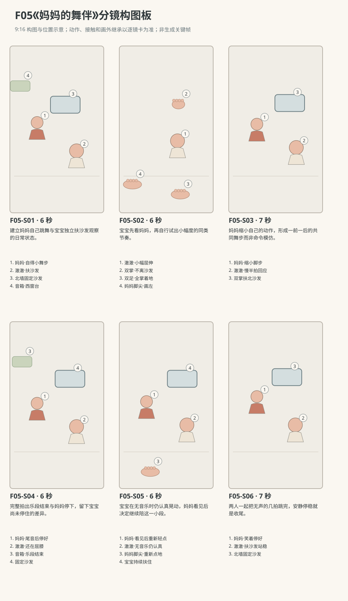

图示为构图位置示意；姿态、接触和画外继承以逐镜正文为准。

### 逐镜设计

#### F05-S01｜00—06 秒｜6 秒｜帧 [0, 144)

**镜头任务：**建立妈妈自己跳舞与宝宝独立扶沙发观察的日常状态。

**景别、机位与构图：**中全景，南侧朝北略西，妈妈左、澈澈右后、北沙发横后景，下缘保留双方双足，窗台音箱在左后。

**摄影机与理由：**固定，先看妈妈完整重心变化及宝宝稳定支撑。

**焦点：**妈妈身体节拍与澈澈手足均清晰。

**入态：**妈妈站西南侧双臂自然垂，澈澈朝北双掌扶沙发，双足分开小距离，眼睛看座垫缝。

**动作与表演：**

- 3 秒：妈妈随原创音乐把重心由左脚换到右脚，空出的脚尖轻点一次。

- 3 秒：她又换回重心，肩膀松动；澈澈听见轻点声，头开始向西转。

**声音：**音箱原创无歌词乐段、两次轻点地声、沙发布摩擦，无对白。

**出态：**妈妈继续轻晃，澈澈双掌不动、头已朝妈妈方向转一半。

**切点与承接：**沿澈澈转头接中近景，保持脚掌与扶手事实。

**连续性：**澈澈从未离开沙发，音箱在西窗台；妈妈不触碰宝宝。

**开始画面母稿：**

9:16竖幅，原创三维生活动画，圆润而有重量的造型，棉布细纹、柔和皮肤层次与可读的小表情；动作按真实生活物理及婴儿当下能力展开，不用成人化算计表情。澈澈为圆脸、深棕眼、短黑绒发、额前一小撮向右弯的头发，穿奶油色棉连体衣。妈妈深棕低马尾，雾蓝棉上衣、米色长裤。本镜开始画面为单一瞬间：妈妈站西南侧双臂自然垂，澈澈朝北双掌扶沙发，双足分开小距离，眼睛看座垫缝。 场次方位与光位：L客厅北墙固定沙发、西窗、东走廊、中央地垫。澈澈在沙发南侧朝北，双掌扶固定座垫前缘、双足在垫上；妈妈在其西南侧朝东北，音箱固定在西窗台。摄影在两人连线南侧，妈妈左、宝宝右、沙发后景，窗光来自画左。音乐的有无及动作进度只依本镜声音与起态。 摄影构图：中全景，南侧朝北略西，妈妈左、澈澈右后、北沙发横后景，下缘保留双方双足，窗台音箱在左后。 当前焦点：妈妈当前站姿与澈澈双掌扶沙发、双足接地的四个支点。只呈现上述起态，不把后续动作拼入一张画面。

**视频变化母稿：**

9:16竖幅，原创三维生活动画，圆润而有重量的造型，棉布细纹、柔和皮肤层次与可读的小表情；动作按真实生活物理及婴儿当下能力展开，不用成人化算计表情。澈澈为圆脸、深棕眼、短黑绒发、额前一小撮向右弯的头发，穿奶油色棉连体衣。妈妈深棕低马尾，雾蓝棉上衣、米色长裤。制作一段6秒连续镜头。本段人物和能力：澈澈、妈妈，澈澈为R2。空间光位：L客厅北墙固定沙发、西窗、东走廊、中央地垫。澈澈在沙发南侧朝北，双掌扶固定座垫前缘、双足在垫上；妈妈在其西南侧朝东北，音箱固定在西窗台。摄影在两人连线南侧，妈妈左、宝宝右、沙发后景，窗光来自画左。音乐的有无及动作进度只依本镜声音与起态。 起态：妈妈站西南侧双臂自然垂，澈澈朝北双掌扶沙发，双足分开小距离，眼睛看座垫缝。 摄影：中全景，南侧朝北略西，妈妈左、澈澈右后、北沙发横后景，下缘保留双方双足，窗台音箱在左后。 相机行为：固定，先看妈妈完整重心变化及宝宝稳定支撑。 焦点：妈妈身体节拍与澈澈手足均清晰。 时间过程：第1阶段3秒：妈妈随原创音乐把重心由左脚换到右脚，空出的脚尖轻点一次。；第2阶段3秒：她又换回重心，肩膀松动；澈澈听见轻点声，头开始向西转。。声音：音箱原创无歌词乐段、两次轻点地声、沙发布摩擦，无对白。 终态：妈妈继续轻晃，澈澈双掌不动、头已朝妈妈方向转一半。 连续性：澈澈从未离开沙发，音箱在西窗台；妈妈不触碰宝宝。 不加未写出的对白、人物或道具。

#### F05-S02｜06—12 秒｜6 秒｜帧 [144, 288)

**镜头任务：**宝宝先看妈妈，再自行试出小幅度的同类节奏。

**景别、机位与构图：**澈澈全身中景，机位在南侧略偏东，宝宝转向西的侧脸、双臂、双膝和双足全部留在画内，固定沙发接触面在上半；妈妈点地的小腿与脚在画左边缘。

**摄影机与理由：**固定，不跟头绕轴；把妈妈的脚留作宝宝视线下落依据。

**焦点：**澈澈眼睛、扶沙发双掌与双足均在清晰景深内，小幅屈伸与脚掌持续接地同框可读。

**入态：**澈澈双掌扶沙发、头转向西侧看妈妈，双膝基本伸直，双足全掌接地。

**动作与表演：**

- 2 秒：澈澈眼睛先看妈妈脸，再沿她身体落到轻点的脚。

- 2 秒：他把双膝轻弯，臀部稍降，双肘随之弯曲而掌心不滑。

- 2 秒：他把膝盖伸回，身体回原高度，脸仍朝向妈妈。

**声音：**音乐持续，沙发棉布受掌轻摩擦，澈澈一次轻鼻音，无对白。

**出态：**澈澈已完成一次小屈伸，双掌双足仍在原接触点，注意力留在妈妈。

**切点与承接：**切二人中景，让妈妈看见这一次动作后的回应清楚发生。

**连续性：**不把扶物动作变成蹲起训练；澈澈脚位不变，妈妈画外仍轻点。

**开始画面母稿：**

9:16竖幅，原创三维生活动画，圆润而有重量的造型，棉布细纹、柔和皮肤层次与可读的小表情；动作按真实生活物理及婴儿当下能力展开，不用成人化算计表情。澈澈为圆脸、深棕眼、短黑绒发、额前一小撮向右弯的头发，穿奶油色棉连体衣。妈妈深棕低马尾，雾蓝棉上衣、米色长裤。本镜开始画面为单一瞬间：澈澈双掌扶沙发、头转向西侧看妈妈，双膝基本伸直，双足全掌接地。 场次方位与光位：L客厅北墙固定沙发、西窗、东走廊、中央地垫。澈澈在沙发南侧朝北，双掌扶固定座垫前缘、双足在垫上；妈妈在其西南侧朝东北，音箱固定在西窗台。摄影在两人连线南侧，妈妈左、宝宝右、沙发后景，窗光来自画左。音乐的有无及动作进度只依本镜声音与起态。 摄影构图：澈澈全身中景，机位在南侧略偏东，宝宝转向西的侧脸、双臂、双膝和双足全部留在画内，固定沙发接触面在上半；妈妈点地的小腿与脚在画左边缘。 当前焦点：澈澈向西看妈妈的双眼、双掌扶沙发与双足全掌着地。只呈现上述起态，不把后续动作拼入一张画面。

**视频变化母稿：**

9:16竖幅，原创三维生活动画，圆润而有重量的造型，棉布细纹、柔和皮肤层次与可读的小表情；动作按真实生活物理及婴儿当下能力展开，不用成人化算计表情。澈澈为圆脸、深棕眼、短黑绒发、额前一小撮向右弯的头发，穿奶油色棉连体衣。妈妈深棕低马尾，雾蓝棉上衣、米色长裤。制作一段6秒连续镜头。本段人物和能力：澈澈、妈妈，澈澈为R2。空间光位：L客厅北墙固定沙发、西窗、东走廊、中央地垫。澈澈在沙发南侧朝北，双掌扶固定座垫前缘、双足在垫上；妈妈在其西南侧朝东北，音箱固定在西窗台。摄影在两人连线南侧，妈妈左、宝宝右、沙发后景，窗光来自画左。音乐的有无及动作进度只依本镜声音与起态。 起态：澈澈双掌扶沙发、头转向西侧看妈妈，双膝基本伸直，双足全掌接地。 摄影：澈澈全身中景，机位在南侧略偏东，宝宝转向西的侧脸、双臂、双膝和双足全部留在画内，固定沙发接触面在上半；妈妈点地的小腿与脚在画左边缘。 相机行为：固定，不跟头绕轴；把妈妈的脚留作宝宝视线下落依据。 焦点：澈澈眼睛、扶沙发双掌与双足均在清晰景深内，小幅屈伸与脚掌持续接地同框可读。 时间过程：第1阶段2秒：澈澈眼睛先看妈妈脸，再沿她身体落到轻点的脚。；第2阶段2秒：他把双膝轻弯，臀部稍降，双肘随之弯曲而掌心不滑。；第3阶段2秒：他把膝盖伸回，身体回原高度，脸仍朝向妈妈。。声音：音乐持续，沙发棉布受掌轻摩擦，澈澈一次轻鼻音，无对白。 终态：澈澈已完成一次小屈伸，双掌双足仍在原接触点，注意力留在妈妈。 连续性：不把扶物动作变成蹲起训练；澈澈脚位不变，妈妈画外仍轻点。 不加未写出的对白、人物或道具。

#### F05-S03｜12—19 秒｜7 秒｜帧 [288, 456)

**镜头任务：**妈妈缩小自己的动作，形成一前一后的共同舞步而非命令模仿。

**景别、机位与构图：**二人中全景，南侧同轴，妈妈左、澈澈右，妈妈脸、宝宝侧脸、双足和支撑面均见。

**摄影机与理由：**固定；动作幅度的改变由演员完成，不以镜头缩放模拟。

**焦点：**妈妈发现宝宝的眼神和澈澈接下来的屈伸共同清晰。

**入态：**妈妈仍随音乐小步，澈澈头朝她、双掌扶沙发，刚从第一次屈膝伸回。

**动作与表演：**

- 3 秒：妈妈看见澈澈的膝盖变化，笑一下，把脚步缩成原地换重心。

- 4 秒：澈澈又弯膝伸回，妈妈等他伸直后再轻点一下脚尖，两人的节奏错开半拍。

**声音：**音乐持续，妈妈一次细短笑气、脚尖轻点、沙发细摩擦，无对白。

**出态：**两人各自稳定，澈澈仍看妈妈，妈妈不再大步横移。

**切点与承接：**在最后乐句开始时切到同侧稍近画面，准备音乐自然结束。

**连续性：**妈妈未伸手扶宝宝；澈澈双掌持续接触、脚位稳定，允许节拍不整齐。

**开始画面母稿：**

9:16竖幅，原创三维生活动画，圆润而有重量的造型，棉布细纹、柔和皮肤层次与可读的小表情；动作按真实生活物理及婴儿当下能力展开，不用成人化算计表情。澈澈为圆脸、深棕眼、短黑绒发、额前一小撮向右弯的头发，穿奶油色棉连体衣。妈妈深棕低马尾，雾蓝棉上衣、米色长裤。本镜开始画面为单一瞬间：妈妈仍随音乐小步，澈澈头朝她、双掌扶沙发，刚从第一次屈膝伸回。 场次方位与光位：L客厅北墙固定沙发、西窗、东走廊、中央地垫。澈澈在沙发南侧朝北，双掌扶固定座垫前缘、双足在垫上；妈妈在其西南侧朝东北，音箱固定在西窗台。摄影在两人连线南侧，妈妈左、宝宝右、沙发后景，窗光来自画左。音乐的有无及动作进度只依本镜声音与起态。 摄影构图：二人中全景，南侧同轴，妈妈左、澈澈右，妈妈脸、宝宝侧脸、双足和支撑面均见。 当前焦点：妈妈观察澈澈的眼神、宝宝稳定的手足支撑。只呈现上述起态，不把后续动作拼入一张画面。

**视频变化母稿：**

9:16竖幅，原创三维生活动画，圆润而有重量的造型，棉布细纹、柔和皮肤层次与可读的小表情；动作按真实生活物理及婴儿当下能力展开，不用成人化算计表情。澈澈为圆脸、深棕眼、短黑绒发、额前一小撮向右弯的头发，穿奶油色棉连体衣。妈妈深棕低马尾，雾蓝棉上衣、米色长裤。制作一段7秒连续镜头。本段人物和能力：澈澈、妈妈，澈澈为R2。空间光位：L客厅北墙固定沙发、西窗、东走廊、中央地垫。澈澈在沙发南侧朝北，双掌扶固定座垫前缘、双足在垫上；妈妈在其西南侧朝东北，音箱固定在西窗台。摄影在两人连线南侧，妈妈左、宝宝右、沙发后景，窗光来自画左。音乐的有无及动作进度只依本镜声音与起态。 起态：妈妈仍随音乐小步，澈澈头朝她、双掌扶沙发，刚从第一次屈膝伸回。 摄影：二人中全景，南侧同轴，妈妈左、澈澈右，妈妈脸、宝宝侧脸、双足和支撑面均见。 相机行为：固定；动作幅度的改变由演员完成，不以镜头缩放模拟。 焦点：妈妈发现宝宝的眼神和澈澈接下来的屈伸共同清晰。 时间过程：第1阶段3秒：妈妈看见澈澈的膝盖变化，笑一下，把脚步缩成原地换重心。；第2阶段4秒：澈澈又弯膝伸回，妈妈等他伸直后再轻点一下脚尖，两人的节奏错开半拍。。声音：音乐持续，妈妈一次细短笑气、脚尖轻点、沙发细摩擦，无对白。 终态：两人各自稳定，澈澈仍看妈妈，妈妈不再大步横移。 连续性：妈妈未伸手扶宝宝；澈澈双掌持续接触、脚位稳定，允许节拍不整齐。 不加未写出的对白、人物或道具。

#### F05-S04｜19—25 秒｜6 秒｜帧 [456, 600)

**镜头任务：**完整拍出乐段结束与妈妈停下，留下宝宝尚未停住的差异。

**景别、机位与构图：**二人中景，南侧同轴略收紧，妈妈左半身至足、宝宝右全身，音箱可在左后边缘。

**摄影机与理由：**固定，音乐结束时不做转场，让观众确知同一时空。

**焦点：**两人的重心变化；音箱不需读出界面。

**入态：**全片第19秒，妈妈原地换重心，澈澈扶沙发小幅晃，原创乐段进入最后一乐句。

**动作与表演：**

- 4 秒：妈妈随尾句再轻点两次，澈澈较慢地弯膝伸回一次。

- 2 秒：最后音符自然落下，妈妈双脚平放、肩膀停住；澈澈刚开始下一次屈膝。

**声音：**原创乐段在本镜第6秒即全片25秒完全结束，最后一音自然衰减；无对白。

**出态：**妈妈已停，澈澈处于小幅屈膝最低点，手掌仍扶沙发。

**切点与承接：**在音乐留白中接宝宝继续伸回，不跳过膝盖终态。

**连续性：**声音终止与妈妈停步同镜完成；澈澈下一个动作尚在进行，无隐形节拍器。

**开始画面母稿：**

9:16竖幅，原创三维生活动画，圆润而有重量的造型，棉布细纹、柔和皮肤层次与可读的小表情；动作按真实生活物理及婴儿当下能力展开，不用成人化算计表情。澈澈为圆脸、深棕眼、短黑绒发、额前一小撮向右弯的头发，穿奶油色棉连体衣。妈妈深棕低马尾，雾蓝棉上衣、米色长裤。本镜开始画面为单一瞬间：全片第19秒，妈妈原地换重心，澈澈扶沙发小幅晃，原创乐段进入最后一乐句。 场次方位与光位：L客厅北墙固定沙发、西窗、东走廊、中央地垫。澈澈在沙发南侧朝北，双掌扶固定座垫前缘、双足在垫上；妈妈在其西南侧朝东北，音箱固定在西窗台。摄影在两人连线南侧，妈妈左、宝宝右、沙发后景，窗光来自画左。音乐的有无及动作进度只依本镜声音与起态。 摄影构图：二人中景，南侧同轴略收紧，妈妈左半身至足、宝宝右全身，音箱可在左后边缘。 当前焦点：两人的当前重心、宝宝双掌持续扶物与妈妈点地脚。只呈现上述起态，不把后续动作拼入一张画面。

**视频变化母稿：**

9:16竖幅，原创三维生活动画，圆润而有重量的造型，棉布细纹、柔和皮肤层次与可读的小表情；动作按真实生活物理及婴儿当下能力展开，不用成人化算计表情。澈澈为圆脸、深棕眼、短黑绒发、额前一小撮向右弯的头发，穿奶油色棉连体衣。妈妈深棕低马尾，雾蓝棉上衣、米色长裤。制作一段6秒连续镜头。本段人物和能力：澈澈、妈妈，澈澈为R2。空间光位：L客厅北墙固定沙发、西窗、东走廊、中央地垫。澈澈在沙发南侧朝北，双掌扶固定座垫前缘、双足在垫上；妈妈在其西南侧朝东北，音箱固定在西窗台。摄影在两人连线南侧，妈妈左、宝宝右、沙发后景，窗光来自画左。音乐的有无及动作进度只依本镜声音与起态。 起态：全片第19秒，妈妈原地换重心，澈澈扶沙发小幅晃，原创乐段进入最后一乐句。 摄影：二人中景，南侧同轴略收紧，妈妈左半身至足、宝宝右全身，音箱可在左后边缘。 相机行为：固定，音乐结束时不做转场，让观众确知同一时空。 焦点：两人的重心变化；音箱不需读出界面。 时间过程：第1阶段4秒：妈妈随尾句再轻点两次，澈澈较慢地弯膝伸回一次。；第2阶段2秒：最后音符自然落下，妈妈双脚平放、肩膀停住；澈澈刚开始下一次屈膝。。声音：原创乐段在本镜第6秒即全片25秒完全结束，最后一音自然衰减；无对白。 终态：妈妈已停，澈澈处于小幅屈膝最低点，手掌仍扶沙发。 连续性：声音终止与妈妈停步同镜完成；澈澈下一个动作尚在进行，无隐形节拍器。 不加未写出的对白、人物或道具。

#### F05-S05｜25—31 秒｜6 秒｜帧 [600, 744)

**镜头任务：**宝宝在无音乐时仍认真晃动，妈妈看见后决定继续陪这一小段。

**景别、机位与构图：**二人中景，南侧同轴，妈妈左、宝宝右，妈妈双脚和澈澈扶手接触在下/右缘可见。

**摄影机与理由：**固定，先等宝宝完成动作，再让妈妈重新动。

**焦点：**澈澈侧脸与膝盖先，随后妈妈看他的微笑，均保持可辨。

**入态：**妈妈双脚平放停住，澈澈膝盖小弯、双掌扶沙发，音箱已静音。

**动作与表演：**

- 2 秒：澈澈伸直膝盖，看妈妈一眼，停半拍。

- 2 秒：他又轻弯一下膝，自己认真继续；妈妈目光落到他的膝盖，嘴角扬起。

- 2 秒：妈妈重新换一下重心、脚尖轻点地面，动作比有音乐时更轻。

**声音：**无音乐；清楚保留一次脚尖轻点、衣料轻响和妈妈笑气，无对白。

**出态：**妈妈已重新开始小幅轻晃，澈澈从屈膝中慢慢伸回。

**切点与承接：**接两人无声继续的稍宽镜，兑现陪伴的结尾。

**连续性：**不能恢复BGM；澈澈掌心不离沙发，妈妈动作必须晚于宝宝再次屈膝。

**开始画面母稿：**

9:16竖幅，原创三维生活动画，圆润而有重量的造型，棉布细纹、柔和皮肤层次与可读的小表情；动作按真实生活物理及婴儿当下能力展开，不用成人化算计表情。澈澈为圆脸、深棕眼、短黑绒发、额前一小撮向右弯的头发，穿奶油色棉连体衣。妈妈深棕低马尾，雾蓝棉上衣、米色长裤。本镜开始画面为单一瞬间：妈妈双脚平放停住，澈澈膝盖小弯、双掌扶沙发，音箱已静音。 场次方位与光位：L客厅北墙固定沙发、西窗、东走廊、中央地垫。澈澈在沙发南侧朝北，双掌扶固定座垫前缘、双足在垫上；妈妈在其西南侧朝东北，音箱固定在西窗台。摄影在两人连线南侧，妈妈左、宝宝右、沙发后景，窗光来自画左。音乐的有无及动作进度只依本镜声音与起态。 摄影构图：二人中景，南侧同轴，妈妈左、宝宝右，妈妈双脚和澈澈扶手接触在下/右缘可见。 当前焦点：妈妈已经停住的双脚、宝宝仍微屈的双膝与扶物双掌。只呈现上述起态，不把后续动作拼入一张画面。

**视频变化母稿：**

9:16竖幅，原创三维生活动画，圆润而有重量的造型，棉布细纹、柔和皮肤层次与可读的小表情；动作按真实生活物理及婴儿当下能力展开，不用成人化算计表情。澈澈为圆脸、深棕眼、短黑绒发、额前一小撮向右弯的头发，穿奶油色棉连体衣。妈妈深棕低马尾，雾蓝棉上衣、米色长裤。制作一段6秒连续镜头。本段人物和能力：澈澈、妈妈，澈澈为R2。空间光位：L客厅北墙固定沙发、西窗、东走廊、中央地垫。澈澈在沙发南侧朝北，双掌扶固定座垫前缘、双足在垫上；妈妈在其西南侧朝东北，音箱固定在西窗台。摄影在两人连线南侧，妈妈左、宝宝右、沙发后景，窗光来自画左。音乐的有无及动作进度只依本镜声音与起态。 起态：妈妈双脚平放停住，澈澈膝盖小弯、双掌扶沙发，音箱已静音。 摄影：二人中景，南侧同轴，妈妈左、宝宝右，妈妈双脚和澈澈扶手接触在下/右缘可见。 相机行为：固定，先等宝宝完成动作，再让妈妈重新动。 焦点：澈澈侧脸与膝盖先，随后妈妈看他的微笑，均保持可辨。 时间过程：第1阶段2秒：澈澈伸直膝盖，看妈妈一眼，停半拍。；第2阶段2秒：他又轻弯一下膝，自己认真继续；妈妈目光落到他的膝盖，嘴角扬起。；第3阶段2秒：妈妈重新换一下重心、脚尖轻点地面，动作比有音乐时更轻。。声音：无音乐；清楚保留一次脚尖轻点、衣料轻响和妈妈笑气，无对白。 终态：妈妈已重新开始小幅轻晃，澈澈从屈膝中慢慢伸回。 连续性：不能恢复BGM；澈澈掌心不离沙发，妈妈动作必须晚于宝宝再次屈膝。 不加未写出的对白、人物或道具。

#### F05-S06｜31—38 秒｜7 秒｜帧 [744, 912)

**镜头任务：**两人一起把无声的几拍跳完，安静停稳就是收尾。

**景别、机位与构图：**二人中全景，同S03方向，母子与沙发、地垫接触完整，西窗暖反射保持。

**摄影机与理由：**轻缓后移一小步，给两人全身与共同停下留空间，最后3秒固定。

**焦点：**两人面部与手足同清晰，不再切焦。

**入态：**妈妈小幅换重心，澈澈从屈膝伸回，两人都知道对方在看，音乐已停。

**动作与表演：**

- 3 秒：妈妈轻点一次，澈澈过一拍才弯膝再伸回，彼此看一眼。

- 2 秒：澈澈双膝伸直，双掌向沙发压稳，身体不再上下动；妈妈随他一起站好。

- 2 秒：妈妈笑着轻呼气，澈澈抬眼看她，脚和手都仍稳稳落着。

**声音：**一次轻点与沙发布料声后回到呼吸，妈妈一声轻笑，无音乐无对白。

**出态：**澈澈双手扶沙发、双足着地，妈妈在西南站稳微笑，共同的小舞段完成。

**切点与承接：**末两秒留白后结束，不追加鼓掌、口号或迈步。

**连续性：**能力保持R2扶物站立，整片无放手；妈妈与宝宝仍在原相对位置。

**开始画面母稿：**

9:16竖幅，原创三维生活动画，圆润而有重量的造型，棉布细纹、柔和皮肤层次与可读的小表情；动作按真实生活物理及婴儿当下能力展开，不用成人化算计表情。澈澈为圆脸、深棕眼、短黑绒发、额前一小撮向右弯的头发，穿奶油色棉连体衣。妈妈深棕低马尾，雾蓝棉上衣、米色长裤。本镜开始画面为单一瞬间：妈妈小幅换重心，澈澈从屈膝伸回，两人都知道对方在看，音乐已停。 场次方位与光位：L客厅北墙固定沙发、西窗、东走廊、中央地垫。澈澈在沙发南侧朝北，双掌扶固定座垫前缘、双足在垫上；妈妈在其西南侧朝东北，音箱固定在西窗台。摄影在两人连线南侧，妈妈左、宝宝右、沙发后景，窗光来自画左。音乐的有无及动作进度只依本镜声音与起态。 摄影构图：二人中全景，同S03方向，母子与沙发、地垫接触完整，西窗暖反射保持。 当前焦点：母子当前微晃姿态、宝宝双手双足的稳定接触。只呈现上述起态，不把后续动作拼入一张画面。

**视频变化母稿：**

9:16竖幅，原创三维生活动画，圆润而有重量的造型，棉布细纹、柔和皮肤层次与可读的小表情；动作按真实生活物理及婴儿当下能力展开，不用成人化算计表情。澈澈为圆脸、深棕眼、短黑绒发、额前一小撮向右弯的头发，穿奶油色棉连体衣。妈妈深棕低马尾，雾蓝棉上衣、米色长裤。制作一段7秒连续镜头。本段人物和能力：澈澈、妈妈，澈澈为R2。空间光位：L客厅北墙固定沙发、西窗、东走廊、中央地垫。澈澈在沙发南侧朝北，双掌扶固定座垫前缘、双足在垫上；妈妈在其西南侧朝东北，音箱固定在西窗台。摄影在两人连线南侧，妈妈左、宝宝右、沙发后景，窗光来自画左。音乐的有无及动作进度只依本镜声音与起态。 起态：妈妈小幅换重心，澈澈从屈膝伸回，两人都知道对方在看，音乐已停。 摄影：二人中全景，同S03方向，母子与沙发、地垫接触完整，西窗暖反射保持。 相机行为：轻缓后移一小步，给两人全身与共同停下留空间，最后3秒固定。 焦点：两人面部与手足同清晰，不再切焦。 时间过程：第1阶段3秒：妈妈轻点一次，澈澈过一拍才弯膝再伸回，彼此看一眼。；第2阶段2秒：澈澈双膝伸直，双掌向沙发压稳，身体不再上下动；妈妈随他一起站好。；第3阶段2秒：妈妈笑着轻呼气，澈澈抬眼看她，脚和手都仍稳稳落着。。声音：一次轻点与沙发布料声后回到呼吸，妈妈一声轻笑，无音乐无对白。 终态：澈澈双手扶沙发、双足着地，妈妈在西南站稳微笑，共同的小舞段完成。 连续性：能力保持R2扶物站立，整片无放手；妈妈与宝宝仍在原相对位置。 不加未写出的对白、人物或道具。

### 声音与剪辑

小音箱内原创无歌词轻快乐段从片头持续至第25秒自然收尾，不使用现成商业歌曲。脚尖轻点、棉袖与沙发布摩擦为前景。第25秒后音乐完全消失，保留两人无声继续时的呼吸与轻点声，不人为续播。

正式台词：无；保留镜头声音中已写明的自然发声。

### 连续性与试片

- 连续性：澈澈双掌始终扶固定沙发座垫前缘，脚掌持续落在同一小区域，不跳跃、不放手站立。

- 连续性：妈妈在西南侧，澈澈朝北扶物，头转向西侧看妈妈；摄影持续在南侧，窗门不反。

- 连续性：唯一音乐源F05-X01在西窗台，乐段第25秒终止，S05—S06不可凭空恢复音乐。

- 连续性：妈妈小步不进入澈澈两脚之间，不牵手或抱起改变能力任务。

- 试片：F05-S02—S04试片：屈膝、脚底与双掌接触必须共同可读；若脚底滑移、膝盖反折或手脱离沙发仍悬站，则失败。

- 试片：F05-S04—S05试听：第25秒音乐须结束，宝宝的继续动作先于妈妈重新起步；若仍靠背景节拍强迫同步则失败。

- 试片：F05-S06静音看片：须看出妈妈是回应而非教动作，若不断口型数拍或拉拽宝宝肢体则失败。

**媒体待验证：**未生成媒体；待验扶沙发承重、双足摩擦和婴儿小幅屈膝，及音乐停后七秒无对白节奏是否自然。

---

## F06《收拾的方向不一样》

**55 秒｜坐姿与手部互动｜角色：澈澈、爸爸｜场景 L**

### 剧情正文

客厅地垫上还散着两块软积木，爸爸右手已拿起另一块，把浅木玩具盒拉到手边，澈澈坐在盒旁看。他把第一块放进去，伸手去拿第二块。澈澈却从盒里拿出刚放好的那块，转一下，摆在自己面前。爸爸没有注意，第二块又轻轻落进盒里。澈澈看看盒子，伸手把它也取出来，放到第一块旁边，还用掌心慢慢推开一点距离。爸爸的右手已经拿起最后一块，悬在盒上方，却停住了。他看一眼宝宝面前的两块积木，又看见澈澈正在修正中间的小空隙，终于不再往盒里放。爸爸把盒子向后移一点，自己挪到旁边，将最后一块平托着递过去。澈澈先握住一角，另一只手也凑上来，爸爸等他拿稳才松开。他把积木放到队尾，又低头推了推，不很整齐的三块终于排成一小行。爸爸空着的手落回膝上，没有替他摆直。澈澈抬头看看爸爸，两人一起看着这份方向完全不同的“收拾”。

### 亲述来源与改编

原帖是家长自述，未独立核实。本片将生活机制改编为澈澈的原创故事。

- [TD07 · 一边装洗碗机一边被往外拿，改分工才顺下来](https://www.reddit.com/r/Mommit/comments/koo3ho/how_did_i_not_figure_this_out_sooner/)；作者自报年龄：2 year old（作者原话，精确月龄未注明）。

- **采用的生活过程：**只借鉴成人收进、孩子拿出导致任务相反，成人随后改变参与方式的关系机制。

- **本片原创改编：**原片软积木、浅木盒、爸爸停止收纳并改为平托递第三块、宝宝短暂排放均为本项目原创。

- **不作出的事实推断：**原帖是两岁幼儿参与洗碗机与餐具分类，不是婴儿摆积木的实录；不将两岁家务能力移给R1。

- **不作出的事实推断：**原帖的重新分工不等于本片婴儿已经理解收拾规则；不承诺任何育儿效果。

[查看原始过程与缺项](research/real-experiences/index.html#TD07)

### 导演与空间

**观察任务：**爸爸从把玩具收进盒子的单向任务，转而看懂宝宝正在摆放的另一项任务，通过递出下一块自然加入。

**空间与光位：**L客厅北墙沙发、西窗、东走廊、中央地垫。澈澈坐垫北半朝南，爸爸盘腿坐其西南侧朝东北，摄影始终在两人连线东南侧，爸爸画左、澈澈右。P07浅木玩具盒在澈澈右膝外偏西的可及处。三块P03同款鼠尾草软积木用制作编号A/B/C区分：A有圆形缝线、起始爸爸右手；B有方形缝线、起始爸爸左膝外；C有十字缝线、起始爸爸右膝前。宝宝面前南侧留一条东西向空位，最后从西到东为A/B/C。西窗柔光来自画左。

**人物表演：**爸爸确实想收拾，开始手法熟练；发现相反方向后先停手观察，再改变自己坐位与递物方式。澈澈专注把积木放在眼前，摆得不完全齐，不被写成故意捣乱；他能稳坐、短暂双手离垫，侧伸时有另一掌撑垫。

### 节拍覆盖

- **F06-b1**：交代爸爸的收纳目标、宝宝位置与三块积木的不同起点。 前态：爸爸盘腿坐着右手持A，左手在盒沿，澈澈双掌撑垫，B/C各在爸爸对应膝旁。 后态：A在爸爸右手盒口上方，B/C仍在地垫，澈澈注意盒口。 → F06-S01

- **F06-b2**：第一块确实被爸爸放进盒，宝宝随后才动手。 前态：爸爸右手持圆缝线A在盒口上方，澈澈左掌撑垫、右手在右膝边，盒内空。 后态：A仍在盒底，澈澈右指已抓上角，左掌撑垫；爸爸右手已空。 → F06-S02

- **F06-b3**：宝宝把取出的A放到自己的观看范围，显出另一个目标的雏形。 前态：澈澈右指握A上角、左掌撑垫，A尚在盒底，爸爸正看左膝外B。 后态：A在宝宝面前南侧偏西，B在爸爸左手，C仍右膝前；宝宝右手空。 → F06-S03

- **F06-b4**：第二块也被搬出并排到A旁，爸爸尚未完成的收纳由此被打断。 前态：爸爸左手拿方缝线B在空盒旁，宝宝右手空放A旁，左掌撑垫，C在爸爸右膝前。 后态：A西、B东在宝宝面前，C爸爸右手，盒空；宝宝右掌仍按B上。 → F06-S04

- **F06-b5**：爸爸看懂宝宝摆放而改变自己的下一步，不能靠一句解释完成转折。 前态：爸爸右手持C准备去盒上方，澈澈右掌按B，A/B已成一小行，盒空。 后态：盒在宝宝右后方，爸爸右掌平托C朝宝宝，A/B前方空位未被占。 → F06-S05

- **F06-b6**：用等待拿稳后的松手，具体表现爸爸加入宝宝的摆放活动。 前态：爸爸右掌平托十字缝线C在宝宝胸腹前，澈澈已坐正，右手抬起、左掌刚离垫。 后态：C在澈澈双手，爸爸右手已回膝，A/B在前方原位。 → F06-S06

- **F06-b7**：宝宝完成自己的排列，爸爸选择看而不纠正，关系自然落定。 前态：澈澈双手持C于胸前，A西B中在面前，爸爸双手落膝，空盒后移。 后态：三块从西到东A/B/C，宝宝双手已离块放膝边，爸爸未代摆，盒空在后方。 → F06-S07

### 分镜构图板

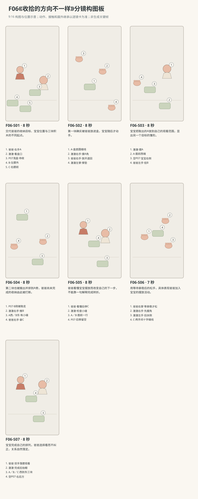

图示为构图位置示意；姿态、接触和画外继承以逐镜正文为准。

### 逐镜设计

#### F06-S01｜00—08 秒｜8 秒｜帧 [0, 192)

**镜头任务：**交代爸爸的收纳目标、宝宝位置与三块积木的不同起点。

**景别、机位与构图：**中全景，东南朝西北，爸爸左、宝宝右，木盒在两人间偏上，A右手、B左膝外、C右膝前均可见。

**摄影机与理由：**固定，先完整呈现散物与准备收纳的距离。

**焦点：**爸爸右手A和宝宝看盒的眼神，所有道具可辨。

**入态：**爸爸盘腿坐着右手持A，左手在盒沿，澈澈双掌撑垫，B/C各在爸爸对应膝旁。

**动作与表演：**

- 3 秒：爸爸左手把P07向澈澈右膝外可及处拉近一点，宝宝沿盒沿看进去。

- 5 秒：爸爸右手把A举到盒口正上方，稍停避免碰沿；左手离开盒沿准备拿左膝外B。

**声音：**木盒擦垫短声、积木布面擦掌声，无对白。

**出态：**A在爸爸右手盒口上方，B/C仍在地垫，澈澈注意盒口。

**切点与承接：**切近A落盒的动作，同时保留宝宝可及的盒沿。

**连续性：**三块全部画内建立；盒不装其他玩具，不新增第四块。

**开始画面母稿：**

9:16竖幅，原创三维生活动画，圆润而有重量的造型，棉布细纹、柔和皮肤层次与可读的小表情；动作按真实生活物理及婴儿当下能力展开，不用成人化算计表情。澈澈为圆脸、深棕眼、短黑绒发、额前一小撮向右弯的头发，穿奶油色棉连体衣。爸爸短黑发，砖陶色棉衬衫、深灰长裤。本镜开始画面为单一瞬间：爸爸盘腿坐着右手持A，左手在盒沿，澈澈双掌撑垫，B/C各在爸爸对应膝旁。 场次方位与光位：L客厅北墙沙发、西窗、东走廊、中央地垫。澈澈在垫北半朝南、爸爸在其西南朝东北，摄影始终在连线东南侧，爸爸左、宝宝右，窗光来自左。浅木盒P07与三块鼠尾草软积木共用：圆缝线A、方缝线B、十字缝线C，编号不印在实物上。道具当前归属与摆放只依本镜起态，不重置最初散放状态。 摄影构图：中全景，东南朝西北，爸爸左、宝宝右，木盒在两人间偏上，A右手、B左膝外、C右膝前均可见。 当前焦点：爸爸右手圆缝线A、浅木盒及宝宝注意盒口的双眼。只呈现上述起态，不把后续动作拼入一张画面。

**视频变化母稿：**

9:16竖幅，原创三维生活动画，圆润而有重量的造型，棉布细纹、柔和皮肤层次与可读的小表情；动作按真实生活物理及婴儿当下能力展开，不用成人化算计表情。澈澈为圆脸、深棕眼、短黑绒发、额前一小撮向右弯的头发，穿奶油色棉连体衣。爸爸短黑发，砖陶色棉衬衫、深灰长裤。制作一段8秒连续镜头。本段人物和能力：澈澈、爸爸，澈澈为R1。空间光位：L客厅北墙沙发、西窗、东走廊、中央地垫。澈澈在垫北半朝南、爸爸在其西南朝东北，摄影始终在连线东南侧，爸爸左、宝宝右，窗光来自左。浅木盒P07与三块鼠尾草软积木共用：圆缝线A、方缝线B、十字缝线C，编号不印在实物上。道具当前归属与摆放只依本镜起态，不重置最初散放状态。 起态：爸爸盘腿坐着右手持A，左手在盒沿，澈澈双掌撑垫，B/C各在爸爸对应膝旁。 摄影：中全景，东南朝西北，爸爸左、宝宝右，木盒在两人间偏上，A右手、B左膝外、C右膝前均可见。 相机行为：固定，先完整呈现散物与准备收纳的距离。 焦点：爸爸右手A和宝宝看盒的眼神，所有道具可辨。 时间过程：第1阶段3秒：爸爸左手把P07向澈澈右膝外可及处拉近一点，宝宝沿盒沿看进去。；第2阶段5秒：爸爸右手把A举到盒口正上方，稍停避免碰沿；左手离开盒沿准备拿左膝外B。。声音：木盒擦垫短声、积木布面擦掌声，无对白。 终态：A在爸爸右手盒口上方，B/C仍在地垫，澈澈注意盒口。 连续性：三块全部画内建立；盒不装其他玩具，不新增第四块。 不加未写出的对白、人物或道具。

#### F06-S02｜08—16 秒｜8 秒｜帧 [192, 384)

**镜头任务：**第一块确实被爸爸放进盒，宝宝随后才动手。

**景别、机位与构图：**手部中近景，东南同轴，盒居左中、澈澈右半身和右臂居右，爸爸右手从左上入框。

**摄影机与理由：**固定，盒内与盒沿同见，落下不能被整个遮挡。

**焦点：**A触盒底及澈澈右指靠近的先后。

**入态：**爸爸右手持圆缝线A在盒口上方，澈澈左掌撑垫、右手在右膝边，盒内空。

**动作与表演：**

- 3 秒：爸爸把A轻放到盒底，等接触后松右指，不抛落。

- 2 秒：爸爸空右手退回，目光移向散在地垫的其他块。

- 3 秒：澈澈稍向右侧倾，左掌压稳地垫，右手伸进盒口摸到A上角。

**声音：**A落盒底一声软扑、袖布声，无对白。

**出态：**A仍在盒底，澈澈右指已抓上角，左掌撑垫；爸爸右手已空。

**切点与承接：**接宝宝提A出盒的动作，保证落盒结果被看见后才取。

**连续性：**A未提前跳到宝宝手；B/C在画外原位，爸爸左手尚未拿B。

**开始画面母稿：**

9:16竖幅，原创三维生活动画，圆润而有重量的造型，棉布细纹、柔和皮肤层次与可读的小表情；动作按真实生活物理及婴儿当下能力展开，不用成人化算计表情。澈澈为圆脸、深棕眼、短黑绒发、额前一小撮向右弯的头发，穿奶油色棉连体衣。爸爸短黑发，砖陶色棉衬衫、深灰长裤。本镜开始画面为单一瞬间：爸爸右手持圆缝线A在盒口上方，澈澈左掌撑垫、右手在右膝边，盒内空。 场次方位与光位：L客厅北墙沙发、西窗、东走廊、中央地垫。澈澈在垫北半朝南、爸爸在其西南朝东北，摄影始终在连线东南侧，爸爸左、宝宝右，窗光来自左。浅木盒P07与三块鼠尾草软积木共用：圆缝线A、方缝线B、十字缝线C，编号不印在实物上。道具当前归属与摆放只依本镜起态，不重置最初散放状态。 摄影构图：手部中近景，东南同轴，盒居左中、澈澈右半身和右臂居右，爸爸右手从左上入框。 当前焦点：爸爸右手盒口上方的A、空盒底与宝宝尚未伸入的右手。只呈现上述起态，不把后续动作拼入一张画面。

**视频变化母稿：**

9:16竖幅，原创三维生活动画，圆润而有重量的造型，棉布细纹、柔和皮肤层次与可读的小表情；动作按真实生活物理及婴儿当下能力展开，不用成人化算计表情。澈澈为圆脸、深棕眼、短黑绒发、额前一小撮向右弯的头发，穿奶油色棉连体衣。爸爸短黑发，砖陶色棉衬衫、深灰长裤。制作一段8秒连续镜头。本段人物和能力：澈澈、爸爸，澈澈为R1。空间光位：L客厅北墙沙发、西窗、东走廊、中央地垫。澈澈在垫北半朝南、爸爸在其西南朝东北，摄影始终在连线东南侧，爸爸左、宝宝右，窗光来自左。浅木盒P07与三块鼠尾草软积木共用：圆缝线A、方缝线B、十字缝线C，编号不印在实物上。道具当前归属与摆放只依本镜起态，不重置最初散放状态。 起态：爸爸右手持圆缝线A在盒口上方，澈澈左掌撑垫、右手在右膝边，盒内空。 摄影：手部中近景，东南同轴，盒居左中、澈澈右半身和右臂居右，爸爸右手从左上入框。 相机行为：固定，盒内与盒沿同见，落下不能被整个遮挡。 焦点：A触盒底及澈澈右指靠近的先后。 时间过程：第1阶段3秒：爸爸把A轻放到盒底，等接触后松右指，不抛落。；第2阶段2秒：爸爸空右手退回，目光移向散在地垫的其他块。；第3阶段3秒：澈澈稍向右侧倾，左掌压稳地垫，右手伸进盒口摸到A上角。。声音：A落盒底一声软扑、袖布声，无对白。 终态：A仍在盒底，澈澈右指已抓上角，左掌撑垫；爸爸右手已空。 连续性：A未提前跳到宝宝手；B/C在画外原位，爸爸左手尚未拿B。 不加未写出的对白、人物或道具。

#### F06-S03｜16—24 秒｜8 秒｜帧 [384, 576)

**镜头任务：**宝宝把取出的A放到自己的观看范围，显出另一个目标的雏形。

**景别、机位与构图：**宝宝中景，东南同轴，盒在其画左、南侧空位在下缘，爸爸左手与地上B在左边缘。

**摄影机与理由：**固定，让A从盒到地垫的完整路径被看到。

**焦点：**宝宝右手与A，落垫后转宝宝检查的位置。

**入态：**澈澈右指握A上角、左掌撑垫，A尚在盒底，爸爸正看左膝外B。

**动作与表演：**

- 3 秒：澈澈右手把A提过盒沿，身体慢慢回正，A不碰盒沿穿过去。

- 3 秒：他把A放到面前偏西的地垫，掌心贴着布面轻转，使圆缝线朝上。

- 2 秒：澈澈松开A，低头看它；爸爸左手拾起B，仍未注意A被取出。

**声音：**爸爸拾B的轻衣料声、A落在地垫上的柔软布声；A提过盒沿时不接触盒沿，没有刮擦声，无对白。

**出态：**A在宝宝面前南侧偏西，B在爸爸左手，C仍右膝前；宝宝右手空。

**切点与承接：**接爸爸左手B入盒与宝宝再次取出的完整过程。

**连续性：**A保持圆缝线朝上，宝宝左掌一直稳定支撑；木盒此时再次为空。

**开始画面母稿：**

9:16竖幅，原创三维生活动画，圆润而有重量的造型，棉布细纹、柔和皮肤层次与可读的小表情；动作按真实生活物理及婴儿当下能力展开，不用成人化算计表情。澈澈为圆脸、深棕眼、短黑绒发、额前一小撮向右弯的头发，穿奶油色棉连体衣。爸爸短黑发，砖陶色棉衬衫、深灰长裤。本镜开始画面为单一瞬间：澈澈右指握A上角、左掌撑垫，A尚在盒底，爸爸正看左膝外B。 场次方位与光位：L客厅北墙沙发、西窗、东走廊、中央地垫。澈澈在垫北半朝南、爸爸在其西南朝东北，摄影始终在连线东南侧，爸爸左、宝宝右，窗光来自左。浅木盒P07与三块鼠尾草软积木共用：圆缝线A、方缝线B、十字缝线C，编号不印在实物上。道具当前归属与摆放只依本镜起态，不重置最初散放状态。 摄影构图：宝宝中景，东南同轴，盒在其画左、南侧空位在下缘，爸爸左手与地上B在左边缘。 当前焦点：宝宝右指握盒底A上角的接触处、撑垫左掌。只呈现上述起态，不把后续动作拼入一张画面。

**视频变化母稿：**

9:16竖幅，原创三维生活动画，圆润而有重量的造型，棉布细纹、柔和皮肤层次与可读的小表情；动作按真实生活物理及婴儿当下能力展开，不用成人化算计表情。澈澈为圆脸、深棕眼、短黑绒发、额前一小撮向右弯的头发，穿奶油色棉连体衣。爸爸短黑发，砖陶色棉衬衫、深灰长裤。制作一段8秒连续镜头。本段人物和能力：澈澈、爸爸，澈澈为R1。空间光位：L客厅北墙沙发、西窗、东走廊、中央地垫。澈澈在垫北半朝南、爸爸在其西南朝东北，摄影始终在连线东南侧，爸爸左、宝宝右，窗光来自左。浅木盒P07与三块鼠尾草软积木共用：圆缝线A、方缝线B、十字缝线C，编号不印在实物上。道具当前归属与摆放只依本镜起态，不重置最初散放状态。 起态：澈澈右指握A上角、左掌撑垫，A尚在盒底，爸爸正看左膝外B。 摄影：宝宝中景，东南同轴，盒在其画左、南侧空位在下缘，爸爸左手与地上B在左边缘。 相机行为：固定，让A从盒到地垫的完整路径被看到。 焦点：宝宝右手与A，落垫后转宝宝检查的位置。 时间过程：第1阶段3秒：澈澈右手把A提过盒沿，身体慢慢回正，A不碰盒沿穿过去。；第2阶段3秒：他把A放到面前偏西的地垫，掌心贴着布面轻转，使圆缝线朝上。；第3阶段2秒：澈澈松开A，低头看它；爸爸左手拾起B，仍未注意A被取出。。声音：爸爸拾B的轻衣料声、A落在地垫上的柔软布声；A提过盒沿时不接触盒沿，没有刮擦声，无对白。 终态：A在宝宝面前南侧偏西，B在爸爸左手，C仍右膝前；宝宝右手空。 连续性：A保持圆缝线朝上，宝宝左掌一直稳定支撑；木盒此时再次为空。 不加未写出的对白、人物或道具。

#### F06-S04｜24—32 秒｜8 秒｜帧 [576, 768)

**镜头任务：**第二块也被搬出并排到A旁，爸爸尚未完成的收纳由此被打断。

**景别、机位与构图：**偏俯二人手部中景，东南同侧，P07左上、A下中偏左、待放B路径与宝宝右手在右，爸爸一角身体在左。

**摄影机与理由：**固定，单镜容纳B的入盒、出盒和靠近A，保持动作空间小而清楚。

**焦点：**B始终为焦点，A和盒沿同清晰。

**入态：**爸爸左手拿方缝线B在空盒旁，宝宝右手空放A旁，左掌撑垫，C在爸爸右膝前。

**动作与表演：**

- 2 秒：爸爸左手把B放到盒底再松开，右手转去摸右膝前C。

- 3 秒：澈澈右手伸进盒，抓B边缘提过盒沿，再把身体回正。

- 3 秒：他把B放在A东侧留一个小缝，掌心轻推B让两块不相碰；爸爸右手已拿起C。

**声音：**B两次软触声、右掌推动布块的细摩擦，无对白。

**出态：**A西、B东在宝宝面前，C爸爸右手，盒空；宝宝右掌仍按B上。

**切点与承接：**切到爸爸持C停住的脸与手，观看意图改变。

**连续性：**B从左手入盒到宝宝右手出盒全程可见；A不位移，C不能提前入盒。

**开始画面母稿：**

9:16竖幅，原创三维生活动画，圆润而有重量的造型，棉布细纹、柔和皮肤层次与可读的小表情；动作按真实生活物理及婴儿当下能力展开，不用成人化算计表情。澈澈为圆脸、深棕眼、短黑绒发、额前一小撮向右弯的头发，穿奶油色棉连体衣。爸爸短黑发，砖陶色棉衬衫、深灰长裤。本镜开始画面为单一瞬间：爸爸左手拿方缝线B在空盒旁，宝宝右手空放A旁，左掌撑垫，C在爸爸右膝前。 场次方位与光位：L客厅北墙沙发、西窗、东走廊、中央地垫。澈澈在垫北半朝南、爸爸在其西南朝东北，摄影始终在连线东南侧，爸爸左、宝宝右，窗光来自左。浅木盒P07与三块鼠尾草软积木共用：圆缝线A、方缝线B、十字缝线C，编号不印在实物上。道具当前归属与摆放只依本镜起态，不重置最初散放状态。 摄影构图：偏俯二人手部中景，东南同侧，P07左上、A下中偏左、待放B路径与宝宝右手在右，爸爸一角身体在左。 当前焦点：爸爸左手方缝线B、空盒及宝宝面前圆缝线A。只呈现上述起态，不把后续动作拼入一张画面。

**视频变化母稿：**

9:16竖幅，原创三维生活动画，圆润而有重量的造型，棉布细纹、柔和皮肤层次与可读的小表情；动作按真实生活物理及婴儿当下能力展开，不用成人化算计表情。澈澈为圆脸、深棕眼、短黑绒发、额前一小撮向右弯的头发，穿奶油色棉连体衣。爸爸短黑发，砖陶色棉衬衫、深灰长裤。制作一段8秒连续镜头。本段人物和能力：澈澈、爸爸，澈澈为R1。空间光位：L客厅北墙沙发、西窗、东走廊、中央地垫。澈澈在垫北半朝南、爸爸在其西南朝东北，摄影始终在连线东南侧，爸爸左、宝宝右，窗光来自左。浅木盒P07与三块鼠尾草软积木共用：圆缝线A、方缝线B、十字缝线C，编号不印在实物上。道具当前归属与摆放只依本镜起态，不重置最初散放状态。 起态：爸爸左手拿方缝线B在空盒旁，宝宝右手空放A旁，左掌撑垫，C在爸爸右膝前。 摄影：偏俯二人手部中景，东南同侧，P07左上、A下中偏左、待放B路径与宝宝右手在右，爸爸一角身体在左。 相机行为：固定，单镜容纳B的入盒、出盒和靠近A，保持动作空间小而清楚。 焦点：B始终为焦点，A和盒沿同清晰。 时间过程：第1阶段2秒：爸爸左手把B放到盒底再松开，右手转去摸右膝前C。；第2阶段3秒：澈澈右手伸进盒，抓B边缘提过盒沿，再把身体回正。；第3阶段3秒：他把B放在A东侧留一个小缝，掌心轻推B让两块不相碰；爸爸右手已拿起C。。声音：B两次软触声、右掌推动布块的细摩擦，无对白。 终态：A西、B东在宝宝面前，C爸爸右手，盒空；宝宝右掌仍按B上。 连续性：B从左手入盒到宝宝右手出盒全程可见；A不位移，C不能提前入盒。 不加未写出的对白、人物或道具。

#### F06-S05｜32—40 秒｜8 秒｜帧 [768, 960)

**镜头任务：**爸爸看懂宝宝摆放而改变自己的下一步，不能靠一句解释完成转折。

**景别、机位与构图：**二人中景，东南朝西北，爸爸左脸与持C右手、宝宝右脸和地上A/B同框，盒在两人之间偏后。

**摄影机与理由：**固定，爸爸看两处后再动手，给发现留时间。

**焦点：**先爸爸右手悬C，再移爸爸眼睛，最后兼顾宝宝推B的手。

**入态：**爸爸右手持C准备去盒上方，澈澈右掌按B，A/B已成一小行，盒空。

**动作与表演：**

- 3 秒：爸爸右手在盒上方停住，眼睛先看空盒，再沿宝宝的手落到A/B。

- 2 秒：澈澈把B往东推一点又停，认真检查缝隙；爸爸不插手。

- 3 秒：爸爸左手把空盒向北后移一小掌，自己略转向宝宝，右手C移到低处平托。

**声音：**观察前两秒留白，随后木盒擦垫短声、爸爸一次轻呼气，无对白。

**出态：**盒在宝宝右后方，爸爸右掌平托C朝宝宝，A/B前方空位未被占。

**切点与承接：**接平托C的交接近景，动作方向由盒子改为宝宝。

**连续性：**C始终爸爸右手，左手独自挪空盒；A/B不因挪盒移动，宝宝仍坐稳。

**开始画面母稿：**

9:16竖幅，原创三维生活动画，圆润而有重量的造型，棉布细纹、柔和皮肤层次与可读的小表情；动作按真实生活物理及婴儿当下能力展开，不用成人化算计表情。澈澈为圆脸、深棕眼、短黑绒发、额前一小撮向右弯的头发，穿奶油色棉连体衣。爸爸短黑发，砖陶色棉衬衫、深灰长裤。本镜开始画面为单一瞬间：爸爸右手持C准备去盒上方，澈澈右掌按B，A/B已成一小行，盒空。 场次方位与光位：L客厅北墙沙发、西窗、东走廊、中央地垫。澈澈在垫北半朝南、爸爸在其西南朝东北，摄影始终在连线东南侧，爸爸左、宝宝右，窗光来自左。浅木盒P07与三块鼠尾草软积木共用：圆缝线A、方缝线B、十字缝线C，编号不印在实物上。道具当前归属与摆放只依本镜起态，不重置最初散放状态。 摄影构图：二人中景，东南朝西北，爸爸左脸与持C右手、宝宝右脸和地上A/B同框，盒在两人之间偏后。 当前焦点：爸爸右手C、地垫上A和B的间隙与宝宝按B的右掌。只呈现上述起态，不把后续动作拼入一张画面。

**视频变化母稿：**

9:16竖幅，原创三维生活动画，圆润而有重量的造型，棉布细纹、柔和皮肤层次与可读的小表情；动作按真实生活物理及婴儿当下能力展开，不用成人化算计表情。澈澈为圆脸、深棕眼、短黑绒发、额前一小撮向右弯的头发，穿奶油色棉连体衣。爸爸短黑发，砖陶色棉衬衫、深灰长裤。制作一段8秒连续镜头。本段人物和能力：澈澈、爸爸，澈澈为R1。空间光位：L客厅北墙沙发、西窗、东走廊、中央地垫。澈澈在垫北半朝南、爸爸在其西南朝东北，摄影始终在连线东南侧，爸爸左、宝宝右，窗光来自左。浅木盒P07与三块鼠尾草软积木共用：圆缝线A、方缝线B、十字缝线C，编号不印在实物上。道具当前归属与摆放只依本镜起态，不重置最初散放状态。 起态：爸爸右手持C准备去盒上方，澈澈右掌按B，A/B已成一小行，盒空。 摄影：二人中景，东南朝西北，爸爸左脸与持C右手、宝宝右脸和地上A/B同框，盒在两人之间偏后。 相机行为：固定，爸爸看两处后再动手，给发现留时间。 焦点：先爸爸右手悬C，再移爸爸眼睛，最后兼顾宝宝推B的手。 时间过程：第1阶段3秒：爸爸右手在盒上方停住，眼睛先看空盒，再沿宝宝的手落到A/B。；第2阶段2秒：澈澈把B往东推一点又停，认真检查缝隙；爸爸不插手。；第3阶段3秒：爸爸左手把空盒向北后移一小掌，自己略转向宝宝，右手C移到低处平托。。声音：观察前两秒留白，随后木盒擦垫短声、爸爸一次轻呼气，无对白。 终态：盒在宝宝右后方，爸爸右掌平托C朝宝宝，A/B前方空位未被占。 连续性：C始终爸爸右手，左手独自挪空盒；A/B不因挪盒移动，宝宝仍坐稳。 不加未写出的对白、人物或道具。

#### F06-S06｜40—47 秒｜7 秒｜帧 [960, 1128)

**镜头任务：**用等待拿稳后的松手，具体表现爸爸加入宝宝的摆放活动。

**景别、机位与构图：**交接手部近景，东南同轴，爸爸右掌从左托C、澈澈右手从右先接、左手随后加入；后下缘A/B可辨。

**摄影机与理由：**固定，掌心、四指和积木角接触都在框内，不以切镜省略交接。

**焦点：**C两侧的接触和爸爸指尖由托到松的变化。

**入态：**爸爸右掌平托十字缝线C在宝宝胸腹前，澈澈已坐正，右手抬起、左掌刚离垫。

**动作与表演：**

- 2 秒：澈澈右指先握C近角，爸爸手掌仍托住重量。

- 3 秒：澈澈左手扶住另一侧，把C拉近胸前，爸爸等两手稳定才逐渐摊开右指。

- 2 秒：爸爸空右手缓退到膝，澈澈双手持C，低头看A/B东侧的空位。

**声音：**布块与手掌摩擦、澈澈轻鼻音，爸爸无对白。

**出态：**C在澈澈双手，爸爸右手已回膝，A/B在前方原位。

**切点与承接：**沿宝宝向下目光切到最终放置，不跳过拿稳状态。

**连续性：**交接有重叠持物时段但无瞬移；左掌离垫前已坐正，C十字缝线朝上。

**开始画面母稿：**

9:16竖幅，原创三维生活动画，圆润而有重量的造型，棉布细纹、柔和皮肤层次与可读的小表情；动作按真实生活物理及婴儿当下能力展开，不用成人化算计表情。澈澈为圆脸、深棕眼、短黑绒发、额前一小撮向右弯的头发，穿奶油色棉连体衣。爸爸短黑发，砖陶色棉衬衫、深灰长裤。本镜开始画面为单一瞬间：爸爸右掌平托十字缝线C在宝宝胸腹前，澈澈已坐正，右手抬起、左掌刚离垫。 场次方位与光位：L客厅北墙沙发、西窗、东走廊、中央地垫。澈澈在垫北半朝南、爸爸在其西南朝东北，摄影始终在连线东南侧，爸爸左、宝宝右，窗光来自左。浅木盒P07与三块鼠尾草软积木共用：圆缝线A、方缝线B、十字缝线C，编号不印在实物上。道具当前归属与摆放只依本镜起态，不重置最初散放状态。 摄影构图：交接手部近景，东南同轴，爸爸右掌从画左托住C，澈澈右手已抬起但与C仍有间隙，左掌刚离垫；后下缘A/B可辨。 当前焦点：爸爸右掌托十字缝线C、宝宝尚未接触的右指与两者间隙。只呈现上述起态，不把后续动作拼入一张画面。

**视频变化母稿：**

9:16竖幅，原创三维生活动画，圆润而有重量的造型，棉布细纹、柔和皮肤层次与可读的小表情；动作按真实生活物理及婴儿当下能力展开，不用成人化算计表情。澈澈为圆脸、深棕眼、短黑绒发、额前一小撮向右弯的头发，穿奶油色棉连体衣。爸爸短黑发，砖陶色棉衬衫、深灰长裤。制作一段7秒连续镜头。本段人物和能力：澈澈、爸爸，澈澈为R1。空间光位：L客厅北墙沙发、西窗、东走廊、中央地垫。澈澈在垫北半朝南、爸爸在其西南朝东北，摄影始终在连线东南侧，爸爸左、宝宝右，窗光来自左。浅木盒P07与三块鼠尾草软积木共用：圆缝线A、方缝线B、十字缝线C，编号不印在实物上。道具当前归属与摆放只依本镜起态，不重置最初散放状态。 起态：爸爸右掌平托十字缝线C在宝宝胸腹前，澈澈已坐正，右手抬起、左掌刚离垫。 摄影：交接手部近景，东南同轴，爸爸右掌从左托C、澈澈右手从右先接、左手随后加入；后下缘A/B可辨。 相机行为：固定，掌心、四指和积木角接触都在框内，不以切镜省略交接。 焦点：C两侧的接触和爸爸指尖由托到松的变化。 时间过程：第1阶段2秒：澈澈右指先握C近角，爸爸手掌仍托住重量。；第2阶段3秒：澈澈左手扶住另一侧，把C拉近胸前，爸爸等两手稳定才逐渐摊开右指。；第3阶段2秒：爸爸空右手缓退到膝，澈澈双手持C，低头看A/B东侧的空位。。声音：布块与手掌摩擦、澈澈轻鼻音，爸爸无对白。 终态：C在澈澈双手，爸爸右手已回膝，A/B在前方原位。 连续性：交接有重叠持物时段但无瞬移；左掌离垫前已坐正，C十字缝线朝上。 不加未写出的对白、人物或道具。

#### F06-S07｜47—55 秒｜8 秒｜帧 [1128, 1320)

**镜头任务：**宝宝完成自己的排列，爸爸选择看而不纠正，关系自然落定。

**景别、机位与构图：**二人中景带适度俯角，东南同侧，三块行在下前景、宝宝右中、爸爸左中；不切顶视反转东西。

**摄影机与理由：**C放下时轻缓下倾半个块高，随后固定，让三块和两张脸都保留。

**焦点：**先C落位与三块间隙，再回两人对视；三块持续可辨。

**入态：**澈澈双手持C于胸前，A西B中在面前，爸爸双手落膝，空盒后移。

**动作与表演：**

- 3 秒：澈澈把C放到B东侧，双掌轻贴一下顶面才松开。

- 3 秒：澈澈右手微推B，使三块之间留不完全相等的小缝；爸爸只看，右手仍在膝上。

- 2 秒：澈澈抬头看爸爸，爸爸回一个小笑，两人目光再落回短短的一行积木。

**声音：**C落垫软声、推B布声，爸爸一点笑气，结尾安静，无对白无音乐。

**出态：**三块从西到东A/B/C，宝宝双手已离块放膝边，爸爸未代摆，盒空在后方。

**切点与承接：**在两人共同看回排列的一拍结束，不加教育说明。

**连续性：**C只在东端，A无移动、B仅微调；爸爸双手可见不碰排列，三块底面均贴垫。

**开始画面母稿：**

9:16竖幅，原创三维生活动画，圆润而有重量的造型，棉布细纹、柔和皮肤层次与可读的小表情；动作按真实生活物理及婴儿当下能力展开，不用成人化算计表情。澈澈为圆脸、深棕眼、短黑绒发、额前一小撮向右弯的头发，穿奶油色棉连体衣。爸爸短黑发，砖陶色棉衬衫、深灰长裤。本镜开始画面为单一瞬间：澈澈双手持C于胸前，A西B中在面前，爸爸双手落膝，空盒后移。 场次方位与光位：L客厅北墙沙发、西窗、东走廊、中央地垫。澈澈在垫北半朝南、爸爸在其西南朝东北，摄影始终在连线东南侧，爸爸左、宝宝右，窗光来自左。浅木盒P07与三块鼠尾草软积木共用：圆缝线A、方缝线B、十字缝线C，编号不印在实物上。道具当前归属与摆放只依本镜起态，不重置最初散放状态。 摄影构图：二人中景带适度俯角，东南同侧，只有A/B在下前景，C仍由宝宝双手持于胸前；宝宝右中、爸爸左中；不切顶视反转东西。 当前焦点：宝宝双手持C的接触、地垫西侧A和中间B的当前位置。只呈现上述起态，不把后续动作拼入一张画面。

**视频变化母稿：**

9:16竖幅，原创三维生活动画，圆润而有重量的造型，棉布细纹、柔和皮肤层次与可读的小表情；动作按真实生活物理及婴儿当下能力展开，不用成人化算计表情。澈澈为圆脸、深棕眼、短黑绒发、额前一小撮向右弯的头发，穿奶油色棉连体衣。爸爸短黑发，砖陶色棉衬衫、深灰长裤。制作一段8秒连续镜头。本段人物和能力：澈澈、爸爸，澈澈为R1。空间光位：L客厅北墙沙发、西窗、东走廊、中央地垫。澈澈在垫北半朝南、爸爸在其西南朝东北，摄影始终在连线东南侧，爸爸左、宝宝右，窗光来自左。浅木盒P07与三块鼠尾草软积木共用：圆缝线A、方缝线B、十字缝线C，编号不印在实物上。道具当前归属与摆放只依本镜起态，不重置最初散放状态。 起态：澈澈双手持C于胸前，A西B中在面前，爸爸双手落膝，空盒后移。 摄影：二人中景带适度俯角，东南同侧，三块行在下前景、宝宝右中、爸爸左中；不切顶视反转东西。 相机行为：C放下时轻缓下倾半个块高，随后固定，让三块和两张脸都保留。 焦点：先C落位与三块间隙，再回两人对视；三块持续可辨。 时间过程：第1阶段3秒：澈澈把C放到B东侧，双掌轻贴一下顶面才松开。；第2阶段3秒：澈澈右手微推B，使三块之间留不完全相等的小缝；爸爸只看，右手仍在膝上。；第3阶段2秒：澈澈抬头看爸爸，爸爸回一个小笑，两人目光再落回短短的一行积木。。声音：C落垫软声、推B布声，爸爸一点笑气，结尾安静，无对白无音乐。 终态：三块从西到东A/B/C，宝宝双手已离块放膝边，爸爸未代摆，盒空在后方。 连续性：C只在东端，A无移动、B仅微调；爸爸双手可见不碰排列，三块底面均贴垫。 不加未写出的对白、人物或道具。

### 声音与剪辑

无对白、无配乐。软积木落木盒内为低软扑声，盒子滑垫为短木布摩擦，宝宝拖软块为更轻的布声。爸爸改变主意处保留一段安静，末尾一声轻笑气即可。

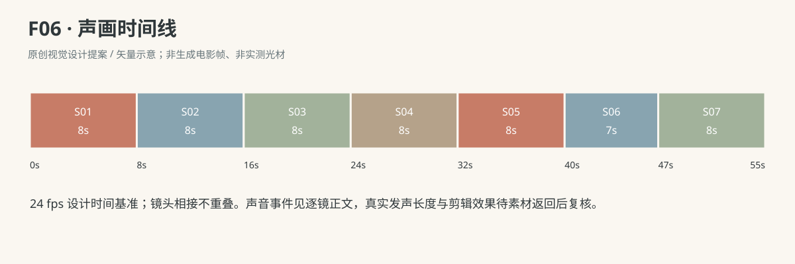

正式台词：无；保留镜头声音中已写明的自然发声。

### 连续性与试片

- 连续性：三块编号A/B/C仅供制作追踪，画面无字母；圆缝线A、方缝线B、十字缝线C，不复制增加。

- 连续性：A与B先后入P07又被取出，C始终爸爸右手持到递出；最终行从西到东A/B/C。

- 连续性：宝宝侧伸取积木时左掌撑垫、右手取物；最后接C时已坐正，可双手短暂持物。

- 连续性：爸爸先看见两块排列才移动盒并递C，盒最后在宝宝右后方，不能占据新排列。

- 连续性：趣味来自双方当前动作目标不同，不用故意捣乱或已懂收纳规则的表情；TD07只作关系机制灵感，软积木任务是原创。

- 试片：F06-S02—S04试剪：A/B必须分别入盒再出盒，若切后B凭空出现在行里或盒中仍有同款副本，则失败。

- 试片：F06-S05—S06：爸爸观察后才改为平托递物；若直接把积木塞进宝宝手或提前帮摆，则不成立。

- 试片：F06-S07俯拍预演：仅三块、东西顺序A/B/C，宝宝推块时底面贴垫；若块穿掌、弹跳或父亲自动排直，则失败。

**媒体待验证：**未生成媒体；待验盒沿取物遮挡、双手交接软块、三块同款资产身份连续、低摩擦推放与坐姿平衡。

---

## F07《爷爷的报纸后面》

**45 秒｜坐姿与手部互动｜角色：澈澈、爷爷｜场景 L**

### 剧情正文

西窗照着沙发西端，爷爷坐着读报，澈澈在他前方的地垫上，腿上放着一本蓝绿布书。爷爷翻页，把报纸举高，脸一下不见了。澈澈抬头看了一会儿，右手撑到垫上，脑袋往一边探。爷爷正要放低报纸，发现那双努力寻找的眼睛，便从纸边慢慢露出半张脸。澈澈看见他，嘴一下咧开。爷爷重新藏回去，停一拍，再从另一边出来。澈澈先看错了方向，转回来找见他，笑得肩膀轻晃。爷爷也笑了，终于把报纸折低到膝上，准备接着看。澈澈却低头摸到自己的布书，两只手把它举起来，挡在眼睛前面，露着额发和一点下巴。爷爷抬眼，面前的小脸换成了蓝绿书皮。他没有去拉书，只把身子往旁边探一点。布书也慢慢偏过去，仍想挡住他。爷爷从书边找到一只眼，澈澈便笑着把书放低。报纸还在爷爷膝上，读到的那一页暂时没有翻过去。

### 导演与空间

**观察任务：**从爷爷真实读报的遮挡关系变成两人轮流寻找，宝宝用布书接过游戏主动权。

**空间与光位：**L客厅北墙沙发、西窗、东走廊、中央地垫。爷爷坐沙发西端朝南，F07-X01无可读标题的报纸在双手；澈澈坐其南偏东地垫朝西北，P05蓝绿布书闭合放腿上。摄影固定在两人连线东南侧，爷爷画左上、宝宝画右下；西窗光由左侧，报纸与布书遮挡都发生在两人视线之间，不反打穿报纸。

**人物表演：**爷爷最初认真阅读一个版面，被宝宝寻找才放慢翻页，露面幅度小而不突然吓人。澈澈稳坐，探头时一只掌先撑垫，眼睛和头移动多于躯干；后半双手举布书，动作是邀请，并非理解规则后机械执行。

### 节拍覆盖

- **F07-b1**：先让读报本身成立，随后纸页自然挡住熟悉的脸。 前态：爷爷双手持报于胸口，脸露出；澈澈腿上放P05，双手落书边，抬头看爷爷。 后态：报纸挡住爷爷脸，双手各持一边；澈澈抬眼看纸上缘，布书仍在腿。 → F07-S01

- **F07-b2**：宝宝的寻找被爷爷接收到，第一次露面慢慢发生。 前态：报纸完全挡爷爷脸，澈澈双手在腿上布书边，身体坐正。 后态：爷爷半脸从报纸东边露出，澈澈右掌撑垫、左手在布书上，身体微侧。 → F07-S02

- **F07-b3**：第二次改边让游戏被宝宝继续参与，保留一拍找错再找见。 前态：爷爷头在报纸东边露出，澈澈已笑、右掌撑垫微侧坐。 后态：爷爷在报纸西边露脸，澈澈身体趋于坐正，右掌仍撑，书在腿。 → F07-S03

- **F07-b4**：爷爷准备回到读报，宝宝却接过游戏的主动权。 前态：爷爷脸在纸西边，澈澈右掌撑垫、左手在腿上布书，身体接近坐正。 后态：报纸折在爷爷膝上、双手轻按；布书澈澈双手举脸前，宝宝坐稳。 → F07-S04

- **F07-b5**：爷爷识别邀请后用探身来回应，宝宝的书也会慢慢跟着挡。 前态：爷爷看着宝宝脸前布书，报纸折在膝，宝宝两手抓书侧、书面大致竖直。 后态：爷爷从布书东边看见一只眼，书仍澈澈双手握住，双方都停一拍。 → F07-S05

- **F07-b6**：轮到宝宝被找到，读报暂缓但不被宣布成牺牲与道理。 前态：爷爷微向东探，澈澈书东边露一眼，双手仍持P05，爷爷双手按报。 后态：布书回宝宝腿上、报纸在爷爷膝上，两人对视，游戏自然歇一下。 → F07-S06

### 分镜构图板

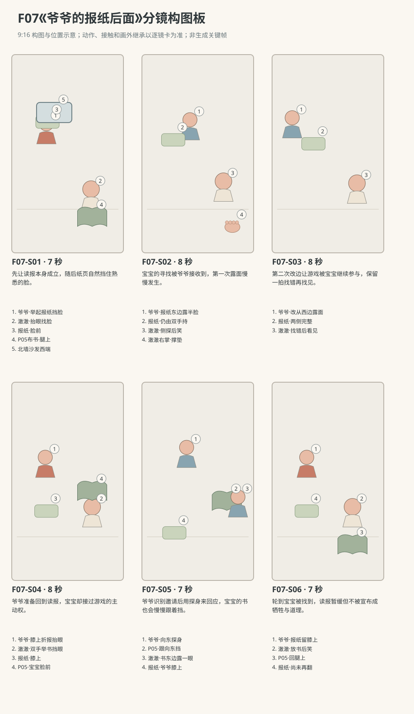

图示为构图位置示意；姿态、接触和画外继承以逐镜正文为准。

### 逐镜设计

#### F07-S01｜00—07 秒｜7 秒｜帧 [0, 168)

**镜头任务：**先让读报本身成立，随后纸页自然挡住熟悉的脸。

**景别、机位与构图：**二人中全景，东南朝西北，爷爷左上坐沙发，澈澈右下坐垫，布书在腿，报纸初在爷爷胸前。

**摄影机与理由：**固定，以高度差读出宝宝为什么需要抬眼找脸。

**焦点：**爷爷脸与宝宝抬眼同清晰，报纸边缘可辨。

**入态：**爷爷双手持报于胸口，脸露出；澈澈腿上放P05，双手落书边，抬头看爷爷。

**动作与表演：**

- 3 秒：爷爷眼睛沿报纸一栏慢慢下移，澈澈看他，自己右指轻摸布书角。

- 4 秒：爷爷翻页并把报纸举高，纸面逐渐挡住整张脸，澈澈目光停在刚才脸的位置。

**声音：**翻报纸的清晰轻响、棉衣摩擦、环境底声，无对白。

**出态：**报纸挡住爷爷脸，双手各持一边；澈澈抬眼看纸上缘，布书仍在腿。

**切点与承接：**接宝宝探头寻找的侧倾，保留脸确实被遮住的起态。

**连续性：**无印刷标题可读要求；纸不能透明看见爷爷五官，布书未被拿起。

**开始画面母稿：**

9:16竖幅，原创三维生活动画，圆润而有重量的造型，棉布细纹、柔和皮肤层次与可读的小表情；动作按真实生活物理及婴儿当下能力展开，不用成人化算计表情。澈澈为圆脸、深棕眼、短黑绒发、额前一小撮向右弯的头发，穿奶油色棉连体衣。爷爷灰短发，浅灰开衫、深蓝长裤。本镜开始画面为单一瞬间：爷爷双手持报于胸口，脸露出；澈澈腿上放P05，双手落书边，抬头看爷爷。 场次方位与光位：L客厅北墙沙发、西窗、东走廊、中央地垫。爷爷在沙发西端朝南，澈澈在其南偏东地垫朝西北。摄影始终在连线东南侧，爷爷左上、宝宝右下，窗光来自左。报纸与P05布书是两件不同物品，其高度与持物状态只依本镜起态。 摄影构图：二人中全景，东南朝西北，爷爷左上坐沙发，澈澈右下坐垫，布书在腿，报纸初在爷爷胸前。 当前焦点：爷爷露在胸前报纸上方的脸、宝宝抬眼及腿上P05。只呈现上述起态，不把后续动作拼入一张画面。

**视频变化母稿：**

9:16竖幅，原创三维生活动画，圆润而有重量的造型，棉布细纹、柔和皮肤层次与可读的小表情；动作按真实生活物理及婴儿当下能力展开，不用成人化算计表情。澈澈为圆脸、深棕眼、短黑绒发、额前一小撮向右弯的头发，穿奶油色棉连体衣。爷爷灰短发，浅灰开衫、深蓝长裤。制作一段7秒连续镜头。本段人物和能力：澈澈、爷爷，澈澈为R1。空间光位：L客厅北墙沙发、西窗、东走廊、中央地垫。爷爷在沙发西端朝南，澈澈在其南偏东地垫朝西北。摄影始终在连线东南侧，爷爷左上、宝宝右下，窗光来自左。报纸与P05布书是两件不同物品，其高度与持物状态只依本镜起态。 起态：爷爷双手持报于胸口，脸露出；澈澈腿上放P05，双手落书边，抬头看爷爷。 摄影：二人中全景，东南朝西北，爷爷左上坐沙发，澈澈右下坐垫，布书在腿，报纸初在爷爷胸前。 相机行为：固定，以高度差读出宝宝为什么需要抬眼找脸。 焦点：爷爷脸与宝宝抬眼同清晰，报纸边缘可辨。 时间过程：第1阶段3秒：爷爷眼睛沿报纸一栏慢慢下移，澈澈看他，自己右指轻摸布书角。；第2阶段4秒：爷爷翻页并把报纸举高，纸面逐渐挡住整张脸，澈澈目光停在刚才脸的位置。。声音：翻报纸的清晰轻响、棉衣摩擦、环境底声，无对白。 终态：报纸挡住爷爷脸，双手各持一边；澈澈抬眼看纸上缘，布书仍在腿。 连续性：无印刷标题可读要求；纸不能透明看见爷爷五官，布书未被拿起。 不加未写出的对白、人物或道具。

#### F07-S02｜07—15 秒｜8 秒｜帧 [168, 360)

**镜头任务：**宝宝的寻找被爷爷接收到，第一次露面慢慢发生。

**景别、机位与构图：**二人中景，东南同侧，报纸与爷爷坐姿占左半，澈澈右半，下缘见宝宝右掌可撑区域。

**摄影机与理由：**固定，纸边、宝宝视线和爷爷露脸必须同框读懂。

**焦点：**宝宝探看的眼睛与纸的东侧边缘，爷爷露面后共同清晰。

**入态：**报纸完全挡爷爷脸，澈澈双手在腿上布书边，身体坐正。

**动作与表演：**

- 3 秒：澈澈右掌从书边落到右膝外地垫，身体微向右侧倾，脑袋探向报纸东侧。

- 2 秒：爷爷稍放低纸边看见澈澈的寻找，目光与他对上。

- 3 秒：爷爷把头移向自身左侧、从报纸东边慢慢露半张脸，澈澈张嘴笑一小声。

**声音：**报纸微折响后才有宝宝短笑，爷爷轻呼气，无对白。

**出态：**爷爷半脸从报纸东边露出，澈澈右掌撑垫、左手在布书上，身体微侧。

**切点与承接：**在宝宝确认找到的目光上切稍近同侧，准备另边露面。

**连续性：**爷爷不是从纸中间穿出；澈澈右掌承重、布书留腿未落地。

**开始画面母稿：**

9:16竖幅，原创三维生活动画，圆润而有重量的造型，棉布细纹、柔和皮肤层次与可读的小表情；动作按真实生活物理及婴儿当下能力展开，不用成人化算计表情。澈澈为圆脸、深棕眼、短黑绒发、额前一小撮向右弯的头发，穿奶油色棉连体衣。爷爷灰短发，浅灰开衫、深蓝长裤。本镜开始画面为单一瞬间：报纸完全挡爷爷脸，澈澈双手在腿上布书边，身体坐正。 场次方位与光位：L客厅北墙沙发、西窗、东走廊、中央地垫。爷爷在沙发西端朝南，澈澈在其南偏东地垫朝西北。摄影始终在连线东南侧，爷爷左上、宝宝右下，窗光来自左。报纸与P05布书是两件不同物品，其高度与持物状态只依本镜起态。 摄影构图：二人中景，东南同侧，报纸与爷爷坐姿占左半，澈澈右半，下缘见宝宝右掌可撑区域。 当前焦点：真正被报纸遮住的脸区与宝宝将探头前的双眼。只呈现上述起态，不把后续动作拼入一张画面。

**视频变化母稿：**

9:16竖幅，原创三维生活动画，圆润而有重量的造型，棉布细纹、柔和皮肤层次与可读的小表情；动作按真实生活物理及婴儿当下能力展开，不用成人化算计表情。澈澈为圆脸、深棕眼、短黑绒发、额前一小撮向右弯的头发，穿奶油色棉连体衣。爷爷灰短发，浅灰开衫、深蓝长裤。制作一段8秒连续镜头。本段人物和能力：澈澈、爷爷，澈澈为R1。空间光位：L客厅北墙沙发、西窗、东走廊、中央地垫。爷爷在沙发西端朝南，澈澈在其南偏东地垫朝西北。摄影始终在连线东南侧，爷爷左上、宝宝右下，窗光来自左。报纸与P05布书是两件不同物品，其高度与持物状态只依本镜起态。 起态：报纸完全挡爷爷脸，澈澈双手在腿上布书边，身体坐正。 摄影：二人中景，东南同侧，报纸与爷爷坐姿占左半，澈澈右半，下缘见宝宝右掌可撑区域。 相机行为：固定，纸边、宝宝视线和爷爷露脸必须同框读懂。 焦点：宝宝探看的眼睛与纸的东侧边缘，爷爷露面后共同清晰。 时间过程：第1阶段3秒：澈澈右掌从书边落到右膝外地垫，身体微向右侧倾，脑袋探向报纸东侧。；第2阶段2秒：爷爷稍放低纸边看见澈澈的寻找，目光与他对上。；第3阶段3秒：爷爷把头移向自身左侧、从报纸东边慢慢露半张脸，澈澈张嘴笑一小声。。声音：报纸微折响后才有宝宝短笑，爷爷轻呼气，无对白。 终态：爷爷半脸从报纸东边露出，澈澈右掌撑垫、左手在布书上，身体微侧。 连续性：爷爷不是从纸中间穿出；澈澈右掌承重、布书留腿未落地。 不加未写出的对白、人物或道具。

#### F07-S03｜15—23 秒｜8 秒｜帧 [360, 552)

**镜头任务：**第二次改边让游戏被宝宝继续参与，保留一拍找错再找见。

**景别、机位与构图：**紧凑二人中景，东南同轴，报纸左右边缘都在框，澈澈侧脸在右下，爷爷头的移动不出上缘。

**摄影机与理由：**固定，不靠左右快速摇镜替爷爷玩躲猫猫。

**焦点：**先报纸东边宝宝等待处，随后平稳转向西边露出的爷爷脸。

**入态：**爷爷头在报纸东边露出，澈澈已笑、右掌撑垫微侧坐。

**动作与表演：**

- 2 秒：爷爷把头慢慢收回报纸后，澈澈仍盯东边等。

- 3 秒：停一拍后爷爷把头移向自身右侧，从报纸西边露脸，澈澈先望空的东边。

- 3 秒：澈澈抬眼绕过纸上缘看见西边的爷爷，身体回正一点，笑声短短接起来。

**声音：**纸边轻动、澈澈发现后两声笑，爷爷一声低短笑，无对白。

**出态：**爷爷在报纸西边露脸，澈澈身体趋于坐正，右掌仍撑，书在腿。

**切点与承接：**笑声延续到爷爷放低报纸的宽一点画面。

**连续性：**东到西的头部移动在纸后完成，纸不变尺寸；澈澈不站起追脸。

**开始画面母稿：**

9:16竖幅，原创三维生活动画，圆润而有重量的造型，棉布细纹、柔和皮肤层次与可读的小表情；动作按真实生活物理及婴儿当下能力展开，不用成人化算计表情。澈澈为圆脸、深棕眼、短黑绒发、额前一小撮向右弯的头发，穿奶油色棉连体衣。爷爷灰短发，浅灰开衫、深蓝长裤。本镜开始画面为单一瞬间：爷爷头在报纸东边露出，澈澈已笑、右掌撑垫微侧坐。 场次方位与光位：L客厅北墙沙发、西窗、东走廊、中央地垫。爷爷在沙发西端朝南，澈澈在其南偏东地垫朝西北。摄影始终在连线东南侧，爷爷左上、宝宝右下，窗光来自左。报纸与P05布书是两件不同物品，其高度与持物状态只依本镜起态。 摄影构图：紧凑二人中景，东南同轴，报纸左右边缘都在框，澈澈侧脸在右下，爷爷头的移动不出上缘。 当前焦点：爷爷在报纸东边露出的半张脸、宝宝看见后的眼神。只呈现上述起态，不把后续动作拼入一张画面。

**视频变化母稿：**

9:16竖幅，原创三维生活动画，圆润而有重量的造型，棉布细纹、柔和皮肤层次与可读的小表情；动作按真实生活物理及婴儿当下能力展开，不用成人化算计表情。澈澈为圆脸、深棕眼、短黑绒发、额前一小撮向右弯的头发，穿奶油色棉连体衣。爷爷灰短发，浅灰开衫、深蓝长裤。制作一段8秒连续镜头。本段人物和能力：澈澈、爷爷，澈澈为R1。空间光位：L客厅北墙沙发、西窗、东走廊、中央地垫。爷爷在沙发西端朝南，澈澈在其南偏东地垫朝西北。摄影始终在连线东南侧，爷爷左上、宝宝右下，窗光来自左。报纸与P05布书是两件不同物品，其高度与持物状态只依本镜起态。 起态：爷爷头在报纸东边露出，澈澈已笑、右掌撑垫微侧坐。 摄影：紧凑二人中景，东南同轴，报纸左右边缘都在框，澈澈侧脸在右下，爷爷头的移动不出上缘。 相机行为：固定，不靠左右快速摇镜替爷爷玩躲猫猫。 焦点：先报纸东边宝宝等待处，随后平稳转向西边露出的爷爷脸。 时间过程：第1阶段2秒：爷爷把头慢慢收回报纸后，澈澈仍盯东边等。；第2阶段3秒：停一拍后爷爷把头移向自身右侧，从报纸西边露脸，澈澈先望空的东边。；第3阶段3秒：澈澈抬眼绕过纸上缘看见西边的爷爷，身体回正一点，笑声短短接起来。。声音：纸边轻动、澈澈发现后两声笑，爷爷一声低短笑，无对白。 终态：爷爷在报纸西边露脸，澈澈身体趋于坐正，右掌仍撑，书在腿。 连续性：东到西的头部移动在纸后完成，纸不变尺寸；澈澈不站起追脸。 不加未写出的对白、人物或道具。

#### F07-S04｜23—31 秒｜8 秒｜帧 [552, 744)

**镜头任务：**爷爷准备回到读报，宝宝却接过游戏的主动权。

**景别、机位与构图：**二人中全景，东南同侧，爷爷双膝与宝宝腿上布书都可见，不裁遮道具转移。

**摄影机与理由：**固定，报纸降低与布书抬起都在同一时空进行。

**焦点：**先爷爷折报动作，再移澈澈双手与布书，成人脸保持可辨。

**入态：**爷爷脸在纸西边，澈澈右掌撑垫、左手在腿上布书，身体接近坐正。

**动作与表演：**

- 3 秒：爷爷把头回正、双手将报纸折低到膝上，自己低头准备看原来那栏。

- 2 秒：澈澈完全坐正，把右手从垫上收回布书右边，双手握住书侧。

- 3 秒：澈澈把布书慢慢举到眼前，遮住两眼和鼻上部，额发与下巴仍露；爷爷抬眼看见蓝绿书皮。

**声音：**折报声比布书摩擦稍清楚，宝宝轻鼻音，爷爷呼吸，无对白。

**出态：**报纸折在爷爷膝上、双手轻按；布书澈澈双手举脸前，宝宝坐稳。

**切点与承接：**切宝宝书前与爷爷目光关系的中近景，接成人回应。

**连续性：**右掌离垫前坐正过程可见；P05从腿上来，报纸不交换给宝宝。

**开始画面母稿：**

9:16竖幅，原创三维生活动画，圆润而有重量的造型，棉布细纹、柔和皮肤层次与可读的小表情；动作按真实生活物理及婴儿当下能力展开，不用成人化算计表情。澈澈为圆脸、深棕眼、短黑绒发、额前一小撮向右弯的头发，穿奶油色棉连体衣。爷爷灰短发，浅灰开衫、深蓝长裤。本镜开始画面为单一瞬间：爷爷脸在纸西边，澈澈右掌撑垫、左手在腿上布书，身体接近坐正。 场次方位与光位：L客厅北墙沙发、西窗、东走廊、中央地垫。爷爷在沙发西端朝南，澈澈在其南偏东地垫朝西北。摄影始终在连线东南侧，爷爷左上、宝宝右下，窗光来自左。报纸与P05布书是两件不同物品，其高度与持物状态只依本镜起态。 摄影构图：二人中全景，东南同侧，爷爷双膝与宝宝腿上布书都可见，不裁遮道具转移。 当前焦点：爷爷在报纸西边的脸、宝宝腿上布书与撑垫右掌。只呈现上述起态，不把后续动作拼入一张画面。

**视频变化母稿：**

9:16竖幅，原创三维生活动画，圆润而有重量的造型，棉布细纹、柔和皮肤层次与可读的小表情；动作按真实生活物理及婴儿当下能力展开，不用成人化算计表情。澈澈为圆脸、深棕眼、短黑绒发、额前一小撮向右弯的头发，穿奶油色棉连体衣。爷爷灰短发，浅灰开衫、深蓝长裤。制作一段8秒连续镜头。本段人物和能力：澈澈、爷爷，澈澈为R1。空间光位：L客厅北墙沙发、西窗、东走廊、中央地垫。爷爷在沙发西端朝南，澈澈在其南偏东地垫朝西北。摄影始终在连线东南侧，爷爷左上、宝宝右下，窗光来自左。报纸与P05布书是两件不同物品，其高度与持物状态只依本镜起态。 起态：爷爷脸在纸西边，澈澈右掌撑垫、左手在腿上布书，身体接近坐正。 摄影：二人中全景，东南同侧，爷爷双膝与宝宝腿上布书都可见，不裁遮道具转移。 相机行为：固定，报纸降低与布书抬起都在同一时空进行。 焦点：先爷爷折报动作，再移澈澈双手与布书，成人脸保持可辨。 时间过程：第1阶段3秒：爷爷把头回正、双手将报纸折低到膝上，自己低头准备看原来那栏。；第2阶段2秒：澈澈完全坐正，把右手从垫上收回布书右边，双手握住书侧。；第3阶段3秒：澈澈把布书慢慢举到眼前，遮住两眼和鼻上部，额发与下巴仍露；爷爷抬眼看见蓝绿书皮。。声音：折报声比布书摩擦稍清楚，宝宝轻鼻音，爷爷呼吸，无对白。 终态：报纸折在爷爷膝上、双手轻按；布书澈澈双手举脸前，宝宝坐稳。 连续性：右掌离垫前坐正过程可见；P05从腿上来，报纸不交换给宝宝。 不加未写出的对白、人物或道具。

#### F07-S05｜31—38 秒｜7 秒｜帧 [744, 912)

**镜头任务：**爷爷识别邀请后用探身来回应，宝宝的书也会慢慢跟着挡。

**景别、机位与构图：**二人中景，东南同侧，爷爷左上、蓝绿布书右下、宝宝露出的额发与下巴可见，爷爷膝上报纸在左下缘。

**摄影机与理由：**固定，让爷爷位移与书的跟随形成慢而可读的关系。

**焦点：**爷爷眼睛与布书边缘；不透书找宝宝眼睛。

**入态：**爷爷看着宝宝脸前布书，报纸折在膝，宝宝两手抓书侧、书面大致竖直。

**动作与表演：**

- 3 秒：爷爷嘴角上扬，身体朝自身左侧即房间东侧探一点，双手仍轻按膝上报纸。

- 2 秒：澈澈听见衣料声，双手把布书向同一东侧小移，仍想挡住脸。

- 2 秒：爷爷停住再微低头，恰好从书东边看见宝宝一只眼。

**声音：**爷爷开衫擦报纸的细声、布书轻响、澈澈忍笑的鼻音，无对白。

**出态：**爷爷从布书东边看见一只眼，书仍澈澈双手握住，双方都停一拍。

**切点与承接：**在目光重新对上的一拍接宝宝放低布书。

**连续性：**爷爷不掀书不伸手，纸仍膝上；书东移幅度小不遮掉宝宝额发方位。

**开始画面母稿：**

9:16竖幅，原创三维生活动画，圆润而有重量的造型，棉布细纹、柔和皮肤层次与可读的小表情；动作按真实生活物理及婴儿当下能力展开，不用成人化算计表情。澈澈为圆脸、深棕眼、短黑绒发、额前一小撮向右弯的头发，穿奶油色棉连体衣。爷爷灰短发，浅灰开衫、深蓝长裤。本镜开始画面为单一瞬间：爷爷看着宝宝脸前布书，报纸折在膝，宝宝两手抓书侧、书面大致竖直。 场次方位与光位：L客厅北墙沙发、西窗、东走廊、中央地垫。爷爷在沙发西端朝南，澈澈在其南偏东地垫朝西北。摄影始终在连线东南侧，爷爷左上、宝宝右下，窗光来自左。报纸与P05布书是两件不同物品，其高度与持物状态只依本镜起态。 摄影构图：二人中景，东南同侧，爷爷左上、蓝绿布书右下、宝宝露出的额发与下巴可见，爷爷膝上报纸在左下缘。 当前焦点：宝宝双手举在眼前的蓝绿书皮、爷爷膝上折报与回应眼神。只呈现上述起态，不把后续动作拼入一张画面。

**视频变化母稿：**

9:16竖幅，原创三维生活动画，圆润而有重量的造型，棉布细纹、柔和皮肤层次与可读的小表情；动作按真实生活物理及婴儿当下能力展开，不用成人化算计表情。澈澈为圆脸、深棕眼、短黑绒发、额前一小撮向右弯的头发，穿奶油色棉连体衣。爷爷灰短发，浅灰开衫、深蓝长裤。制作一段7秒连续镜头。本段人物和能力：澈澈、爷爷，澈澈为R1。空间光位：L客厅北墙沙发、西窗、东走廊、中央地垫。爷爷在沙发西端朝南，澈澈在其南偏东地垫朝西北。摄影始终在连线东南侧，爷爷左上、宝宝右下，窗光来自左。报纸与P05布书是两件不同物品，其高度与持物状态只依本镜起态。 起态：爷爷看着宝宝脸前布书，报纸折在膝，宝宝两手抓书侧、书面大致竖直。 摄影：二人中景，东南同侧，爷爷左上、蓝绿布书右下、宝宝露出的额发与下巴可见，爷爷膝上报纸在左下缘。 相机行为：固定，让爷爷位移与书的跟随形成慢而可读的关系。 焦点：爷爷眼睛与布书边缘；不透书找宝宝眼睛。 时间过程：第1阶段3秒：爷爷嘴角上扬，身体朝自身左侧即房间东侧探一点，双手仍轻按膝上报纸。；第2阶段2秒：澈澈听见衣料声，双手把布书向同一东侧小移，仍想挡住脸。；第3阶段2秒：爷爷停住再微低头，恰好从书东边看见宝宝一只眼。。声音：爷爷开衫擦报纸的细声、布书轻响、澈澈忍笑的鼻音，无对白。 终态：爷爷从布书东边看见一只眼，书仍澈澈双手握住，双方都停一拍。 连续性：爷爷不掀书不伸手，纸仍膝上；书东移幅度小不遮掉宝宝额发方位。 不加未写出的对白、人物或道具。

#### F07-S06｜38—45 秒｜7 秒｜帧 [912, 1080)

**镜头任务：**轮到宝宝被找到，读报暂缓但不被宣布成牺牲与道理。

**景别、机位与构图：**二人中景同轴，爷爷左上、宝宝右下，书下降路径及膝上报纸都完整入框。

**摄影机与理由：**轻缓向两人间收近少许，目的是听见小笑，不改变轴线。

**焦点：**宝宝露出的全脸和爷爷对视，书回腿仍可辨。

**入态：**爷爷微向东探，澈澈书东边露一眼，双手仍持P05，爷爷双手按报。

**动作与表演：**

- 3 秒：澈澈笑出声，把布书从眼前放低到胸口，爷爷跟着低短笑。

- 2 秒：澈澈把书放回自己腿上、双手仍搭书边，身体坐正；爷爷也回正坐姿。

- 2 秒：两人看着彼此留一点笑，爷爷没有立刻举起报纸。

**声音：**澈澈自然短笑、爷爷低笑，书触衣软声，最后呼吸留白，无对白无音乐。

**出态：**布书回宝宝腿上、报纸在爷爷膝上，两人对视，游戏自然歇一下。

**切点与承接：**在爷爷仍没翻页的小停顿结束，不做额外躲藏循环。

**连续性：**书纸各回原主人，不新增道具；宝宝全片稳坐，无伸手抓纸。

**开始画面母稿：**

9:16竖幅，原创三维生活动画，圆润而有重量的造型，棉布细纹、柔和皮肤层次与可读的小表情；动作按真实生活物理及婴儿当下能力展开，不用成人化算计表情。澈澈为圆脸、深棕眼、短黑绒发、额前一小撮向右弯的头发，穿奶油色棉连体衣。爷爷灰短发，浅灰开衫、深蓝长裤。本镜开始画面为单一瞬间：爷爷微向东探，澈澈书东边露一眼，双手仍持P05，爷爷双手按报。 场次方位与光位：L客厅北墙沙发、西窗、东走廊、中央地垫。爷爷在沙发西端朝南，澈澈在其南偏东地垫朝西北。摄影始终在连线东南侧，爷爷左上、宝宝右下，窗光来自左。报纸与P05布书是两件不同物品，其高度与持物状态只依本镜起态。 摄影构图：二人中景同轴，爷爷左上、宝宝右下，书下降路径及膝上报纸都完整入框。 当前焦点：宝宝从布书东边露出的一只眼与爷爷探身后的双眼。只呈现上述起态，不把后续动作拼入一张画面。

**视频变化母稿：**

9:16竖幅，原创三维生活动画，圆润而有重量的造型，棉布细纹、柔和皮肤层次与可读的小表情；动作按真实生活物理及婴儿当下能力展开，不用成人化算计表情。澈澈为圆脸、深棕眼、短黑绒发、额前一小撮向右弯的头发，穿奶油色棉连体衣。爷爷灰短发，浅灰开衫、深蓝长裤。制作一段7秒连续镜头。本段人物和能力：澈澈、爷爷，澈澈为R1。空间光位：L客厅北墙沙发、西窗、东走廊、中央地垫。爷爷在沙发西端朝南，澈澈在其南偏东地垫朝西北。摄影始终在连线东南侧，爷爷左上、宝宝右下，窗光来自左。报纸与P05布书是两件不同物品，其高度与持物状态只依本镜起态。 起态：爷爷微向东探，澈澈书东边露一眼，双手仍持P05，爷爷双手按报。 摄影：二人中景同轴，爷爷左上、宝宝右下，书下降路径及膝上报纸都完整入框。 相机行为：轻缓向两人间收近少许，目的是听见小笑，不改变轴线。 焦点：宝宝露出的全脸和爷爷对视，书回腿仍可辨。 时间过程：第1阶段3秒：澈澈笑出声，把布书从眼前放低到胸口，爷爷跟着低短笑。；第2阶段2秒：澈澈把书放回自己腿上、双手仍搭书边，身体坐正；爷爷也回正坐姿。；第3阶段2秒：两人看着彼此留一点笑，爷爷没有立刻举起报纸。。声音：澈澈自然短笑、爷爷低笑，书触衣软声，最后呼吸留白，无对白无音乐。 终态：布书回宝宝腿上、报纸在爷爷膝上，两人对视，游戏自然歇一下。 连续性：书纸各回原主人，不新增道具；宝宝全片稳坐，无伸手抓纸。 不加未写出的对白、人物或道具。

### 声音与剪辑

无语言对白和配乐。报纸翻页、折页声音与布书柔软擦响区分，笑声由发现露面后出现，爷爷低短笑不盖住澈澈。无突然扑出的惊吓音。

正式台词：无；保留镜头声音中已写明的自然发声。

### 连续性与试片

- 连续性：爷爷固定沙发西端，澈澈地垫南偏东；摄影在东南，爷爷左右露面按其自身方位记录。

- 连续性：爷爷双手持报，第一次从自身左侧即房间东侧露面，第二次从自身右侧即房间西侧露面，不穿纸。

- 连续性：P05从宝宝腿上到双手，再回腿上；报纸最后折在爷爷膝，始终未交给宝宝。

- 连续性：澈澈探头先右掌撑垫，举书前身体回正坐稳；书不能硬穿脸或变成纸报。

- 试片：F07-S02—S03静音试看：宝宝寻脸方向和爷爷两次露面边缘应真实相连；若报纸不挡脸却表现寻找，则失败。

- 试片：F07-S04—S05：布书须从腿上被双手举起，爷爷先见书再响应；若宝宝书突然贴脸或成人预先摆好则失败。

- 试片：F07-S06试片：爷爷探身、书向同侧偏、宝宝露一眼再放低应分阶段可辨；若变成突然掀书吓宝宝则失败。

**媒体待验证：**未生成媒体；待验报纸折叠拓扑、视线遮挡、宝宝侧倾支撑与软布书举在脸前的手指连续。

---

## F08《一家人的小合唱》

**45 秒｜坐姿与手部互动｜角色：澈澈、爸爸、妈妈｜场景 L**

### 剧情正文

客厅地垫上，妈妈摊着一块奶油色布巾，边对齐两角边轻轻哼歌。爸爸在澈澈另一边翻布书，听熟了小调，抬一下眼，也接进一条低低的和声。澈澈先看看妈妈的嘴，再看看爸爸，突然响亮地“啊”了一声。两条哼声一下停了，妈妈的布巾还夹在手里，爸爸的手指也留在翻了一半的书页上。两人都看着他，等下一声。可澈澈也不说了，轮流看他们，嘴巴微微张开，像也在等谁接下去。安静持续了一小会儿。妈妈吸了一点气，爸爸刚好把目光移回她那边，澈澈的胸口也轻轻鼓起来。三个人几乎同时出了声：两个“嗯”和一个“啊”挤在一起，谁也没听清谁。妈妈先笑，爸爸低着头笑出了气，澈澈被两张笑脸逗得跟着笑。等呼吸平下来，妈妈把最后一角布巾叠好，爸爸把布书页放平，三个人都还留着一点想接下一句的表情。

### 导演与空间

**观察任务：**用哼声、咿呀和互相等待的时间，表现三个人临时组成又笑散的小合唱，声音与目光同样承担叙事。

**空间与光位：**L客厅北墙沙发、西窗、东走廊、中央地垫。三人坐垫北半朝南，从西到东妈妈、澈澈、爸爸；妈妈跪坐，P04奶油布巾摊在膝上；爸爸盘腿，P05蓝绿布书打开在腿上；澈澈稳坐两人之间双手在膝边。摄影在南侧朝北，不跨三人东西连线；窗光由画左，三张嘴都可见。

**人物表演：**妈妈一边叠布巾一边哼自创小调，爸爸起初看书，被旋律吸引才加入低声；宝宝自己的发声让两人改变关注。三人都不是按指挥表演，等待时各自在观察别人的嘴与眼睛；同时发声后自然笑，不让宝宝唱出确定歌词或成人精准和声。

### 节拍覆盖

- **F08-b1**：妈妈自己的叠布巾与哼调成立，爸爸仍在看书，宝宝开始注意声音。 前态：妈妈双手拿布巾两角摊在膝上，爸爸左掌托P05右指放在一页边，澈澈双手在膝外撑垫。 后态：布巾半折妈妈手中，爸爸抬眼，宝宝看妈妈嘴，三人仍原坐序。 → F08-S01

- **F08-b2**：爸爸因为听见旋律而加入，宝宝轮流检查两个声源。 前态：妈妈捏半折布巾、准备下一句，爸爸眼睛抬向妈妈、右指仍在书页边，澈澈看妈妈。 后态：宝宝嘴微张，妈妈持布巾并延长末鼻音，爸爸右指提住半页、左掌托书也持续低鼻音，父母尚未收声。 → F08-S02

- **F08-b3**：宝宝发声让父母主动停下听，声音的轮流由此发生。 前态：澈澈嘴微张，妈妈持半折布巾、爸爸左掌托书右指提半页；父母仍在延续上一镜最后的轻鼻音，尚未停止。 后态：三人互相等待，妈妈布巾和爸爸半翻书页都在手中停稳，宝宝双手膝边。 → F08-S03

- **F08-b4**：三人都等别人先出声，静默本身成为可以读懂的小趣味。 前态：妈妈与爸爸看宝宝，澈澈刚看向爸爸，所有人都安静，物件保持上一镜。 后态：妈妈已吸气、爸爸看向妈妈、宝宝胸口轻起，三张嘴准备发声。 → F08-S04

- **F08-b5**：三人同时接句撞在一起，再因互相听见而笑散。 前态：三人都准备开口，妈妈捏半折P04、爸爸托P05半翻页、澈澈稳坐中间。 后态：三人都笑，爸爸右指仍托半翻页、妈妈仍持半折布巾，宝宝未离坐姿。 → F08-S05

- **F08-b6**：笑后回到各自的小事，留下还想接下一句的亲密余韵。 前态：三人笑声刚开始变短，妈妈持半折P04、爸爸托P05半翻页，澈澈坐中央双掌在膝外。 后态：P04叠好在妈妈膝上，P05落页在爸爸腿上，澈澈在两人间带笑，合唱暂歇。 → F08-S06

### 分镜构图板

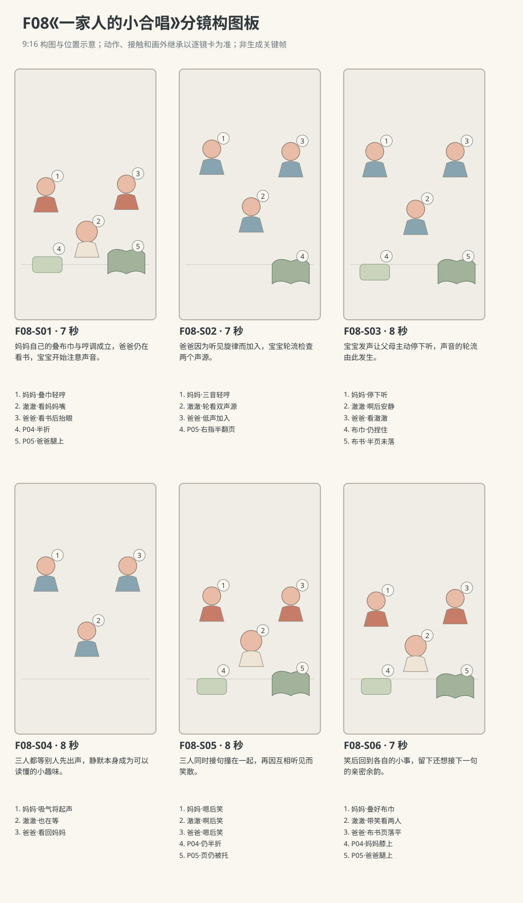

图示为构图位置示意；姿态、接触和画外继承以逐镜正文为准。

### 逐镜设计

#### F08-S01｜00—07 秒｜7 秒｜帧 [0, 168)

**镜头任务：**妈妈自己的叠布巾与哼调成立，爸爸仍在看书，宝宝开始注意声音。

**景别、机位与构图：**三人中全景，南侧朝北，妈妈左、宝宝中、爸爸右，布巾与布书在两端膝上，后景沙发不抢画面。

**摄影机与理由：**固定，容纳三个不同的初始注意对象。

**焦点：**妈妈嘴形与双手、爸爸书页、宝宝转向妈妈的眼神共同可辨。

**入态：**妈妈双手拿布巾两角摊在膝上，爸爸左掌托P05右指放在一页边，澈澈双手在膝外撑垫。

**动作与表演：**

- 2 秒：妈妈对齐布巾两角，爸爸低头看布书，澈澈看妈妈的手。

- 3 秒：妈妈开始轻哼原创三音小调，澈澈眼睛从布巾移到她嘴上。

- 2 秒：妈妈把布巾折成一半仍捏住上角，爸爸抬一点眼听见旋律。

**声音：**妈妈在第3—5秒哼“嗯——嗯、嗯”；另有布巾摩擦、轻书页声与环境声，爸爸宝宝不发声，无BGM。

**出态：**布巾半折妈妈手中，爸爸抬眼，宝宝看妈妈嘴，三人仍原坐序。

**切点与承接：**沿爸爸抬眼接二人嘴与宝宝的同框，开始低声加入。

**连续性：**P04/P05归属不换；宝宝双掌仍撑垫，哼声只来自妈妈。

**开始画面母稿：**

9:16竖幅，原创三维生活动画，圆润而有重量的造型，棉布细纹、柔和皮肤层次与可读的小表情；动作按真实生活物理及婴儿当下能力展开，不用成人化算计表情。澈澈为圆脸、深棕眼、短黑绒发、额前一小撮向右弯的头发，穿奶油色棉连体衣。爸爸短黑发，砖陶色棉衬衫、深灰长裤；妈妈深棕低马尾，雾蓝棉上衣、米色长裤。本镜开始画面为单一瞬间：妈妈双手拿布巾两角摊在膝上，爸爸左掌托P05右指放在一页边，澈澈双手在膝外撑垫。 场次方位与光位：L客厅北墙沙发、西窗、东走廊、中央地垫。三人自西到东为妈妈、澈澈、爸爸，均朝南；摄影南侧朝北，不越东西连线，窗光由画左。P04奶油布巾属于妈妈、P05蓝绿布书属于爸爸，折叠与翻页进度只依本镜起态，所有声音按本镜时间过程。 摄影构图：三人中全景，南侧朝北，妈妈左、宝宝中、爸爸右，布巾与布书在两端膝上，后景沙发不抢画面。 当前焦点：妈妈持P04的双手、爸爸P05书页与宝宝看妈妈的眼神。只呈现上述起态，不把后续动作拼入一张画面。

**视频变化母稿：**

9:16竖幅，原创三维生活动画，圆润而有重量的造型，棉布细纹、柔和皮肤层次与可读的小表情；动作按真实生活物理及婴儿当下能力展开，不用成人化算计表情。澈澈为圆脸、深棕眼、短黑绒发、额前一小撮向右弯的头发，穿奶油色棉连体衣。爸爸短黑发，砖陶色棉衬衫、深灰长裤；妈妈深棕低马尾，雾蓝棉上衣、米色长裤。制作一段7秒连续镜头。本段人物和能力：澈澈、爸爸、妈妈，澈澈为R1。空间光位：L客厅北墙沙发、西窗、东走廊、中央地垫。三人自西到东为妈妈、澈澈、爸爸，均朝南；摄影南侧朝北，不越东西连线，窗光由画左。P04奶油布巾属于妈妈、P05蓝绿布书属于爸爸，折叠与翻页进度只依本镜起态，所有声音按本镜时间过程。 起态：妈妈双手拿布巾两角摊在膝上，爸爸左掌托P05右指放在一页边，澈澈双手在膝外撑垫。 摄影：三人中全景，南侧朝北，妈妈左、宝宝中、爸爸右，布巾与布书在两端膝上，后景沙发不抢画面。 相机行为：固定，容纳三个不同的初始注意对象。 焦点：妈妈嘴形与双手、爸爸书页、宝宝转向妈妈的眼神共同可辨。 时间过程：第1阶段2秒：妈妈对齐布巾两角，爸爸低头看布书，澈澈看妈妈的手。；第2阶段3秒：妈妈开始轻哼原创三音小调，澈澈眼睛从布巾移到她嘴上。；第3阶段2秒：妈妈把布巾折成一半仍捏住上角，爸爸抬一点眼听见旋律。。声音：妈妈在第3—5秒哼“嗯——嗯、嗯”；另有布巾摩擦、轻书页声与环境声，爸爸宝宝不发声，无BGM。 终态：布巾半折妈妈手中，爸爸抬眼，宝宝看妈妈嘴，三人仍原坐序。 连续性：P04/P05归属不换；宝宝双掌仍撑垫，哼声只来自妈妈。 不加未写出的对白、人物或道具。

#### F08-S02｜07—14 秒｜7 秒｜帧 [168, 336)

**镜头任务：**爸爸因为听见旋律而加入，宝宝轮流检查两个声源。

**景别、机位与构图：**三人中景同轴稍紧，三张脸在上中，布巾和书在下缘，妈妈左爸爸右不镜像。

**摄影机与理由：**固定，不以声源切镜打断宝宝左右看人的完整过程。

**焦点：**三张嘴共同清晰，宝宝眼睛为中心。

**入态：**妈妈捏半折布巾、准备下一句，爸爸眼睛抬向妈妈、右指仍在书页边，澈澈看妈妈。

**动作与表演：**

- 2 秒：妈妈从本镜第1秒起再哼一次三音小调，手指压平布巾角；爸爸看她一眼、吸一点气，还未发声。

- 3 秒：爸爸在本镜第3秒加入较低的持续鼻音，右指慢慢抬起一页、左掌托书；妈妈把三音的最后一音轻轻延长，澈澈转眼看爸爸嘴。

- 2 秒：父母的轻鼻音继续保持，没有收尾；澈澈看回妈妈、嘴巴微张准备发声，两个成人尾音跨切进入下一镜。

**声音：**妈妈第1—7秒哼“嗯——嗯、嗯——”，末两秒保持最后一个鼻音；爸爸第3—7秒哼“嗯——”。两人的尾音跨切延续到S03，不能在此镜先停。另有低布声，无BGM。

**出态：**宝宝嘴微张，妈妈持布巾并延长末鼻音，爸爸右指提住半页、左掌托书也持续低鼻音，父母尚未收声。

**切点与承接：**在父母鼻音不中断的情况下直接接宝宝开口，宝宝的啊将触发下一镜的停声。

**连续性：**爸爸页仍半翻；妈妈最后鼻音与爸爸低鼻音以同一次呼吸跨镜到S03第2秒才收，不得用剪辑提前静音。

**开始画面母稿：**

9:16竖幅，原创三维生活动画，圆润而有重量的造型，棉布细纹、柔和皮肤层次与可读的小表情；动作按真实生活物理及婴儿当下能力展开，不用成人化算计表情。澈澈为圆脸、深棕眼、短黑绒发、额前一小撮向右弯的头发，穿奶油色棉连体衣。爸爸短黑发，砖陶色棉衬衫、深灰长裤；妈妈深棕低马尾，雾蓝棉上衣、米色长裤。本镜开始画面为单一瞬间：妈妈捏半折布巾、准备下一句，爸爸眼睛抬向妈妈、右指仍在书页边，澈澈看妈妈。 场次方位与光位：L客厅北墙沙发、西窗、东走廊、中央地垫。三人自西到东为妈妈、澈澈、爸爸，均朝南；摄影南侧朝北，不越东西连线，窗光由画左。P04奶油布巾属于妈妈、P05蓝绿布书属于爸爸，折叠与翻页进度只依本镜起态，所有声音按本镜时间过程。 摄影构图：三人中景同轴稍紧，三张脸在上中，布巾和书在下缘，妈妈左爸爸右不镜像。 当前焦点：三张脸与嘴的当前状态，爸爸右指仍在书页边。只呈现上述起态，不把后续动作拼入一张画面。

**视频变化母稿：**

9:16竖幅，原创三维生活动画，圆润而有重量的造型，棉布细纹、柔和皮肤层次与可读的小表情；动作按真实生活物理及婴儿当下能力展开，不用成人化算计表情。澈澈为圆脸、深棕眼、短黑绒发、额前一小撮向右弯的头发，穿奶油色棉连体衣。爸爸短黑发，砖陶色棉衬衫、深灰长裤；妈妈深棕低马尾，雾蓝棉上衣、米色长裤。制作一段7秒连续镜头。本段人物和能力：澈澈、爸爸、妈妈，澈澈为R1。空间光位：L客厅北墙沙发、西窗、东走廊、中央地垫。三人自西到东为妈妈、澈澈、爸爸，均朝南；摄影南侧朝北，不越东西连线，窗光由画左。P04奶油布巾属于妈妈、P05蓝绿布书属于爸爸，折叠与翻页进度只依本镜起态，所有声音按本镜时间过程。 起态：妈妈捏半折布巾、准备下一句，爸爸眼睛抬向妈妈、右指仍在书页边，澈澈看妈妈。 摄影：三人中景同轴稍紧，三张脸在上中，布巾和书在下缘，妈妈左爸爸右不镜像。 相机行为：固定，不以声源切镜打断宝宝左右看人的完整过程。 焦点：三张嘴共同清晰，宝宝眼睛为中心。 时间过程：第1阶段2秒：妈妈从本镜第1秒起再哼一次三音小调，手指压平布巾角；爸爸看她一眼、吸一点气，还未发声。；第2阶段3秒：爸爸在本镜第3秒加入较低的持续鼻音，右指慢慢抬起一页、左掌托书；妈妈把三音的最后一音轻轻延长，澈澈转眼看爸爸嘴。；第3阶段2秒：父母的轻鼻音继续保持，没有收尾；澈澈看回妈妈、嘴巴微张准备发声，两个成人尾音跨切进入下一镜。。声音：妈妈第1—7秒哼“嗯——嗯、嗯——”，末两秒保持最后一个鼻音；爸爸第3—7秒哼“嗯——”。两人的尾音跨切延续到S03，不能在此镜先停。另有低布声，无BGM。 终态：宝宝嘴微张，妈妈持布巾并延长末鼻音，爸爸右指提住半页、左掌托书也持续低鼻音，父母尚未收声。 连续性：爸爸页仍半翻；妈妈最后鼻音与爸爸低鼻音以同一次呼吸跨镜到S03第2秒才收，不得用剪辑提前静音。 不加未写出的对白、人物或道具。

#### F08-S03｜14—22 秒｜8 秒｜帧 [336, 528)

**镜头任务：**宝宝发声让父母主动停下听，声音的轮流由此发生。

**景别、机位与构图：**三人中景，南侧同轴，澈澈居中，两侧父母嘴与眼均见，下缘仍留任务物件。

**摄影机与理由：**固定，宝宝声音后父母分别停手停声的反应在同镜完成。

**焦点：**宝宝开口先，随后三人眼神共同清晰。

**入态：**澈澈嘴微张，妈妈持半折布巾、爸爸左掌托书右指提半页；父母仍在延续上一镜最后的轻鼻音，尚未停止。

**动作与表演：**

- 2 秒：澈澈在本镜第1秒突然发出自然的啊；父母先听见这声，再在第2秒收住正在持续的鼻音，宝宝双肩随呼气轻动。

- 3 秒：妈妈停住折角动作，爸爸用右指稳住未落下的书页，两人先后看向澈澈，留出听下一声的空白。

- 3 秒：澈澈也收声安静，看妈妈再看爸爸；父母没有立即替他接声，三人开始互等。

**声音：**开头延续妈妈“嗯——”和爸爸“嗯——”，澈澈第1—2秒发“啊”；父母听见啊后在本镜第2秒停止鼻音，后6秒只有呼吸与极轻布声，无新哼调无BGM。

**出态：**三人互相等待，妈妈布巾和爸爸半翻书页都在手中停稳，宝宝双手膝边。

**切点与承接：**在没有下一声的留白中切稍近，延续同一段等待而非换场。

**连续性：**父母进入此镜时确实仍在哼，宝宝的啊是收声刺激；两条尾音停止之后才形成安静。书页与布巾始终被手支撑，不悬浮。

**开始画面母稿：**

9:16竖幅，原创三维生活动画，圆润而有重量的造型，棉布细纹、柔和皮肤层次与可读的小表情；动作按真实生活物理及婴儿当下能力展开，不用成人化算计表情。澈澈为圆脸、深棕眼、短黑绒发、额前一小撮向右弯的头发，穿奶油色棉连体衣。爸爸短黑发，砖陶色棉衬衫、深灰长裤；妈妈深棕低马尾，雾蓝棉上衣、米色长裤。本镜开始画面为单一瞬间：澈澈嘴微张，妈妈持半折布巾、爸爸左掌托书右指提半页；父母仍在延续上一镜最后的轻鼻音，尚未停止。 场次方位与光位：L客厅北墙沙发、西窗、东走廊、中央地垫。三人自西到东为妈妈、澈澈、爸爸，均朝南；摄影南侧朝北，不越东西连线，窗光由画左。P04奶油布巾属于妈妈、P05蓝绿布书属于爸爸，折叠与翻页进度只依本镜起态，所有声音按本镜时间过程。 摄影构图：三人中景，南侧同轴，澈澈居中，两侧父母嘴与眼均见，下缘仍留任务物件。 当前焦点：宝宝刚要开口的嘴、父母仍在持续鼻音的嘴形。只呈现上述起态，不把后续动作拼入一张画面。

**视频变化母稿：**

9:16竖幅，原创三维生活动画，圆润而有重量的造型，棉布细纹、柔和皮肤层次与可读的小表情；动作按真实生活物理及婴儿当下能力展开，不用成人化算计表情。澈澈为圆脸、深棕眼、短黑绒发、额前一小撮向右弯的头发，穿奶油色棉连体衣。爸爸短黑发，砖陶色棉衬衫、深灰长裤；妈妈深棕低马尾，雾蓝棉上衣、米色长裤。制作一段8秒连续镜头。本段人物和能力：澈澈、爸爸、妈妈，澈澈为R1。空间光位：L客厅北墙沙发、西窗、东走廊、中央地垫。三人自西到东为妈妈、澈澈、爸爸，均朝南；摄影南侧朝北，不越东西连线，窗光由画左。P04奶油布巾属于妈妈、P05蓝绿布书属于爸爸，折叠与翻页进度只依本镜起态，所有声音按本镜时间过程。 起态：澈澈嘴微张，妈妈持半折布巾、爸爸左掌托书右指提半页；父母仍在延续上一镜最后的轻鼻音，尚未停止。 摄影：三人中景，南侧同轴，澈澈居中，两侧父母嘴与眼均见，下缘仍留任务物件。 相机行为：固定，宝宝声音后父母分别停手停声的反应在同镜完成。 焦点：宝宝开口先，随后三人眼神共同清晰。 时间过程：第1阶段2秒：澈澈在本镜第1秒突然发出自然的啊；父母先听见这声，再在第2秒收住正在持续的鼻音，宝宝双肩随呼气轻动。；第2阶段3秒：妈妈停住折角动作，爸爸用右指稳住未落下的书页，两人先后看向澈澈，留出听下一声的空白。；第3阶段3秒：澈澈也收声安静，看妈妈再看爸爸；父母没有立即替他接声，三人开始互等。。声音：开头延续妈妈“嗯——”和爸爸“嗯——”，澈澈第1—2秒发“啊”；父母听见啊后在本镜第2秒停止鼻音，后6秒只有呼吸与极轻布声，无新哼调无BGM。 终态：三人互相等待，妈妈布巾和爸爸半翻书页都在手中停稳，宝宝双手膝边。 连续性：父母进入此镜时确实仍在哼，宝宝的啊是收声刺激；两条尾音停止之后才形成安静。书页与布巾始终被手支撑，不悬浮。 不加未写出的对白、人物或道具。

#### F08-S04｜22—30 秒｜8 秒｜帧 [528, 720)

**镜头任务：**三人都等别人先出声，静默本身成为可以读懂的小趣味。

**景别、机位与构图：**紧凑三人近景，南侧同方向，妈妈左、宝宝中央略低、爸爸右，嘴与眼均不裁；物件在下缘露持握角。

**摄影机与理由：**固定，拒绝快切抢走互相等待的时间。

**焦点：**三人面部同在清晰区；视线变化不靠拉焦代替。

**入态：**妈妈与爸爸看宝宝，澈澈刚看向爸爸，所有人都安静，物件保持上一镜。

**动作与表演：**

- 3 秒：澈澈嘴微张看爸爸，爸爸也张一点嘴但没有出声，目光软软等他。

- 3 秒：妈妈看父子互等，抿一下笑，再轻吸一口气；爸爸眼睛移向妈妈。

- 2 秒：澈澈也看向妈妈，自己吸气，三人都处在将开口未开口的时刻。

**声音：**本镜没有哼声、元音或对白；保留三人错开的轻吸气和房间底声，不加心跳或配乐。

**出态：**妈妈已吸气、爸爸看向妈妈、宝宝胸口轻起，三张嘴准备发声。

**切点与承接：**在共同准备的停顿上切略宽，同步起声随后发生。

**连续性：**父母手持物件画外继承，书页不落、布巾不折完；宝宝不出现说词口型。

**开始画面母稿：**

9:16竖幅，原创三维生活动画，圆润而有重量的造型，棉布细纹、柔和皮肤层次与可读的小表情；动作按真实生活物理及婴儿当下能力展开，不用成人化算计表情。澈澈为圆脸、深棕眼、短黑绒发、额前一小撮向右弯的头发，穿奶油色棉连体衣。爸爸短黑发，砖陶色棉衬衫、深灰长裤；妈妈深棕低马尾，雾蓝棉上衣、米色长裤。本镜开始画面为单一瞬间：妈妈与爸爸看宝宝，澈澈刚看向爸爸，所有人都安静，物件保持上一镜。 场次方位与光位：L客厅北墙沙发、西窗、东走廊、中央地垫。三人自西到东为妈妈、澈澈、爸爸，均朝南；摄影南侧朝北，不越东西连线，窗光由画左。P04奶油布巾属于妈妈、P05蓝绿布书属于爸爸，折叠与翻页进度只依本镜起态，所有声音按本镜时间过程。 摄影构图：紧凑三人近景，南侧同方向，妈妈左、宝宝中央略低、爸爸右，嘴与眼均不裁；物件在下缘露持握角。 当前焦点：三人安静互等的眼睛与嘴，父母持物角仍有实体支撑。只呈现上述起态，不把后续动作拼入一张画面。

**视频变化母稿：**

9:16竖幅，原创三维生活动画，圆润而有重量的造型，棉布细纹、柔和皮肤层次与可读的小表情；动作按真实生活物理及婴儿当下能力展开，不用成人化算计表情。澈澈为圆脸、深棕眼、短黑绒发、额前一小撮向右弯的头发，穿奶油色棉连体衣。爸爸短黑发，砖陶色棉衬衫、深灰长裤；妈妈深棕低马尾，雾蓝棉上衣、米色长裤。制作一段8秒连续镜头。本段人物和能力：澈澈、爸爸、妈妈，澈澈为R1。空间光位：L客厅北墙沙发、西窗、东走廊、中央地垫。三人自西到东为妈妈、澈澈、爸爸，均朝南；摄影南侧朝北，不越东西连线，窗光由画左。P04奶油布巾属于妈妈、P05蓝绿布书属于爸爸，折叠与翻页进度只依本镜起态，所有声音按本镜时间过程。 起态：妈妈与爸爸看宝宝，澈澈刚看向爸爸，所有人都安静，物件保持上一镜。 摄影：紧凑三人近景，南侧同方向，妈妈左、宝宝中央略低、爸爸右，嘴与眼均不裁；物件在下缘露持握角。 相机行为：固定，拒绝快切抢走互相等待的时间。 焦点：三人面部同在清晰区；视线变化不靠拉焦代替。 时间过程：第1阶段3秒：澈澈嘴微张看爸爸，爸爸也张一点嘴但没有出声，目光软软等他。；第2阶段3秒：妈妈看父子互等，抿一下笑，再轻吸一口气；爸爸眼睛移向妈妈。；第3阶段2秒：澈澈也看向妈妈，自己吸气，三人都处在将开口未开口的时刻。。声音：本镜没有哼声、元音或对白；保留三人错开的轻吸气和房间底声，不加心跳或配乐。 终态：妈妈已吸气、爸爸看向妈妈、宝宝胸口轻起，三张嘴准备发声。 连续性：父母手持物件画外继承，书页不落、布巾不折完；宝宝不出现说词口型。 不加未写出的对白、人物或道具。

#### F08-S05｜30—38 秒｜8 秒｜帧 [720, 912)

**镜头任务：**三人同时接句撞在一起，再因互相听见而笑散。

**景别、机位与构图：**三人中景，南侧同轴，三张嘴清晰，父母膝上布巾布书完整，宝宝双手可见。

**摄影机与理由：**固定，合声时不推镜，笑声扩开才轻收近一点以亲近声源。

**焦点：**起声时三嘴共同清晰，笑时保持三张脸。

**入态：**三人都准备开口，妈妈捏半折P04、爸爸托P05半翻页、澈澈稳坐中间。

**动作与表演：**

- 3 秒：妈妈看澈澈，爸爸嘴微张，澈澈眼睛在两人间移，三人呼吸凑到同一拍。

- 2 秒：本镜第4秒三人同时起声，妈妈与爸爸各哼持续嗯，澈澈发啊，约一秒后一起察觉声音挤在同一处。

- 3 秒：妈妈先笑气漏出，爸爸低头短笑，澈澈看见两张笑脸也咯咯笑；各自手仍稳住物件。

**声音：**第4秒同时出现妈妈“嗯——”、爸爸“嗯——”、澈澈“啊”，持续约1秒后止；随后依次妈妈笑气、爸爸短笑、澈澈笑，其他无词无BGM。

**出态：**三人都笑，爸爸右指仍托半翻页、妈妈仍持半折布巾，宝宝未离坐姿。

**切点与承接：**笑声越过切点，转回完成手头任务的稍宽画面。

**连续性：**同时起声来自相同真实一拍，不能把三声从不同时间拼贴；双手物件无瞬移。

**开始画面母稿：**

9:16竖幅，原创三维生活动画，圆润而有重量的造型，棉布细纹、柔和皮肤层次与可读的小表情；动作按真实生活物理及婴儿当下能力展开，不用成人化算计表情。澈澈为圆脸、深棕眼、短黑绒发、额前一小撮向右弯的头发，穿奶油色棉连体衣。爸爸短黑发，砖陶色棉衬衫、深灰长裤；妈妈深棕低马尾，雾蓝棉上衣、米色长裤。本镜开始画面为单一瞬间：三人都准备开口，妈妈捏半折P04、爸爸托P05半翻页、澈澈稳坐中间。 场次方位与光位：L客厅北墙沙发、西窗、东走廊、中央地垫。三人自西到东为妈妈、澈澈、爸爸，均朝南；摄影南侧朝北，不越东西连线，窗光由画左。P04奶油布巾属于妈妈、P05蓝绿布书属于爸爸，折叠与翻页进度只依本镜起态，所有声音按本镜时间过程。 摄影构图：三人中景，南侧同轴，三张嘴清晰，父母膝上布巾布书完整，宝宝双手可见。 当前焦点：三人将要发声前的口形与呼吸姿态，尚未出现笑态。只呈现上述起态，不把后续动作拼入一张画面。

**视频变化母稿：**

9:16竖幅，原创三维生活动画，圆润而有重量的造型，棉布细纹、柔和皮肤层次与可读的小表情；动作按真实生活物理及婴儿当下能力展开，不用成人化算计表情。澈澈为圆脸、深棕眼、短黑绒发、额前一小撮向右弯的头发，穿奶油色棉连体衣。爸爸短黑发，砖陶色棉衬衫、深灰长裤；妈妈深棕低马尾，雾蓝棉上衣、米色长裤。制作一段8秒连续镜头。本段人物和能力：澈澈、爸爸、妈妈，澈澈为R1。空间光位：L客厅北墙沙发、西窗、东走廊、中央地垫。三人自西到东为妈妈、澈澈、爸爸，均朝南；摄影南侧朝北，不越东西连线，窗光由画左。P04奶油布巾属于妈妈、P05蓝绿布书属于爸爸，折叠与翻页进度只依本镜起态，所有声音按本镜时间过程。 起态：三人都准备开口，妈妈捏半折P04、爸爸托P05半翻页、澈澈稳坐中间。 摄影：三人中景，南侧同轴，三张嘴清晰，父母膝上布巾布书完整，宝宝双手可见。 相机行为：固定，合声时不推镜，笑声扩开才轻收近一点以亲近声源。 焦点：起声时三嘴共同清晰，笑时保持三张脸。 时间过程：第1阶段3秒：妈妈看澈澈，爸爸嘴微张，澈澈眼睛在两人间移，三人呼吸凑到同一拍。；第2阶段2秒：本镜第4秒三人同时起声，妈妈与爸爸各哼持续嗯，澈澈发啊，约一秒后一起察觉声音挤在同一处。；第3阶段3秒：妈妈先笑气漏出，爸爸低头短笑，澈澈看见两张笑脸也咯咯笑；各自手仍稳住物件。。声音：第4秒同时出现妈妈“嗯——”、爸爸“嗯——”、澈澈“啊”，持续约1秒后止；随后依次妈妈笑气、爸爸短笑、澈澈笑，其他无词无BGM。 终态：三人都笑，爸爸右指仍托半翻页、妈妈仍持半折布巾，宝宝未离坐姿。 连续性：同时起声来自相同真实一拍，不能把三声从不同时间拼贴；双手物件无瞬移。 不加未写出的对白、人物或道具。

#### F08-S06｜38—45 秒｜7 秒｜帧 [912, 1080)

**镜头任务：**笑后回到各自的小事，留下还想接下一句的亲密余韵。

**景别、机位与构图：**三人中全景，同S01方向与坐序，手中物件和地垫接触都可辨，背景沙发稳定。

**摄影机与理由：**微后移恢复初始距离，最后3秒停稳，让生活继续的尺度回来。

**焦点：**父母完成折巾翻页和宝宝看他们的眼神都清晰。

**入态：**三人笑声刚开始变短，妈妈持半折P04、爸爸托P05半翻页，澈澈坐中央双掌在膝外。

**动作与表演：**

- 3 秒：妈妈轻呼气，把最后一角布巾折到位；爸爸笑着把那页慢慢落平。

- 2 秒：澈澈先看妈妈手里的方布，再看爸爸落下的书页，嘴角仍扬。

- 2 秒：父母各抬眼看他，三个人静静停一拍，谁都没有抢着开新的一句。

**声音：**笑声自然落回呼吸，布巾压平与布书落页声，末尾静默；无新增哼声无对白无音乐。

**出态：**P04叠好在妈妈膝上，P05落页在爸爸腿上，澈澈在两人间带笑，合唱暂歇。

**切点与承接：**在三人安静对看处结束，避免为了循环再逼出一声啊。

**连续性：**只有此镜完成叠巾和落页，之前的暂停动作实际收尾；全部道具原归属不换。

**开始画面母稿：**

9:16竖幅，原创三维生活动画，圆润而有重量的造型，棉布细纹、柔和皮肤层次与可读的小表情；动作按真实生活物理及婴儿当下能力展开，不用成人化算计表情。澈澈为圆脸、深棕眼、短黑绒发、额前一小撮向右弯的头发，穿奶油色棉连体衣。爸爸短黑发，砖陶色棉衬衫、深灰长裤；妈妈深棕低马尾，雾蓝棉上衣、米色长裤。本镜开始画面为单一瞬间：三人笑声刚开始变短，妈妈持半折P04、爸爸托P05半翻页，澈澈坐中央双掌在膝外。 场次方位与光位：L客厅北墙沙发、西窗、东走廊、中央地垫。三人自西到东为妈妈、澈澈、爸爸，均朝南；摄影南侧朝北，不越东西连线，窗光由画左。P04奶油布巾属于妈妈、P05蓝绿布书属于爸爸，折叠与翻页进度只依本镜起态，所有声音按本镜时间过程。 摄影构图：三人中全景，同S01方向与坐序，手中物件和地垫接触都可辨，背景沙发稳定。 当前焦点：三人的当前笑脸、妈妈半折布巾与爸爸半翻书页。只呈现上述起态，不把后续动作拼入一张画面。

**视频变化母稿：**

9:16竖幅，原创三维生活动画，圆润而有重量的造型，棉布细纹、柔和皮肤层次与可读的小表情；动作按真实生活物理及婴儿当下能力展开，不用成人化算计表情。澈澈为圆脸、深棕眼、短黑绒发、额前一小撮向右弯的头发，穿奶油色棉连体衣。爸爸短黑发，砖陶色棉衬衫、深灰长裤；妈妈深棕低马尾，雾蓝棉上衣、米色长裤。制作一段7秒连续镜头。本段人物和能力：澈澈、爸爸、妈妈，澈澈为R1。空间光位：L客厅北墙沙发、西窗、东走廊、中央地垫。三人自西到东为妈妈、澈澈、爸爸，均朝南；摄影南侧朝北，不越东西连线，窗光由画左。P04奶油布巾属于妈妈、P05蓝绿布书属于爸爸，折叠与翻页进度只依本镜起态，所有声音按本镜时间过程。 起态：三人笑声刚开始变短，妈妈持半折P04、爸爸托P05半翻页，澈澈坐中央双掌在膝外。 摄影：三人中全景，同S01方向与坐序，手中物件和地垫接触都可辨，背景沙发稳定。 相机行为：微后移恢复初始距离，最后3秒停稳，让生活继续的尺度回来。 焦点：父母完成折巾翻页和宝宝看他们的眼神都清晰。 时间过程：第1阶段3秒：妈妈轻呼气，把最后一角布巾折到位；爸爸笑着把那页慢慢落平。；第2阶段2秒：澈澈先看妈妈手里的方布，再看爸爸落下的书页，嘴角仍扬。；第3阶段2秒：父母各抬眼看他，三个人静静停一拍，谁都没有抢着开新的一句。。声音：笑声自然落回呼吸，布巾压平与布书落页声，末尾静默；无新增哼声无对白无音乐。 终态：P04叠好在妈妈膝上，P05落页在爸爸腿上，澈澈在两人间带笑，合唱暂歇。 连续性：只有此镜完成叠巾和落页，之前的暂停动作实际收尾；全部道具原归属不换。 不加未写出的对白、人物或道具。

### 声音与剪辑

全部音乐性声音均由画内父母口鼻发出，原创无歌词三音小调，不另铺BGM。哼声各有呼吸，爸爸低于妈妈但不做录音棚齐整和声；宝宝元音保持自然不调成音准。中段的真实静默、书页与布巾摩擦不可被配乐填满。

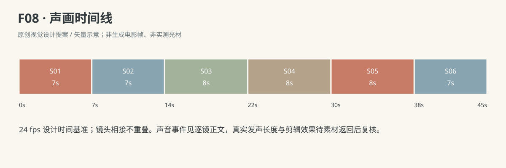

- 妈妈：嗯——嗯、嗯（F08-S01；对自己轻哼原创三音小调，本镜第3—5秒；不是唱词。）

- 妈妈：嗯——嗯、嗯——（F08-S02；本镜第1—7秒哼原创三音小调，最后鼻音不断，跨切延续到S03第2秒才收。）

- 爸爸：嗯——（F08-S02；本镜第3—7秒加入较低持续鼻音，跨切延续到S03第2秒，听见宝宝啊后收。）

- 妈妈：嗯——（F08-S03；承S02末尾的同一个鼻音，本镜第1秒仍持续，听见澈澈啊后在第2秒收；不是重新起一句。）

- 爸爸：嗯——（F08-S03；承S02的同一个低鼻音，本镜第1秒仍持续，听见澈澈啊后在第2秒收；不是重新起一句。）

- 澈澈：啊（F08-S03；本镜第1—2秒一次自然开口元音，送向面前父母，不是单词。）

- 妈妈：嗯——（F08-S05；本镜第4秒起持续约1秒，与另外两人同起，随后笑开。）

- 爸爸：嗯——（F08-S05；本镜第4秒起低声持续约1秒，与另外两人同起，随后收气笑。）

- 澈澈：啊（F08-S05；本镜第4秒起短促自然元音，与父母同起，约1秒后转看他们。）

### 连续性与试片

- 连续性：妈妈西侧P04、爸爸东侧P05、澈澈中央，物件不互换；三人嘴与声源位置对应。

- 连续性：S03宝宝先发啊，父母才停；S04无任何声乐；S05第4秒三人同时起声。

- 连续性：P04妈妈双手折叠，P05爸爸左掌托书右指翻页；停住时不能页纸悬浮脱手。

- 连续性：宝宝只有自然元音与笑声，不配成人歌词、语义对白或精准复唱。

- 试片：F08-S02—S04试听：必须分清父母先哼、宝宝啊、三人安静的次序；若底乐续满静默则失败。

- 试片：F08-S04—S05试剪：能看见三人各自准备呼吸，再在同一时刻起声；若靠随机错配嘴型伪装同时发声则失败。

- 试片：F08-S05—S06：笑声应由眼神和呼吸自然接出，P04/P05仍在原主人手上；若笑声压住首次合声或道具凭空收好，则失败。

**媒体待验证：**未生成媒体；待验三声源定位、元音口型同步、静默时长的观看节奏，以及同声后不同人物笑声的呼吸重叠。

---

## F09《睡醒第一眼》

**30 秒｜仰卧与翻身探索｜角色：澈澈、爸爸｜场景 N**

### 剧情正文

午后的光落在休息角的婴儿床上，澈澈仰卧着，头朝西，爸爸坐在南侧低头看布书。澈澈已经醒了一会儿，正用左手碰右手背，轻轻咿呀。爸爸把半页放平，还没有察觉。他慢慢把目光移到床栏外那截衣袖，玩手停下来，眉心轻挤，发出一小声哼。爸爸听见，书页不再动；他抬眼、压好书，身体往床边靠近。熟悉的眼睛来到眼前，澈澈先看住，眉心松开，嘴角才慢慢展开。爸爸也笑了。澈澈抬起右手，手指张合；爸爸把右食指送到他掌前，停着等。小手碰到指尖，慢慢握住，爸爸就把手留在那里，没有摇，也没有向上拉。书仍在他的腿上，房间又安静下来。

### 亲述来源与改编

原帖是家长自述，未独立核实。本片将生活机制改编为澈澈的原创故事。

- [ZH02 · 醒来先玩自己的手，等人靠近对眼才笑](https://anyray0127.pixnet.net/blog/posts/7102979960)；作者自报年龄：同篇自报刚满5个月；作者把它写成这一时期常见的醒后过程，不是标明日期的单次记录。。

- **采用的生活过程：**先自己玩手、咿呀；成人发现并靠近；对眼后表情转开心。

- **本片原创改编：**选较长醒后过程的尾段，以三十秒表现；未呈现原帖五至十分钟或更长的全部等待。

- **本片原创改编：**具体来人确定为爸爸，加入其看布书的生活任务、一次短哼与最后轻握右食指。

- **不作出的事实推断：**不声称假哭、装哭或婴儿有意操控成人。

- **不作出的事实推断：**原帖为五个月时期习惯自述，未独立核实；本片不是原事件逐镜复现，也不据此给澈澈设统一月龄。

[查看原始过程与缺项](research/real-experiences/index.html#ZH02)

### 导演与空间

**观察任务：**保留醒后先玩手、成人真正靠近对眼后才笑的过程，再用轻握手指结束；短片只取较长醒后过程的尾部。

**空间与光位：**N休息角北墙婴儿床、西窗、东门，爸爸坐床南侧偏西的照顾者座位，身体朝北略东，肩部高于床栏。澈澈始终仰卧，头西脚东，右手在身体南侧靠爸爸、左手在北侧胸腹附近，头背臀均由平整床垫承托。P05蓝绿布书摊在爸爸腿上；爸爸左手托书，右手翻页后才空出。摄影只在父婴连线东侧至东南侧，床头画左、脚端画右，爸爸居左或左前景。午后西窗柔光由画左后漫入，暖墙反射填暗部，不镜像。

**人物表演：**澈澈先认真研究自己的手，短哼来自当前等待，不贴假哭标签；爸爸本来在看书，确实听见后才停页抬眼。两人对眼之后的微笑要小而渐进。

### 节拍覆盖

- **F09-b1**：先看见宝宝正在自己玩手，爸爸尚未注意到醒来。 前态：澈澈已经醒着，右手在胸前摊开、左手轻碰右指，目光落在自己的手；爸爸低头看腿上布书，左掌托底、右指压半页，没有看床内。 后态：澈澈仍看胸前两手，没有笑；爸爸右指已放平书页，目光仍在书，左手托书。 → F09-S01

- **F09-b2**：自己玩的声音变为一声短呼唤，让爸爸获得抬头的实际线索。 前态：澈澈仰卧看自己胸前两手，没有笑；爸爸在画外仍低头，右指已放平书页、左手托书。 后态：澈澈两手在胸腹附近，望南侧衣袖、表情等待，未笑；爸爸已听见，空右手已退膝旁、左掌继续按书，开始从书上抬眼，这些爸爸手位与抬眼属于画外承接。 → F09-S02

- **F09-b3**：爸爸真正看向宝宝并靠近，宝宝在对眼之后才微笑。 前态：爸爸正从书上抬眼，右手已空留膝旁、左掌托腿上书；澈澈仰卧望南侧，嘴角尚未上扬，两手在胸腹附近。 后态：父婴已经对眼微笑；澈澈右手在胸前、左手靠腹，爸爸右手空在膝旁，左掌按书。 → F09-S03

- **F09-b4**：微笑之后宝宝主动抬手，爸爸再将食指送到可及位置。 前态：父婴已经对眼微笑；澈澈右手胸前、左手靠腹，爸爸右手空在膝旁，左掌按腿上书。 后态：澈澈右掌张开悬于胸上方，爸爸右食指在掌前未接触；左掌仍按书，宝宝身体由床垫托住。 → F09-S04

- **F09-b5**：宝宝合拢手指，接触稳定后以安静结束。 前态：宝宝右掌悬胸上方张开，爸爸右食指停在掌前尚有小间隙；宝宝仰卧、左手腹前，爸爸左掌按腿上书均为画外继承。 后态：澈澈右手轻握爸爸右食指，双方手臂各自承托；宝宝身体落床垫、爸爸左掌稳书为画外继承。 → F09-S05

### 分镜构图板

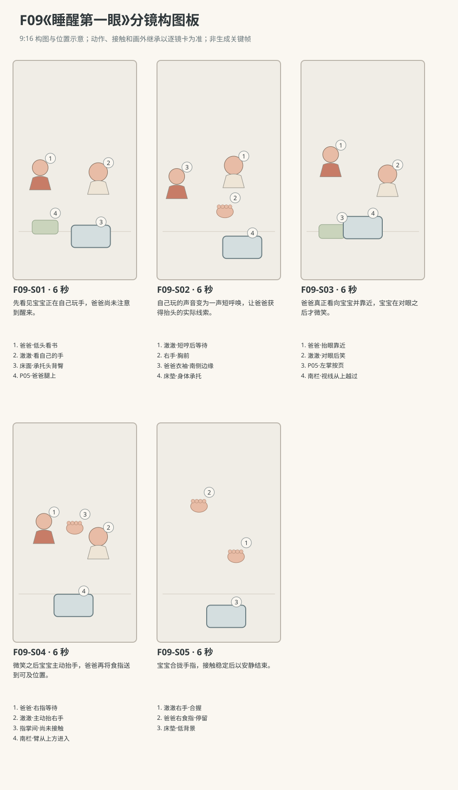

图示为构图位置示意；姿态、接触和画外继承以逐镜正文为准。

### 逐镜设计

#### F09-S01｜00—06 秒｜6 秒｜帧 [0, 144)

**镜头任务：**先看见宝宝正在自己玩手，爸爸尚未注意到醒来。

**景别、机位与构图：**东南朝西北的中全景，爸爸低头的侧脸在左前景，婴儿床与澈澈在右中景；床面和宝宝胸前双手可见，腿上布书在左下。

**摄影机与理由：**固定，保留同一空间里各做各事的关系，不用醒来即切成人笑脸。

**焦点：**宝宝眼睛与胸前两手清楚，爸爸低头和书页处在可辨景深。

**入态：**澈澈已经醒着，右手在胸前摊开、左手轻碰右指，目光落在自己的手；爸爸低头看腿上布书，左掌托底、右指压半页，没有看床内。

**动作与表演：**

- 3 秒：澈澈缓慢张合右指，左指碰一下右手背，嘴里轻轻咿呀，身体仍仰卧。

- 3 秒：爸爸右指把半页放平，仍看书；澈澈继续看手，暂时没有笑，也没有哭。

**声音：**宝宝自然低声咿呀、书页细声与室内底声，无对白无音乐。

**出态：**澈澈仍看胸前两手，没有笑；爸爸右指已放平书页，目光仍在书，左手托书。

**切点与承接：**切同轴稍紧宝宝覆盖，延续这段醒后自玩尾段；不把五至十分钟全部伪装为本片实时。

**连续性：**本片从一段自玩已进行后的尾部进入；宝宝眼睛开着，不重新演一次醒来。爸爸尚未注意，宝宝未对成人先笑。

**开始画面母稿：**

9:16竖幅，原创三维家庭生活动画，圆润而有重量的造型，柔和皮肤层次、哑光棉布与可读的小表情，动作遵循生活物理，不用成人式算计。澈澈暂拟圆润脸颊、深棕眼、短黑绒发、额前右弯小发撮。澈澈穿奶油色棉连体衣。爸爸暂拟短黑发、砖陶色棉衬衫、深灰长裤。人物与场景参考尚未提供，外观为可替换暂拟设计，未上传或绑定真实素材。本镜起始画面为单一瞬间：澈澈已经醒着，右手在胸前摊开、左手轻碰右指，目光落在自己的手；爸爸低头看腿上布书，左掌托底、右指压半页，没有看床内。 场次方位与光位：N休息角北墙婴儿床、西窗、东门，爸爸坐床南侧偏西的照顾者座位，身体朝北略东，肩部高于床栏。澈澈始终仰卧，头西脚东，右手在身体南侧靠爸爸、左手在北侧胸腹附近，头背臀均由平整床垫承托。P05蓝绿布书摊在爸爸腿上；爸爸左手托书，右手翻页后才空出。摄影只在父婴连线东侧至东南侧，床头画左、脚端画右，爸爸居左或左前景。午后西窗柔光由画左后漫入，暖墙反射填暗部，不镜像。 摄影构图：东南朝西北的中全景，爸爸低头的侧脸在左前景，婴儿床与澈澈在右中景；床面和宝宝胸前双手可见，腿上布书在左下。 当前焦点：宝宝眼睛与胸前两手清楚，爸爸低头和书页处在可辨景深。 只画这一刻，不拼入后续动作、轨迹、分格、字幕或不存在的持物状态。

**视频变化母稿：**

9:16竖幅，原创三维家庭生活动画，圆润而有重量的造型，柔和皮肤层次、哑光棉布与可读的小表情，动作遵循生活物理，不用成人式算计。澈澈暂拟圆润脸颊、深棕眼、短黑绒发、额前右弯小发撮。澈澈穿奶油色棉连体衣。爸爸暂拟短黑发、砖陶色棉衬衫、深灰长裤。人物与场景参考尚未提供，外观为可替换暂拟设计，未上传或绑定真实素材。制作一段6秒连续镜头。当前能力：R0仰卧抓握，头背臀由平整床垫承托，不独坐、不站立、不说完整句子。空间光位：N休息角北墙婴儿床、西窗、东门，爸爸坐床南侧偏西的照顾者座位，身体朝北略东，肩部高于床栏。澈澈始终仰卧，头西脚东，右手在身体南侧靠爸爸、左手在北侧胸腹附近，头背臀均由平整床垫承托。P05蓝绿布书摊在爸爸腿上；爸爸左手托书，右手翻页后才空出。摄影只在父婴连线东侧至东南侧，床头画左、脚端画右，爸爸居左或左前景。午后西窗柔光由画左后漫入，暖墙反射填暗部，不镜像。 起态：澈澈已经醒着，右手在胸前摊开、左手轻碰右指，目光落在自己的手；爸爸低头看腿上布书，左掌托底、右指压半页，没有看床内。 摄影：东南朝西北的中全景，爸爸低头的侧脸在左前景，婴儿床与澈澈在右中景；床面和宝宝胸前双手可见，腿上布书在左下。 相机行为：固定，保留同一空间里各做各事的关系，不用醒来即切成人笑脸。 焦点：宝宝眼睛与胸前两手清楚，爸爸低头和书页处在可辨景深。 时间过程：第1阶段3秒：澈澈缓慢张合右指，左指碰一下右手背，嘴里轻轻咿呀，身体仍仰卧。；第2阶段3秒：爸爸右指把半页放平，仍看书；澈澈继续看手，暂时没有笑，也没有哭。。声音：宝宝自然低声咿呀、书页细声与室内底声，无对白无音乐。 终态：澈澈仍看胸前两手，没有笑；爸爸右指已放平书页，目光仍在书，左手托书。 连续性：本片从一段自玩已进行后的尾部进入；宝宝眼睛开着，不重新演一次醒来。爸爸尚未注意，宝宝未对成人先笑。 按本镜完整过程到达终态，不在镜内另加切镜、人物、道具或未写出的台词、字幕与旁白。

#### F09-S02｜06—12 秒｜6 秒｜帧 [144, 288)

**镜头任务：**自己玩的声音变为一声短呼唤，让爸爸获得抬头的实际线索。

**景别、机位与构图：**床东略南朝西的宝宝中近景，澈澈脸、胸前双手与床垫清楚；爸爸雾化衣袖留画左边，爸爸面部在画外。

**摄影机与理由：**固定，关注声与口型的小变化，不把短促哼声夸成嚎哭。

**焦点：**澈澈嘴唇、眉间和右手，床垫保持清晰。

**入态：**澈澈仰卧看自己胸前两手，没有笑；爸爸在画外仍低头，右指已放平书页、左手托书。

**动作与表演：**

- 2 秒：澈澈的左指松开右手背，右手留胸前，视线从手移向南侧衣袖。

- 2 秒：他的眉心轻挤一下，张口发出一小声不满意的哼声，随后短吸气，不滚出眼泪或立刻大笑。

- 2 秒：爸爸听见后停止摩挲书页，右指离开书页、空右手退到膝旁，再开始抬头；这些手位在本特写画外继承，只有画左衣袖微动被看见。澈澈看着袖子所在方向等着。

**声音：**先轻咿呀收住，再一声短哼和换气；书页声听见后停住，没有成人台词、音乐或解释。

**出态：**澈澈两手在胸腹附近，望南侧衣袖、表情等待，未笑；爸爸已听见，空右手已退膝旁、左掌继续按书，开始从书上抬眼，这些爸爸手位与抬眼属于画外承接。

**切点与承接：**接爸爸抬眼靠近的共享镜，不重放短哼。

**连续性：**爸爸的听见由停止书页声和下一镜抬眼体现；本镜脸在画外，不能称已经看见其笑容。短哼不等于假哭或故意操纵。 爸爸右指在本镜画外离页退膝，下一共享镜才直接看到空右手在膝旁，不能把画外动作冒称本特写已可见。

**开始画面母稿：**

9:16竖幅，原创三维家庭生活动画，圆润而有重量的造型，柔和皮肤层次、哑光棉布与可读的小表情，动作遵循生活物理，不用成人式算计。澈澈暂拟圆润脸颊、深棕眼、短黑绒发、额前右弯小发撮。澈澈穿奶油色棉连体衣。爸爸暂拟短黑发、砖陶色棉衬衫、深灰长裤。人物与场景参考尚未提供，外观为可替换暂拟设计，未上传或绑定真实素材。本镜起始画面为单一瞬间：澈澈仰卧看自己胸前两手，没有笑；爸爸在画外仍低头，右指已放平书页、左手托书。 场次方位与光位：N休息角北墙婴儿床、西窗、东门，爸爸坐床南侧偏西的照顾者座位，身体朝北略东，肩部高于床栏。澈澈始终仰卧，头西脚东，右手在身体南侧靠爸爸、左手在北侧胸腹附近，头背臀均由平整床垫承托。P05蓝绿布书摊在爸爸腿上；爸爸左手托书，右手翻页后才空出。摄影只在父婴连线东侧至东南侧，床头画左、脚端画右，爸爸居左或左前景。午后西窗柔光由画左后漫入，暖墙反射填暗部，不镜像。 摄影构图：床东略南朝西的宝宝中近景，澈澈脸、胸前双手与床垫清楚；爸爸雾化衣袖留画左边，爸爸面部在画外。 当前焦点：澈澈嘴唇、眉间和右手，床垫保持清晰。 只画这一刻，不拼入后续动作、轨迹、分格、字幕或不存在的持物状态。

**视频变化母稿：**

9:16竖幅，原创三维家庭生活动画，圆润而有重量的造型，柔和皮肤层次、哑光棉布与可读的小表情，动作遵循生活物理，不用成人式算计。澈澈暂拟圆润脸颊、深棕眼、短黑绒发、额前右弯小发撮。澈澈穿奶油色棉连体衣。爸爸暂拟短黑发、砖陶色棉衬衫、深灰长裤。人物与场景参考尚未提供，外观为可替换暂拟设计，未上传或绑定真实素材。制作一段6秒连续镜头。当前能力：R0仰卧抓握，头背臀由平整床垫承托，不独坐、不站立、不说完整句子。空间光位：N休息角北墙婴儿床、西窗、东门，爸爸坐床南侧偏西的照顾者座位，身体朝北略东，肩部高于床栏。澈澈始终仰卧，头西脚东，右手在身体南侧靠爸爸、左手在北侧胸腹附近，头背臀均由平整床垫承托。P05蓝绿布书摊在爸爸腿上；爸爸左手托书，右手翻页后才空出。摄影只在父婴连线东侧至东南侧，床头画左、脚端画右，爸爸居左或左前景。午后西窗柔光由画左后漫入，暖墙反射填暗部，不镜像。 起态：澈澈仰卧看自己胸前两手，没有笑；爸爸在画外仍低头，右指已放平书页、左手托书。 摄影：床东略南朝西的宝宝中近景，澈澈脸、胸前双手与床垫清楚；爸爸雾化衣袖留画左边，爸爸面部在画外。 相机行为：固定，关注声与口型的小变化，不把短促哼声夸成嚎哭。 焦点：澈澈嘴唇、眉间和右手，床垫保持清晰。 时间过程：第1阶段2秒：澈澈的左指松开右手背，右手留胸前，视线从手移向南侧衣袖。；第2阶段2秒：他的眉心轻挤一下，张口发出一小声不满意的哼声，随后短吸气，不滚出眼泪或立刻大笑。；第3阶段2秒：爸爸听见后停止摩挲书页，右指离开书页、空右手退到膝旁，再开始抬头；这些手位在本特写画外继承，只有画左衣袖微动被看见。澈澈看着袖子所在方向等着。。声音：先轻咿呀收住，再一声短哼和换气；书页声听见后停住，没有成人台词、音乐或解释。 终态：澈澈两手在胸腹附近，望南侧衣袖、表情等待，未笑；爸爸已听见，空右手已退膝旁、左掌继续按书，开始从书上抬眼，这些爸爸手位与抬眼属于画外承接。 连续性：爸爸的听见由停止书页声和下一镜抬眼体现；本镜脸在画外，不能称已经看见其笑容。短哼不等于假哭或故意操纵。 爸爸右指在本镜画外离页退膝，下一共享镜才直接看到空右手在膝旁，不能把画外动作冒称本特写已可见。 按本镜完整过程到达终态，不在镜内另加切镜、人物、道具或未写出的台词、字幕与旁白。

#### F09-S03｜12—18 秒｜6 秒｜帧 [288, 432)

**镜头任务：**爸爸真正看向宝宝并靠近，宝宝在对眼之后才微笑。

**景别、机位与构图：**东南侧双人中景，爸爸画左、床内澈澈画右，两张脸视线通道越过南栏上方；爸爸腿上布书与按书左掌可辨。

**摄影机与理由：**固定，距离改变由爸爸上身轻靠完成；两张脸同框保留刺激和反应。

**焦点：**两人眼睛和澈澈嘴角保持同一可读纵深。

**入态：**爸爸正从书上抬眼，右手已空留膝旁、左掌托腿上书；澈澈仰卧望南侧，嘴角尚未上扬，两手在胸腹附近。

**动作与表演：**

- 2 秒：爸爸抬起眼，看清澈澈醒着，左掌把书页压平，上身向床边轻靠。

- 2 秒：爸爸的脸来到澈澈眼线前，目光落到宝宝眼睛；澈澈看住熟悉的眼睛，眉心慢慢松开。

- 2 秒：对眼后澈澈嘴角才轻轻展开，发出一点开心鼻音；爸爸也回一个小笑，右手仍不伸进床。

**声音：**短哼已结束，两人平稳呼吸，后两秒一点自然开心鼻音；无对白无配乐。

**出态：**父婴已经对眼微笑；澈澈右手在胸前、左手靠腹，爸爸右手空在膝旁，左掌按书。

**切点与承接：**从已对眼的小笑切到伸手回应，不能重做第二次抬头或早铺笑。

**连续性：**爸爸先靠近、宝宝确认对眼、嘴角后动；宝宝头背臀不离床垫。书左掌稳定，爸爸右手尚未越栏。

**开始画面母稿：**

9:16竖幅，原创三维家庭生活动画，圆润而有重量的造型，柔和皮肤层次、哑光棉布与可读的小表情，动作遵循生活物理，不用成人式算计。澈澈暂拟圆润脸颊、深棕眼、短黑绒发、额前右弯小发撮。澈澈穿奶油色棉连体衣。爸爸暂拟短黑发、砖陶色棉衬衫、深灰长裤。人物与场景参考尚未提供，外观为可替换暂拟设计，未上传或绑定真实素材。本镜起始画面为单一瞬间：爸爸正从书上抬眼，右手已空留膝旁、左掌托腿上书；澈澈仰卧望南侧，嘴角尚未上扬，两手在胸腹附近。 场次方位与光位：N休息角北墙婴儿床、西窗、东门，爸爸坐床南侧偏西的照顾者座位，身体朝北略东，肩部高于床栏。澈澈始终仰卧，头西脚东，右手在身体南侧靠爸爸、左手在北侧胸腹附近，头背臀均由平整床垫承托。P05蓝绿布书摊在爸爸腿上；爸爸左手托书，右手翻页后才空出。摄影只在父婴连线东侧至东南侧，床头画左、脚端画右，爸爸居左或左前景。午后西窗柔光由画左后漫入，暖墙反射填暗部，不镜像。 摄影构图：东南侧双人中景，爸爸画左、床内澈澈画右，两张脸视线通道越过南栏上方；爸爸腿上布书与按书左掌可辨。 当前焦点：两人眼睛和澈澈嘴角保持同一可读纵深。 只画这一刻，不拼入后续动作、轨迹、分格、字幕或不存在的持物状态。

**视频变化母稿：**

9:16竖幅，原创三维家庭生活动画，圆润而有重量的造型，柔和皮肤层次、哑光棉布与可读的小表情，动作遵循生活物理，不用成人式算计。澈澈暂拟圆润脸颊、深棕眼、短黑绒发、额前右弯小发撮。澈澈穿奶油色棉连体衣。爸爸暂拟短黑发、砖陶色棉衬衫、深灰长裤。人物与场景参考尚未提供，外观为可替换暂拟设计，未上传或绑定真实素材。制作一段6秒连续镜头。当前能力：R0仰卧抓握，头背臀由平整床垫承托，不独坐、不站立、不说完整句子。空间光位：N休息角北墙婴儿床、西窗、东门，爸爸坐床南侧偏西的照顾者座位，身体朝北略东，肩部高于床栏。澈澈始终仰卧，头西脚东，右手在身体南侧靠爸爸、左手在北侧胸腹附近，头背臀均由平整床垫承托。P05蓝绿布书摊在爸爸腿上；爸爸左手托书，右手翻页后才空出。摄影只在父婴连线东侧至东南侧，床头画左、脚端画右，爸爸居左或左前景。午后西窗柔光由画左后漫入，暖墙反射填暗部，不镜像。 起态：爸爸正从书上抬眼，右手已空留膝旁、左掌托腿上书；澈澈仰卧望南侧，嘴角尚未上扬，两手在胸腹附近。 摄影：东南侧双人中景，爸爸画左、床内澈澈画右，两张脸视线通道越过南栏上方；爸爸腿上布书与按书左掌可辨。 相机行为：固定，距离改变由爸爸上身轻靠完成；两张脸同框保留刺激和反应。 焦点：两人眼睛和澈澈嘴角保持同一可读纵深。 时间过程：第1阶段2秒：爸爸抬起眼，看清澈澈醒着，左掌把书页压平，上身向床边轻靠。；第2阶段2秒：爸爸的脸来到澈澈眼线前，目光落到宝宝眼睛；澈澈看住熟悉的眼睛，眉心慢慢松开。；第3阶段2秒：对眼后澈澈嘴角才轻轻展开，发出一点开心鼻音；爸爸也回一个小笑，右手仍不伸进床。。声音：短哼已结束，两人平稳呼吸，后两秒一点自然开心鼻音；无对白无配乐。 终态：父婴已经对眼微笑；澈澈右手在胸前、左手靠腹，爸爸右手空在膝旁，左掌按书。 连续性：爸爸先靠近、宝宝确认对眼、嘴角后动；宝宝头背臀不离床垫。书左掌稳定，爸爸右手尚未越栏。 按本镜完整过程到达终态，不在镜内另加切镜、人物、道具或未写出的台词、字幕与旁白。

#### F09-S04｜18—24 秒｜6 秒｜帧 [432, 576)

**镜头任务：**微笑之后宝宝主动抬手，爸爸再将食指送到可及位置。

**景别、机位与构图：**侧向双人中景，摄影仍在连线东侧，爸爸左、宝宝右；两只右手在南栏上方的路径无遮挡，脸和双手同读。

**摄影机与理由：**固定，给宝宝先伸、成人再回应的先后留时间，不用推镜代替靠近。

**焦点：**宝宝抬起的右手与双方目光清晰，食指进入后手部同清。

**入态：**父婴已经对眼微笑；澈澈右手胸前、左手靠腹，爸爸右手空在膝旁，左掌按腿上书。

**动作与表演：**

- 3 秒：澈澈带着小笑抬起右臂，右掌在胸上方张开再微合；左手仍留腹前。

- 3 秒：爸爸看见抬手，右前臂从南栏上方缓缓进入，把右食指停在右掌前一小指宽处，等待宝宝触碰。

**声音：**小笑鼻音自然收住，只有袖布轻声和呼吸，无对白。

**出态：**澈澈右掌张开悬于胸上方，爸爸右食指在掌前未接触；左掌仍按书，宝宝身体由床垫托住。

**切点与承接：**在尚有小间隙时切手部特写，下一镜完成首次触碰。

**连续性：**只提供爸爸右食指；不牵拉、不把食指塞入口中，不穿栏。左手及书在近景裁外部分按前镜继承。

**开始画面母稿：**

9:16竖幅，原创三维家庭生活动画，圆润而有重量的造型，柔和皮肤层次、哑光棉布与可读的小表情，动作遵循生活物理，不用成人式算计。澈澈暂拟圆润脸颊、深棕眼、短黑绒发、额前右弯小发撮。澈澈穿奶油色棉连体衣。爸爸暂拟短黑发、砖陶色棉衬衫、深灰长裤。人物与场景参考尚未提供，外观为可替换暂拟设计，未上传或绑定真实素材。本镜起始画面为单一瞬间：父婴已经对眼微笑；澈澈右手胸前、左手靠腹，爸爸右手空在膝旁，左掌按腿上书。 场次方位与光位：N休息角北墙婴儿床、西窗、东门，爸爸坐床南侧偏西的照顾者座位，身体朝北略东，肩部高于床栏。澈澈始终仰卧，头西脚东，右手在身体南侧靠爸爸、左手在北侧胸腹附近，头背臀均由平整床垫承托。P05蓝绿布书摊在爸爸腿上；爸爸左手托书，右手翻页后才空出。摄影只在父婴连线东侧至东南侧，床头画左、脚端画右，爸爸居左或左前景。午后西窗柔光由画左后漫入，暖墙反射填暗部，不镜像。 摄影构图：侧向双人中景，摄影仍在连线东侧，爸爸左、宝宝右；两只右手在南栏上方的路径无遮挡，脸和双手同读。 当前焦点：宝宝胸前右手、爸爸膝旁空右手与父婴已对眼的小笑处于清楚范围，成人手指尚未进入床内。 只画这一刻，不拼入后续动作、轨迹、分格、字幕或不存在的持物状态。

**视频变化母稿：**

9:16竖幅，原创三维家庭生活动画，圆润而有重量的造型，柔和皮肤层次、哑光棉布与可读的小表情，动作遵循生活物理，不用成人式算计。澈澈暂拟圆润脸颊、深棕眼、短黑绒发、额前右弯小发撮。澈澈穿奶油色棉连体衣。爸爸暂拟短黑发、砖陶色棉衬衫、深灰长裤。人物与场景参考尚未提供，外观为可替换暂拟设计，未上传或绑定真实素材。制作一段6秒连续镜头。当前能力：R0仰卧抓握，头背臀由平整床垫承托，不独坐、不站立、不说完整句子。空间光位：N休息角北墙婴儿床、西窗、东门，爸爸坐床南侧偏西的照顾者座位，身体朝北略东，肩部高于床栏。澈澈始终仰卧，头西脚东，右手在身体南侧靠爸爸、左手在北侧胸腹附近，头背臀均由平整床垫承托。P05蓝绿布书摊在爸爸腿上；爸爸左手托书，右手翻页后才空出。摄影只在父婴连线东侧至东南侧，床头画左、脚端画右，爸爸居左或左前景。午后西窗柔光由画左后漫入，暖墙反射填暗部，不镜像。 起态：父婴已经对眼微笑；澈澈右手胸前、左手靠腹，爸爸右手空在膝旁，左掌按腿上书。 摄影：侧向双人中景，摄影仍在连线东侧，爸爸左、宝宝右；两只右手在南栏上方的路径无遮挡，脸和双手同读。 相机行为：固定，给宝宝先伸、成人再回应的先后留时间，不用推镜代替靠近。 焦点：宝宝抬起的右手与双方目光清晰，食指进入后手部同清。 时间过程：第1阶段3秒：澈澈带着小笑抬起右臂，右掌在胸上方张开再微合；左手仍留腹前。；第2阶段3秒：爸爸看见抬手，右前臂从南栏上方缓缓进入，把右食指停在右掌前一小指宽处，等待宝宝触碰。。声音：小笑鼻音自然收住，只有袖布轻声和呼吸，无对白。 终态：澈澈右掌张开悬于胸上方，爸爸右食指在掌前未接触；左掌仍按书，宝宝身体由床垫托住。 连续性：只提供爸爸右食指；不牵拉、不把食指塞入口中，不穿栏。左手及书在近景裁外部分按前镜继承。 按本镜完整过程到达终态，不在镜内另加切镜、人物、道具或未写出的台词、字幕与旁白。

#### F09-S05｜24—30 秒｜6 秒｜帧 [576, 720)

**镜头任务：**宝宝合拢手指，接触稳定后以安静结束。

**景别、机位与构图：**床东略南的手部特写，爸爸右食指从画左上、宝宝右掌从画右下靠近，奶油衣料与平整床垫为背景；两张脸在画外。

**摄影机与理由：**固定，完整看清间隙消失、手指合拢与静止，不靠跳切完成握持。

**焦点：**宝宝四指和拇指接触爸爸食指的皮肤交界持续清楚。

**入态：**宝宝右掌悬胸上方张开，爸爸右食指停在掌前尚有小间隙；宝宝仰卧、左手腹前，爸爸左掌按腿上书均为画外继承。

**动作与表演：**

- 2 秒：澈澈右手微伸，指尖先碰到爸爸右食指侧面，爸爸保持手位。

- 2 秒：宝宝右指慢慢合拢，拇指贴住食指另一侧，手腕自然放松。

- 2 秒：爸爸不抬高手、不摇动，宝宝保持轻握；只看见手背随自然呼吸微动。

**声音：**近处轻呼吸、极细衣料声，末两秒安静，无对白无音乐。

**出态：**澈澈右手轻握爸爸右食指，双方手臂各自承托；宝宝身体落床垫、爸爸左掌稳书为画外继承。

**切点与承接：**在轻握稳定的末帧结束，不加抱起或突然入睡。

**连续性：**握指是本片原创尾声，非原帖记录。画外面部只继承上一镜状态，不宣称本镜直接看到笑脸；手指数量清楚，不融合、不向上牵拉。

**开始画面母稿：**

9:16竖幅，原创三维家庭生活动画，圆润而有重量的造型，柔和皮肤层次、哑光棉布与可读的小表情，动作遵循生活物理，不用成人式算计。澈澈暂拟圆润脸颊、深棕眼、短黑绒发、额前右弯小发撮。澈澈穿奶油色棉连体衣。爸爸暂拟短黑发、砖陶色棉衬衫、深灰长裤。人物与场景参考尚未提供，外观为可替换暂拟设计，未上传或绑定真实素材。本镜起始画面为单一瞬间：宝宝右掌悬胸上方张开，爸爸右食指停在掌前尚有小间隙；宝宝仰卧、左手腹前，爸爸左掌按腿上书均为画外继承。 场次方位与光位：N休息角北墙婴儿床、西窗、东门，爸爸坐床南侧偏西的照顾者座位，身体朝北略东，肩部高于床栏。澈澈始终仰卧，头西脚东，右手在身体南侧靠爸爸、左手在北侧胸腹附近，头背臀均由平整床垫承托。P05蓝绿布书摊在爸爸腿上；爸爸左手托书，右手翻页后才空出。摄影只在父婴连线东侧至东南侧，床头画左、脚端画右，爸爸居左或左前景。午后西窗柔光由画左后漫入，暖墙反射填暗部，不镜像。 摄影构图：床东略南的手部特写，爸爸右食指从画左上、宝宝右掌从画右下靠近，奶油衣料与平整床垫为背景；两张脸在画外。 当前焦点：宝宝张开的右掌与爸爸右食指之间的小间隙清楚，双方尚未接触。 只画这一刻，不拼入后续动作、轨迹、分格、字幕或不存在的持物状态。

**视频变化母稿：**

9:16竖幅，原创三维家庭生活动画，圆润而有重量的造型，柔和皮肤层次、哑光棉布与可读的小表情，动作遵循生活物理，不用成人式算计。澈澈暂拟圆润脸颊、深棕眼、短黑绒发、额前右弯小发撮。澈澈穿奶油色棉连体衣。爸爸暂拟短黑发、砖陶色棉衬衫、深灰长裤。人物与场景参考尚未提供，外观为可替换暂拟设计，未上传或绑定真实素材。制作一段6秒连续镜头。当前能力：R0仰卧抓握，头背臀由平整床垫承托，不独坐、不站立、不说完整句子。空间光位：N休息角北墙婴儿床、西窗、东门，爸爸坐床南侧偏西的照顾者座位，身体朝北略东，肩部高于床栏。澈澈始终仰卧，头西脚东，右手在身体南侧靠爸爸、左手在北侧胸腹附近，头背臀均由平整床垫承托。P05蓝绿布书摊在爸爸腿上；爸爸左手托书，右手翻页后才空出。摄影只在父婴连线东侧至东南侧，床头画左、脚端画右，爸爸居左或左前景。午后西窗柔光由画左后漫入，暖墙反射填暗部，不镜像。 起态：宝宝右掌悬胸上方张开，爸爸右食指停在掌前尚有小间隙；宝宝仰卧、左手腹前，爸爸左掌按腿上书均为画外继承。 摄影：床东略南的手部特写，爸爸右食指从画左上、宝宝右掌从画右下靠近，奶油衣料与平整床垫为背景；两张脸在画外。 相机行为：固定，完整看清间隙消失、手指合拢与静止，不靠跳切完成握持。 焦点：宝宝四指和拇指接触爸爸食指的皮肤交界持续清楚。 时间过程：第1阶段2秒：澈澈右手微伸，指尖先碰到爸爸右食指侧面，爸爸保持手位。；第2阶段2秒：宝宝右指慢慢合拢，拇指贴住食指另一侧，手腕自然放松。；第3阶段2秒：爸爸不抬高手、不摇动，宝宝保持轻握；只看见手背随自然呼吸微动。。声音：近处轻呼吸、极细衣料声，末两秒安静，无对白无音乐。 终态：澈澈右手轻握爸爸右食指，双方手臂各自承托；宝宝身体落床垫、爸爸左掌稳书为画外继承。 连续性：握指是本片原创尾声，非原帖记录。画外面部只继承上一镜状态，不宣称本镜直接看到笑脸；手指数量清楚，不融合、不向上牵拉。 按本镜完整过程到达终态，不在镜内另加切镜、人物、道具或未写出的台词、字幕与旁白。

### 声音与剪辑

无成人对白、无音乐。先有自玩咿呀、再一声短哼与换气，爸爸书页声听见后停；对眼之后才有开心鼻音，末段只有呼吸。不是把原帖五至十分钟完整压成三十秒实时。

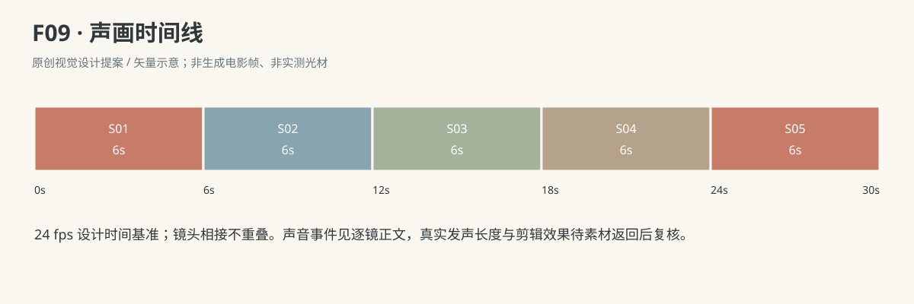

正式台词：无；保留镜头声音中已写明的自然发声。

### 连续性与试片

- 连续性：澈澈全片仰卧，头西脚东，右手位于身体南侧靠爸爸；左手留胸腹附近，不突然交换抓握手。

- 连续性：爸爸左手始终负责托或按住腿上P05，右手先持半页、放平后才越过南栏上方提供食指。

- 连续性：手臂从栏上方进入床内，不能穿栏杆缝；宝宝背、头、臀持续落在床垫，不抬身追手。

- 连续性：午后西窗与东门固定；不通过北面反打把熟悉脸和窗口方向互换。

- 连续性：宝宝第一次笑只能发生在爸爸抬眼靠近并实际对眼之后，不能在独自玩手或只看衣袖时先笑。

- 连续性：短哼不配假哭、装哭、拿捏大人的解释台词或字幕；本片取醒后自玩尾段，不声称原经历只持续三十秒。

- 试片：F09-S01—S03静音检查：先独自玩手，爸爸原先低头，听见短哼后停页抬眼靠近，对眼后宝宝才展笑；如果爸爸无触发已知道醒来，或宝宝预先对空处大笑，则失败。

- 试片：F09-S02—S03声音检查：只一声短哼及自然换气，不把哭声循环成逗笑音效；笑和开心鼻音不能早铺到对眼之前。

- 试片：F09-S04—S05接触检查：右食指先停在掌前，宝宝随后触碰合握，爸爸不牵拉，宝宝身体全程落床垫；书仍左掌稳定在腿上。

**媒体待验证：**本次交付为完整故事、分镜与提示词文字设计，未生成或审看实际图像、视频、音轨。人物和场景参考未提供；逐镜首帧、手指接触、面部表演、对白发音、身体平衡与相邻剪点均待实际素材核对，不以结构检查代替媒体质量。

---

## F10《爸爸回来以后》

**45 秒｜坐姿与手部互动｜角色：澈澈、爸爸｜场景 L**

### 剧情正文

客厅地垫上，澈澈坐着翻一只珊瑚色软环。东边走廊传来爸爸的声音：“澈澈，爸爸回来啦。”他的右手先停住，软环还握在指间。澈澈抬眼，转头往入口看，确认那张熟悉的脸以后，嘴角慢慢展开，左手离开地垫，在胸前兴奋地挥了两下。爸爸也笑了，没有站在门口再喊，只沿地垫边走近，在澈澈斜前方弯膝坐低。澈澈的左掌重新撑好，右手把软环放到面前，空出的手伸向爸爸的脸。爸爸稍稍凑近，让那只小手先碰到左脸颊。澈澈的手指贴着温热的脸颊上动了一下，认真看了看，又笑起来。爸爸的右掌落到自己身旁地垫，稳住前倾的身体，慢慢低下头。两人的额头轻轻挨了一下，又分开一点。澈澈没有被抱走，仍坐在原处，右手落回膝边；爸爸也留在他面前，和他看着彼此，把刚才没出完的笑一起笑完。

### 导演与空间

**观察任务：**把听见、确认、欢迎与靠近一层层拍清，让回来后的短短相认落在手掌和额头的轻触上。

**空间与光位：**L客厅北墙沙发、西窗、东侧走廊入口、中央奶油地垫。澈澈坐垫北半朝南，右手拿P01珊瑚软环、左掌在左膝外撑垫。爸爸由东走廊入口进来，沿地垫东边走到宝宝东南侧后跪坐，父婴连线为西北—东南；摄影始终在连线南侧，入口右后、澈澈画左、爸爸从右进。P01最后落在宝宝两膝前偏南的地垫。西窗柔光来自画左，爸爸进门不改变主光方向。

**人物表演：**爸爸刚回来，先轻声呼唤，等确认对视后才靠近，坐低而不从上方罩住宝宝。澈澈右手先停玩具、目光确认声音来源，再抬空着的左手轻挥；接近后先放下环腾出右手，右掌摸爸爸左颊。额头轻碰主要由爸爸控制靠近距离，宝宝保持稳坐与左掌支撑。

### 节拍覆盖

- **F10-b1**：由爸爸画外到画内的轻声回来触发宝宝停住自己的玩耍。 前态：澈澈坐地垫北半朝南，右手胸前翻P01、左掌撑垫，爸爸在东走廊入口刚露面，双手自然垂。 后态：澈澈右手持环停住、头转向入口，爸爸仍在右后入口等他看见。 → F10-S01

- **F10-b2**：宝宝看清是谁后才展开笑和欢迎动作。 前态：澈澈看向东入口、右手持P01不动、左掌撑垫，嘴角还未展开，爸爸在入口等着。 后态：宝宝笑着、左手还在胸前，右手持环，爸爸开始从入口靠近。 → F10-S02

- **F10-b3**：爸爸走近并主动降低高度，宝宝重新撑稳准备近距离接触。 前态：爸爸从东入口开始靠近，澈澈左手在胸前挥完、右手持环贴腿，稳坐垫北半。 后态：爸爸跪坐宝宝东南侧双手在膝，宝宝左掌已撑垫、右手持环，两人近距离对视。 → F10-S03

- **F10-b4**：宝宝腾出持环右手后主动摸脸，爸爸只调整距离让触碰成立。 前态：爸爸跪坐双手在自己膝上、脸在宝宝可看处；宝宝左掌撑垫、右手握P01贴腿。 后态：P01在宝宝两膝前，宝宝右掌贴爸爸左颊、左掌撑垫，爸爸双手仍在自己膝。 → F10-S04

- **F10-b5**：爸爸先稳住身体再低头，轻额触以真实接触而非碰撞完成。 前态：澈澈右掌在爸爸左颊、左掌撑垫，爸爸跪坐双手在膝，P01已落宝宝膝前。 后态：额头已分开小间隙，爸爸右掌撑垫、左手落膝，宝宝右手贴颊、左掌撑垫。 → F10-S05

- **F10-b6**：在宝宝原处把相认后的笑笑完，不用抱走或升华台词结束。 前态：额头已分开，宝宝右掌仍贴爸爸左颊、左掌撑垫，爸爸右掌撑自己右侧地垫、左手落膝。 后态：宝宝稳坐双手各在膝边及垫上，爸爸跪坐其东南侧，一掌撑垫一手落膝，P01原地。 → F10-S06

### 分镜构图板

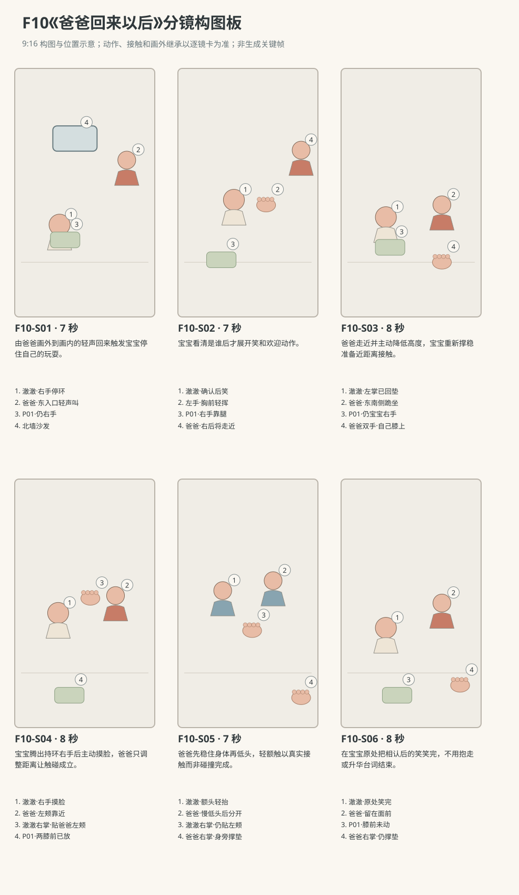

图示为构图位置示意；姿态、接触和画外继承以逐镜正文为准。

### 逐镜设计

#### F10-S01｜00—07 秒｜7 秒｜帧 [0, 168)

**镜头任务：**由爸爸画外到画内的轻声回来触发宝宝停住自己的玩耍。

**景别、机位与构图：**中全景，南侧朝北略东，澈澈画左中、东入口右后、爸爸刚在入口出现，地垫与北沙发建立空间。

**摄影机与理由：**固定，让声音来源在画内可确认，不用突然推镜。

**焦点：**澈澈右手软环先，爸爸入口脸保持可辨，随后看宝宝抬眼。

**入态：**澈澈坐地垫北半朝南，右手胸前翻P01、左掌撑垫，爸爸在东走廊入口刚露面，双手自然垂。

**动作与表演：**

- 2 秒：澈澈右手缓慢转软环，爸爸在入口看见他，脚步停一下。

- 3 秒：爸爸轻声说完整一句回来啦，澈澈右手先停止翻环，头先轻偏向声源。

- 2 秒：澈澈眼睛抬起、头转向东入口，软环仍在右手，左掌仍撑。

**声音：**爸爸第3—5秒说“澈澈，爸爸回来啦。”；之前一次走廊轻脚步，之后衣料与呼吸，无BGM。

**出态：**澈澈右手持环停住、头转向入口，爸爸仍在右后入口等他看见。

**切点与承接：**切澈澈确认脸的中景，承接看向画右的目光。

**连续性：**爸爸尚未走近，软环未松手；左掌仍接地，不提前挥。

**开始画面母稿：**

9:16竖幅，原创三维生活动画，圆润而有重量的造型，棉布细纹、柔和皮肤层次与可读的小表情；动作按真实生活物理及婴儿当下能力展开，不用成人化算计表情。澈澈为圆脸、深棕眼、短黑绒发、额前一小撮向右弯的头发，穿奶油色棉连体衣。爸爸短黑发，砖陶色棉衬衫、深灰长裤。本镜开始画面为单一瞬间：澈澈坐地垫北半朝南，右手胸前翻P01、左掌撑垫，爸爸在东走廊入口刚露面，双手自然垂。 场次方位与光位：L客厅北墙沙发、西窗、东侧走廊入口、中央地垫。澈澈在地垫北半，爸爸从东走廊沿地垫东缘来到其东南侧；摄影始终在连线南侧，入口画右后、宝宝画左、爸爸从右进入。西窗柔光来自画左，P01软环的当前归属只依本镜起态，爸爸面向与坐姿随当前动作改变。 摄影构图：中全景，南侧朝北略东，澈澈画左中、东入口右后、爸爸刚在入口出现，地垫与北沙发建立空间。 当前焦点：宝宝右手P01与东走廊入口爸爸的脸。只呈现上述起态，不把后续动作拼入一张画面。

**视频变化母稿：**

9:16竖幅，原创三维生活动画，圆润而有重量的造型，棉布细纹、柔和皮肤层次与可读的小表情；动作按真实生活物理及婴儿当下能力展开，不用成人化算计表情。澈澈为圆脸、深棕眼、短黑绒发、额前一小撮向右弯的头发，穿奶油色棉连体衣。爸爸短黑发，砖陶色棉衬衫、深灰长裤。制作一段7秒连续镜头。本段人物和能力：澈澈、爸爸，澈澈为R1。空间光位：L客厅北墙沙发、西窗、东侧走廊入口、中央地垫。澈澈在地垫北半，爸爸从东走廊沿地垫东缘来到其东南侧；摄影始终在连线南侧，入口画右后、宝宝画左、爸爸从右进入。西窗柔光来自画左，P01软环的当前归属只依本镜起态，爸爸面向与坐姿随当前动作改变。 起态：澈澈坐地垫北半朝南，右手胸前翻P01、左掌撑垫，爸爸在东走廊入口刚露面，双手自然垂。 摄影：中全景，南侧朝北略东，澈澈画左中、东入口右后、爸爸刚在入口出现，地垫与北沙发建立空间。 相机行为：固定，让声音来源在画内可确认，不用突然推镜。 焦点：澈澈右手软环先，爸爸入口脸保持可辨，随后看宝宝抬眼。 时间过程：第1阶段2秒：澈澈右手缓慢转软环，爸爸在入口看见他，脚步停一下。；第2阶段3秒：爸爸轻声说完整一句回来啦，澈澈右手先停止翻环，头先轻偏向声源。；第3阶段2秒：澈澈眼睛抬起、头转向东入口，软环仍在右手，左掌仍撑。。声音：爸爸第3—5秒说“澈澈，爸爸回来啦。”；之前一次走廊轻脚步，之后衣料与呼吸，无BGM。 终态：澈澈右手持环停住、头转向入口，爸爸仍在右后入口等他看见。 连续性：爸爸尚未走近，软环未松手；左掌仍接地，不提前挥。 不加未写出的对白、人物或道具。

#### F10-S02｜07—14 秒｜7 秒｜帧 [168, 336)

**镜头任务：**宝宝看清是谁后才展开笑和欢迎动作。

**景别、机位与构图：**澈澈中近景带下身，南侧同轴，宝宝居左中，右画缘保留爸爸入口身影，左掌到胸前的路径完整。

**摄影机与理由：**固定，把表情从查看到认出的变化留在一镜。

**焦点：**宝宝双眼与嘴角；左手挥动不抢脸部焦点。

**入态：**澈澈看向东入口、右手持P01不动、左掌撑垫，嘴角还未展开，爸爸在入口等着。

**动作与表演：**

- 3 秒：澈澈认真看爸爸脸，眼睛对焦后嘴角缓慢扬起，右手把软环贴近自己腿上。

- 2 秒：澈澈左掌离垫，左前臂在胸前小幅挥一下，身体坐骨仍稳。

- 2 秒：左前臂再兴奋地晃一下，澈澈看着爸爸笑，爸爸身影开始朝前迈步。

**声音：**澈澈轻短笑与衣袖声，爸爸一次轻脚步开始，无对白。

**出态：**宝宝笑着、左手还在胸前，右手持环，爸爸开始从入口靠近。

**切点与承接：**用爸爸迈步的动作接宽镜，完整走到宝宝旁边。

**连续性：**挥的是空左手，P01一直在右手；宝宝不站起来迎接。

**开始画面母稿：**

9:16竖幅，原创三维生活动画，圆润而有重量的造型，棉布细纹、柔和皮肤层次与可读的小表情；动作按真实生活物理及婴儿当下能力展开，不用成人化算计表情。澈澈为圆脸、深棕眼、短黑绒发、额前一小撮向右弯的头发，穿奶油色棉连体衣。爸爸短黑发，砖陶色棉衬衫、深灰长裤。本镜开始画面为单一瞬间：澈澈看向东入口、右手持P01不动、左掌撑垫，嘴角还未展开，爸爸在入口等着。 场次方位与光位：L客厅北墙沙发、西窗、东侧走廊入口、中央地垫。澈澈在地垫北半，爸爸从东走廊沿地垫东缘来到其东南侧；摄影始终在连线南侧，入口画右后、宝宝画左、爸爸从右进入。西窗柔光来自画左，P01软环的当前归属只依本镜起态，爸爸面向与坐姿随当前动作改变。 摄影构图：澈澈中近景带下身，南侧同轴，宝宝居左中，右画缘保留爸爸入口身影，左掌到胸前的路径完整。 当前焦点：宝宝看向入口的确认眼神、右手P01与撑垫左掌。只呈现上述起态，不把后续动作拼入一张画面。

**视频变化母稿：**

9:16竖幅，原创三维生活动画，圆润而有重量的造型，棉布细纹、柔和皮肤层次与可读的小表情；动作按真实生活物理及婴儿当下能力展开，不用成人化算计表情。澈澈为圆脸、深棕眼、短黑绒发、额前一小撮向右弯的头发，穿奶油色棉连体衣。爸爸短黑发，砖陶色棉衬衫、深灰长裤。制作一段7秒连续镜头。本段人物和能力：澈澈、爸爸，澈澈为R1。空间光位：L客厅北墙沙发、西窗、东侧走廊入口、中央地垫。澈澈在地垫北半，爸爸从东走廊沿地垫东缘来到其东南侧；摄影始终在连线南侧，入口画右后、宝宝画左、爸爸从右进入。西窗柔光来自画左，P01软环的当前归属只依本镜起态，爸爸面向与坐姿随当前动作改变。 起态：澈澈看向东入口、右手持P01不动、左掌撑垫，嘴角还未展开，爸爸在入口等着。 摄影：澈澈中近景带下身，南侧同轴，宝宝居左中，右画缘保留爸爸入口身影，左掌到胸前的路径完整。 相机行为：固定，把表情从查看到认出的变化留在一镜。 焦点：宝宝双眼与嘴角；左手挥动不抢脸部焦点。 时间过程：第1阶段3秒：澈澈认真看爸爸脸，眼睛对焦后嘴角缓慢扬起，右手把软环贴近自己腿上。；第2阶段2秒：澈澈左掌离垫，左前臂在胸前小幅挥一下，身体坐骨仍稳。；第3阶段2秒：左前臂再兴奋地晃一下，澈澈看着爸爸笑，爸爸身影开始朝前迈步。。声音：澈澈轻短笑与衣袖声，爸爸一次轻脚步开始，无对白。 终态：宝宝笑着、左手还在胸前，右手持环，爸爸开始从入口靠近。 连续性：挥的是空左手，P01一直在右手；宝宝不站起来迎接。 不加未写出的对白、人物或道具。

#### F10-S03｜14—22 秒｜8 秒｜帧 [336, 528)

**镜头任务：**爸爸走近并主动降低高度，宝宝重新撑稳准备近距离接触。

**景别、机位与构图：**二人中全景，南侧同轴，宝宝左、爸爸由右后向右前沿地垫东边进入，完整脚步、弯膝与膝落垫入框。

**摄影机与理由：**随爸爸前进轻向右摇小角度，仍留宝宝在左，不跨轴也不让爸爸遮满宝宝。

**焦点：**爸爸从走到跪坐的重心和宝宝左掌回垫，二人同清晰。

**入态：**爸爸从东入口开始靠近，澈澈左手在胸前挥完、右手持环贴腿，稳坐垫北半。

**动作与表演：**

- 3 秒：爸爸沿地垫东边走近，笑看澈澈，不再重复喊；澈澈左手慢慢放回左膝外地垫。

- 3 秒：爸爸在澈澈东南侧弯膝跪坐，双膝与臀依次稳定落下，双手先落自己膝上。

- 2 秒：爸爸把脸降到宝宝稍高一点的位置停住，澈澈抬眼近看他。

**声音：**两三步轻脚步、裤膝接垫布声、爸爸自然呼气，无对白无音乐。

**出态：**爸爸跪坐宝宝东南侧双手在膝，宝宝左掌已撑垫、右手持环，两人近距离对视。

**切点与承接：**切能看清环放下与手摸脸的同侧中景，开始亲密动作。

**连续性：**爸爸移动路径在东边，未穿地垫中央越过宝宝；宝宝左掌回垫全程可见。

**开始画面母稿：**

9:16竖幅，原创三维生活动画，圆润而有重量的造型，棉布细纹、柔和皮肤层次与可读的小表情；动作按真实生活物理及婴儿当下能力展开，不用成人化算计表情。澈澈为圆脸、深棕眼、短黑绒发、额前一小撮向右弯的头发，穿奶油色棉连体衣。爸爸短黑发，砖陶色棉衬衫、深灰长裤。本镜开始画面为单一瞬间：爸爸从东入口开始靠近，澈澈左手在胸前挥完、右手持环贴腿，稳坐垫北半。 场次方位与光位：L客厅北墙沙发、西窗、东侧走廊入口、中央地垫。澈澈在地垫北半，爸爸从东走廊沿地垫东缘来到其东南侧；摄影始终在连线南侧，入口画右后、宝宝画左、爸爸从右进入。西窗柔光来自画左，P01软环的当前归属只依本镜起态，爸爸面向与坐姿随当前动作改变。 摄影构图：二人中全景，南侧同轴，宝宝左、爸爸由右后向右前沿地垫东边进入，完整脚步、弯膝与膝落垫入框。 当前焦点：爸爸从入口开始靠近的身影、宝宝挥完未落的左手。只呈现上述起态，不把后续动作拼入一张画面。

**视频变化母稿：**

9:16竖幅，原创三维生活动画，圆润而有重量的造型，棉布细纹、柔和皮肤层次与可读的小表情；动作按真实生活物理及婴儿当下能力展开，不用成人化算计表情。澈澈为圆脸、深棕眼、短黑绒发、额前一小撮向右弯的头发，穿奶油色棉连体衣。爸爸短黑发，砖陶色棉衬衫、深灰长裤。制作一段8秒连续镜头。本段人物和能力：澈澈、爸爸，澈澈为R1。空间光位：L客厅北墙沙发、西窗、东侧走廊入口、中央地垫。澈澈在地垫北半，爸爸从东走廊沿地垫东缘来到其东南侧；摄影始终在连线南侧，入口画右后、宝宝画左、爸爸从右进入。西窗柔光来自画左，P01软环的当前归属只依本镜起态，爸爸面向与坐姿随当前动作改变。 起态：爸爸从东入口开始靠近，澈澈左手在胸前挥完、右手持环贴腿，稳坐垫北半。 摄影：二人中全景，南侧同轴，宝宝左、爸爸由右后向右前沿地垫东边进入，完整脚步、弯膝与膝落垫入框。 相机行为：随爸爸前进轻向右摇小角度，仍留宝宝在左，不跨轴也不让爸爸遮满宝宝。 焦点：爸爸从走到跪坐的重心和宝宝左掌回垫，二人同清晰。 时间过程：第1阶段3秒：爸爸沿地垫东边走近，笑看澈澈，不再重复喊；澈澈左手慢慢放回左膝外地垫。；第2阶段3秒：爸爸在澈澈东南侧弯膝跪坐，双膝与臀依次稳定落下，双手先落自己膝上。；第3阶段2秒：爸爸把脸降到宝宝稍高一点的位置停住，澈澈抬眼近看他。。声音：两三步轻脚步、裤膝接垫布声、爸爸自然呼气，无对白无音乐。 终态：爸爸跪坐宝宝东南侧双手在膝，宝宝左掌已撑垫、右手持环，两人近距离对视。 连续性：爸爸移动路径在东边，未穿地垫中央越过宝宝；宝宝左掌回垫全程可见。 不加未写出的对白、人物或道具。

#### F10-S04｜22—30 秒｜8 秒｜帧 [528, 720)

**镜头任务：**宝宝腾出持环右手后主动摸脸，爸爸只调整距离让触碰成立。

**景别、机位与构图：**紧凑二人中景，连线南侧，宝宝左、爸爸右，宝宝两膝前地垫在下缘，右手到爸爸左颊路径位于画心。

**摄影机与理由：**固定，放环与摸脸同镜，不让道具去向被剪掉。

**焦点：**先宝宝右手放P01，再移到右掌与爸爸左颊接触；两张脸可辨。

**入态：**爸爸跪坐双手在自己膝上、脸在宝宝可看处；宝宝左掌撑垫、右手握P01贴腿。

**动作与表演：**

- 3 秒：澈澈右手把P01放到两膝前偏南的垫上，松指看它落稳，再抬空手。

- 3 秒：澈澈右手向爸爸脸伸，爸爸微前倾，令自己的左颊停在小手前；宝宝指尖先碰颊，再掌心贴上。

- 2 秒：澈澈右指在脸颊轻动，眼睛查这次触感，爸爸眼角带笑保持不动。

**声音：**软环触垫低扑、皮肤与棉袖细声、澈澈一小声笑气，无对白。

**出态：**P01在宝宝两膝前，宝宝右掌贴爸爸左颊、左掌撑垫，爸爸双手仍在自己膝。

**切点与承接：**接爸爸将右手移到地垫支撑后低头的动作，保留右掌贴颊终态。

**连续性：**必须先松环后触脸；摸爸爸左颊不换成右颊，手指不穿眼鼻。

**开始画面母稿：**

9:16竖幅，原创三维生活动画，圆润而有重量的造型，棉布细纹、柔和皮肤层次与可读的小表情；动作按真实生活物理及婴儿当下能力展开，不用成人化算计表情。澈澈为圆脸、深棕眼、短黑绒发、额前一小撮向右弯的头发，穿奶油色棉连体衣。爸爸短黑发，砖陶色棉衬衫、深灰长裤。本镜开始画面为单一瞬间：爸爸跪坐双手在自己膝上、脸在宝宝可看处；宝宝左掌撑垫、右手握P01贴腿。 场次方位与光位：L客厅北墙沙发、西窗、东侧走廊入口、中央地垫。澈澈在地垫北半，爸爸从东走廊沿地垫东缘来到其东南侧；摄影始终在连线南侧，入口画右后、宝宝画左、爸爸从右进入。西窗柔光来自画左，P01软环的当前归属只依本镜起态，爸爸面向与坐姿随当前动作改变。 摄影构图：紧凑二人中景，连线南侧，宝宝左、爸爸右，宝宝两膝前地垫在下缘，右手到爸爸左颊路径位于画心。 当前焦点：宝宝右手仍握P01、撑垫左掌与爸爸停在可及距离的脸。只呈现上述起态，不把后续动作拼入一张画面。

**视频变化母稿：**

9:16竖幅，原创三维生活动画，圆润而有重量的造型，棉布细纹、柔和皮肤层次与可读的小表情；动作按真实生活物理及婴儿当下能力展开，不用成人化算计表情。澈澈为圆脸、深棕眼、短黑绒发、额前一小撮向右弯的头发，穿奶油色棉连体衣。爸爸短黑发，砖陶色棉衬衫、深灰长裤。制作一段8秒连续镜头。本段人物和能力：澈澈、爸爸，澈澈为R1。空间光位：L客厅北墙沙发、西窗、东侧走廊入口、中央地垫。澈澈在地垫北半，爸爸从东走廊沿地垫东缘来到其东南侧；摄影始终在连线南侧，入口画右后、宝宝画左、爸爸从右进入。西窗柔光来自画左，P01软环的当前归属只依本镜起态，爸爸面向与坐姿随当前动作改变。 起态：爸爸跪坐双手在自己膝上、脸在宝宝可看处；宝宝左掌撑垫、右手握P01贴腿。 摄影：紧凑二人中景，连线南侧，宝宝左、爸爸右，宝宝两膝前地垫在下缘，右手到爸爸左颊路径位于画心。 相机行为：固定，放环与摸脸同镜，不让道具去向被剪掉。 焦点：先宝宝右手放P01，再移到右掌与爸爸左颊接触；两张脸可辨。 时间过程：第1阶段3秒：澈澈右手把P01放到两膝前偏南的垫上，松指看它落稳，再抬空手。；第2阶段3秒：澈澈右手向爸爸脸伸，爸爸微前倾，令自己的左颊停在小手前；宝宝指尖先碰颊，再掌心贴上。；第3阶段2秒：澈澈右指在脸颊轻动，眼睛查这次触感，爸爸眼角带笑保持不动。。声音：软环触垫低扑、皮肤与棉袖细声、澈澈一小声笑气，无对白。 终态：P01在宝宝两膝前，宝宝右掌贴爸爸左颊、左掌撑垫，爸爸双手仍在自己膝。 连续性：必须先松环后触脸；摸爸爸左颊不换成右颊，手指不穿眼鼻。 不加未写出的对白、人物或道具。

#### F10-S05｜30—37 秒｜7 秒｜帧 [720, 888)

**镜头任务：**爸爸先稳住身体再低头，轻额触以真实接触而非碰撞完成。

**景别、机位与构图：**二人侧向近景，仍连线南侧，宝宝左、爸爸右，两张额头和宝宝右掌贴颊都见，下缘留爸爸右前臂撑垫方向。

**摄影机与理由：**固定，双方靠近路径都在画内；不在接触瞬间推镜或震动。

**焦点：**两额头之间缩短的间隙及宝宝眼睛；掌贴颊保持可辨。

**入态：**澈澈右掌在爸爸左颊、左掌撑垫，爸爸跪坐双手在膝，P01已落宝宝膝前。

**动作与表演：**

- 2 秒：爸爸右手从自己右膝移到身旁地垫，掌心落稳，左手仍在左膝。

- 3 秒：爸爸借右掌支撑缓慢低头，澈澈只微抬下巴不离坐姿，两额头轻轻接触一瞬。

- 2 秒：爸爸慢慢后退一小指宽，两额头分开，澈澈右掌仍贴颊，彼此嘴角扬起。

**声音：**爸爸手掌接垫微声、双方呼吸，一声很轻笑气；额头接触无夸张碰撞音，无对白。

**出态：**额头已分开小间隙，爸爸右掌撑垫、左手落膝，宝宝右手贴颊、左掌撑垫。

**切点与承接：**在分开后接稍宽，给两人笑完与宝宝回手留空间。

**连续性：**宝宝不抬臀、不悬空；爸爸先撑垫再低头，额头只软触，不发生头骨交叠。

**开始画面母稿：**

9:16竖幅，原创三维生活动画，圆润而有重量的造型，棉布细纹、柔和皮肤层次与可读的小表情；动作按真实生活物理及婴儿当下能力展开，不用成人化算计表情。澈澈为圆脸、深棕眼、短黑绒发、额前一小撮向右弯的头发，穿奶油色棉连体衣。爸爸短黑发，砖陶色棉衬衫、深灰长裤。本镜开始画面为单一瞬间：澈澈右掌在爸爸左颊、左掌撑垫，爸爸跪坐双手在膝，P01已落宝宝膝前。 场次方位与光位：L客厅北墙沙发、西窗、东侧走廊入口、中央地垫。澈澈在地垫北半，爸爸从东走廊沿地垫东缘来到其东南侧；摄影始终在连线南侧，入口画右后、宝宝画左、爸爸从右进入。西窗柔光来自画左，P01软环的当前归属只依本镜起态，爸爸面向与坐姿随当前动作改变。 摄影构图：二人侧向近景，仍连线南侧，宝宝左、爸爸右，两张额头和宝宝右掌贴颊都见，下缘留爸爸右前臂撑垫方向。 当前焦点：宝宝右掌贴爸爸左颊的接触、两人额头之间尚未缩短的间隙。只呈现上述起态，不把后续动作拼入一张画面。

**视频变化母稿：**

9:16竖幅，原创三维生活动画，圆润而有重量的造型，棉布细纹、柔和皮肤层次与可读的小表情；动作按真实生活物理及婴儿当下能力展开，不用成人化算计表情。澈澈为圆脸、深棕眼、短黑绒发、额前一小撮向右弯的头发，穿奶油色棉连体衣。爸爸短黑发，砖陶色棉衬衫、深灰长裤。制作一段7秒连续镜头。本段人物和能力：澈澈、爸爸，澈澈为R1。空间光位：L客厅北墙沙发、西窗、东侧走廊入口、中央地垫。澈澈在地垫北半，爸爸从东走廊沿地垫东缘来到其东南侧；摄影始终在连线南侧，入口画右后、宝宝画左、爸爸从右进入。西窗柔光来自画左，P01软环的当前归属只依本镜起态，爸爸面向与坐姿随当前动作改变。 起态：澈澈右掌在爸爸左颊、左掌撑垫，爸爸跪坐双手在膝，P01已落宝宝膝前。 摄影：二人侧向近景，仍连线南侧，宝宝左、爸爸右，两张额头和宝宝右掌贴颊都见，下缘留爸爸右前臂撑垫方向。 相机行为：固定，双方靠近路径都在画内；不在接触瞬间推镜或震动。 焦点：两额头之间缩短的间隙及宝宝眼睛；掌贴颊保持可辨。 时间过程：第1阶段2秒：爸爸右手从自己右膝移到身旁地垫，掌心落稳，左手仍在左膝。；第2阶段3秒：爸爸借右掌支撑缓慢低头，澈澈只微抬下巴不离坐姿，两额头轻轻接触一瞬。；第3阶段2秒：爸爸慢慢后退一小指宽，两额头分开，澈澈右掌仍贴颊，彼此嘴角扬起。。声音：爸爸手掌接垫微声、双方呼吸，一声很轻笑气；额头接触无夸张碰撞音，无对白。 终态：额头已分开小间隙，爸爸右掌撑垫、左手落膝，宝宝右手贴颊、左掌撑垫。 连续性：宝宝不抬臀、不悬空；爸爸先撑垫再低头，额头只软触，不发生头骨交叠。 不加未写出的对白、人物或道具。

#### F10-S06｜37—45 秒｜8 秒｜帧 [888, 1080)

**镜头任务：**在宝宝原处把相认后的笑笑完，不用抱走或升华台词结束。

**景别、机位与构图：**二人中景，南侧同轴稍宽，宝宝左、爸爸右，P01在下缘、双方支撑手与膝都可见，背景沙发固定。

**摄影机与理由：**缓慢后移一点恢复舒服距离，最后3秒停稳。

**焦点：**两张笑脸同清晰，手回位与软环也可辨。

**入态：**额头已分开，宝宝右掌仍贴爸爸左颊、左掌撑垫，爸爸右掌撑自己右侧地垫、左手落膝。

**动作与表演：**

- 3 秒：两人看彼此笑出声，宝宝右指从爸爸脸颊慢慢松开，右臂收向自己。

- 3 秒：宝宝右掌落回膝边，身体仍在原位；爸爸脸退到正常距离，右掌继续撑垫陪他看。

- 2 秒：笑声变成短鼻息，两人仍带笑对视，P01安静躺在宝宝两膝前。

**声音：**宝宝自然咯咯、爸爸低短笑，随后落回呼吸；无新增对白无音乐。

**出态：**宝宝稳坐双手各在膝边及垫上，爸爸跪坐其东南侧，一掌撑垫一手落膝，P01原地。

**切点与承接：**在最后一声笑气后结束，不补拥抱、挥手或旁白总结。

**连续性：**宝宝右手确实离开爸爸左颊回自己膝边；额头分开保持距离、P01不回手。

**开始画面母稿：**

9:16竖幅，原创三维生活动画，圆润而有重量的造型，棉布细纹、柔和皮肤层次与可读的小表情；动作按真实生活物理及婴儿当下能力展开，不用成人化算计表情。澈澈为圆脸、深棕眼、短黑绒发、额前一小撮向右弯的头发，穿奶油色棉连体衣。爸爸短黑发，砖陶色棉衬衫、深灰长裤。本镜开始画面为单一瞬间：额头已分开，宝宝右掌仍贴爸爸左颊、左掌撑垫，爸爸右掌撑自己右侧地垫、左手落膝。 场次方位与光位：L客厅北墙沙发、西窗、东侧走廊入口、中央地垫。澈澈在地垫北半，爸爸从东走廊沿地垫东缘来到其东南侧；摄影始终在连线南侧，入口画右后、宝宝画左、爸爸从右进入。西窗柔光来自画左，P01软环的当前归属只依本镜起态，爸爸面向与坐姿随当前动作改变。 摄影构图：二人中景，南侧同轴稍宽，宝宝左、爸爸右，P01在下缘、双方支撑手与膝都可见，背景沙发固定。 当前焦点：双人笑脸、宝宝右掌仍贴左颊与爸爸撑垫右掌。只呈现上述起态，不把后续动作拼入一张画面。

**视频变化母稿：**

9:16竖幅，原创三维生活动画，圆润而有重量的造型，棉布细纹、柔和皮肤层次与可读的小表情；动作按真实生活物理及婴儿当下能力展开，不用成人化算计表情。澈澈为圆脸、深棕眼、短黑绒发、额前一小撮向右弯的头发，穿奶油色棉连体衣。爸爸短黑发，砖陶色棉衬衫、深灰长裤。制作一段8秒连续镜头。本段人物和能力：澈澈、爸爸，澈澈为R1。空间光位：L客厅北墙沙发、西窗、东侧走廊入口、中央地垫。澈澈在地垫北半，爸爸从东走廊沿地垫东缘来到其东南侧；摄影始终在连线南侧，入口画右后、宝宝画左、爸爸从右进入。西窗柔光来自画左，P01软环的当前归属只依本镜起态，爸爸面向与坐姿随当前动作改变。 起态：额头已分开，宝宝右掌仍贴爸爸左颊、左掌撑垫，爸爸右掌撑自己右侧地垫、左手落膝。 摄影：二人中景，南侧同轴稍宽，宝宝左、爸爸右，P01在下缘、双方支撑手与膝都可见，背景沙发固定。 相机行为：缓慢后移一点恢复舒服距离，最后3秒停稳。 焦点：两张笑脸同清晰，手回位与软环也可辨。 时间过程：第1阶段3秒：两人看彼此笑出声，宝宝右指从爸爸脸颊慢慢松开，右臂收向自己。；第2阶段3秒：宝宝右掌落回膝边，身体仍在原位；爸爸脸退到正常距离，右掌继续撑垫陪他看。；第3阶段2秒：笑声变成短鼻息，两人仍带笑对视，P01安静躺在宝宝两膝前。。声音：宝宝自然咯咯、爸爸低短笑，随后落回呼吸；无新增对白无音乐。 终态：宝宝稳坐双手各在膝边及垫上，爸爸跪坐其东南侧，一掌撑垫一手落膝，P01原地。 连续性：宝宝右手确实离开爸爸左颊回自己膝边；额头分开保持距离、P01不回手。 不加未写出的对白、人物或道具。

### 声音与剪辑

仅一行爸爸对白。爸爸从走廊到地垫的轻脚步、裤膝接垫、软环放下与双方短笑依次前景化；无配乐，无额头碰撞夸张音效，不添加宝宝语义台词。

- 爸爸：澈澈，爸爸回来啦。（F10-S01；从东走廊入口向宝宝轻声说，本镜第3—5秒，带刚回家的自然呼气，不高声逗弄。）

### 连续性与试片

- 连续性：澈澈开始右手持P01、左掌撑垫；S02左手挥、S03左掌回垫；S04右手先放环再摸爸爸左颊。

- 连续性：爸爸始终从东入口画右到宝宝东南侧，不跨到宝宝西侧；最后右掌撑自己右侧地垫、左手在左膝。

- 连续性：额头相碰前爸爸右掌已稳定撑垫，宝宝左掌持续支撑；不以牵手吊起或突然抱起完成亲密动作。

- 连续性：P01放在宝宝两膝前偏南后全片保持，不自动回手；前后表情与轻笑留真实呼吸间隔。

- 试片：F10-S01—S02静音及有声双版：先停手、后确认脸、再笑挥，若一听声音就直接切大笑挥手省掉确认则失败。

- 试片：F10-S03—S04：左掌回垫、右手放环、右手摸左颊的顺序须逐项可见；若环悬浮或持环手同时摸脸则失败。

- 试片：F10-S05侧向试片：额头轻接触后分开有真实距离，二人身体都有支撑；若头部穿模、碰撞弹回或宝宝离垫，则失败。

**媒体待验证：**未生成媒体；待验宝宝挥臂与稳坐过渡、爸爸降低身高的重心、掌贴脸颊与额头微接触、双人近距离笑时的空间与呼吸。

---

## F11《还没露面就笑了》

**30 秒｜坐姿与手部互动｜角色：澈澈、妈妈｜场景 L**

### 剧情正文

客厅的西窗透进柔光，澈澈靠着低靠垫坐在地垫上，妈妈在西南侧陪他，双手抬到自己的脸旁。两只手合在脸前，熟悉的眉眼被藏住了，澈澈安静盯着掌边。妈妈把双掌向两侧打开，露出带笑的脸，轻声说：“在这儿！”澈澈先看住她的眼睛，嘴角一点点提起，随后才笑出声。小小的笑分成几声，中间停下来吸一口气；妈妈把手放回膝上，等他笑完。呼吸平稳下来，妈妈双手还在膝上，温柔地问：“再来？”说完才把双掌合到自己脸前。这回澈澈仍盯着掌边，嘴角先扬起来，脸还没露出，便漏出一声轻轻的期待笑。他停一下吸气，又短短笑了一声。妈妈听见了，肩膀轻动，掌后也漏出一点忍笑的气息，却没有立刻打开。双手终于向两侧分开时，她的眼角已经弯了。澈澈看见这张笑脸，又明亮地笑出两小声，妈妈也跟着笑。两个人把同一阵笑慢慢笑完，妈妈双手落回膝上，澈澈的小手也松在腿上，带着小笑安静看她。

### 亲述来源与改编

原帖是家长自述，未独立核实。本片将生活机制改编为澈澈的原创故事。

- [IN02 · 宝宝自己拉毯露脸，大人的夸张回应让游戏继续](https://www.reddit.com/r/NewParents/comments/18l1b3e/8_month_old_playing_peekaboo_can_she_be_more_cute/)；作者自报年龄：8个月。

- **采用的生活过程：**提取遮住与露面之间的等待，以及一方露面、另一方回应、笑声再反馈给成人的互相触发节奏。

- **本片原创改编：**原帖由宝宝拉毯子藏脸；本片改为妈妈只用双掌遮自己的脸，澈澈有靠坐在地垫，未使用毯子。

- **本片原创改编：**妈妈的逐字中文台词“在这儿！”和“再来？”、第二轮未露面先期待笑、手位和呼吸窗口均为原创。

- **不作出的事实推断：**不声称原帖发生了这两句台词、相同手势、相同轮数或明确停止游戏。

- **不作出的事实推断：**公开八个月亲述未独立证实，不以此保证所有宝宝都会有相同笑声或期待反应。

[查看原始过程与缺项](research/real-experiences/index.html#IN02)

### 导演与空间

**观察任务：**让亲子躲猫猫从看见才笑变成认出游戏后提前期待；笑点是两人互相感染与等待，不是吓唬婴儿、连续重复或成人解释发展道理。

**空间与光位：**L客厅北墙固定沙发、西窗、东侧走廊入口、中央奶油地垫。澈澈在地垫北半朝南有靠坐，稳固低靠垫承背、骨盆和双脚落垫，头自然偏向西南的妈妈；妈妈盘腿坐西南侧朝东北，把上身放低一点与宝宝玩。两人不互相碰触。摄影始终在两人连线的东南侧朝西北，不越轴；共享镜妈妈画左、澈澈画右，两张侧脸与母亲掌边留足尺寸。西窗漫射为唯一主光，落在世界西侧脸颊，暖墙填暗部，机位变化不交换窗门。没有布巾、报纸、布书或手持玩具。

**人物表演：**妈妈主动玩双掌遮自己脸再打开的游戏，第一轮给清楚的脸部显露，看到宝宝笑后等待他自然换气，再发起第二轮。遮脸时双掌并拢立在自己面前，掌心朝自己、手背朝宝宝，留呼吸空隙、不压鼻口，眉眼被遮便看不见宝宝，只能听。澈澈第一次先注视打开的眉眼与嘴角，随后才短笑；第一阵笑有吸气和停顿，笑收住之后第二轮才成立。第二次认出同样的双掌姿势，妈妈仍遮脸时先出现小声期待笑。妈妈先听见才忍笑，开掌露出笑眼后才能重新看宝宝。婴儿笑只带很小的肩胸起伏，背和骨盆留在支撑里，不靠夸张后仰或连续尖笑。妈妈只说两句自然普通话：首次双掌已完全打开后轻快轻声说“在这儿！”，宝宝仍先看见脸、下一镜才笑；第一阵笑尾已止、宝宝短吸气之后，妈妈双手仍膝上且嘴部可见时温柔带逗趣问“再来？”，说完才再次遮脸。两句的唇舌与下颌随中文自然发音，语毕放松收口，不闭唇说话；宝宝不说完整话。 成人的脸被看见后才触发第一阵笑，妈妈随后被澈澈的声音逗笑；第二次打开后，澈澈又接收到妈妈已经带笑的面部，笑才进一步明亮，反应不同时预演。

### 节拍覆盖

- **F11-b1**：从妈妈脸旁双手开始，在前三秒完成合掌遮自己脸及完整打开；宝宝先看见露出的脸，尚无笑声。 → F11-S01

- **F11-b2**：看见妈妈面部之后宝宝才发第一次短笑，笑间有吸气；成人不立即重复，先等待。 → F11-S02

- **F11-b3**：第一轮笑尾结束并恢复平稳呼吸，妈妈才从膝上抬手再次遮脸，建立第二轮清楚的起点。 → F11-S03

- **F11-b4**：同样的合掌仍遮着妈妈，宝宝注视后先出现期待笑；母亲只从声音知道他的变化，脸没有提前露出。 → F11-S04

- **F11-b5**：先让妈妈听见宝宝期待笑并忍笑，再完整开掌；宝宝接收到她已经弯起的笑眼和嘴角，第二阵笑才更明亮。 前态：妈妈双掌仍完全遮脸，已经听到宝宝的期待笑但尚未打开；澈澈双掌腿上，盯着掌边，期待笑的最后一声轻尾音未完，正要换气。 后态：妈妈面部已经完全露出，带笑看宝宝，分开的双手降到自己胸前；澈澈双掌仍腿上，已看见妈妈笑脸，第二阵较明亮的笑声仍有短尾，身体有靠。 → F11-S05

- **F11-b6**：共同笑尾逐渐变弱，母亲双手落膝，宝宝稳坐换气，结束于安静小笑，不开第三轮。 → F11-S06

### 分镜构图板

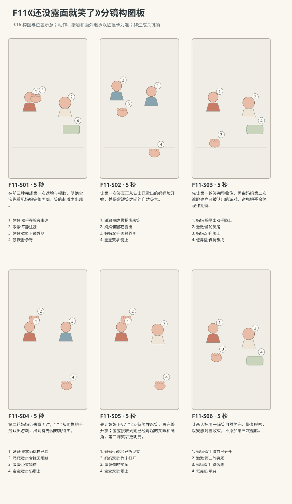

图示为构图位置示意；姿态、接触和画外继承以逐镜正文为准。

### 逐镜设计

#### F11-S01｜00—05 秒｜5 秒｜帧 [0, 120)

**镜头任务：**在前三秒完成第一次遮脸与揭脸，明确宝宝先看见妈妈完整面部，笑的刺激才出现。

**景别、机位与构图：**东南朝西北的固定双人中景，近宝宝眼高略俯，妈妈画左、澈澈画右，两张侧脸、妈妈双手和宝宝胸前都可读；北沙发稳住后景，低靠垫轮廓与宝宝坐骨区域在下部。妈妈双手当前悬在自己下颊外侧，未遮住眼鼻，宝宝双手各放腿上。

**摄影机与理由：**固定，把合掌遮脸与向两边打开的全过程留在同一画面，不切镜藏掉第一次显露；不推近制造惊吓。

**焦点：**妈妈当前露出的眉眼嘴角、脸旁双掌与宝宝注视的双眼都清楚，保持同一短纵深，不让手部虚化遮盖开合。

**入态：**澈澈背靠低靠垫坐稳，双掌各轻放自己腿上，平静看妈妈，没有笑声；妈妈双手悬在自己下颊外侧、掌心朝自己，脸完整露出，正看宝宝。

**动作与表演：**

- 1 秒：妈妈把两只手同时移到自己脸前，双掌并拢，手背朝宝宝，遮住自己的眉眼鼻口并留呼吸空隙；澈澈只看双掌，没有笑。

- 1 秒：妈妈双掌保持合拢，眉眼不从指缝偷露，也不假装还能看见宝宝；澈澈目光停在掌边，双手仍腿上。

- 1 秒：妈妈双掌向自己两侧分开，沿脸旁完整退到面颊外，露出眼睛、鼻子和带小笑的嘴；这一秒结束时脸已经全部打开，重新看向宝宝。

- 2 秒：妈妈在双掌已经完全打开、嘴部可见后，轻快轻声说“在这儿！”，口唇随普通话自然开合，语毕放松收口；澈澈看住露出的眼睛和嘴角，脸慢慢亮起来、嘴角略提，尚未发出笑声，妈妈双手仍停在面颊外侧。

**声音：**前3秒只有室内轻底声、妈妈双臂的一点衣料声和两人平稳呼吸，首次打开不配爆点声；镜内第3—5秒，双掌已完全打开、嘴部可见，妈妈对澈澈用轻快轻声的普通话准确说“在这儿！”，自然发音，语句在切出前完整收住。直到本镜结束都没有宝宝笑声；无其他对白、字幕、旁白或音乐。

**出态：**妈妈脸完整露出，双手分开停在自己面颊外侧，正看宝宝；澈澈双掌仍腿上，目光已对到妈妈眼鼻，嘴角略提但尚未发笑。

**切点与承接：**第一次揭脸已经完整结束，切稍紧的宝宝反应覆盖，延续这一次看见，不重演开掌。

**连续性：**画内看清双掌只遮妈妈自己、再向两侧打开，宝宝脸从未被挡或触摸；首次笑尚未起。低靠垫和骨盆支撑在共享镜可辨，后镜裁切部分只继承。

**开始画面母稿：**

9:16竖幅，原创三维家庭生活动画，圆润而有重量的造型，柔和皮肤层次、哑光棉布与可读的小表情；生活物理与婴儿当下能力真实，不用成人式算计。宝宝名叫澈澈，暂拟圆润脸颊、深棕眼、短黑绒发与额前右弯小发撮，奶油色棉连体衣；妈妈暂拟深棕低马尾、雾蓝棉上衣、米色长裤，外貌和服装以后续用户参考为准。人物、场景参考尚未提供，未绑定实际素材。本镜开始画面为单一瞬间：澈澈背靠低靠垫坐稳，双掌各轻放自己腿上，平静看妈妈，没有笑声；妈妈双手悬在自己下颊外侧、掌心朝自己，脸完整露出，正看宝宝。 场次方位与光位：L客厅北墙固定沙发、西窗、东侧走廊入口、中央奶油地垫。澈澈在地垫北半朝南有靠坐，头自然偏向西南的妈妈，稳固低靠垫承背、骨盆与双脚落垫，双掌轻放自己腿上；妈妈盘腿坐西南侧朝东北。摄影始终在两人连线东南侧朝西北，妈妈画左、宝宝画右，侧脸与掌边可读；西窗漫射为唯一主光，暖墙反射填暗部，地理不镜像。只有这两个人，没有布巾、报纸、布书、玩具或其他遮脸道具。妈妈遮脸时双掌只遮自己的脸，离自己面部留呼吸空隙、不压鼻口；遮住眉眼时她看不见宝宝，开掌露眼后才能重新对视。 摄影构图：东南朝西北的固定双人中景，近宝宝眼高略俯，妈妈画左、澈澈画右，两张侧脸、妈妈双手和宝宝胸前都可读；北沙发稳住后景，低靠垫轮廓与宝宝坐骨区域在下部。妈妈双手当前悬在自己下颊外侧，未遮住眼鼻，宝宝双手各放腿上。 当前焦点：妈妈当前露出的眉眼嘴角、脸旁双掌与宝宝注视的双眼都清楚，保持同一短纵深，不让手部虚化遮盖开合。只呈现上述起态，不把后续遮脸、开掌或新的笑容拼入一张画面；不绘动作轨迹、分格或文字。

**视频变化母稿：**

9:16竖幅，原创三维家庭生活动画，圆润而有重量的造型，柔和皮肤层次、哑光棉布与可读的小表情；生活物理与婴儿当下能力真实，不用成人式算计。宝宝名叫澈澈，暂拟圆润脸颊、深棕眼、短黑绒发与额前右弯小发撮，奶油色棉连体衣；妈妈暂拟深棕低马尾、雾蓝棉上衣、米色长裤，外貌和服装以后续用户参考为准。人物、场景参考尚未提供，未绑定实际素材。制作一段5秒连续镜头。本段人物和能力：澈澈、妈妈，澈澈为R1有靠坐，不据此设统一月龄。空间光位：L客厅北墙固定沙发、西窗、东侧走廊入口、中央奶油地垫。澈澈在地垫北半朝南有靠坐，头自然偏向西南的妈妈，稳固低靠垫承背、骨盆与双脚落垫，双掌轻放自己腿上；妈妈盘腿坐西南侧朝东北。摄影始终在两人连线东南侧朝西北，妈妈画左、宝宝画右，侧脸与掌边可读；西窗漫射为唯一主光，暖墙反射填暗部，地理不镜像。只有这两个人，没有布巾、报纸、布书、玩具或其他遮脸道具。妈妈遮脸时双掌只遮自己的脸，离自己面部留呼吸空隙、不压鼻口；遮住眉眼时她看不见宝宝，开掌露眼后才能重新对视。 起态：澈澈背靠低靠垫坐稳，双掌各轻放自己腿上，平静看妈妈，没有笑声；妈妈双手悬在自己下颊外侧、掌心朝自己，脸完整露出，正看宝宝。 摄影：东南朝西北的固定双人中景，近宝宝眼高略俯，妈妈画左、澈澈画右，两张侧脸、妈妈双手和宝宝胸前都可读；北沙发稳住后景，低靠垫轮廓与宝宝坐骨区域在下部。妈妈双手当前悬在自己下颊外侧，未遮住眼鼻，宝宝双手各放腿上。 相机行为：固定，把合掌遮脸与向两边打开的全过程留在同一画面，不切镜藏掉第一次显露；不推近制造惊吓。 焦点：妈妈当前露出的眉眼嘴角、脸旁双掌与宝宝注视的双眼都清楚，保持同一短纵深，不让手部虚化遮盖开合。 时间过程：第1阶段1秒：妈妈把两只手同时移到自己脸前，双掌并拢，手背朝宝宝，遮住自己的眉眼鼻口并留呼吸空隙；澈澈只看双掌，没有笑。；第2阶段1秒：妈妈双掌保持合拢，眉眼不从指缝偷露，也不假装还能看见宝宝；澈澈目光停在掌边，双手仍腿上。；第3阶段1秒：妈妈双掌向自己两侧分开，沿脸旁完整退到面颊外，露出眼睛、鼻子和带小笑的嘴；这一秒结束时脸已经全部打开，重新看向宝宝。；第4阶段2秒：妈妈在双掌已经完全打开、嘴部可见后，轻快轻声说“在这儿！”，口唇随普通话自然开合，语毕放松收口；澈澈看住露出的眼睛和嘴角，脸慢慢亮起来、嘴角略提，尚未发出笑声，妈妈双手仍停在面颊外侧。。声音：前3秒只有室内轻底声、妈妈双臂的一点衣料声和两人平稳呼吸，首次打开不配爆点声；镜内第3—5秒，双掌已完全打开、嘴部可见，妈妈对澈澈用轻快轻声的普通话准确说“在这儿！”，自然发音，语句在切出前完整收住。直到本镜结束都没有宝宝笑声；无其他对白、字幕、旁白或音乐。 终态：妈妈脸完整露出，双手分开停在自己面颊外侧，正看宝宝；澈澈双掌仍腿上，目光已对到妈妈眼鼻，嘴角略提但尚未发笑。 连续性：画内看清双掌只遮妈妈自己、再向两侧打开，宝宝脸从未被挡或触摸；首次笑尚未起。低靠垫和骨盆支撑在共享镜可辨，后镜裁切部分只继承。 按本镜完整过程到达终态，不在镜内另加切镜，不加未写出的对白、人物、道具或解释旁白。

#### F11-S02｜05—10 秒｜5 秒｜帧 [120, 240)

**镜头任务：**让第一次笑真正从认出已露出的妈妈脸开始，并保留短笑之间的自然吸气。

**景别、机位与构图：**同轴线东南侧稍紧的反应中近景，澈澈脸与上胸占画中右，双手和腿上缘在下部；妈妈已露出的近侧脸与分开双手留画左边缘。妈妈膝部在本镜裁切外，不为证明手归属强行压进脸部近景。

**摄影机与理由：**固定，略紧是为读宝宝从注视到短笑和吸气的过程；妈妈的脸一直露着，不用她再次打开来催笑。

**焦点：**宝宝当前略提的嘴角、眼睛与胸前呼吸区清楚，妈妈露出的面部轮廓可辨，保持目光指向而非只锁嘴。

**入态：**妈妈脸完整露出，双手分开停在自己面颊外侧，正看宝宝；澈澈双掌仍腿上，目光已对到妈妈眼鼻，嘴角略提但尚未发笑。

**动作与表演：**

- 1 秒：澈澈看着妈妈已露出的脸，嘴角展开，下巴轻松，呼出第一声短笑；妈妈接住他的目光，笑容也松开。

- 2 秒：宝宝又笑出两小声，中间有一次自然吸气，肩胸只轻轻起伏；妈妈放下分开的双手，双手沿自己的上身两侧下降，离开裁切后落回各自膝上。

- 2 秒：澈澈的笑逐渐变短，最后一声轻笑仍留短尾、尚未开始吸气，双掌仍轻落腿上；妈妈不再逗第二个动作，安静等他缓过这口气。

**声音：**本镜第一秒在宝宝看清脸之后才起第一声短笑，接两小声带空隙的自然婴儿笑与清楚吸气；不铺循环笑罐头。最后一声轻尾音延至下一镜开头，连续呼吸相位保留。妈妈只平稳呼吸，无台词。

**出态：**妈妈双手已落各自膝上，脸一直露出、看着宝宝；澈澈双掌腿上，首轮笑只剩最后一声轻尾音，正待下一口吸气，目光仍向妈妈。

**切点与承接：**在第一阵笑的尾声切回稍宽共享镜，同一次笑尾和吸气继续，不把第二轮笑提前拼进来。

**连续性：**画内直接见宝宝因露脸而笑、笑间换气及妈妈双手向下离开裁切；妈妈双手落膝为画外继承，由下一镜宽景确认。宝宝骨盆和靠垫下部在画外保持支撑，不因笑前扑。

**开始画面母稿：**

9:16竖幅，原创三维家庭生活动画，圆润而有重量的造型，柔和皮肤层次、哑光棉布与可读的小表情；生活物理与婴儿当下能力真实，不用成人式算计。宝宝名叫澈澈，暂拟圆润脸颊、深棕眼、短黑绒发与额前右弯小发撮，奶油色棉连体衣；妈妈暂拟深棕低马尾、雾蓝棉上衣、米色长裤，外貌和服装以后续用户参考为准。人物、场景参考尚未提供，未绑定实际素材。本镜开始画面为单一瞬间：妈妈脸完整露出，双手分开停在自己面颊外侧，正看宝宝；澈澈双掌仍腿上，目光已对到妈妈眼鼻，嘴角略提但尚未发笑。 场次方位与光位：L客厅北墙固定沙发、西窗、东侧走廊入口、中央奶油地垫。澈澈在地垫北半朝南有靠坐，头自然偏向西南的妈妈，稳固低靠垫承背、骨盆与双脚落垫，双掌轻放自己腿上；妈妈盘腿坐西南侧朝东北。摄影始终在两人连线东南侧朝西北，妈妈画左、宝宝画右，侧脸与掌边可读；西窗漫射为唯一主光，暖墙反射填暗部，地理不镜像。只有这两个人，没有布巾、报纸、布书、玩具或其他遮脸道具。妈妈遮脸时双掌只遮自己的脸，离自己面部留呼吸空隙、不压鼻口；遮住眉眼时她看不见宝宝，开掌露眼后才能重新对视。 摄影构图：同轴线东南侧稍紧的反应中近景，澈澈脸与上胸占画中右，双手和腿上缘在下部；妈妈已露出的近侧脸与分开双手留画左边缘。妈妈膝部在本镜裁切外，不为证明手归属强行压进脸部近景。 当前焦点：宝宝当前略提的嘴角、眼睛与胸前呼吸区清楚，妈妈露出的面部轮廓可辨，保持目光指向而非只锁嘴。只呈现上述起态，不把后续遮脸、开掌或新的笑容拼入一张画面；不绘动作轨迹、分格或文字。

**视频变化母稿：**

9:16竖幅，原创三维家庭生活动画，圆润而有重量的造型，柔和皮肤层次、哑光棉布与可读的小表情；生活物理与婴儿当下能力真实，不用成人式算计。宝宝名叫澈澈，暂拟圆润脸颊、深棕眼、短黑绒发与额前右弯小发撮，奶油色棉连体衣；妈妈暂拟深棕低马尾、雾蓝棉上衣、米色长裤，外貌和服装以后续用户参考为准。人物、场景参考尚未提供，未绑定实际素材。制作一段5秒连续镜头。本段人物和能力：澈澈、妈妈，澈澈为R1有靠坐，不据此设统一月龄。空间光位：L客厅北墙固定沙发、西窗、东侧走廊入口、中央奶油地垫。澈澈在地垫北半朝南有靠坐，头自然偏向西南的妈妈，稳固低靠垫承背、骨盆与双脚落垫，双掌轻放自己腿上；妈妈盘腿坐西南侧朝东北。摄影始终在两人连线东南侧朝西北，妈妈画左、宝宝画右，侧脸与掌边可读；西窗漫射为唯一主光，暖墙反射填暗部，地理不镜像。只有这两个人，没有布巾、报纸、布书、玩具或其他遮脸道具。妈妈遮脸时双掌只遮自己的脸，离自己面部留呼吸空隙、不压鼻口；遮住眉眼时她看不见宝宝，开掌露眼后才能重新对视。 起态：妈妈脸完整露出，双手分开停在自己面颊外侧，正看宝宝；澈澈双掌仍腿上，目光已对到妈妈眼鼻，嘴角略提但尚未发笑。 摄影：同轴线东南侧稍紧的反应中近景，澈澈脸与上胸占画中右，双手和腿上缘在下部；妈妈已露出的近侧脸与分开双手留画左边缘。妈妈膝部在本镜裁切外，不为证明手归属强行压进脸部近景。 相机行为：固定，略紧是为读宝宝从注视到短笑和吸气的过程；妈妈的脸一直露着，不用她再次打开来催笑。 焦点：宝宝当前略提的嘴角、眼睛与胸前呼吸区清楚，妈妈露出的面部轮廓可辨，保持目光指向而非只锁嘴。 时间过程：第1阶段1秒：澈澈看着妈妈已露出的脸，嘴角展开，下巴轻松，呼出第一声短笑；妈妈接住他的目光，笑容也松开。；第2阶段2秒：宝宝又笑出两小声，中间有一次自然吸气，肩胸只轻轻起伏；妈妈放下分开的双手，双手沿自己的上身两侧下降，离开裁切后落回各自膝上。；第3阶段2秒：澈澈的笑逐渐变短，最后一声轻笑仍留短尾、尚未开始吸气，双掌仍轻落腿上；妈妈不再逗第二个动作，安静等他缓过这口气。。声音：本镜第一秒在宝宝看清脸之后才起第一声短笑，接两小声带空隙的自然婴儿笑与清楚吸气；不铺循环笑罐头。最后一声轻尾音延至下一镜开头，连续呼吸相位保留。妈妈只平稳呼吸，无台词。 终态：妈妈双手已落各自膝上，脸一直露出、看着宝宝；澈澈双掌腿上，首轮笑只剩最后一声轻尾音，正待下一口吸气，目光仍向妈妈。 连续性：画内直接见宝宝因露脸而笑、笑间换气及妈妈双手向下离开裁切；妈妈双手落膝为画外继承，由下一镜宽景确认。宝宝骨盆和靠垫下部在画外保持支撑，不因笑前扑。 按本镜完整过程到达终态，不在镜内另加切镜，不加未写出的对白、人物、道具或解释旁白。

#### F11-S03｜10—15 秒｜5 秒｜帧 [240, 360)

**镜头任务：**先让第一轮笑完整收住，再由妈妈第二次遮脸建立可被认出的游戏，避免把残余笑误作期待。

**景别、机位与构图：**东南侧双人中景，妈妈画左、澈澈画右，妈妈当前双手落膝、面部露出，宝宝两手和低靠垫清楚；面部到膝上的手部通道都在取景内，背景沙发不换边。

**摄影机与理由：**固定、略宽于前镜，完整看到妈妈双手从膝上抬到自己的脸前；第二次遮脸不靠切镜凭空完成。

**焦点：**当前妈妈膝上双手、已露出的面部和宝宝笑尾中的口眼可读，维持足够清楚范围，不只追成人抬手。

**入态：**妈妈双手已落各自膝上，脸一直露出、看着宝宝；澈澈双掌腿上，首轮笑只剩最后一声轻尾音，正待下一口吸气，目光仍向妈妈。

**动作与表演：**

- 1 秒：上一镜最后一声笑尾先自然结束，澈澈随后吸一小口气，肩膀慢慢放松；妈妈双手仍膝上，没有马上重复。

- 1 秒：宝宝已完成短吸气，恢复平稳呼吸，只留小笑容；妈妈双手仍在各自膝上、脸完整露出，温柔带逗趣地用普通话问“再来？”，口唇自然开合，问完放松收口，再开始后面的抬手动作。

- 2 秒：妈妈双手从各自膝上抬起，掌心转向自己，再次并拢遮住自己的眉眼鼻口，离脸留小空隙，不伸向宝宝；澈澈的目光跟到同样的双掌姿势。

- 1 秒：妈妈双掌保持完全合拢，眉眼藏住，只听宝宝；澈澈继续看掌边，嘴角微提，仍没有第二轮笑声。

**声音：**开头承接上一镜同一声轻笑尾，尾音先在第一秒内结束，随即接一口短吸气；镜内第1—2秒，宝宝已经缓过这口气，妈妈双手仍膝上、嘴部可见，温柔带逗趣地用普通话准确问“再来？”，轻微询问上扬，问句完整结束后才抬手遮脸，随后才有轻衣料声。后半只留平稳呼吸，无新的宝宝笑声、其他台词或配乐，不加字幕、旁白。

**出态：**妈妈双掌合拢遮住自己的眉眼鼻口、离脸有呼吸空隙，看不见宝宝；澈澈双掌腿上，带小笑看着掌边，呼吸已经平稳，第二轮笑尚未起。

**切点与承接：**在遮脸已成立、首轮笑已结束的安静状态切稍紧共享镜，接同一次等待，不重新举手。

**连续性：**画内重新确认妈妈双手从膝上抬起并遮自己面部，宝宝脸始终无遮挡。第二轮开始前有完整安静呼吸，妈妈遮住眼睛后不能继续用眼线追宝宝。

**开始画面母稿：**

9:16竖幅，原创三维家庭生活动画，圆润而有重量的造型，柔和皮肤层次、哑光棉布与可读的小表情；生活物理与婴儿当下能力真实，不用成人式算计。宝宝名叫澈澈，暂拟圆润脸颊、深棕眼、短黑绒发与额前右弯小发撮，奶油色棉连体衣；妈妈暂拟深棕低马尾、雾蓝棉上衣、米色长裤，外貌和服装以后续用户参考为准。人物、场景参考尚未提供，未绑定实际素材。本镜开始画面为单一瞬间：妈妈双手已落各自膝上，脸一直露出、看着宝宝；澈澈双掌腿上，首轮笑只剩最后一声轻尾音，正待下一口吸气，目光仍向妈妈。 场次方位与光位：L客厅北墙固定沙发、西窗、东侧走廊入口、中央奶油地垫。澈澈在地垫北半朝南有靠坐，头自然偏向西南的妈妈，稳固低靠垫承背、骨盆与双脚落垫，双掌轻放自己腿上；妈妈盘腿坐西南侧朝东北。摄影始终在两人连线东南侧朝西北，妈妈画左、宝宝画右，侧脸与掌边可读；西窗漫射为唯一主光，暖墙反射填暗部，地理不镜像。只有这两个人，没有布巾、报纸、布书、玩具或其他遮脸道具。妈妈遮脸时双掌只遮自己的脸，离自己面部留呼吸空隙、不压鼻口；遮住眉眼时她看不见宝宝，开掌露眼后才能重新对视。 摄影构图：东南侧双人中景，妈妈画左、澈澈画右，妈妈当前双手落膝、面部露出，宝宝两手和低靠垫清楚；面部到膝上的手部通道都在取景内，背景沙发不换边。 当前焦点：当前妈妈膝上双手、已露出的面部和宝宝笑尾中的口眼可读，维持足够清楚范围，不只追成人抬手。只呈现上述起态，不把后续遮脸、开掌或新的笑容拼入一张画面；不绘动作轨迹、分格或文字。

**视频变化母稿：**

9:16竖幅，原创三维家庭生活动画，圆润而有重量的造型，柔和皮肤层次、哑光棉布与可读的小表情；生活物理与婴儿当下能力真实，不用成人式算计。宝宝名叫澈澈，暂拟圆润脸颊、深棕眼、短黑绒发与额前右弯小发撮，奶油色棉连体衣；妈妈暂拟深棕低马尾、雾蓝棉上衣、米色长裤，外貌和服装以后续用户参考为准。人物、场景参考尚未提供，未绑定实际素材。制作一段5秒连续镜头。本段人物和能力：澈澈、妈妈，澈澈为R1有靠坐，不据此设统一月龄。空间光位：L客厅北墙固定沙发、西窗、东侧走廊入口、中央奶油地垫。澈澈在地垫北半朝南有靠坐，头自然偏向西南的妈妈，稳固低靠垫承背、骨盆与双脚落垫，双掌轻放自己腿上；妈妈盘腿坐西南侧朝东北。摄影始终在两人连线东南侧朝西北，妈妈画左、宝宝画右，侧脸与掌边可读；西窗漫射为唯一主光，暖墙反射填暗部，地理不镜像。只有这两个人，没有布巾、报纸、布书、玩具或其他遮脸道具。妈妈遮脸时双掌只遮自己的脸，离自己面部留呼吸空隙、不压鼻口；遮住眉眼时她看不见宝宝，开掌露眼后才能重新对视。 起态：妈妈双手已落各自膝上，脸一直露出、看着宝宝；澈澈双掌腿上，首轮笑只剩最后一声轻尾音，正待下一口吸气，目光仍向妈妈。 摄影：东南侧双人中景，妈妈画左、澈澈画右，妈妈当前双手落膝、面部露出，宝宝两手和低靠垫清楚；面部到膝上的手部通道都在取景内，背景沙发不换边。 相机行为：固定、略宽于前镜，完整看到妈妈双手从膝上抬到自己的脸前；第二次遮脸不靠切镜凭空完成。 焦点：当前妈妈膝上双手、已露出的面部和宝宝笑尾中的口眼可读，维持足够清楚范围，不只追成人抬手。 时间过程：第1阶段1秒：上一镜最后一声笑尾先自然结束，澈澈随后吸一小口气，肩膀慢慢放松；妈妈双手仍膝上，没有马上重复。；第2阶段1秒：宝宝已完成短吸气，恢复平稳呼吸，只留小笑容；妈妈双手仍在各自膝上、脸完整露出，温柔带逗趣地用普通话问“再来？”，口唇自然开合，问完放松收口，再开始后面的抬手动作。；第3阶段2秒：妈妈双手从各自膝上抬起，掌心转向自己，再次并拢遮住自己的眉眼鼻口，离脸留小空隙，不伸向宝宝；澈澈的目光跟到同样的双掌姿势。；第4阶段1秒：妈妈双掌保持完全合拢，眉眼藏住，只听宝宝；澈澈继续看掌边，嘴角微提，仍没有第二轮笑声。。声音：开头承接上一镜同一声轻笑尾，尾音先在第一秒内结束，随即接一口短吸气；镜内第1—2秒，宝宝已经缓过这口气，妈妈双手仍膝上、嘴部可见，温柔带逗趣地用普通话准确问“再来？”，轻微询问上扬，问句完整结束后才抬手遮脸，随后才有轻衣料声。后半只留平稳呼吸，无新的宝宝笑声、其他台词或配乐，不加字幕、旁白。 终态：妈妈双掌合拢遮住自己的眉眼鼻口、离脸有呼吸空隙，看不见宝宝；澈澈双掌腿上，带小笑看着掌边，呼吸已经平稳，第二轮笑尚未起。 连续性：画内重新确认妈妈双手从膝上抬起并遮自己面部，宝宝脸始终无遮挡。第二轮开始前有完整安静呼吸，妈妈遮住眼睛后不能继续用眼线追宝宝。 按本镜完整过程到达终态，不在镜内另加切镜，不加未写出的对白、人物、道具或解释旁白。

#### F11-S04｜15—20 秒｜5 秒｜帧 [360, 480)

**镜头任务：**第二轮妈妈仍未露面时，宝宝从同样的手势认出游戏，出现有先因的期待笑。

**景别、机位与构图：**东南侧共享中近景，妈妈画左、澈澈画右，两张侧脸所在区域同框，妈妈面部完全藏在自己并拢双掌后，掌侧从本机位也挡住近侧眼睛，不留偷看的眼缝；宝宝脸和胸前清楚。双手都在妈妈面前，宝宝双掌仍腿上。

**摄影机与理由：**固定，等待宝宝自己的反应；母亲遮脸状态和宝宝表情始终同框，不用单独宝宝笑镜掩盖母亲是否提前开掌。

**焦点：**妈妈当前合拢的掌边、宝宝带小笑的眼睛嘴角与胸前呼吸区都清楚；母亲眉眼在掌后，此刻不要求看见她的眼神。

**入态：**妈妈双掌合拢遮住自己的眉眼鼻口、离脸有呼吸空隙，看不见宝宝；澈澈双掌腿上，带小笑看着掌边，呼吸已经平稳，第二轮笑尚未起。

**动作与表演：**

- 2 秒：澈澈盯着合拢的掌边，嘴角慢慢再提一点，目光没有转开；妈妈仍不打开，只听近处的呼吸，双掌不露缝。

- 1 秒：宝宝忽然从小笑容里漏出一声很轻的期待笑气，脸前没有新的显露；妈妈双手保持原位，尚不作可见反应。

- 2 秒：澈澈接一小声短笑、停一下吸气，又笑出轻尾音；妈妈继续合掌等待，已经听见宝宝，脸仍藏着，不提前分开手指。

**声音：**前两秒只有安静呼吸，第三秒才起一声轻期待笑气，之后一小声短笑、吸气、轻尾音，强度低于后续再次露脸的笑。尾音连续进入下一镜第一秒，不重放。妈妈此镜不发笑声，无台词。

**出态：**妈妈双掌仍完全遮脸，已经听到宝宝的期待笑但尚未打开；澈澈双掌腿上，盯着掌边，期待笑的最后一声轻尾音未完，正要换气。

**切点与承接：**保持同方向和近似构图切下镜，尾音不断，使妈妈随后忍笑与开掌确实由她已经听见的声音触发。

**连续性：**画内能同时证明母亲脸未显露、宝宝已经开始期待笑；妈妈的知识来自听觉，不写她隔着双掌看到宝宝。宝宝第一次看见的经验来自首轮妈妈露面后的互动，两轮之间已留安静间隔。

**开始画面母稿：**

9:16竖幅，原创三维家庭生活动画，圆润而有重量的造型，柔和皮肤层次、哑光棉布与可读的小表情；生活物理与婴儿当下能力真实，不用成人式算计。宝宝名叫澈澈，暂拟圆润脸颊、深棕眼、短黑绒发与额前右弯小发撮，奶油色棉连体衣；妈妈暂拟深棕低马尾、雾蓝棉上衣、米色长裤，外貌和服装以后续用户参考为准。人物、场景参考尚未提供，未绑定实际素材。本镜开始画面为单一瞬间：妈妈双掌合拢遮住自己的眉眼鼻口、离脸有呼吸空隙，看不见宝宝；澈澈双掌腿上，带小笑看着掌边，呼吸已经平稳，第二轮笑尚未起。 场次方位与光位：L客厅北墙固定沙发、西窗、东侧走廊入口、中央奶油地垫。澈澈在地垫北半朝南有靠坐，头自然偏向西南的妈妈，稳固低靠垫承背、骨盆与双脚落垫，双掌轻放自己腿上；妈妈盘腿坐西南侧朝东北。摄影始终在两人连线东南侧朝西北，妈妈画左、宝宝画右，侧脸与掌边可读；西窗漫射为唯一主光，暖墙反射填暗部，地理不镜像。只有这两个人，没有布巾、报纸、布书、玩具或其他遮脸道具。妈妈遮脸时双掌只遮自己的脸，离自己面部留呼吸空隙、不压鼻口；遮住眉眼时她看不见宝宝，开掌露眼后才能重新对视。 摄影构图：东南侧共享中近景，妈妈画左、澈澈画右，两张侧脸所在区域同框，妈妈面部完全藏在自己并拢双掌后，掌侧从本机位也挡住近侧眼睛，不留偷看的眼缝；宝宝脸和胸前清楚。双手都在妈妈面前，宝宝双掌仍腿上。 当前焦点：妈妈当前合拢的掌边、宝宝带小笑的眼睛嘴角与胸前呼吸区都清楚；母亲眉眼在掌后，此刻不要求看见她的眼神。只呈现上述起态，不把后续遮脸、开掌或新的笑容拼入一张画面；不绘动作轨迹、分格或文字。

**视频变化母稿：**

9:16竖幅，原创三维家庭生活动画，圆润而有重量的造型，柔和皮肤层次、哑光棉布与可读的小表情；生活物理与婴儿当下能力真实，不用成人式算计。宝宝名叫澈澈，暂拟圆润脸颊、深棕眼、短黑绒发与额前右弯小发撮，奶油色棉连体衣；妈妈暂拟深棕低马尾、雾蓝棉上衣、米色长裤，外貌和服装以后续用户参考为准。人物、场景参考尚未提供，未绑定实际素材。制作一段5秒连续镜头。本段人物和能力：澈澈、妈妈，澈澈为R1有靠坐，不据此设统一月龄。空间光位：L客厅北墙固定沙发、西窗、东侧走廊入口、中央奶油地垫。澈澈在地垫北半朝南有靠坐，头自然偏向西南的妈妈，稳固低靠垫承背、骨盆与双脚落垫，双掌轻放自己腿上；妈妈盘腿坐西南侧朝东北。摄影始终在两人连线东南侧朝西北，妈妈画左、宝宝画右，侧脸与掌边可读；西窗漫射为唯一主光，暖墙反射填暗部，地理不镜像。只有这两个人，没有布巾、报纸、布书、玩具或其他遮脸道具。妈妈遮脸时双掌只遮自己的脸，离自己面部留呼吸空隙、不压鼻口；遮住眉眼时她看不见宝宝，开掌露眼后才能重新对视。 起态：妈妈双掌合拢遮住自己的眉眼鼻口、离脸有呼吸空隙，看不见宝宝；澈澈双掌腿上，带小笑看着掌边，呼吸已经平稳，第二轮笑尚未起。 摄影：东南侧共享中近景，妈妈画左、澈澈画右，两张侧脸所在区域同框，妈妈面部完全藏在自己并拢双掌后，掌侧从本机位也挡住近侧眼睛，不留偷看的眼缝；宝宝脸和胸前清楚。双手都在妈妈面前，宝宝双掌仍腿上。 相机行为：固定，等待宝宝自己的反应；母亲遮脸状态和宝宝表情始终同框，不用单独宝宝笑镜掩盖母亲是否提前开掌。 焦点：妈妈当前合拢的掌边、宝宝带小笑的眼睛嘴角与胸前呼吸区都清楚；母亲眉眼在掌后，此刻不要求看见她的眼神。 时间过程：第1阶段2秒：澈澈盯着合拢的掌边，嘴角慢慢再提一点，目光没有转开；妈妈仍不打开，只听近处的呼吸，双掌不露缝。；第2阶段1秒：宝宝忽然从小笑容里漏出一声很轻的期待笑气，脸前没有新的显露；妈妈双手保持原位，尚不作可见反应。；第3阶段2秒：澈澈接一小声短笑、停一下吸气，又笑出轻尾音；妈妈继续合掌等待，已经听见宝宝，脸仍藏着，不提前分开手指。。声音：前两秒只有安静呼吸，第三秒才起一声轻期待笑气，之后一小声短笑、吸气、轻尾音，强度低于后续再次露脸的笑。尾音连续进入下一镜第一秒，不重放。妈妈此镜不发笑声，无台词。 终态：妈妈双掌仍完全遮脸，已经听到宝宝的期待笑但尚未打开；澈澈双掌腿上，盯着掌边，期待笑的最后一声轻尾音未完，正要换气。 连续性：画内能同时证明母亲脸未显露、宝宝已经开始期待笑；妈妈的知识来自听觉，不写她隔着双掌看到宝宝。宝宝第一次看见的经验来自首轮妈妈露面后的互动，两轮之间已留安静间隔。 按本镜完整过程到达终态，不在镜内另加切镜，不加未写出的对白、人物、道具或解释旁白。

#### F11-S05｜20—25 秒｜5 秒｜帧 [480, 600)

**镜头任务：**先让妈妈听见宝宝期待笑并忍笑，再完整开掌；宝宝接收到她已经弯起的笑眼和嘴角，第二阵笑才更明亮。

**景别、机位与构图：**沿用前镜东南侧共享中近景，妈妈画左、澈澈画右，妈妈双掌当前完全合拢挡住面部，双掌向两侧退出的通道完整，胸前有降手空间；宝宝的眼睛、嘴与上胸都可读。妈妈膝部在画外，不要求本镜把手降到膝上。

**摄影机与理由：**全镜固定，两掌分开、脸显露和宝宝加深的笑在同一镜头内完成，不用切镜、闪白或手掌溶解完成揭脸。

**焦点：**妈妈双掌边缘、两人面部所在的短纵深及宝宝口眼保持可读；起态母亲眼睛仍被掌挡住，不用切焦提前显示笑眼。

**入态：**妈妈双掌仍完全遮脸，已经听到宝宝的期待笑但尚未打开；澈澈双掌腿上，盯着掌边，期待笑的最后一声轻尾音未完，正要换气。

**动作与表演：**

- 1 秒：承接宝宝同一声期待笑尾，妈妈听见后肩膀轻动一下，掌后漏出一口忍笑的轻气，双掌仍不分开；她此时仍看不见宝宝。

- 2 秒：妈妈把双掌向两边分开、退到自己面颊外，完整露出面部；眼角已经弯起，眼睛露出之后才重新看宝宝。宝宝先短暂吸气，目光跟住显露的眼睛。

- 2 秒：看见妈妈笑着的脸，澈澈再笑出两小声较明亮的笑，中间留呼吸空隙；妈妈也笑出来，双手分开降到自己胸前，不去碰宝宝。

**声音：**开头第一秒延续前一镜同一声宝宝轻尾音并自然止住，妈妈随后一口忍笑轻气；中间宝宝短暂吸气，两掌打开不配提示声。脸显露后才起较明亮的两小声宝宝笑与妈妈柔和笑气，最后一阵笑尾接下一镜，不循环起声。

**出态：**妈妈面部已经完全露出，带笑看宝宝，分开的双手降到自己胸前；澈澈双掌仍腿上，已看见妈妈笑脸，第二阵较明亮的笑声仍有短尾，身体有靠。

**切点与承接：**在双掌已完整退出、两人已经共同发笑后切稍宽共享镜，继续这阵笑的消退与换气，不再开启第三轮。

**连续性：**画内顺序为宝宝笑尾被妈妈接收、妈妈先忍笑气、再完整开掌、露眼后才对视、宝宝看见后笑得更明显；双手只属于妈妈，不接触宝宝脸。膝部画外，因此只把本镜出态写到双手胸前。

**开始画面母稿：**

9:16竖幅，原创三维家庭生活动画，圆润而有重量的造型，柔和皮肤层次、哑光棉布与可读的小表情；生活物理与婴儿当下能力真实，不用成人式算计。宝宝名叫澈澈，暂拟圆润脸颊、深棕眼、短黑绒发与额前右弯小发撮，奶油色棉连体衣；妈妈暂拟深棕低马尾、雾蓝棉上衣、米色长裤，外貌和服装以后续用户参考为准。人物、场景参考尚未提供，未绑定实际素材。本镜开始画面为单一瞬间：妈妈双掌仍完全遮脸，已经听到宝宝的期待笑但尚未打开；澈澈双掌腿上，盯着掌边，期待笑的最后一声轻尾音未完，正要换气。 场次方位与光位：L客厅北墙固定沙发、西窗、东侧走廊入口、中央奶油地垫。澈澈在地垫北半朝南有靠坐，头自然偏向西南的妈妈，稳固低靠垫承背、骨盆与双脚落垫，双掌轻放自己腿上；妈妈盘腿坐西南侧朝东北。摄影始终在两人连线东南侧朝西北，妈妈画左、宝宝画右，侧脸与掌边可读；西窗漫射为唯一主光，暖墙反射填暗部，地理不镜像。只有这两个人，没有布巾、报纸、布书、玩具或其他遮脸道具。妈妈遮脸时双掌只遮自己的脸，离自己面部留呼吸空隙、不压鼻口；遮住眉眼时她看不见宝宝，开掌露眼后才能重新对视。 摄影构图：沿用前镜东南侧共享中近景，妈妈画左、澈澈画右，妈妈双掌当前完全合拢挡住面部，双掌向两侧退出的通道完整，胸前有降手空间；宝宝的眼睛、嘴与上胸都可读。妈妈膝部在画外，不要求本镜把手降到膝上。 当前焦点：妈妈双掌边缘、两人面部所在的短纵深及宝宝口眼保持可读；起态母亲眼睛仍被掌挡住，不用切焦提前显示笑眼。只呈现上述起态，不把后续遮脸、开掌或新的笑容拼入一张画面；不绘动作轨迹、分格或文字。

**视频变化母稿：**

9:16竖幅，原创三维家庭生活动画，圆润而有重量的造型，柔和皮肤层次、哑光棉布与可读的小表情；生活物理与婴儿当下能力真实，不用成人式算计。宝宝名叫澈澈，暂拟圆润脸颊、深棕眼、短黑绒发与额前右弯小发撮，奶油色棉连体衣；妈妈暂拟深棕低马尾、雾蓝棉上衣、米色长裤，外貌和服装以后续用户参考为准。人物、场景参考尚未提供，未绑定实际素材。制作一段5秒连续镜头。本段人物和能力：澈澈、妈妈，澈澈为R1有靠坐，不据此设统一月龄。空间光位：L客厅北墙固定沙发、西窗、东侧走廊入口、中央奶油地垫。澈澈在地垫北半朝南有靠坐，头自然偏向西南的妈妈，稳固低靠垫承背、骨盆与双脚落垫，双掌轻放自己腿上；妈妈盘腿坐西南侧朝东北。摄影始终在两人连线东南侧朝西北，妈妈画左、宝宝画右，侧脸与掌边可读；西窗漫射为唯一主光，暖墙反射填暗部，地理不镜像。只有这两个人，没有布巾、报纸、布书、玩具或其他遮脸道具。妈妈遮脸时双掌只遮自己的脸，离自己面部留呼吸空隙、不压鼻口；遮住眉眼时她看不见宝宝，开掌露眼后才能重新对视。 起态：妈妈双掌仍完全遮脸，已经听到宝宝的期待笑但尚未打开；澈澈双掌腿上，盯着掌边，期待笑的最后一声轻尾音未完，正要换气。 摄影：沿用前镜东南侧共享中近景，妈妈画左、澈澈画右，妈妈双掌当前完全合拢挡住面部，双掌向两侧退出的通道完整，胸前有降手空间；宝宝的眼睛、嘴与上胸都可读。妈妈膝部在画外，不要求本镜把手降到膝上。 相机行为：全镜固定，两掌分开、脸显露和宝宝加深的笑在同一镜头内完成，不用切镜、闪白或手掌溶解完成揭脸。 焦点：妈妈双掌边缘、两人面部所在的短纵深及宝宝口眼保持可读；起态母亲眼睛仍被掌挡住，不用切焦提前显示笑眼。 时间过程：第1阶段1秒：承接宝宝同一声期待笑尾，妈妈听见后肩膀轻动一下，掌后漏出一口忍笑的轻气，双掌仍不分开；她此时仍看不见宝宝。；第2阶段2秒：妈妈把双掌向两边分开、退到自己面颊外，完整露出面部；眼角已经弯起，眼睛露出之后才重新看宝宝。宝宝先短暂吸气，目光跟住显露的眼睛。；第3阶段2秒：看见妈妈笑着的脸，澈澈再笑出两小声较明亮的笑，中间留呼吸空隙；妈妈也笑出来，双手分开降到自己胸前，不去碰宝宝。。声音：开头第一秒延续前一镜同一声宝宝轻尾音并自然止住，妈妈随后一口忍笑轻气；中间宝宝短暂吸气，两掌打开不配提示声。脸显露后才起较明亮的两小声宝宝笑与妈妈柔和笑气，最后一阵笑尾接下一镜，不循环起声。 终态：妈妈面部已经完全露出，带笑看宝宝，分开的双手降到自己胸前；澈澈双掌仍腿上，已看见妈妈笑脸，第二阵较明亮的笑声仍有短尾，身体有靠。 连续性：画内顺序为宝宝笑尾被妈妈接收、妈妈先忍笑气、再完整开掌、露眼后才对视、宝宝看见后笑得更明显；双手只属于妈妈，不接触宝宝脸。膝部画外，因此只把本镜出态写到双手胸前。 按本镜完整过程到达终态，不在镜内另加切镜，不加未写出的对白、人物、道具或解释旁白。

#### F11-S06｜25—30 秒｜5 秒｜帧 [600, 720)

**镜头任务：**让两人把同一阵笑自然笑完、恢复呼吸，以安静对看收束，不添加第三次遮脸。

**景别、机位与构图：**东南侧稍宽双人中景，妈妈画左、澈澈画右，面部、上身到膝部均可读；妈妈双手分开在自己胸前，宝宝双掌腿上，低靠垫与坐骨区域在下部清楚，北沙发背景不变。

**摄影机与理由：**固定，放宽是为了完整看妈妈双手由胸前落回膝上和两人呼吸平复，不用拉远回避婴儿笑后的口型。

**焦点：**两人当前带笑的面部、妈妈胸前分开的双手与宝宝有支撑的上身可读；不切焦丢掉笑尾和吸气。

**入态：**妈妈面部已经完全露出，带笑看宝宝，分开的双手降到自己胸前；澈澈双掌仍腿上，已看见妈妈笑脸，第二阵较明亮的笑声仍有短尾，身体有靠。

**动作与表演：**

- 2 秒：两人延续上一镜同一阵短笑的尾声，间隔自然拉开；妈妈双手沿自己上身两侧落回各自膝上，澈澈肩胸只有轻小起伏。

- 2 秒：笑尾完全收住，宝宝松开嘴唇缓一口气，呼吸重新平稳；妈妈也轻呼气，双手留膝，只看着他。

- 1 秒：澈澈带着小笑看妈妈，腿上的手指放松；妈妈保持温和目光，谁都不再举手，安静停住。

**声音：**前两秒只延续前一镜同一阵笑的渐弱尾声，不重新加一轮笑；中间两秒笑声结束，只留一次自然换气、轻呼气和衣料声，最后一秒仅室内底声与平稳呼吸，无台词、音乐或片尾笑罐头。

**出态：**妈妈双手各落膝上、脸完全露出，澈澈双掌轻放腿上、背和骨盆有靠；两人带小笑互看，已经没有笑声，呼吸平稳。

**切点与承接：**在共同缓息后的安静互望中结束，不把母亲再抬手剪成循环。

**连续性：**画内看清妈妈双手从胸前落到各自膝上，宝宝始终有靠、不后仰失衡；笑声是前镜同一波逐渐结束，片尾没有新遮脸、无新笑声或道具。

**开始画面母稿：**

9:16竖幅，原创三维家庭生活动画，圆润而有重量的造型，柔和皮肤层次、哑光棉布与可读的小表情；生活物理与婴儿当下能力真实，不用成人式算计。宝宝名叫澈澈，暂拟圆润脸颊、深棕眼、短黑绒发与额前右弯小发撮，奶油色棉连体衣；妈妈暂拟深棕低马尾、雾蓝棉上衣、米色长裤，外貌和服装以后续用户参考为准。人物、场景参考尚未提供，未绑定实际素材。本镜开始画面为单一瞬间：妈妈面部已经完全露出，带笑看宝宝，分开的双手降到自己胸前；澈澈双掌仍腿上，已看见妈妈笑脸，第二阵较明亮的笑声仍有短尾，身体有靠。 场次方位与光位：L客厅北墙固定沙发、西窗、东侧走廊入口、中央奶油地垫。澈澈在地垫北半朝南有靠坐，头自然偏向西南的妈妈，稳固低靠垫承背、骨盆与双脚落垫，双掌轻放自己腿上；妈妈盘腿坐西南侧朝东北。摄影始终在两人连线东南侧朝西北，妈妈画左、宝宝画右，侧脸与掌边可读；西窗漫射为唯一主光，暖墙反射填暗部，地理不镜像。只有这两个人，没有布巾、报纸、布书、玩具或其他遮脸道具。妈妈遮脸时双掌只遮自己的脸，离自己面部留呼吸空隙、不压鼻口；遮住眉眼时她看不见宝宝，开掌露眼后才能重新对视。 摄影构图：东南侧稍宽双人中景，妈妈画左、澈澈画右，面部、上身到膝部均可读；妈妈双手分开在自己胸前，宝宝双掌腿上，低靠垫与坐骨区域在下部清楚，北沙发背景不变。 当前焦点：两人当前带笑的面部、妈妈胸前分开的双手与宝宝有支撑的上身可读；不切焦丢掉笑尾和吸气。只呈现上述起态，不把后续遮脸、开掌或新的笑容拼入一张画面；不绘动作轨迹、分格或文字。

**视频变化母稿：**

9:16竖幅，原创三维家庭生活动画，圆润而有重量的造型，柔和皮肤层次、哑光棉布与可读的小表情；生活物理与婴儿当下能力真实，不用成人式算计。宝宝名叫澈澈，暂拟圆润脸颊、深棕眼、短黑绒发与额前右弯小发撮，奶油色棉连体衣；妈妈暂拟深棕低马尾、雾蓝棉上衣、米色长裤，外貌和服装以后续用户参考为准。人物、场景参考尚未提供，未绑定实际素材。制作一段5秒连续镜头。本段人物和能力：澈澈、妈妈，澈澈为R1有靠坐，不据此设统一月龄。空间光位：L客厅北墙固定沙发、西窗、东侧走廊入口、中央奶油地垫。澈澈在地垫北半朝南有靠坐，头自然偏向西南的妈妈，稳固低靠垫承背、骨盆与双脚落垫，双掌轻放自己腿上；妈妈盘腿坐西南侧朝东北。摄影始终在两人连线东南侧朝西北，妈妈画左、宝宝画右，侧脸与掌边可读；西窗漫射为唯一主光，暖墙反射填暗部，地理不镜像。只有这两个人，没有布巾、报纸、布书、玩具或其他遮脸道具。妈妈遮脸时双掌只遮自己的脸，离自己面部留呼吸空隙、不压鼻口；遮住眉眼时她看不见宝宝，开掌露眼后才能重新对视。 起态：妈妈面部已经完全露出，带笑看宝宝，分开的双手降到自己胸前；澈澈双掌仍腿上，已看见妈妈笑脸，第二阵较明亮的笑声仍有短尾，身体有靠。 摄影：东南侧稍宽双人中景，妈妈画左、澈澈画右，面部、上身到膝部均可读；妈妈双手分开在自己胸前，宝宝双掌腿上，低靠垫与坐骨区域在下部清楚，北沙发背景不变。 相机行为：固定，放宽是为了完整看妈妈双手由胸前落回膝上和两人呼吸平复，不用拉远回避婴儿笑后的口型。 焦点：两人当前带笑的面部、妈妈胸前分开的双手与宝宝有支撑的上身可读；不切焦丢掉笑尾和吸气。 时间过程：第1阶段2秒：两人延续上一镜同一阵短笑的尾声，间隔自然拉开；妈妈双手沿自己上身两侧落回各自膝上，澈澈肩胸只有轻小起伏。；第2阶段2秒：笑尾完全收住，宝宝松开嘴唇缓一口气，呼吸重新平稳；妈妈也轻呼气，双手留膝，只看着他。；第3阶段1秒：澈澈带着小笑看妈妈，腿上的手指放松；妈妈保持温和目光，谁都不再举手，安静停住。。声音：前两秒只延续前一镜同一阵笑的渐弱尾声，不重新加一轮笑；中间两秒笑声结束，只留一次自然换气、轻呼气和衣料声，最后一秒仅室内底声与平稳呼吸，无台词、音乐或片尾笑罐头。 终态：妈妈双手各落膝上、脸完全露出，澈澈双掌轻放腿上、背和骨盆有靠；两人带小笑互看，已经没有笑声，呼吸平稳。 连续性：画内看清妈妈双手从胸前落到各自膝上，宝宝始终有靠、不后仰失衡；笑声是前镜同一波逐渐结束，片尾没有新遮脸、无新笑声或道具。 按本镜完整过程到达终态，不在镜内另加切镜，不加未写出的对白、人物、道具或解释旁白。

### 声音与剪辑

全片仅妈妈两句普通话现场台词：“在这儿！”和“再来？”，无字幕、旁白或音乐，片名不作口头台词。两句来自同一位妈妈的自然近距离声线：前句在首次脸完全露出后的第3—5秒轻快轻声说完；后句在第一阵笑尾已止、宝宝已短吸气后的第1—2秒温柔带逗趣问完，随后才再次遮脸。妈妈嘴部在发声时可见，口唇随中文自然发音，不闭唇配音；宝宝只保留自然笑与呼吸，不说成人式完整句子。婴儿笑按近距离真实婴儿的呼气短音、自然吸气、松口缓气与安静停顿设计，不拼接成人音色、不使用等间距循环笑罐头。母亲笑是柔和短笑气，先听宝宝再反应，遮脸时不从未显露的口型或眼神伪证反应。S01始终无宝宝笑；S02起首次笑，笑尾跨S02→S03并在S03第一秒内结束；S03后半无新笑；S04第三秒才起期待笑，轻尾音跨S04→S05第一秒；S05完整开掌后另起较明亮的笑，该笑尾跨S05→S06前两秒后消退，片尾只余呼吸与室内底声。笑声归属与换气相位不可在切镜后重置。

- 妈妈：在这儿！（F11-S01；镜内第3—5秒，首次双掌已完全向两侧打开、嘴部可见后对澈澈轻快轻声说；用自然普通话，口唇随发音开合，语句在本镜切出前完整结束，不抢先遮脸说或拖到下一镜笑声里。）

- 妈妈：再来？（F11-S03；镜内第1—2秒，前一笑尾已经结束且澈澈已短吸气，妈妈双手仍在各自膝上、脸和嘴部露出；温柔带逗趣的普通话轻问，句尾略上扬，问完收口，再用随后两秒举手遮自己脸。）

### 连续性与试片

- 连续性：宝宝正式名字澈澈，R1有靠坐是本条能力，不代表统一月龄；低靠垫承背、骨盆与双脚落垫全片保持，笑时不后仰离靠、前扑或抬臀。

- 连续性：妈妈遮脸时双掌只遮自己的脸，掌心朝自己、手背朝宝宝，离面部留呼吸空隙、不压鼻口；不碰触、捂住或突然贴近宝宝的脸，未使用布巾、报纸或布书。

- 连续性：S01先完整展示首次遮脸，再于第三秒结束前完整打开；宝宝先看清露出的眼鼻与嘴角，第一次笑只从S02开始，不能前铺笑声。“在这儿！”只在S01第3—5秒、双掌全开且嘴部可见后说完，不能遮脸或闭唇发这句。

- 连续性：S02笑尾在S03第一秒内结束，之后宝宝平稳换气；第二次遮脸从S03膝上双手抬起开始，S03末与S04全过程双掌保持合拢，不留偷看的眼缝。“再来？”只在S03第1—2秒、前一笑尾已止且宝宝短吸气后说，妈妈双手仍膝上、嘴部可见，完整说完再举手。

- 连续性：妈妈眉眼被遮时看不见宝宝，第二轮只听宝宝笑；S05先接收期待笑、再忍笑、再开掌，眼睛显露后才重新对视，不能提前展示笑眼。

- 连续性：宝宝双掌全片各轻放自己腿上，笑只带轻微肩胸起伏；妈妈双手的出入态依序为脸旁、初遮及打开、膝上、再遮、打开到胸前、最后膝上，没有第三轮。

- 连续性：摄影始终在两人连线东南侧朝西北，妈妈画左、澈澈画右；北墙沙发、西窗和世界西侧受光不反转。特写裁切外支撑与手位只作继承，不冒称直接可见。

- 连续性：笑声只随本条已写出的看见、记住游戏与听见而起；跨镜承接同一笑尾和换气，不循环笑声、不加吓人音效；宝宝不说成人式完整句子，妈妈只说两句已列中文台词，不额外旁白。人物／场景参考未提供，未声称实图或音轨已绑定。

- 试片：F11-S01—S02：静音试看须能依次指出妈妈合掌遮自己、第三秒内完整开掌、宝宝注视露出的眼鼻后才展笑；若用切镜藏开掌、宝宝在首次显露前已大笑或手盖到宝宝脸，则失败。另核S01“在这儿！”只能在双掌全开、嘴部可见的第3—5秒自然发音，切出前收句；若遮脸说、闭唇配音、改字或台词压到下一镜笑起点，则失败。

- 试片：F11-S02—S03：同一轮笑有可听吸气，笑尾只延到S03第一秒并结束，第二次遮脸前已恢复平稳呼吸；若切镜重放笑起声、连笑无换气或把残留第一轮笑当成期待，则失败。另核S03第1—2秒妈妈在宝宝短吸气完成后问“再来？”，嘴可见、双手膝上，问完才举手；若盖住呼吸、开场即发问、遮脸说或擅加第三句，则失败。

- 试片：F11-S03—S04：第二次遮脸须由膝上双手完整抬起，S04宝宝期待笑发生时妈妈眉眼鼻口仍被合拢双掌遮住；若先露眼缝才起笑、镜外已打开或妈妈仍用眼线追宝宝，则失败。

- 试片：F11-S04—S05：妈妈必须先听到期待笑，随后才出现掌后忍笑气及肩部反应；完整开掌后才能看到弯眼并重新对视。若笑眼在掌后直接可见、成人反应早于声音或揭脸靠溶解切换，则失败。

- 试片：F11-S05—S06：S05开掌显露后才起更明亮的新笑，S06仅承接同一笑尾，随后笑完全结束、双手落膝；若片尾追加第三次遮脸、重起笑罐头或突然静音截断吸气，则失败。

- 试片：F11全部静帧：S01脸未遮、S02脸已露、S03双手膝上、S04—S05脸仍遮、S06双手胸前且面部已露；若提前绘入该镜未来打开、期待笑或落膝动作，则失败。

- 试片：F11全部镜头：支撑始终可继承且关键宽镜可见，宝宝脸与鼻口从未被成人手触碰；若笑靠身体前扑、失衡后仰、手指穿脸或身份／光向镜像，则失败。

**媒体待验证：**已完成30秒六镜与十二份原生文字母稿，尚未生成画面、笑声或成片。待用户人物与场景参考核对遮脸时手掌大小、近侧眼睛的真实遮挡、宝宝有靠坐的身体比例与镜头裁切；待动态试片确认双掌开合完整、母亲遮眼时不追视、真实婴儿笑与呼吸的起止、期待笑和首次笑的可辨差异，以及三处声音跨镜接续；两句普通话的实际时长、清楚口型及与宝宝吸气／笑声让位关系也待音画联合核对。文字与时长检查不证明已获得自然笑声或可剪媒体。

---

## F12《先拍到一只手》

**36 秒｜仰卧与翻身探索｜角色：澈澈、妈妈｜场景 N**

### 剧情正文

休息角的西窗透着柔光，澈澈仰卧在婴儿床，右手刚从嘴边放下。妈妈坐在南侧，左手把手机举向自己眼前，想拍他的脸，空着的右手放松留在床栏内侧。澈澈看见近处的手，抬起右掌，握住妈妈的右食指，往自己下巴前带近一点。妈妈只好把手机降回胸前，低头看这次忽然开始的握手。指侧湿漉漉的，她微抬眉，等小手松一点，才把食指慢慢撤出来。澈澈随即把自己的右手送回嘴边，唇边贴着指关节，又微微移开，笑着看她。妈妈看看他，再看看自己的手指，没忍住一点笑。手机降到左腿上，她没有急着重新举起来。宝宝右指在下巴下张合，妈妈就靠在床边看着他。

### 亲述来源与改编

原帖是家长自述，未独立核实。本片将生活机制改编为澈澈的原创故事。

- [ZH01 · 想拍一张脸，先被湿漉漉的小手握住](https://anyray0127.pixnet.net/blog/posts/7102979960)；作者自报年龄：文章自报刚满5个月；这一小段没有另标具体日龄。。

- **采用的生活过程：**想拍宝宝脸、宝宝主动握手、成人感觉湿而撤手、宝宝把自己的手送回嘴里并看成人。

- **本片原创改编：**具体左手持手机、右食指被握、宝宝握手带近下巴但不入口、妈妈暂缓取景均为原创细节。

- **本片原创改编：**N休息角、三十六秒时长、首尾手位、表情与拍照没有完成的结尾是本项目补写。

- **不作出的事实推断：**原帖只写五个月孩子握手，没有写使用哪只手、哪根手指、是否拍照成功或握成人手靠近下巴。

- **不作出的事实推断：**不把作者幽默说法得逞当成婴儿故意把口水擦给成人的事实；公开亲述未独立核实。

[查看原始过程与缺项](research/real-experiences/index.html#ZH01)

### 导演与空间

**观察任务：**把准备拍脸、被小手握住、感到湿、撤手后看见宝宝继续吃手的完整动作链转为一条亲近的小误判。

**空间与光位：**N休息角北墙婴儿床、西窗、东门；澈澈R0仰卧，头西脚东、右手在南侧近妈妈、左手在北侧胸腹前，头背臀均由平整床垫承托。妈妈坐床南侧偏西，面朝北略东；手机只在妈妈左手，右手可从南栏上方进入床内，不穿栏。摄影在母婴连线东侧至东南侧，妈妈画左、宝宝画右，床头仍画左。西窗柔光从画左后入、暖墙反射填暗部。手机无可辨品牌和可读界面，未设闪光灯。

**人物表演：**妈妈确实在取景，握住时才转移注意；宝宝只是抓近处的手并继续探索自己的手，不偷笑示意计谋。手湿只以指侧小反光和妈妈反应读出，不做恶心夸张。

### 节拍覆盖

- **F12-b1**：交代妈妈准备拍宝宝脸，但宝宝正在研究自己的右手。 前态：澈澈仰卧，右指刚离嘴停在下巴下方、左手靠腹；妈妈左手竖持手机在胸前、镜头朝宝宝，右手空悬南栏内侧、离宝宝右掌一小掌远。 后态：妈妈左手手机已抬到自己下颊前、镜头仍朝宝宝，右手空留栏内；澈澈右掌已抬向妈妈右指但尚未接触、左手靠腹。 → F12-S01

- **F12-b2**：宝宝握住近处手指，妈妈的拍照动作被一个真实接触打断。 前态：宝宝右掌已抬向妈妈右指但尚未接触，左手靠腹；妈妈左手手机在自己下颊前，右手松开留在宝宝右掌前。 后态：宝宝右指握住妈妈右食指，停在宝宝下巴前、未碰嘴；妈妈左手手机已回胸前，正低头看握手。 → F12-S02

- **F12-b3**：妈妈感到潮湿而看一眼手指，等宝宝松一点才撤出。 前态：宝宝右指握妈妈右食指、停下巴前未触嘴；妈妈左手手机在胸前，右腕松着，低头看握手。 后态：妈妈右手已完全脱离宝宝右手、退至胸前，左手仍持手机；宝宝右手半合停下巴下、左手靠腹。 → F12-S03

- **F12-b4**：宝宝把自己的右手送到嘴边，给妈妈先前的疑惑一个可见答案。 前态：澈澈右手半合停下巴下、左手靠腹，成人右手已退出且在画外胸前，妈妈左手持手机为画外继承。 后态：澈澈右手在自己唇边微离、露出小笑；左手腹前，仰卧支撑不变，成人双手均画外继承。 → F12-S04

- **F12-b5**：妈妈看到宝宝继续吃手，明白刚才湿手的来源，反应落在亲近而非责怪。 前态：妈妈空右手停自己胸前，左手手机仍在胸前；澈澈右手微离唇边、露小笑，正看妈妈。 后态：手机仍在妈妈左手但已降到左腿，右手落右腿；澈澈右手下巴下、左手腹前，双方带小笑。 → F12-S05

- **F12-b6**：拍照暂缓，妈妈留在床边与宝宝对看。 前态：妈妈左手握手机靠左腿、空右手落右腿，带笑看宝宝；澈澈右手下巴下、左手腹前，仰卧看妈妈。 后态：妈妈仍左手持手机在左腿、右手空在右腿，澈澈仰卧、右手下巴下、左手腹前，安静对看。 → F12-S06

### 分镜构图板

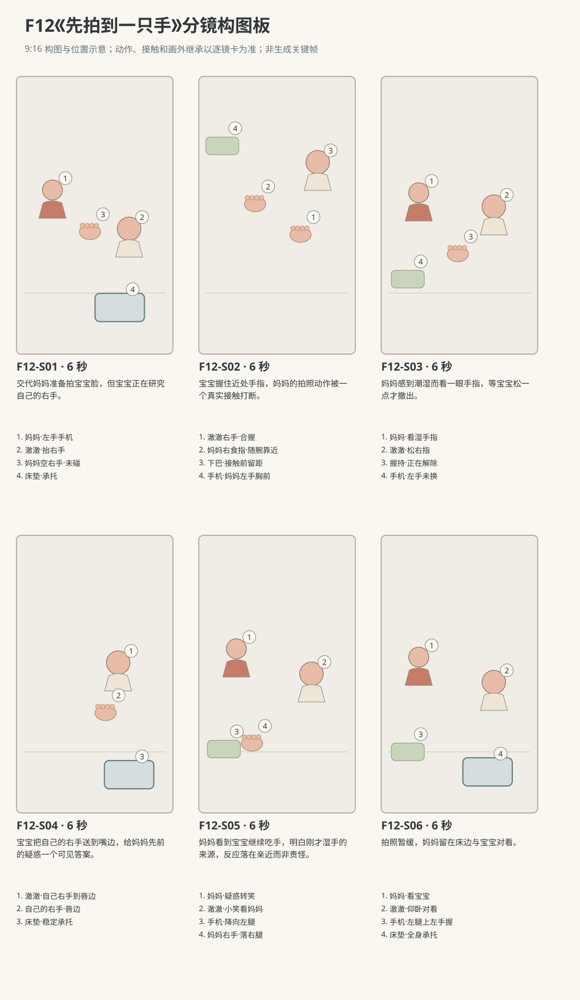

图示为构图位置示意；姿态、接触和画外继承以逐镜正文为准。

### 逐镜设计

#### F12-S01｜00—06 秒｜6 秒｜帧 [0, 144)

**镜头任务：**交代妈妈准备拍宝宝脸，但宝宝正在研究自己的右手。

**景别、机位与构图：**东南朝西北的双人中景，妈妈左、床内澈澈右；妈妈左手竖持手机在胸前、空右手在南栏上方，宝宝面部及两手清楚。

**摄影机与理由：**固定，先把手机和两只不同用途的成人手放清楚，为意外握手作准备。

**焦点：**妈妈左手手机、宝宝脸与近南侧右手同在可辨景深。

**入态：**澈澈仰卧，右指刚离嘴停在下巴下方、左手靠腹；妈妈左手竖持手机在胸前、镜头朝宝宝，右手空悬南栏内侧、离宝宝右掌一小掌远。

**动作与表演：**

- 3 秒：妈妈把左手手机稍抬向自己眼前，微偏手腕给宝宝脸取景；右手保持松开，没有碰脸。

- 3 秒：澈澈眼睛转到妈妈近处的右手，右指展开，右臂从胸前缓慢抬起。

**声音：**轻衣料声和宝宝呼吸，无快门声、对白或音乐。

**出态：**妈妈左手手机已抬到自己下颊前、镜头仍朝宝宝，右手空留栏内；澈澈右掌已抬向妈妈右指但尚未接触、左手靠腹。

**切点与承接：**切同侧近景看首次接触，不预先让成人手指已经在宝宝掌中。

**连续性：**右指刚离嘴为本片原创起态；手机一直属于妈妈左手，未按快门，宝宝身体不抬起。

**开始画面母稿：**

9:16竖幅，原创三维家庭生活动画，圆润而有重量的造型，柔和皮肤层次、哑光棉布与可读的小表情，动作遵循生活物理，不用成人式算计。澈澈暂拟圆润脸颊、深棕眼、短黑绒发、额前右弯小发撮。澈澈穿奶油色棉连体衣。妈妈暂拟深棕低马尾、雾蓝棉上衣、米色长裤。人物与场景参考尚未提供，外观为可替换暂拟设计，未上传或绑定真实素材。本镜起始画面为单一瞬间：澈澈仰卧，右指刚离嘴停在下巴下方、左手靠腹；妈妈左手竖持手机在胸前、镜头朝宝宝，右手空悬南栏内侧、离宝宝右掌一小掌远。 场次方位与光位：N休息角北墙婴儿床、西窗、东门；澈澈R0仰卧，头西脚东、右手在南侧近妈妈、左手在北侧胸腹前，头背臀均由平整床垫承托。妈妈坐床南侧偏西，面朝北略东；手机只在妈妈左手，右手可从南栏上方进入床内，不穿栏。摄影在母婴连线东侧至东南侧，妈妈画左、宝宝画右，床头仍画左。西窗柔光从画左后入、暖墙反射填暗部。手机无可辨品牌和可读界面，未设闪光灯。 摄影构图：东南朝西北的双人中景，妈妈左、床内澈澈右；妈妈左手竖持手机在胸前、空右手在南栏上方，宝宝面部及两手清楚。 当前焦点：妈妈左手手机、宝宝脸与近南侧右手同在可辨景深。 只画这一刻，不拼入后续动作、轨迹、分格、字幕或不存在的持物状态。

**视频变化母稿：**

9:16竖幅，原创三维家庭生活动画，圆润而有重量的造型，柔和皮肤层次、哑光棉布与可读的小表情，动作遵循生活物理，不用成人式算计。澈澈暂拟圆润脸颊、深棕眼、短黑绒发、额前右弯小发撮。澈澈穿奶油色棉连体衣。妈妈暂拟深棕低马尾、雾蓝棉上衣、米色长裤。人物与场景参考尚未提供，外观为可替换暂拟设计，未上传或绑定真实素材。制作一段6秒连续镜头。当前能力：R0仰卧抓握，头背臀由平整床垫承托，不独坐、不站立、不说完整句子。空间光位：N休息角北墙婴儿床、西窗、东门；澈澈R0仰卧，头西脚东、右手在南侧近妈妈、左手在北侧胸腹前，头背臀均由平整床垫承托。妈妈坐床南侧偏西，面朝北略东；手机只在妈妈左手，右手可从南栏上方进入床内，不穿栏。摄影在母婴连线东侧至东南侧，妈妈画左、宝宝画右，床头仍画左。西窗柔光从画左后入、暖墙反射填暗部。手机无可辨品牌和可读界面，未设闪光灯。 起态：澈澈仰卧，右指刚离嘴停在下巴下方、左手靠腹；妈妈左手竖持手机在胸前、镜头朝宝宝，右手空悬南栏内侧、离宝宝右掌一小掌远。 摄影：东南朝西北的双人中景，妈妈左、床内澈澈右；妈妈左手竖持手机在胸前、空右手在南栏上方，宝宝面部及两手清楚。 相机行为：固定，先把手机和两只不同用途的成人手放清楚，为意外握手作准备。 焦点：妈妈左手手机、宝宝脸与近南侧右手同在可辨景深。 时间过程：第1阶段3秒：妈妈把左手手机稍抬向自己眼前，微偏手腕给宝宝脸取景；右手保持松开，没有碰脸。；第2阶段3秒：澈澈眼睛转到妈妈近处的右手，右指展开，右臂从胸前缓慢抬起。。声音：轻衣料声和宝宝呼吸，无快门声、对白或音乐。 终态：妈妈左手手机已抬到自己下颊前、镜头仍朝宝宝，右手空留栏内；澈澈右掌已抬向妈妈右指但尚未接触、左手靠腹。 连续性：右指刚离嘴为本片原创起态；手机一直属于妈妈左手，未按快门，宝宝身体不抬起。 按本镜完整过程到达终态，不在镜内另加切镜、人物、道具或未写出的台词、字幕与旁白。

#### F12-S02｜06—12 秒｜6 秒｜帧 [144, 288)

**镜头任务：**宝宝握住近处手指，妈妈的拍照动作被一个真实接触打断。

**景别、机位与构图：**东侧手部中近景，妈妈右手从画左进入、宝宝右手从画右下抬起；下巴和胸前可见，手机左上边缘和妈妈嘴角入画。

**摄影机与理由：**固定，完整保留空隙到握住再移动的过程，接触不靠切镜。

**焦点：**宝宝右指与妈妈右食指的接触交界，口鼻与指间留距同清楚。

**入态：**宝宝右掌已抬向妈妈右指但尚未接触，左手靠腹；妈妈左手手机在自己下颊前，右手松开留在宝宝右掌前。

**动作与表演：**

- 2 秒：澈澈右指碰上妈妈右食指侧面，随即合拢握住；妈妈右腕放软。

- 2 秒：澈澈把握住的食指朝自己下巴带近一点，停在下巴前方，不送入口中；妈妈顺着这个短小动作让右腕跟随。

- 2 秒：妈妈左手手机降到胸前，视线从屏幕移到两人握着的手，嘴角从拍照笑变为一点疑惑。

**声音：**皮肤与袖口轻声、宝宝轻鼻音，无对白、快门或音乐。

**出态：**宝宝右指握住妈妈右食指，停在宝宝下巴前、未碰嘴；妈妈左手手机已回胸前，正低头看握手。

**切点与承接：**沿妈妈低头的视线接发现湿手的反应。

**连续性：**具体握哪根指与带近下巴是原创；只移一小段，不牵起宝宝上身、不碰鼻口；妈妈食指从未入口。

**开始画面母稿：**

9:16竖幅，原创三维家庭生活动画，圆润而有重量的造型，柔和皮肤层次、哑光棉布与可读的小表情，动作遵循生活物理，不用成人式算计。澈澈暂拟圆润脸颊、深棕眼、短黑绒发、额前右弯小发撮。澈澈穿奶油色棉连体衣。妈妈暂拟深棕低马尾、雾蓝棉上衣、米色长裤。人物与场景参考尚未提供，外观为可替换暂拟设计，未上传或绑定真实素材。本镜起始画面为单一瞬间：宝宝右掌已抬向妈妈右指但尚未接触，左手靠腹；妈妈左手手机在自己下颊前，右手松开留在宝宝右掌前。 场次方位与光位：N休息角北墙婴儿床、西窗、东门；澈澈R0仰卧，头西脚东、右手在南侧近妈妈、左手在北侧胸腹前，头背臀均由平整床垫承托。妈妈坐床南侧偏西，面朝北略东；手机只在妈妈左手，右手可从南栏上方进入床内，不穿栏。摄影在母婴连线东侧至东南侧，妈妈画左、宝宝画右，床头仍画左。西窗柔光从画左后入、暖墙反射填暗部。手机无可辨品牌和可读界面，未设闪光灯。 摄影构图：东侧手部中近景，妈妈右手从画左进入、宝宝右手从画右下抬起；下巴和胸前可见，手机左上边缘和妈妈嘴角入画。 当前焦点：宝宝右掌与妈妈右食指之间的间隙清楚，双方尚未接触，手指与宝宝口鼻仍有距离。 只画这一刻，不拼入后续动作、轨迹、分格、字幕或不存在的持物状态。

**视频变化母稿：**

9:16竖幅，原创三维家庭生活动画，圆润而有重量的造型，柔和皮肤层次、哑光棉布与可读的小表情，动作遵循生活物理，不用成人式算计。澈澈暂拟圆润脸颊、深棕眼、短黑绒发、额前右弯小发撮。澈澈穿奶油色棉连体衣。妈妈暂拟深棕低马尾、雾蓝棉上衣、米色长裤。人物与场景参考尚未提供，外观为可替换暂拟设计，未上传或绑定真实素材。制作一段6秒连续镜头。当前能力：R0仰卧抓握，头背臀由平整床垫承托，不独坐、不站立、不说完整句子。空间光位：N休息角北墙婴儿床、西窗、东门；澈澈R0仰卧，头西脚东、右手在南侧近妈妈、左手在北侧胸腹前，头背臀均由平整床垫承托。妈妈坐床南侧偏西，面朝北略东；手机只在妈妈左手，右手可从南栏上方进入床内，不穿栏。摄影在母婴连线东侧至东南侧，妈妈画左、宝宝画右，床头仍画左。西窗柔光从画左后入、暖墙反射填暗部。手机无可辨品牌和可读界面，未设闪光灯。 起态：宝宝右掌已抬向妈妈右指但尚未接触，左手靠腹；妈妈左手手机在自己下颊前，右手松开留在宝宝右掌前。 摄影：东侧手部中近景，妈妈右手从画左进入、宝宝右手从画右下抬起；下巴和胸前可见，手机左上边缘和妈妈嘴角入画。 相机行为：固定，完整保留空隙到握住再移动的过程，接触不靠切镜。 焦点：宝宝右指与妈妈右食指的接触交界，口鼻与指间留距同清楚。 时间过程：第1阶段2秒：澈澈右指碰上妈妈右食指侧面，随即合拢握住；妈妈右腕放软。；第2阶段2秒：澈澈把握住的食指朝自己下巴带近一点，停在下巴前方，不送入口中；妈妈顺着这个短小动作让右腕跟随。；第3阶段2秒：妈妈左手手机降到胸前，视线从屏幕移到两人握着的手，嘴角从拍照笑变为一点疑惑。。声音：皮肤与袖口轻声、宝宝轻鼻音，无对白、快门或音乐。 终态：宝宝右指握住妈妈右食指，停在宝宝下巴前、未碰嘴；妈妈左手手机已回胸前，正低头看握手。 连续性：具体握哪根指与带近下巴是原创；只移一小段，不牵起宝宝上身、不碰鼻口；妈妈食指从未入口。 按本镜完整过程到达终态，不在镜内另加切镜、人物、道具或未写出的台词、字幕与旁白。

#### F12-S03｜12—18 秒｜6 秒｜帧 [288, 432)

**镜头任务：**妈妈感到潮湿而看一眼手指，等宝宝松一点才撤出。

**景别、机位与构图：**东南双人中近景，妈妈低头脸画左、宝宝脸画右、相握的右手在中央下部，左手手机留左下。

**摄影机与理由：**固定，留出感到湿、短暂检查、宝宝松指与成人撤手的顺序，不做夸张甩手。

**焦点：**中央手指与妈妈轻抬的眉；宝宝嘴部仍可辨。

**入态：**宝宝右指握妈妈右食指、停下巴前未触嘴；妈妈左手手机在胸前，右腕松着，低头看握手。

**动作与表演：**

- 2 秒：妈妈感觉指侧潮湿，微抬眉，右食指轻转让指侧在窗光里露出一小片湿润光泽。

- 2 秒：澈澈右指松开一点、目光转向自己的指头；妈妈随松动缓缓把食指向南退出。

- 2 秒：妈妈空右手退到南栏外胸前，看一眼指侧；宝宝右掌停在下巴下，五指半合。

**声音：**一口很轻的疑惑鼻息和衣料声，不加黏腻音效、对白或音乐。

**出态：**妈妈右手已完全脱离宝宝右手、退至胸前，左手仍持手机；宝宝右手半合停下巴下、左手靠腹。

**切点与承接：**切宝宝自己把手送回嘴边，不用切镜把成人手换成宝宝手。

**连续性：**撤出前宝宝指头先松，不能硬掰或抽拉；一点湿润仅是表面反光，不形成夸张水滴。成人手已离开才让宝宝开始后续动作。

**开始画面母稿：**

9:16竖幅，原创三维家庭生活动画，圆润而有重量的造型，柔和皮肤层次、哑光棉布与可读的小表情，动作遵循生活物理，不用成人式算计。澈澈暂拟圆润脸颊、深棕眼、短黑绒发、额前右弯小发撮。澈澈穿奶油色棉连体衣。妈妈暂拟深棕低马尾、雾蓝棉上衣、米色长裤。人物与场景参考尚未提供，外观为可替换暂拟设计，未上传或绑定真实素材。本镜起始画面为单一瞬间：宝宝右指握妈妈右食指、停下巴前未触嘴；妈妈左手手机在胸前，右腕松着，低头看握手。 场次方位与光位：N休息角北墙婴儿床、西窗、东门；澈澈R0仰卧，头西脚东、右手在南侧近妈妈、左手在北侧胸腹前，头背臀均由平整床垫承托。妈妈坐床南侧偏西，面朝北略东；手机只在妈妈左手，右手可从南栏上方进入床内，不穿栏。摄影在母婴连线东侧至东南侧，妈妈画左、宝宝画右，床头仍画左。西窗柔光从画左后入、暖墙反射填暗部。手机无可辨品牌和可读界面，未设闪光灯。 摄影构图：东南双人中近景，妈妈低头脸画左、宝宝脸画右、相握的右手在中央下部，左手手机留左下。 当前焦点：中央相握手指与妈妈低头疑惑的面部清楚；眉毛尚未抬起，宝宝嘴部可辨。 只画这一刻，不拼入后续动作、轨迹、分格、字幕或不存在的持物状态。

**视频变化母稿：**

9:16竖幅，原创三维家庭生活动画，圆润而有重量的造型，柔和皮肤层次、哑光棉布与可读的小表情，动作遵循生活物理，不用成人式算计。澈澈暂拟圆润脸颊、深棕眼、短黑绒发、额前右弯小发撮。澈澈穿奶油色棉连体衣。妈妈暂拟深棕低马尾、雾蓝棉上衣、米色长裤。人物与场景参考尚未提供，外观为可替换暂拟设计，未上传或绑定真实素材。制作一段6秒连续镜头。当前能力：R0仰卧抓握，头背臀由平整床垫承托，不独坐、不站立、不说完整句子。空间光位：N休息角北墙婴儿床、西窗、东门；澈澈R0仰卧，头西脚东、右手在南侧近妈妈、左手在北侧胸腹前，头背臀均由平整床垫承托。妈妈坐床南侧偏西，面朝北略东；手机只在妈妈左手，右手可从南栏上方进入床内，不穿栏。摄影在母婴连线东侧至东南侧，妈妈画左、宝宝画右，床头仍画左。西窗柔光从画左后入、暖墙反射填暗部。手机无可辨品牌和可读界面，未设闪光灯。 起态：宝宝右指握妈妈右食指、停下巴前未触嘴；妈妈左手手机在胸前，右腕松着，低头看握手。 摄影：东南双人中近景，妈妈低头脸画左、宝宝脸画右、相握的右手在中央下部，左手手机留左下。 相机行为：固定，留出感到湿、短暂检查、宝宝松指与成人撤手的顺序，不做夸张甩手。 焦点：中央手指与妈妈轻抬的眉；宝宝嘴部仍可辨。 时间过程：第1阶段2秒：妈妈感觉指侧潮湿，微抬眉，右食指轻转让指侧在窗光里露出一小片湿润光泽。；第2阶段2秒：澈澈右指松开一点、目光转向自己的指头；妈妈随松动缓缓把食指向南退出。；第3阶段2秒：妈妈空右手退到南栏外胸前，看一眼指侧；宝宝右掌停在下巴下，五指半合。。声音：一口很轻的疑惑鼻息和衣料声，不加黏腻音效、对白或音乐。 终态：妈妈右手已完全脱离宝宝右手、退至胸前，左手仍持手机；宝宝右手半合停下巴下、左手靠腹。 连续性：撤出前宝宝指头先松，不能硬掰或抽拉；一点湿润仅是表面反光，不形成夸张水滴。成人手已离开才让宝宝开始后续动作。 按本镜完整过程到达终态，不在镜内另加切镜、人物、道具或未写出的台词、字幕与旁白。

#### F12-S04｜18—24 秒｜6 秒｜帧 [432, 576)

**镜头任务：**宝宝把自己的右手送到嘴边，给妈妈先前的疑惑一个可见答案。

**景别、机位与构图：**床东略南朝西的宝宝中近景，脸、自己右手和胸腹可见；妈妈空右手在画左外，手机由画外妈妈左手持有。

**摄影机与理由：**固定，完整看到宝宝自己手从下巴下移动到唇边，避免手掌瞬移。

**焦点：**宝宝自己的右指关节与唇边接触清楚，眼神仍向南侧妈妈。

**入态：**澈澈右手半合停下巴下、左手靠腹，成人右手已退出且在画外胸前，妈妈左手持手机为画外继承。

**动作与表演：**

- 2 秒：澈澈抬右腕，将自己的右手指关节缓慢送向嘴边。

- 2 秒：唇边轻贴自己的右指关节，嘴唇小幅活动，眼睛仍看南侧妈妈。

- 2 秒：他把右手微微移开一点，露出一点笑，左手仍松在腹前。

**声音：**宝宝轻小口腔声、鼻息与呼吸，无成人对白、音乐或夸张吮吸声。

**出态：**澈澈右手在自己唇边微离、露出小笑；左手腹前，仰卧支撑不变，成人双手均画外继承。

**切点与承接：**接妈妈反应的共享镜，宝宝手仍在唇边微离。

**连续性：**这只手始终是宝宝自己的右手，妈妈右手没有再进入；不凭此推断宝宝故意把湿手抹给妈妈。

**开始画面母稿：**

9:16竖幅，原创三维家庭生活动画，圆润而有重量的造型，柔和皮肤层次、哑光棉布与可读的小表情，动作遵循生活物理，不用成人式算计。澈澈暂拟圆润脸颊、深棕眼、短黑绒发、额前右弯小发撮。澈澈穿奶油色棉连体衣。妈妈暂拟深棕低马尾、雾蓝棉上衣、米色长裤。人物与场景参考尚未提供，外观为可替换暂拟设计，未上传或绑定真实素材。本镜起始画面为单一瞬间：澈澈右手半合停下巴下、左手靠腹，成人右手已退出且在画外胸前，妈妈左手持手机为画外继承。 场次方位与光位：N休息角北墙婴儿床、西窗、东门；澈澈R0仰卧，头西脚东、右手在南侧近妈妈、左手在北侧胸腹前，头背臀均由平整床垫承托。妈妈坐床南侧偏西，面朝北略东；手机只在妈妈左手，右手可从南栏上方进入床内，不穿栏。摄影在母婴连线东侧至东南侧，妈妈画左、宝宝画右，床头仍画左。西窗柔光从画左后入、暖墙反射填暗部。手机无可辨品牌和可读界面，未设闪光灯。 摄影构图：床东略南朝西的宝宝中近景，脸、自己右手和胸腹可见；妈妈空右手在画左外，手机由画外妈妈左手持有。 当前焦点：宝宝半合右手停在下巴下，与嘴唇间隙清楚；目光朝南侧妈妈，指关节尚未贴唇。 只画这一刻，不拼入后续动作、轨迹、分格、字幕或不存在的持物状态。

**视频变化母稿：**

9:16竖幅，原创三维家庭生活动画，圆润而有重量的造型，柔和皮肤层次、哑光棉布与可读的小表情，动作遵循生活物理，不用成人式算计。澈澈暂拟圆润脸颊、深棕眼、短黑绒发、额前右弯小发撮。澈澈穿奶油色棉连体衣。妈妈暂拟深棕低马尾、雾蓝棉上衣、米色长裤。人物与场景参考尚未提供，外观为可替换暂拟设计，未上传或绑定真实素材。制作一段6秒连续镜头。当前能力：R0仰卧抓握，头背臀由平整床垫承托，不独坐、不站立、不说完整句子。空间光位：N休息角北墙婴儿床、西窗、东门；澈澈R0仰卧，头西脚东、右手在南侧近妈妈、左手在北侧胸腹前，头背臀均由平整床垫承托。妈妈坐床南侧偏西，面朝北略东；手机只在妈妈左手，右手可从南栏上方进入床内，不穿栏。摄影在母婴连线东侧至东南侧，妈妈画左、宝宝画右，床头仍画左。西窗柔光从画左后入、暖墙反射填暗部。手机无可辨品牌和可读界面，未设闪光灯。 起态：澈澈右手半合停下巴下、左手靠腹，成人右手已退出且在画外胸前，妈妈左手持手机为画外继承。 摄影：床东略南朝西的宝宝中近景，脸、自己右手和胸腹可见；妈妈空右手在画左外，手机由画外妈妈左手持有。 相机行为：固定，完整看到宝宝自己手从下巴下移动到唇边，避免手掌瞬移。 焦点：宝宝自己的右指关节与唇边接触清楚，眼神仍向南侧妈妈。 时间过程：第1阶段2秒：澈澈抬右腕，将自己的右手指关节缓慢送向嘴边。；第2阶段2秒：唇边轻贴自己的右指关节，嘴唇小幅活动，眼睛仍看南侧妈妈。；第3阶段2秒：他把右手微微移开一点，露出一点笑，左手仍松在腹前。。声音：宝宝轻小口腔声、鼻息与呼吸，无成人对白、音乐或夸张吮吸声。 终态：澈澈右手在自己唇边微离、露出小笑；左手腹前，仰卧支撑不变，成人双手均画外继承。 连续性：这只手始终是宝宝自己的右手，妈妈右手没有再进入；不凭此推断宝宝故意把湿手抹给妈妈。 按本镜完整过程到达终态，不在镜内另加切镜、人物、道具或未写出的台词、字幕与旁白。

#### F12-S05｜24—30 秒｜6 秒｜帧 [576, 720)

**镜头任务：**妈妈看到宝宝继续吃手，明白刚才湿手的来源，反应落在亲近而非责怪。

**景别、机位与构图：**东南双人中景，妈妈左、澈澈右，两人眼线与各自右手同框，妈妈左手手机在胸前可见。

**摄影机与理由：**固定，保持宝宝小动作和妈妈反应在同一画面，不把笑变为夸张审判。

**焦点：**妈妈嘴角从疑惑转松、宝宝唇边右手与小笑都清楚。

**入态：**妈妈空右手停自己胸前，左手手机仍在胸前；澈澈右手微离唇边、露小笑，正看妈妈。

**动作与表演：**

- 2 秒：妈妈先看见宝宝唇边的右手，再看一眼自己指侧，眉头和肩膀同时松开。

- 2 秒：她抿一下笑，没有责怪或拨开宝宝手；澈澈右手自然落回下巴下，目光继续看她。

- 2 秒：妈妈把左手手机缓慢降向自己左腿，右手也落回右腿；宝宝嘴角留一点小笑。

**声音：**妈妈一点短笑气、衣料声，宝宝轻呼吸；无台词、快门声或配乐。

**出态：**手机仍在妈妈左手但已降到左腿，右手落右腿；澈澈右手下巴下、左手腹前，双方带小笑。

**切点与承接：**接稍宽收尾，看原本的拍照暂缓而目光留在宝宝身上。

**连续性：**妈妈先看见宝宝动作才转笑，手机不换手、不凭空落桌；尚未拍成照片，不把原帖未知结局补成成功自拍。

**开始画面母稿：**

9:16竖幅，原创三维家庭生活动画，圆润而有重量的造型，柔和皮肤层次、哑光棉布与可读的小表情，动作遵循生活物理，不用成人式算计。澈澈暂拟圆润脸颊、深棕眼、短黑绒发、额前右弯小发撮。澈澈穿奶油色棉连体衣。妈妈暂拟深棕低马尾、雾蓝棉上衣、米色长裤。人物与场景参考尚未提供，外观为可替换暂拟设计，未上传或绑定真实素材。本镜起始画面为单一瞬间：妈妈空右手停自己胸前，左手手机仍在胸前；澈澈右手微离唇边、露小笑，正看妈妈。 场次方位与光位：N休息角北墙婴儿床、西窗、东门；澈澈R0仰卧，头西脚东、右手在南侧近妈妈、左手在北侧胸腹前，头背臀均由平整床垫承托。妈妈坐床南侧偏西，面朝北略东；手机只在妈妈左手，右手可从南栏上方进入床内，不穿栏。摄影在母婴连线东侧至东南侧，妈妈画左、宝宝画右，床头仍画左。西窗柔光从画左后入、暖墙反射填暗部。手机无可辨品牌和可读界面，未设闪光灯。 摄影构图：东南双人中景，妈妈左、澈澈右，两人眼线与各自右手同框，妈妈左手手机在胸前可见。 当前焦点：妈妈嘴角从疑惑转松、宝宝唇边右手与小笑都清楚。 只画这一刻，不拼入后续动作、轨迹、分格、字幕或不存在的持物状态。

**视频变化母稿：**

9:16竖幅，原创三维家庭生活动画，圆润而有重量的造型，柔和皮肤层次、哑光棉布与可读的小表情，动作遵循生活物理，不用成人式算计。澈澈暂拟圆润脸颊、深棕眼、短黑绒发、额前右弯小发撮。澈澈穿奶油色棉连体衣。妈妈暂拟深棕低马尾、雾蓝棉上衣、米色长裤。人物与场景参考尚未提供，外观为可替换暂拟设计，未上传或绑定真实素材。制作一段6秒连续镜头。当前能力：R0仰卧抓握，头背臀由平整床垫承托，不独坐、不站立、不说完整句子。空间光位：N休息角北墙婴儿床、西窗、东门；澈澈R0仰卧，头西脚东、右手在南侧近妈妈、左手在北侧胸腹前，头背臀均由平整床垫承托。妈妈坐床南侧偏西，面朝北略东；手机只在妈妈左手，右手可从南栏上方进入床内，不穿栏。摄影在母婴连线东侧至东南侧，妈妈画左、宝宝画右，床头仍画左。西窗柔光从画左后入、暖墙反射填暗部。手机无可辨品牌和可读界面，未设闪光灯。 起态：妈妈空右手停自己胸前，左手手机仍在胸前；澈澈右手微离唇边、露小笑，正看妈妈。 摄影：东南双人中景，妈妈左、澈澈右，两人眼线与各自右手同框，妈妈左手手机在胸前可见。 相机行为：固定，保持宝宝小动作和妈妈反应在同一画面，不把笑变为夸张审判。 焦点：妈妈嘴角从疑惑转松、宝宝唇边右手与小笑都清楚。 时间过程：第1阶段2秒：妈妈先看见宝宝唇边的右手，再看一眼自己指侧，眉头和肩膀同时松开。；第2阶段2秒：她抿一下笑，没有责怪或拨开宝宝手；澈澈右手自然落回下巴下，目光继续看她。；第3阶段2秒：妈妈把左手手机缓慢降向自己左腿，右手也落回右腿；宝宝嘴角留一点小笑。。声音：妈妈一点短笑气、衣料声，宝宝轻呼吸；无台词、快门声或配乐。 终态：手机仍在妈妈左手但已降到左腿，右手落右腿；澈澈右手下巴下、左手腹前，双方带小笑。 连续性：妈妈先看见宝宝动作才转笑，手机不换手、不凭空落桌；尚未拍成照片，不把原帖未知结局补成成功自拍。 按本镜完整过程到达终态，不在镜内另加切镜、人物、道具或未写出的台词、字幕与旁白。

#### F12-S06｜30—36 秒｜6 秒｜帧 [720, 864)

**镜头任务：**拍照暂缓，妈妈留在床边与宝宝对看。

**景别、机位与构图：**东南稍宽中全景，妈妈脸到膝与床内宝宝全身有支撑的状态可读；手机在妈妈左腿上由左手握着。

**摄影机与理由：**固定，以完整承托和两人安静对看结束，不用相机界面替情绪下结论。

**焦点：**两人眼睛与手机左手归属清晰，宝宝右手下巴下保持可辨。

**入态：**妈妈左手握手机靠左腿、空右手落右腿，带笑看宝宝；澈澈右手下巴下、左手腹前，仰卧看妈妈。

**动作与表演：**

- 3 秒：妈妈没有再次举起手机，身体轻向床边靠一点，眼睛留在澈澈脸上。

- 3 秒：澈澈右指再轻轻张合，嘴角放松；妈妈随他小动作笑一下，保持双手各自位置。

**声音：**自然呼吸与一点笑气，无对白、快门、音乐或旁白。

**出态：**妈妈仍左手持手机在左腿、右手空在右腿，澈澈仰卧、右手下巴下、左手腹前，安静对看。

**切点与承接：**在未拍照的对看中结束，不追加手机里成片或已成功拍摄的画面。

**连续性：**从头到尾只有妈妈左手持手机；宝宝头背臀落床垫，没有拉坐、抬抱或新的接触。

**开始画面母稿：**

9:16竖幅，原创三维家庭生活动画，圆润而有重量的造型，柔和皮肤层次、哑光棉布与可读的小表情，动作遵循生活物理，不用成人式算计。澈澈暂拟圆润脸颊、深棕眼、短黑绒发、额前右弯小发撮。澈澈穿奶油色棉连体衣。妈妈暂拟深棕低马尾、雾蓝棉上衣、米色长裤。人物与场景参考尚未提供，外观为可替换暂拟设计，未上传或绑定真实素材。本镜起始画面为单一瞬间：妈妈左手握手机靠左腿、空右手落右腿，带笑看宝宝；澈澈右手下巴下、左手腹前，仰卧看妈妈。 场次方位与光位：N休息角北墙婴儿床、西窗、东门；澈澈R0仰卧，头西脚东、右手在南侧近妈妈、左手在北侧胸腹前，头背臀均由平整床垫承托。妈妈坐床南侧偏西，面朝北略东；手机只在妈妈左手，右手可从南栏上方进入床内，不穿栏。摄影在母婴连线东侧至东南侧，妈妈画左、宝宝画右，床头仍画左。西窗柔光从画左后入、暖墙反射填暗部。手机无可辨品牌和可读界面，未设闪光灯。 摄影构图：东南稍宽中全景，妈妈脸到膝与床内宝宝全身有支撑的状态可读；手机在妈妈左腿上由左手握着。 当前焦点：两人眼睛与手机左手归属清晰，宝宝右手下巴下保持可辨。 只画这一刻，不拼入后续动作、轨迹、分格、字幕或不存在的持物状态。

**视频变化母稿：**

9:16竖幅，原创三维家庭生活动画，圆润而有重量的造型，柔和皮肤层次、哑光棉布与可读的小表情，动作遵循生活物理，不用成人式算计。澈澈暂拟圆润脸颊、深棕眼、短黑绒发、额前右弯小发撮。澈澈穿奶油色棉连体衣。妈妈暂拟深棕低马尾、雾蓝棉上衣、米色长裤。人物与场景参考尚未提供，外观为可替换暂拟设计，未上传或绑定真实素材。制作一段6秒连续镜头。当前能力：R0仰卧抓握，头背臀由平整床垫承托，不独坐、不站立、不说完整句子。空间光位：N休息角北墙婴儿床、西窗、东门；澈澈R0仰卧，头西脚东、右手在南侧近妈妈、左手在北侧胸腹前，头背臀均由平整床垫承托。妈妈坐床南侧偏西，面朝北略东；手机只在妈妈左手，右手可从南栏上方进入床内，不穿栏。摄影在母婴连线东侧至东南侧，妈妈画左、宝宝画右，床头仍画左。西窗柔光从画左后入、暖墙反射填暗部。手机无可辨品牌和可读界面，未设闪光灯。 起态：妈妈左手握手机靠左腿、空右手落右腿，带笑看宝宝；澈澈右手下巴下、左手腹前，仰卧看妈妈。 摄影：东南稍宽中全景，妈妈脸到膝与床内宝宝全身有支撑的状态可读；手机在妈妈左腿上由左手握着。 相机行为：固定，以完整承托和两人安静对看结束，不用相机界面替情绪下结论。 焦点：两人眼睛与手机左手归属清晰，宝宝右手下巴下保持可辨。 时间过程：第1阶段3秒：妈妈没有再次举起手机，身体轻向床边靠一点，眼睛留在澈澈脸上。；第2阶段3秒：澈澈右指再轻轻张合，嘴角放松；妈妈随他小动作笑一下，保持双手各自位置。。声音：自然呼吸与一点笑气，无对白、快门、音乐或旁白。 终态：妈妈仍左手持手机在左腿、右手空在右腿，澈澈仰卧、右手下巴下、左手腹前，安静对看。 连续性：从头到尾只有妈妈左手持手机；宝宝头背臀落床垫，没有拉坐、抬抱或新的接触。 按本镜完整过程到达终态，不在镜内另加切镜、人物、道具或未写出的台词、字幕与旁白。

### 声音与剪辑

无对白、无音乐、无快门。只留手机衣料声、自然婴儿轻口腔声与呼吸，妈妈发现后一点笑气；不加口水夸张音效。

正式台词：无；保留镜头声音中已写明的自然发声。

### 连续性与试片

- 连续性：R0仰卧，头背臀持续由床垫承托；右手是抓握和回到嘴边的同一只，左手留腹前。

- 连续性：手机全片妈妈左手，妈妈右食指是唯一被握的成人指；成人食指始终未入口。

- 连续性：先宝宝松指、妈妈再撤手；成人手完全离开后宝宝自己的右手才到唇边，不做替换错手。

- 连续性：手湿不等于故意擦口水；不加得逞台词、挑眉计谋或故意恶作剧说明。

- 连续性：没有按快门或照片成片，拍照是否成功不作为来源事实；具体取景与暂停流程为原创。

- 试片：F12-S01—S03检查手机一直在妈妈左手，接触从无到有、握住、宝宝放松、妈妈撤出全程可追踪；若手指瞬移、硬掰或成人指入口则失败。

- 试片：F12-S03—S04检查妈妈右手完全退出后，宝宝自己的右手才从下巴下到唇边；四指与拇指数量清楚、嘴鼻未被捂。

- 试片：F12-S05—S06检查妈妈先看到宝宝动作才转笑，最终手机左腿未按快门；不能用原帖未知的拍照成功来收尾。

**媒体待验证：**本次交付为完整故事、分镜与提示词文字设计，未生成或审看实际图像、视频、音轨。人物和场景参考未提供；逐镜首帧、手指接触、面部表演、对白发音、身体平衡与相邻剪点均待实际素材核对，不以结构检查代替媒体质量。

---

## F13《妈妈的手要去哪》

**36 秒｜稳步行走与初语｜角色：澈澈、妈妈｜场景 L**

### 剧情正文

客厅沙发前的低桌上开着电脑，妈妈坐在西半边处理事情，澈澈在东南地垫上看两块软积木。他抬头望一眼妈妈的右手，走过来，左掌碰到她手腕，轻轻“嗯”一声，右手指回玩具。妈妈停下触控板，低头看他。小手握住她的右食指，往那边带一点。妈妈说：“等妈妈一下。”澈澈松开手，走回地垫，蹲下摸了摸积木，又放回去。他再看看妈妈，站起来又走回同一个地方，重新牵住那根食指。妈妈停住，看着他，空着的左手按一下键，慢慢把电脑合上。“走，陪你玩。”她双脚踩稳，自己站起来，澈澈等她起身才一起走。到了积木旁，他松开手。妈妈蹲低，他把软积木推到她面前；这回，那只手停在玩具旁边。

### 亲述来源与改编

原帖是家长自述，未独立核实。本片将生活机制改编为澈澈的原创故事。

- [RT06 · 妈妈一开电脑，就来牵手叫陪玩](https://feitravel.tw/p-5062220628/)；作者自报年龄：日记该条明确标1Y8M16D。

- **采用的生活过程：**妈妈打开电脑做事；孩子自己玩不久就走来牵妈妈的手求陪玩，并有反复发生。

- **本片原创改编：**用两次完整往返代表原帖多次牵手，精确手位、软积木、两句中文台词与每次成人回应均为原创。

- **本片原创改编：**妈妈合电脑、主动跟去玩，是为本片补写的原创结尾；原帖是儿歌跳舞节目开始后停止反复来牵手。

- **不作出的事实推断：**不声称原帖妈妈关电脑或逐次起身陪玩。

- **不作出的事实推断：**RT06自报1岁8个月16天，页面发布日期不能当作事件年份；公开亲述未独立核实。

- **不作出的事实推断：**不将节目转移注意或本片的陪玩选择写成保证有效的育儿方法。

[查看原始过程与缺项](research/real-experiences/index.html#RT06)

### 导演与空间

**观察任务：**从孩子反复来牵手的可见邀请，走到妈妈自主暂停工作、把注意转回共同游戏的原创结尾。

**空间与光位：**L客厅北墙沙发、西窗、东侧走廊，中央奶油地垫。成长后的澈澈为R4稳步行走与初语，不是R1有靠坐婴儿。妈妈坐沙发西半朝南，低桌在其膝前南侧，灰色笔记本电脑居桌面北半；妈妈操作电脑时左手用键盘、右手用触控板，双手具体位置按本镜起态。澈澈的软积木在地垫东南，距妈妈两三个幼儿短步，平地路线无遮挡。主摄影南侧朝北，妈妈画左、宝宝画右，电脑屏幕背向观众，西窗柔光来自画左。

**人物表演：**妈妈确有未完的电脑任务，第一次让孩子等；孩子回玩具后仍需要同伴，再次来找。邀请只用轻握与指向，不哭闹、不拖拽，不把母亲的迟延演成冷漠。第二次妈妈合盖是当下选择。

### 节拍覆盖

- **F13-b1**：把妈妈处理电脑与孩子独自玩的两项任务同时建立。 前态：妈妈左指在电脑键盘、右手在触控板，目光屏幕；澈澈站在东南地垫，双手空放身侧，两块软积木在脚前，正看积木。 后态：澈澈站妈妈右膝南侧、双手空，已看向妈妈右手；妈妈仍左手键盘右手触控板、目光屏幕。 → F13-S01

- **F13-b2**：孩子用牵手与指向表达邀请，妈妈确实先暂停右手才回应。 前态：孩子站妈妈右膝南侧、双手空，望妈妈右手；妈妈右手触控板、左手键盘，目光屏幕。 后态：孩子左手轻握妈妈右食指、右手指向积木；妈妈右手离电脑随腕让位、左手停键，低头看孩子，仍坐沙发。 → F13-S02

- **F13-b3**：妈妈短暂让孩子先等，孩子放手回到玩具，保留各自目标。 前态：孩子左手握妈妈右食指、右手指积木；妈妈右手离电脑，左手停在键盘边，低头看孩子。 后态：孩子站回东南积木旁、双手空、身体半朝妈妈；妈妈左右手回到电脑，目光屏幕，第一次牵手已解除。 → F13-S03

- **F13-b4**：孩子刚回到玩具又转向同一只手，让邀请的反复具体可见。 前态：孩子站东南积木旁、身体半朝妈妈、双手空；妈妈左手键盘右手触控板，正看屏幕。 后态：第二次邀请已成立：孩子左手轻握妈妈右食指、右手指积木；妈妈右手已离开电脑、低头看孩子，左手也停键。 → F13-S04

- **F13-b5**：妈妈选择暂停电脑，把原本被牵走的手主动交给孩子。 前态：孩子左手轻握妈妈右食指、右手指积木，妈妈右手离电脑随腕放松、左手停键，目光已在孩子。 后态：电脑合在桌上，妈妈双脚踏稳、身体前移准备起身，右食指仍被孩子左手轻握；孩子半转向地垫站稳等待。 → F13-S05

- **F13-b6**：两人来到原来的玩具区，妈妈真正参加孩子原先的活动。 前态：妈妈双脚踏稳正准备起身，右食指被孩子左手轻握；孩子半朝玩具站稳等她，电脑合在左后桌上。 后态：母子蹲在两块积木旁，孩子双手已松开成人，妈妈右手空停积木旁、左手近自己膝；合盖电脑留左后桌上。 → F13-S06

### 分镜构图板

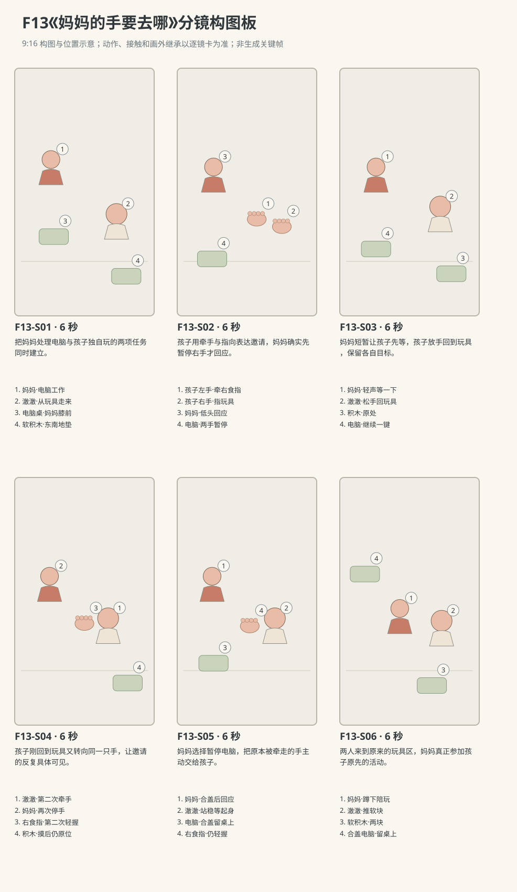

图示为构图位置示意；姿态、接触和画外继承以逐镜正文为准。

### 逐镜设计

#### F13-S01｜00—06 秒｜6 秒｜帧 [0, 144)

**镜头任务：**把妈妈处理电脑与孩子独自玩的两项任务同时建立。

**景别、机位与构图：**南侧朝北中全景，妈妈画左坐沙发、电脑桌在左前，澈澈画右在地垫，软积木在其脚前；两三步路线完整。

**摄影机与理由：**固定，先让观众看清孩子确实从玩具处过来，而非突然出现在成人腿边。

**焦点：**妈妈右手在触控板、孩子由积木抬起的眼睛与平地路线同清楚。

**入态：**妈妈左指在电脑键盘、右手在触控板，目光屏幕；澈澈站在东南地垫，双手空放身侧，两块软积木在脚前，正看积木。

**动作与表演：**

- 2 秒：妈妈左指按两下键，右指轻滑触控板，继续看屏幕。

- 2 秒：澈澈从积木抬眼看妈妈的右手，身体转向西北。

- 2 秒：他空着双手走两个短步到妈妈右膝南侧，在离桌角一小步处站稳。

**声音：**电脑轻键声、棉袜踩地垫声与呼吸，无对白或音乐。

**出态：**澈澈站妈妈右膝南侧、双手空，已看向妈妈右手；妈妈仍左手键盘右手触控板、目光屏幕。

**切点与承接：**接手部邀请，从尚未碰到成人手开始。

**连续性：**孩子为R4有行走能力，短步不过桌角，不攀桌或碰电脑；两块积木仍原地。

**开始画面母稿：**

9:16竖幅，原创三维家庭生活动画，圆润而有重量的造型，柔和皮肤层次、哑光棉布与可读的小表情，动作遵循生活物理，不用成人式算计。澈澈暂拟圆润脸颊、深棕眼、短黑绒发、额前右弯小发撮。成长后的幼儿澈澈穿奶油色棉上衣、鼠尾草色棉长裤。妈妈暂拟深棕低马尾、雾蓝棉上衣、米色长裤。人物与场景参考尚未提供，外观为可替换暂拟设计，未上传或绑定真实素材。本镜起始画面为单一瞬间：妈妈左指在电脑键盘、右手在触控板，目光屏幕；澈澈站在东南地垫，双手空放身侧，两块软积木在脚前，正看积木。 场次方位与光位：L客厅北墙沙发、西窗、东侧走廊，中央奶油地垫。成长后的澈澈为R4稳步行走与初语，不是R1有靠坐婴儿。妈妈坐沙发西半朝南，低桌在其膝前南侧，灰色笔记本电脑居桌面北半；妈妈操作电脑时左手用键盘、右手用触控板，双手具体位置按本镜起态。澈澈的软积木在地垫东南，距妈妈两三个幼儿短步，平地路线无遮挡。主摄影南侧朝北，妈妈画左、宝宝画右，电脑屏幕背向观众，西窗柔光来自画左。 摄影构图：南侧朝北中全景，妈妈画左坐沙发、电脑桌在左前，澈澈画右在地垫，软积木在其脚前；两三步路线完整。 当前焦点：妈妈触控板上的右手、看屏幕的脸与孩子正看积木的双眼处于清楚范围；孩子双手空在身侧。 只画这一刻，不拼入后续动作、轨迹、分格、字幕或不存在的持物状态。

**视频变化母稿：**

9:16竖幅，原创三维家庭生活动画，圆润而有重量的造型，柔和皮肤层次、哑光棉布与可读的小表情，动作遵循生活物理，不用成人式算计。澈澈暂拟圆润脸颊、深棕眼、短黑绒发、额前右弯小发撮。成长后的幼儿澈澈穿奶油色棉上衣、鼠尾草色棉长裤。妈妈暂拟深棕低马尾、雾蓝棉上衣、米色长裤。人物与场景参考尚未提供，外观为可替换暂拟设计，未上传或绑定真实素材。制作一段6秒连续镜头。当前能力：R4稳步行走与初语，只走短小平地路线、使用自然单音或短词，不把当前能力套给小月龄婴儿。空间光位：L客厅北墙沙发、西窗、东侧走廊，中央奶油地垫。成长后的澈澈为R4稳步行走与初语，不是R1有靠坐婴儿。妈妈坐沙发西半朝南，低桌在其膝前南侧，灰色笔记本电脑居桌面北半；妈妈操作电脑时左手用键盘、右手用触控板，双手具体位置按本镜起态。澈澈的软积木在地垫东南，距妈妈两三个幼儿短步，平地路线无遮挡。主摄影南侧朝北，妈妈画左、宝宝画右，电脑屏幕背向观众，西窗柔光来自画左。 起态：妈妈左指在电脑键盘、右手在触控板，目光屏幕；澈澈站在东南地垫，双手空放身侧，两块软积木在脚前，正看积木。 摄影：南侧朝北中全景，妈妈画左坐沙发、电脑桌在左前，澈澈画右在地垫，软积木在其脚前；两三步路线完整。 相机行为：固定，先让观众看清孩子确实从玩具处过来，而非突然出现在成人腿边。 焦点：妈妈右手在触控板、孩子由积木抬起的眼睛与平地路线同清楚。 时间过程：第1阶段2秒：妈妈左指按两下键，右指轻滑触控板，继续看屏幕。；第2阶段2秒：澈澈从积木抬眼看妈妈的右手，身体转向西北。；第3阶段2秒：他空着双手走两个短步到妈妈右膝南侧，在离桌角一小步处站稳。。声音：电脑轻键声、棉袜踩地垫声与呼吸，无对白或音乐。 终态：澈澈站妈妈右膝南侧、双手空，已看向妈妈右手；妈妈仍左手键盘右手触控板、目光屏幕。 连续性：孩子为R4有行走能力，短步不过桌角，不攀桌或碰电脑；两块积木仍原地。 按本镜完整过程到达终态，不在镜内另加切镜、人物、道具或未写出的台词、字幕与旁白。

#### F13-S02｜06—12 秒｜6 秒｜帧 [144, 288)

**镜头任务：**孩子用牵手与指向表达邀请，妈妈确实先暂停右手才回应。

**景别、机位与构图：**南偏东的双人中景，妈妈左、孩子右，妈妈右手到孩子左手的路径在中央；嘴、握指和桌边可读。

**摄影机与理由：**固定，保留右手从触控板离开、孩子才接到的全过程，不让牵拉承担电脑脱离。

**焦点：**妈妈右指与孩子左掌接触点，孩子指向积木的右手亦清楚。

**入态：**孩子站妈妈右膝南侧、双手空，望妈妈右手；妈妈右手触控板、左手键盘，目光屏幕。

**动作与表演：**

- 2 秒：澈澈左手轻碰妈妈右腕，抬脸发出自然短音“嗯”，右手指向东南地垫。

- 2 秒：妈妈看见触碰，右手离开触控板、左手也停键，低头看他。

- 2 秒：澈澈左指合住妈妈右食指，向积木方向轻带一小段；妈妈只随腕让位，没有被拖离座位。

**声音：**键声在触碰被接收后停，孩子一次自然邀请短音“嗯”、衣料声；无其他台词。

**出态：**孩子左手轻握妈妈右食指、右手指向积木；妈妈右手离电脑随腕让位、左手停键，低头看孩子，仍坐沙发。

**切点与承接：**接母亲回应与第一次松手回到玩具，不制造被拖走的失衡。

**连续性：**触碰是邀请，成人右手自己离开电脑再被握住；右指不被用力拉伸，妈妈身体不被孩子拖起。

**开始画面母稿：**

9:16竖幅，原创三维家庭生活动画，圆润而有重量的造型，柔和皮肤层次、哑光棉布与可读的小表情，动作遵循生活物理，不用成人式算计。澈澈暂拟圆润脸颊、深棕眼、短黑绒发、额前右弯小发撮。成长后的幼儿澈澈穿奶油色棉上衣、鼠尾草色棉长裤。妈妈暂拟深棕低马尾、雾蓝棉上衣、米色长裤。人物与场景参考尚未提供，外观为可替换暂拟设计，未上传或绑定真实素材。本镜起始画面为单一瞬间：孩子站妈妈右膝南侧、双手空，望妈妈右手；妈妈右手触控板、左手键盘，目光屏幕。 场次方位与光位：L客厅北墙沙发、西窗、东侧走廊，中央奶油地垫。成长后的澈澈为R4稳步行走与初语，不是R1有靠坐婴儿。妈妈坐沙发西半朝南，低桌在其膝前南侧，灰色笔记本电脑居桌面北半；妈妈操作电脑时左手用键盘、右手用触控板，双手具体位置按本镜起态。澈澈的软积木在地垫东南，距妈妈两三个幼儿短步，平地路线无遮挡。主摄影南侧朝北，妈妈画左、宝宝画右，电脑屏幕背向观众，西窗柔光来自画左。 摄影构图：南偏东的双人中景，妈妈左、孩子右，妈妈右手到孩子左手的路径在中央；妈妈闭合嘴部、尚未接触的双手和桌边可读。 当前焦点：妈妈触控板上的右手与孩子身侧空左掌之间的距离清楚；孩子右手尚未指向积木，双方尚未接触。 只画这一刻，不拼入后续动作、轨迹、分格、字幕或不存在的持物状态。

**视频变化母稿：**

9:16竖幅，原创三维家庭生活动画，圆润而有重量的造型，柔和皮肤层次、哑光棉布与可读的小表情，动作遵循生活物理，不用成人式算计。澈澈暂拟圆润脸颊、深棕眼、短黑绒发、额前右弯小发撮。成长后的幼儿澈澈穿奶油色棉上衣、鼠尾草色棉长裤。妈妈暂拟深棕低马尾、雾蓝棉上衣、米色长裤。人物与场景参考尚未提供，外观为可替换暂拟设计，未上传或绑定真实素材。制作一段6秒连续镜头。当前能力：R4稳步行走与初语，只走短小平地路线、使用自然单音或短词，不把当前能力套给小月龄婴儿。空间光位：L客厅北墙沙发、西窗、东侧走廊，中央奶油地垫。成长后的澈澈为R4稳步行走与初语，不是R1有靠坐婴儿。妈妈坐沙发西半朝南，低桌在其膝前南侧，灰色笔记本电脑居桌面北半；妈妈操作电脑时左手用键盘、右手用触控板，双手具体位置按本镜起态。澈澈的软积木在地垫东南，距妈妈两三个幼儿短步，平地路线无遮挡。主摄影南侧朝北，妈妈画左、宝宝画右，电脑屏幕背向观众，西窗柔光来自画左。 起态：孩子站妈妈右膝南侧、双手空，望妈妈右手；妈妈右手触控板、左手键盘，目光屏幕。 摄影：南偏东的双人中景，妈妈左、孩子右，妈妈右手到孩子左手的路径在中央；嘴、握指和桌边可读。 相机行为：固定，保留右手从触控板离开、孩子才接到的全过程，不让牵拉承担电脑脱离。 焦点：妈妈右指与孩子左掌接触点，孩子指向积木的右手亦清楚。 时间过程：第1阶段2秒：澈澈左手轻碰妈妈右腕，抬脸发出自然短音“嗯”，右手指向东南地垫。；第2阶段2秒：妈妈看见触碰，右手离开触控板、左手也停键，低头看他。；第3阶段2秒：澈澈左指合住妈妈右食指，向积木方向轻带一小段；妈妈只随腕让位，没有被拖离座位。。声音：键声在触碰被接收后停，孩子一次自然邀请短音“嗯”、衣料声；无其他台词。 终态：孩子左手轻握妈妈右食指、右手指向积木；妈妈右手离电脑随腕让位、左手停键，低头看孩子，仍坐沙发。 连续性：触碰是邀请，成人右手自己离开电脑再被握住；右指不被用力拉伸，妈妈身体不被孩子拖起。 按本镜完整过程到达终态，不在镜内另加切镜、人物、道具或未写出的台词、字幕与旁白。

#### F13-S03｜12—18 秒｜6 秒｜帧 [288, 432)

**镜头任务：**妈妈短暂让孩子先等，孩子放手回到玩具，保留各自目标。

**景别、机位与构图：**南侧双人中景，妈妈脸与两只手在左、孩子在右，脚下回玩具路线留在下部。

**摄影机与理由：**固定，让说话、指向与孩子放手的回应同框，不用旁白解释打断。

**焦点：**妈妈可见嘴部、孩子抬脸和左手的松开依次可读。

**入态：**孩子左手握妈妈右食指、右手指积木；妈妈右手离电脑，左手停在键盘边，低头看孩子。

**动作与表演：**

- 2 秒：妈妈看着澈澈，嘴部露出，用轻声普通话说“等妈妈一下。”，左手留桌边。

- 2 秒：澈澈看她一会儿，左指松开，右手放下；妈妈空右手自然退回触控板。

- 2 秒：澈澈转身走两个短步回到东南积木边，妈妈左指再按一键。

**声音：**妈妈只说“等妈妈一下。”，口型随自然普通话，语毕才松手回电脑；末尾一声轻键，无音乐。

**出态：**孩子站回东南积木旁、双手空、身体半朝妈妈；妈妈左右手回到电脑，目光屏幕，第一次牵手已解除。

**切点与承接：**切稍紧孩子再次回望，明确下一次是新邀请，非同一次重复镜头。

**连续性：**这句台词与妈妈回到电脑为原创即时回应，未声称原帖逐次如此。握持先解开才有孩子转身，手不跨距离持续牵着。

**开始画面母稿：**

9:16竖幅，原创三维家庭生活动画，圆润而有重量的造型，柔和皮肤层次、哑光棉布与可读的小表情，动作遵循生活物理，不用成人式算计。澈澈暂拟圆润脸颊、深棕眼、短黑绒发、额前右弯小发撮。成长后的幼儿澈澈穿奶油色棉上衣、鼠尾草色棉长裤。妈妈暂拟深棕低马尾、雾蓝棉上衣、米色长裤。人物与场景参考尚未提供，外观为可替换暂拟设计，未上传或绑定真实素材。本镜起始画面为单一瞬间：孩子左手握妈妈右食指、右手指积木；妈妈右手离电脑，左手停在键盘边，低头看孩子。 场次方位与光位：L客厅北墙沙发、西窗、东侧走廊，中央奶油地垫。成长后的澈澈为R4稳步行走与初语，不是R1有靠坐婴儿。妈妈坐沙发西半朝南，低桌在其膝前南侧，灰色笔记本电脑居桌面北半；妈妈操作电脑时左手用键盘、右手用触控板，双手具体位置按本镜起态。澈澈的软积木在地垫东南，距妈妈两三个幼儿短步，平地路线无遮挡。主摄影南侧朝北，妈妈画左、宝宝画右，电脑屏幕背向观众，西窗柔光来自画左。 摄影构图：南侧双人中景，妈妈脸与两只手在左、孩子在右，脚下回玩具路线留在下部。 当前焦点：妈妈可见且尚未发声的嘴部、孩子抬起的脸和仍握住成人食指的左手清楚。 只画这一刻，不拼入后续动作、轨迹、分格、字幕或不存在的持物状态。

**视频变化母稿：**

9:16竖幅，原创三维家庭生活动画，圆润而有重量的造型，柔和皮肤层次、哑光棉布与可读的小表情，动作遵循生活物理，不用成人式算计。澈澈暂拟圆润脸颊、深棕眼、短黑绒发、额前右弯小发撮。成长后的幼儿澈澈穿奶油色棉上衣、鼠尾草色棉长裤。妈妈暂拟深棕低马尾、雾蓝棉上衣、米色长裤。人物与场景参考尚未提供，外观为可替换暂拟设计，未上传或绑定真实素材。制作一段6秒连续镜头。当前能力：R4稳步行走与初语，只走短小平地路线、使用自然单音或短词，不把当前能力套给小月龄婴儿。空间光位：L客厅北墙沙发、西窗、东侧走廊，中央奶油地垫。成长后的澈澈为R4稳步行走与初语，不是R1有靠坐婴儿。妈妈坐沙发西半朝南，低桌在其膝前南侧，灰色笔记本电脑居桌面北半；妈妈操作电脑时左手用键盘、右手用触控板，双手具体位置按本镜起态。澈澈的软积木在地垫东南，距妈妈两三个幼儿短步，平地路线无遮挡。主摄影南侧朝北，妈妈画左、宝宝画右，电脑屏幕背向观众，西窗柔光来自画左。 起态：孩子左手握妈妈右食指、右手指积木；妈妈右手离电脑，左手停在键盘边，低头看孩子。 摄影：南侧双人中景，妈妈脸与两只手在左、孩子在右，脚下回玩具路线留在下部。 相机行为：固定，让说话、指向与孩子放手的回应同框，不用旁白解释打断。 焦点：妈妈可见嘴部、孩子抬脸和左手的松开依次可读。 时间过程：第1阶段2秒：妈妈看着澈澈，嘴部露出，用轻声普通话说“等妈妈一下。”，左手留桌边。；第2阶段2秒：澈澈看她一会儿，左指松开，右手放下；妈妈空右手自然退回触控板。；第3阶段2秒：澈澈转身走两个短步回到东南积木边，妈妈左指再按一键。。声音：妈妈只说“等妈妈一下。”，口型随自然普通话，语毕才松手回电脑；末尾一声轻键，无音乐。 终态：孩子站回东南积木旁、双手空、身体半朝妈妈；妈妈左右手回到电脑，目光屏幕，第一次牵手已解除。 连续性：这句台词与妈妈回到电脑为原创即时回应，未声称原帖逐次如此。握持先解开才有孩子转身，手不跨距离持续牵着。 按本镜完整过程到达终态，不在镜内另加切镜、人物、道具或未写出的台词、字幕与旁白。

#### F13-S04｜18—24 秒｜6 秒｜帧 [432, 576)

**镜头任务：**孩子刚回到玩具又转向同一只手，让邀请的反复具体可见。

**景别、机位与构图：**南侧中全景保持原轴线，电脑桌画左、积木区画右、平地路线居中；母子上身与脚步都可见。

**摄影机与理由：**固定，重复发生在人物行动上，画面不循环上一镜；次数只演两次。

**焦点：**孩子从积木到成人右手的视线、第二次行走及妈妈停手都清楚。

**入态：**孩子站东南积木旁、身体半朝妈妈、双手空；妈妈左手键盘右手触控板，正看屏幕。

**动作与表演：**

- 2 秒：澈澈蹲一下摸到一块软积木又放回原处，抬眼看妈妈，随即站稳。

- 2 秒：他再走两个短步到妈妈右膝南侧，左手伸到她右腕旁。

- 2 秒：孩子轻触右腕，妈妈先停触控板、自己把右手移离桌面再低头看他；他才合住妈妈右食指，右手仍指回玩具处。

**声音：**积木触垫软声、短步与电脑键声停止，无新对白或音乐。

**出态：**第二次邀请已成立：孩子左手轻握妈妈右食指、右手指积木；妈妈右手已离开电脑、低头看孩子，左手也停键。

**切点与承接：**接妈妈这次作出不同选择，不再用等待回到相同状态。

**连续性：**同一块积木摸后放回原处，孩子两次邀请之间已经松手回过玩具；第二次握持不能凭空延续第一次。

**开始画面母稿：**

9:16竖幅，原创三维家庭生活动画，圆润而有重量的造型，柔和皮肤层次、哑光棉布与可读的小表情，动作遵循生活物理，不用成人式算计。澈澈暂拟圆润脸颊、深棕眼、短黑绒发、额前右弯小发撮。成长后的幼儿澈澈穿奶油色棉上衣、鼠尾草色棉长裤。妈妈暂拟深棕低马尾、雾蓝棉上衣、米色长裤。人物与场景参考尚未提供，外观为可替换暂拟设计，未上传或绑定真实素材。本镜起始画面为单一瞬间：孩子站东南积木旁、身体半朝妈妈、双手空；妈妈左手键盘右手触控板，正看屏幕。 场次方位与光位：L客厅北墙沙发、西窗、东侧走廊，中央奶油地垫。成长后的澈澈为R4稳步行走与初语，不是R1有靠坐婴儿。妈妈坐沙发西半朝南，低桌在其膝前南侧，灰色笔记本电脑居桌面北半；妈妈操作电脑时左手用键盘、右手用触控板，双手具体位置按本镜起态。澈澈的软积木在地垫东南，距妈妈两三个幼儿短步，平地路线无遮挡。主摄影南侧朝北，妈妈画左、宝宝画右，电脑屏幕背向观众，西窗柔光来自画左。 摄影构图：南侧中全景保持原轴线，电脑桌画左、积木区画右、平地路线居中；母子上身与脚步都可见。 当前焦点：孩子站在积木边的双脚、身侧空双手与妈妈正在操作电脑的双手清楚；孩子尚未再次走来。 只画这一刻，不拼入后续动作、轨迹、分格、字幕或不存在的持物状态。

**视频变化母稿：**

9:16竖幅，原创三维家庭生活动画，圆润而有重量的造型，柔和皮肤层次、哑光棉布与可读的小表情，动作遵循生活物理，不用成人式算计。澈澈暂拟圆润脸颊、深棕眼、短黑绒发、额前右弯小发撮。成长后的幼儿澈澈穿奶油色棉上衣、鼠尾草色棉长裤。妈妈暂拟深棕低马尾、雾蓝棉上衣、米色长裤。人物与场景参考尚未提供，外观为可替换暂拟设计，未上传或绑定真实素材。制作一段6秒连续镜头。当前能力：R4稳步行走与初语，只走短小平地路线、使用自然单音或短词，不把当前能力套给小月龄婴儿。空间光位：L客厅北墙沙发、西窗、东侧走廊，中央奶油地垫。成长后的澈澈为R4稳步行走与初语，不是R1有靠坐婴儿。妈妈坐沙发西半朝南，低桌在其膝前南侧，灰色笔记本电脑居桌面北半；妈妈操作电脑时左手用键盘、右手用触控板，双手具体位置按本镜起态。澈澈的软积木在地垫东南，距妈妈两三个幼儿短步，平地路线无遮挡。主摄影南侧朝北，妈妈画左、宝宝画右，电脑屏幕背向观众，西窗柔光来自画左。 起态：孩子站东南积木旁、身体半朝妈妈、双手空；妈妈左手键盘右手触控板，正看屏幕。 摄影：南侧中全景保持原轴线，电脑桌画左、积木区画右、平地路线居中；母子上身与脚步都可见。 相机行为：固定，重复发生在人物行动上，画面不循环上一镜；次数只演两次。 焦点：孩子从积木到成人右手的视线、第二次行走及妈妈停手都清楚。 时间过程：第1阶段2秒：澈澈蹲一下摸到一块软积木又放回原处，抬眼看妈妈，随即站稳。；第2阶段2秒：他再走两个短步到妈妈右膝南侧，左手伸到她右腕旁。；第3阶段2秒：孩子轻触右腕，妈妈先停触控板、自己把右手移离桌面再低头看他；他才合住妈妈右食指，右手仍指回玩具处。。声音：积木触垫软声、短步与电脑键声停止，无新对白或音乐。 终态：第二次邀请已成立：孩子左手轻握妈妈右食指、右手指积木；妈妈右手已离开电脑、低头看孩子，左手也停键。 连续性：同一块积木摸后放回原处，孩子两次邀请之间已经松手回过玩具；第二次握持不能凭空延续第一次。 按本镜完整过程到达终态，不在镜内另加切镜、人物、道具或未写出的台词、字幕与旁白。

#### F13-S05｜24—30 秒｜6 秒｜帧 [576, 720)

**镜头任务：**妈妈选择暂停电脑，把原本被牵走的手主动交给孩子。

**景别、机位与构图：**南偏东双人中景，电脑全机和桌面在左下、妈妈露嘴的脸在左上、孩子及轻握手在右；电脑合盖路径无遮。

**摄影机与理由：**固定，完整保留一次按键、合盖和妈妈看回孩子回应的过程，最后电脑留在桌面。

**焦点：**妈妈左手与屏幕合盖、说话嘴部、孩子左手握持同清楚。

**入态：**孩子左手轻握妈妈右食指、右手指积木，妈妈右手离电脑随腕放松、左手停键，目光已在孩子。

**动作与表演：**

- 2 秒：妈妈先看孩子再转到电脑，用空左手按一下键、停一拍，把屏幕缓慢合上；右手仍给孩子轻握。

- 2 秒：合盖完成后妈妈看回澈澈，轻声说“走，陪你玩。”，嘴部完整可见。

- 2 秒：孩子右手放下，向地垫转半身但先等妈妈起身；妈妈双脚踏稳，身体前移准备站起，电脑留在桌上。

**声音：**一声轻键和合盖声，妈妈准确说“走，陪你玩。”，语毕自然收口；无音乐、旁白或孩子完整句子。

**出态：**电脑合在桌上，妈妈双脚踏稳、身体前移准备起身，右食指仍被孩子左手轻握；孩子半转向地垫站稳等待。

**切点与承接：**接稍宽全身镜完成起身与一起到玩具处，不靠幼儿牵拉让成人站立。

**连续性：**合盖与陪玩是明确原创结尾，原帖以节目播放后停止牵手结束。妈妈只用左手操作电脑，右指接触连续，孩子不拉起成人。

**开始画面母稿：**

9:16竖幅，原创三维家庭生活动画，圆润而有重量的造型，柔和皮肤层次、哑光棉布与可读的小表情，动作遵循生活物理，不用成人式算计。澈澈暂拟圆润脸颊、深棕眼、短黑绒发、额前右弯小发撮。成长后的幼儿澈澈穿奶油色棉上衣、鼠尾草色棉长裤。妈妈暂拟深棕低马尾、雾蓝棉上衣、米色长裤。人物与场景参考尚未提供，外观为可替换暂拟设计，未上传或绑定真实素材。本镜起始画面为单一瞬间：孩子左手轻握妈妈右食指、右手指积木，妈妈右手离电脑随腕放松、左手停键，目光已在孩子。 场次方位与光位：L客厅北墙沙发、西窗、东侧走廊，中央奶油地垫。成长后的澈澈为R4稳步行走与初语，不是R1有靠坐婴儿。妈妈坐沙发西半朝南，低桌在其膝前南侧，灰色笔记本电脑居桌面北半；妈妈操作电脑时左手用键盘、右手用触控板，双手具体位置按本镜起态。澈澈的软积木在地垫东南，距妈妈两三个幼儿短步，平地路线无遮挡。主摄影南侧朝北，妈妈画左、宝宝画右，电脑屏幕背向观众，西窗柔光来自画左。 摄影构图：南偏东双人中景，电脑全机和桌面在左下、妈妈露嘴的脸在左上、孩子及轻握手在右；电脑合盖路径无遮。 当前焦点：仍打开的电脑屏幕、妈妈停在键盘边的左手、可见嘴部和孩子左手握指状态清楚；电脑尚未合盖。 只画这一刻，不拼入后续动作、轨迹、分格、字幕或不存在的持物状态。

**视频变化母稿：**

9:16竖幅，原创三维家庭生活动画，圆润而有重量的造型，柔和皮肤层次、哑光棉布与可读的小表情，动作遵循生活物理，不用成人式算计。澈澈暂拟圆润脸颊、深棕眼、短黑绒发、额前右弯小发撮。成长后的幼儿澈澈穿奶油色棉上衣、鼠尾草色棉长裤。妈妈暂拟深棕低马尾、雾蓝棉上衣、米色长裤。人物与场景参考尚未提供，外观为可替换暂拟设计，未上传或绑定真实素材。制作一段6秒连续镜头。当前能力：R4稳步行走与初语，只走短小平地路线、使用自然单音或短词，不把当前能力套给小月龄婴儿。空间光位：L客厅北墙沙发、西窗、东侧走廊，中央奶油地垫。成长后的澈澈为R4稳步行走与初语，不是R1有靠坐婴儿。妈妈坐沙发西半朝南，低桌在其膝前南侧，灰色笔记本电脑居桌面北半；妈妈操作电脑时左手用键盘、右手用触控板，双手具体位置按本镜起态。澈澈的软积木在地垫东南，距妈妈两三个幼儿短步，平地路线无遮挡。主摄影南侧朝北，妈妈画左、宝宝画右，电脑屏幕背向观众，西窗柔光来自画左。 起态：孩子左手轻握妈妈右食指、右手指积木，妈妈右手离电脑随腕放松、左手停键，目光已在孩子。 摄影：南偏东双人中景，电脑全机和桌面在左下、妈妈露嘴的脸在左上、孩子及轻握手在右；电脑合盖路径无遮。 相机行为：固定，完整保留一次按键、合盖和妈妈看回孩子回应的过程，最后电脑留在桌面。 焦点：妈妈左手与屏幕合盖、说话嘴部、孩子左手握持同清楚。 时间过程：第1阶段2秒：妈妈先看孩子再转到电脑，用空左手按一下键、停一拍，把屏幕缓慢合上；右手仍给孩子轻握。；第2阶段2秒：合盖完成后妈妈看回澈澈，轻声说“走，陪你玩。”，嘴部完整可见。；第3阶段2秒：孩子右手放下，向地垫转半身但先等妈妈起身；妈妈双脚踏稳，身体前移准备站起，电脑留在桌上。。声音：一声轻键和合盖声，妈妈准确说“走，陪你玩。”，语毕自然收口；无音乐、旁白或孩子完整句子。 终态：电脑合在桌上，妈妈双脚踏稳、身体前移准备起身，右食指仍被孩子左手轻握；孩子半转向地垫站稳等待。 连续性：合盖与陪玩是明确原创结尾，原帖以节目播放后停止牵手结束。妈妈只用左手操作电脑，右指接触连续，孩子不拉起成人。 按本镜完整过程到达终态，不在镜内另加切镜、人物、道具或未写出的台词、字幕与旁白。

#### F13-S06｜30—36 秒｜6 秒｜帧 [720, 864)

**镜头任务：**两人来到原来的玩具区，妈妈真正参加孩子原先的活动。

**景别、机位与构图：**南侧稍宽全身镜，沙发与合盖电脑在左后景，东南玩具区在右前，妈妈与孩子站起、走两步、蹲下的空间全留。

**摄影机与理由：**固定，真实看清成人自己起身与短距同行，不用拉远掩盖握手状态。

**焦点：**两人脚步和交握的手持续可读，蹲下后焦点保持母子与两块积木。

**入态：**妈妈双脚踏稳正准备起身，右食指被孩子左手轻握；孩子半朝玩具站稳等她，电脑合在左后桌上。

**动作与表演：**

- 2 秒：妈妈靠自己的腿力站起，左手空在身侧，孩子只轻握右食指不承重。

- 2 秒：两人一起走两个短步来到东南积木边，停稳后孩子松左指，妈妈右手恢复空手。

- 2 秒：妈妈自己蹲低，孩子蹲在旁边把一块软积木推到她面前；她空右手停在块旁接入游戏，没有再看电脑。

**声音：**两人短步、衣料和软积木触垫声，妈妈一点呼气，无新对白无音乐。

**出态：**母子蹲在两块积木旁，孩子双手已松开成人，妈妈右手空停积木旁、左手近自己膝；合盖电脑留左后桌上。

**切点与承接：**在妈妈开始看玩具的时刻结束，不拍遥远未来或育儿成果。

**连续性：**孩子松指后双方才各自蹲下，无承重拉拽；原积木仍两块，电脑没有被孩子接触或移动。

**开始画面母稿：**

9:16竖幅，原创三维家庭生活动画，圆润而有重量的造型，柔和皮肤层次、哑光棉布与可读的小表情，动作遵循生活物理，不用成人式算计。澈澈暂拟圆润脸颊、深棕眼、短黑绒发、额前右弯小发撮。成长后的幼儿澈澈穿奶油色棉上衣、鼠尾草色棉长裤。妈妈暂拟深棕低马尾、雾蓝棉上衣、米色长裤。人物与场景参考尚未提供，外观为可替换暂拟设计，未上传或绑定真实素材。本镜起始画面为单一瞬间：妈妈双脚踏稳正准备起身，右食指被孩子左手轻握；孩子半朝玩具站稳等她，电脑合在左后桌上。 场次方位与光位：L客厅北墙沙发、西窗、东侧走廊，中央奶油地垫。成长后的澈澈为R4稳步行走与初语，不是R1有靠坐婴儿。妈妈坐沙发西半朝南，低桌在其膝前南侧，灰色笔记本电脑居桌面北半；妈妈操作电脑时左手用键盘、右手用触控板，双手具体位置按本镜起态。澈澈的软积木在地垫东南，距妈妈两三个幼儿短步，平地路线无遮挡。主摄影南侧朝北，妈妈画左、宝宝画右，电脑屏幕背向观众，西窗柔光来自画左。 摄影构图：南侧稍宽全身镜，沙发与合盖电脑在左后景，东南玩具区在右前，妈妈仍坐沙发前沿准备起身、孩子站在她身侧，平地与玩具区在同框完整留出。 当前焦点：妈妈仍坐沙发前沿、上身前移的姿态与踩稳的双脚清楚；孩子站稳轻握她右食指，电脑已经合盖。 只画这一刻，不拼入后续动作、轨迹、分格、字幕或不存在的持物状态。

**视频变化母稿：**

9:16竖幅，原创三维家庭生活动画，圆润而有重量的造型，柔和皮肤层次、哑光棉布与可读的小表情，动作遵循生活物理，不用成人式算计。澈澈暂拟圆润脸颊、深棕眼、短黑绒发、额前右弯小发撮。成长后的幼儿澈澈穿奶油色棉上衣、鼠尾草色棉长裤。妈妈暂拟深棕低马尾、雾蓝棉上衣、米色长裤。人物与场景参考尚未提供，外观为可替换暂拟设计，未上传或绑定真实素材。制作一段6秒连续镜头。当前能力：R4稳步行走与初语，只走短小平地路线、使用自然单音或短词，不把当前能力套给小月龄婴儿。空间光位：L客厅北墙沙发、西窗、东侧走廊，中央奶油地垫。成长后的澈澈为R4稳步行走与初语，不是R1有靠坐婴儿。妈妈坐沙发西半朝南，低桌在其膝前南侧，灰色笔记本电脑居桌面北半；妈妈操作电脑时左手用键盘、右手用触控板，双手具体位置按本镜起态。澈澈的软积木在地垫东南，距妈妈两三个幼儿短步，平地路线无遮挡。主摄影南侧朝北，妈妈画左、宝宝画右，电脑屏幕背向观众，西窗柔光来自画左。 起态：妈妈双脚踏稳正准备起身，右食指被孩子左手轻握；孩子半朝玩具站稳等她，电脑合在左后桌上。 摄影：南侧稍宽全身镜，沙发与合盖电脑在左后景，东南玩具区在右前，妈妈与孩子站起、走两步、蹲下的空间全留。 相机行为：固定，真实看清成人自己起身与短距同行，不用拉远掩盖握手状态。 焦点：两人脚步和交握的手持续可读，蹲下后焦点保持母子与两块积木。 时间过程：第1阶段2秒：妈妈靠自己的腿力站起，左手空在身侧，孩子只轻握右食指不承重。；第2阶段2秒：两人一起走两个短步来到东南积木边，停稳后孩子松左指，妈妈右手恢复空手。；第3阶段2秒：妈妈自己蹲低，孩子蹲在旁边把一块软积木推到她面前；她空右手停在块旁接入游戏，没有再看电脑。。声音：两人短步、衣料和软积木触垫声，妈妈一点呼气，无新对白无音乐。 终态：母子蹲在两块积木旁，孩子双手已松开成人，妈妈右手空停积木旁、左手近自己膝；合盖电脑留左后桌上。 连续性：孩子松指后双方才各自蹲下，无承重拉拽；原积木仍两块，电脑没有被孩子接触或移动。 按本镜完整过程到达终态，不在镜内另加切镜、人物、道具或未写出的台词、字幕与旁白。

### 声音与剪辑

允许两句妈妈普通话与孩子一次自然短音“嗯”。键声在触碰被接收后才停，合盖先于第二句，步声与握持相位连续；无配乐、字幕或教育旁白。

- 澈澈：嗯（F13-S02；一次自然邀请短音，不当作完整词句；左手轻碰妈妈右腕时发出。）

- 妈妈：等妈妈一下。（F13-S03；本镜前两秒，嘴部可见，看着澈澈轻声说完整句，语毕才退右手回电脑。）

- 妈妈：走，陪你玩。（F13-S05；本镜中间两秒，电脑已合盖、嘴部可见，看回孩子温和说完，再准备自己起身。）

### 连续性与试片

- 连续性：这是成长后的R4幼儿澈澈，稳步行走与初语，不用本条行动作为R0/R1婴儿能力。

- 连续性：孩子左手始终邀请妈妈右食指，右手指玩具；先触腕、妈妈自己离开触控板、再握指，不硬拖成人。

- 连续性：第一次松手回到玩具后，第二次重新接触成立，不把两次接触剪成一只手一直跨场牵着。

- 连续性：电脑只有妈妈操作：开始左键盘右触控板，合盖时左手操作、右手给孩子轻握；孩子不摸电脑或攀桌。

- 连续性：妈妈自己站起、双方仅轻握不承重；到玩具旁先松指再各自蹲下。

- 连续性：“等妈妈一下。”与“走，陪你玩。”逐字保留在各镜发声处，嘴部可见；孩子不说完整成人句子。

- 试片：F13-S01—S04检查两次邀请都有从玩具区走来、实际触腕、成人停电脑、轻握的顺序；第二次之前第一轮已松开，不能用循环镜头充当反复过程。

- 试片：F13-S03与S05中文台词逐字核对、嘴部可见、语句完整，合盖必须先于“走，陪你玩。”。

- 试片：F13-S05—S06检查成人自己起身、孩子不承重、不牵拉；到玩具旁先松指再蹲下，最终电脑留桌上合盖、积木仍两块。

**媒体待验证：**本次交付为完整故事、分镜与提示词文字设计，未生成或审看实际图像、视频、音轨。人物和场景参考未提供；逐镜首帧、手指接触、面部表演、对白发音、身体平衡与相邻剪点均待实际素材核对，不以结构检查代替媒体质量。

---

## F14《给你？再抱一会儿》

**36 秒｜稳步行走与初语｜角色：澈澈、妈妈、爸爸｜场景 L**

### 剧情正文

客厅东侧入口，爸爸把一个轻轻的纸包裹平放到地垫边，空手退回门内。成长后的澈澈走过来，双掌夹住包裹两侧，慢慢抱到胸下，低头看一眼前路，朝西走两小步。妈妈坐在地垫另一边，问：“给妈妈看看？”他停一拍，看她，再走近。妈妈把双掌送到下方等着。澈澈双肘向前，包裹慢慢离她掌心只剩一点空隙，却还没有松手。他看一眼纸包裹，又把双肘收回来，重新抱近胸口，转向东走了一步。妈妈看着两只仍空着的手，笑了一下，放回膝上，没有追。澈澈回头看她，又抱着自己的包裹继续走两小步，在地垫东半停下来研究一个纸角。包裹还在他怀里，这次交接就先停在这里。

### 亲述来源与改编

原帖是家长自述，未独立核实。本片将生活机制改编为澈澈的原创故事。

- [RT03 · 抱着包裹走来，却只是假递一下](https://yubingbing.wordpress.com/2008/01/08/%E7%8E%A9%E7%8E%A9%E6%9D%82%E4%BA%8B-2/)；作者自报年龄：同篇作者明确称孩子15个月，第一件事未单独标龄。

- **采用的生活过程：**爸爸把轻包裹放地；孩子抱着走；妈妈请求；走近做递出样子又抱回去、继续走。

- **本片原创改编：**具体东入口、软角空薄纸包裹、两次短步数、母亲等待双掌与一句“给妈妈看看？”为原创镜头设计。

- **本片原创改编：**妈妈空掌落回膝、微笑不追与最后看纸角为原创即时反应与收束，但不改最终仍未交出的状态。

- **不作出的事实推断：**同文第二件事明确十五个月，包裹事件未单独标龄；这里只标成长后的R4，不据此认定精确十五个月。

- **不作出的事实推断：**原帖没写妈妈最终是否接到，也未证明孩子有意戏弄成人；公开亲述未独立核实。

[查看原始过程与缺项](research/real-experiences/index.html#RT03)

### 导演与空间

**观察任务：**把以为即将交接而仍未松手的轻微期待差拍清楚，结尾仍由孩子抱着走，不补成原帖没有的最终交出。

**空间与光位：**L客厅北墙沙发、西窗、东侧走廊、中央奶油地垫。成长后的澈澈为R4稳步行走与初语；本片只抱一个体积约自己胸宽的空薄纸包裹，浅牛皮色、四角钝软，无提绳、钉子或可读地址，重量可轻抱，抱持和步行时位于胸下，脚前路线可见；落地、提起与持有状态按本镜起态。爸爸的活动区在东入口内，妈妈盘腿坐地垫西南侧朝东北。澈澈由东往西走两三步到妈妈面前，随后退回朝东，路线平整无遮挡。摄影始终在南侧朝北，妈妈左、澈澈右、爸爸右后，西窗柔光从画左入，不反轴。

**人物表演：**孩子专注于刚能自己抱着走的物件，回应妈妈时向前送一点，又重新收近；不写成故意戏弄、报复或恶意计谋。妈妈真以为要接到，落空之后才笑；爸爸有自己的放物退出任务，不全程围观表演。

### 节拍覆盖

- **F14-b1**：交代包裹确实由爸爸放到地上，孩子看到后才接近。 前态：爸爸双手托一个浅牛皮色空薄纸包裹在东入口内膝高，澈澈站其西南一短步处、双手空；妈妈盘腿坐西南地垫、双手膝上看过来。 后态：包裹在地垫东侧、底面接地，孩子双掌贴左右侧尚未提起；爸爸空手入口内、妈妈双手膝上。 → F14-S01

- **F14-b2**：看清幼儿抱起轻包裹并试短步行走，保持能力与重量可信。 前态：孩子双掌贴包裹左右侧、底仍接东侧地垫，双脚踏稳、膝微弯；爸爸空手在入口内、妈妈左画外双手膝上。 后态：包裹由孩子双手夹在胸下，已朝西走两步，在地垫中东部；妈妈仍左侧坐着，爸爸仍右后入口。 → F14-S02

- **F14-b3**：妈妈提出可听请求，孩子接收到后才向她走来。 前态：澈澈在地垫中东部双手抱包裹于胸下，身体朝西，尚看脚前；妈妈西南侧盘腿坐着、双手膝上，正看他。 后态：孩子站妈妈面前、双手夹包裹胸下，妈妈双掌向上停在包裹下方一小掌间距、尚未接触；爸爸右后空手。 → F14-S03

- **F14-b4**：包裹向成人手掌靠近，造成即将交接的期待，但孩子还未放手。 前态：澈澈双手夹包裹在胸下，妈妈双掌向上停包裹下方一小掌距、未接触；孩子站稳看妈妈。 后态：包裹正被孩子双手向自己收回、已离开妈妈掌心上方，尚未贴回胸下；妈妈双掌仍朝上且未接触。 → F14-S04

- **F14-b5**：孩子把轻包裹抱回去，妈妈看到落空才收手，喜剧落在动作差别。 前态：包裹正由孩子双掌向自己收回、尚未贴胸；妈妈双掌仍朝上没有接触，孩子站稳。 后态：孩子抱同一包裹朝东已走一小步、回头看妈妈；妈妈双手空落膝，爸爸仍右后入口。 → F14-S05

- **F14-b6**：仍抱着自己的发现继续短程走，母亲接受这次没有完成的交接。 前态：孩子抱包裹朝东已走一小步，正回头看妈妈；妈妈双手空放膝，爸爸入口内空手。 后态：孩子仍双手持同一轻包裹站地垫东半，妈妈空手膝上、爸爸入口内空手；包裹没有交出。 → F14-S06

### 分镜构图板

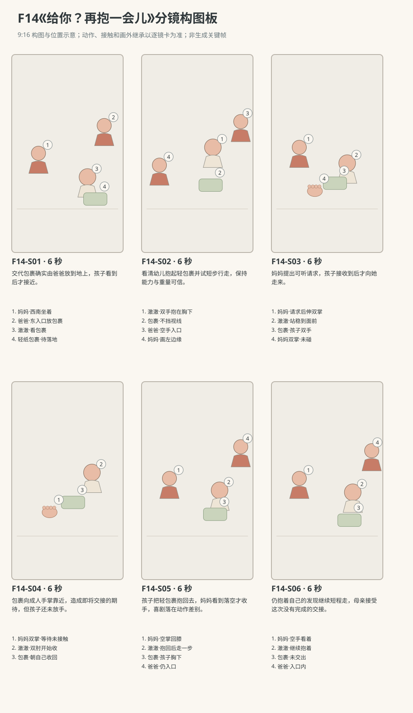

图示为构图位置示意；姿态、接触和画外继承以逐镜正文为准。

### 逐镜设计

#### F14-S01｜00—06 秒｜6 秒｜帧 [0, 144)

**镜头任务：**交代包裹确实由爸爸放到地上，孩子看到后才接近。

**景别、机位与构图：**南侧朝北中全景，妈妈坐左前地垫、爸爸在右后东入口，包裹放置点在右中，孩子右前朝向爸爸手里包裹；脚下路线完整。

**摄影机与理由：**固定，建立成人放物与孩子取物的先后，包装不凭空出现在孩子怀里。

**焦点：**爸爸双手与轻纸包裹、孩子目光和母亲位置都清楚。

**入态：**爸爸双手托一个浅牛皮色空薄纸包裹在东入口内膝高，澈澈站其西南一短步处、双手空；妈妈盘腿坐西南地垫、双手膝上看过来。

**动作与表演：**

- 2 秒：爸爸弯膝把包裹底面平放东侧地垫边，双手等底面接地再松开。

- 2 秒：爸爸空手退回入口半步，澈澈看住包裹，向前走一短步。

- 2 秒：孩子在包裹前站稳、膝微弯，双掌贴到包裹左右侧面，还未提起。

**声音：**纸包裹触垫轻声、爸爸衣料和短步声，无对白无音乐。

**出态：**包裹在地垫东侧、底面接地，孩子双掌贴左右侧尚未提起；爸爸空手入口内、妈妈双手膝上。

**切点与承接：**切同轴较紧看孩子从接触到提起，不漏包裹底离地。

**连续性：**纸包裹只有一个，爸爸放稳才松手；包装无真实住址，母亲一直坐着未伸手。

**开始画面母稿：**

9:16竖幅，原创三维家庭生活动画，圆润而有重量的造型，柔和皮肤层次、哑光棉布与可读的小表情，动作遵循生活物理，不用成人式算计。澈澈暂拟圆润脸颊、深棕眼、短黑绒发、额前右弯小发撮。成长后的幼儿澈澈穿奶油色棉上衣、鼠尾草色棉长裤。妈妈暂拟深棕低马尾、雾蓝棉上衣、米色长裤。爸爸暂拟短黑发、砖陶色棉衬衫、深灰长裤。人物与场景参考尚未提供，外观为可替换暂拟设计，未上传或绑定真实素材。本镜起始画面为单一瞬间：爸爸双手托一个浅牛皮色空薄纸包裹在东入口内膝高，澈澈站其西南一短步处、双手空；妈妈盘腿坐西南地垫、双手膝上看过来。 场次方位与光位：L客厅北墙沙发、西窗、东侧走廊、中央奶油地垫。成长后的澈澈为R4稳步行走与初语；本片只抱一个体积约自己胸宽的空薄纸包裹，浅牛皮色、四角钝软，无提绳、钉子或可读地址，重量可轻抱，抱持和步行时位于胸下，脚前路线可见；落地、提起与持有状态按本镜起态。爸爸的活动区在东入口内，妈妈盘腿坐地垫西南侧朝东北。澈澈由东往西走两三步到妈妈面前，随后退回朝东，路线平整无遮挡。摄影始终在南侧朝北，妈妈左、澈澈右、爸爸右后，西窗柔光从画左入，不反轴。 摄影构图：南侧朝北中全景，妈妈坐左前地垫、爸爸在右后东入口，包裹放置点在右中，孩子右前朝向爸爸手里包裹；脚下路线完整。 当前焦点：爸爸双手与轻纸包裹、孩子目光和母亲位置都清楚。 只画这一刻，不拼入后续动作、轨迹、分格、字幕或不存在的持物状态。

**视频变化母稿：**

9:16竖幅，原创三维家庭生活动画，圆润而有重量的造型，柔和皮肤层次、哑光棉布与可读的小表情，动作遵循生活物理，不用成人式算计。澈澈暂拟圆润脸颊、深棕眼、短黑绒发、额前右弯小发撮。成长后的幼儿澈澈穿奶油色棉上衣、鼠尾草色棉长裤。妈妈暂拟深棕低马尾、雾蓝棉上衣、米色长裤。爸爸暂拟短黑发、砖陶色棉衬衫、深灰长裤。人物与场景参考尚未提供，外观为可替换暂拟设计，未上传或绑定真实素材。制作一段6秒连续镜头。当前能力：R4稳步行走与初语，只走短小平地路线、使用自然单音或短词，不把当前能力套给小月龄婴儿。空间光位：L客厅北墙沙发、西窗、东侧走廊、中央奶油地垫。成长后的澈澈为R4稳步行走与初语；本片只抱一个体积约自己胸宽的空薄纸包裹，浅牛皮色、四角钝软，无提绳、钉子或可读地址，重量可轻抱，抱持和步行时位于胸下，脚前路线可见；落地、提起与持有状态按本镜起态。爸爸的活动区在东入口内，妈妈盘腿坐地垫西南侧朝东北。澈澈由东往西走两三步到妈妈面前，随后退回朝东，路线平整无遮挡。摄影始终在南侧朝北，妈妈左、澈澈右、爸爸右后，西窗柔光从画左入，不反轴。 起态：爸爸双手托一个浅牛皮色空薄纸包裹在东入口内膝高，澈澈站其西南一短步处、双手空；妈妈盘腿坐西南地垫、双手膝上看过来。 摄影：南侧朝北中全景，妈妈坐左前地垫、爸爸在右后东入口，包裹放置点在右中，孩子右前朝向爸爸手里包裹；脚下路线完整。 相机行为：固定，建立成人放物与孩子取物的先后，包装不凭空出现在孩子怀里。 焦点：爸爸双手与轻纸包裹、孩子目光和母亲位置都清楚。 时间过程：第1阶段2秒：爸爸弯膝把包裹底面平放东侧地垫边，双手等底面接地再松开。；第2阶段2秒：爸爸空手退回入口半步，澈澈看住包裹，向前走一短步。；第3阶段2秒：孩子在包裹前站稳、膝微弯，双掌贴到包裹左右侧面，还未提起。。声音：纸包裹触垫轻声、爸爸衣料和短步声，无对白无音乐。 终态：包裹在地垫东侧、底面接地，孩子双掌贴左右侧尚未提起；爸爸空手入口内、妈妈双手膝上。 连续性：纸包裹只有一个，爸爸放稳才松手；包装无真实住址，母亲一直坐着未伸手。 按本镜完整过程到达终态，不在镜内另加切镜、人物、道具或未写出的台词、字幕与旁白。

#### F14-S02｜06—12 秒｜6 秒｜帧 [144, 288)

**镜头任务：**看清幼儿抱起轻包裹并试短步行走，保持能力与重量可信。

**景别、机位与构图：**南偏东的孩子中全景，从头到双脚与包裹底面全在框，爸爸空手留右后，妈妈衣角在左边缘。

**摄影机与理由：**固定，包裹由地到怀再步行全程可读，不用夸张踉跄制造危险感。

**焦点：**孩子双掌接触、包裹底面离地与脚前路线持续清楚。

**入态：**孩子双掌贴包裹左右侧、底仍接东侧地垫，双脚踏稳、膝微弯；爸爸空手在入口内、妈妈左画外双手膝上。

**动作与表演：**

- 2 秒：澈澈两掌从两侧向内夹稳包裹，缓慢伸膝，将底面提离地垫。

- 2 秒：他把包裹收近胸下，双肘自然弯曲，脚前地面仍露出，低头看一眼前路。

- 2 秒：孩子朝西走两小步，脚步分开落稳，包裹随身体轻晃但不遮眼。

**声音：**薄纸轻揉、棉袜短步与孩子呼吸，无对白和配乐。

**出态：**包裹由孩子双手夹在胸下，已朝西走两步，在地垫中东部；妈妈仍左侧坐着，爸爸仍右后入口。

**切点与承接：**接同侧共享镜由妈妈出声提出请求，孩子听见后再看她。

**连续性：**只抱轻空薄纸包裹，不演重物举起；侧夹双掌不换成凭空底托，底角轻软不碰脚。

**开始画面母稿：**

9:16竖幅，原创三维家庭生活动画，圆润而有重量的造型，柔和皮肤层次、哑光棉布与可读的小表情，动作遵循生活物理，不用成人式算计。澈澈暂拟圆润脸颊、深棕眼、短黑绒发、额前右弯小发撮。成长后的幼儿澈澈穿奶油色棉上衣、鼠尾草色棉长裤。妈妈暂拟深棕低马尾、雾蓝棉上衣、米色长裤。爸爸暂拟短黑发、砖陶色棉衬衫、深灰长裤。人物与场景参考尚未提供，外观为可替换暂拟设计，未上传或绑定真实素材。本镜起始画面为单一瞬间：孩子双掌贴包裹左右侧、底仍接东侧地垫，双脚踏稳、膝微弯；爸爸空手在入口内、妈妈左画外双手膝上。 场次方位与光位：L客厅北墙沙发、西窗、东侧走廊、中央奶油地垫。成长后的澈澈为R4稳步行走与初语；本片只抱一个体积约自己胸宽的空薄纸包裹，浅牛皮色、四角钝软，无提绳、钉子或可读地址，重量可轻抱，抱持和步行时位于胸下，脚前路线可见；落地、提起与持有状态按本镜起态。爸爸的活动区在东入口内，妈妈盘腿坐地垫西南侧朝东北。澈澈由东往西走两三步到妈妈面前，随后退回朝东，路线平整无遮挡。摄影始终在南侧朝北，妈妈左、澈澈右、爸爸右后，西窗柔光从画左入，不反轴。 摄影构图：南偏东的孩子中全景，从头到双脚与包裹底面全在框，爸爸空手留右后，妈妈衣角在左边缘。 当前焦点：孩子双掌与包裹两侧接触、包裹底面仍接地和脚底落点清楚；包裹尚未提起。 只画这一刻，不拼入后续动作、轨迹、分格、字幕或不存在的持物状态。

**视频变化母稿：**

9:16竖幅，原创三维家庭生活动画，圆润而有重量的造型，柔和皮肤层次、哑光棉布与可读的小表情，动作遵循生活物理，不用成人式算计。澈澈暂拟圆润脸颊、深棕眼、短黑绒发、额前右弯小发撮。成长后的幼儿澈澈穿奶油色棉上衣、鼠尾草色棉长裤。妈妈暂拟深棕低马尾、雾蓝棉上衣、米色长裤。爸爸暂拟短黑发、砖陶色棉衬衫、深灰长裤。人物与场景参考尚未提供，外观为可替换暂拟设计，未上传或绑定真实素材。制作一段6秒连续镜头。当前能力：R4稳步行走与初语，只走短小平地路线、使用自然单音或短词，不把当前能力套给小月龄婴儿。空间光位：L客厅北墙沙发、西窗、东侧走廊、中央奶油地垫。成长后的澈澈为R4稳步行走与初语；本片只抱一个体积约自己胸宽的空薄纸包裹，浅牛皮色、四角钝软，无提绳、钉子或可读地址，重量可轻抱，抱持和步行时位于胸下，脚前路线可见；落地、提起与持有状态按本镜起态。爸爸的活动区在东入口内，妈妈盘腿坐地垫西南侧朝东北。澈澈由东往西走两三步到妈妈面前，随后退回朝东，路线平整无遮挡。摄影始终在南侧朝北，妈妈左、澈澈右、爸爸右后，西窗柔光从画左入，不反轴。 起态：孩子双掌贴包裹左右侧、底仍接东侧地垫，双脚踏稳、膝微弯；爸爸空手在入口内、妈妈左画外双手膝上。 摄影：南偏东的孩子中全景，从头到双脚与包裹底面全在框，爸爸空手留右后，妈妈衣角在左边缘。 相机行为：固定，包裹由地到怀再步行全程可读，不用夸张踉跄制造危险感。 焦点：孩子双掌接触、包裹底面离地与脚前路线持续清楚。 时间过程：第1阶段2秒：澈澈两掌从两侧向内夹稳包裹，缓慢伸膝，将底面提离地垫。；第2阶段2秒：他把包裹收近胸下，双肘自然弯曲，脚前地面仍露出，低头看一眼前路。；第3阶段2秒：孩子朝西走两小步，脚步分开落稳，包裹随身体轻晃但不遮眼。。声音：薄纸轻揉、棉袜短步与孩子呼吸，无对白和配乐。 终态：包裹由孩子双手夹在胸下，已朝西走两步，在地垫中东部；妈妈仍左侧坐着，爸爸仍右后入口。 连续性：只抱轻空薄纸包裹，不演重物举起；侧夹双掌不换成凭空底托，底角轻软不碰脚。 按本镜完整过程到达终态，不在镜内另加切镜、人物、道具或未写出的台词、字幕与旁白。

#### F14-S03｜12—18 秒｜6 秒｜帧 [288, 432)

**镜头任务：**妈妈提出可听请求，孩子接收到后才向她走来。

**景别、机位与构图：**南侧双人中全景，妈妈左、孩子右，双方脸、孩子包裹和脚下两步距离清楚；爸爸在右后入口。

**摄影机与理由：**固定，把请求、孩子转眼和实际走近留在同一画面，避免把抱着路过误读为回应。

**焦点：**妈妈说话嘴部、孩子转向她的眼睛和包裹双掌同时可读。

**入态：**澈澈在地垫中东部双手抱包裹于胸下，身体朝西，尚看脚前；妈妈西南侧盘腿坐着、双手膝上，正看他。

**动作与表演：**

- 2 秒：妈妈对着澈澈轻声说“给妈妈看看？”，发声时嘴部可见，双手仍在膝上。

- 2 秒：澈澈听见停一小拍，先转眼再转脸看妈妈，包裹仍贴胸下。

- 2 秒：他朝妈妈走两小步，在她面前留一小臂距离站稳；妈妈才把两只手掌心向上送到包裹下方，但未碰到。

**声音：**妈妈准确说“给妈妈看看？”，自然普通话轻问；孩子短步、纸面声，语毕留反应空隙，无其他对白。

**出态：**孩子站妈妈面前、双手夹包裹胸下，妈妈双掌向上停在包裹下方一小掌间距、尚未接触；爸爸右后空手。

**切点与承接：**切稍近共享镜看短暂向外递，不提前进入成人手里。

**连续性：**成人只提出请求，没有命令或硬抢；母亲露口发问，孩子先听见后转头。包裹仍孩子独持。

**开始画面母稿：**

9:16竖幅，原创三维家庭生活动画，圆润而有重量的造型，柔和皮肤层次、哑光棉布与可读的小表情，动作遵循生活物理，不用成人式算计。澈澈暂拟圆润脸颊、深棕眼、短黑绒发、额前右弯小发撮。成长后的幼儿澈澈穿奶油色棉上衣、鼠尾草色棉长裤。妈妈暂拟深棕低马尾、雾蓝棉上衣、米色长裤。爸爸暂拟短黑发、砖陶色棉衬衫、深灰长裤。人物与场景参考尚未提供，外观为可替换暂拟设计，未上传或绑定真实素材。本镜起始画面为单一瞬间：澈澈在地垫中东部双手抱包裹于胸下，身体朝西，尚看脚前；妈妈西南侧盘腿坐着、双手膝上，正看他。 场次方位与光位：L客厅北墙沙发、西窗、东侧走廊、中央奶油地垫。成长后的澈澈为R4稳步行走与初语；本片只抱一个体积约自己胸宽的空薄纸包裹，浅牛皮色、四角钝软，无提绳、钉子或可读地址，重量可轻抱，抱持和步行时位于胸下，脚前路线可见；落地、提起与持有状态按本镜起态。爸爸的活动区在东入口内，妈妈盘腿坐地垫西南侧朝东北。澈澈由东往西走两三步到妈妈面前，随后退回朝东，路线平整无遮挡。摄影始终在南侧朝北，妈妈左、澈澈右、爸爸右后，西窗柔光从画左入，不反轴。 摄影构图：南侧双人中全景，妈妈左、孩子右，双方脸、孩子包裹和脚下两步距离清楚；爸爸在右后入口。 当前焦点：妈妈闭合的嘴部、孩子正看脚前的眼睛与夹住包裹两侧的双掌清楚；妈妈双手仍在膝上。 只画这一刻，不拼入后续动作、轨迹、分格、字幕或不存在的持物状态。

**视频变化母稿：**

9:16竖幅，原创三维家庭生活动画，圆润而有重量的造型，柔和皮肤层次、哑光棉布与可读的小表情，动作遵循生活物理，不用成人式算计。澈澈暂拟圆润脸颊、深棕眼、短黑绒发、额前右弯小发撮。成长后的幼儿澈澈穿奶油色棉上衣、鼠尾草色棉长裤。妈妈暂拟深棕低马尾、雾蓝棉上衣、米色长裤。爸爸暂拟短黑发、砖陶色棉衬衫、深灰长裤。人物与场景参考尚未提供，外观为可替换暂拟设计，未上传或绑定真实素材。制作一段6秒连续镜头。当前能力：R4稳步行走与初语，只走短小平地路线、使用自然单音或短词，不把当前能力套给小月龄婴儿。空间光位：L客厅北墙沙发、西窗、东侧走廊、中央奶油地垫。成长后的澈澈为R4稳步行走与初语；本片只抱一个体积约自己胸宽的空薄纸包裹，浅牛皮色、四角钝软，无提绳、钉子或可读地址，重量可轻抱，抱持和步行时位于胸下，脚前路线可见；落地、提起与持有状态按本镜起态。爸爸的活动区在东入口内，妈妈盘腿坐地垫西南侧朝东北。澈澈由东往西走两三步到妈妈面前，随后退回朝东，路线平整无遮挡。摄影始终在南侧朝北，妈妈左、澈澈右、爸爸右后，西窗柔光从画左入，不反轴。 起态：澈澈在地垫中东部双手抱包裹于胸下，身体朝西，尚看脚前；妈妈西南侧盘腿坐着、双手膝上，正看他。 摄影：南侧双人中全景，妈妈左、孩子右，双方脸、孩子包裹和脚下两步距离清楚；爸爸在右后入口。 相机行为：固定，把请求、孩子转眼和实际走近留在同一画面，避免把抱着路过误读为回应。 焦点：妈妈说话嘴部、孩子转向她的眼睛和包裹双掌同时可读。 时间过程：第1阶段2秒：妈妈对着澈澈轻声说“给妈妈看看？”，发声时嘴部可见，双手仍在膝上。；第2阶段2秒：澈澈听见停一小拍，先转眼再转脸看妈妈，包裹仍贴胸下。；第3阶段2秒：他朝妈妈走两小步，在她面前留一小臂距离站稳；妈妈才把两只手掌心向上送到包裹下方，但未碰到。。声音：妈妈准确说“给妈妈看看？”，自然普通话轻问；孩子短步、纸面声，语毕留反应空隙，无其他对白。 终态：孩子站妈妈面前、双手夹包裹胸下，妈妈双掌向上停在包裹下方一小掌间距、尚未接触；爸爸右后空手。 连续性：成人只提出请求，没有命令或硬抢；母亲露口发问，孩子先听见后转头。包裹仍孩子独持。 按本镜完整过程到达终态，不在镜内另加切镜、人物、道具或未写出的台词、字幕与旁白。

#### F14-S04｜18—24 秒｜6 秒｜帧 [432, 576)

**镜头任务：**包裹向成人手掌靠近，造成即将交接的期待，但孩子还未放手。

**景别、机位与构图：**南偏东双人中景，妈妈左、孩子右，双方脸和包裹两侧夹握、下方等待的双掌全在框；底面与成人掌心空隙清楚。

**摄影机与理由：**固定，先让观众看到真实距离缩短，交接尚未完成不能靠切镜误导。

**焦点：**包裹底面与妈妈双掌之间的小间隙及孩子两侧手指清楚。

**入态：**澈澈双手夹包裹在胸下，妈妈双掌向上停包裹下方一小掌距、未接触；孩子站稳看妈妈。

**动作与表演：**

- 2 秒：澈澈双肘向前伸一点，把包裹朝妈妈掌心送近，底面仍由自己双掌夹持而非成人托住。

- 2 秒：包裹停在妈妈掌心上方一小指宽处，孩子看一眼包裹，再看妈妈；妈妈双掌保持原处等着。

- 2 秒：澈澈双肘开始往自己身侧收，包裹轻轻离开妈妈掌心正上方，尚未抱回胸下。

**声音：**薄纸微揉与呼吸，无交接落掌声、对白、搞怪提示音或音乐。

**出态：**包裹正被孩子双手向自己收回、已离开妈妈掌心上方，尚未贴回胸下；妈妈双掌仍朝上且未接触。

**切点与承接：**在回收动作已开始的相位切同侧稍宽镜，继续同一次收回，不重演递出。

**连续性：**全镜孩子未松指、妈妈未碰纸包裹，成人并未得到持有权；不凭空加妈妈抓住再被抢回的拉扯。

**开始画面母稿：**

9:16竖幅，原创三维家庭生活动画，圆润而有重量的造型，柔和皮肤层次、哑光棉布与可读的小表情，动作遵循生活物理，不用成人式算计。澈澈暂拟圆润脸颊、深棕眼、短黑绒发、额前右弯小发撮。成长后的幼儿澈澈穿奶油色棉上衣、鼠尾草色棉长裤。妈妈暂拟深棕低马尾、雾蓝棉上衣、米色长裤。爸爸暂拟短黑发、砖陶色棉衬衫、深灰长裤。人物与场景参考尚未提供，外观为可替换暂拟设计，未上传或绑定真实素材。本镜起始画面为单一瞬间：澈澈双手夹包裹在胸下，妈妈双掌向上停包裹下方一小掌距、未接触；孩子站稳看妈妈。 场次方位与光位：L客厅北墙沙发、西窗、东侧走廊、中央奶油地垫。成长后的澈澈为R4稳步行走与初语；本片只抱一个体积约自己胸宽的空薄纸包裹，浅牛皮色、四角钝软，无提绳、钉子或可读地址，重量可轻抱，抱持和步行时位于胸下，脚前路线可见；落地、提起与持有状态按本镜起态。爸爸的活动区在东入口内，妈妈盘腿坐地垫西南侧朝东北。澈澈由东往西走两三步到妈妈面前，随后退回朝东，路线平整无遮挡。摄影始终在南侧朝北，妈妈左、澈澈右、爸爸右后，西窗柔光从画左入，不反轴。 摄影构图：南偏东双人中景，妈妈左、孩子右，双方脸和包裹两侧夹握、下方等待的双掌全在框；底面与成人掌心空隙清楚。 当前焦点：包裹底面与妈妈双掌之间的小间隙及孩子两侧手指清楚。 只画这一刻，不拼入后续动作、轨迹、分格、字幕或不存在的持物状态。

**视频变化母稿：**

9:16竖幅，原创三维家庭生活动画，圆润而有重量的造型，柔和皮肤层次、哑光棉布与可读的小表情，动作遵循生活物理，不用成人式算计。澈澈暂拟圆润脸颊、深棕眼、短黑绒发、额前右弯小发撮。成长后的幼儿澈澈穿奶油色棉上衣、鼠尾草色棉长裤。妈妈暂拟深棕低马尾、雾蓝棉上衣、米色长裤。爸爸暂拟短黑发、砖陶色棉衬衫、深灰长裤。人物与场景参考尚未提供，外观为可替换暂拟设计，未上传或绑定真实素材。制作一段6秒连续镜头。当前能力：R4稳步行走与初语，只走短小平地路线、使用自然单音或短词，不把当前能力套给小月龄婴儿。空间光位：L客厅北墙沙发、西窗、东侧走廊、中央奶油地垫。成长后的澈澈为R4稳步行走与初语；本片只抱一个体积约自己胸宽的空薄纸包裹，浅牛皮色、四角钝软，无提绳、钉子或可读地址，重量可轻抱，抱持和步行时位于胸下，脚前路线可见；落地、提起与持有状态按本镜起态。爸爸的活动区在东入口内，妈妈盘腿坐地垫西南侧朝东北。澈澈由东往西走两三步到妈妈面前，随后退回朝东，路线平整无遮挡。摄影始终在南侧朝北，妈妈左、澈澈右、爸爸右后，西窗柔光从画左入，不反轴。 起态：澈澈双手夹包裹在胸下，妈妈双掌向上停包裹下方一小掌距、未接触；孩子站稳看妈妈。 摄影：南偏东双人中景，妈妈左、孩子右，双方脸和包裹两侧夹握、下方等待的双掌全在框；底面与成人掌心空隙清楚。 相机行为：固定，先让观众看到真实距离缩短，交接尚未完成不能靠切镜误导。 焦点：包裹底面与妈妈双掌之间的小间隙及孩子两侧手指清楚。 时间过程：第1阶段2秒：澈澈双肘向前伸一点，把包裹朝妈妈掌心送近，底面仍由自己双掌夹持而非成人托住。；第2阶段2秒：包裹停在妈妈掌心上方一小指宽处，孩子看一眼包裹，再看妈妈；妈妈双掌保持原处等着。；第3阶段2秒：澈澈双肘开始往自己身侧收，包裹轻轻离开妈妈掌心正上方，尚未抱回胸下。。声音：薄纸微揉与呼吸，无交接落掌声、对白、搞怪提示音或音乐。 终态：包裹正被孩子双手向自己收回、已离开妈妈掌心上方，尚未贴回胸下；妈妈双掌仍朝上且未接触。 连续性：全镜孩子未松指、妈妈未碰纸包裹，成人并未得到持有权；不凭空加妈妈抓住再被抢回的拉扯。 按本镜完整过程到达终态，不在镜内另加切镜、人物、道具或未写出的台词、字幕与旁白。

#### F14-S05｜24—30 秒｜6 秒｜帧 [576, 720)

**镜头任务：**孩子把轻包裹抱回去，妈妈看到落空才收手，喜剧落在动作差别。

**景别、机位与构图：**南侧共享中全景，妈妈左、孩子右，从表情到孩子脚部均可见，包裹回胸与转身的空间充分。

**摄影机与理由：**固定，承接同一次回收，妈妈反应后于落空，不快切放大孩子恶作剧意图。

**焦点：**包裹回胸与妈妈空掌、随后妈妈微松嘴角保持可读。

**入态：**包裹正由孩子双掌向自己收回、尚未贴胸；妈妈双掌仍朝上没有接触，孩子站稳。

**动作与表演：**

- 2 秒：澈澈把包裹重新收紧到胸下，双掌仍夹两侧，身体微转向东。

- 2 秒：妈妈看一眼仍空的双掌，再看包裹，嘴角松成一点笑，慢慢把空手落回膝上。

- 2 秒：澈澈朝东走一小步，回头看妈妈；她留着笑，没有追过去拿。

**声音：**一小步、纸面轻声，妈妈一点短笑气，无对白、胜利音效或音乐。

**出态：**孩子抱同一包裹朝东已走一小步、回头看妈妈；妈妈双手空落膝，爸爸仍右后入口。

**切点与承接：**接宽镜让孩子继续抱着走，保持未交出的来源结尾。

**连续性：**妈妈先发现没接到才收手，孩子没有做计谋挑眉、嘲笑或逃跑；不增加抢夺追逐。

**开始画面母稿：**

9:16竖幅，原创三维家庭生活动画，圆润而有重量的造型，柔和皮肤层次、哑光棉布与可读的小表情，动作遵循生活物理，不用成人式算计。澈澈暂拟圆润脸颊、深棕眼、短黑绒发、额前右弯小发撮。成长后的幼儿澈澈穿奶油色棉上衣、鼠尾草色棉长裤。妈妈暂拟深棕低马尾、雾蓝棉上衣、米色长裤。爸爸暂拟短黑发、砖陶色棉衬衫、深灰长裤。人物与场景参考尚未提供，外观为可替换暂拟设计，未上传或绑定真实素材。本镜起始画面为单一瞬间：包裹正由孩子双掌向自己收回、尚未贴胸；妈妈双掌仍朝上没有接触，孩子站稳。 场次方位与光位：L客厅北墙沙发、西窗、东侧走廊、中央奶油地垫。成长后的澈澈为R4稳步行走与初语；本片只抱一个体积约自己胸宽的空薄纸包裹，浅牛皮色、四角钝软，无提绳、钉子或可读地址，重量可轻抱，抱持和步行时位于胸下，脚前路线可见；落地、提起与持有状态按本镜起态。爸爸的活动区在东入口内，妈妈盘腿坐地垫西南侧朝东北。澈澈由东往西走两三步到妈妈面前，随后退回朝东，路线平整无遮挡。摄影始终在南侧朝北，妈妈左、澈澈右、爸爸右后，西窗柔光从画左入，不反轴。 摄影构图：南侧共享中全景，妈妈左、孩子右，从表情到孩子脚部均可见，包裹仍在两人之间、尚未贴回孩子胸下，妈妈双掌朝上未接触包裹。 当前焦点：包裹与孩子胸前仍有间距、妈妈朝上空双掌清楚；妈妈还未笑，也未把手放回膝上。 只画这一刻，不拼入后续动作、轨迹、分格、字幕或不存在的持物状态。

**视频变化母稿：**

9:16竖幅，原创三维家庭生活动画，圆润而有重量的造型，柔和皮肤层次、哑光棉布与可读的小表情，动作遵循生活物理，不用成人式算计。澈澈暂拟圆润脸颊、深棕眼、短黑绒发、额前右弯小发撮。成长后的幼儿澈澈穿奶油色棉上衣、鼠尾草色棉长裤。妈妈暂拟深棕低马尾、雾蓝棉上衣、米色长裤。爸爸暂拟短黑发、砖陶色棉衬衫、深灰长裤。人物与场景参考尚未提供，外观为可替换暂拟设计，未上传或绑定真实素材。制作一段6秒连续镜头。当前能力：R4稳步行走与初语，只走短小平地路线、使用自然单音或短词，不把当前能力套给小月龄婴儿。空间光位：L客厅北墙沙发、西窗、东侧走廊、中央奶油地垫。成长后的澈澈为R4稳步行走与初语；本片只抱一个体积约自己胸宽的空薄纸包裹，浅牛皮色、四角钝软，无提绳、钉子或可读地址，重量可轻抱，抱持和步行时位于胸下，脚前路线可见；落地、提起与持有状态按本镜起态。爸爸的活动区在东入口内，妈妈盘腿坐地垫西南侧朝东北。澈澈由东往西走两三步到妈妈面前，随后退回朝东，路线平整无遮挡。摄影始终在南侧朝北，妈妈左、澈澈右、爸爸右后，西窗柔光从画左入，不反轴。 起态：包裹正由孩子双掌向自己收回、尚未贴胸；妈妈双掌仍朝上没有接触，孩子站稳。 摄影：南侧共享中全景，妈妈左、孩子右，从表情到孩子脚部均可见，包裹回胸与转身的空间充分。 相机行为：固定，承接同一次回收，妈妈反应后于落空，不快切放大孩子恶作剧意图。 焦点：包裹回胸与妈妈空掌、随后妈妈微松嘴角保持可读。 时间过程：第1阶段2秒：澈澈把包裹重新收紧到胸下，双掌仍夹两侧，身体微转向东。；第2阶段2秒：妈妈看一眼仍空的双掌，再看包裹，嘴角松成一点笑，慢慢把空手落回膝上。；第3阶段2秒：澈澈朝东走一小步，回头看妈妈；她留着笑，没有追过去拿。。声音：一小步、纸面轻声，妈妈一点短笑气，无对白、胜利音效或音乐。 终态：孩子抱同一包裹朝东已走一小步、回头看妈妈；妈妈双手空落膝，爸爸仍右后入口。 连续性：妈妈先发现没接到才收手，孩子没有做计谋挑眉、嘲笑或逃跑；不增加抢夺追逐。 按本镜完整过程到达终态，不在镜内另加切镜、人物、道具或未写出的台词、字幕与旁白。

#### F14-S06｜30—36 秒｜6 秒｜帧 [720, 864)

**镜头任务：**仍抱着自己的发现继续短程走，母亲接受这次没有完成的交接。

**景别、机位与构图：**南侧中全景，妈妈左前坐着、孩子右中、爸爸右后在入口，原包裹起点在右下背景可辨；空地路线完整。

**摄影机与理由：**固定，结束在孩子继续自己的活动，成人不强行补一个成功交出的圆满。

**焦点：**包裹与孩子双手、妈妈空膝上手及孩子回头的脸均清楚。

**入态：**孩子抱包裹朝东已走一小步，正回头看妈妈；妈妈双手空放膝，爸爸入口内空手。

**动作与表演：**

- 2 秒：澈澈把脸转回前路，再向东走两个小步，包裹仍胸下，脚前无遮挡。

- 2 秒：他在地垫东半停住看包裹一角，双掌轻调一下夹握，不松手掉落。

- 2 秒：妈妈从原处看着他，指尖在膝上松开；爸爸也留在入口，谁都没有去接包裹。

**声音：**短步、纸面微揉与室内底声，末两秒自然安静，无新对白音乐。

**出态：**孩子仍双手持同一轻包裹站地垫东半，妈妈空手膝上、爸爸入口内空手；包裹没有交出。

**切点与承接：**在继续抱着包裹的状态结束，无偷补实际递交或原帖未知后续。

**连续性：**只有一个包裹，未到任何成人手中；成人不追不抢，R4短步行走能力与轻物重量保持。

**开始画面母稿：**

9:16竖幅，原创三维家庭生活动画，圆润而有重量的造型，柔和皮肤层次、哑光棉布与可读的小表情，动作遵循生活物理，不用成人式算计。澈澈暂拟圆润脸颊、深棕眼、短黑绒发、额前右弯小发撮。成长后的幼儿澈澈穿奶油色棉上衣、鼠尾草色棉长裤。妈妈暂拟深棕低马尾、雾蓝棉上衣、米色长裤。爸爸暂拟短黑发、砖陶色棉衬衫、深灰长裤。人物与场景参考尚未提供，外观为可替换暂拟设计，未上传或绑定真实素材。本镜起始画面为单一瞬间：孩子抱包裹朝东已走一小步，正回头看妈妈；妈妈双手空放膝，爸爸入口内空手。 场次方位与光位：L客厅北墙沙发、西窗、东侧走廊、中央奶油地垫。成长后的澈澈为R4稳步行走与初语；本片只抱一个体积约自己胸宽的空薄纸包裹，浅牛皮色、四角钝软，无提绳、钉子或可读地址，重量可轻抱，抱持和步行时位于胸下，脚前路线可见；落地、提起与持有状态按本镜起态。爸爸的活动区在东入口内，妈妈盘腿坐地垫西南侧朝东北。澈澈由东往西走两三步到妈妈面前，随后退回朝东，路线平整无遮挡。摄影始终在南侧朝北，妈妈左、澈澈右、爸爸右后，西窗柔光从画左入，不反轴。 摄影构图：南侧中全景，妈妈左前坐着、孩子右中、爸爸右后在入口，原包裹起点在右下背景可辨；空地路线完整。 当前焦点：包裹与孩子双手、妈妈空膝上手及孩子回头的脸均清楚。 只画这一刻，不拼入后续动作、轨迹、分格、字幕或不存在的持物状态。

**视频变化母稿：**

9:16竖幅，原创三维家庭生活动画，圆润而有重量的造型，柔和皮肤层次、哑光棉布与可读的小表情，动作遵循生活物理，不用成人式算计。澈澈暂拟圆润脸颊、深棕眼、短黑绒发、额前右弯小发撮。成长后的幼儿澈澈穿奶油色棉上衣、鼠尾草色棉长裤。妈妈暂拟深棕低马尾、雾蓝棉上衣、米色长裤。爸爸暂拟短黑发、砖陶色棉衬衫、深灰长裤。人物与场景参考尚未提供，外观为可替换暂拟设计，未上传或绑定真实素材。制作一段6秒连续镜头。当前能力：R4稳步行走与初语，只走短小平地路线、使用自然单音或短词，不把当前能力套给小月龄婴儿。空间光位：L客厅北墙沙发、西窗、东侧走廊、中央奶油地垫。成长后的澈澈为R4稳步行走与初语；本片只抱一个体积约自己胸宽的空薄纸包裹，浅牛皮色、四角钝软，无提绳、钉子或可读地址，重量可轻抱，抱持和步行时位于胸下，脚前路线可见；落地、提起与持有状态按本镜起态。爸爸的活动区在东入口内，妈妈盘腿坐地垫西南侧朝东北。澈澈由东往西走两三步到妈妈面前，随后退回朝东，路线平整无遮挡。摄影始终在南侧朝北，妈妈左、澈澈右、爸爸右后，西窗柔光从画左入，不反轴。 起态：孩子抱包裹朝东已走一小步，正回头看妈妈；妈妈双手空放膝，爸爸入口内空手。 摄影：南侧中全景，妈妈左前坐着、孩子右中、爸爸右后在入口，原包裹起点在右下背景可辨；空地路线完整。 相机行为：固定，结束在孩子继续自己的活动，成人不强行补一个成功交出的圆满。 焦点：包裹与孩子双手、妈妈空膝上手及孩子回头的脸均清楚。 时间过程：第1阶段2秒：澈澈把脸转回前路，再向东走两个小步，包裹仍胸下，脚前无遮挡。；第2阶段2秒：他在地垫东半停住看包裹一角，双掌轻调一下夹握，不松手掉落。；第3阶段2秒：妈妈从原处看着他，指尖在膝上松开；爸爸也留在入口，谁都没有去接包裹。。声音：短步、纸面微揉与室内底声，末两秒自然安静，无新对白音乐。 终态：孩子仍双手持同一轻包裹站地垫东半，妈妈空手膝上、爸爸入口内空手；包裹没有交出。 连续性：只有一个包裹，未到任何成人手中；成人不追不抢，R4短步行走能力与轻物重量保持。 按本镜完整过程到达终态，不在镜内另加切镜、人物、道具或未写出的台词、字幕与旁白。

### 声音与剪辑

妈妈只有“给妈妈看看？”一句自然普通话。纸面声按夹握微动，成人掌心从未接触所以不能加交接落掌声；不加胜利、失败或恶作剧提示音，不配乐。

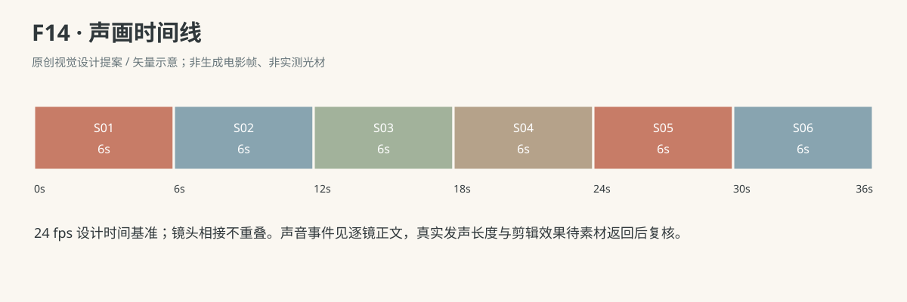

- 妈妈：给妈妈看看？（F14-S03；本镜前两秒，对澈澈轻声自然普通话发问，嘴部可见；先说完再等他转眼走来，之后才把双掌送到下方。）

### 连续性与试片

- 连续性：成长后的R4幼儿可稳步行走、抱轻物；本片空薄纸包裹胸宽且轻、底在胸下不挡前路，不用沉重真实快递。

- 连续性：只有一个包裹，爸爸先放地松手、孩子后夹起；孩子始终双手夹侧不松开，妈妈全片没有接触或持有包裹。

- 连续性：妈妈双掌只是等待，包裹与掌心始终有可读间隙；不能改成抢夺、扯回、成人先抓到再丢手。

- 连续性：向前送、开始收回、抱回胸下跨镜连续，F14-S04出点已经收回中，下一镜不重演递出。

- 连续性：“给妈妈看看？”逐字在F14-S03嘴部可见处说完，孩子先听到才看向妈妈；不加故意、不给你、骗到你了等心理解释。

- 连续性：结尾仍抱着走；原帖没有最终妈妈接到的结果，不补作来源事实。

- 试片：F14-S01—S02检查包裹放地后才到孩子手中，只有一个；站起与行走从脚到包裹都可见，不能举重般拉扯或脚下失衡。

- 试片：F14-S03—S05静音检查请求后的走近、成人伸掌、包裹靠近、未接触即收回、母亲发现空掌后笑的先后；若成人已经接住或突然换持有者则失败。

- 试片：F14-S04—S06检查回收相位不重放、无拉扯、最后孩子仍双手抱同一包裹；原帖未知的最后交出不在片尾偷偷补上。

**媒体待验证：**本次交付为完整故事、分镜与提示词文字设计，未生成或审看实际图像、视频、音轨。人物和场景参考未提供；逐镜首帧、手指接触、面部表演、对白发音、身体平衡与相邻剪点均待实际素材核对，不以结构检查代替媒体质量。