# 成长小变化：13 条剧情与分镜

## G01《原来是我的脚》

**36 秒｜仰卧与翻身探索｜角色：澈澈、爸爸｜场景 L**

### 剧情正文

西窗的柔光落在客厅地垫上。澈澈仰躺在中央，爸爸跪坐北侧，手里拿着珊瑚色软布环，正想逗他伸手。澈澈蹬了一下腿，右手背偶然擦过抬起的右脚。小手停住，脚却落回去，他低下视线，看向刚才碰到的地方。右膝又慢慢弯起，脚出现在眼前；他张开手去够，先摸到裤腿，再往前挪一点，终于握住自己的脚掌外侧。爸爸举到一半的软环停在旁边，没插进两者之间。澈澈看着手和脚，手指松开，脚落低了一点。他等它停住，重新看准，再伸手握上去。这次没有惊讶，只专心地摸了摸。爸爸也低头看着，软环安静留在自己手里。

### 导演与空间

**观察任务：**把偶然触脚变成看准后主动再抓一次；爸爸学会暂缓自己准备好的玩具。

**空间与光位：**澈澈仰卧中央地垫，头朝西、脚朝东，身体南侧是解剖右侧；爸爸跪坐北侧偏西，P01珊瑚软布环在爸爸左手。所有机位在地垫南侧，面向北或东北；西窗保持物理西侧，地垫与躯干形成稳定横轴。

**人物表演：**澈澈只做仰卧屈腿与手部探索，后背、后脑和骨盆由地垫支撑；不突然坐起。爸爸本想递P01，发现新兴趣后收住动作，继续握住软环陪看。

### 节拍覆盖

- **G01-b1**：前态：澈澈仰卧，双腿自然弯曲落在垫上，双手在胸口附近；爸爸左手握P01，右手撑自己膝侧。 过程：爸爸看一眼软环，再看澈澈右手，左腕向前送少许。澈澈视线未跟软环，右腿轻蹬后屈回，右手松松落向腹部；爸爸的递物停在可见半途。 后态：右膝略高于左膝，右手靠近腹部，软环仍在爸爸左手距宝宝一臂之外。 观众观察：交代仰卧支撑、脚的位置与爸爸原本的递物任务。 → G01-S01

- **G01-b2**：前态：右手背朝外停在腹部右侧，右膝正在屈起，裸右脚尚离手背一小段距离。 过程：右脚随屈膝缓慢靠近，脚掌外侧擦到右手背，手指一顿。右手没有握合，右腿轻放低，脚离开手背。右手留在原处张开，澈澈下巴微收，视线落到空出的手背旁。 后态：右脚已落低，右手张开悬于腹部右侧；宝宝眼睛朝右脚方向。 观众观察：让观众看清偶然触脚发生在主动寻找之前。 → G01-S02

- **G01-b3**：前态：澈澈眼睛望向右脚，右手在腹部上方张开，右脚落在较低位置。 过程：澈澈先看右脚，右膝重新屈起，把脚带到腹部上方。右手伸去先碰到右小腿的棉裤，手指沿裤腿停住。他看着裸脚，把右手再向足外侧移一小段，手掌尚未闭合。 后态：右掌已贴到右足外侧，手指张开；爸爸的软环保持在背景边缘。 观众观察：把偶然事件变成看准目标的下一次尝试。 → G01-S03

- **G01-b4**：前态：右掌贴右足外侧但手指仍张开，脚趾自然弯曲。 过程：右手指腹沿足外侧慢慢收拢，拇指停在足背一侧，形成松握。右脚趾轻动，手指跟着略调整，右膝保持屈曲。手与脚一起轻晃后停住，不把脚拉到嘴边。 后态：右手松握右足外侧，足趾与每根手指可区分，小腿仍自然弯向骨盆。 观众观察：真正完成第一次抓住，呈现软组织接触而非手脚融合。 → G01-S04

- **G01-b5**：前态：宝宝右手握着右脚，爸爸左手持环停在半途，看着这次抓握。 过程：爸爸的目光从软环移到宝宝手脚，肩膀放松。他把左手软环缓缓收回自己膝上，右手继续撑地，不碰宝宝。宝宝看了一会儿，右手指逐渐张开，右脚随膝略放低但不落出画。 后态：右手已离脚，右膝仍屈着，右脚在腹部偏右上方；爸爸左手与软环落在膝上。 观众观察：爸爸放弃干预，让宝宝继续观察自己的发现。 → G01-S05

- **G01-b6**：前态：右手张开，右脚仍随屈膝停在腹部右上方，宝宝视线先落在脚上。 过程：澈澈看准脚的位置，右手向足外侧移动，不再先摸裤腿。右手再度松握足外侧，脚趾轻动；宝宝眼睛在手与脚间来回看。他用拇指轻轻蹭一下足背，爸爸保持安静，画面停在这一小段专注上。 后态：右手重新握住右脚，爸爸仍在后景，软环画外继承膝上左手持有。 观众观察：以看准后的重抓收尾，成长落在动作变化上。 → G01-S06

### 分镜构图板

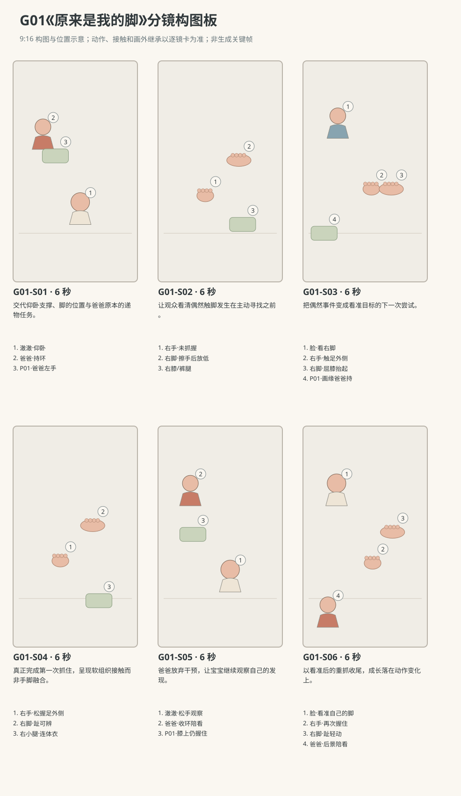

图示为构图位置示意；姿态、接触和画外继承以逐镜正文为准。

### 逐镜设计

#### G01-S01｜00—06 秒｜6 秒｜帧 [0, 144)

**镜头任务：**交代仰卧支撑、脚的位置与爸爸原本的递物任务。

**景别、机位与构图：**中全景，南侧35厘米高轻俯拍；澈澈头在画左、脚在画右，爸爸居后景左上，软环在爸爸胸前，不遮宝宝腿。

**摄影机与理由：**固定机位，让动作本身改变画面；不推拉遮盖接触。

**焦点：**焦点覆盖澈澈的眼睛、行动手与目标物；关键接触始终可辨。

**入态：**澈澈仰卧，双腿自然弯曲落在垫上，双手在胸口附近；爸爸左手握P01，右手撑自己膝侧。

**动作与表演：**

- 2 秒：爸爸看一眼软环，再看澈澈右手，左腕向前送少许。

- 4 秒：澈澈视线未跟软环，右腿轻蹬后屈回，右手松松落向腹部；爸爸的递物停在可见半途。

**声音：**无对白、无音乐；西窗外极轻鸟声作底，前景保留连体衣摩擦与婴儿呼吸，动作触碰同步发声。

**出态：**右膝略高于左膝，右手靠近腹部，软环仍在爸爸左手距宝宝一臂之外。

**切点与承接：**顺着右腿将再次抬起的趋势切近，不省略偶然接触。

**连续性：**画内可见宝宝全身支撑与爸爸持环；画外没有第二位成人或其他道具。

**开始画面母稿：**

9:16竖幅，原创圆润三维生活动画，柔软棉布与自然皮肤质感，生活物理，无文字标语。澈澈深棕眼、短黑绒发、额前一撮向右弯，奶油色棉连体衣；身体按本条能力阶段呈现，表情与动作保留婴儿的专注和不熟练。 本条澈澈处于R0仰卧探索能力阶段。爸爸短黑发、砖陶色棉衬衫、深灰长裤；近景只呈现构图所需身体部分。 白天客厅西窗提供柔和漫射主光，暖墙反射补光；北墙固定沙发，东侧走廊，中央奶油地垫。 中全景，南侧35厘米高轻俯拍；澈澈头在画左、脚在画右，爸爸居后景左上，软环在爸爸胸前，不遮宝宝腿。 单一开始瞬间：澈澈仰卧，双腿自然弯曲落在垫上，双手在胸口附近；爸爸左手握P01，右手撑自己膝侧。 画面清楚呈现起态中已存在的支撑、视线与道具归属；不把后续动作叠画。

**视频变化母稿：**

9:16竖幅，原创圆润三维生活动画，柔软棉布与自然皮肤质感，生活物理，无文字标语。澈澈深棕眼、短黑绒发、额前一撮向右弯，奶油色棉连体衣；身体按本条能力阶段呈现，表情与动作保留婴儿的专注和不熟练。 本条澈澈处于R0仰卧探索能力阶段。爸爸短黑发、砖陶色棉衬衫、深灰长裤；近景只呈现构图所需身体部分。 白天客厅西窗提供柔和漫射主光，暖墙反射补光；北墙固定沙发，东侧走廊，中央奶油地垫。 本镜6秒，中全景，南侧35厘米高轻俯拍；澈澈头在画左、脚在画右，爸爸居后景左上，软环在爸爸胸前，不遮宝宝腿。 起态：澈澈仰卧，双腿自然弯曲落在垫上，双手在胸口附近；爸爸左手握P01，右手撑自己膝侧。 阶段1，持续2秒：爸爸看一眼软环，再看澈澈右手，左腕向前送少许。 阶段2，持续4秒：澈澈视线未跟软环，右腿轻蹬后屈回，右手松松落向腹部；爸爸的递物停在可见半途。 摄影：固定机位，让动作本身改变画面；不推拉遮盖接触。 焦点：焦点覆盖澈澈的眼睛、行动手与目标物；关键接触始终可辨。 声音：无对白、无音乐；西窗外极轻鸟声作底，前景保留连体衣摩擦与婴儿呼吸，动作触碰同步发声。 终态：右膝略高于左膝，右手靠近腹部，软环仍在爸爸左手距宝宝一臂之外。 连续性：画内可见宝宝全身支撑与爸爸持环；画外没有第二位成人或其他道具。

#### G01-S02｜06—12 秒｜6 秒｜帧 [144, 288)

**镜头任务：**让观众看清偶然触脚发生在主动寻找之前。

**景别、机位与构图：**手脚中近景，南侧45厘米高斜俯；右手在画左下、右脚在右上，画内保留腹部和右膝，爸爸不入画。

**摄影机与理由：**固定机位，让动作本身改变画面；不推拉遮盖接触。

**焦点：**固定在手背与足外侧接触平面，腹部稍虚但腿的连接仍可读。

**入态：**右手背朝外停在腹部右侧，右膝正在屈起，裸右脚尚离手背一小段距离。

**动作与表演：**

- 2 秒：右脚随屈膝缓慢靠近，脚掌外侧擦到右手背，手指一顿。

- 2 秒：右手没有握合，右腿轻放低，脚离开手背。

- 2 秒：右手留在原处张开，澈澈下巴微收，视线落到空出的手背旁。

**声音：**无对白、无音乐；西窗外极轻鸟声作底，前景保留连体衣摩擦与婴儿呼吸，动作触碰同步发声。

**出态：**右脚已落低，右手张开悬于腹部右侧；宝宝眼睛朝右脚方向。

**切点与承接：**触脚和分离均发生后，切眼神与腿部同框，承接寻找。

**连续性：**画内右手右腿连续连接到躯干；爸爸与P01画外继承北侧原位，不参与触脚。

**开始画面母稿：**

9:16竖幅，原创圆润三维生活动画，柔软棉布与自然皮肤质感，生活物理，无文字标语。澈澈深棕眼、短黑绒发、额前一撮向右弯，奶油色棉连体衣；身体按本条能力阶段呈现，表情与动作保留婴儿的专注和不熟练。 本条澈澈处于R0仰卧探索能力阶段。爸爸短黑发、砖陶色棉衬衫、深灰长裤；近景只呈现构图所需身体部分。 白天客厅西窗提供柔和漫射主光，暖墙反射补光；北墙固定沙发，东侧走廊，中央奶油地垫。 手脚中近景，南侧45厘米高斜俯；右手在画左下、右脚在右上，画内保留腹部和右膝，爸爸不入画。 单一开始瞬间：右手背朝外停在腹部右侧，右膝正在屈起，裸右脚尚离手背一小段距离。 画面清楚呈现起态中已存在的支撑、视线与道具归属；不把后续动作叠画。

**视频变化母稿：**

9:16竖幅，原创圆润三维生活动画，柔软棉布与自然皮肤质感，生活物理，无文字标语。澈澈深棕眼、短黑绒发、额前一撮向右弯，奶油色棉连体衣；身体按本条能力阶段呈现，表情与动作保留婴儿的专注和不熟练。 本条澈澈处于R0仰卧探索能力阶段。爸爸短黑发、砖陶色棉衬衫、深灰长裤；近景只呈现构图所需身体部分。 白天客厅西窗提供柔和漫射主光，暖墙反射补光；北墙固定沙发，东侧走廊，中央奶油地垫。 本镜6秒，手脚中近景，南侧45厘米高斜俯；右手在画左下、右脚在右上，画内保留腹部和右膝，爸爸不入画。 起态：右手背朝外停在腹部右侧，右膝正在屈起，裸右脚尚离手背一小段距离。 阶段1，持续2秒：右脚随屈膝缓慢靠近，脚掌外侧擦到右手背，手指一顿。 阶段2，持续2秒：右手没有握合，右腿轻放低，脚离开手背。 阶段3，持续2秒：右手留在原处张开，澈澈下巴微收，视线落到空出的手背旁。 摄影：固定机位，让动作本身改变画面；不推拉遮盖接触。 焦点：固定在手背与足外侧接触平面，腹部稍虚但腿的连接仍可读。 声音：无对白、无音乐；西窗外极轻鸟声作底，前景保留连体衣摩擦与婴儿呼吸，动作触碰同步发声。 终态：右脚已落低，右手张开悬于腹部右侧；宝宝眼睛朝右脚方向。 连续性：画内右手右腿连续连接到躯干；爸爸与P01画外继承北侧原位，不参与触脚。

#### G01-S03｜12—18 秒｜6 秒｜帧 [288, 432)

**镜头任务：**把偶然事件变成看准目标的下一次尝试。

**景别、机位与构图：**中近景，南侧50厘米高，脸在左上、右手居中、屈起右脚在右侧；爸爸左手与软环仅在后景边缘。

**摄影机与理由：**固定机位，让动作本身改变画面；不推拉遮盖接触。

**焦点：**焦点覆盖澈澈的眼睛、行动手与目标物；关键接触始终可辨。

**入态：**澈澈眼睛望向右脚，右手在腹部上方张开，右脚落在较低位置。

**动作与表演：**

- 2 秒：澈澈先看右脚，右膝重新屈起，把脚带到腹部上方。

- 2 秒：右手伸去先碰到右小腿的棉裤，手指沿裤腿停住。

- 2 秒：他看着裸脚，把右手再向足外侧移一小段，手掌尚未闭合。

**声音：**无对白、无音乐；西窗外极轻鸟声作底，前景保留连体衣摩擦与婴儿呼吸，动作触碰同步发声。

**出态：**右掌已贴到右足外侧，手指张开；爸爸的软环保持在背景边缘。

**切点与承接：**在尚未闭合的手掌上切更近，下一镜必须从同一接触起态开始。

**连续性：**右脚由自身屈膝抬起；右手从裤腿移到裸足，P01无位置跳变。

**开始画面母稿：**

9:16竖幅，原创圆润三维生活动画，柔软棉布与自然皮肤质感，生活物理，无文字标语。澈澈深棕眼、短黑绒发、额前一撮向右弯，奶油色棉连体衣；身体按本条能力阶段呈现，表情与动作保留婴儿的专注和不熟练。 本条澈澈处于R0仰卧探索能力阶段。爸爸短黑发、砖陶色棉衬衫、深灰长裤；近景只呈现构图所需身体部分。 白天客厅西窗提供柔和漫射主光，暖墙反射补光；北墙固定沙发，东侧走廊，中央奶油地垫。 中近景，南侧50厘米高；宝宝脸在左上、右手居中张开，右脚在画右较低位置；爸爸左手与软环仅在后景边缘。 单一开始瞬间：澈澈眼睛望向右脚，右手在腹部上方张开，右脚落在较低位置。 本图焦点固定在：宝宝看向右脚的眼睛、腹上张开的右掌与较低的右脚。 仅呈现这一瞬间的身体支撑、视线与物件归属，不把未来阶段或相机路径叠画。

**视频变化母稿：**

9:16竖幅，原创圆润三维生活动画，柔软棉布与自然皮肤质感，生活物理，无文字标语。澈澈深棕眼、短黑绒发、额前一撮向右弯，奶油色棉连体衣；身体按本条能力阶段呈现，表情与动作保留婴儿的专注和不熟练。 本条澈澈处于R0仰卧探索能力阶段。爸爸短黑发、砖陶色棉衬衫、深灰长裤；近景只呈现构图所需身体部分。 白天客厅西窗提供柔和漫射主光，暖墙反射补光；北墙固定沙发，东侧走廊，中央奶油地垫。 本镜6秒，中近景，南侧50厘米高，脸在左上、右手居中、屈起右脚在右侧；爸爸左手与软环仅在后景边缘。 起态：澈澈眼睛望向右脚，右手在腹部上方张开，右脚落在较低位置。 阶段1，持续2秒：澈澈先看右脚，右膝重新屈起，把脚带到腹部上方。 阶段2，持续2秒：右手伸去先碰到右小腿的棉裤，手指沿裤腿停住。 阶段3，持续2秒：他看着裸脚，把右手再向足外侧移一小段，手掌尚未闭合。 摄影：固定机位，让动作本身改变画面；不推拉遮盖接触。 焦点：焦点覆盖澈澈的眼睛、行动手与目标物；关键接触始终可辨。 声音：无对白、无音乐；西窗外极轻鸟声作底，前景保留连体衣摩擦与婴儿呼吸，动作触碰同步发声。 终态：右掌已贴到右足外侧，手指张开；爸爸的软环保持在背景边缘。 连续性：右脚由自身屈膝抬起；右手从裤腿移到裸足，P01无位置跳变。

#### G01-S04｜18—24 秒｜6 秒｜帧 [432, 576)

**镜头任务：**真正完成第一次抓住，呈现软组织接触而非手脚融合。

**景别、机位与构图：**右手右脚特写，南侧斜俯；脚趾向画右上，手掌从左下承托足外侧，画缘保留小腿连接。

**摄影机与理由：**固定机位，让动作本身改变画面；不推拉遮盖接触。

**焦点：**焦点锁定手指与足外侧，脚趾同在可辨景深内。

**入态：**右掌贴右足外侧但手指仍张开，脚趾自然弯曲。

**动作与表演：**

- 2 秒：右手指腹沿足外侧慢慢收拢，拇指停在足背一侧，形成松握。

- 2 秒：右脚趾轻动，手指跟着略调整，右膝保持屈曲。

- 2 秒：手与脚一起轻晃后停住，不把脚拉到嘴边。

**声音：**无对白无音乐；棉布轻擦，手指触皮肤仅极轻干声，宝宝短促吸气后安静呼吸。

**出态：**右手松握右足外侧，足趾与每根手指可区分，小腿仍自然弯向骨盆。

**切点与承接：**接触稳定后切回中景，让爸爸的停手反应进入同一事件。

**连续性：**仅右手持右脚；裸脚不穿过掌心，衣裤边界固定在脚踝上方。

**开始画面母稿：**

9:16竖幅，原创圆润三维生活动画，柔软棉布与自然皮肤质感，生活物理，无文字标语。澈澈深棕眼、短黑绒发、额前一撮向右弯，奶油色棉连体衣；身体按本条能力阶段呈现，表情与动作保留婴儿的专注和不熟练。 本条澈澈处于R0仰卧探索能力阶段。爸爸短黑发、砖陶色棉衬衫、深灰长裤；近景只呈现构图所需身体部分。 白天客厅西窗提供柔和漫射主光，暖墙反射补光；北墙固定沙发，东侧走廊，中央奶油地垫。 右手右脚特写，南侧斜俯；脚趾向画右上，手掌从左下承托足外侧，画缘保留小腿连接。 单一开始瞬间：右掌贴右足外侧但手指仍张开，脚趾自然弯曲。 画面清楚呈现起态中已存在的支撑、视线与道具归属；不把后续动作叠画。

**视频变化母稿：**

9:16竖幅，原创圆润三维生活动画，柔软棉布与自然皮肤质感，生活物理，无文字标语。澈澈深棕眼、短黑绒发、额前一撮向右弯，奶油色棉连体衣；身体按本条能力阶段呈现，表情与动作保留婴儿的专注和不熟练。 本条澈澈处于R0仰卧探索能力阶段。爸爸短黑发、砖陶色棉衬衫、深灰长裤；近景只呈现构图所需身体部分。 白天客厅西窗提供柔和漫射主光，暖墙反射补光；北墙固定沙发，东侧走廊，中央奶油地垫。 本镜6秒，右手右脚特写，南侧斜俯；脚趾向画右上，手掌从左下承托足外侧，画缘保留小腿连接。 起态：右掌贴右足外侧但手指仍张开，脚趾自然弯曲。 阶段1，持续2秒：右手指腹沿足外侧慢慢收拢，拇指停在足背一侧，形成松握。 阶段2，持续2秒：右脚趾轻动，手指跟着略调整，右膝保持屈曲。 阶段3，持续2秒：手与脚一起轻晃后停住，不把脚拉到嘴边。 摄影：固定机位，让动作本身改变画面；不推拉遮盖接触。 焦点：焦点锁定手指与足外侧，脚趾同在可辨景深内。 声音：无对白无音乐；棉布轻擦，手指触皮肤仅极轻干声，宝宝短促吸气后安静呼吸。 终态：右手松握右足外侧，足趾与每根手指可区分，小腿仍自然弯向骨盆。 连续性：仅右手持右脚；裸脚不穿过掌心，衣裤边界固定在脚踝上方。

#### G01-S05｜24—30 秒｜6 秒｜帧 [576, 720)

**镜头任务：**爸爸放弃干预，让宝宝继续观察自己的发现。

**景别、机位与构图：**中景，南侧35厘米高；澈澈横于下半画幅，爸爸在左上，P01清晰留在爸爸左掌。

**摄影机与理由：**固定机位，让动作本身改变画面；不推拉遮盖接触。

**焦点：**焦点覆盖澈澈的眼睛、行动手与目标物；关键接触始终可辨。

**入态：**宝宝右手握着右脚，爸爸左手持环停在半途，看着这次抓握。

**动作与表演：**

- 2 秒：爸爸的目光从软环移到宝宝手脚，肩膀放松。

- 2 秒：他把左手软环缓缓收回自己膝上，右手继续撑地，不碰宝宝。

- 2 秒：宝宝看了一会儿，右手指逐渐张开，右脚随膝略放低但不落出画。

**声音：**无对白、无音乐；西窗外极轻鸟声作底，前景保留连体衣摩擦与婴儿呼吸，动作触碰同步发声。

**出态：**右手已离脚，右膝仍屈着，右脚在腹部偏右上方；爸爸左手与软环落在膝上。

**切点与承接：**在脚仍可找到的空隙切回宝宝，给第二次主动抓握完整时间。

**连续性：**本镜画内清楚完成爸爸收环与宝宝松手；下镜不可恢复到爸爸递物状态。

**开始画面母稿：**

9:16竖幅，原创圆润三维生活动画，柔软棉布与自然皮肤质感，生活物理，无文字标语。澈澈深棕眼、短黑绒发、额前一撮向右弯，奶油色棉连体衣；身体按本条能力阶段呈现，表情与动作保留婴儿的专注和不熟练。 本条澈澈处于R0仰卧探索能力阶段。爸爸短黑发、砖陶色棉衬衫、深灰长裤；近景只呈现构图所需身体部分。 白天客厅西窗提供柔和漫射主光，暖墙反射补光；北墙固定沙发，东侧走廊，中央奶油地垫。 中景，南侧35厘米高；澈澈横于下半画幅，爸爸在左上，P01清晰留在爸爸左掌。 单一开始瞬间：宝宝右手握着右脚，爸爸左手持环停在半途，看着这次抓握。 画面清楚呈现起态中已存在的支撑、视线与道具归属；不把后续动作叠画。

**视频变化母稿：**

9:16竖幅，原创圆润三维生活动画，柔软棉布与自然皮肤质感，生活物理，无文字标语。澈澈深棕眼、短黑绒发、额前一撮向右弯，奶油色棉连体衣；身体按本条能力阶段呈现，表情与动作保留婴儿的专注和不熟练。 本条澈澈处于R0仰卧探索能力阶段。爸爸短黑发、砖陶色棉衬衫、深灰长裤；近景只呈现构图所需身体部分。 白天客厅西窗提供柔和漫射主光，暖墙反射补光；北墙固定沙发，东侧走廊，中央奶油地垫。 本镜6秒，中景，南侧35厘米高；澈澈横于下半画幅，爸爸在左上，P01清晰留在爸爸左掌。 起态：宝宝右手握着右脚，爸爸左手持环停在半途，看着这次抓握。 阶段1，持续2秒：爸爸的目光从软环移到宝宝手脚，肩膀放松。 阶段2，持续2秒：他把左手软环缓缓收回自己膝上，右手继续撑地，不碰宝宝。 阶段3，持续2秒：宝宝看了一会儿，右手指逐渐张开，右脚随膝略放低但不落出画。 摄影：固定机位，让动作本身改变画面；不推拉遮盖接触。 焦点：焦点覆盖澈澈的眼睛、行动手与目标物；关键接触始终可辨。 声音：无对白、无音乐；西窗外极轻鸟声作底，前景保留连体衣摩擦与婴儿呼吸，动作触碰同步发声。 终态：右手已离脚，右膝仍屈着，右脚在腹部偏右上方；爸爸左手与软环落在膝上。 连续性：本镜画内清楚完成爸爸收环与宝宝松手；下镜不可恢复到爸爸递物状态。

#### G01-S06｜30—36 秒｜6 秒｜帧 [720, 864)

**镜头任务：**以看准后的重抓收尾，成长落在动作变化上。

**景别、机位与构图：**中近景，南侧50厘米高斜俯，宝宝脸、右掌和右脚组成三角，爸爸只保留后景安静的半张脸。

**摄影机与理由：**固定；让目光、手和脚的距离在同一画面中闭合，结尾不推近庆功。

**焦点：**焦点覆盖澈澈的眼睛、行动手与目标物；关键接触始终可辨。

**入态：**右手张开，右脚仍随屈膝停在腹部右上方，宝宝视线先落在脚上。

**动作与表演：**

- 2 秒：澈澈看准脚的位置，右手向足外侧移动，不再先摸裤腿。

- 2 秒：右手再度松握足外侧，脚趾轻动；宝宝眼睛在手与脚间来回看。

- 2 秒：他用拇指轻轻蹭一下足背，爸爸保持安静，画面停在这一小段专注上。

**声音：**无对白、无音乐；西窗外极轻鸟声作底，前景保留连体衣摩擦与婴儿呼吸，动作触碰同步发声。

**出态：**右手重新握住右脚，爸爸仍在后景，软环画外继承膝上左手持有。

**切点与承接：**手指小动作结束后留半秒自然呼吸，直接结束，不用成功字幕。

**连续性：**重抓发生在镜内，不靠切镜替换抓握；仰卧支撑与裸脚左右一致。

**开始画面母稿：**

9:16竖幅，原创圆润三维生活动画，柔软棉布与自然皮肤质感，生活物理，无文字标语。澈澈深棕眼、短黑绒发、额前一撮向右弯，奶油色棉连体衣；身体按本条能力阶段呈现，表情与动作保留婴儿的专注和不熟练。 本条澈澈处于R0仰卧探索能力阶段。爸爸短黑发、砖陶色棉衬衫、深灰长裤；近景只呈现构图所需身体部分。 白天客厅西窗提供柔和漫射主光，暖墙反射补光；北墙固定沙发，东侧走廊，中央奶油地垫。 中近景，南侧50厘米高斜俯，宝宝脸、右掌和右脚组成三角，爸爸只保留后景安静的半张脸。 单一开始瞬间：右手张开，右脚仍随屈膝停在腹部右上方，宝宝视线先落在脚上。 画面清楚呈现起态中已存在的支撑、视线与道具归属；不把后续动作叠画。

**视频变化母稿：**

9:16竖幅，原创圆润三维生活动画，柔软棉布与自然皮肤质感，生活物理，无文字标语。澈澈深棕眼、短黑绒发、额前一撮向右弯，奶油色棉连体衣；身体按本条能力阶段呈现，表情与动作保留婴儿的专注和不熟练。 本条澈澈处于R0仰卧探索能力阶段。爸爸短黑发、砖陶色棉衬衫、深灰长裤；近景只呈现构图所需身体部分。 白天客厅西窗提供柔和漫射主光，暖墙反射补光；北墙固定沙发，东侧走廊，中央奶油地垫。 本镜6秒，中近景，南侧50厘米高斜俯，宝宝脸、右掌和右脚组成三角，爸爸只保留后景安静的半张脸。 起态：右手张开，右脚仍随屈膝停在腹部右上方，宝宝视线先落在脚上。 阶段1，持续2秒：澈澈看准脚的位置，右手向足外侧移动，不再先摸裤腿。 阶段2，持续2秒：右手再度松握足外侧，脚趾轻动；宝宝眼睛在手与脚间来回看。 阶段3，持续2秒：他用拇指轻轻蹭一下足背，爸爸保持安静，画面停在这一小段专注上。 摄影：固定；让目光、手和脚的距离在同一画面中闭合，结尾不推近庆功。 焦点：焦点覆盖澈澈的眼睛、行动手与目标物；关键接触始终可辨。 声音：无对白、无音乐；西窗外极轻鸟声作底，前景保留连体衣摩擦与婴儿呼吸，动作触碰同步发声。 终态：右手重新握住右脚，爸爸仍在后景，软环画外继承膝上左手持有。 连续性：重抓发生在镜内，不靠切镜替换抓握；仰卧支撑与裸脚左右一致。

### 声音与剪辑

以衣料摩擦、脚掌擦过手背和轻呼吸组织节奏；不加发现成功的提示音或成人解释。室外鸟声只作连续空间底声。

正式台词：无；保留镜头声音中已写明的自然发声。

### 连续性与试片

- 连续性：澈澈双脚裸露，右手与右脚为唯一抓握组合；左手没有暗换抓脚。

- 连续性：后脑、背部与骨盆始终在垫上，屈膝抬脚不能带出坐起能力。

- 连续性：P01始终在爸爸左手，未递到宝宝手里；爸爸在北侧，不跨过脚部探索区。

- 连续性：所有镜保持头西脚东及南侧观察方向，近景不得镜像。

- 试片：G01-S02到S04：第一次手背触脚、脚落低、右手改抓右脚必须可区分；手脚数量变化、裤腿变成脚或直接跳到握住则失败。

- 试片：G01-S05到S06：必须看见右手松开、右脚仍以屈膝支撑悬起、再抓住的过程；靠定格或跳切完成第二次抓握则失败。

- 试片：全片静音试剪：观众能指出爸爸手中的软环始终没递出，宝宝从偶然碰到变成看准重抓；读成爸爸摆好脚则失败。

**媒体待验证：**尚无媒体。重点待验证裸脚形状、手指与足外侧接触、仰卧屈腿的骨盆稳定及爸爸停手的自然表演。

---

## G02《这次抓住了》

**42 秒｜仰卧与翻身探索｜角色：澈澈、妈妈｜场景 L**

### 剧情正文

客厅地垫上，澈澈仰躺着，眼前悬着一只珊瑚色软布环。妈妈坐在他脚边，用左手捏着环的上缘，把下缘留在小手够得到的地方。澈澈伸出右手，手背擦过软环，环晃了晃，他却抓了个空。妈妈刚抬起右手，想帮他扶一下手腕，发现他没有移开视线，便停下来。澈澈把右手收回胸口，先看自己的手，再重新盯住环的下缘。这次小手放慢一点，指腹贴上布面，手指一根根收住。妈妈等他握稳，才松开左手。软环轻轻压低他的右腕，他又把它举回来，眼睛认真看着。妈妈空出的手还停在旁边，片刻后悄悄放回膝上。澈澈没看见这个动作，只顾着摸那块终于留在手里的软布。

### 导演与空间

**观察任务：**同一软环不移动，宝宝经历碰偏、重看、抓住；妈妈准备帮忙却及时让出动作。

**空间与光位：**澈澈仰卧中央地垫，头西脚东，右侧临南；妈妈跪坐地垫东南角。妈妈左手捏P01上缘，让软环下缘停在宝宝右掌自然够到处、胸口上方；机位始终南侧，脸在画左、环在中右。

**人物表演：**宝宝背、后脑、骨盆落垫，只练仰卧手眼接近；妈妈左手提供稳定目标，右手原本想帮助宝宝手臂但最终不接触，不晃环诱导。

### 节拍覆盖

- **G02-b1**：前态：澈澈仰卧看P01，妈妈左手捏环上缘，环下缘距宝宝张开的右手很近；妈妈右掌落膝。 过程：妈妈把环下缘缓缓停稳，不再左右摇晃；宝宝眼睛跟到环下缘。宝宝右肘离垫，掌心向环伸去，左手留在胸前；后脑和背没有离垫。 后态：右手接近软环下缘但尚未接触，妈妈左指仍捏上缘。 观众观察：建立够得到的目标和成人持物，不让软环悬空。 → G02-S01

- **G02-b2**：前态：宝宝右掌张开向环下缘，妈妈左指保持上缘固定。 过程：宝宝右手略偏外，手背擦到环的南侧边缘。软环围绕妈妈左指轻摆，宝宝手指此时才闭合，掌心没有环。宝宝看空拳，再张开右掌收回胸前；软环摆幅逐渐减小。 后态：右掌在胸前重新张开，P01仍由妈妈左手持着，摇摆将停。 观众观察：展示第一次接近落空，并让宝宝发现差一点。 → G02-S02

- **G02-b3**：前态：宝宝右手收胸，眼睛仍看P01；妈妈左手持环，右手刚离膝。 过程：妈妈右手靠向宝宝右手腕附近，但停在未接触的位置。宝宝眼睛从自己张开的右掌转回环下缘，下巴稍收。妈妈看见这次对准，右手停住不再靠近；宝宝再抬右肘，把掌心朝环送出。 后态：宝宝右掌正对P01下缘，妈妈帮助的右手停在旁侧，未碰宝宝。 观众观察：妈妈看见宝宝仍在尝试，于是停止帮助。 → G02-S03

- **G02-b4**：前态：宝宝右掌距软环下缘一指宽，手指舒展；妈妈左指仍捏上缘。 过程：右手指腹先碰到环下缘，布面微微压扁。宝宝四指与拇指在下缘两侧缓慢合拢，环在双手之间停稳。妈妈确认下缘没有滑动，再张开左指退离上缘；环全重移到宝宝右手。 后态：P01只在宝宝右手中，妈妈左指已经退出环上方，宝宝右腕略向下沉。 观众观察：在一个镜头内完成接触、抓稳、成人释放。 → G02-S04

- **G02-b5**：前态：宝宝右手握P01，右腕受软环重量略低；妈妈双手已空，右手仍停在旁边。 过程：宝宝右肘弯一点，把下沉的软环重新带到视线前，目光追着它。妈妈右手慢慢收回，左手也回到膝上，不牵动宝宝。宝宝停止挥动，左手仍贴胸，眼睛盯住环的布纹。 后态：软环稳定在宝宝右手，妈妈双手放膝，宝宝全身继续仰卧。 观众观察：宝宝自己调整拿住后的姿态，妈妈彻底退出帮助。 → G02-S05

- **G02-b6**：前态：宝宝安静仰卧，右手握P01下缘举在右胸上方，目光落在布面。 过程：宝宝轻轻转右腕，软环露出另一面，他眼睛跟着移动。右拇指蹭一下软布，握持没有松开；宝宝吐出很轻的气。他把环停在眼前，继续看；背景妈妈的肩膀随安静呼吸轻动。 后态：右手持续握环，宝宝目光稳定，妈妈在旁陪候。 观众观察：以抓到后的认真观察而非成人评价完成小变化。 → G02-S06

### 分镜构图板

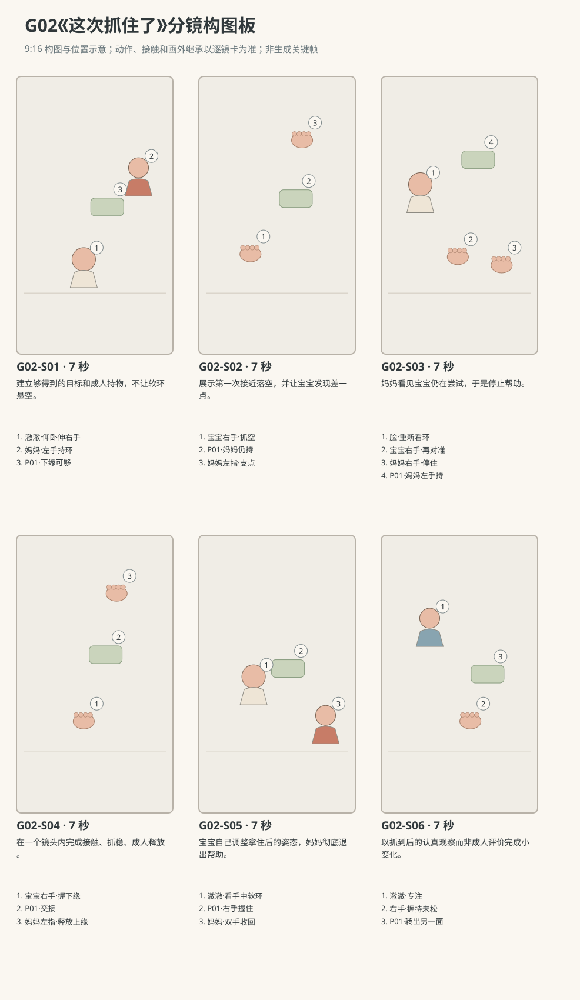

图示为构图位置示意；姿态、接触和画外继承以逐镜正文为准。

### 逐镜设计

#### G02-S01｜00—07 秒｜7 秒｜帧 [0, 168)

**镜头任务：**建立够得到的目标和成人持物，不让软环悬空。

**景别、机位与构图：**中景，南侧40厘米高轻俯；宝宝头画左、脚画右，妈妈坐右上，左手和软环在宝宝右胸前方。

**摄影机与理由：**固定机位，让动作本身改变画面；不推拉遮盖接触。

**焦点：**焦点覆盖澈澈的眼睛、行动手与目标物；关键接触始终可辨。

**入态：**澈澈仰卧看P01，妈妈左手捏环上缘，环下缘距宝宝张开的右手很近；妈妈右掌落膝。

**动作与表演：**

- 3 秒：妈妈把环下缘缓缓停稳，不再左右摇晃；宝宝眼睛跟到环下缘。

- 4 秒：宝宝右肘离垫，掌心向环伸去，左手留在胸前；后脑和背没有离垫。

**声音：**无对白、无音乐；西窗外极轻鸟声作底，前景保留连体衣摩擦与婴儿呼吸，动作触碰同步发声。

**出态：**右手接近软环下缘但尚未接触，妈妈左指仍捏上缘。

**切点与承接：**在指尖距离尚可辨时切近，保留碰偏的实际过程。

**连续性：**全身支撑与持环者同框；P01未交接，妈妈右手仍空。

**开始画面母稿：**

9:16竖幅，原创圆润三维生活动画，柔软棉布与自然皮肤质感，生活物理，无文字标语。澈澈深棕眼、短黑绒发、额前一撮向右弯，奶油色棉连体衣；身体按本条能力阶段呈现，表情与动作保留婴儿的专注和不熟练。 澈澈为R0仰卧伸手阶段；妈妈深棕低马尾、雾蓝棉上衣、米色长裤。 白天客厅西窗提供柔和漫射主光，暖墙反射补光；北墙固定沙发，东侧走廊，中央奶油地垫。 中景，南侧40厘米高轻俯；宝宝头画左、脚画右，妈妈坐右上，左手和软环在宝宝右胸前方。 单一开始瞬间：澈澈仰卧看P01，妈妈左手捏环上缘，环下缘距宝宝张开的右手很近；妈妈右掌落膝。 画面清楚呈现起态中已存在的支撑、视线与道具归属；不把后续动作叠画。

**视频变化母稿：**

9:16竖幅，原创圆润三维生活动画，柔软棉布与自然皮肤质感，生活物理，无文字标语。澈澈深棕眼、短黑绒发、额前一撮向右弯，奶油色棉连体衣；身体按本条能力阶段呈现，表情与动作保留婴儿的专注和不熟练。 澈澈为R0仰卧伸手阶段；妈妈深棕低马尾、雾蓝棉上衣、米色长裤。 白天客厅西窗提供柔和漫射主光，暖墙反射补光；北墙固定沙发，东侧走廊，中央奶油地垫。 本镜7秒，中景，南侧40厘米高轻俯；宝宝头画左、脚画右，妈妈坐右上，左手和软环在宝宝右胸前方。 起态：澈澈仰卧看P01，妈妈左手捏环上缘，环下缘距宝宝张开的右手很近；妈妈右掌落膝。 阶段1，持续3秒：妈妈把环下缘缓缓停稳，不再左右摇晃；宝宝眼睛跟到环下缘。 阶段2，持续4秒：宝宝右肘离垫，掌心向环伸去，左手留在胸前；后脑和背没有离垫。 摄影：固定机位，让动作本身改变画面；不推拉遮盖接触。 焦点：焦点覆盖澈澈的眼睛、行动手与目标物；关键接触始终可辨。 声音：无对白、无音乐；西窗外极轻鸟声作底，前景保留连体衣摩擦与婴儿呼吸，动作触碰同步发声。 终态：右手接近软环下缘但尚未接触，妈妈左指仍捏上缘。 连续性：全身支撑与持环者同框；P01未交接，妈妈右手仍空。

#### G02-S02｜07—14 秒｜7 秒｜帧 [168, 336)

**镜头任务：**展示第一次接近落空，并让宝宝发现差一点。

**景别、机位与构图：**手与环近景，南侧45厘米高；右手从左下进入，P01居中，妈妈左指在上缘，宝宝眼睛在左上画缘。

**摄影机与理由：**固定机位，让动作本身改变画面；不推拉遮盖接触。

**焦点：**环下缘和宝宝指尖同平面清楚，保持到空掌张开。

**入态：**宝宝右掌张开向环下缘，妈妈左指保持上缘固定。

**动作与表演：**

- 2 秒：宝宝右手略偏外，手背擦到环的南侧边缘。

- 2 秒：软环围绕妈妈左指轻摆，宝宝手指此时才闭合，掌心没有环。

- 3 秒：宝宝看空拳，再张开右掌收回胸前；软环摆幅逐渐减小。

**声音：**无对白、无音乐；西窗外极轻鸟声作底，前景保留连体衣摩擦与婴儿呼吸，动作触碰同步发声。

**出态：**右掌在胸前重新张开，P01仍由妈妈左手持着，摇摆将停。

**切点与承接：**保持环的摆动声，切到妈妈右手将起的反应，不跳到成功。

**连续性：**右手没有拿到环，镜内全程有妈妈左指作为悬挂支点。

**开始画面母稿：**

9:16竖幅，原创圆润三维生活动画，柔软棉布与自然皮肤质感，生活物理，无文字标语。澈澈深棕眼、短黑绒发、额前一撮向右弯，奶油色棉连体衣；身体按本条能力阶段呈现，表情与动作保留婴儿的专注和不熟练。 澈澈为R0仰卧伸手阶段；妈妈深棕低马尾、雾蓝棉上衣、米色长裤。 白天客厅西窗提供柔和漫射主光，暖墙反射补光；北墙固定沙发，东侧走廊，中央奶油地垫。 手与环近景，南侧45厘米高；右手从左下进入，P01居中，妈妈左指在上缘，宝宝眼睛在左上画缘。 单一开始瞬间：宝宝右掌张开向环下缘，妈妈左指保持上缘固定。 画面清楚呈现起态中已存在的支撑、视线与道具归属；不把后续动作叠画。

**视频变化母稿：**

9:16竖幅，原创圆润三维生活动画，柔软棉布与自然皮肤质感，生活物理，无文字标语。澈澈深棕眼、短黑绒发、额前一撮向右弯，奶油色棉连体衣；身体按本条能力阶段呈现，表情与动作保留婴儿的专注和不熟练。 澈澈为R0仰卧伸手阶段；妈妈深棕低马尾、雾蓝棉上衣、米色长裤。 白天客厅西窗提供柔和漫射主光，暖墙反射补光；北墙固定沙发，东侧走廊，中央奶油地垫。 本镜7秒，手与环近景，南侧45厘米高；右手从左下进入，P01居中，妈妈左指在上缘，宝宝眼睛在左上画缘。 起态：宝宝右掌张开向环下缘，妈妈左指保持上缘固定。 阶段1，持续2秒：宝宝右手略偏外，手背擦到环的南侧边缘。 阶段2，持续2秒：软环围绕妈妈左指轻摆，宝宝手指此时才闭合，掌心没有环。 阶段3，持续3秒：宝宝看空拳，再张开右掌收回胸前；软环摆幅逐渐减小。 摄影：固定机位，让动作本身改变画面；不推拉遮盖接触。 焦点：环下缘和宝宝指尖同平面清楚，保持到空掌张开。 声音：无对白、无音乐；西窗外极轻鸟声作底，前景保留连体衣摩擦与婴儿呼吸，动作触碰同步发声。 终态：右掌在胸前重新张开，P01仍由妈妈左手持着，摇摆将停。 连续性：右手没有拿到环，镜内全程有妈妈左指作为悬挂支点。

#### G02-S03｜14—21 秒｜7 秒｜帧 [336, 504)

**镜头任务：**妈妈看见宝宝仍在尝试，于是停止帮助。

**景别、机位与构图：**中近景，南侧35厘米高；宝宝脸左下，右手中央，妈妈的右手由右下抬起，左手持环位于右上。

**摄影机与理由：**固定机位，让动作本身改变画面；不推拉遮盖接触。

**焦点：**焦点覆盖澈澈的眼睛、行动手与目标物；关键接触始终可辨。

**入态：**宝宝右手收胸，眼睛仍看P01；妈妈左手持环，右手刚离膝。

**动作与表演：**

- 2 秒：妈妈右手靠向宝宝右手腕附近，但停在未接触的位置。

- 2 秒：宝宝眼睛从自己张开的右掌转回环下缘，下巴稍收。

- 3 秒：妈妈看见这次对准，右手停住不再靠近；宝宝再抬右肘，把掌心朝环送出。

**声音：**无对白、无音乐；西窗外极轻鸟声作底，前景保留连体衣摩擦与婴儿呼吸，动作触碰同步发声。

**出态：**宝宝右掌正对P01下缘，妈妈帮助的右手停在旁侧，未碰宝宝。

**切点与承接：**沿宝宝右手前进方向切接触近景，妈妈右手停留位置画外继承。

**连续性：**妈妈左手未换手持环；她右手没有替宝宝摆姿，宝宝背仍在垫上。

**开始画面母稿：**

9:16竖幅，原创圆润三维生活动画，柔软棉布与自然皮肤质感，生活物理，无文字标语。澈澈深棕眼、短黑绒发、额前一撮向右弯，奶油色棉连体衣；身体按本条能力阶段呈现，表情与动作保留婴儿的专注和不熟练。 澈澈为R0仰卧伸手阶段；妈妈深棕低马尾、雾蓝棉上衣、米色长裤。 白天客厅西窗提供柔和漫射主光，暖墙反射补光；北墙固定沙发，东侧走廊，中央奶油地垫。 中近景，南侧35厘米高；宝宝脸左下、右手收在胸前，妈妈右手在画右下刚离膝，左手持环位于右上。 单一开始瞬间：宝宝右手收胸，眼睛仍看P01；妈妈左手持环，右手刚离膝。 本图焦点固定在：宝宝看环的双眼、妈妈左指持环处与尚未接触宝宝的右手。 仅呈现这一瞬间的身体支撑、视线与物件归属，不把未来阶段或相机路径叠画。

**视频变化母稿：**

9:16竖幅，原创圆润三维生活动画，柔软棉布与自然皮肤质感，生活物理，无文字标语。澈澈深棕眼、短黑绒发、额前一撮向右弯，奶油色棉连体衣；身体按本条能力阶段呈现，表情与动作保留婴儿的专注和不熟练。 澈澈为R0仰卧伸手阶段；妈妈深棕低马尾、雾蓝棉上衣、米色长裤。 白天客厅西窗提供柔和漫射主光，暖墙反射补光；北墙固定沙发，东侧走廊，中央奶油地垫。 本镜7秒，中近景，南侧35厘米高；宝宝脸左下，右手中央，妈妈的右手由右下抬起，左手持环位于右上。 起态：宝宝右手收胸，眼睛仍看P01；妈妈左手持环，右手刚离膝。 阶段1，持续2秒：妈妈右手靠向宝宝右手腕附近，但停在未接触的位置。 阶段2，持续2秒：宝宝眼睛从自己张开的右掌转回环下缘，下巴稍收。 阶段3，持续3秒：妈妈看见这次对准，右手停住不再靠近；宝宝再抬右肘，把掌心朝环送出。 摄影：固定机位，让动作本身改变画面；不推拉遮盖接触。 焦点：焦点覆盖澈澈的眼睛、行动手与目标物；关键接触始终可辨。 声音：无对白、无音乐；西窗外极轻鸟声作底，前景保留连体衣摩擦与婴儿呼吸，动作触碰同步发声。 终态：宝宝右掌正对P01下缘，妈妈帮助的右手停在旁侧，未碰宝宝。 连续性：妈妈左手未换手持环；她右手没有替宝宝摆姿，宝宝背仍在垫上。

#### G02-S04｜21—28 秒｜7 秒｜帧 [504, 672)

**镜头任务：**在一个镜头内完成接触、抓稳、成人释放。

**景别、机位与构图：**手部特写，南侧斜俯，宝宝右手从下方托向环下缘，妈妈左指在上方，两个持物点不重叠。

**摄影机与理由：**固定机位，让动作本身改变画面；不推拉遮盖接触。

**焦点：**接触下缘保持锐利，妈妈上缘释放也在可辨景深内。

**入态：**宝宝右掌距软环下缘一指宽，手指舒展；妈妈左指仍捏上缘。

**动作与表演：**

- 2 秒：右手指腹先碰到环下缘，布面微微压扁。

- 3 秒：宝宝四指与拇指在下缘两侧缓慢合拢，环在双手之间停稳。

- 2 秒：妈妈确认下缘没有滑动，再张开左指退离上缘；环全重移到宝宝右手。

**声音：**无对白、无音乐；西窗外极轻鸟声作底，前景保留连体衣摩擦与婴儿呼吸，动作触碰同步发声。

**出态：**P01只在宝宝右手中，妈妈左指已经退出环上方，宝宝右腕略向下沉。

**切点与承接：**抓握已成立后切中近景，继续看小重量的结果而非庆祝。

**连续性：**妈妈释放在宝宝闭合之后；环始终一个，不能瞬间变成硬塑料。

**开始画面母稿：**

9:16竖幅，原创圆润三维生活动画，柔软棉布与自然皮肤质感，生活物理，无文字标语。澈澈深棕眼、短黑绒发、额前一撮向右弯，奶油色棉连体衣；身体按本条能力阶段呈现，表情与动作保留婴儿的专注和不熟练。 澈澈为R0仰卧伸手阶段；妈妈深棕低马尾、雾蓝棉上衣、米色长裤。 白天客厅西窗提供柔和漫射主光，暖墙反射补光；北墙固定沙发，东侧走廊，中央奶油地垫。 手部特写，南侧斜俯，宝宝右手从下方托向环下缘，妈妈左指在上方，两个持物点不重叠。 单一开始瞬间：宝宝右掌距软环下缘一指宽，手指舒展；妈妈左指仍捏上缘。 画面清楚呈现起态中已存在的支撑、视线与道具归属；不把后续动作叠画。

**视频变化母稿：**

9:16竖幅，原创圆润三维生活动画，柔软棉布与自然皮肤质感，生活物理，无文字标语。澈澈深棕眼、短黑绒发、额前一撮向右弯，奶油色棉连体衣；身体按本条能力阶段呈现，表情与动作保留婴儿的专注和不熟练。 澈澈为R0仰卧伸手阶段；妈妈深棕低马尾、雾蓝棉上衣、米色长裤。 白天客厅西窗提供柔和漫射主光，暖墙反射补光；北墙固定沙发，东侧走廊，中央奶油地垫。 本镜7秒，手部特写，南侧斜俯，宝宝右手从下方托向环下缘，妈妈左指在上方，两个持物点不重叠。 起态：宝宝右掌距软环下缘一指宽，手指舒展；妈妈左指仍捏上缘。 阶段1，持续2秒：右手指腹先碰到环下缘，布面微微压扁。 阶段2，持续3秒：宝宝四指与拇指在下缘两侧缓慢合拢，环在双手之间停稳。 阶段3，持续2秒：妈妈确认下缘没有滑动，再张开左指退离上缘；环全重移到宝宝右手。 摄影：固定机位，让动作本身改变画面；不推拉遮盖接触。 焦点：接触下缘保持锐利，妈妈上缘释放也在可辨景深内。 声音：无对白、无音乐；西窗外极轻鸟声作底，前景保留连体衣摩擦与婴儿呼吸，动作触碰同步发声。 终态：P01只在宝宝右手中，妈妈左指已经退出环上方，宝宝右腕略向下沉。 连续性：妈妈释放在宝宝闭合之后；环始终一个，不能瞬间变成硬塑料。

#### G02-S05｜28—35 秒｜7 秒｜帧 [672, 840)

**镜头任务：**宝宝自己调整拿住后的姿态，妈妈彻底退出帮助。

**景别、机位与构图：**中近景，南侧45厘米高，宝宝脸左上、右掌与软环在中央；妈妈两只空手出现在画右边缘。

**摄影机与理由：**固定机位，让动作本身改变画面；不推拉遮盖接触。

**焦点：**焦点覆盖澈澈的眼睛、行动手与目标物；关键接触始终可辨。

**入态：**宝宝右手握P01，右腕受软环重量略低；妈妈双手已空，右手仍停在旁边。

**动作与表演：**

- 3 秒：宝宝右肘弯一点，把下沉的软环重新带到视线前，目光追着它。

- 2 秒：妈妈右手慢慢收回，左手也回到膝上，不牵动宝宝。

- 2 秒：宝宝停止挥动，左手仍贴胸，眼睛盯住环的布纹。

**声音：**无对白、无音乐；西窗外极轻鸟声作底，前景保留连体衣摩擦与婴儿呼吸，动作触碰同步发声。

**出态：**软环稳定在宝宝右手，妈妈双手放膝，宝宝全身继续仰卧。

**切点与承接：**在动作由大变小时切更贴脸的收尾，延续专注。

**连续性：**P01只由宝宝右掌握下缘，妈妈空手必须可见；左手没有接棒。

**开始画面母稿：**

9:16竖幅，原创圆润三维生活动画，柔软棉布与自然皮肤质感，生活物理，无文字标语。澈澈深棕眼、短黑绒发、额前一撮向右弯，奶油色棉连体衣；身体按本条能力阶段呈现，表情与动作保留婴儿的专注和不熟练。 澈澈为R0仰卧伸手阶段；妈妈深棕低马尾、雾蓝棉上衣、米色长裤。 白天客厅西窗提供柔和漫射主光，暖墙反射补光；北墙固定沙发，东侧走廊，中央奶油地垫。 中近景，南侧45厘米高，宝宝脸左上、右掌与软环在中央；妈妈两只空手出现在画右边缘。 单一开始瞬间：宝宝右手握P01，右腕受软环重量略低；妈妈双手已空，右手仍停在旁边。 画面清楚呈现起态中已存在的支撑、视线与道具归属；不把后续动作叠画。

**视频变化母稿：**

9:16竖幅，原创圆润三维生活动画，柔软棉布与自然皮肤质感，生活物理，无文字标语。澈澈深棕眼、短黑绒发、额前一撮向右弯，奶油色棉连体衣；身体按本条能力阶段呈现，表情与动作保留婴儿的专注和不熟练。 澈澈为R0仰卧伸手阶段；妈妈深棕低马尾、雾蓝棉上衣、米色长裤。 白天客厅西窗提供柔和漫射主光，暖墙反射补光；北墙固定沙发，东侧走廊，中央奶油地垫。 本镜7秒，中近景，南侧45厘米高，宝宝脸左上、右掌与软环在中央；妈妈两只空手出现在画右边缘。 起态：宝宝右手握P01，右腕受软环重量略低；妈妈双手已空，右手仍停在旁边。 阶段1，持续3秒：宝宝右肘弯一点，把下沉的软环重新带到视线前，目光追着它。 阶段2，持续2秒：妈妈右手慢慢收回，左手也回到膝上，不牵动宝宝。 阶段3，持续2秒：宝宝停止挥动，左手仍贴胸，眼睛盯住环的布纹。 摄影：固定机位，让动作本身改变画面；不推拉遮盖接触。 焦点：焦点覆盖澈澈的眼睛、行动手与目标物；关键接触始终可辨。 声音：无对白、无音乐；西窗外极轻鸟声作底，前景保留连体衣摩擦与婴儿呼吸，动作触碰同步发声。 终态：软环稳定在宝宝右手，妈妈双手放膝，宝宝全身继续仰卧。 连续性：P01只由宝宝右掌握下缘，妈妈空手必须可见；左手没有接棒。

#### G02-S06｜35—42 秒｜7 秒｜帧 [840, 1008)

**镜头任务：**以抓到后的认真观察而非成人评价完成小变化。

**景别、机位与构图：**脸手近景，南侧50厘米高，眼睛在左上、软环在右下；背景仅见妈妈雾蓝衣料，不展示完整成人。

**摄影机与理由：**固定机位，让动作本身改变画面；不推拉遮盖接触。

**焦点：**宝宝双眼与软环表面同在可辨景深，背景妈妈柔虚。

**入态：**宝宝安静仰卧，右手握P01下缘举在右胸上方，目光落在布面。

**动作与表演：**

- 3 秒：宝宝轻轻转右腕，软环露出另一面，他眼睛跟着移动。

- 2 秒：右拇指蹭一下软布，握持没有松开；宝宝吐出很轻的气。

- 2 秒：他把环停在眼前，继续看；背景妈妈的肩膀随安静呼吸轻动。

**声音：**无对白、无音乐；西窗外极轻鸟声作底，前景保留连体衣摩擦与婴儿呼吸，动作触碰同步发声。

**出态：**右手持续握环，宝宝目光稳定，妈妈在旁陪候。

**切点与承接：**留在新获得的稳定握持上结束，不加台词、字幕或成就音。

**连续性：**握持与仰卧连续；近景外的妈妈仍在东南、双手在膝上。

**开始画面母稿：**

9:16竖幅，原创圆润三维生活动画，柔软棉布与自然皮肤质感，生活物理，无文字标语。澈澈深棕眼、短黑绒发、额前一撮向右弯，奶油色棉连体衣；身体按本条能力阶段呈现，表情与动作保留婴儿的专注和不熟练。 澈澈为R0仰卧伸手阶段；妈妈深棕低马尾、雾蓝棉上衣、米色长裤。 白天客厅西窗提供柔和漫射主光，暖墙反射补光；北墙固定沙发，东侧走廊，中央奶油地垫。 脸手近景，南侧50厘米高，眼睛在左上、软环在右下；背景仅见妈妈雾蓝衣料，不展示完整成人。 单一开始瞬间：宝宝安静仰卧，右手握P01下缘举在右胸上方，目光落在布面。 画面清楚呈现起态中已存在的支撑、视线与道具归属；不把后续动作叠画。

**视频变化母稿：**

9:16竖幅，原创圆润三维生活动画，柔软棉布与自然皮肤质感，生活物理，无文字标语。澈澈深棕眼、短黑绒发、额前一撮向右弯，奶油色棉连体衣；身体按本条能力阶段呈现，表情与动作保留婴儿的专注和不熟练。 澈澈为R0仰卧伸手阶段；妈妈深棕低马尾、雾蓝棉上衣、米色长裤。 白天客厅西窗提供柔和漫射主光，暖墙反射补光；北墙固定沙发，东侧走廊，中央奶油地垫。 本镜7秒，脸手近景，南侧50厘米高，眼睛在左上、软环在右下；背景仅见妈妈雾蓝衣料，不展示完整成人。 起态：宝宝安静仰卧，右手握P01下缘举在右胸上方，目光落在布面。 阶段1，持续3秒：宝宝轻轻转右腕，软环露出另一面，他眼睛跟着移动。 阶段2，持续2秒：右拇指蹭一下软布，握持没有松开；宝宝吐出很轻的气。 阶段3，持续2秒：他把环停在眼前，继续看；背景妈妈的肩膀随安静呼吸轻动。 摄影：固定机位，让动作本身改变画面；不推拉遮盖接触。 焦点：宝宝双眼与软环表面同在可辨景深，背景妈妈柔虚。 声音：无对白、无音乐；西窗外极轻鸟声作底，前景保留连体衣摩擦与婴儿呼吸，动作触碰同步发声。 终态：右手持续握环，宝宝目光稳定，妈妈在旁陪候。 连续性：握持与仰卧连续；近景外的妈妈仍在东南、双手在膝上。

### 声音与剪辑

软环布面摩擦与第一次轻摆、婴儿轻呼气构成节奏；妈妈无口头鼓励，成功后也不加音效。

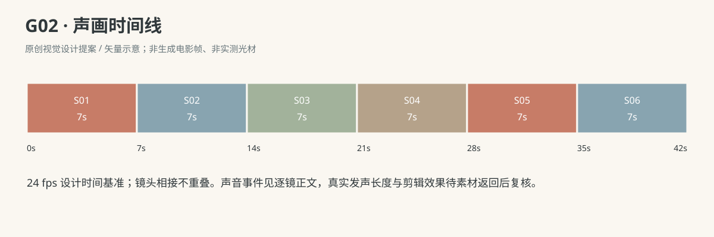

正式台词：无；保留镜头声音中已写明的自然发声。

### 连续性与试片

- 连续性：P01起初由妈妈左手捏上缘，下缘是宝宝唯一抓取目标；直到S04确定抓稳才释放。

- 连续性：宝宝只用右手抓P01，左手贴胸；镜头不镜像交换手。

- 连续性：妈妈右手全片不握宝宝手腕，停手距离始终可见。

- 连续性：R0仰卧承托不变，不以突然坐起或抬背解决够取距离。

- 试片：G02-S02：必须看见右手擦过软环但未抓住，P01仍由妈妈左手持有；碰偏后凭空出现在宝宝掌中则失败。

- 试片：G02-S03到S04：右手再次对准、触布、闭合、妈妈松手有先后顺序；松手前环悬空或双方手指融合则失败。

- 试片：G02-S05到S06：妈妈帮助之手没有碰上宝宝，宝宝自己承受环的小幅重量且保留仰卧；若读成妈妈把环塞进手里则失败。

**媒体待验证：**尚无媒体；待验证软环形变、双手交接帧、婴儿右腕受力与重看目标的微表演。

---

## G03《翻过去，世界换了一面》

**54 秒｜仰卧与翻身探索｜角色：澈澈、妈妈｜场景 L**

### 剧情正文

地垫北边放着一只芥末色布球，旁边正好是窗光照亮的缝线。澈澈仰躺着，头朝布球偏过去，右手越过胸前去够。肩膀转了一点，肚子和腿却还留在原处；手指离球始终差一小段，他慢慢回到仰卧。坐在西北角的妈妈把自己膝边的布巾收好，停下来等。澈澈再看看球，屈起腿，左臂先往头侧舒展开，右手又向北边伸去。这次肩膀转动后，腰和骨盆也跟着滚过去，脚尖擦着地垫，身体终于落成俯卧。他用前臂撑住，抬起脸，看到原本横在视线侧面的布球，现在就在面前。妈妈俯低身体，脸出现在他的新视野里。澈澈先怔怔看她，随后腾出右手碰一下球，球只滚了一小截。他没有再追，只趴着看那一点新距离。

### 导演与空间

**观察任务：**让翻身前后的视野变化可见，完整呈现肩、躯干、骨盆与腿跟随，而非以切镜完成翻转。

**空间与光位：**澈澈头西脚东仰卧；P02芥末布球放在其身体北侧、左肩略前的位置，始终在同一地垫缝旁。妈妈跪坐西北角，不占北侧翻身落点。相机在南至西南侧，沿头脚轴同侧观察；主翻身镜升至60厘米斜俯以看全身。

**人物表演：**宝宝先肩转而骨盆未跟上，回落后再尝试；第二次左侧滚转到俯卧，左前臂预先向头侧伸开并落垫，右手最后腾出碰球。妈妈只近旁守候、事后降低视线，不推肩或提腿。

### 节拍覆盖

- **G03-b1**：前态：澈澈仰卧，左臂松放身侧，双腿微弯；P02在北侧左肩略前地垫缝旁，妈妈跪坐西北角握P04。 过程：妈妈把P04折到自己膝边，视线转向宝宝。宝宝头慢慢偏向北侧布球，右手抬到胸前，眼睛追到球上。 后态：宝宝视线指向北侧球，右手在胸前，妈妈双手落自己膝边。 观众观察：交代北侧球、仰卧宝宝和空出的翻身区域。 → G03-S01

- **G03-b2**：前态：宝宝右手已抬胸前，目光看北侧球，肩背和骨盆仍平贴垫面。 过程：右手跨过胸前伸向北侧，头和右肩跟着抬转，左肩成为较低接触点。骨盆还留在仰卧位置，手指停在离球一掌远处，没有碰球。宝宝右手收回，肩背慢慢落垫，头仍朝球偏着。 后态：肩背回到垫上，骨盆未滚转，P02原位未动。 观众观察：呈现第一次只转肩、尚不能够到球的尝试。 → G03-S02

- **G03-b3**：前态：宝宝已仰卧回稳，右手胸前，左臂在身体北侧，布球未动。 过程：宝宝停下来呼吸，眼睛仍看球；妈妈身体略前倾但双手保持膝上。宝宝双膝缓慢屈起，左前臂往头侧舒展，掌和前臂落在头左前方垫面。右手再跨胸向球伸去，肩开始朝北侧转，骨盆尚未翻过。 后态：左前臂已前伸落垫，双膝屈着，右肩刚离垫，右手指向布球。 观众观察：交代下一次尝试之前左臂与腿的位置准备。 → G03-S03

- **G03-b4**：前态：左前臂在头侧垫上，右肩刚抬转，双膝屈着，骨盆仍贴垫。 过程：右手向北伸带动上身转向左侧，左肩与侧胸先受垫承托，左臂仍留在头前。躯干继续转，骨盆跟随侧滚，屈着的腿沿垫移动，没有突然交换左右。腹部和骨盆逐渐落成俯卧，双腿舒开，右前臂落到胸前侧共同承托，翻转结束。 后态：宝宝已俯卧，两前臂在胸前垫上，腹部与骨盆接地，脸侧向北侧球但尚未抬高。 观众观察：完整看到第二次肩、躯干、骨盆和腿连成一次翻转。 → G03-S04

- **G03-b5**：前态：澈澈俯卧，两前臂承托上身，腹部骨盆贴垫，脸还低着，球在视线前方。 过程：宝宝以前臂承托微抬胸口和下巴，眼睛慢慢抬到布球高度。视线从地垫缝转到球，再向球后的妈妈方向看，嘴微张。妈妈在远处开始俯低身体，但还没有进入宝宝近处。 后态：宝宝抬脸稳定，球完整进入其前方视野，妈妈正降低到相近视线高度。 观众观察：让新视线从低处抬起，证明翻身改变了世界。 → G03-S05

- **G03-b6**：前态：宝宝由两前臂撑着看向妈妈；妈妈跪地身体下俯，手在自己膝旁。 过程：妈妈慢慢把脸降到宝宝能直接看见的位置，停住，轻轻笑一下。宝宝先愣着看妈妈，再把目光落回两人之间的球。宝宝重心留在左前臂与腹部，右手肘稍向前松出，为碰球腾出空间。 后态：妈妈与宝宝视线相遇后都看向球；宝宝左前臂稳定，右掌开始离垫。 观众观察：妈妈进入宝宝的新视野，回应先于庆祝。 → G03-S06

- **G03-b7**：前态：宝宝左前臂撑垫，腹部骨盆贴垫，右掌朝球伸出但尚未碰到。 过程：右掌向前触到布球侧面，指腹让软布略凹。球在掌推下滚过一小段地垫缝，右掌随后回落到垫上。宝宝恢复双前臂支撑，抬眼看停住的球；妈妈保持陪看，轻呼吸。 后态：宝宝稳定俯卧，球停在原位前方约一掌处，右手已经回垫。 观众观察：小成功落在新姿势下碰到同一个球。 → G03-S07

### 分镜构图板

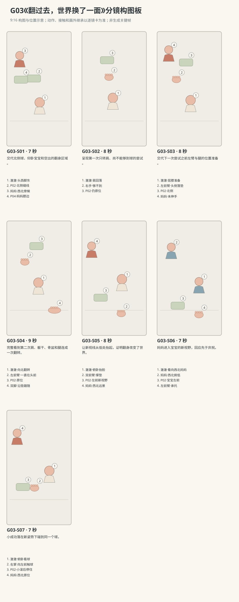

图示为构图位置示意；姿态、接触和画外继承以逐镜正文为准。

### 逐镜设计

#### G03-S01｜00—07 秒｜7 秒｜帧 [0, 168)

**镜头任务：**交代北侧球、仰卧宝宝和空出的翻身区域。

**景别、机位与构图：**中全景，南侧55厘米高轻俯；澈澈横在中下，头左脚右，布球在其身体后方偏左，妈妈居左上，北侧落点完整可见。

**摄影机与理由：**固定机位，让动作本身改变画面；不推拉遮盖接触。

**焦点：**焦点覆盖澈澈的眼睛、行动手与目标物；关键接触始终可辨。

**入态：**澈澈仰卧，左臂松放身侧，双腿微弯；P02在北侧左肩略前地垫缝旁，妈妈跪坐西北角握P04。

**动作与表演：**

- 3 秒：妈妈把P04折到自己膝边，视线转向宝宝。

- 4 秒：宝宝头慢慢偏向北侧布球，右手抬到胸前，眼睛追到球上。

**声音：**无对白、无音乐；西窗外极轻鸟声作底，前景保留连体衣摩擦与婴儿呼吸，动作触碰同步发声。

**出态：**宝宝视线指向北侧球，右手在胸前，妈妈双手落自己膝边。

**切点与承接：**沿宝宝越胸前的右手切到较近全身景，保留球的位置参照。

**连续性：**画内明确北侧翻身空间无成人膝盖阻挡；P04属于妈妈，不参与翻身。

**开始画面母稿：**

9:16竖幅，原创圆润三维生活动画，柔软棉布与自然皮肤质感，生活物理，无文字标语。澈澈深棕眼、短黑绒发、额前一撮向右弯，奶油色棉连体衣；身体按本条能力阶段呈现，表情与动作保留婴儿的专注和不熟练。 澈澈为R0仰卧到俯卧的翻身片段，奶油连体衣；妈妈低马尾、雾蓝上衣、米色长裤。 白天客厅西窗提供柔和漫射主光，暖墙反射补光；北墙固定沙发，东侧走廊，中央奶油地垫。 中全景，南侧55厘米高轻俯；澈澈横在中下，头左脚右，布球在其身体后方偏左，妈妈居左上，北侧落点完整可见。 单一开始瞬间：澈澈仰卧，左臂松放身侧，双腿微弯；P02在北侧左肩略前地垫缝旁，妈妈跪坐西北角握P04。 画面清楚呈现起态中已存在的支撑、视线与道具归属；不把后续动作叠画。

**视频变化母稿：**

9:16竖幅，原创圆润三维生活动画，柔软棉布与自然皮肤质感，生活物理，无文字标语。澈澈深棕眼、短黑绒发、额前一撮向右弯，奶油色棉连体衣；身体按本条能力阶段呈现，表情与动作保留婴儿的专注和不熟练。 澈澈为R0仰卧到俯卧的翻身片段，奶油连体衣；妈妈低马尾、雾蓝上衣、米色长裤。 白天客厅西窗提供柔和漫射主光，暖墙反射补光；北墙固定沙发，东侧走廊，中央奶油地垫。 本镜7秒，中全景，南侧55厘米高轻俯；澈澈横在中下，头左脚右，布球在其身体后方偏左，妈妈居左上，北侧落点完整可见。 起态：澈澈仰卧，左臂松放身侧，双腿微弯；P02在北侧左肩略前地垫缝旁，妈妈跪坐西北角握P04。 阶段1，持续3秒：妈妈把P04折到自己膝边，视线转向宝宝。 阶段2，持续4秒：宝宝头慢慢偏向北侧布球，右手抬到胸前，眼睛追到球上。 摄影：固定机位，让动作本身改变画面；不推拉遮盖接触。 焦点：焦点覆盖澈澈的眼睛、行动手与目标物；关键接触始终可辨。 声音：无对白、无音乐；西窗外极轻鸟声作底，前景保留连体衣摩擦与婴儿呼吸，动作触碰同步发声。 终态：宝宝视线指向北侧球，右手在胸前，妈妈双手落自己膝边。 连续性：画内明确北侧翻身空间无成人膝盖阻挡；P04属于妈妈，不参与翻身。

#### G03-S02｜07—15 秒｜8 秒｜帧 [168, 360)

**镜头任务：**呈现第一次只转肩、尚不能够到球的尝试。

**景别、机位与构图：**全身近景，西南侧50厘米高斜俯，头左上脚右下，北侧球在上方；腰、骨盆和双腿全留画。

**摄影机与理由：**固定机位，让动作本身改变画面；不推拉遮盖接触。

**焦点：**焦点覆盖澈澈的眼睛、行动手与目标物；关键接触始终可辨。

**入态：**宝宝右手已抬胸前，目光看北侧球，肩背和骨盆仍平贴垫面。

**动作与表演：**

- 3 秒：右手跨过胸前伸向北侧，头和右肩跟着抬转，左肩成为较低接触点。

- 2 秒：骨盆还留在仰卧位置，手指停在离球一掌远处，没有碰球。

- 3 秒：宝宝右手收回，肩背慢慢落垫，头仍朝球偏着。

**声音：**无对白、无音乐；西窗外极轻鸟声作底，前景保留连体衣摩擦与婴儿呼吸，动作触碰同步发声。

**出态：**肩背回到垫上，骨盆未滚转，P02原位未动。

**切点与承接：**等第一次回落完成再切，不能把未完成的动作剪成成功。

**连续性：**第一次仅肩转，左右腿仍能从骨盆连续看到；妈妈画外继承西北角未伸手。

**开始画面母稿：**

9:16竖幅，原创圆润三维生活动画，柔软棉布与自然皮肤质感，生活物理，无文字标语。澈澈深棕眼、短黑绒发、额前一撮向右弯，奶油色棉连体衣；身体按本条能力阶段呈现，表情与动作保留婴儿的专注和不熟练。 澈澈为R0仰卧到俯卧的翻身片段，奶油连体衣；妈妈低马尾、雾蓝上衣、米色长裤。 白天客厅西窗提供柔和漫射主光，暖墙反射补光；北墙固定沙发，东侧走廊，中央奶油地垫。 全身近景，西南侧50厘米高斜俯，头左上脚右下，北侧球在上方；腰、骨盆和双腿全留画。 单一开始瞬间：宝宝右手已抬胸前，目光看北侧球，肩背和骨盆仍平贴垫面。 画面清楚呈现起态中已存在的支撑、视线与道具归属；不把后续动作叠画。

**视频变化母稿：**

9:16竖幅，原创圆润三维生活动画，柔软棉布与自然皮肤质感，生活物理，无文字标语。澈澈深棕眼、短黑绒发、额前一撮向右弯，奶油色棉连体衣；身体按本条能力阶段呈现，表情与动作保留婴儿的专注和不熟练。 澈澈为R0仰卧到俯卧的翻身片段，奶油连体衣；妈妈低马尾、雾蓝上衣、米色长裤。 白天客厅西窗提供柔和漫射主光，暖墙反射补光；北墙固定沙发，东侧走廊，中央奶油地垫。 本镜8秒，全身近景，西南侧50厘米高斜俯，头左上脚右下，北侧球在上方；腰、骨盆和双腿全留画。 起态：宝宝右手已抬胸前，目光看北侧球，肩背和骨盆仍平贴垫面。 阶段1，持续3秒：右手跨过胸前伸向北侧，头和右肩跟着抬转，左肩成为较低接触点。 阶段2，持续2秒：骨盆还留在仰卧位置，手指停在离球一掌远处，没有碰球。 阶段3，持续3秒：宝宝右手收回，肩背慢慢落垫，头仍朝球偏着。 摄影：固定机位，让动作本身改变画面；不推拉遮盖接触。 焦点：焦点覆盖澈澈的眼睛、行动手与目标物；关键接触始终可辨。 声音：无对白、无音乐；西窗外极轻鸟声作底，前景保留连体衣摩擦与婴儿呼吸，动作触碰同步发声。 终态：肩背回到垫上，骨盆未滚转，P02原位未动。 连续性：第一次仅肩转，左右腿仍能从骨盆连续看到；妈妈画外继承西北角未伸手。

#### G03-S03｜15—23 秒｜8 秒｜帧 [360, 552)

**镜头任务：**交代下一次尝试之前左臂与腿的位置准备。

**景别、机位与构图：**中全景，南侧60厘米高，身体与布球同画，妈妈只在西北边缘，左臂朝头侧的空隙清楚。

**摄影机与理由：**固定机位，让动作本身改变画面；不推拉遮盖接触。

**焦点：**焦点覆盖澈澈的眼睛、行动手与目标物；关键接触始终可辨。

**入态：**宝宝已仰卧回稳，右手胸前，左臂在身体北侧，布球未动。

**动作与表演：**

- 2 秒：宝宝停下来呼吸，眼睛仍看球；妈妈身体略前倾但双手保持膝上。

- 3 秒：宝宝双膝缓慢屈起，左前臂往头侧舒展，掌和前臂落在头左前方垫面。

- 3 秒：右手再跨胸向球伸去，肩开始朝北侧转，骨盆尚未翻过。

**声音：**无对白、无音乐；西窗外极轻鸟声作底，前景保留连体衣摩擦与婴儿呼吸，动作触碰同步发声。

**出态：**左前臂已前伸落垫，双膝屈着，右肩刚离垫，右手指向布球。

**切点与承接：**从刚开始的肩转接入不中断的全身翻身镜，左臂落点严格匹配。

**连续性：**左臂移位在本镜可见，非翻过后凭空抽出；P02仍在缝旁。

**开始画面母稿：**

9:16竖幅，原创圆润三维生活动画，柔软棉布与自然皮肤质感，生活物理，无文字标语。澈澈深棕眼、短黑绒发、额前一撮向右弯，奶油色棉连体衣；身体按本条能力阶段呈现，表情与动作保留婴儿的专注和不熟练。 澈澈为R0仰卧到俯卧的翻身片段，奶油连体衣；妈妈低马尾、雾蓝上衣、米色长裤。 白天客厅西窗提供柔和漫射主光，暖墙反射补光；北墙固定沙发，东侧走廊，中央奶油地垫。 中全景，南侧60厘米高，身体与布球同画，妈妈只在西北边缘，左臂朝头侧的空隙清楚。 单一开始瞬间：宝宝已仰卧回稳，右手胸前，左臂在身体北侧，布球未动。 画面清楚呈现起态中已存在的支撑、视线与道具归属；不把后续动作叠画。

**视频变化母稿：**

9:16竖幅，原创圆润三维生活动画，柔软棉布与自然皮肤质感，生活物理，无文字标语。澈澈深棕眼、短黑绒发、额前一撮向右弯，奶油色棉连体衣；身体按本条能力阶段呈现，表情与动作保留婴儿的专注和不熟练。 澈澈为R0仰卧到俯卧的翻身片段，奶油连体衣；妈妈低马尾、雾蓝上衣、米色长裤。 白天客厅西窗提供柔和漫射主光，暖墙反射补光；北墙固定沙发，东侧走廊，中央奶油地垫。 本镜8秒，中全景，南侧60厘米高，身体与布球同画，妈妈只在西北边缘，左臂朝头侧的空隙清楚。 起态：宝宝已仰卧回稳，右手胸前，左臂在身体北侧，布球未动。 阶段1，持续2秒：宝宝停下来呼吸，眼睛仍看球；妈妈身体略前倾但双手保持膝上。 阶段2，持续3秒：宝宝双膝缓慢屈起，左前臂往头侧舒展，掌和前臂落在头左前方垫面。 阶段3，持续3秒：右手再跨胸向球伸去，肩开始朝北侧转，骨盆尚未翻过。 摄影：固定机位，让动作本身改变画面；不推拉遮盖接触。 焦点：焦点覆盖澈澈的眼睛、行动手与目标物；关键接触始终可辨。 声音：无对白、无音乐；西窗外极轻鸟声作底，前景保留连体衣摩擦与婴儿呼吸，动作触碰同步发声。 终态：左前臂已前伸落垫，双膝屈着，右肩刚离垫，右手指向布球。 连续性：左臂移位在本镜可见，非翻过后凭空抽出；P02仍在缝旁。

#### G03-S04｜23—32 秒｜9 秒｜帧 [552, 768)

**镜头任务：**完整看到第二次肩、躯干、骨盆和腿连成一次翻转。

**景别、机位与构图：**全身动作主镜，南侧60厘米高斜俯固定，头脚与球均不裁切；北侧落点在画上半，保留手臂避让空间。

**摄影机与理由：**固定机位，让动作本身改变画面；不推拉遮盖接触。

**焦点：**保持全身较深景深，肩、骨盆、双腿与前臂落点同时清楚。

**入态：**左前臂在头侧垫上，右肩刚抬转，双膝屈着，骨盆仍贴垫。

**动作与表演：**

- 3 秒：右手向北伸带动上身转向左侧，左肩与侧胸先受垫承托，左臂仍留在头前。

- 3 秒：躯干继续转，骨盆跟随侧滚，屈着的腿沿垫移动，没有突然交换左右。

- 3 秒：腹部和骨盆逐渐落成俯卧，双腿舒开，右前臂落到胸前侧共同承托，翻转结束。

**声音：**无对白无音乐；侧胸、衣腹与垫面的摩擦依次出现，双腿舒开时轻擦垫，翻定后短呼气。

**出态：**宝宝已俯卧，两前臂在胸前垫上，腹部与骨盆接地，脸侧向北侧球但尚未抬高。

**切点与承接：**翻转完全结束并有稳定接触后才切，下一镜从俯卧承托继续。

**连续性：**翻身整程可见，无成人手入画；左前臂未被身体穿过，球始终未触未滚。

**开始画面母稿：**

9:16竖幅，原创圆润三维生活动画，柔软棉布与自然皮肤质感，生活物理，无文字标语。澈澈深棕眼、短黑绒发、额前一撮向右弯，奶油色棉连体衣；身体按本条能力阶段呈现，表情与动作保留婴儿的专注和不熟练。 澈澈为R0仰卧到俯卧的翻身片段，奶油连体衣；妈妈低马尾、雾蓝上衣、米色长裤。 白天客厅西窗提供柔和漫射主光，暖墙反射补光；北墙固定沙发，东侧走廊，中央奶油地垫。 全身动作主镜，南侧60厘米高斜俯固定，头脚与球均不裁切；北侧落点在画上半，保留手臂避让空间。 单一开始瞬间：左前臂在头侧垫上，右肩刚抬转，双膝屈着，骨盆仍贴垫。 画面清楚呈现起态中已存在的支撑、视线与道具归属；不把后续动作叠画。

**视频变化母稿：**

9:16竖幅，原创圆润三维生活动画，柔软棉布与自然皮肤质感，生活物理，无文字标语。澈澈深棕眼、短黑绒发、额前一撮向右弯，奶油色棉连体衣；身体按本条能力阶段呈现，表情与动作保留婴儿的专注和不熟练。 澈澈为R0仰卧到俯卧的翻身片段，奶油连体衣；妈妈低马尾、雾蓝上衣、米色长裤。 白天客厅西窗提供柔和漫射主光，暖墙反射补光；北墙固定沙发，东侧走廊，中央奶油地垫。 本镜9秒，全身动作主镜，南侧60厘米高斜俯固定，头脚与球均不裁切；北侧落点在画上半，保留手臂避让空间。 起态：左前臂在头侧垫上，右肩刚抬转，双膝屈着，骨盆仍贴垫。 阶段1，持续3秒：右手向北伸带动上身转向左侧，左肩与侧胸先受垫承托，左臂仍留在头前。 阶段2，持续3秒：躯干继续转，骨盆跟随侧滚，屈着的腿沿垫移动，没有突然交换左右。 阶段3，持续3秒：腹部和骨盆逐渐落成俯卧，双腿舒开，右前臂落到胸前侧共同承托，翻转结束。 摄影：固定机位，让动作本身改变画面；不推拉遮盖接触。 焦点：保持全身较深景深，肩、骨盆、双腿与前臂落点同时清楚。 声音：无对白无音乐；侧胸、衣腹与垫面的摩擦依次出现，双腿舒开时轻擦垫，翻定后短呼气。 终态：宝宝已俯卧，两前臂在胸前垫上，腹部与骨盆接地，脸侧向北侧球但尚未抬高。 连续性：翻身整程可见，无成人手入画；左前臂未被身体穿过，球始终未触未滚。

#### G03-S05｜32—40 秒｜8 秒｜帧 [768, 960)

**镜头任务：**让新视线从低处抬起，证明翻身改变了世界。

**景别、机位与构图：**低位中近景，西南侧离垫18厘米向东北观察；宝宝头在中右、身体向右后延伸，北西侧的布球在左前，妈妈仍在左上远景西北角，前臂与腹部承托留画。

**摄影机与理由：**固定机位，让动作本身改变画面；不推拉遮盖接触。

**焦点：**焦点覆盖澈澈的眼睛、行动手与目标物；关键接触始终可辨。

**入态：**澈澈俯卧，两前臂承托上身，腹部骨盆贴垫，脸还低着，球在视线前方。

**动作与表演：**

- 3 秒：宝宝以前臂承托微抬胸口和下巴，眼睛慢慢抬到布球高度。

- 3 秒：视线从地垫缝转到球，再向球后的妈妈方向看，嘴微张。

- 2 秒：妈妈在远处开始俯低身体，但还没有进入宝宝近处。

**声音：**无对白、无音乐；西窗外极轻鸟声作底，前景保留连体衣摩擦与婴儿呼吸，动作触碰同步发声。

**出态：**宝宝抬脸稳定，球完整进入其前方视野，妈妈正降低到相近视线高度。

**切点与承接：**沿宝宝看妈妈的眼线切双人同框，保持南侧而不反打换窗。

**连续性：**前臂与腹部共同承托可见；抬脸不演成俯卧撑或胸腹全悬空。

**开始画面母稿：**

9:16竖幅，原创圆润三维生活动画，柔软棉布与自然皮肤质感，生活物理，无文字标语。澈澈深棕眼、短黑绒发、额前一撮向右弯，奶油色棉连体衣；身体按本条能力阶段呈现，表情与动作保留婴儿的专注和不熟练。 澈澈为R0仰卧到俯卧的翻身片段，奶油连体衣；妈妈低马尾、雾蓝上衣、米色长裤。 白天客厅西窗提供柔和漫射主光，暖墙反射补光；北墙固定沙发，东侧走廊，中央奶油地垫。 低位中近景，西南侧离垫18厘米向东北观察；宝宝头在中右、身体向右后延伸，北西侧的布球在左前，妈妈仍在左上远景西北角，前臂与腹部承托留画。 单一开始瞬间：澈澈俯卧，两前臂承托上身，腹部骨盆贴垫，脸还低着，球在视线前方。 画面清楚呈现起态中已存在的支撑、视线与道具归属；不把后续动作叠画。

**视频变化母稿：**

9:16竖幅，原创圆润三维生活动画，柔软棉布与自然皮肤质感，生活物理，无文字标语。澈澈深棕眼、短黑绒发、额前一撮向右弯，奶油色棉连体衣；身体按本条能力阶段呈现，表情与动作保留婴儿的专注和不熟练。 澈澈为R0仰卧到俯卧的翻身片段，奶油连体衣；妈妈低马尾、雾蓝上衣、米色长裤。 白天客厅西窗提供柔和漫射主光，暖墙反射补光；北墙固定沙发，东侧走廊，中央奶油地垫。 本镜8秒，低位中近景，西南侧离垫18厘米向东北观察；宝宝头在中右、身体向右后延伸，北西侧的布球在左前，妈妈仍在左上远景西北角，前臂与腹部承托留画。 起态：澈澈俯卧，两前臂承托上身，腹部骨盆贴垫，脸还低着，球在视线前方。 阶段1，持续3秒：宝宝以前臂承托微抬胸口和下巴，眼睛慢慢抬到布球高度。 阶段2，持续3秒：视线从地垫缝转到球，再向球后的妈妈方向看，嘴微张。 阶段3，持续2秒：妈妈在远处开始俯低身体，但还没有进入宝宝近处。 摄影：固定机位，让动作本身改变画面；不推拉遮盖接触。 焦点：焦点覆盖澈澈的眼睛、行动手与目标物；关键接触始终可辨。 声音：无对白、无音乐；西窗外极轻鸟声作底，前景保留连体衣摩擦与婴儿呼吸，动作触碰同步发声。 终态：宝宝抬脸稳定，球完整进入其前方视野，妈妈正降低到相近视线高度。 连续性：前臂与腹部共同承托可见；抬脸不演成俯卧撑或胸腹全悬空。

#### G03-S06｜40—47 秒｜7 秒｜帧 [960, 1128)

**镜头任务：**妈妈进入宝宝的新视野，回应先于庆祝。

**景别、机位与构图：**双人近景，延续西南侧低机位朝东北；宝宝脸在右下，妈妈仍在西北角、脸在左上，P02在宝宝左前的画左下，机位未越过头脚轴。

**摄影机与理由：**固定机位，让动作本身改变画面；不推拉遮盖接触。

**焦点：**焦点覆盖澈澈的眼睛、行动手与目标物；关键接触始终可辨。

**入态：**宝宝由两前臂撑着看向妈妈；妈妈跪地身体下俯，手在自己膝旁。

**动作与表演：**

- 3 秒：妈妈慢慢把脸降到宝宝能直接看见的位置，停住，轻轻笑一下。

- 2 秒：宝宝先愣着看妈妈，再把目光落回两人之间的球。

- 2 秒：宝宝重心留在左前臂与腹部，右手肘稍向前松出，为碰球腾出空间。

**声音：**无对白、无音乐；西窗外极轻鸟声作底，前景保留连体衣摩擦与婴儿呼吸，动作触碰同步发声。

**出态：**妈妈与宝宝视线相遇后都看向球；宝宝左前臂稳定，右掌开始离垫。

**切点与承接：**从右掌刚离垫切到接触球的中近景，镜外妈妈继续俯低等待。

**连续性：**成人未托举宝宝；右手解放前已有左前臂与腹部的支撑关系。

**开始画面母稿：**

9:16竖幅，原创圆润三维生活动画，柔软棉布与自然皮肤质感，生活物理，无文字标语。澈澈深棕眼、短黑绒发、额前一撮向右弯，奶油色棉连体衣；身体按本条能力阶段呈现，表情与动作保留婴儿的专注和不熟练。 澈澈为R0仰卧到俯卧的翻身片段，奶油连体衣；妈妈低马尾、雾蓝上衣、米色长裤。 白天客厅西窗提供柔和漫射主光，暖墙反射补光；北墙固定沙发，东侧走廊，中央奶油地垫。 双人近景，延续西南侧低机位朝东北；宝宝脸在右下，妈妈仍在西北角、脸在左上，P02在宝宝左前的画左下，机位未越过头脚轴。 单一开始瞬间：宝宝由两前臂撑着看向妈妈；妈妈跪地身体下俯，手在自己膝旁。 画面清楚呈现起态中已存在的支撑、视线与道具归属；不把后续动作叠画。

**视频变化母稿：**

9:16竖幅，原创圆润三维生活动画，柔软棉布与自然皮肤质感，生活物理，无文字标语。澈澈深棕眼、短黑绒发、额前一撮向右弯，奶油色棉连体衣；身体按本条能力阶段呈现，表情与动作保留婴儿的专注和不熟练。 澈澈为R0仰卧到俯卧的翻身片段，奶油连体衣；妈妈低马尾、雾蓝上衣、米色长裤。 白天客厅西窗提供柔和漫射主光，暖墙反射补光；北墙固定沙发，东侧走廊，中央奶油地垫。 本镜7秒，双人近景，延续西南侧低机位朝东北；宝宝脸在右下，妈妈仍在西北角、脸在左上，P02在宝宝左前的画左下，机位未越过头脚轴。 起态：宝宝由两前臂撑着看向妈妈；妈妈跪地身体下俯，手在自己膝旁。 阶段1，持续3秒：妈妈慢慢把脸降到宝宝能直接看见的位置，停住，轻轻笑一下。 阶段2，持续2秒：宝宝先愣着看妈妈，再把目光落回两人之间的球。 阶段3，持续2秒：宝宝重心留在左前臂与腹部，右手肘稍向前松出，为碰球腾出空间。 摄影：固定机位，让动作本身改变画面；不推拉遮盖接触。 焦点：焦点覆盖澈澈的眼睛、行动手与目标物；关键接触始终可辨。 声音：无对白、无音乐；西窗外极轻鸟声作底，前景保留连体衣摩擦与婴儿呼吸，动作触碰同步发声。 终态：妈妈与宝宝视线相遇后都看向球；宝宝左前臂稳定，右掌开始离垫。 连续性：成人未托举宝宝；右手解放前已有左前臂与腹部的支撑关系。

#### G03-S07｜47—54 秒｜7 秒｜帧 [1128, 1296)

**镜头任务：**小成功落在新姿势下碰到同一个球。

**景别、机位与构图：**中近景，西南侧35厘米高斜俯向东北；宝宝上身位于画右，P02在左前，右掌由右向左接近球；左前臂与腹部接触下缘可见，妈妈留左上西北后景柔虚。

**摄影机与理由：**固定机位，让动作本身改变画面；不推拉遮盖接触。

**焦点：**焦点覆盖澈澈的眼睛、行动手与目标物；关键接触始终可辨。

**入态：**宝宝左前臂撑垫，腹部骨盆贴垫，右掌朝球伸出但尚未碰到。

**动作与表演：**

- 2 秒：右掌向前触到布球侧面，指腹让软布略凹。

- 2 秒：球在掌推下滚过一小段地垫缝，右掌随后回落到垫上。

- 3 秒：宝宝恢复双前臂支撑，抬眼看停住的球；妈妈保持陪看，轻呼吸。

**声音：**无对白、无音乐；西窗外极轻鸟声作底，前景保留连体衣摩擦与婴儿呼吸，动作触碰同步发声。

**出态：**宝宝稳定俯卧，球停在原位前方约一掌处，右手已经回垫。

**切点与承接：**球停止、宝宝目光落稳后结束，不追加追爬新事件。

**连续性：**球直到本镜实际接触才滚；不赋予R0爬行能力，妈妈与P04继续原位画外继承。

**开始画面母稿：**

9:16竖幅，原创圆润三维生活动画，柔软棉布与自然皮肤质感，生活物理，无文字标语。澈澈深棕眼、短黑绒发、额前一撮向右弯，奶油色棉连体衣；身体按本条能力阶段呈现，表情与动作保留婴儿的专注和不熟练。 澈澈为R0仰卧到俯卧的翻身片段，奶油连体衣；妈妈低马尾、雾蓝上衣、米色长裤。 白天客厅西窗提供柔和漫射主光，暖墙反射补光；北墙固定沙发，东侧走廊，中央奶油地垫。 中近景，西南侧35厘米高斜俯向东北；宝宝上身位于画右，P02在左前，右掌伸在球旁但仍有间隙；左前臂与腹部接垫下缘可见，妈妈留左上西北后景柔虚。 单一开始瞬间：宝宝左前臂撑垫，腹部骨盆贴垫，右掌朝球伸出但尚未碰到。 本图焦点固定在：右掌与球之间尚未闭合的间隙、左前臂及腹部的承托。 仅呈现这一瞬间的身体支撑、视线与物件归属，不把未来阶段或相机路径叠画。

**视频变化母稿：**

9:16竖幅，原创圆润三维生活动画，柔软棉布与自然皮肤质感，生活物理，无文字标语。澈澈深棕眼、短黑绒发、额前一撮向右弯，奶油色棉连体衣；身体按本条能力阶段呈现，表情与动作保留婴儿的专注和不熟练。 澈澈为R0仰卧到俯卧的翻身片段，奶油连体衣；妈妈低马尾、雾蓝上衣、米色长裤。 白天客厅西窗提供柔和漫射主光，暖墙反射补光；北墙固定沙发，东侧走廊，中央奶油地垫。 本镜7秒，中近景，西南侧35厘米高斜俯向东北；宝宝上身位于画右，P02在左前，右掌由右向左接近球；左前臂与腹部接触下缘可见，妈妈留左上西北后景柔虚。 起态：宝宝左前臂撑垫，腹部骨盆贴垫，右掌朝球伸出但尚未碰到。 阶段1，持续2秒：右掌向前触到布球侧面，指腹让软布略凹。 阶段2，持续2秒：球在掌推下滚过一小段地垫缝，右掌随后回落到垫上。 阶段3，持续3秒：宝宝恢复双前臂支撑，抬眼看停住的球；妈妈保持陪看，轻呼吸。 摄影：固定机位，让动作本身改变画面；不推拉遮盖接触。 焦点：焦点覆盖澈澈的眼睛、行动手与目标物；关键接触始终可辨。 声音：无对白、无音乐；西窗外极轻鸟声作底，前景保留连体衣摩擦与婴儿呼吸，动作触碰同步发声。 终态：宝宝稳定俯卧，球停在原位前方约一掌处，右手已经回垫。 连续性：球直到本镜实际接触才滚；不赋予R0爬行能力，妈妈与P04继续原位画外继承。

### 声音与剪辑

棉布、前臂和膝足与地垫的摩擦需要随受力先后变化；妈妈收布巾后空间安静，翻过后宝宝短呼气。无教学旁白。

正式台词：无；保留镜头声音中已写明的自然发声。

### 连续性与试片

- 连续性：P02固定在北侧同一缝线附近，直到最后右手触碰才小滚；不得为够到而自动移球。

- 连续性：第二次翻转向身体左侧/空间北侧；左前臂先移至头侧，不能压在胸下瞬间穿出。

- 连续性：妈妈在西北角，不用画外手推背或抬腿；宝宝身体由地垫连续承托。

- 连续性：主翻身在S04整镜完成，S03仍是仰卧，S05开始已俯卧，不以剪辑掩盖过程。

- 试片：G03-S04逐帧：肩→胸腹→骨盆→腿的翻转可连续追踪，左臂未穿胸、脚未换边；凭空翻面或成人画外推转则失败。

- 试片：G03-S02及S04比较：第一次只有肩转、第二次骨盆跟随，区别可见；两镜都仅摆头却直接落成俯卧则失败。

- 试片：G03-S05到S07：先以前臂撑住再抬脸，右手碰球前剩余支撑可信；球在未接触前滚动或身体悬空则失败。

**媒体待验证：**尚无媒体；该条需先做全身翻转预演，验证骨盆接地、左臂避让、连体衣褶皱与翻后承托，再进行表情及质感制作。

---

## G04《空出来的一只手》

**42 秒｜坐姿与手部互动｜角色：澈澈、妈妈｜场景 L**

### 剧情正文

客厅中央，澈澈坐在奶油色地垫上，两只手撑在身前。妈妈在他身后折一块布巾，蓝绿色布书放在他右前方。澈澈盯住翘起的书角，右手刚离地，身体就轻轻朝右晃了一下。他立刻把手撑回去，书还在原处。妈妈放下布巾，身体靠近一点，双手停在可以照顾他的位置，没有替他把手挪过去。澈澈低头看看撑地的双手，左掌往身边收了一点，屁股重新坐实，停了一会儿。他又抬起右手，这次身体只轻轻摆动。右手一点点伸向布书，碰到书角，慢慢捏住。书角被提起，露出下面的一小片蓝色。澈澈看着自己的手，左掌仍稳稳撑地。妈妈伸到半途的手安静退回，拿起膝边的布巾，却先和他一起看了一会儿。

### 导演与空间

**观察任务：**先建立双手与骨盆的支撑，再让宝宝在小幅失衡后重新调整，腾右手捏住书角。

**空间与光位：**澈澈坐中央地垫面朝南，双腿自然向两侧屈开，妈妈跪坐其北后方偏东，一臂范围内近旁守候；P05布书在宝宝前方偏右、封面朝上，P04在妈妈膝上。相机全在南侧，宝宝解剖右侧在画左，书在画左下；西窗不变。

**人物表演：**宝宝起初骨盆与双掌形成支撑；第一次右掌抬起时身体轻晃，右掌自行回垫。第二次左掌略收近身体、骨盆坐稳，右手才到书角。妈妈收布巾的任务中断，双手停旁候而不把宝宝摆成坐稳。

### 节拍覆盖

- **G04-b1**：前态：澈澈面南坐垫，骨盆接地、双腿屈开，双掌在身前撑垫；妈妈在北后方折P04，P05位于宝宝右前方。 过程：妈妈把P04折成一半，眼睛余光照看宝宝。宝宝从双掌之间抬眼，视线转到右前方翘起的布书角，右手指轻动。 后态：宝宝眼睛锁住书角，双掌与骨盆仍维持原支撑。 观众观察：先交代双掌和骨盆的支撑，避免坐稳能力从空气出现。 → G04-S01

- **G04-b2**：前态：宝宝双掌撑地，右手离书角尚有一掌距离，眼睛看书。 过程：右掌慢慢抬起，手指向书角伸。上身随右手前伸向自身右侧轻晃，左掌留地，右手尚未够到书。宝宝停住伸手，右掌立刻回到身前垫面，身体晃幅减小。 后态：右掌已重新撑垫，宝宝身体回到双掌之间，P05未动。 观众观察：让腾手与小幅失衡的因果清楚。 → G04-S02

- **G04-b3**：前态：宝宝双掌撑垫回稳，妈妈刚放下P04在自己膝旁。 过程：妈妈身体略前倾，双手靠近宝宝躯干两侧但不接触。宝宝低头看撑地的左掌，左掌轻提后移近自己左膝，立即重新接地。宝宝骨盆坐实，胸口回到左掌与骨盆形成的稳定范围，妈妈的手保持旁候。 后态：左掌已收近并撑稳，右掌仍在垫上，骨盆接地，妈妈未碰。 观众观察：妈妈响应风险但让调整由宝宝完成。 → G04-S03

- **G04-b4**：前态：左掌与右掌均接地，骨盆坐实，眼睛看P05右上书角，妈妈双手旁候。 过程：宝宝右掌缓慢离地，躯干有小幅晃动但左掌和骨盆保持接触。右肘略弯，手掌一点点伸向书角，视线跟着指尖。右指腹碰到翘起书角，先贴住布面，还未提起。 后态：右指腹已贴书角，左掌与骨盆持续支撑，身体没有倒向书。 观众观察：从明确支撑开始第二次腾右手，并真实接近书角。 → G04-S04

- **G04-b5**：前态：右指腹贴P05翘角，拇指尚未合上；左掌在身体左前方稳撑。 过程：右拇指与食指慢慢捏住布书角，布料压出浅褶。右腕轻抬，书角离垫，书身大部分仍压在地垫上。右手停在小幅抬角位置，左掌轻微调压但没有移开。 后态：右手捏起一角，书身不离垫；左掌与骨盆仍提供支撑。 观众观察：捏住书角须有接触和布料形变，同时保留支撑证据。 → G04-S05

- **G04-b6**：前态：宝宝右指捏角、左掌撑垫，妈妈双手仍在旁边未接触。 过程：宝宝看一眼捏着的书角，嘴角轻张，身体有自然小晃。妈妈确认他保持住，把双手缓缓收回自己膝旁。她拿起P04却暂不折，和宝宝一起看书角；宝宝继续左掌撑地，右手轻捏不松。 后态：宝宝保持左掌加骨盆支撑，右手拥有书角；妈妈膝上拿布巾陪看。 观众观察：家长退出半途的帮助，留下宝宝保持新姿态的时间。 → G04-S06

### 分镜构图板

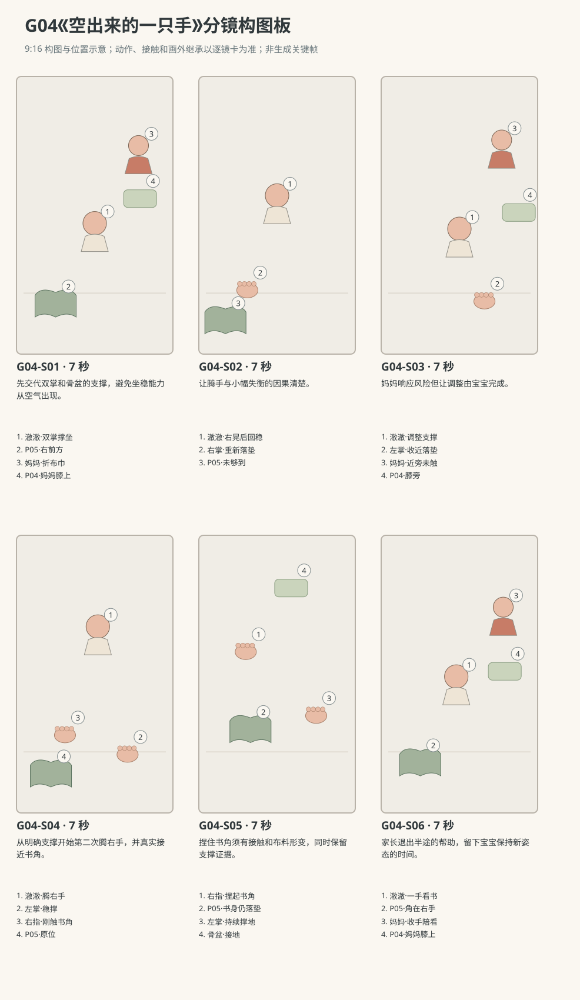

图示为构图位置示意；姿态、接触和画外继承以逐镜正文为准。

### 逐镜设计

#### G04-S01｜00—07 秒｜7 秒｜帧 [0, 168)

**镜头任务：**先交代双掌和骨盆的支撑，避免坐稳能力从空气出现。

**景别、机位与构图：**全身中景，正南离地30厘米；宝宝正面居中，双掌下方、骨盆与双腿均可见，布书画左下，妈妈在右上后景。

**摄影机与理由：**固定机位，让动作本身改变画面；不推拉遮盖接触。

**焦点：**焦点覆盖澈澈的眼睛、行动手与目标物；关键接触始终可辨。

**入态：**澈澈面南坐垫，骨盆接地、双腿屈开，双掌在身前撑垫；妈妈在北后方折P04，P05位于宝宝右前方。

**动作与表演：**

- 3 秒：妈妈把P04折成一半，眼睛余光照看宝宝。

- 4 秒：宝宝从双掌之间抬眼，视线转到右前方翘起的布书角，右手指轻动。

**声音：**无对白、无音乐；西窗外极轻鸟声作底，前景保留连体衣摩擦与婴儿呼吸，动作触碰同步发声。

**出态：**宝宝眼睛锁住书角，双掌与骨盆仍维持原支撑。

**切点与承接：**顺着视线切右手、书角及骨盆同框的较近镜头。

**连续性：**画内看得到身体三处支撑；妈妈的手均在布巾上，未托宝宝。

**开始画面母稿：**

9:16竖幅，原创圆润三维生活动画，柔软棉布与自然皮肤质感，生活物理，无文字标语。澈澈深棕眼、短黑绒发、额前一撮向右弯，奶油色棉连体衣；身体按本条能力阶段呈现，表情与动作保留婴儿的专注和不熟练。 澈澈为R1地垫坐姿探索阶段，圆润躯干与较短四肢；妈妈低马尾雾蓝上衣米色长裤。 白天客厅西窗提供柔和漫射主光，暖墙反射补光；北墙固定沙发，东侧走廊，中央奶油地垫。 全身中景，正南离地30厘米；宝宝正面居中，双掌下方、骨盆与双腿均可见，布书画左下，妈妈在右上后景。 单一开始瞬间：澈澈面南坐垫，骨盆接地、双腿屈开，双掌在身前撑垫；妈妈在北后方折P04，P05位于宝宝右前方。 画面清楚呈现起态中已存在的支撑、视线与道具归属；不把后续动作叠画。

**视频变化母稿：**

9:16竖幅，原创圆润三维生活动画，柔软棉布与自然皮肤质感，生活物理，无文字标语。澈澈深棕眼、短黑绒发、额前一撮向右弯，奶油色棉连体衣；身体按本条能力阶段呈现，表情与动作保留婴儿的专注和不熟练。 澈澈为R1地垫坐姿探索阶段，圆润躯干与较短四肢；妈妈低马尾雾蓝上衣米色长裤。 白天客厅西窗提供柔和漫射主光，暖墙反射补光；北墙固定沙发，东侧走廊，中央奶油地垫。 本镜7秒，全身中景，正南离地30厘米；宝宝正面居中，双掌下方、骨盆与双腿均可见，布书画左下，妈妈在右上后景。 起态：澈澈面南坐垫，骨盆接地、双腿屈开，双掌在身前撑垫；妈妈在北后方折P04，P05位于宝宝右前方。 阶段1，持续3秒：妈妈把P04折成一半，眼睛余光照看宝宝。 阶段2，持续4秒：宝宝从双掌之间抬眼，视线转到右前方翘起的布书角，右手指轻动。 摄影：固定机位，让动作本身改变画面；不推拉遮盖接触。 焦点：焦点覆盖澈澈的眼睛、行动手与目标物；关键接触始终可辨。 声音：无对白、无音乐；西窗外极轻鸟声作底，前景保留连体衣摩擦与婴儿呼吸，动作触碰同步发声。 终态：宝宝眼睛锁住书角，双掌与骨盆仍维持原支撑。 连续性：画内看得到身体三处支撑；妈妈的手均在布巾上，未托宝宝。

#### G04-S02｜07—14 秒｜7 秒｜帧 [168, 336)

**镜头任务：**让腾手与小幅失衡的因果清楚。

**景别、机位与构图：**中近全身景，南偏西仍在南侧轴线，右掌在画左下，书在左前缘；保留头、骨盆和双腿。

**摄影机与理由：**固定机位，让动作本身改变画面；不推拉遮盖接触。

**焦点：**焦点覆盖澈澈的眼睛、行动手与目标物；关键接触始终可辨。

**入态：**宝宝双掌撑地，右手离书角尚有一掌距离，眼睛看书。

**动作与表演：**

- 2 秒：右掌慢慢抬起，手指向书角伸。

- 2 秒：上身随右手前伸向自身右侧轻晃，左掌留地，右手尚未够到书。

- 3 秒：宝宝停住伸手，右掌立刻回到身前垫面，身体晃幅减小。

**声音：**无对白、无音乐；西窗外极轻鸟声作底，前景保留连体衣摩擦与婴儿呼吸，动作触碰同步发声。

**出态：**右掌已重新撑垫，宝宝身体回到双掌之间，P05未动。

**切点与承接：**右掌触垫的声音带到下镜，随后才给妈妈反应。

**连续性：**右掌没有抓书；左掌与骨盆始终接地，妈妈没伸入画托住。

**开始画面母稿：**

9:16竖幅，原创圆润三维生活动画，柔软棉布与自然皮肤质感，生活物理，无文字标语。澈澈深棕眼、短黑绒发、额前一撮向右弯，奶油色棉连体衣；身体按本条能力阶段呈现，表情与动作保留婴儿的专注和不熟练。 澈澈为R1地垫坐姿探索阶段，圆润躯干与较短四肢；妈妈低马尾雾蓝上衣米色长裤。 白天客厅西窗提供柔和漫射主光，暖墙反射补光；北墙固定沙发，东侧走廊，中央奶油地垫。 中近全身景，南偏西仍在南侧轴线，右掌在画左下，书在左前缘；保留头、骨盆和双腿。 单一开始瞬间：宝宝双掌撑地，右手离书角尚有一掌距离，眼睛看书。 画面清楚呈现起态中已存在的支撑、视线与道具归属；不把后续动作叠画。

**视频变化母稿：**

9:16竖幅，原创圆润三维生活动画，柔软棉布与自然皮肤质感，生活物理，无文字标语。澈澈深棕眼、短黑绒发、额前一撮向右弯，奶油色棉连体衣；身体按本条能力阶段呈现，表情与动作保留婴儿的专注和不熟练。 澈澈为R1地垫坐姿探索阶段，圆润躯干与较短四肢；妈妈低马尾雾蓝上衣米色长裤。 白天客厅西窗提供柔和漫射主光，暖墙反射补光；北墙固定沙发，东侧走廊，中央奶油地垫。 本镜7秒，中近全身景，南偏西仍在南侧轴线，右掌在画左下，书在左前缘；保留头、骨盆和双腿。 起态：宝宝双掌撑地，右手离书角尚有一掌距离，眼睛看书。 阶段1，持续2秒：右掌慢慢抬起，手指向书角伸。 阶段2，持续2秒：上身随右手前伸向自身右侧轻晃，左掌留地，右手尚未够到书。 阶段3，持续3秒：宝宝停住伸手，右掌立刻回到身前垫面，身体晃幅减小。 摄影：固定机位，让动作本身改变画面；不推拉遮盖接触。 焦点：焦点覆盖澈澈的眼睛、行动手与目标物；关键接触始终可辨。 声音：无对白、无音乐；西窗外极轻鸟声作底，前景保留连体衣摩擦与婴儿呼吸，动作触碰同步发声。 终态：右掌已重新撑垫，宝宝身体回到双掌之间，P05未动。 连续性：右掌没有抓书；左掌与骨盆始终接地，妈妈没伸入画托住。

#### G04-S03｜14—21 秒｜7 秒｜帧 [336, 504)

**镜头任务：**妈妈响应风险但让调整由宝宝完成。

**景别、机位与构图：**双人中景，正南30厘米，宝宝全身居中，妈妈在后景右侧，双手停在宝宝两侧外，不遮骨盆。

**摄影机与理由：**固定机位，让动作本身改变画面；不推拉遮盖接触。

**焦点：**焦点覆盖澈澈的眼睛、行动手与目标物；关键接触始终可辨。

**入态：**宝宝双掌撑垫回稳，妈妈刚放下P04在自己膝旁。

**动作与表演：**

- 2 秒：妈妈身体略前倾，双手靠近宝宝躯干两侧但不接触。

- 2 秒：宝宝低头看撑地的左掌，左掌轻提后移近自己左膝，立即重新接地。

- 3 秒：宝宝骨盆坐实，胸口回到左掌与骨盆形成的稳定范围，妈妈的手保持旁候。

**声音：**无对白、无音乐；西窗外极轻鸟声作底，前景保留连体衣摩擦与婴儿呼吸，动作触碰同步发声。

**出态：**左掌已收近并撑稳，右掌仍在垫上，骨盆接地，妈妈未碰。

**切点与承接：**在新支撑稳定后切下一次抬右手，不能把调整剪掉。

**连续性：**左掌移位时右掌未离地；妈妈双手只是守候，不出现看不见的托力。

**开始画面母稿：**

9:16竖幅，原创圆润三维生活动画，柔软棉布与自然皮肤质感，生活物理，无文字标语。澈澈深棕眼、短黑绒发、额前一撮向右弯，奶油色棉连体衣；身体按本条能力阶段呈现，表情与动作保留婴儿的专注和不熟练。 澈澈为R1地垫坐姿探索阶段，圆润躯干与较短四肢；妈妈低马尾雾蓝上衣米色长裤。 白天客厅西窗提供柔和漫射主光，暖墙反射补光；北墙固定沙发，东侧走廊，中央奶油地垫。 双人中景，正南30厘米；宝宝全身居中、双掌撑垫，妈妈在后景右侧，双手位于自己膝旁，P04已经放在膝旁，骨盆无遮挡。 单一开始瞬间：宝宝双掌撑垫回稳，妈妈刚放下P04在自己膝旁。 本图焦点固定在：宝宝双掌和骨盆的接地，以及妈妈尚未伸向宝宝的双手。 仅呈现这一瞬间的身体支撑、视线与物件归属，不把未来阶段或相机路径叠画。

**视频变化母稿：**

9:16竖幅，原创圆润三维生活动画，柔软棉布与自然皮肤质感，生活物理，无文字标语。澈澈深棕眼、短黑绒发、额前一撮向右弯，奶油色棉连体衣；身体按本条能力阶段呈现，表情与动作保留婴儿的专注和不熟练。 澈澈为R1地垫坐姿探索阶段，圆润躯干与较短四肢；妈妈低马尾雾蓝上衣米色长裤。 白天客厅西窗提供柔和漫射主光，暖墙反射补光；北墙固定沙发，东侧走廊，中央奶油地垫。 本镜7秒，双人中景，正南30厘米，宝宝全身居中，妈妈在后景右侧，双手停在宝宝两侧外，不遮骨盆。 起态：宝宝双掌撑垫回稳，妈妈刚放下P04在自己膝旁。 阶段1，持续2秒：妈妈身体略前倾，双手靠近宝宝躯干两侧但不接触。 阶段2，持续2秒：宝宝低头看撑地的左掌，左掌轻提后移近自己左膝，立即重新接地。 阶段3，持续3秒：宝宝骨盆坐实，胸口回到左掌与骨盆形成的稳定范围，妈妈的手保持旁候。 摄影：固定机位，让动作本身改变画面；不推拉遮盖接触。 焦点：焦点覆盖澈澈的眼睛、行动手与目标物；关键接触始终可辨。 声音：无对白、无音乐；西窗外极轻鸟声作底，前景保留连体衣摩擦与婴儿呼吸，动作触碰同步发声。 终态：左掌已收近并撑稳，右掌仍在垫上，骨盆接地，妈妈未碰。 连续性：左掌移位时右掌未离地；妈妈双手只是守候，不出现看不见的托力。

#### G04-S04｜21—28 秒｜7 秒｜帧 [504, 672)

**镜头任务：**从明确支撑开始第二次腾右手，并真实接近书角。

**景别、机位与构图：**中全近景，正南40厘米轻俯，宝宝脸居中上、左掌画右下、右手画左、书左下；成人只露衣袖边缘。

**摄影机与理由：**固定机位，让动作本身改变画面；不推拉遮盖接触。

**焦点：**焦点覆盖澈澈的眼睛、行动手与目标物；关键接触始终可辨。

**入态：**左掌与右掌均接地，骨盆坐实，眼睛看P05右上书角，妈妈双手旁候。

**动作与表演：**

- 2 秒：宝宝右掌缓慢离地，躯干有小幅晃动但左掌和骨盆保持接触。

- 3 秒：右肘略弯，手掌一点点伸向书角，视线跟着指尖。

- 2 秒：右指腹碰到翘起书角，先贴住布面，还未提起。

**声音：**无对白、无音乐；西窗外极轻鸟声作底，前景保留连体衣摩擦与婴儿呼吸，动作触碰同步发声。

**出态：**右指腹已贴书角，左掌与骨盆持续支撑，身体没有倒向书。

**切点与承接：**在触布后切手部近景，完整显示捏合与抬角。

**连续性：**左掌全镜不离地；书在触碰前未移动，妈妈没有扶手臂。

**开始画面母稿：**

9:16竖幅，原创圆润三维生活动画，柔软棉布与自然皮肤质感，生活物理，无文字标语。澈澈深棕眼、短黑绒发、额前一撮向右弯，奶油色棉连体衣；身体按本条能力阶段呈现，表情与动作保留婴儿的专注和不熟练。 澈澈为R1地垫坐姿探索阶段，圆润躯干与较短四肢；妈妈低马尾雾蓝上衣米色长裤。 白天客厅西窗提供柔和漫射主光，暖墙反射补光；北墙固定沙发，东侧走廊，中央奶油地垫。 中全近景，正南40厘米轻俯，宝宝脸居中上、左掌画右下、右手画左、书左下；成人只露衣袖边缘。 单一开始瞬间：左掌与右掌均接地，骨盆坐实，眼睛看P05右上书角，妈妈双手旁候。 画面清楚呈现起态中已存在的支撑、视线与道具归属；不把后续动作叠画。

**视频变化母稿：**

9:16竖幅，原创圆润三维生活动画，柔软棉布与自然皮肤质感，生活物理，无文字标语。澈澈深棕眼、短黑绒发、额前一撮向右弯，奶油色棉连体衣；身体按本条能力阶段呈现，表情与动作保留婴儿的专注和不熟练。 澈澈为R1地垫坐姿探索阶段，圆润躯干与较短四肢；妈妈低马尾雾蓝上衣米色长裤。 白天客厅西窗提供柔和漫射主光，暖墙反射补光；北墙固定沙发，东侧走廊，中央奶油地垫。 本镜7秒，中全近景，正南40厘米轻俯，宝宝脸居中上、左掌画右下、右手画左、书左下；成人只露衣袖边缘。 起态：左掌与右掌均接地，骨盆坐实，眼睛看P05右上书角，妈妈双手旁候。 阶段1，持续2秒：宝宝右掌缓慢离地，躯干有小幅晃动但左掌和骨盆保持接触。 阶段2，持续3秒：右肘略弯，手掌一点点伸向书角，视线跟着指尖。 阶段3，持续2秒：右指腹碰到翘起书角，先贴住布面，还未提起。 摄影：固定机位，让动作本身改变画面；不推拉遮盖接触。 焦点：焦点覆盖澈澈的眼睛、行动手与目标物；关键接触始终可辨。 声音：无对白、无音乐；西窗外极轻鸟声作底，前景保留连体衣摩擦与婴儿呼吸，动作触碰同步发声。 终态：右指腹已贴书角，左掌与骨盆持续支撑，身体没有倒向书。 连续性：左掌全镜不离地；书在触碰前未移动，妈妈没有扶手臂。

#### G04-S05｜28—35 秒｜7 秒｜帧 [672, 840)

**镜头任务：**捏住书角须有接触和布料形变，同时保留支撑证据。

**景别、机位与构图：**手部近景，正南斜俯；右指与书角画左，左掌画右，连体衣腹部及接地骨盆留上缘，不孤立成无主手。

**摄影机与理由：**固定机位，让动作本身改变画面；不推拉遮盖接触。

**焦点：**右指捏角与左掌支撑均清晰，景深覆盖两处接触。

**入态：**右指腹贴P05翘角，拇指尚未合上；左掌在身体左前方稳撑。

**动作与表演：**

- 3 秒：右拇指与食指慢慢捏住布书角，布料压出浅褶。

- 2 秒：右腕轻抬，书角离垫，书身大部分仍压在地垫上。

- 2 秒：右手停在小幅抬角位置，左掌轻微调压但没有移开。

**声音：**无对白、无音乐；西窗外极轻鸟声作底，前景保留连体衣摩擦与婴儿呼吸，动作触碰同步发声。

**出态：**右手捏起一角，书身不离垫；左掌与骨盆仍提供支撑。

**切点与承接：**布料轻响后切回脸与双手，确认这是宝宝自己腾出的手。

**连续性：**P05只有角被抬起，无整本漂浮；左右掌位置和衣裤褶皱延续。

**开始画面母稿：**

9:16竖幅，原创圆润三维生活动画，柔软棉布与自然皮肤质感，生活物理，无文字标语。澈澈深棕眼、短黑绒发、额前一撮向右弯，奶油色棉连体衣；身体按本条能力阶段呈现，表情与动作保留婴儿的专注和不熟练。 澈澈为R1地垫坐姿探索阶段，圆润躯干与较短四肢；妈妈低马尾雾蓝上衣米色长裤。 白天客厅西窗提供柔和漫射主光，暖墙反射补光；北墙固定沙发，东侧走廊，中央奶油地垫。 手部近景，正南斜俯；右指与书角画左，左掌画右，连体衣腹部及接地骨盆留上缘，不孤立成无主手。 单一开始瞬间：右指腹贴P05翘角，拇指尚未合上；左掌在身体左前方稳撑。 画面清楚呈现起态中已存在的支撑、视线与道具归属；不把后续动作叠画。

**视频变化母稿：**

9:16竖幅，原创圆润三维生活动画，柔软棉布与自然皮肤质感，生活物理，无文字标语。澈澈深棕眼、短黑绒发、额前一撮向右弯，奶油色棉连体衣；身体按本条能力阶段呈现，表情与动作保留婴儿的专注和不熟练。 澈澈为R1地垫坐姿探索阶段，圆润躯干与较短四肢；妈妈低马尾雾蓝上衣米色长裤。 白天客厅西窗提供柔和漫射主光，暖墙反射补光；北墙固定沙发，东侧走廊，中央奶油地垫。 本镜7秒，手部近景，正南斜俯；右指与书角画左，左掌画右，连体衣腹部及接地骨盆留上缘，不孤立成无主手。 起态：右指腹贴P05翘角，拇指尚未合上；左掌在身体左前方稳撑。 阶段1，持续3秒：右拇指与食指慢慢捏住布书角，布料压出浅褶。 阶段2，持续2秒：右腕轻抬，书角离垫，书身大部分仍压在地垫上。 阶段3，持续2秒：右手停在小幅抬角位置，左掌轻微调压但没有移开。 摄影：固定机位，让动作本身改变画面；不推拉遮盖接触。 焦点：右指捏角与左掌支撑均清晰，景深覆盖两处接触。 声音：无对白、无音乐；西窗外极轻鸟声作底，前景保留连体衣摩擦与婴儿呼吸，动作触碰同步发声。 终态：右手捏起一角，书身不离垫；左掌与骨盆仍提供支撑。 连续性：P05只有角被抬起，无整本漂浮；左右掌位置和衣裤褶皱延续。

#### G04-S06｜35—42 秒｜7 秒｜帧 [840, 1008)

**镜头任务：**家长退出半途的帮助，留下宝宝保持新姿态的时间。

**景别、机位与构图：**中景，正南30厘米，宝宝全身、书角和妈妈旁候的手都在画内，布书在左下。

**摄影机与理由：**固定机位，让动作本身改变画面；不推拉遮盖接触。

**焦点：**焦点覆盖澈澈的眼睛、行动手与目标物；关键接触始终可辨。

**入态：**宝宝右指捏角、左掌撑垫，妈妈双手仍在旁边未接触。

**动作与表演：**

- 2 秒：宝宝看一眼捏着的书角，嘴角轻张，身体有自然小晃。

- 2 秒：妈妈确认他保持住，把双手缓缓收回自己膝旁。

- 3 秒：她拿起P04却暂不折，和宝宝一起看书角；宝宝继续左掌撑地，右手轻捏不松。

**声音：**无对白、无音乐；西窗外极轻鸟声作底，前景保留连体衣摩擦与婴儿呼吸，动作触碰同步发声。

**出态：**宝宝保持左掌加骨盆支撑，右手拥有书角；妈妈膝上拿布巾陪看。

**切点与承接：**保留一秒稳定呼吸结束，不追加翻书或站起的新能力。

**连续性：**没有成人先扶住再撤掉的隐藏变化；P05仍只抬角，西窗光位不变。

**开始画面母稿：**

9:16竖幅，原创圆润三维生活动画，柔软棉布与自然皮肤质感，生活物理，无文字标语。澈澈深棕眼、短黑绒发、额前一撮向右弯，奶油色棉连体衣；身体按本条能力阶段呈现，表情与动作保留婴儿的专注和不熟练。 澈澈为R1地垫坐姿探索阶段，圆润躯干与较短四肢；妈妈低马尾雾蓝上衣米色长裤。 白天客厅西窗提供柔和漫射主光，暖墙反射补光；北墙固定沙发，东侧走廊，中央奶油地垫。 中景，正南30厘米，宝宝全身、书角和妈妈旁候的手都在画内，布书在左下。 单一开始瞬间：宝宝右指捏角、左掌撑垫，妈妈双手仍在旁边未接触。 画面清楚呈现起态中已存在的支撑、视线与道具归属；不把后续动作叠画。

**视频变化母稿：**

9:16竖幅，原创圆润三维生活动画，柔软棉布与自然皮肤质感，生活物理，无文字标语。澈澈深棕眼、短黑绒发、额前一撮向右弯，奶油色棉连体衣；身体按本条能力阶段呈现，表情与动作保留婴儿的专注和不熟练。 澈澈为R1地垫坐姿探索阶段，圆润躯干与较短四肢；妈妈低马尾雾蓝上衣米色长裤。 白天客厅西窗提供柔和漫射主光，暖墙反射补光；北墙固定沙发，东侧走廊，中央奶油地垫。 本镜7秒，中景，正南30厘米，宝宝全身、书角和妈妈旁候的手都在画内，布书在左下。 起态：宝宝右指捏角、左掌撑垫，妈妈双手仍在旁边未接触。 阶段1，持续2秒：宝宝看一眼捏着的书角，嘴角轻张，身体有自然小晃。 阶段2，持续2秒：妈妈确认他保持住，把双手缓缓收回自己膝旁。 阶段3，持续3秒：她拿起P04却暂不折，和宝宝一起看书角；宝宝继续左掌撑地，右手轻捏不松。 摄影：固定机位，让动作本身改变画面；不推拉遮盖接触。 焦点：焦点覆盖澈澈的眼睛、行动手与目标物；关键接触始终可辨。 声音：无对白、无音乐；西窗外极轻鸟声作底，前景保留连体衣摩擦与婴儿呼吸，动作触碰同步发声。 终态：宝宝保持左掌加骨盆支撑，右手拥有书角；妈妈膝上拿布巾陪看。 连续性：没有成人先扶住再撤掉的隐藏变化；P05仍只抬角，西窗光位不变。

### 声音与剪辑

掌根回垫、布书角捏动、妈妈放下布巾的拟音轻而明确；无对白与配乐，失败尝试不配滑稽音效。

正式台词：无；保留镜头声音中已写明的自然发声。

### 连续性与试片

- 连续性：宝宝面朝南，右侧与P05都在画左，所有镜头不镜像。

- 连续性：骨盆全程接地，双腿屈开；第一次失衡由右掌回垫恢复，没有画外成人扶正。

- 连续性：第二次右手取书前，左掌与骨盆支撑必须已建立；书角不自动飘入掌中。

- 连续性：P05右前方原位直到书角被提起；妈妈位于北后方偏东、未触宝宝。

- 试片：G04-S02到S03：右掌离地、身体右晃、右掌重新接地三步连续，若婴儿身体悬停或妈妈暗扶恢复则失败。

- 试片：G04-S04到S06：左掌和骨盆持续承担支撑，右手独立捏角；若两手同时离地或书角未碰即抬起则失败。

- 试片：静音看全片：能区分第一次晃回与第二次腾手成功，不能只看到一个始终稳定的坐姿。

**媒体待验证：**尚无媒体；先预演坐姿重心、掌根触垫与成人保护距离，再验证书角柔性和婴儿不完全熟练的动作。

---

## G05《左手接班》

**36 秒｜坐姿与手部互动｜角色：澈澈、爸爸｜场景 L**

### 剧情正文

澈澈坐在客厅地垫上，右手握着珊瑚色软布环。爸爸坐在旁边，把膝外的浅木盒转正。澈澈用左手来摸软环，先碰到自己的右手背。他停住，看看两只挤在一起的手，左指在右手背上轻轻动了动。软环被右腕转出一点空边，他再次伸来左手，这回指腹终于摸到布。两只手同时抓住环，他没有急着拉，先盯着看了一会儿。随后右手慢慢松开，环留在左掌里，轻轻往左边垂下。澈澈把空出的右手翻过来，张开掌心，再看左手里的环。爸爸也摊开自己的一只空掌，停在旁边。澈澈看见他的手，又低头看看自己的右掌，最后举起左手的软环。爸爸没接，只笑着继续陪他看。

### 导演与空间

**观察任务：**以右手持环、双手同时持环、右手释放的连续过程，让观众看到一次真正换手。

**空间与光位：**澈澈坐中央垫面朝南，骨盆双腿自然接地、躯干稳定；爸爸坐东侧，在画右后方，P07浅木盒在爸爸膝外。P01起初在宝宝右手、位于画左。相机全在南侧，宝宝右手画左、左手画右。

**人物表演：**宝宝已具备本条稳定坐姿，左右手慢而试探；左手第一次碰到右手背，第二次从软环空出的边缘抓入。爸爸本在整理空盒，发现换手后以张开的空掌回应，不代做。

### 节拍覆盖

- **G05-b1**：前态：澈澈稳坐垫上，右手握P01下缘放在胸前，左掌空着；爸爸东侧坐地，手扶P07边。 过程：爸爸把P07沿地垫转正，轻轻放稳。宝宝看右手里的环，左手抬起，掌心慢慢朝环靠近。 后态：左手来到右手附近，尚未接触，P01仍全由右手持着。 观众观察：建立软环属于右手，以及爸爸自己正在做的事。 → G05-S01

- **G05-b2**：前态：左掌张开靠近P01，右手包着环下缘，环的一侧被右手遮挡。 过程：左指伸向被遮住的环下缘，先落在右手背上。左手指在右手背轻摸，右手仍握紧软环，双方停住。左手退开少许，两手之间重新露出软环边缘。 后态：左手空着悬在环旁，右手仍持环，宝宝目光朝双手。 观众观察：第一下摸到的是自己的手，不是软环。 → G05-S02

- **G05-b3**：前态：宝宝看着两手，左手已经退开少许，右手握P01。 过程：宝宝视线停在环上，右腕慢慢转，使软环空出的外缘朝左掌。左手再次靠近，这次指腹碰到裸露的布边。左指贴布停住，拇指绕到边缘另一侧，尚未完全握合。 后态：左指与拇指在环的两侧，右手还握着原位置。 观众观察：右腕转出空边，让第二次抓握有可见路径。 → G05-S03

- **G05-b4**：前态：左拇指和其余手指分处软环边缘两侧，右手未松。 过程：左手指逐渐收拢，软环侧边轻轻压扁。两手同时握环，宝宝保持停顿，环没有离开任何一只手。右手抓力减轻，指节微舒展，但仍与布面接触。 后态：左手已握稳P01，右指刚开始放松，两手仍同时触环。 观众观察：形成清楚的双手共同持有过渡。 → G05-S04

- **G05-b5**：前态：左手握稳环，右指舒展仍触布，宝宝眼睛朝手中间。 过程：右指完全张开离开布面，环向左掌一侧微垂。宝宝把空右掌翻向自己看，右腕缓慢转动。眼睛从空右掌移到左手的软环，左手略抬把环带回视线。 后态：P01只在宝宝左手，右掌摊开朝自己，宝宝目光落左手。 观众观察：右手释放后，宝宝检查空掌与左手中的环。 → G05-S05

- **G05-b6**：前态：宝宝左手持环、右掌空着；爸爸看到换手，自己的双手已离P07。 过程：爸爸摊开空右掌，放在宝宝能看见却不碰环的位置。宝宝看一眼大手，再看自己空右掌，手指轻动。宝宝举高一点左手的环，爸爸不接，安静笑着看；P07留膝外。 后态：软环仍归宝宝左手，父子各有一只空掌可见，爸爸未接环。 观众观察：成人以空掌回应，使小变化落在共同观察上。 → G05-S06

### 分镜构图板

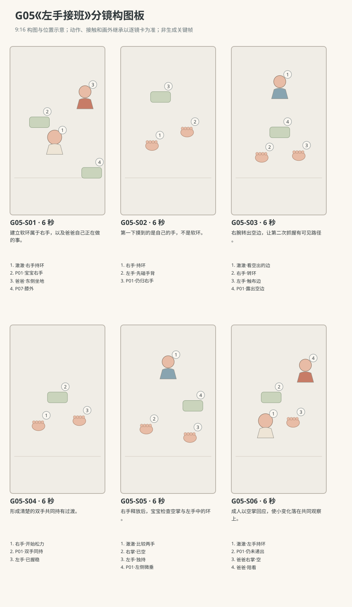

图示为构图位置示意；姿态、接触和画外继承以逐镜正文为准。

### 逐镜设计

#### G05-S01｜00—06 秒｜6 秒｜帧 [0, 144)

**镜头任务：**建立软环属于右手，以及爸爸自己正在做的事。

**景别、机位与构图：**中景，正南30厘米，宝宝坐于中央，右手持环在画左，爸爸在右上，浅木盒右下。

**摄影机与理由：**固定机位，让动作本身改变画面；不推拉遮盖接触。

**焦点：**焦点覆盖澈澈的眼睛、行动手与目标物；关键接触始终可辨。

**入态：**澈澈稳坐垫上，右手握P01下缘放在胸前，左掌空着；爸爸东侧坐地，手扶P07边。

**动作与表演：**

- 2 秒：爸爸把P07沿地垫转正，轻轻放稳。

- 4 秒：宝宝看右手里的环，左手抬起，掌心慢慢朝环靠近。

**声音：**无对白、无音乐；西窗外极轻鸟声作底，前景保留连体衣摩擦与婴儿呼吸，动作触碰同步发声。

**出态：**左手来到右手附近，尚未接触，P01仍全由右手持着。

**切点与承接：**沿两手相遇方向切近，留出第一次碰错的位置。

**连续性：**宝宝骨盆双腿可见接地；爸爸的盒子始终在其膝外，不是环的容器。

**开始画面母稿：**

9:16竖幅，原创圆润三维生活动画，柔软棉布与自然皮肤质感，生活物理，无文字标语。澈澈深棕眼、短黑绒发、额前一撮向右弯，奶油色棉连体衣；身体按本条能力阶段呈现，表情与动作保留婴儿的专注和不熟练。 澈澈为R1已能稳定坐姿抓握的阶段；爸爸短黑发砖陶色棉衬衫深灰长裤。 白天客厅西窗提供柔和漫射主光，暖墙反射补光；北墙固定沙发，东侧走廊，中央奶油地垫。 中景，正南30厘米，宝宝坐于中央，右手持环在画左，爸爸在右上，浅木盒右下。 单一开始瞬间：澈澈稳坐垫上，右手握P01下缘放在胸前，左掌空着；爸爸东侧坐地，手扶P07边。 画面清楚呈现起态中已存在的支撑、视线与道具归属；不把后续动作叠画。

**视频变化母稿：**

9:16竖幅，原创圆润三维生活动画，柔软棉布与自然皮肤质感，生活物理，无文字标语。澈澈深棕眼、短黑绒发、额前一撮向右弯，奶油色棉连体衣；身体按本条能力阶段呈现，表情与动作保留婴儿的专注和不熟练。 澈澈为R1已能稳定坐姿抓握的阶段；爸爸短黑发砖陶色棉衬衫深灰长裤。 白天客厅西窗提供柔和漫射主光，暖墙反射补光；北墙固定沙发，东侧走廊，中央奶油地垫。 本镜6秒，中景，正南30厘米，宝宝坐于中央，右手持环在画左，爸爸在右上，浅木盒右下。 起态：澈澈稳坐垫上，右手握P01下缘放在胸前，左掌空着；爸爸东侧坐地，手扶P07边。 阶段1，持续2秒：爸爸把P07沿地垫转正，轻轻放稳。 阶段2，持续4秒：宝宝看右手里的环，左手抬起，掌心慢慢朝环靠近。 摄影：固定机位，让动作本身改变画面；不推拉遮盖接触。 焦点：焦点覆盖澈澈的眼睛、行动手与目标物；关键接触始终可辨。 声音：无对白、无音乐；西窗外极轻鸟声作底，前景保留连体衣摩擦与婴儿呼吸，动作触碰同步发声。 终态：左手来到右手附近，尚未接触，P01仍全由右手持着。 连续性：宝宝骨盆双腿可见接地；爸爸的盒子始终在其膝外，不是环的容器。

#### G05-S02｜06—12 秒｜6 秒｜帧 [144, 288)

**镜头任务：**第一下摸到的是自己的手，不是软环。

**景别、机位与构图：**双手近景，正南略俯，右手在画左握环，左手由画右伸来；胸口与两腕连接在上缘。

**摄影机与理由：**固定机位，让动作本身改变画面；不推拉遮盖接触。

**焦点：**锁定左指与右手背的触点，保留软环露出的边缘。

**入态：**左掌张开靠近P01，右手包着环下缘，环的一侧被右手遮挡。

**动作与表演：**

- 2 秒：左指伸向被遮住的环下缘，先落在右手背上。

- 2 秒：左手指在右手背轻摸，右手仍握紧软环，双方停住。

- 2 秒：左手退开少许，两手之间重新露出软环边缘。

**声音：**无对白、无音乐；西窗外极轻鸟声作底，前景保留连体衣摩擦与婴儿呼吸，动作触碰同步发声。

**出态：**左手空着悬在环旁，右手仍持环，宝宝目光朝双手。

**切点与承接：**在手背与环边分开后切带脸的镜头，交代宝宝重新看。

**连续性：**本镜左手未取得环；右手手背、布面与左指边界必须分明。

**开始画面母稿：**

9:16竖幅，原创圆润三维生活动画，柔软棉布与自然皮肤质感，生活物理，无文字标语。澈澈深棕眼、短黑绒发、额前一撮向右弯，奶油色棉连体衣；身体按本条能力阶段呈现，表情与动作保留婴儿的专注和不熟练。 澈澈为R1已能稳定坐姿抓握的阶段；爸爸短黑发砖陶色棉衬衫深灰长裤。 白天客厅西窗提供柔和漫射主光，暖墙反射补光；北墙固定沙发，东侧走廊，中央奶油地垫。 双手近景，正南略俯；右手在画左握环，空左掌位于画右靠近环，尚未碰到右手背；胸口与两腕连接在上缘。 单一开始瞬间：左掌张开靠近P01，右手包着环下缘，环的一侧被右手遮挡。 本图焦点固定在：宝宝右手的握点与尚未接触右手背的左指。 仅呈现这一瞬间的身体支撑、视线与物件归属，不把未来阶段或相机路径叠画。

**视频变化母稿：**

9:16竖幅，原创圆润三维生活动画，柔软棉布与自然皮肤质感，生活物理，无文字标语。澈澈深棕眼、短黑绒发、额前一撮向右弯，奶油色棉连体衣；身体按本条能力阶段呈现，表情与动作保留婴儿的专注和不熟练。 澈澈为R1已能稳定坐姿抓握的阶段；爸爸短黑发砖陶色棉衬衫深灰长裤。 白天客厅西窗提供柔和漫射主光，暖墙反射补光；北墙固定沙发，东侧走廊，中央奶油地垫。 本镜6秒，双手近景，正南略俯，右手在画左握环，左手由画右伸来；胸口与两腕连接在上缘。 起态：左掌张开靠近P01，右手包着环下缘，环的一侧被右手遮挡。 阶段1，持续2秒：左指伸向被遮住的环下缘，先落在右手背上。 阶段2，持续2秒：左手指在右手背轻摸，右手仍握紧软环，双方停住。 阶段3，持续2秒：左手退开少许，两手之间重新露出软环边缘。 摄影：固定机位，让动作本身改变画面；不推拉遮盖接触。 焦点：锁定左指与右手背的触点，保留软环露出的边缘。 声音：无对白、无音乐；西窗外极轻鸟声作底，前景保留连体衣摩擦与婴儿呼吸，动作触碰同步发声。 终态：左手空着悬在环旁，右手仍持环，宝宝目光朝双手。 连续性：本镜左手未取得环；右手手背、布面与左指边界必须分明。

#### G05-S03｜12—18 秒｜6 秒｜帧 [288, 432)

**镜头任务：**右腕转出空边，让第二次抓握有可见路径。

**景别、机位与构图：**脸手中近景，正南40厘米；宝宝脸居中上，右手环在左下、空左手在右下。

**摄影机与理由：**固定机位，让动作本身改变画面；不推拉遮盖接触。

**焦点：**焦点覆盖澈澈的眼睛、行动手与目标物；关键接触始终可辨。

**入态：**宝宝看着两手，左手已经退开少许，右手握P01。

**动作与表演：**

- 2 秒：宝宝视线停在环上，右腕慢慢转，使软环空出的外缘朝左掌。

- 2 秒：左手再次靠近，这次指腹碰到裸露的布边。

- 2 秒：左指贴布停住，拇指绕到边缘另一侧，尚未完全握合。

**声音：**无对白、无音乐；西窗外极轻鸟声作底，前景保留连体衣摩擦与婴儿呼吸，动作触碰同步发声。

**出态：**左指与拇指在环的两侧，右手还握着原位置。

**切点与承接：**切双手特写，接下来握合与释放要在同一方向可追踪。

**连续性：**右腕转环而不是环自动转；两个握持位置相隔，避免双方手指融成一团。

**开始画面母稿：**

9:16竖幅，原创圆润三维生活动画，柔软棉布与自然皮肤质感，生活物理，无文字标语。澈澈深棕眼、短黑绒发、额前一撮向右弯，奶油色棉连体衣；身体按本条能力阶段呈现，表情与动作保留婴儿的专注和不熟练。 澈澈为R1已能稳定坐姿抓握的阶段；爸爸短黑发砖陶色棉衬衫深灰长裤。 白天客厅西窗提供柔和漫射主光，暖墙反射补光；北墙固定沙发，东侧走廊，中央奶油地垫。 脸手中近景，正南40厘米；宝宝脸居中上，右手环在左下、空左手在右下。 单一开始瞬间：宝宝看着两手，左手已经退开少许，右手握P01。 画面清楚呈现起态中已存在的支撑、视线与道具归属；不把后续动作叠画。

**视频变化母稿：**

9:16竖幅，原创圆润三维生活动画，柔软棉布与自然皮肤质感，生活物理，无文字标语。澈澈深棕眼、短黑绒发、额前一撮向右弯，奶油色棉连体衣；身体按本条能力阶段呈现，表情与动作保留婴儿的专注和不熟练。 澈澈为R1已能稳定坐姿抓握的阶段；爸爸短黑发砖陶色棉衬衫深灰长裤。 白天客厅西窗提供柔和漫射主光，暖墙反射补光；北墙固定沙发，东侧走廊，中央奶油地垫。 本镜6秒，脸手中近景，正南40厘米；宝宝脸居中上，右手环在左下、空左手在右下。 起态：宝宝看着两手，左手已经退开少许，右手握P01。 阶段1，持续2秒：宝宝视线停在环上，右腕慢慢转，使软环空出的外缘朝左掌。 阶段2，持续2秒：左手再次靠近，这次指腹碰到裸露的布边。 阶段3，持续2秒：左指贴布停住，拇指绕到边缘另一侧，尚未完全握合。 摄影：固定机位，让动作本身改变画面；不推拉遮盖接触。 焦点：焦点覆盖澈澈的眼睛、行动手与目标物；关键接触始终可辨。 声音：无对白、无音乐；西窗外极轻鸟声作底，前景保留连体衣摩擦与婴儿呼吸，动作触碰同步发声。 终态：左指与拇指在环的两侧，右手还握着原位置。 连续性：右腕转环而不是环自动转；两个握持位置相隔，避免双方手指融成一团。

#### G05-S04｜18—24 秒｜6 秒｜帧 [432, 576)

**镜头任务：**形成清楚的双手共同持有过渡。

**景别、机位与构图：**双手特写，正南斜俯；环居中，宝宝右手画左握下缘、左手画右握另一侧，腕部均连接胸前。

**摄影机与理由：**固定机位，让动作本身改变画面；不推拉遮盖接触。

**焦点：**两处握点同在清晰景深内，不只拍单侧手。

**入态：**左拇指和其余手指分处软环边缘两侧，右手未松。

**动作与表演：**

- 2 秒：左手指逐渐收拢，软环侧边轻轻压扁。

- 2 秒：两手同时握环，宝宝保持停顿，环没有离开任何一只手。

- 2 秒：右手抓力减轻，指节微舒展，但仍与布面接触。

**声音：**无对白、无音乐；西窗外极轻鸟声作底，前景保留连体衣摩擦与婴儿呼吸，动作触碰同步发声。

**出态：**左手已握稳P01，右指刚开始放松，两手仍同时触环。

**切点与承接：**在右指松开的起点切稍宽镜，继续追踪物件归属。

**连续性：**左掌握合先于右手释放，软环形状变化服从两处指腹，不增殖。

**开始画面母稿：**

9:16竖幅，原创圆润三维生活动画，柔软棉布与自然皮肤质感，生活物理，无文字标语。澈澈深棕眼、短黑绒发、额前一撮向右弯，奶油色棉连体衣；身体按本条能力阶段呈现，表情与动作保留婴儿的专注和不熟练。 澈澈为R1已能稳定坐姿抓握的阶段；爸爸短黑发砖陶色棉衬衫深灰长裤。 白天客厅西窗提供柔和漫射主光，暖墙反射补光；北墙固定沙发，东侧走廊，中央奶油地垫。 双手特写，正南斜俯；环居中，宝宝右手画左握下缘，空左手画右，左拇指和其余手指分处另一侧布边两面、尚未握合，两腕连接胸前。 单一开始瞬间：左拇指和其余手指分处软环边缘两侧，右手未松。 本图焦点固定在：右手现有握点与左指尚未合拢的布边。 仅呈现这一瞬间的身体支撑、视线与物件归属，不把未来阶段或相机路径叠画。

**视频变化母稿：**

9:16竖幅，原创圆润三维生活动画，柔软棉布与自然皮肤质感，生活物理，无文字标语。澈澈深棕眼、短黑绒发、额前一撮向右弯，奶油色棉连体衣；身体按本条能力阶段呈现，表情与动作保留婴儿的专注和不熟练。 澈澈为R1已能稳定坐姿抓握的阶段；爸爸短黑发砖陶色棉衬衫深灰长裤。 白天客厅西窗提供柔和漫射主光，暖墙反射补光；北墙固定沙发，东侧走廊，中央奶油地垫。 本镜6秒，双手特写，正南斜俯；环居中，宝宝右手画左握下缘、左手画右握另一侧，腕部均连接胸前。 起态：左拇指和其余手指分处软环边缘两侧，右手未松。 阶段1，持续2秒：左手指逐渐收拢，软环侧边轻轻压扁。 阶段2，持续2秒：两手同时握环，宝宝保持停顿，环没有离开任何一只手。 阶段3，持续2秒：右手抓力减轻，指节微舒展，但仍与布面接触。 摄影：固定机位，让动作本身改变画面；不推拉遮盖接触。 焦点：两处握点同在清晰景深内，不只拍单侧手。 声音：无对白、无音乐；西窗外极轻鸟声作底，前景保留连体衣摩擦与婴儿呼吸，动作触碰同步发声。 终态：左手已握稳P01，右指刚开始放松，两手仍同时触环。 连续性：左掌握合先于右手释放，软环形状变化服从两处指腹，不增殖。

#### G05-S05｜24—30 秒｜6 秒｜帧 [576, 720)

**镜头任务：**右手释放后，宝宝检查空掌与左手中的环。

**景别、机位与构图：**脸手中近景，正南40厘米，左右掌及脸都在画内，P01位于宝宝左手即画右下。

**摄影机与理由：**固定机位，让动作本身改变画面；不推拉遮盖接触。

**焦点：**焦点覆盖澈澈的眼睛、行动手与目标物；关键接触始终可辨。

**入态：**左手握稳环，右指舒展仍触布，宝宝眼睛朝手中间。

**动作与表演：**

- 2 秒：右指完全张开离开布面，环向左掌一侧微垂。

- 2 秒：宝宝把空右掌翻向自己看，右腕缓慢转动。

- 2 秒：眼睛从空右掌移到左手的软环，左手略抬把环带回视线。

**声音：**无对白、无音乐；西窗外极轻鸟声作底，前景保留连体衣摩擦与婴儿呼吸，动作触碰同步发声。

**出态：**P01只在宝宝左手，右掌摊开朝自己，宝宝目光落左手。

**切点与承接：**在宝宝看完空掌后切入爸爸的回应，不制造再一次交接。

**连续性：**环重量由左手承担，右手与环已分离；坐姿稳定，爸爸未参与换手。

**开始画面母稿：**

9:16竖幅，原创圆润三维生活动画，柔软棉布与自然皮肤质感，生活物理，无文字标语。澈澈深棕眼、短黑绒发、额前一撮向右弯，奶油色棉连体衣；身体按本条能力阶段呈现，表情与动作保留婴儿的专注和不熟练。 澈澈为R1已能稳定坐姿抓握的阶段；爸爸短黑发砖陶色棉衬衫深灰长裤。 白天客厅西窗提供柔和漫射主光，暖墙反射补光；北墙固定沙发，东侧走廊，中央奶油地垫。 脸手中近景，正南40厘米，左右掌及脸都在画内，P01位于宝宝左手即画右下。 单一开始瞬间：左手握稳环，右指舒展仍触布，宝宝眼睛朝手中间。 画面清楚呈现起态中已存在的支撑、视线与道具归属；不把后续动作叠画。

**视频变化母稿：**

9:16竖幅，原创圆润三维生活动画，柔软棉布与自然皮肤质感，生活物理，无文字标语。澈澈深棕眼、短黑绒发、额前一撮向右弯，奶油色棉连体衣；身体按本条能力阶段呈现，表情与动作保留婴儿的专注和不熟练。 澈澈为R1已能稳定坐姿抓握的阶段；爸爸短黑发砖陶色棉衬衫深灰长裤。 白天客厅西窗提供柔和漫射主光，暖墙反射补光；北墙固定沙发，东侧走廊，中央奶油地垫。 本镜6秒，脸手中近景，正南40厘米，左右掌及脸都在画内，P01位于宝宝左手即画右下。 起态：左手握稳环，右指舒展仍触布，宝宝眼睛朝手中间。 阶段1，持续2秒：右指完全张开离开布面，环向左掌一侧微垂。 阶段2，持续2秒：宝宝把空右掌翻向自己看，右腕缓慢转动。 阶段3，持续2秒：眼睛从空右掌移到左手的软环，左手略抬把环带回视线。 摄影：固定机位，让动作本身改变画面；不推拉遮盖接触。 焦点：焦点覆盖澈澈的眼睛、行动手与目标物；关键接触始终可辨。 声音：无对白、无音乐；西窗外极轻鸟声作底，前景保留连体衣摩擦与婴儿呼吸，动作触碰同步发声。 终态：P01只在宝宝左手，右掌摊开朝自己，宝宝目光落左手。 连续性：环重量由左手承担，右手与环已分离；坐姿稳定，爸爸未参与换手。

#### G05-S06｜30—36 秒｜6 秒｜帧 [720, 864)

**镜头任务：**成人以空掌回应，使小变化落在共同观察上。

**景别、机位与构图：**双人中景，正南30厘米；宝宝居左中、爸爸居右上，爸爸空右掌在两人之间，宝宝左手的环保持画内。

**摄影机与理由：**固定机位，让动作本身改变画面；不推拉遮盖接触。

**焦点：**焦点覆盖澈澈的眼睛、行动手与目标物；关键接触始终可辨。

**入态：**宝宝左手持环、右掌空着；爸爸看到换手，自己的双手已离P07。

**动作与表演：**

- 2 秒：爸爸摊开空右掌，放在宝宝能看见却不碰环的位置。

- 2 秒：宝宝看一眼大手，再看自己空右掌，手指轻动。

- 2 秒：宝宝举高一点左手的环，爸爸不接，安静笑着看；P07留膝外。

**声音：**无对白、无音乐；西窗外极轻鸟声作底，前景保留连体衣摩擦与婴儿呼吸，动作触碰同步发声。

**出态：**软环仍归宝宝左手，父子各有一只空掌可见，爸爸未接环。

**切点与承接：**停在两种手的大小对照上结束，不追加成人评价台词。

**连续性：**爸爸摊开的是右手且空着，宝宝左右手延续；P07仍在地面。

**开始画面母稿：**

9:16竖幅，原创圆润三维生活动画，柔软棉布与自然皮肤质感，生活物理，无文字标语。澈澈深棕眼、短黑绒发、额前一撮向右弯，奶油色棉连体衣；身体按本条能力阶段呈现，表情与动作保留婴儿的专注和不熟练。 澈澈为R1已能稳定坐姿抓握的阶段；爸爸短黑发砖陶色棉衬衫深灰长裤。 白天客厅西窗提供柔和漫射主光，暖墙反射补光；北墙固定沙发，东侧走廊，中央奶油地垫。 双人中景，正南30厘米；宝宝居左中、爸爸居右上，宝宝左手持环、右掌空着；爸爸双手已离P07、位于自己膝旁，右掌尚未举到两人之间。 单一开始瞬间：宝宝左手持环、右掌空着；爸爸看到换手，自己的双手已离P07。 本图焦点固定在：宝宝空右掌、左手中的环及爸爸尚未举起的右手。 仅呈现这一瞬间的身体支撑、视线与物件归属，不把未来阶段或相机路径叠画。

**视频变化母稿：**

9:16竖幅，原创圆润三维生活动画，柔软棉布与自然皮肤质感，生活物理，无文字标语。澈澈深棕眼、短黑绒发、额前一撮向右弯，奶油色棉连体衣；身体按本条能力阶段呈现，表情与动作保留婴儿的专注和不熟练。 澈澈为R1已能稳定坐姿抓握的阶段；爸爸短黑发砖陶色棉衬衫深灰长裤。 白天客厅西窗提供柔和漫射主光，暖墙反射补光；北墙固定沙发，东侧走廊，中央奶油地垫。 本镜6秒，双人中景，正南30厘米；宝宝居左中、爸爸居右上，爸爸空右掌在两人之间，宝宝左手的环保持画内。 起态：宝宝左手持环、右掌空着；爸爸看到换手，自己的双手已离P07。 阶段1，持续2秒：爸爸摊开空右掌，放在宝宝能看见却不碰环的位置。 阶段2，持续2秒：宝宝看一眼大手，再看自己空右掌，手指轻动。 阶段3，持续2秒：宝宝举高一点左手的环，爸爸不接，安静笑着看；P07留膝外。 摄影：固定机位，让动作本身改变画面；不推拉遮盖接触。 焦点：焦点覆盖澈澈的眼睛、行动手与目标物；关键接触始终可辨。 声音：无对白、无音乐；西窗外极轻鸟声作底，前景保留连体衣摩擦与婴儿呼吸，动作触碰同步发声。 终态：软环仍归宝宝左手，父子各有一只空掌可见，爸爸未接环。 连续性：爸爸摊开的是右手且空着，宝宝左右手延续；P07仍在地面。

### 声音与剪辑

软环受双手轻压的布响、空盒转正轻擦垫声、宝宝呼吸；没有换手提示旁白，爸爸回应无台词。

正式台词：无；保留镜头声音中已写明的自然发声。

### 连续性与试片

- 连续性：P01从宝宝右手转到左手；S04出现双方同时握住的明确过渡，右手不得在左手抓稳前释放。

- 连续性：宝宝面南，右手画左、左手画右；手部特写保留腕部连接，禁止镜像。

- 连续性：坐姿稳定依靠已有能力，骨盆腿接地；不安排突然爬行或站起。

- 连续性：爸爸始终空手回应，不接走软环；P07仅在东侧膝外，不进入宝宝抓握区。

- 试片：G05-S02到S04：第一次左手碰右手背与第二次碰布环必须可区分，若直接闪成换手成功则失败。

- 试片：G05-S04到S05：左掌握稳后右指逐渐放开，P01始终一个；环穿过手掌、复制或更换颜色则失败。

- 试片：G05-S06：爸爸摊的是空掌，P01仍在宝宝左手；若读成爸爸接物或宝宝成人式展示领奖则失败。

**媒体待验证：**尚无媒体；待验证双手交叠的指节遮挡、软环形变、右指释放顺序与空掌检查的眼神。

---

## G06《回头才发现爬远了》

**54 秒｜爬行与扶站｜角色：澈澈、爸爸｜场景 L**

### 剧情正文

地垫西半边，澈澈用手和膝盖撑着，眼睛盯住东边的芥末色布球。爸爸坐在北侧，布书摊在膝上，原本正跟他看图。澈澈先向前挪一只手，膝盖再跟过去，停住，确认球还在前面。他又爬一小段，连体衣在膝上堆起细褶，身体越过了原来压住的地垫缝。爸爸合上布书，没有把球推近，也没有跟着挪。澈澈终于碰到布球，掌心让球轻轻凹下。他放低身体，趴在球旁边，右手留在球上。安静下来后，他抬头，先调整前臂，让肩膀稍朝爸爸那边，再转脸看过去。爸爸已经离得比刚才远了，仍坐在原位，向他轻轻招手。澈澈看了看中间空出的地垫，又看爸爸，嘴角一点点张开。球还在掌下，他没有急着爬回去，只趴着回了一个笑。

### 导演与空间

**观察任务：**以地垫缝与爸爸不动的位置让距离累积可见，最后宝宝趴下回看，自己发现已经爬远。

**空间与光位：**宝宝在地垫西半面朝东，P02放东侧约一个宝宝身长外；爸爸跪坐北侧偏东，侧看宝宝，始终不随爬行挪动。相机位于南侧向北，宝宝头画右、脚画左，西窗照亮垫缝；回看时先把前臂及上胸稍朝北调整，目光便能转向北侧偏西的爸爸，不扭头180度。

**人物表演：**本条宝宝已有手膝爬行能力，但每次移手移膝仍有小停顿；受力从落地手膝转移后才前送另一肢。到球前放低腹部，右手留球、左前臂撑垫。爸爸原本拿P05看图，合上书留在原位招手。

### 节拍覆盖

- **G06-b1**：前态：澈澈手掌和双膝落垫、腹部离地，面东看P02；爸爸北侧偏东坐地，P05摊膝，P02在东侧缝旁。 过程：爸爸从布书抬眼看宝宝，手指停在书页边。宝宝盯住球，身体轻轻前后调重心，右手指在垫面张开，准备前移。 后态：四处手膝接地，宝宝重心稍前，球和爸爸都未移动。 观众观察：把起点、球和爸爸的固定位置一次交代清楚。 → G06-S01

- **G06-b2**：前态：宝宝四点撑地看东侧球，右手指已张开，腹部尚在起点缝上方。 过程：重心留在落地手膝上，右掌向前移一小段并落稳，左膝再跟入身下。另一只手向前落稳，另一膝随后前移，躯干随支撑整体向东。宝宝停住，四处手膝重新承托，抬眼确认球的位置。 后态：宝宝腹部已经越过起点缝，四点重新落稳，球距离缩短一小段。 观众观察：让第一段前进建立在手膝连续支撑上。 → G06-S02

- **G06-b3**：前态：宝宝停在越过第一条缝的位置，四点承托；爸爸膝上布书仍开着。 过程：爸爸把P05轻轻合上放在膝上，目光保持宝宝。宝宝再做一组慢的移掌、落掌、跟膝，身体向东越过下一段地垫。他停在离球一臂以内，头抬高一点，爸爸原位显得更靠后。 后态：球在宝宝右掌前方可够处，宝宝双膝与左掌稳稳落地，爸爸仍原位。 观众观察：继续前进的同时让距离在背景累积。 → G06-S03

- **G06-b4**：前态：宝宝双膝与左掌稳落垫，右掌在身体右前方，球在右掌前一点。 过程：宝宝保持左掌和双膝支撑，右掌前伸碰到球上侧，布球受轻压而没有被猛推。右掌留球，左肘缓缓弯下成为前臂承托，躯干降低，膝逐渐往后舒展。腹部与骨盆轻轻落垫，双腿伸松，右掌仍搭球，左前臂留头胸前。 后态：宝宝俯卧在球旁，右掌搭P02，左前臂和腹部骨盆接地，球仅轻扁原位。 观众观察：真正够到球，再从手膝支撑连续降低为俯卧。 → G06-S04

- **G06-b5**：前态：宝宝俯卧面东，右掌搭球、左前臂撑垫，爸爸在其北侧偏西方向。 过程：宝宝左前臂向北略挪后重新落稳，上胸随之稍转向东北，骨盆仍贴垫。他从球上抬眼，再沿肩膀打开的方向侧转头看北侧爸爸，不扭到正后方。目光找到爸爸，嘴微张，右掌仍留在球上。 后态：上胸略朝东北，宝宝侧脸看向爸爸，左前臂和腹部承托，右手仍搭球。 观众观察：回看先调整肩与前臂，保留自然活动范围。 → G06-S05

- **G06-b6**：前态：宝宝趴在东侧看爸爸，爸爸仍在最初坐地位置，P05合在膝上。 过程：宝宝目光从爸爸移到两人之间空出的地垫，停一下。爸爸举空右手轻轻招一招，左手压住膝上布书，身体不向宝宝挪。宝宝目光回到爸爸脸上，眼睛慢慢眯起。 后态：爸爸右手停在一次招手后，宝宝准备笑，距离与起点缝保持可见。 观众观察：让已增加的距离和爸爸不动的回应同时可见。 → G06-S06

- **G06-b7**：前态：宝宝侧头看爸爸，眼睛已微眯，右掌搭球，左前臂撑垫。 过程：宝宝嘴角张开，发一声很轻的笑，肩膀随呼吸小动。右手指轻压球一下，球略凹，没有另一次投掷。宝宝继续看爸爸，爸爸的招手落回膝旁，画面安静停住。 后态：宝宝保持俯卧回笑，右手仍在球上，爸爸仍在原处。 观众观察：以趴着回笑收尾，成长是被自己察觉的距离。 → G06-S07

### 分镜构图板

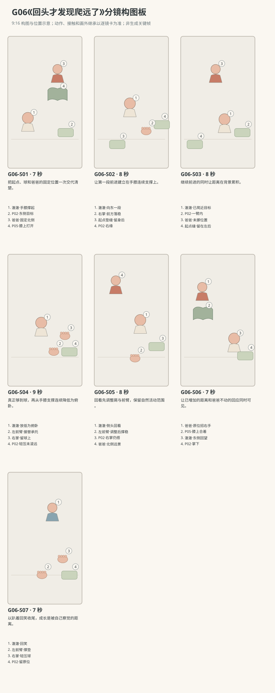

图示为构图位置示意；姿态、接触和画外继承以逐镜正文为准。

### 逐镜设计

#### G06-S01｜00—07 秒｜7 秒｜帧 [0, 168)

**镜头任务：**把起点、球和爸爸的固定位置一次交代清楚。

**景别、机位与构图：**中全景，南侧35厘米高向北；宝宝在画左下手膝撑起、头朝右，球在右下，爸爸在上方偏右，地垫两条缝清楚。

**摄影机与理由：**固定机位，让动作本身改变画面；不推拉遮盖接触。

**焦点：**焦点覆盖澈澈的眼睛、行动手与目标物；关键接触始终可辨。

**入态：**澈澈手掌和双膝落垫、腹部离地，面东看P02；爸爸北侧偏东坐地，P05摊膝，P02在东侧缝旁。

**动作与表演：**

- 3 秒：爸爸从布书抬眼看宝宝，手指停在书页边。

- 4 秒：宝宝盯住球，身体轻轻前后调重心，右手指在垫面张开，准备前移。

**声音：**无对白、无音乐；西窗外极轻鸟声作底，前景保留连体衣摩擦与婴儿呼吸，动作触碰同步发声。

**出态：**四处手膝接地，宝宝重心稍前，球和爸爸都未移动。

**切点与承接：**顺宝宝望球方向切南侧全身较近景，保留起点缝线。

**连续性：**手膝和骨盆位置全可见；P02不在成人手中，爸爸与书留原位。

**开始画面母稿：**

9:16竖幅，原创圆润三维生活动画，柔软棉布与自然皮肤质感，生活物理，无文字标语。澈澈深棕眼、短黑绒发、额前一撮向右弯，奶油色棉连体衣；身体按本条能力阶段呈现，表情与动作保留婴儿的专注和不熟练。 澈澈为R2能以手膝交替爬行的阶段；爸爸短黑发、砖陶衬衫、深灰长裤。 白天客厅西窗提供柔和漫射主光，暖墙反射补光；北墙固定沙发，东侧走廊，中央奶油地垫。 中全景，南侧35厘米高向北；宝宝在画左下手膝撑起、头朝右，球在右下，爸爸在上方偏右，地垫两条缝清楚。 单一开始瞬间：澈澈手掌和双膝落垫、腹部离地，面东看P02；爸爸北侧偏东坐地，P05摊膝，P02在东侧缝旁。 画面清楚呈现起态中已存在的支撑、视线与道具归属；不把后续动作叠画。

**视频变化母稿：**

9:16竖幅，原创圆润三维生活动画，柔软棉布与自然皮肤质感，生活物理，无文字标语。澈澈深棕眼、短黑绒发、额前一撮向右弯，奶油色棉连体衣；身体按本条能力阶段呈现，表情与动作保留婴儿的专注和不熟练。 澈澈为R2能以手膝交替爬行的阶段；爸爸短黑发、砖陶衬衫、深灰长裤。 白天客厅西窗提供柔和漫射主光，暖墙反射补光；北墙固定沙发，东侧走廊，中央奶油地垫。 本镜7秒，中全景，南侧35厘米高向北；宝宝在画左下手膝撑起、头朝右，球在右下，爸爸在上方偏右，地垫两条缝清楚。 起态：澈澈手掌和双膝落垫、腹部离地，面东看P02；爸爸北侧偏东坐地，P05摊膝，P02在东侧缝旁。 阶段1，持续3秒：爸爸从布书抬眼看宝宝，手指停在书页边。 阶段2，持续4秒：宝宝盯住球，身体轻轻前后调重心，右手指在垫面张开，准备前移。 摄影：固定机位，让动作本身改变画面；不推拉遮盖接触。 焦点：焦点覆盖澈澈的眼睛、行动手与目标物；关键接触始终可辨。 声音：无对白、无音乐；西窗外极轻鸟声作底，前景保留连体衣摩擦与婴儿呼吸，动作触碰同步发声。 终态：四处手膝接地，宝宝重心稍前，球和爸爸都未移动。 连续性：手膝和骨盆位置全可见；P02不在成人手中，爸爸与书留原位。

#### G06-S02｜07—15 秒｜8 秒｜帧 [168, 360)

**镜头任务：**让第一段前进建立在手膝连续支撑上。

**景别、机位与构图：**全身近景，南侧30厘米高平视略俯，宝宝横向头右脚左，起点垫缝在腹下，球只在右缘露出。

**摄影机与理由：**固定机位，让动作本身改变画面；不推拉遮盖接触。

**焦点：**全身及四处接地保持清楚，球可略虚但方位不能消失。

**入态：**宝宝四点撑地看东侧球，右手指已张开，腹部尚在起点缝上方。

**动作与表演：**

- 3 秒：重心留在落地手膝上，右掌向前移一小段并落稳，左膝再跟入身下。

- 3 秒：另一只手向前落稳，另一膝随后前移，躯干随支撑整体向东。

- 2 秒：宝宝停住，四处手膝重新承托，抬眼确认球的位置。

**声音：**无对白、无音乐；西窗外极轻鸟声作底，前景保留连体衣摩擦与婴儿呼吸，动作触碰同步发声。

**出态：**宝宝腹部已经越过起点缝，四点重新落稳，球距离缩短一小段。

**切点与承接：**停顿后切略宽镜，让爸爸与起点缝重新作参照。

**连续性：**每只手膝先落稳再换下一处；衣袖裤腿跟随肢体，不把脚当膝落地。

**开始画面母稿：**

9:16竖幅，原创圆润三维生活动画，柔软棉布与自然皮肤质感，生活物理，无文字标语。澈澈深棕眼、短黑绒发、额前一撮向右弯，奶油色棉连体衣；身体按本条能力阶段呈现，表情与动作保留婴儿的专注和不熟练。 澈澈为R2能以手膝交替爬行的阶段；爸爸短黑发、砖陶衬衫、深灰长裤。 白天客厅西窗提供柔和漫射主光，暖墙反射补光；北墙固定沙发，东侧走廊，中央奶油地垫。 全身近景，南侧30厘米高平视略俯，宝宝横向头右脚左，起点垫缝在腹下，球只在右缘露出。 单一开始瞬间：宝宝四点撑地看东侧球，右手指已张开，腹部尚在起点缝上方。 画面清楚呈现起态中已存在的支撑、视线与道具归属；不把后续动作叠画。

**视频变化母稿：**

9:16竖幅，原创圆润三维生活动画，柔软棉布与自然皮肤质感，生活物理，无文字标语。澈澈深棕眼、短黑绒发、额前一撮向右弯，奶油色棉连体衣；身体按本条能力阶段呈现，表情与动作保留婴儿的专注和不熟练。 澈澈为R2能以手膝交替爬行的阶段；爸爸短黑发、砖陶衬衫、深灰长裤。 白天客厅西窗提供柔和漫射主光，暖墙反射补光；北墙固定沙发，东侧走廊，中央奶油地垫。 本镜8秒，全身近景，南侧30厘米高平视略俯，宝宝横向头右脚左，起点垫缝在腹下，球只在右缘露出。 起态：宝宝四点撑地看东侧球，右手指已张开，腹部尚在起点缝上方。 阶段1，持续3秒：重心留在落地手膝上，右掌向前移一小段并落稳，左膝再跟入身下。 阶段2，持续3秒：另一只手向前落稳，另一膝随后前移，躯干随支撑整体向东。 阶段3，持续2秒：宝宝停住，四处手膝重新承托，抬眼确认球的位置。 摄影：固定机位，让动作本身改变画面；不推拉遮盖接触。 焦点：全身及四处接地保持清楚，球可略虚但方位不能消失。 声音：无对白、无音乐；西窗外极轻鸟声作底，前景保留连体衣摩擦与婴儿呼吸，动作触碰同步发声。 终态：宝宝腹部已经越过起点缝，四点重新落稳，球距离缩短一小段。 连续性：每只手膝先落稳再换下一处；衣袖裤腿跟随肢体，不把脚当膝落地。

#### G06-S03｜15—23 秒｜8 秒｜帧 [360, 552)

**镜头任务：**继续前进的同时让距离在背景累积。

**景别、机位与构图：**中全景，南侧35厘米高；宝宝头右脚左居中，爸爸仍在上方固定位置，球在右下，起点缝留画左。

**摄影机与理由：**固定较宽机位，通过宝宝相对垫缝与爸爸的位移交代爬远；不跟拍抹掉参照。

**焦点：**焦点覆盖澈澈的眼睛、行动手与目标物；关键接触始终可辨。

**入态：**宝宝停在越过第一条缝的位置，四点承托；爸爸膝上布书仍开着。

**动作与表演：**

- 2 秒：爸爸把P05轻轻合上放在膝上，目光保持宝宝。

- 4 秒：宝宝再做一组慢的移掌、落掌、跟膝，身体向东越过下一段地垫。

- 2 秒：他停在离球一臂以内，头抬高一点，爸爸原位显得更靠后。

**声音：**无对白、无音乐；西窗外极轻鸟声作底，前景保留连体衣摩擦与婴儿呼吸，动作触碰同步发声。

**出态：**球在宝宝右掌前方可够处，宝宝双膝与左掌稳稳落地，爸爸仍原位。

**切点与承接：**在宝宝看准球、尚未碰到时切较近全身，接触必须镜内发生。

**连续性：**相机固定，爸爸与沙发不漂移；两次停顿时手膝受力成立。

**开始画面母稿：**

9:16竖幅，原创圆润三维生活动画，柔软棉布与自然皮肤质感，生活物理，无文字标语。澈澈深棕眼、短黑绒发、额前一撮向右弯，奶油色棉连体衣；身体按本条能力阶段呈现，表情与动作保留婴儿的专注和不熟练。 澈澈为R2能以手膝交替爬行的阶段；爸爸短黑发、砖陶衬衫、深灰长裤。 白天客厅西窗提供柔和漫射主光，暖墙反射补光；北墙固定沙发，东侧走廊，中央奶油地垫。 中全景，南侧35厘米高；宝宝头右脚左居中，爸爸仍在上方固定位置，球在右下，起点缝留画左。 单一开始瞬间：宝宝停在越过第一条缝的位置，四点承托；爸爸膝上布书仍开着。 画面清楚呈现起态中已存在的支撑、视线与道具归属；不把后续动作叠画。

**视频变化母稿：**

9:16竖幅，原创圆润三维生活动画，柔软棉布与自然皮肤质感，生活物理，无文字标语。澈澈深棕眼、短黑绒发、额前一撮向右弯，奶油色棉连体衣；身体按本条能力阶段呈现，表情与动作保留婴儿的专注和不熟练。 澈澈为R2能以手膝交替爬行的阶段；爸爸短黑发、砖陶衬衫、深灰长裤。 白天客厅西窗提供柔和漫射主光，暖墙反射补光；北墙固定沙发，东侧走廊，中央奶油地垫。 本镜8秒，中全景，南侧35厘米高；宝宝头右脚左居中，爸爸仍在上方固定位置，球在右下，起点缝留画左。 起态：宝宝停在越过第一条缝的位置，四点承托；爸爸膝上布书仍开着。 阶段1，持续2秒：爸爸把P05轻轻合上放在膝上，目光保持宝宝。 阶段2，持续4秒：宝宝再做一组慢的移掌、落掌、跟膝，身体向东越过下一段地垫。 阶段3，持续2秒：他停在离球一臂以内，头抬高一点，爸爸原位显得更靠后。 摄影：固定较宽机位，通过宝宝相对垫缝与爸爸的位移交代爬远；不跟拍抹掉参照。 焦点：焦点覆盖澈澈的眼睛、行动手与目标物；关键接触始终可辨。 声音：无对白、无音乐；西窗外极轻鸟声作底，前景保留连体衣摩擦与婴儿呼吸，动作触碰同步发声。 终态：球在宝宝右掌前方可够处，宝宝双膝与左掌稳稳落地，爸爸仍原位。 连续性：相机固定，爸爸与沙发不漂移；两次停顿时手膝受力成立。

#### G06-S04｜23—32 秒｜9 秒｜帧 [552, 768)

**镜头任务：**真正够到球，再从手膝支撑连续降低为俯卧。

**景别、机位与构图：**全身中近景，南侧30厘米高略俯，头右、脚左、球最右，双膝和双掌都保留。

**摄影机与理由：**固定机位，让动作本身改变画面；不推拉遮盖接触。

**焦点：**焦点覆盖澈澈的眼睛、行动手与目标物；关键接触始终可辨。

**入态：**宝宝双膝与左掌稳落垫，右掌在身体右前方，球在右掌前一点。

**动作与表演：**

- 3 秒：宝宝保持左掌和双膝支撑，右掌前伸碰到球上侧，布球受轻压而没有被猛推。

- 3 秒：右掌留球，左肘缓缓弯下成为前臂承托，躯干降低，膝逐渐往后舒展。

- 3 秒：腹部与骨盆轻轻落垫，双腿伸松，右掌仍搭球，左前臂留头胸前。

**声音：**无对白无音乐；右掌压球的轻布响，左袖和腹部依次贴垫摩擦，宝宝落稳后呼出一口气。

**出态：**宝宝俯卧在球旁，右掌搭P02，左前臂和腹部骨盆接地，球仅轻扁原位。

**切点与承接：**下降完成后再切回看起态，不跳过从爬到趴的支撑转换。

**连续性：**球由右掌实际触压，左前臂接替左掌支撑；腹部落垫前不抽掉双膝。

**开始画面母稿：**

9:16竖幅，原创圆润三维生活动画，柔软棉布与自然皮肤质感，生活物理，无文字标语。澈澈深棕眼、短黑绒发、额前一撮向右弯，奶油色棉连体衣；身体按本条能力阶段呈现，表情与动作保留婴儿的专注和不熟练。 澈澈为R2能以手膝交替爬行的阶段；爸爸短黑发、砖陶衬衫、深灰长裤。 白天客厅西窗提供柔和漫射主光，暖墙反射补光；北墙固定沙发，东侧走廊，中央奶油地垫。 全身中近景，南侧30厘米高略俯，头右、脚左、球最右，双膝和双掌都保留。 单一开始瞬间：宝宝双膝与左掌稳落垫，右掌在身体右前方，球在右掌前一点。 画面清楚呈现起态中已存在的支撑、视线与道具归属；不把后续动作叠画。

**视频变化母稿：**

9:16竖幅，原创圆润三维生活动画，柔软棉布与自然皮肤质感，生活物理，无文字标语。澈澈深棕眼、短黑绒发、额前一撮向右弯，奶油色棉连体衣；身体按本条能力阶段呈现，表情与动作保留婴儿的专注和不熟练。 澈澈为R2能以手膝交替爬行的阶段；爸爸短黑发、砖陶衬衫、深灰长裤。 白天客厅西窗提供柔和漫射主光，暖墙反射补光；北墙固定沙发，东侧走廊，中央奶油地垫。 本镜9秒，全身中近景，南侧30厘米高略俯，头右、脚左、球最右，双膝和双掌都保留。 起态：宝宝双膝与左掌稳落垫，右掌在身体右前方，球在右掌前一点。 阶段1，持续3秒：宝宝保持左掌和双膝支撑，右掌前伸碰到球上侧，布球受轻压而没有被猛推。 阶段2，持续3秒：右掌留球，左肘缓缓弯下成为前臂承托，躯干降低，膝逐渐往后舒展。 阶段3，持续3秒：腹部与骨盆轻轻落垫，双腿伸松，右掌仍搭球，左前臂留头胸前。 摄影：固定机位，让动作本身改变画面；不推拉遮盖接触。 焦点：焦点覆盖澈澈的眼睛、行动手与目标物；关键接触始终可辨。 声音：无对白无音乐；右掌压球的轻布响，左袖和腹部依次贴垫摩擦，宝宝落稳后呼出一口气。 终态：宝宝俯卧在球旁，右掌搭P02，左前臂和腹部骨盆接地，球仅轻扁原位。 连续性：球由右掌实际触压，左前臂接替左掌支撑；腹部落垫前不抽掉双膝。

#### G06-S05｜32—40 秒｜8 秒｜帧 [768, 960)

**镜头任务：**回看先调整肩与前臂，保留自然活动范围。

**景别、机位与构图：**中近景，南偏西35厘米高斜俯，宝宝头在右中，左前臂下缘、右掌与球在右下；爸爸在北侧后景。

**摄影机与理由：**固定机位，让动作本身改变画面；不推拉遮盖接触。

**焦点：**焦点覆盖澈澈的眼睛、行动手与目标物；关键接触始终可辨。

**入态：**宝宝俯卧面东，右掌搭球、左前臂撑垫，爸爸在其北侧偏西方向。

**动作与表演：**

- 3 秒：宝宝左前臂向北略挪后重新落稳，上胸随之稍转向东北，骨盆仍贴垫。

- 3 秒：他从球上抬眼，再沿肩膀打开的方向侧转头看北侧爸爸，不扭到正后方。

- 2 秒：目光找到爸爸，嘴微张，右掌仍留在球上。

**声音：**无对白、无音乐；西窗外极轻鸟声作底，前景保留连体衣摩擦与婴儿呼吸，动作触碰同步发声。

**出态：**上胸略朝东北，宝宝侧脸看向爸爸，左前臂和腹部承托，右手仍搭球。

**切点与承接：**沿宝宝眼线切带完整距离的双人宽镜，让观众看到他发现了什么。

**连续性：**头先随肩调整再转动；右手没有离球撑向背后，腿仍舒展在垫上。

**开始画面母稿：**

9:16竖幅，原创圆润三维生活动画，柔软棉布与自然皮肤质感，生活物理，无文字标语。澈澈深棕眼、短黑绒发、额前一撮向右弯，奶油色棉连体衣；身体按本条能力阶段呈现，表情与动作保留婴儿的专注和不熟练。 澈澈为R2能以手膝交替爬行的阶段；爸爸短黑发、砖陶衬衫、深灰长裤。 白天客厅西窗提供柔和漫射主光，暖墙反射补光；北墙固定沙发，东侧走廊，中央奶油地垫。 中近景，南偏西35厘米高斜俯，宝宝头在右中，左前臂下缘、右掌与球在右下；爸爸在北侧后景。 单一开始瞬间：宝宝俯卧面东，右掌搭球、左前臂撑垫，爸爸在其北侧偏西方向。 画面清楚呈现起态中已存在的支撑、视线与道具归属；不把后续动作叠画。

**视频变化母稿：**

9:16竖幅，原创圆润三维生活动画，柔软棉布与自然皮肤质感，生活物理，无文字标语。澈澈深棕眼、短黑绒发、额前一撮向右弯，奶油色棉连体衣；身体按本条能力阶段呈现，表情与动作保留婴儿的专注和不熟练。 澈澈为R2能以手膝交替爬行的阶段；爸爸短黑发、砖陶衬衫、深灰长裤。 白天客厅西窗提供柔和漫射主光，暖墙反射补光；北墙固定沙发，东侧走廊，中央奶油地垫。 本镜8秒，中近景，南偏西35厘米高斜俯，宝宝头在右中，左前臂下缘、右掌与球在右下；爸爸在北侧后景。 起态：宝宝俯卧面东，右掌搭球、左前臂撑垫，爸爸在其北侧偏西方向。 阶段1，持续3秒：宝宝左前臂向北略挪后重新落稳，上胸随之稍转向东北，骨盆仍贴垫。 阶段2，持续3秒：他从球上抬眼，再沿肩膀打开的方向侧转头看北侧爸爸，不扭到正后方。 阶段3，持续2秒：目光找到爸爸，嘴微张，右掌仍留在球上。 摄影：固定机位，让动作本身改变画面；不推拉遮盖接触。 焦点：焦点覆盖澈澈的眼睛、行动手与目标物；关键接触始终可辨。 声音：无对白、无音乐；西窗外极轻鸟声作底，前景保留连体衣摩擦与婴儿呼吸，动作触碰同步发声。 终态：上胸略朝东北，宝宝侧脸看向爸爸，左前臂和腹部承托，右手仍搭球。 连续性：头先随肩调整再转动；右手没有离球撑向背后，腿仍舒展在垫上。

#### G06-S06｜40—47 秒｜7 秒｜帧 [960, 1128)

**镜头任务：**让已增加的距离和爸爸不动的回应同时可见。

**景别、机位与构图：**中全景，南侧35厘米高向北，宝宝和球在右下，爸爸在左上，两者之间留清楚的空地垫与缝线。

**摄影机与理由：**固定机位，让动作本身改变画面；不推拉遮盖接触。

**焦点：**焦点覆盖澈澈的眼睛、行动手与目标物；关键接触始终可辨。

**入态：**宝宝趴在东侧看爸爸，爸爸仍在最初坐地位置，P05合在膝上。

**动作与表演：**

- 2 秒：宝宝目光从爸爸移到两人之间空出的地垫，停一下。

- 3 秒：爸爸举空右手轻轻招一招，左手压住膝上布书，身体不向宝宝挪。

- 2 秒：宝宝目光回到爸爸脸上，眼睛慢慢眯起。

**声音：**无对白、无音乐；西窗外极轻鸟声作底，前景保留连体衣摩擦与婴儿呼吸，动作触碰同步发声。

**出态：**爸爸右手停在一次招手后，宝宝准备笑，距离与起点缝保持可见。

**切点与承接：**切侧脸近景延续笑的形成，右手搭球的状态需同框保留。

**连续性：**爸爸从未追近宝宝；宝宝没有爬回，球仍在东侧同一位置。

**开始画面母稿：**

9:16竖幅，原创圆润三维生活动画，柔软棉布与自然皮肤质感，生活物理，无文字标语。澈澈深棕眼、短黑绒发、额前一撮向右弯，奶油色棉连体衣；身体按本条能力阶段呈现，表情与动作保留婴儿的专注和不熟练。 澈澈为R2能以手膝交替爬行的阶段；爸爸短黑发、砖陶衬衫、深灰长裤。 白天客厅西窗提供柔和漫射主光，暖墙反射补光；北墙固定沙发，东侧走廊，中央奶油地垫。 中全景，南侧35厘米高向北，宝宝和球在右下，爸爸在左上，两者之间留清楚的空地垫与缝线。 单一开始瞬间：宝宝趴在东侧看爸爸，爸爸仍在最初坐地位置，P05合在膝上。 画面清楚呈现起态中已存在的支撑、视线与道具归属；不把后续动作叠画。

**视频变化母稿：**

9:16竖幅，原创圆润三维生活动画，柔软棉布与自然皮肤质感，生活物理，无文字标语。澈澈深棕眼、短黑绒发、额前一撮向右弯，奶油色棉连体衣；身体按本条能力阶段呈现，表情与动作保留婴儿的专注和不熟练。 澈澈为R2能以手膝交替爬行的阶段；爸爸短黑发、砖陶衬衫、深灰长裤。 白天客厅西窗提供柔和漫射主光，暖墙反射补光；北墙固定沙发，东侧走廊，中央奶油地垫。 本镜7秒，中全景，南侧35厘米高向北，宝宝和球在右下，爸爸在左上，两者之间留清楚的空地垫与缝线。 起态：宝宝趴在东侧看爸爸，爸爸仍在最初坐地位置，P05合在膝上。 阶段1，持续2秒：宝宝目光从爸爸移到两人之间空出的地垫，停一下。 阶段2，持续3秒：爸爸举空右手轻轻招一招，左手压住膝上布书，身体不向宝宝挪。 阶段3，持续2秒：宝宝目光回到爸爸脸上，眼睛慢慢眯起。 摄影：固定机位，让动作本身改变画面；不推拉遮盖接触。 焦点：焦点覆盖澈澈的眼睛、行动手与目标物；关键接触始终可辨。 声音：无对白、无音乐；西窗外极轻鸟声作底，前景保留连体衣摩擦与婴儿呼吸，动作触碰同步发声。 终态：爸爸右手停在一次招手后，宝宝准备笑，距离与起点缝保持可见。 连续性：爸爸从未追近宝宝；宝宝没有爬回，球仍在东侧同一位置。

#### G06-S07｜47—54 秒｜7 秒｜帧 [1128, 1296)

**镜头任务：**以趴着回笑收尾，成长是被自己察觉的距离。

**景别、机位与构图：**中近景，南偏西35厘米高，宝宝侧脸右上，右掌与球右下，左前臂和腹部留画，爸爸仅在左上柔虚。

**摄影机与理由：**固定机位，让动作本身改变画面；不推拉遮盖接触。

**焦点：**焦点覆盖澈澈的眼睛、行动手与目标物；关键接触始终可辨。

**入态：**宝宝侧头看爸爸，眼睛已微眯，右掌搭球，左前臂撑垫。

**动作与表演：**

- 3 秒：宝宝嘴角张开，发一声很轻的笑，肩膀随呼吸小动。

- 2 秒：右手指轻压球一下，球略凹，没有另一次投掷。

- 2 秒：宝宝继续看爸爸，爸爸的招手落回膝旁，画面安静停住。

**声音：**无对白、无音乐；西窗外极轻鸟声作底，前景保留连体衣摩擦与婴儿呼吸，动作触碰同步发声。

**出态：**宝宝保持俯卧回笑，右手仍在球上，爸爸仍在原处。

**切点与承接：**呼吸与笑声自然落下后结束，不加爬返程或成长字幕。

**连续性：**前臂、腹部支撑持续；球不离手、不换色，肩颈不再加大回转。

**开始画面母稿：**

9:16竖幅，原创圆润三维生活动画，柔软棉布与自然皮肤质感，生活物理，无文字标语。澈澈深棕眼、短黑绒发、额前一撮向右弯，奶油色棉连体衣；身体按本条能力阶段呈现，表情与动作保留婴儿的专注和不熟练。 澈澈为R2能以手膝交替爬行的阶段；爸爸短黑发、砖陶衬衫、深灰长裤。 白天客厅西窗提供柔和漫射主光，暖墙反射补光；北墙固定沙发，东侧走廊，中央奶油地垫。 中近景，南偏西35厘米高，宝宝侧脸右上，右掌与球右下，左前臂和腹部留画，爸爸仅在左上柔虚。 单一开始瞬间：宝宝侧头看爸爸，眼睛已微眯，右掌搭球，左前臂撑垫。 画面清楚呈现起态中已存在的支撑、视线与道具归属；不把后续动作叠画。

**视频变化母稿：**

9:16竖幅，原创圆润三维生活动画，柔软棉布与自然皮肤质感，生活物理，无文字标语。澈澈深棕眼、短黑绒发、额前一撮向右弯，奶油色棉连体衣；身体按本条能力阶段呈现，表情与动作保留婴儿的专注和不熟练。 澈澈为R2能以手膝交替爬行的阶段；爸爸短黑发、砖陶衬衫、深灰长裤。 白天客厅西窗提供柔和漫射主光，暖墙反射补光；北墙固定沙发，东侧走廊，中央奶油地垫。 本镜7秒，中近景，南偏西35厘米高，宝宝侧脸右上，右掌与球右下，左前臂和腹部留画，爸爸仅在左上柔虚。 起态：宝宝侧头看爸爸，眼睛已微眯，右掌搭球，左前臂撑垫。 阶段1，持续3秒：宝宝嘴角张开，发一声很轻的笑，肩膀随呼吸小动。 阶段2，持续2秒：右手指轻压球一下，球略凹，没有另一次投掷。 阶段3，持续2秒：宝宝继续看爸爸，爸爸的招手落回膝旁，画面安静停住。 摄影：固定机位，让动作本身改变画面；不推拉遮盖接触。 焦点：焦点覆盖澈澈的眼睛、行动手与目标物；关键接触始终可辨。 声音：无对白、无音乐；西窗外极轻鸟声作底，前景保留连体衣摩擦与婴儿呼吸，动作触碰同步发声。 终态：宝宝保持俯卧回笑，右手仍在球上，爸爸仍在原处。 连续性：前臂、腹部支撑持续；球不离手、不换色，肩颈不再加大回转。

### 声音与剪辑

掌根、膝部依受力顺序轻触地垫，爬行时棉衣摩擦，爸爸合布书一声轻响；结尾宝宝轻笑但不配成人评价或励志音乐。

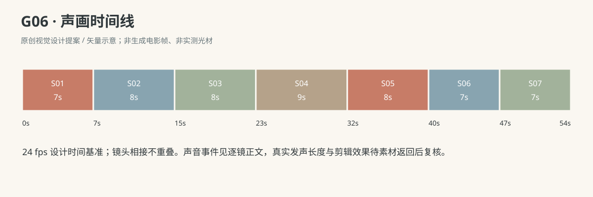

正式台词：无；保留镜头声音中已写明的自然发声。

### 连续性与试片

- 连续性：P02在东侧缝线旁保持原位，直到S04右掌碰到才受轻压；爸爸不得移球缩短距离。

- 连续性：宝宝自西向东，所有机位在南侧，垫缝与固定爸爸位置是距离参照，不随相机平移重置。

- 连续性：S04结束腹部已放低，S05先调整前臂和肩再回看，不做颈部180度旋转。

- 连续性：S07宝宝右掌搭球，左前臂与腹部承托；爸爸原位招的是右手，P05合在膝上。

- 试片：G06-S02到S04：每次移手移膝前后仍有落地支撑，身体确实相对缝线东移；原地滑步或肢体数量变化则失败。

- 试片：G06-S03及S06远景核对：爸爸与地垫边缘不动，中间距离增加；背景跟随宝宝平移造成假距离则失败。

- 试片：G06-S05到S07：回看由前臂/肩调整后完成，右掌不离球，左前臂和腹部承托可辨；脖颈过转、球自动滚走或身体悬空则失败。

**媒体待验证：**尚无媒体；待验证手膝交替、膝部衣褶、爬后降低腹部及回看时肩颈活动范围，先做全身低清动作预演。

---

## G07《你也拿一下》

**36 秒｜坐姿与手部互动｜角色：澈澈、爸爸｜场景 L**

### 剧情正文

澈澈坐在地垫上，右手抓着熟悉的珊瑚软布环，爸爸在旁边翻布书。澈澈先摸摸环边，忽然看向爸爸，把握环的右手伸过去。爸爸停住翻页，抬眼看他，再把空左掌摊在环下面。环的下缘碰到掌心，澈澈还握了一会儿，像在确认这个新地方，随后手指慢慢张开。软环留在爸爸掌上。他看看自己的空手，又盯住那只大手里的环。爸爸没有立即摇给他看，也没有放进玩具盒，只安静托着。澈澈张开右掌，朝爸爸伸去。爸爸用左手轻握环的一侧，把另一边送到那只小掌前。澈澈捏住布边，握牢，爸爸才松开。环回到右手，澈澈把它收在胸前，却仍看着爸爸。爸爸也没有再翻书，两人留在刚才那次小小的来回里。

### 亲述来源与改编

原帖是家长自述，未独立核实。本片将生活机制改编为澈澈的原创故事。

- [RT03 · 抱着包裹走来，却只是假递一下](https://yubingbing.wordpress.com/2008/01/08/%E7%8E%A9%E7%8E%A9%E6%9D%82%E4%BA%8B-2/)；作者自报年龄：同篇作者明确称孩子15个月，第一件事未单独标龄。

- **采用的生活过程：**仅迁移“把手中物送到成人面前，使观众等待交接结果”的动作结构。

- **本片原创改编：**RT03原文是会行走幼儿抱包裹假递后收回；本条保持原有稳定坐姿和软环，改为澈澈主动递给爸爸、爸爸确实接住再递回。

- **本片原创改编：**爸爸翻布书、两次先抓稳后松手、空掌邀请与安静对视均为原创澈澈剧情。

- **不作出的事实推断：**不称本条为RT03原家庭经过复现；原文没有真正交出包裹的结局。

- **不作出的事实推断：**家长公开亲述没有独立核实；本片不据此证明特定月龄必然会递物，也不与其他家庭拼作同一真实事件。

[查看原始过程与缺项](research/real-experiences/index.html#RT03)

### 导演与空间

**观察任务：**保留“递到成人面前”时观众对交接的期待，改写为宝宝主动真实递物：爸爸左掌已承托后才松手，再以空掌邀请拿回；与抱回物件的假递片段形成可见差别。

**空间与光位：**澈澈面南稳坐中央垫，爸爸东侧偏南坐地，两者距一个宝宝前臂可及。P01最初在宝宝右手，爸爸左掌作为接物掌；P05摊开在爸爸膝上，开场左指翻页，注意转向宝宝后停翻；爸爸右手与膝持续承托，不合书。机位南侧，宝宝画左、爸爸画右，交接区居中，不越两人视线轴。

**人物表演：**宝宝递物动作可犹豫，但不做成人式送礼仪式；手腕将环送向看得见的掌心。爸爸从翻书中停下，先摊左掌接，再等空掌邀请，返回时由宝宝抓稳才释放。

### 节拍覆盖

- **G07-b1**：前态：宝宝右手持P01，左手空搭腿上；爸爸右手扶P05、左指翻页，双方身体稳定落地。 过程：宝宝低头摸环边，爸爸翻到一半停在书页上。宝宝抬眼看爸爸，把右手里的环朝两人中间伸一点，目光跟到爸爸脸上。 后态：握环右手已经伸向爸爸，爸爸看见动作，P05仍在膝上。 观众观察：建立各自活动，再让宝宝主动改变互动。 → G07-S01

- **G07-b2**：前态：宝宝右手握P01伸在两人中间，爸爸左掌尚在书页上，右手稳住书。 过程：爸爸左手离开书页，掌心向上送到环下方，停稳。宝宝看掌心，将环下缘慢慢落到爸爸左掌。环已经受爸爸掌心承托，宝宝右指仍握着上侧边缘。 后态：环下缘在爸爸左掌，宝宝右指未松，两人短暂共同持有。 观众观察：让爸爸的左掌成为明确目标，宝宝递到而非扔去。 → G07-S02

- **G07-b3**：前态：P01下缘坐在爸爸左掌，宝宝右指握环上缘，视线画外指向交接点。 过程：宝宝右指逐一舒展，仍有指腹轻触布边。右手离开环，空掌收回胸前，爸爸左掌维持平托。爸爸左指略弯稳住环防止滑走，没有抬高或摇晃。 后态：P01仅在爸爸左掌，宝宝右掌已经空着并收在胸前，双方手完全分离。 观众观察：主动松开成立，物件留在别人手里。 → G07-S03

- **G07-b4**：前态：宝宝空右掌收在胸前，爸爸左掌托环停在中间，没有主动递回。 过程：宝宝先看空右掌，再看爸爸掌心的环。右掌慢慢张开朝爸爸伸去，眼睛看爸爸。爸爸看懂空掌，左指轻握环一侧，把空出的布边转向宝宝，但尚未送近。 后态：宝宝空右掌伸着，爸爸左手握环一侧、另一侧朝宝宝。 观众观察：宝宝先发现自己空手，再以空掌邀请递回。 → G07-S04

- **G07-b5**：前态：宝宝空右掌伸着，爸爸左手握P01一侧，环自由边缘离小掌尚有少许距离。 过程：爸爸左手把自由边缘慢慢送到宝宝右指腹。宝宝右指和拇指合拢，握住软环，双手短暂共同持有。爸爸左指张开退出，宝宝右手独持，手腕随重量轻沉。 后态：P01回到宝宝右手，爸爸左掌已空，双方分离。 观众观察：第二次交接同样要先抓稳、后松成人手。 → G07-S05

- **G07-b6**：前态：宝宝右手独持P01在两人中间，爸爸左掌空着，目光看宝宝。 过程：宝宝把握环右手收回胸前，左掌仍搭腿。他看看环，再抬眼看爸爸；爸爸空左手放回膝旁却没再翻书。两人安静对视，宝宝指腹轻捏布边，爸爸微笑。 后态：宝宝持环，爸爸书未继续，两人保持共同注意。 观众观察：来回后的关系变化是两人继续相看。 → G07-S06

### 分镜构图板

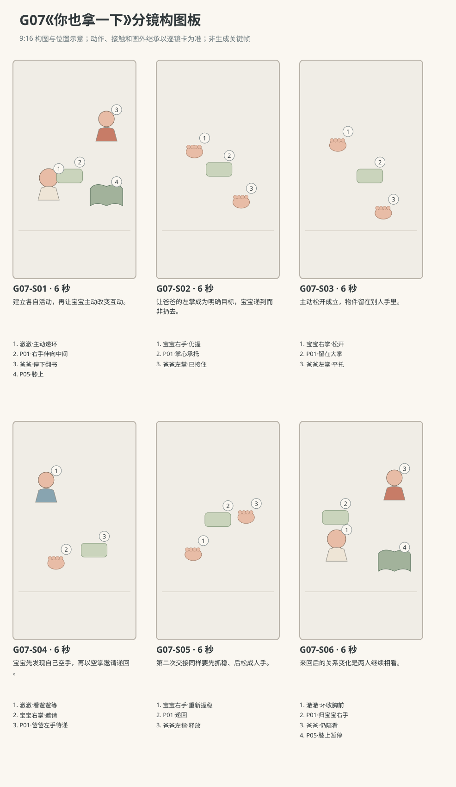

图示为构图位置示意；姿态、接触和画外继承以逐镜正文为准。

### 逐镜设计

#### G07-S01｜00—06 秒｜6 秒｜帧 [0, 144)

**镜头任务：**建立各自活动，再让宝宝主动改变互动。

**景别、机位与构图：**双人中景，南侧30厘米，宝宝画左稳坐，爸爸画右膝上翻P05，软环在宝宝右手靠画左胸前。

**摄影机与理由：**固定机位，让动作本身改变画面；不推拉遮盖接触。

**焦点：**焦点覆盖宝宝右手握点、软环和爸爸左指，交接平面保持清楚；两人眼睛在画外，目光向交接点的方向继承，不称此近景直接看见眼神。

**入态：**宝宝右手持P01，左手空搭腿上；爸爸右手扶P05、左指翻页，双方身体稳定落地。

**动作与表演：**

- 2 秒：宝宝低头摸环边，爸爸翻到一半停在书页上。

- 4 秒：宝宝抬眼看爸爸，把右手里的环朝两人中间伸一点，目光跟到爸爸脸上。

**声音：**无对白、无音乐；西窗外极轻鸟声作底，前景保留连体衣摩擦与婴儿呼吸，动作触碰同步发声。

**出态：**握环右手已经伸向爸爸，爸爸看见动作，P05仍在膝上。

**切点与承接：**切到双手交接区域，先给爸爸空掌进入再发生接触。

**连续性：**P01仍只归宝宝右手；爸爸左手离书前书由右手与膝承托。

**开始画面母稿：**

9:16竖幅，原创圆润三维生活动画，柔软棉布与自然皮肤质感，生活物理，无文字标语。澈澈深棕眼、短黑绒发、额前一撮向右弯，奶油色棉连体衣；身体按本条能力阶段呈现，表情与动作保留婴儿的专注和不熟练。 澈澈为R1稳定坐姿、能抓握和主动松手阶段；爸爸砖陶衬衫、深灰长裤、短黑发。 白天客厅西窗提供柔和漫射主光，暖墙反射补光；北墙固定沙发，东侧走廊，中央奶油地垫。 双人中景，南侧30厘米，宝宝画左稳坐，爸爸画右膝上翻P05，软环在宝宝右手靠画左胸前。 单一开始瞬间：宝宝右手持P01，左手空搭腿上；爸爸右手扶P05、左指翻页，双方身体稳定落地。 画面清楚呈现起态中已存在的支撑、视线与道具归属；不把后续动作叠画。

**视频变化母稿：**

9:16竖幅，原创圆润三维生活动画，柔软棉布与自然皮肤质感，生活物理，无文字标语。澈澈深棕眼、短黑绒发、额前一撮向右弯，奶油色棉连体衣；身体按本条能力阶段呈现，表情与动作保留婴儿的专注和不熟练。 澈澈为R1稳定坐姿、能抓握和主动松手阶段；爸爸砖陶衬衫、深灰长裤、短黑发。 白天客厅西窗提供柔和漫射主光，暖墙反射补光；北墙固定沙发，东侧走廊，中央奶油地垫。 本镜6秒，双人中景，南侧30厘米，宝宝画左稳坐，爸爸画右膝上翻P05，软环在宝宝右手靠画左胸前。 起态：宝宝右手持P01，左手空搭腿上；爸爸右手扶P05、左指翻页，双方身体稳定落地。 阶段1，持续2秒：宝宝低头摸环边，爸爸翻到一半停在书页上。 阶段2，持续4秒：宝宝抬眼看爸爸，把右手里的环朝两人中间伸一点，目光跟到爸爸脸上。 摄影：固定机位，让动作本身改变画面；不推拉遮盖接触。 焦点：焦点覆盖宝宝右手握点、软环和爸爸左指，交接平面保持清楚；两人眼睛在画外，目光向交接点的方向继承，不称此近景直接看见眼神。 声音：无对白、无音乐；西窗外极轻鸟声作底，前景保留连体衣摩擦与婴儿呼吸，动作触碰同步发声。 终态：握环右手已经伸向爸爸，爸爸看见动作，P05仍在膝上。 连续性：P01仍只归宝宝右手；爸爸左手离书前书由右手与膝承托。 硬锁：软环只有一只，所有交接均先由对方承托或握稳、再释放；按本镜列出的归属承接，不演成递到一半又收回。

#### G07-S02｜06—12 秒｜6 秒｜帧 [144, 288)

**镜头任务：**让爸爸的左掌成为明确目标，宝宝递到而非扔去。

**景别、机位与构图：**手与上身中近景，南侧35厘米，宝宝右手自左至中，爸爸左掌从右下伸入，环在两者之间。

**摄影机与理由：**固定机位，让动作本身改变画面；不推拉遮盖接触。

**焦点：**焦点覆盖宝宝右手握点、软环和爸爸左指，交接平面保持清楚；两人眼睛在画外，目光向交接点的方向继承，不称此近景直接看见眼神。

**入态：**宝宝右手握P01伸在两人中间，爸爸左掌尚在书页上，右手稳住书。

**动作与表演：**

- 2 秒：爸爸左手离开书页，掌心向上送到环下方，停稳。

- 2 秒：宝宝看掌心，将环下缘慢慢落到爸爸左掌。

- 2 秒：环已经受爸爸掌心承托，宝宝右指仍握着上侧边缘。

**声音：**无对白、无音乐；西窗外极轻鸟声作底，前景保留连体衣摩擦与婴儿呼吸，动作触碰同步发声。

**出态：**环下缘在爸爸左掌，宝宝右指未松，两人短暂共同持有。

**切点与承接：**在共同持有状态切更近，接下来释放必须实际可见。

**连续性：**爸爸左掌先出现再接触；宝宝没有把环甩出，身体不过度前探。

**开始画面母稿：**

9:16竖幅，原创圆润三维生活动画，柔软棉布与自然皮肤质感，生活物理，无文字标语。澈澈深棕眼、短黑绒发、额前一撮向右弯，奶油色棉连体衣；身体按本条能力阶段呈现，表情与动作保留婴儿的专注和不熟练。 澈澈为R1稳定坐姿、能抓握和主动松手阶段；爸爸砖陶衬衫、深灰长裤、短黑发。 白天客厅西窗提供柔和漫射主光，暖墙反射补光；北墙固定沙发，东侧走廊，中央奶油地垫。 手与上身中近景，南侧35厘米；宝宝右手持环伸到两人中间，爸爸左手仍在右下书页上，右手稳住膝上的布书。 单一开始瞬间：宝宝右手握P01伸在两人中间，爸爸左掌尚在书页上，右手稳住书。 本图焦点固定在：宝宝当前握环处、爸爸仍在书页上的左手与右手稳书处。 仅呈现这一瞬间的身体支撑、视线与物件归属，不把未来阶段或相机路径叠画。

**视频变化母稿：**

9:16竖幅，原创圆润三维生活动画，柔软棉布与自然皮肤质感，生活物理，无文字标语。澈澈深棕眼、短黑绒发、额前一撮向右弯，奶油色棉连体衣；身体按本条能力阶段呈现，表情与动作保留婴儿的专注和不熟练。 澈澈为R1稳定坐姿、能抓握和主动松手阶段；爸爸砖陶衬衫、深灰长裤、短黑发。 白天客厅西窗提供柔和漫射主光，暖墙反射补光；北墙固定沙发，东侧走廊，中央奶油地垫。 本镜6秒，手与上身中近景，南侧35厘米，宝宝右手自左至中，爸爸左掌从右下伸入，环在两者之间。 起态：宝宝右手握P01伸在两人中间，爸爸左掌尚在书页上，右手稳住书。 阶段1，持续2秒：爸爸左手离开书页，掌心向上送到环下方，停稳。 阶段2，持续2秒：宝宝看掌心，将环下缘慢慢落到爸爸左掌。 阶段3，持续2秒：环已经受爸爸掌心承托，宝宝右指仍握着上侧边缘。 摄影：固定机位，让动作本身改变画面；不推拉遮盖接触。 焦点：焦点覆盖宝宝右手握点、软环和爸爸左指，交接平面保持清楚；两人眼睛在画外，目光向交接点的方向继承，不称此近景直接看见眼神。 声音：无对白、无音乐；西窗外极轻鸟声作底，前景保留连体衣摩擦与婴儿呼吸，动作触碰同步发声。 终态：环下缘在爸爸左掌，宝宝右指未松，两人短暂共同持有。 连续性：爸爸左掌先出现再接触；宝宝没有把环甩出，身体不过度前探。 硬锁：软环只有一只，所有交接均先由对方承托或握稳、再释放；按本镜列出的归属承接，不演成递到一半又收回。

#### G07-S03｜12—18 秒｜6 秒｜帧 [288, 432)

**镜头任务：**主动松开成立，物件留在别人手里。

**景别、机位与构图：**双手特写，南侧斜俯；爸爸左掌平托环在右下，宝宝右指握上缘在左上，两腕连接留画。

**摄影机与理由：**固定机位，让动作本身改变画面；不推拉遮盖接触。

**焦点：**宝宝释放的指尖、环与成人掌心三层都清楚。

**入态：**P01下缘坐在爸爸左掌，宝宝右指握环上缘，视线画外指向交接点。

**动作与表演：**

- 2 秒：宝宝右指逐一舒展，仍有指腹轻触布边。

- 2 秒：右手离开环，空掌收回胸前，爸爸左掌维持平托。

- 2 秒：爸爸左指略弯稳住环防止滑走，没有抬高或摇晃。

**声音：**无对白、无音乐；西窗外极轻鸟声作底，前景保留连体衣摩擦与婴儿呼吸，动作触碰同步发声。

**出态：**P01仅在爸爸左掌，宝宝右掌已经空着并收在胸前，双方手完全分离。

**切点与承接：**环归属明确后切宝宝脸和空掌，让他检查变化。

**连续性：**环只有一个；爸爸左掌从下承托，不是隔空吸走；宝宝右手未从画外换环。

**开始画面母稿：**

9:16竖幅，原创圆润三维生活动画，柔软棉布与自然皮肤质感，生活物理，无文字标语。澈澈深棕眼、短黑绒发、额前一撮向右弯，奶油色棉连体衣；身体按本条能力阶段呈现，表情与动作保留婴儿的专注和不熟练。 澈澈为R1稳定坐姿、能抓握和主动松手阶段；爸爸砖陶衬衫、深灰长裤、短黑发。 白天客厅西窗提供柔和漫射主光，暖墙反射补光；北墙固定沙发，东侧走廊，中央奶油地垫。 双手特写，南侧斜俯；爸爸左掌平托环在右下，宝宝右指握上缘在左上，两腕连接留画。 单一开始瞬间：P01下缘坐在爸爸左掌，宝宝右指握环上缘，视线画外指向交接点。 画面清楚呈现起态中已存在的支撑、视线与道具归属；不把后续动作叠画。

**视频变化母稿：**

9:16竖幅，原创圆润三维生活动画，柔软棉布与自然皮肤质感，生活物理，无文字标语。澈澈深棕眼、短黑绒发、额前一撮向右弯，奶油色棉连体衣；身体按本条能力阶段呈现，表情与动作保留婴儿的专注和不熟练。 澈澈为R1稳定坐姿、能抓握和主动松手阶段；爸爸砖陶衬衫、深灰长裤、短黑发。 白天客厅西窗提供柔和漫射主光，暖墙反射补光；北墙固定沙发，东侧走廊，中央奶油地垫。 本镜6秒，双手特写，南侧斜俯；爸爸左掌平托环在右下，宝宝右指握上缘在左上，两腕连接留画。 起态：P01下缘坐在爸爸左掌，宝宝右指握环上缘，视线画外指向交接点。 阶段1，持续2秒：宝宝右指逐一舒展，仍有指腹轻触布边。 阶段2，持续2秒：右手离开环，空掌收回胸前，爸爸左掌维持平托。 阶段3，持续2秒：爸爸左指略弯稳住环防止滑走，没有抬高或摇晃。 摄影：固定机位，让动作本身改变画面；不推拉遮盖接触。 焦点：宝宝释放的指尖、环与成人掌心三层都清楚。 声音：无对白、无音乐；西窗外极轻鸟声作底，前景保留连体衣摩擦与婴儿呼吸，动作触碰同步发声。 终态：P01仅在爸爸左掌，宝宝右掌已经空着并收在胸前，双方手完全分离。 连续性：环只有一个；爸爸左掌从下承托，不是隔空吸走；宝宝右手未从画外换环。 硬锁：软环只有一只，所有交接均先由对方承托或握稳、再释放；按本镜列出的归属承接，不演成递到一半又收回。

#### G07-S04｜18—24 秒｜6 秒｜帧 [432, 576)

**镜头任务：**宝宝先发现自己空手，再以空掌邀请递回。

**景别、机位与构图：**脸与双掌中近景，南侧35厘米；宝宝脸左上、空右掌左下、爸爸持环左掌在右下，爸爸脸画外。

**摄影机与理由：**固定机位，让动作本身改变画面；不推拉遮盖接触。

**焦点：**焦点覆盖宝宝右手握点、软环和爸爸左指，交接平面保持清楚；两人眼睛在画外，目光向交接点的方向继承，不称此近景直接看见眼神。

**入态：**宝宝空右掌收在胸前，爸爸左掌托环停在中间，没有主动递回。

**动作与表演：**

- 2 秒：宝宝先看空右掌，再看爸爸掌心的环。

- 2 秒：右掌慢慢张开朝爸爸伸去，眼睛看爸爸。

- 2 秒：爸爸看懂空掌，左指轻握环一侧，把空出的布边转向宝宝，但尚未送近。

**声音：**无对白、无音乐；西窗外极轻鸟声作底，前景保留连体衣摩擦与婴儿呼吸，动作触碰同步发声。

**出态：**宝宝空右掌伸着，爸爸左手握环一侧、另一侧朝宝宝。

**切点与承接：**沿邀请与回应切实际返还动作，不能提前让环回宝宝手里。

**连续性：**返还由宝宝伸空掌触发；P01始终在爸爸左手，P05画外仍膝上。

**开始画面母稿：**

9:16竖幅，原创圆润三维生活动画，柔软棉布与自然皮肤质感，生活物理，无文字标语。澈澈深棕眼、短黑绒发、额前一撮向右弯，奶油色棉连体衣；身体按本条能力阶段呈现，表情与动作保留婴儿的专注和不熟练。 澈澈为R1稳定坐姿、能抓握和主动松手阶段；爸爸砖陶衬衫、深灰长裤、短黑发。 白天客厅西窗提供柔和漫射主光，暖墙反射补光；北墙固定沙发，东侧走廊，中央奶油地垫。 脸与双掌中近景，南侧35厘米；宝宝脸左上、空右掌左下、爸爸持环左掌在右下，爸爸脸画外。 单一开始瞬间：宝宝空右掌收在胸前，爸爸左掌托环停在中间，没有主动递回。 画面清楚呈现起态中已存在的支撑、视线与道具归属；不把后续动作叠画。

**视频变化母稿：**

9:16竖幅，原创圆润三维生活动画，柔软棉布与自然皮肤质感，生活物理，无文字标语。澈澈深棕眼、短黑绒发、额前一撮向右弯，奶油色棉连体衣；身体按本条能力阶段呈现，表情与动作保留婴儿的专注和不熟练。 澈澈为R1稳定坐姿、能抓握和主动松手阶段；爸爸砖陶衬衫、深灰长裤、短黑发。 白天客厅西窗提供柔和漫射主光，暖墙反射补光；北墙固定沙发，东侧走廊，中央奶油地垫。 本镜6秒，脸与双掌中近景，南侧35厘米；宝宝脸左上、空右掌左下、爸爸持环左掌在右下，爸爸脸画外。 起态：宝宝空右掌收在胸前，爸爸左掌托环停在中间，没有主动递回。 阶段1，持续2秒：宝宝先看空右掌，再看爸爸掌心的环。 阶段2，持续2秒：右掌慢慢张开朝爸爸伸去，眼睛看爸爸。 阶段3，持续2秒：爸爸看懂空掌，左指轻握环一侧，把空出的布边转向宝宝，但尚未送近。 摄影：固定机位，让动作本身改变画面；不推拉遮盖接触。 焦点：焦点覆盖宝宝右手握点、软环和爸爸左指，交接平面保持清楚；两人眼睛在画外，目光向交接点的方向继承，不称此近景直接看见眼神。 声音：无对白、无音乐；西窗外极轻鸟声作底，前景保留连体衣摩擦与婴儿呼吸，动作触碰同步发声。 终态：宝宝空右掌伸着，爸爸左手握环一侧、另一侧朝宝宝。 连续性：返还由宝宝伸空掌触发；P01始终在爸爸左手，P05画外仍膝上。 硬锁：软环只有一只，所有交接均先由对方承托或握稳、再释放；按本镜列出的归属承接，不演成递到一半又收回。

#### G07-S05｜24—30 秒｜6 秒｜帧 [576, 720)

**镜头任务：**第二次交接同样要先抓稳、后松成人手。

**景别、机位与构图：**双手近景，南侧斜俯；宝宝右掌画左，爸爸左手画右，环自由边缘朝左，两个握点分开。

**摄影机与理由：**固定机位，让动作本身改变画面；不推拉遮盖接触。

**焦点：**焦点覆盖宝宝右手握点、软环和爸爸左指，交接平面保持清楚；两人眼睛在画外，目光向交接点的方向继承，不称此近景直接看见眼神。

**入态：**宝宝空右掌伸着，爸爸左手握P01一侧，环自由边缘离小掌尚有少许距离。

**动作与表演：**

- 2 秒：爸爸左手把自由边缘慢慢送到宝宝右指腹。

- 2 秒：宝宝右指和拇指合拢，握住软环，双手短暂共同持有。

- 2 秒：爸爸左指张开退出，宝宝右手独持，手腕随重量轻沉。

**声音：**无对白、无音乐；西窗外极轻鸟声作底，前景保留连体衣摩擦与婴儿呼吸，动作触碰同步发声。

**出态：**P01回到宝宝右手，爸爸左掌已空，双方分离。

**切点与承接：**交接完成后切回双人，让宝宝收环与爸爸停书形成结尾。

**连续性：**宝宝握牢后才释放；环从爸爸左手回宝宝右手，没有落地与抛物。

**开始画面母稿：**

9:16竖幅，原创圆润三维生活动画，柔软棉布与自然皮肤质感，生活物理，无文字标语。澈澈深棕眼、短黑绒发、额前一撮向右弯，奶油色棉连体衣；身体按本条能力阶段呈现，表情与动作保留婴儿的专注和不熟练。 澈澈为R1稳定坐姿、能抓握和主动松手阶段；爸爸砖陶衬衫、深灰长裤、短黑发。 白天客厅西窗提供柔和漫射主光，暖墙反射补光；北墙固定沙发，东侧走廊，中央奶油地垫。 双手近景，南侧斜俯；宝宝右掌画左，爸爸左手画右，环自由边缘朝左，两个握点分开。 单一开始瞬间：宝宝空右掌伸着，爸爸左手握P01一侧，环自由边缘离小掌尚有少许距离。 画面清楚呈现起态中已存在的支撑、视线与道具归属；不把后续动作叠画。

**视频变化母稿：**

9:16竖幅，原创圆润三维生活动画，柔软棉布与自然皮肤质感，生活物理，无文字标语。澈澈深棕眼、短黑绒发、额前一撮向右弯，奶油色棉连体衣；身体按本条能力阶段呈现，表情与动作保留婴儿的专注和不熟练。 澈澈为R1稳定坐姿、能抓握和主动松手阶段；爸爸砖陶衬衫、深灰长裤、短黑发。 白天客厅西窗提供柔和漫射主光，暖墙反射补光；北墙固定沙发，东侧走廊，中央奶油地垫。 本镜6秒，双手近景，南侧斜俯；宝宝右掌画左，爸爸左手画右，环自由边缘朝左，两个握点分开。 起态：宝宝空右掌伸着，爸爸左手握P01一侧，环自由边缘离小掌尚有少许距离。 阶段1，持续2秒：爸爸左手把自由边缘慢慢送到宝宝右指腹。 阶段2，持续2秒：宝宝右指和拇指合拢，握住软环，双手短暂共同持有。 阶段3，持续2秒：爸爸左指张开退出，宝宝右手独持，手腕随重量轻沉。 摄影：固定机位，让动作本身改变画面；不推拉遮盖接触。 焦点：焦点覆盖宝宝右手握点、软环和爸爸左指，交接平面保持清楚；两人眼睛在画外，目光向交接点的方向继承，不称此近景直接看见眼神。 声音：无对白、无音乐；西窗外极轻鸟声作底，前景保留连体衣摩擦与婴儿呼吸，动作触碰同步发声。 终态：P01回到宝宝右手，爸爸左掌已空，双方分离。 连续性：宝宝握牢后才释放；环从爸爸左手回宝宝右手，没有落地与抛物。 硬锁：软环只有一只，所有交接均先由对方承托或握稳、再释放；按本镜列出的归属承接，不演成递到一半又收回。

#### G07-S06｜30—36 秒｜6 秒｜帧 [720, 864)

**镜头任务：**来回后的关系变化是两人继续相看。

**景别、机位与构图：**双人中景，南侧30厘米，宝宝左、爸爸右，P05停在爸爸膝上，P01从两人之间收回宝宝胸前的路径留画。

**摄影机与理由：**固定机位，让动作本身改变画面；不推拉遮盖接触。

**焦点：**焦点覆盖宝宝右手握点、软环和爸爸左指，交接平面保持清楚；两人眼睛在画外，目光向交接点的方向继承，不称此近景直接看见眼神。

**入态：**宝宝右手独持P01在两人中间，爸爸左掌空着，目光看宝宝。

**动作与表演：**

- 2 秒：宝宝把握环右手收回胸前，左掌仍搭腿。

- 2 秒：他看看环，再抬眼看爸爸；爸爸空左手放回膝旁却没再翻书。

- 2 秒：两人安静对视，宝宝指腹轻捏布边，爸爸微笑。

**声音：**无对白、无音乐；西窗外极轻鸟声作底，前景保留连体衣摩擦与婴儿呼吸，动作触碰同步发声。

**出态：**宝宝持环，爸爸书未继续，两人保持共同注意。

**切点与承接：**在一次完整递去和递回后结束，不追加第三次或总结台词。

**连续性：**环最终归宝宝右手；成人空掌、书和身体原位都可见。

**开始画面母稿：**

9:16竖幅，原创圆润三维生活动画，柔软棉布与自然皮肤质感，生活物理，无文字标语。澈澈深棕眼、短黑绒发、额前一撮向右弯，奶油色棉连体衣；身体按本条能力阶段呈现，表情与动作保留婴儿的专注和不熟练。 澈澈为R1稳定坐姿、能抓握和主动松手阶段；爸爸砖陶衬衫、深灰长裤、短黑发。 白天客厅西窗提供柔和漫射主光，暖墙反射补光；北墙固定沙发，东侧走廊，中央奶油地垫。 双人中景，南侧30厘米；宝宝左、爸爸右，P05停在爸爸膝上，P01仍在宝宝右手、位于两人之间；爸爸左掌已空。 单一开始瞬间：宝宝右手独持P01在两人中间，爸爸左掌空着，目光看宝宝。 本图焦点固定在：宝宝右手的环、空着的成人左掌与两人相望的眼睛。 仅呈现这一瞬间的身体支撑、视线与物件归属，不把未来阶段或相机路径叠画。

**视频变化母稿：**

9:16竖幅，原创圆润三维生活动画，柔软棉布与自然皮肤质感，生活物理，无文字标语。澈澈深棕眼、短黑绒发、额前一撮向右弯，奶油色棉连体衣；身体按本条能力阶段呈现，表情与动作保留婴儿的专注和不熟练。 澈澈为R1稳定坐姿、能抓握和主动松手阶段；爸爸砖陶衬衫、深灰长裤、短黑发。 白天客厅西窗提供柔和漫射主光，暖墙反射补光；北墙固定沙发，东侧走廊，中央奶油地垫。 本镜6秒，双人中景，南侧30厘米，宝宝左、爸爸右，P05停在爸爸膝上，P01从两人之间收回宝宝胸前的路径留画。 起态：宝宝右手独持P01在两人中间，爸爸左掌空着，目光看宝宝。 阶段1，持续2秒：宝宝把握环右手收回胸前，左掌仍搭腿。 阶段2，持续2秒：他看看环，再抬眼看爸爸；爸爸空左手放回膝旁却没再翻书。 阶段3，持续2秒：两人安静对视，宝宝指腹轻捏布边，爸爸微笑。 摄影：固定机位，让动作本身改变画面；不推拉遮盖接触。 焦点：焦点覆盖宝宝右手握点、软环和爸爸左指，交接平面保持清楚；两人眼睛在画外，目光向交接点的方向继承，不称此近景直接看见眼神。 声音：无对白、无音乐；西窗外极轻鸟声作底，前景保留连体衣摩擦与婴儿呼吸，动作触碰同步发声。 终态：宝宝持环，爸爸书未继续，两人保持共同注意。 连续性：环最终归宝宝右手；成人空掌、书和身体原位都可见。 硬锁：软环只有一只，所有交接均先由对方承托或握稳、再释放；按本镜列出的归属承接，不演成递到一半又收回。

### 声音与剪辑

P05翻到半途停下的布响，两次接触软环的轻摩擦，宝宝不成词的轻气声；无成人示范台词与音乐。

正式台词：无；保留镜头声音中已写明的自然发声。

### 连续性与试片

- 连续性：P01一只，先宝宝右手→爸爸左掌/左手→宝宝右手；两次释放均在对方已承托或握稳之后。

- 连续性：宝宝稳坐且骨盆双腿接地，右手送到一前臂可及处，不把躯干探成悬空。

- 连续性：爸爸始终坐东侧偏南，P05在膝上暂停，不出现P07或未交代家人。

- 连续性：此题没有向地面扔环；递物目标为爸爸看得见的左掌。

- 连续性：本条是真实递出，爸爸接住后澈澈才松手；宝宝不在接触前撤回。回递由宝宝空掌邀请触发，两次交接都在画内完成。

- 试片：G07-S02到S03：环先碰爸爸左掌、宝宝右指后松，交接在画内完整；未接住先掉或环自动传送则失败。

- 试片：G07-S04到S05：宝宝空右掌先伸出，爸爸才递回；若爸爸主动塞回而宝宝没有邀请则失去本题事件。

- 试片：G07-S05到S06：宝宝握稳后爸爸左指再释放，最终环确在原来的右手；左右暗换、双环或手指融合则失败。

- 试片：与假递素材区分：第一次交接后必须存在P01仅由爸爸左掌持有、宝宝右掌完全空着的清楚窗口；只有伸过去又收回则失败。

**媒体待验证：**尚无媒体；重点待验证两次双人交接、掌心承托与指尖释放，婴儿主动邀请的目光时序和稳定坐姿。

---

## G08《原来可以轮流说》

**36 秒｜坐姿与手部互动｜角色：澈澈、妈妈｜场景 L**

### 剧情正文

妈妈坐在客厅地垫旁，布书摊在膝上。澈澈看着她，忽然发出一声短短的“啊”。妈妈正在翻页的手停下，抬眼听，等那点声音落完，才轻声回一个“啊”。澈澈嘴还张着，却没有接着出声。他看妈妈的嘴，又看她的眼睛，安静了一会儿，才再发一次。妈妈仍等他停住，再回应，然后把接下来的空白留给他。窗外传来很远的一声鸟叫，两人都没有马上说话。澈澈先抿嘴，看看膝上的布书，又把视线移回妈妈，像在寻找刚才那句声音。妈妈没有急着填满安静，只微微偏头。澈澈望着她，小嘴轻动。妈妈终于又轻声“啊”了一下，停住等。澈澈的眼睛亮起来，吸了一小口气。镜头留在他的准备里，这段小小的对话还没有结束。

### 导演与空间

**观察任务：**通过真实停声和看对方，令声音从独自发出变成轮流回应；不赋予宝宝词句理解或成人对白。

**空间与光位：**澈澈稳坐地垫面南，妈妈坐其东南侧、身体俯低到相近视线；P05摊在妈妈膝上但交流时不翻。相机位于两人视线轴南侧，宝宝画左妈妈画右，近景不反转窗门。

**人物表演：**宝宝咿呀短而含混，每次声后都有听与等；妈妈用小音量相近元音回应，不夸张模仿口型。双方有自然眨眼、呼吸和微小身体调整，不演成精准节拍训练。

### 节拍覆盖

- **G08-b1**：前态：澈澈看妈妈，嘴自然合着；妈妈手指扶住P05页边，正要翻页。 过程：宝宝看着妈妈，胸口随吸气微起。宝宝嘴张成自然短元音，发出“啊”，妈妈翻页的手停住。宝宝声音落下，嘴慢慢收拢；妈妈抬眼看他，保持听的停顿。 后态：宝宝已经停声，妈妈与他相看，布书页边仍被妈妈扶住。 观众观察：宝宝先发声，妈妈原有的翻书任务因此停下。 → G08-S01

- **G08-b2**：前态：妈妈看着已停声的宝宝，嘴合着，指尖还扶P05页边。 过程：妈妈保持看宝宝的眼睛，没有立刻张嘴。妈妈小声回应“啊”，音量和嘴形都克制。她合上嘴停声，手指离页放松到膝上，眼睛继续看宝宝。 后态：妈妈停止发声、嘴合着，眼神留给宝宝；布书仍打开在膝上。 观众观察：妈妈等待后回应，并真的留下空白。 → G08-S02

- **G08-b3**：前态：宝宝嘴合拢，眼睛看妈妈，妈妈刚停声，布书画外保持膝上。 过程：宝宝目光先落妈妈嘴的位置，再抬到眼睛，自己不出声。宝宝吸气后发短“啊”，嘴和下巴小幅自然活动。声音停下，宝宝嘴角松开，仍看妈妈，双手轻挪但不离坐位。 后态：宝宝第二次元音已落，眼睛仍朝妈妈，等待空间成立。 观众观察：宝宝先看与听，再出现第二次声音。 → G08-S03

- **G08-b4**：前态：宝宝已经停声，妈妈嘴合着看宝宝，双方双手都在各自腿膝上。 过程：妈妈先保持听的姿态，确认宝宝声音结束。妈妈柔声回“啊”，随后闭嘴。妈妈微微偏头等待；宝宝目光跟着她，嘴轻张却未发声。 后态：妈妈停声等，宝宝也安静，双方看着对方。 观众观察：第二次回应后，妈妈主动把空白留给宝宝。 → G08-S04

- **G08-b5**：前态：妈妈微偏头等待，宝宝嘴轻张但没有发声，双手自然搭腿。 过程：宝宝慢慢抿嘴，目光落到妈妈膝上的书页。他再抬眼看妈妈，妈妈也保持看他，轻轻眨一次眼。宝宝小嘴轻动又停住，妈妈不抢着示范，脸上只是一点笑。 后态：宝宝重新看妈妈，双方都在等下一次声音，没有冻住表情。 观众观察：共同等待本身成为可读的小变化。 → G08-S05

- **G08-b6**：前态：宝宝抬眼看妈妈，妈妈轻偏头，双方嘴都合着。 过程：妈妈看见宝宝仍在等，头略回正。她轻声“啊”一下，随即停住，眼睛留在宝宝身上。宝宝眼睛亮一点，胸口随一小口吸气微起，小嘴准备张开，但还没有下一声。 后态：妈妈已停声，宝宝正准备接续，两人目光相连。 观众观察：收在下一次回应的准备，使轮流交流仍在继续。 → G08-S06

### 分镜构图板

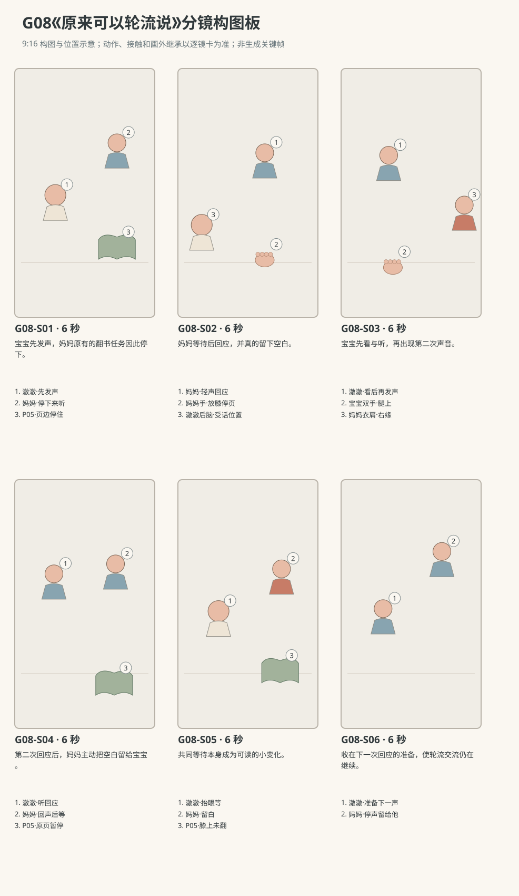

图示为构图位置示意；姿态、接触和画外继承以逐镜正文为准。

### 逐镜设计

#### G08-S01｜00—06 秒｜6 秒｜帧 [0, 144)

**镜头任务：**宝宝先发声，妈妈原有的翻书任务因此停下。

**景别、机位与构图：**双人中景，南侧30厘米，宝宝画左稳坐，妈妈右侧膝上布书打开，两张脸在相近高度。

**摄影机与理由：**固定机位，让动作本身改变画面；不推拉遮盖接触。

**焦点：**焦点覆盖澈澈的眼睛、行动手与目标物；关键接触始终可辨。

**入态：**澈澈看妈妈，嘴自然合着；妈妈手指扶住P05页边，正要翻页。

**动作与表演：**

- 1 秒：宝宝看着妈妈，胸口随吸气微起。

- 2 秒：宝宝嘴张成自然短元音，发出“啊”，妈妈翻页的手停住。

- 3 秒：宝宝声音落下，嘴慢慢收拢；妈妈抬眼看他，保持听的停顿。

**声音：**第2—3秒澈澈发一个短“啊”，声源在画左；前后只有呼吸，妈妈无声，书页轻响在元音前停住。

**出态：**宝宝已经停声，妈妈与他相看，布书页边仍被妈妈扶住。

**切点与承接：**宝宝声确实结束后切妈妈近景，回应从下一镜才开始。

**连续性：**画内两人嘴型均可辨，妈妈此镜不发声；宝宝全身坐姿稳定。

**开始画面母稿：**

9:16竖幅，原创圆润三维生活动画，柔软棉布与自然皮肤质感，生活物理，无文字标语。澈澈深棕眼、短黑绒发、额前一撮向右弯，奶油色棉连体衣；身体按本条能力阶段呈现，表情与动作保留婴儿的专注和不熟练。 澈澈为R1可稳定坐姿并发单个元音的能力阶段；妈妈雾蓝上衣、低马尾、米色长裤。 白天客厅西窗提供柔和漫射主光，暖墙反射补光；北墙固定沙发，东侧走廊，中央奶油地垫。 双人中景，南侧30厘米，宝宝画左稳坐，妈妈右侧膝上布书打开，两张脸在相近高度。 单一开始瞬间：澈澈看妈妈，嘴自然合着；妈妈手指扶住P05页边，正要翻页。 画面清楚呈现起态中已存在的支撑、视线与道具归属；不把后续动作叠画。

**视频变化母稿：**

9:16竖幅，原创圆润三维生活动画，柔软棉布与自然皮肤质感，生活物理，无文字标语。澈澈深棕眼、短黑绒发、额前一撮向右弯，奶油色棉连体衣；身体按本条能力阶段呈现，表情与动作保留婴儿的专注和不熟练。 澈澈为R1可稳定坐姿并发单个元音的能力阶段；妈妈雾蓝上衣、低马尾、米色长裤。 白天客厅西窗提供柔和漫射主光，暖墙反射补光；北墙固定沙发，东侧走廊，中央奶油地垫。 本镜6秒，双人中景，南侧30厘米，宝宝画左稳坐，妈妈右侧膝上布书打开，两张脸在相近高度。 起态：澈澈看妈妈，嘴自然合着；妈妈手指扶住P05页边，正要翻页。 阶段1，持续1秒：宝宝看着妈妈，胸口随吸气微起。 阶段2，持续2秒：宝宝嘴张成自然短元音，发出“啊”，妈妈翻页的手停住。 阶段3，持续3秒：宝宝声音落下，嘴慢慢收拢；妈妈抬眼看他，保持听的停顿。 摄影：固定机位，让动作本身改变画面；不推拉遮盖接触。 焦点：焦点覆盖澈澈的眼睛、行动手与目标物；关键接触始终可辨。 声音：第2—3秒澈澈发一个短“啊”，声源在画左；前后只有呼吸，妈妈无声，书页轻响在元音前停住。 终态：宝宝已经停声，妈妈与他相看，布书页边仍被妈妈扶住。 连续性：画内两人嘴型均可辨，妈妈此镜不发声；宝宝全身坐姿稳定。

#### G08-S02｜06—12 秒｜6 秒｜帧 [144, 288)

**镜头任务：**妈妈等待后回应，并真的留下空白。

**景别、机位与构图：**妈妈脸手近景，南侧偏西仍在视线轴南侧，妈妈脸画右上向左看，宝宝后脑仅在左下边缘，布书下缘可见。

**摄影机与理由：**固定机位，让动作本身改变画面；不推拉遮盖接触。

**焦点：**妈妈眼睛与嘴清楚；宝宝边缘柔虚但视线方位成立。

**入态：**妈妈看着已停声的宝宝，嘴合着，指尖还扶P05页边。

**动作与表演：**

- 1 秒：妈妈保持看宝宝的眼睛，没有立刻张嘴。

- 2 秒：妈妈小声回应“啊”，音量和嘴形都克制。

- 3 秒：她合上嘴停声，手指离页放松到膝上，眼睛继续看宝宝。

**声音：**第2—3秒妈妈轻声“啊”，声源画右；第4—6秒保持无人物发声，只有轻呼吸。

**出态：**妈妈停止发声、嘴合着，眼神留给宝宝；布书仍打开在膝上。

**切点与承接：**停声后留够安静再切宝宝，镜头不替她抢答。

**连续性：**宝宝画外没有同时咿呀；妈妈头朝左不反向，书页没有翻过。

**开始画面母稿：**

9:16竖幅，原创圆润三维生活动画，柔软棉布与自然皮肤质感，生活物理，无文字标语。澈澈深棕眼、短黑绒发、额前一撮向右弯，奶油色棉连体衣；身体按本条能力阶段呈现，表情与动作保留婴儿的专注和不熟练。 澈澈为R1可稳定坐姿并发单个元音的能力阶段；妈妈雾蓝上衣、低马尾、米色长裤。 白天客厅西窗提供柔和漫射主光，暖墙反射补光；北墙固定沙发，东侧走廊，中央奶油地垫。 妈妈脸手近景，南侧偏西仍在视线轴南侧，妈妈脸画右上向左看，宝宝后脑仅在左下边缘，布书下缘可见。 单一开始瞬间：妈妈看着已停声的宝宝，嘴合着，指尖还扶P05页边。 画面清楚呈现起态中已存在的支撑、视线与道具归属；不把后续动作叠画。

**视频变化母稿：**

9:16竖幅，原创圆润三维生活动画，柔软棉布与自然皮肤质感，生活物理，无文字标语。澈澈深棕眼、短黑绒发、额前一撮向右弯，奶油色棉连体衣；身体按本条能力阶段呈现，表情与动作保留婴儿的专注和不熟练。 澈澈为R1可稳定坐姿并发单个元音的能力阶段；妈妈雾蓝上衣、低马尾、米色长裤。 白天客厅西窗提供柔和漫射主光，暖墙反射补光；北墙固定沙发，东侧走廊，中央奶油地垫。 本镜6秒，妈妈脸手近景，南侧偏西仍在视线轴南侧，妈妈脸画右上向左看，宝宝后脑仅在左下边缘，布书下缘可见。 起态：妈妈看着已停声的宝宝，嘴合着，指尖还扶P05页边。 阶段1，持续1秒：妈妈保持看宝宝的眼睛，没有立刻张嘴。 阶段2，持续2秒：妈妈小声回应“啊”，音量和嘴形都克制。 阶段3，持续3秒：她合上嘴停声，手指离页放松到膝上，眼睛继续看宝宝。 摄影：固定机位，让动作本身改变画面；不推拉遮盖接触。 焦点：妈妈眼睛与嘴清楚；宝宝边缘柔虚但视线方位成立。 声音：第2—3秒妈妈轻声“啊”，声源画右；第4—6秒保持无人物发声，只有轻呼吸。 终态：妈妈停止发声、嘴合着，眼神留给宝宝；布书仍打开在膝上。 连续性：宝宝画外没有同时咿呀；妈妈头朝左不反向，书页没有翻过。

#### G08-S03｜12—18 秒｜6 秒｜帧 [288, 432)

**镜头任务：**宝宝先看与听，再出现第二次声音。

**景别、机位与构图：**宝宝脸胸近景，南侧偏东但仍同轴南侧；宝宝画左向右看，妈妈雾蓝衣肩在右缘，宝宝双手在腿上。

**摄影机与理由：**固定机位，让动作本身改变画面；不推拉遮盖接触。

**焦点：**宝宝双眼与嘴唇清楚，手部可略虚，视线保持指向妈妈。

**入态：**宝宝嘴合拢，眼睛看妈妈，妈妈刚停声，布书画外保持膝上。

**动作与表演：**

- 2 秒：宝宝目光先落妈妈嘴的位置，再抬到眼睛，自己不出声。

- 2 秒：宝宝吸气后发短“啊”，嘴和下巴小幅自然活动。

- 2 秒：声音停下，宝宝嘴角松开，仍看妈妈，双手轻挪但不离坐位。

**声音：**第3—4秒澈澈再次发短“啊”，前两秒是听的安静，后两秒停声；妈妈无对白。

**出态：**宝宝第二次元音已落，眼睛仍朝妈妈，等待空间成立。

**切点与承接：**让宝宝声落完再回双人镜，保留两次声音确实分开。

**连续性：**宝宝只能发元音，不把嘴形动画变成成人词句；妈妈画外不回应抢声。

**开始画面母稿：**

9:16竖幅，原创圆润三维生活动画，柔软棉布与自然皮肤质感，生活物理，无文字标语。澈澈深棕眼、短黑绒发、额前一撮向右弯，奶油色棉连体衣；身体按本条能力阶段呈现，表情与动作保留婴儿的专注和不熟练。 澈澈为R1可稳定坐姿并发单个元音的能力阶段；妈妈雾蓝上衣、低马尾、米色长裤。 白天客厅西窗提供柔和漫射主光，暖墙反射补光；北墙固定沙发，东侧走廊，中央奶油地垫。 宝宝脸胸近景，南侧偏东但仍同轴南侧；宝宝画左向右看，妈妈雾蓝衣肩在右缘，宝宝双手在腿上。 单一开始瞬间：宝宝嘴合拢，眼睛看妈妈，妈妈刚停声，布书画外保持膝上。 画面清楚呈现起态中已存在的支撑、视线与道具归属；不把后续动作叠画。

**视频变化母稿：**

9:16竖幅，原创圆润三维生活动画，柔软棉布与自然皮肤质感，生活物理，无文字标语。澈澈深棕眼、短黑绒发、额前一撮向右弯，奶油色棉连体衣；身体按本条能力阶段呈现，表情与动作保留婴儿的专注和不熟练。 澈澈为R1可稳定坐姿并发单个元音的能力阶段；妈妈雾蓝上衣、低马尾、米色长裤。 白天客厅西窗提供柔和漫射主光，暖墙反射补光；北墙固定沙发，东侧走廊，中央奶油地垫。 本镜6秒，宝宝脸胸近景，南侧偏东但仍同轴南侧；宝宝画左向右看，妈妈雾蓝衣肩在右缘，宝宝双手在腿上。 起态：宝宝嘴合拢，眼睛看妈妈，妈妈刚停声，布书画外保持膝上。 阶段1，持续2秒：宝宝目光先落妈妈嘴的位置，再抬到眼睛，自己不出声。 阶段2，持续2秒：宝宝吸气后发短“啊”，嘴和下巴小幅自然活动。 阶段3，持续2秒：声音停下，宝宝嘴角松开，仍看妈妈，双手轻挪但不离坐位。 摄影：固定机位，让动作本身改变画面；不推拉遮盖接触。 焦点：宝宝双眼与嘴唇清楚，手部可略虚，视线保持指向妈妈。 声音：第3—4秒澈澈再次发短“啊”，前两秒是听的安静，后两秒停声；妈妈无对白。 终态：宝宝第二次元音已落，眼睛仍朝妈妈，等待空间成立。 连续性：宝宝只能发元音，不把嘴形动画变成成人词句；妈妈画外不回应抢声。

#### G08-S04｜18—24 秒｜6 秒｜帧 [432, 576)

**镜头任务：**第二次回应后，妈妈主动把空白留给宝宝。

**景别、机位与构图：**双人近景，南侧30厘米，宝宝左妈妈右，P05在下方，二人眼睛与嘴同框。

**摄影机与理由：**固定机位，让动作本身改变画面；不推拉遮盖接触。

**焦点：**焦点覆盖澈澈的眼睛、行动手与目标物；关键接触始终可辨。

**入态：**宝宝已经停声，妈妈嘴合着看宝宝，双方双手都在各自腿膝上。

**动作与表演：**

- 1 秒：妈妈先保持听的姿态，确认宝宝声音结束。

- 2 秒：妈妈柔声回“啊”，随后闭嘴。

- 3 秒：妈妈微微偏头等待；宝宝目光跟着她，嘴轻张却未发声。

**声音：**第2—3秒妈妈柔声“啊”，宝宝无声；第4—6秒仅呼吸，远处鸟声在末尾极轻带入。

**出态：**妈妈停声等，宝宝也安静，双方看着对方。

**切点与承接：**不在停声时立刻切走，带着真正安静进入下一镜。

**连续性：**本镜只有妈妈一次元音，宝宝不得嘴型对应另一层配音；书仍原页。

**开始画面母稿：**

9:16竖幅，原创圆润三维生活动画，柔软棉布与自然皮肤质感，生活物理，无文字标语。澈澈深棕眼、短黑绒发、额前一撮向右弯，奶油色棉连体衣；身体按本条能力阶段呈现，表情与动作保留婴儿的专注和不熟练。 澈澈为R1可稳定坐姿并发单个元音的能力阶段；妈妈雾蓝上衣、低马尾、米色长裤。 白天客厅西窗提供柔和漫射主光，暖墙反射补光；北墙固定沙发，东侧走廊，中央奶油地垫。 双人近景，南侧30厘米，宝宝左妈妈右，P05在下方，二人眼睛与嘴同框。 单一开始瞬间：宝宝已经停声，妈妈嘴合着看宝宝，双方双手都在各自腿膝上。 画面清楚呈现起态中已存在的支撑、视线与道具归属；不把后续动作叠画。

**视频变化母稿：**

9:16竖幅，原创圆润三维生活动画，柔软棉布与自然皮肤质感，生活物理，无文字标语。澈澈深棕眼、短黑绒发、额前一撮向右弯，奶油色棉连体衣；身体按本条能力阶段呈现，表情与动作保留婴儿的专注和不熟练。 澈澈为R1可稳定坐姿并发单个元音的能力阶段；妈妈雾蓝上衣、低马尾、米色长裤。 白天客厅西窗提供柔和漫射主光，暖墙反射补光；北墙固定沙发，东侧走廊，中央奶油地垫。 本镜6秒，双人近景，南侧30厘米，宝宝左妈妈右，P05在下方，二人眼睛与嘴同框。 起态：宝宝已经停声，妈妈嘴合着看宝宝，双方双手都在各自腿膝上。 阶段1，持续1秒：妈妈先保持听的姿态，确认宝宝声音结束。 阶段2，持续2秒：妈妈柔声回“啊”，随后闭嘴。 阶段3，持续3秒：妈妈微微偏头等待；宝宝目光跟着她，嘴轻张却未发声。 摄影：固定机位，让动作本身改变画面；不推拉遮盖接触。 焦点：焦点覆盖澈澈的眼睛、行动手与目标物；关键接触始终可辨。 声音：第2—3秒妈妈柔声“啊”，宝宝无声；第4—6秒仅呼吸，远处鸟声在末尾极轻带入。 终态：妈妈停声等，宝宝也安静，双方看着对方。 连续性：本镜只有妈妈一次元音，宝宝不得嘴型对应另一层配音；书仍原页。

#### G08-S05｜24—30 秒｜6 秒｜帧 [576, 720)

**镜头任务：**共同等待本身成为可读的小变化。

**景别、机位与构图：**双人中景，南侧固定，宝宝左、妈妈右，两人之间留空，膝上布书仍可见。

**摄影机与理由：**固定机位，让动作本身改变画面；不推拉遮盖接触。

**焦点：**焦点覆盖澈澈的眼睛、行动手与目标物；关键接触始终可辨。

**入态：**妈妈微偏头等待，宝宝嘴轻张但没有发声，双手自然搭腿。

**动作与表演：**

- 2 秒：宝宝慢慢抿嘴，目光落到妈妈膝上的书页。

- 2 秒：他再抬眼看妈妈，妈妈也保持看他，轻轻眨一次眼。

- 2 秒：宝宝小嘴轻动又停住，妈妈不抢着示范，脸上只是一点笑。

**声音：**整镜无人物发声、无音乐；仅连续呼吸、远鸟声与极轻棉衣响，留足安静。

**出态：**宝宝重新看妈妈，双方都在等下一次声音，没有冻住表情。

**切点与承接：**在宝宝视线返回时切近一点的共同画面，下一声仍由妈妈轻柔给出。

**连续性：**六秒内人物均不发声；呼吸、眼睛与指尖有自然微动，非静帧替代听戏。

**开始画面母稿：**

9:16竖幅，原创圆润三维生活动画，柔软棉布与自然皮肤质感，生活物理，无文字标语。澈澈深棕眼、短黑绒发、额前一撮向右弯，奶油色棉连体衣；身体按本条能力阶段呈现，表情与动作保留婴儿的专注和不熟练。 澈澈为R1可稳定坐姿并发单个元音的能力阶段；妈妈雾蓝上衣、低马尾、米色长裤。 白天客厅西窗提供柔和漫射主光，暖墙反射补光；北墙固定沙发，东侧走廊，中央奶油地垫。 双人中景，南侧固定，宝宝左、妈妈右，两人之间留空，膝上布书仍可见。 单一开始瞬间：妈妈微偏头等待，宝宝嘴轻张但没有发声，双手自然搭腿。 画面清楚呈现起态中已存在的支撑、视线与道具归属；不把后续动作叠画。

**视频变化母稿：**

9:16竖幅，原创圆润三维生活动画，柔软棉布与自然皮肤质感，生活物理，无文字标语。澈澈深棕眼、短黑绒发、额前一撮向右弯，奶油色棉连体衣；身体按本条能力阶段呈现，表情与动作保留婴儿的专注和不熟练。 澈澈为R1可稳定坐姿并发单个元音的能力阶段；妈妈雾蓝上衣、低马尾、米色长裤。 白天客厅西窗提供柔和漫射主光，暖墙反射补光；北墙固定沙发，东侧走廊，中央奶油地垫。 本镜6秒，双人中景，南侧固定，宝宝左、妈妈右，两人之间留空，膝上布书仍可见。 起态：妈妈微偏头等待，宝宝嘴轻张但没有发声，双手自然搭腿。 阶段1，持续2秒：宝宝慢慢抿嘴，目光落到妈妈膝上的书页。 阶段2，持续2秒：他再抬眼看妈妈，妈妈也保持看他，轻轻眨一次眼。 阶段3，持续2秒：宝宝小嘴轻动又停住，妈妈不抢着示范，脸上只是一点笑。 摄影：固定机位，让动作本身改变画面；不推拉遮盖接触。 焦点：焦点覆盖澈澈的眼睛、行动手与目标物；关键接触始终可辨。 声音：整镜无人物发声、无音乐；仅连续呼吸、远鸟声与极轻棉衣响，留足安静。 终态：宝宝重新看妈妈，双方都在等下一次声音，没有冻住表情。 连续性：六秒内人物均不发声；呼吸、眼睛与指尖有自然微动，非静帧替代听戏。

#### G08-S06｜30—36 秒｜6 秒｜帧 [720, 864)

**镜头任务：**收在下一次回应的准备，使轮流交流仍在继续。

**景别、机位与构图：**脸部双人近景，南侧30厘米，宝宝脸左下、妈妈脸右上，视线相接，下缘保留宝宝稳定坐姿的一部分。

**摄影机与理由：**固定机位，让动作本身改变画面；不推拉遮盖接触。

**焦点：**焦点覆盖澈澈的眼睛、行动手与目标物；关键接触始终可辨。

**入态：**宝宝抬眼看妈妈，妈妈轻偏头，双方嘴都合着。

**动作与表演：**

- 1 秒：妈妈看见宝宝仍在等，头略回正。

- 2 秒：她轻声“啊”一下，随即停住，眼睛留在宝宝身上。

- 3 秒：宝宝眼睛亮一点，胸口随一小口吸气微起，小嘴准备张开，但还没有下一声。

**声音：**第2—3秒妈妈轻声“啊”；第4—6秒只有宝宝小口吸气与母婴呼吸，宝宝不追加有声词。

**出态：**妈妈已停声，宝宝正准备接续，两人目光相连。

**切点与承接：**结束在吸气准备的自然尾端，不加字幕解释轮流，也不剪成合唱。

**连续性：**宝宝最后没有实际发出元音；妈妈只有台词表这一声，身体位置不变。

**开始画面母稿：**

9:16竖幅，原创圆润三维生活动画，柔软棉布与自然皮肤质感，生活物理，无文字标语。澈澈深棕眼、短黑绒发、额前一撮向右弯，奶油色棉连体衣；身体按本条能力阶段呈现，表情与动作保留婴儿的专注和不熟练。 澈澈为R1可稳定坐姿并发单个元音的能力阶段；妈妈雾蓝上衣、低马尾、米色长裤。 白天客厅西窗提供柔和漫射主光，暖墙反射补光；北墙固定沙发，东侧走廊，中央奶油地垫。 脸部双人近景，南侧30厘米，宝宝脸左下、妈妈脸右上，视线相接，下缘保留宝宝稳定坐姿的一部分。 单一开始瞬间：宝宝抬眼看妈妈，妈妈轻偏头，双方嘴都合着。 画面清楚呈现起态中已存在的支撑、视线与道具归属；不把后续动作叠画。

**视频变化母稿：**

9:16竖幅，原创圆润三维生活动画，柔软棉布与自然皮肤质感，生活物理，无文字标语。澈澈深棕眼、短黑绒发、额前一撮向右弯，奶油色棉连体衣；身体按本条能力阶段呈现，表情与动作保留婴儿的专注和不熟练。 澈澈为R1可稳定坐姿并发单个元音的能力阶段；妈妈雾蓝上衣、低马尾、米色长裤。 白天客厅西窗提供柔和漫射主光，暖墙反射补光；北墙固定沙发，东侧走廊，中央奶油地垫。 本镜6秒，脸部双人近景，南侧30厘米，宝宝脸左下、妈妈脸右上，视线相接，下缘保留宝宝稳定坐姿的一部分。 起态：宝宝抬眼看妈妈，妈妈轻偏头，双方嘴都合着。 阶段1，持续1秒：妈妈看见宝宝仍在等，头略回正。 阶段2，持续2秒：她轻声“啊”一下，随即停住，眼睛留在宝宝身上。 阶段3，持续3秒：宝宝眼睛亮一点，胸口随一小口吸气微起，小嘴准备张开，但还没有下一声。 摄影：固定机位，让动作本身改变画面；不推拉遮盖接触。 焦点：焦点覆盖澈澈的眼睛、行动手与目标物；关键接触始终可辨。 声音：第2—3秒妈妈轻声“啊”；第4—6秒只有宝宝小口吸气与母婴呼吸，宝宝不追加有声词。 终态：妈妈已停声，宝宝正准备接续，两人目光相连。 连续性：宝宝最后没有实际发出元音；妈妈只有台词表这一声，身体位置不变。

### 声音与剪辑

只有五次列明的“啊”、真实呼吸、布书初始轻响与很远鸟声；保留S05完整安静，不用背景音乐填平停顿，不做成人儿语讲解。

- 澈澈：啊（G08-S01；第2—3秒面向妈妈的短元音，不成词；余时呼吸。）

- 妈妈：啊（G08-S02；第2—3秒，等宝宝声落完再柔声回应，随后真正停声。）

- 澈澈：啊（G08-S03；第3—4秒，再次看着妈妈发出短元音，不续成句。）

- 妈妈：啊（G08-S04；第2—3秒回应，随后保持安静等宝宝。）

- 妈妈：啊（G08-S06；第2—3秒轻声发出后停止，留给宝宝吸气准备而不立即重叠。）

### 连续性与试片

- 连续性：宝宝始终只有短元音“啊”，无隐含词句、配音解释或歌词；妈妈也只发台词表中的三次“啊”。

- 连续性：五次发声窗口不重叠；S05没有人物发声，S06结尾宝宝只吸气准备不发出第六次声。

- 连续性：P05一直在妈妈膝上，S01停页后不再翻动分散刺激。

- 连续性：宝宝骨盆双腿稳定接地，妈妈在东南侧，所有近景维持宝宝向右看、妈妈向左看。

- 试片：G08-S01到S04逐音检查：先前一人声音完整结束、对方停听后才回应；若嘴型和音源人物错配、元音叠音或多出词句则失败。

- 试片：G08-S05静音与有声对照：需要看出双方在等对方，仍有自然呼吸眼神；若只是冻住脸或由音乐提示情绪则失败。

- 试片：G08-S06：妈妈的“啊”结束后宝宝吸气而未完成下一声，收尾应像互动将继续；若强行同步合唱则与本题不同。

**媒体待验证：**尚无媒体；待验证婴儿元音音色、母婴轮流口型、停顿里的听戏，台词表窗口需实剪复核。

---

## G09《站起来看见的新世界》

**54 秒｜爬行与扶站｜角色：澈澈、妈妈｜场景 L**

### 剧情正文

北墙沙发前，澈澈跪在地垫上，双手抓着固定矮扶栏。沙发前沿挡住了座面，他仰着脸，只能看见上面露出的一点颜色。妈妈跪在东侧，把布巾放到自己膝边。澈澈低头看看膝盖，再抬眼往上看，双手没有松开。他先把右脚挪到身前，脚掌踩实，左膝仍在地垫上。停稳以后，右腿慢慢撑起，屁股升高，左腿跟着往前，左脚也落下来。妈妈双手停在身边可照顾的位置，没有向上提他。澈澈终于用两只脚站住，肚子仍靠近扶栏，双肘微弯。随着眼睛越过沙发前沿，一整块绿色软积木出现在他面前。他先睁大眼，再低头看看自己的脚，随后又抬眼确认积木。妈妈俯低身子，跟他望向同一个地方。澈澈握着栏边，指头轻轻收了一下，没急着伸手去拿。

### 导演与空间

**观察任务：**完整建立双手扶栏、半跪落足、双足承重后的站立，再让遮挡后的同一玩具进入视线。

**空间与光位：**北墙沙发前有固定在底座上的圆钝矮扶栏，宝宝在栏南侧面北，栏高允许跪姿双手握住、站立后肘仍略屈。P03绿色软积木在北侧沙发座面、前沿内侧，低跪视角被沙发前沿遮住。妈妈在宝宝东侧跪坐，双手旁候不拉拽。相机始终在南至西南侧，不越栏；侧面机位用于看握点、脚底与视线升高，西窗保持西侧。

**人物表演：**宝宝起态双膝、双手有支撑，先把右足踩平形成半跪，利用双手扶栏和右足逐渐提高骨盆，再移左足落稳；不演成双手悬挂拉起。妈妈先整理P04，见动作后近旁守候，站稳后才俯低一起看玩具。

### 节拍覆盖

- **G09-b1**：前态：澈澈双膝落垫、双手握固定栏，胸腹不悬挂；妈妈东侧跪坐，P04在膝边，P03在北侧沙发座面前沿内侧。 过程：妈妈把P04折好放在自己膝旁，眼睛转向宝宝。宝宝沿扶栏抬头看沙发前沿，双手轻收指，膝盖仍落地。 后态：宝宝仍跪着看上方，成人与固定栏、积木位置都已交代。 观众观察：从宽镜建立固定栏、双膝双手与被遮住玩具的位置。 → G09-S01

- **G09-b2**：前态：宝宝双膝在垫、双手握栏，视线被沙发前沿挡住，P03大部分不可见。 过程：宝宝仰脸看露出的一点绿色，嘴稍张，栏与沙发不动。他低头看自己的膝盖，双手保持握点。目光重新抬向绿色角，身体向栏靠近一点，准备挪脚。 后态：宝宝仍跪姿，双手原位，身体略靠近栏，右膝准备前移。 观众观察：证明起立的动力来自视线被挡，而非成人口令。 → G09-S02

- **G09-b3**：前态：双膝与双手承托宝宝，躯干靠近栏；妈妈已放好布巾。 过程：妈妈稍向前靠近，双手留在宝宝躯干两侧外，未接触。宝宝在双手和左膝支撑下，把右膝向前送，右脚落到身前垫面。右脚掌慢慢踩平，宝宝停住，保持左膝与右足、双手共同承托。 后态：宝宝形成右足踩平、左膝落地的半跪，双手仍握栏原位，妈妈未触。 观众观察：明确半跪之前和之后的支撑变化。 → G09-S03

- **G09-b4**：前态：右足已平踩身前、左膝接垫，宝宝双手握栏、肘略屈，骨盆较低。 过程：宝宝把重量慢慢转向右足，右腿开始伸展，双手只稳住向前晃的躯干，骨盆提高。左膝离垫，左腿向身下跟进，左足落在右足旁，双手握点不变。双脚逐渐踩实，双膝保留微屈，身体升到扶栏站姿；停一下让轻晃减小。 后态：宝宝双足落地扶栏站住，双膝微屈，肘仍略弯，骨盆不悬在双臂下；妈妈未触。 观众观察：在完整全身镜里完成起立，不以手臂吊起身体。 → G09-S04

- **G09-b5**：前态：宝宝已经扶栏站住，双手握栏，眼睛已朝向沙发上的P03；相机起在低于宝宝眼位的位置，因此观众仍见P03被沙发前沿少量遮住。 过程：宝宝只轻抬下巴看P03，相机缓升到宝宝已经达到的站姿眼位，让观众看见前沿后完整的绿色积木；宝宝双足与身高不再改变。他睁大眼看P03，双手不松，身体只做自然小摆。相机停稳，宝宝目光短暂往自己的脚方向落下，再抬回积木。 后态：P03完整出现在宝宝视线前，宝宝仍双手扶栏站立，脸上是安静的惊讶。 观众观察：同一固定场景通过视点升高揭示积木。 → G09-S05

- **G09-b6**：前态：宝宝站稳看积木，妈妈东侧跪地近旁，双手仍空停身前。 过程：妈妈确认宝宝双足站住后，把自己上身俯低到宝宝能侧眼看见的高度。她先看宝宝，再顺着目光看P03，轻轻笑一下。宝宝侧眼看看妈妈，仍握栏，随后把视线回到积木。 后态：两人都看着座面上的P03，宝宝双手双足状态未变，妈妈未碰。 观众观察：妈妈跟到新的视线高度一起看，不把成果说出口。 → G09-S06

- **G09-b7**：前态：宝宝双足平踩、膝微屈、双手握栏，妈妈俯低与他同看P03。 过程：宝宝手指在栏上轻轻收紧又放松，但握点不脱离。他低头看一眼自己的双足，脚没有挪动，再抬眼看绿色积木。妈妈安静跟随他的目光，宝宝保持站姿，呼吸慢慢平稳。 后态：宝宝以同一握点和双足站立，看着完整显露的P03，妈妈旁边陪看。 观众观察：结尾确认新的站立视野仍由真实支撑维持。 → G09-S07

### 分镜构图板

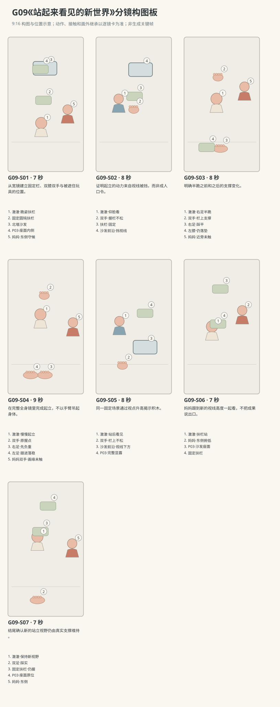

图示为构图位置示意；姿态、接触和画外继承以逐镜正文为准。

### 逐镜设计

#### G09-S01｜00—07 秒｜7 秒｜帧 [0, 168)

**镜头任务：**从宽镜建立固定栏、双膝双手与被遮住玩具的位置。

**景别、机位与构图：**中全景，西南侧60厘米高斜俯向东北；宝宝在中下背侧面朝北，扶栏横贯中部，沙发在上方，妈妈东侧画右，P03在沙发座面可见。

**摄影机与理由：**固定机位，让动作本身改变画面；不推拉遮盖接触。

**焦点：**焦点覆盖澈澈的眼睛、行动手与目标物；关键接触始终可辨。

**入态：**澈澈双膝落垫、双手握固定栏，胸腹不悬挂；妈妈东侧跪坐，P04在膝边，P03在北侧沙发座面前沿内侧。

**动作与表演：**

- 3 秒：妈妈把P04折好放在自己膝旁，眼睛转向宝宝。

- 4 秒：宝宝沿扶栏抬头看沙发前沿，双手轻收指，膝盖仍落地。

**声音：**无对白、无音乐；西窗外极轻鸟声作底，前景保留连体衣摩擦与婴儿呼吸，动作触碰同步发声。

**出态：**宝宝仍跪着看上方，成人与固定栏、积木位置都已交代。

**切点与承接：**切到宝宝眼高的侧面，显示同一玩具在低视点怎样被挡。

**连续性：**高机位给观众看见P03，不代表宝宝已经看见；双手双膝起态受力成立。

**开始画面母稿：**

9:16竖幅，原创圆润三维生活动画，柔软棉布与自然皮肤质感，生活物理，无文字标语。澈澈深棕眼、短黑绒发、额前一撮向右弯，奶油色棉连体衣；身体按本条能力阶段呈现，表情与动作保留婴儿的专注和不熟练。 澈澈为R2能扶固定支撑由跪姿起立的阶段；妈妈低马尾、雾蓝上衣、米色长裤。 白天客厅西窗提供柔和漫射主光，暖墙反射补光；北墙固定沙发，东侧走廊，中央奶油地垫。 中全景，西南侧60厘米高斜俯向东北；宝宝在中下背侧面朝北，扶栏横贯中部，沙发在上方，妈妈东侧画右，P03在沙发座面可见。 单一开始瞬间：澈澈双膝落垫、双手握固定栏，胸腹不悬挂；妈妈东侧跪坐，P04在膝边，P03在北侧沙发座面前沿内侧。 画面清楚呈现起态中已存在的支撑、视线与道具归属；不把后续动作叠画。

**视频变化母稿：**

9:16竖幅，原创圆润三维生活动画，柔软棉布与自然皮肤质感，生活物理，无文字标语。澈澈深棕眼、短黑绒发、额前一撮向右弯，奶油色棉连体衣；身体按本条能力阶段呈现，表情与动作保留婴儿的专注和不熟练。 澈澈为R2能扶固定支撑由跪姿起立的阶段；妈妈低马尾、雾蓝上衣、米色长裤。 白天客厅西窗提供柔和漫射主光，暖墙反射补光；北墙固定沙发，东侧走廊，中央奶油地垫。 本镜7秒，中全景，西南侧60厘米高斜俯向东北；宝宝在中下背侧面朝北，扶栏横贯中部，沙发在上方，妈妈东侧画右，P03在沙发座面可见。 起态：澈澈双膝落垫、双手握固定栏，胸腹不悬挂；妈妈东侧跪坐，P04在膝边，P03在北侧沙发座面前沿内侧。 阶段1，持续3秒：妈妈把P04折好放在自己膝旁，眼睛转向宝宝。 阶段2，持续4秒：宝宝沿扶栏抬头看沙发前沿，双手轻收指，膝盖仍落地。 摄影：固定机位，让动作本身改变画面；不推拉遮盖接触。 焦点：焦点覆盖澈澈的眼睛、行动手与目标物；关键接触始终可辨。 声音：无对白、无音乐；西窗外极轻鸟声作底，前景保留连体衣摩擦与婴儿呼吸，动作触碰同步发声。 终态：宝宝仍跪着看上方，成人与固定栏、积木位置都已交代。 连续性：高机位给观众看见P03，不代表宝宝已经看见；双手双膝起态受力成立。

#### G09-S02｜07—15 秒｜8 秒｜帧 [168, 360)

**镜头任务：**证明起立的动力来自视线被挡，而非成人口令。

**景别、机位与构图：**低位中近景，西南侧离垫25厘米斜看北；宝宝侧脸画左、握栏双手居中，沙发前沿横在视线上方，积木只露很小色角。

**摄影机与理由：**固定机位，让动作本身改变画面；不推拉遮盖接触。

**焦点：**宝宝眼睛、握栏处与沙发前沿清楚；仅露积木小角，不自动越过遮挡。

**入态：**宝宝双膝在垫、双手握栏，视线被沙发前沿挡住，P03大部分不可见。

**动作与表演：**

- 3 秒：宝宝仰脸看露出的一点绿色，嘴稍张，栏与沙发不动。

- 2 秒：他低头看自己的膝盖，双手保持握点。

- 3 秒：目光重新抬向绿色角，身体向栏靠近一点，准备挪脚。

**声音：**无对白、无音乐；西窗外极轻鸟声作底，前景保留连体衣摩擦与婴儿呼吸，动作触碰同步发声。

**出态：**宝宝仍跪姿，双手原位，身体略靠近栏，右膝准备前移。

**切点与承接：**从低头准备接入全身镜，必须在看得清的画面交代右足踩地。

**连续性：**画外妈妈仍东侧未触；P03被挡不是删掉，颜色角位置固定。

**开始画面母稿：**

9:16竖幅，原创圆润三维生活动画，柔软棉布与自然皮肤质感，生活物理，无文字标语。澈澈深棕眼、短黑绒发、额前一撮向右弯，奶油色棉连体衣；身体按本条能力阶段呈现，表情与动作保留婴儿的专注和不熟练。 澈澈为R2能扶固定支撑由跪姿起立的阶段；妈妈低马尾、雾蓝上衣、米色长裤。 白天客厅西窗提供柔和漫射主光，暖墙反射补光；北墙固定沙发，东侧走廊，中央奶油地垫。 低位中近景，西南侧离垫25厘米斜看北；宝宝侧脸画左、握栏双手居中，沙发前沿横在视线上方，积木只露很小色角。 单一开始瞬间：宝宝双膝在垫、双手握栏，视线被沙发前沿挡住，P03大部分不可见。 画面清楚呈现起态中已存在的支撑、视线与道具归属；不把后续动作叠画。

**视频变化母稿：**

9:16竖幅，原创圆润三维生活动画，柔软棉布与自然皮肤质感，生活物理，无文字标语。澈澈深棕眼、短黑绒发、额前一撮向右弯，奶油色棉连体衣；身体按本条能力阶段呈现，表情与动作保留婴儿的专注和不熟练。 澈澈为R2能扶固定支撑由跪姿起立的阶段；妈妈低马尾、雾蓝上衣、米色长裤。 白天客厅西窗提供柔和漫射主光，暖墙反射补光；北墙固定沙发，东侧走廊，中央奶油地垫。 本镜8秒，低位中近景，西南侧离垫25厘米斜看北；宝宝侧脸画左、握栏双手居中，沙发前沿横在视线上方，积木只露很小色角。 起态：宝宝双膝在垫、双手握栏，视线被沙发前沿挡住，P03大部分不可见。 阶段1，持续3秒：宝宝仰脸看露出的一点绿色，嘴稍张，栏与沙发不动。 阶段2，持续2秒：他低头看自己的膝盖，双手保持握点。 阶段3，持续3秒：目光重新抬向绿色角，身体向栏靠近一点，准备挪脚。 摄影：固定机位，让动作本身改变画面；不推拉遮盖接触。 焦点：宝宝眼睛、握栏处与沙发前沿清楚；仅露积木小角，不自动越过遮挡。 声音：无对白、无音乐；西窗外极轻鸟声作底，前景保留连体衣摩擦与婴儿呼吸，动作触碰同步发声。 终态：宝宝仍跪姿，双手原位，身体略靠近栏，右膝准备前移。 连续性：画外妈妈仍东侧未触；P03被挡不是删掉，颜色角位置固定。

#### G09-S03｜15—23 秒｜8 秒｜帧 [360, 552)

**镜头任务：**明确半跪之前和之后的支撑变化。

**景别、机位与构图：**全身中景，西南侧40厘米高，宝宝侧面头左上、脚下方，栏在上中，妈妈右后方双手旁候，右足落点无遮挡。

**摄影机与理由：**固定机位，让动作本身改变画面；不推拉遮盖接触。

**焦点：**焦点覆盖澈澈的眼睛、行动手与目标物；关键接触始终可辨。

**入态：**双膝与双手承托宝宝，躯干靠近栏；妈妈已放好布巾。

**动作与表演：**

- 2 秒：妈妈稍向前靠近，双手留在宝宝躯干两侧外，未接触。

- 3 秒：宝宝在双手和左膝支撑下，把右膝向前送，右脚落到身前垫面。

- 3 秒：右脚掌慢慢踩平，宝宝停住，保持左膝与右足、双手共同承托。

**声音：**无对白、无音乐；西窗外极轻鸟声作底，前景保留连体衣摩擦与婴儿呼吸，动作触碰同步发声。

**出态：**宝宝形成右足踩平、左膝落地的半跪，双手仍握栏原位，妈妈未触。

**切点与承接：**等右足真的踩稳后才切起立主镜，不用切镜完成负重转换。

**连续性：**右足从右膝下自然前送，不能从另一条裤腿穿出；左膝未提前离地。

**开始画面母稿：**

9:16竖幅，原创圆润三维生活动画，柔软棉布与自然皮肤质感，生活物理，无文字标语。澈澈深棕眼、短黑绒发、额前一撮向右弯，奶油色棉连体衣；身体按本条能力阶段呈现，表情与动作保留婴儿的专注和不熟练。 澈澈为R2能扶固定支撑由跪姿起立的阶段；妈妈低马尾、雾蓝上衣、米色长裤。 白天客厅西窗提供柔和漫射主光，暖墙反射补光；北墙固定沙发，东侧走廊，中央奶油地垫。 全身中景，西南侧40厘米高；宝宝在画中左侧面，双手握栏、双膝落垫，妈妈在右后方，双手位于自己膝旁、未触宝宝，右足尚未前送。 单一开始瞬间：双膝与双手承托宝宝，躯干靠近栏；妈妈已放好布巾。 本图焦点固定在：宝宝两膝和双手的现有支撑、仍在后方的右足及成人未接触的手。 仅呈现这一瞬间的身体支撑、视线与物件归属，不把未来阶段或相机路径叠画。

**视频变化母稿：**

9:16竖幅，原创圆润三维生活动画，柔软棉布与自然皮肤质感，生活物理，无文字标语。澈澈深棕眼、短黑绒发、额前一撮向右弯，奶油色棉连体衣；身体按本条能力阶段呈现，表情与动作保留婴儿的专注和不熟练。 澈澈为R2能扶固定支撑由跪姿起立的阶段；妈妈低马尾、雾蓝上衣、米色长裤。 白天客厅西窗提供柔和漫射主光，暖墙反射补光；北墙固定沙发，东侧走廊，中央奶油地垫。 本镜8秒，全身中景，西南侧40厘米高，宝宝侧面头左上、脚下方，栏在上中，妈妈右后方双手旁候，右足落点无遮挡。 起态：双膝与双手承托宝宝，躯干靠近栏；妈妈已放好布巾。 阶段1，持续2秒：妈妈稍向前靠近，双手留在宝宝躯干两侧外，未接触。 阶段2，持续3秒：宝宝在双手和左膝支撑下，把右膝向前送，右脚落到身前垫面。 阶段3，持续3秒：右脚掌慢慢踩平，宝宝停住，保持左膝与右足、双手共同承托。 摄影：固定机位，让动作本身改变画面；不推拉遮盖接触。 焦点：焦点覆盖澈澈的眼睛、行动手与目标物；关键接触始终可辨。 声音：无对白、无音乐；西窗外极轻鸟声作底，前景保留连体衣摩擦与婴儿呼吸，动作触碰同步发声。 终态：宝宝形成右足踩平、左膝落地的半跪，双手仍握栏原位，妈妈未触。 连续性：右足从右膝下自然前送，不能从另一条裤腿穿出；左膝未提前离地。

#### G09-S04｜23—32 秒｜9 秒｜帧 [552, 768)

**镜头任务：**在完整全身镜里完成起立，不以手臂吊起身体。

**景别、机位与构图：**全身动作主镜，西南侧40厘米高固定，头至双脚完整；栏握点、肘、右足与左膝都可读，妈妈双手在右缘不遮接触。

**摄影机与理由：**固定机位，让动作本身改变画面；不推拉遮盖接触。

**焦点：**全身景深覆盖肘、骨盆、膝和双足，不拉浅景深隐藏承重。

**入态：**右足已平踩身前、左膝接垫，宝宝双手握栏、肘略屈，骨盆较低。

**动作与表演：**

- 3 秒：宝宝把重量慢慢转向右足，右腿开始伸展，双手只稳住向前晃的躯干，骨盆提高。

- 3 秒：左膝离垫，左腿向身下跟进，左足落在右足旁，双手握点不变。

- 3 秒：双脚逐渐踩实，双膝保留微屈，身体升到扶栏站姿；停一下让轻晃减小。

**声音：**无对白无音乐；右足压垫、左裤腿与膝离垫轻擦、左足落垫先后清楚；栏无晃动声，宝宝站定后轻呼气。

**出态：**宝宝双足落地扶栏站住，双膝微屈，肘仍略弯，骨盆不悬在双臂下；妈妈未触。

**切点与承接：**双足承重与站稳停顿都完成后切眼高变化，不能在悬空中剪走。

**连续性：**右足不滑，左足从左腿接续；扶栏刚性不变，妈妈没有画外提衣服。

**开始画面母稿：**

9:16竖幅，原创圆润三维生活动画，柔软棉布与自然皮肤质感，生活物理，无文字标语。澈澈深棕眼、短黑绒发、额前一撮向右弯，奶油色棉连体衣；身体按本条能力阶段呈现，表情与动作保留婴儿的专注和不熟练。 澈澈为R2能扶固定支撑由跪姿起立的阶段；妈妈低马尾、雾蓝上衣、米色长裤。 白天客厅西窗提供柔和漫射主光，暖墙反射补光；北墙固定沙发，东侧走廊，中央奶油地垫。 全身动作主镜，西南侧40厘米高固定，头至双脚完整；栏握点、肘、右足与左膝都可读，妈妈双手在右缘不遮接触。 单一开始瞬间：右足已平踩身前、左膝接垫，宝宝双手握栏、肘略屈，骨盆较低。 画面清楚呈现起态中已存在的支撑、视线与道具归属；不把后续动作叠画。

**视频变化母稿：**

9:16竖幅，原创圆润三维生活动画，柔软棉布与自然皮肤质感，生活物理，无文字标语。澈澈深棕眼、短黑绒发、额前一撮向右弯，奶油色棉连体衣；身体按本条能力阶段呈现，表情与动作保留婴儿的专注和不熟练。 澈澈为R2能扶固定支撑由跪姿起立的阶段；妈妈低马尾、雾蓝上衣、米色长裤。 白天客厅西窗提供柔和漫射主光，暖墙反射补光；北墙固定沙发，东侧走廊，中央奶油地垫。 本镜9秒，全身动作主镜，西南侧40厘米高固定，头至双脚完整；栏握点、肘、右足与左膝都可读，妈妈双手在右缘不遮接触。 起态：右足已平踩身前、左膝接垫，宝宝双手握栏、肘略屈，骨盆较低。 阶段1，持续3秒：宝宝把重量慢慢转向右足，右腿开始伸展，双手只稳住向前晃的躯干，骨盆提高。 阶段2，持续3秒：左膝离垫，左腿向身下跟进，左足落在右足旁，双手握点不变。 阶段3，持续3秒：双脚逐渐踩实，双膝保留微屈，身体升到扶栏站姿；停一下让轻晃减小。 摄影：固定机位，让动作本身改变画面；不推拉遮盖接触。 焦点：全身景深覆盖肘、骨盆、膝和双足，不拉浅景深隐藏承重。 声音：无对白无音乐；右足压垫、左裤腿与膝离垫轻擦、左足落垫先后清楚；栏无晃动声，宝宝站定后轻呼气。 终态：宝宝双足落地扶栏站住，双膝微屈，肘仍略弯，骨盆不悬在双臂下；妈妈未触。 连续性：右足不滑，左足从左腿接续；扶栏刚性不变，妈妈没有画外提衣服。

#### G09-S05｜32—40 秒｜8 秒｜帧 [768, 960)

**镜头任务：**同一固定场景通过视点升高揭示积木。

**景别、机位与构图：**侧面近景，西南侧相机从低于宝宝眼位约15厘米缓升到站后的实际眼位；宝宝侧脸与握栏双手始终留画，P03的遮挡变化属于观众机位，不要求宝宝再长高。

**摄影机与理由：**由宝宝看向新视野触发相机缓升约15厘米，从低于其眼位移到实际站姿眼位后固定；起立已在上镜完成，本镜不再抬高宝宝。

**焦点：**先保宝宝眼睛与沙发前沿可辨，积木露全后焦点稍移P03，握栏双手仍有轮廓。

**入态：**宝宝已经扶栏站住，双手握栏，眼睛已朝向沙发上的P03；相机起在低于宝宝眼位的位置，因此观众仍见P03被沙发前沿少量遮住。

**动作与表演：**

- 3 秒：宝宝只轻抬下巴看P03，相机缓升到宝宝已经达到的站姿眼位，让观众看见前沿后完整的绿色积木；宝宝双足与身高不再改变。

- 3 秒：他睁大眼看P03，双手不松，身体只做自然小摆。

- 2 秒：相机停稳，宝宝目光短暂往自己的脚方向落下，再抬回积木。

**声音：**无对白、无音乐；西窗外极轻鸟声作底，前景保留连体衣摩擦与婴儿呼吸，动作触碰同步发声。

**出态：**P03完整出现在宝宝视线前，宝宝仍双手扶栏站立，脸上是安静的惊讶。

**切点与承接：**沿宝宝看积木的眼线切妈妈靠近的同侧画面，世界方位不反转。

**连续性：**P03与沙发从未移动；相机上移仅揭示眼位变化，不把宝宝再次凭空拉高。

**开始画面母稿：**

9:16竖幅，原创圆润三维生活动画，柔软棉布与自然皮肤质感，生活物理，无文字标语。澈澈深棕眼、短黑绒发、额前一撮向右弯，奶油色棉连体衣；身体按本条能力阶段呈现，表情与动作保留婴儿的专注和不熟练。 澈澈为R2能扶固定支撑由跪姿起立的阶段；妈妈低马尾、雾蓝上衣、米色长裤。 白天客厅西窗提供柔和漫射主光，暖墙反射补光；北墙固定沙发，东侧走廊，中央奶油地垫。 侧面近景，西南侧固定在低于宝宝站姿眼位约15厘米的位置；宝宝侧脸与握栏双手留画，P03仍有一小部分被沙发前沿遮住，宝宝双足已经落地站稳。 单一开始瞬间：宝宝已经扶栏站住，双手握栏，眼睛已朝向沙发上的P03；相机起在低于宝宝眼位的位置，因此观众仍见P03被沙发前沿少量遮住。 本图焦点固定在：宝宝已站稳的眼睛、双手握栏及当前仍被前沿略遮的P03。 仅呈现这一瞬间的身体支撑、视线与物件归属，不把未来阶段或相机路径叠画。

**视频变化母稿：**

9:16竖幅，原创圆润三维生活动画，柔软棉布与自然皮肤质感，生活物理，无文字标语。澈澈深棕眼、短黑绒发、额前一撮向右弯，奶油色棉连体衣；身体按本条能力阶段呈现，表情与动作保留婴儿的专注和不熟练。 澈澈为R2能扶固定支撑由跪姿起立的阶段；妈妈低马尾、雾蓝上衣、米色长裤。 白天客厅西窗提供柔和漫射主光，暖墙反射补光；北墙固定沙发，东侧走廊，中央奶油地垫。 本镜8秒，侧面近景，西南侧相机从低于宝宝眼位约15厘米缓升到站后的实际眼位；宝宝侧脸与握栏双手始终留画，P03的遮挡变化属于观众机位，不要求宝宝再长高。 起态：宝宝已经扶栏站住，双手握栏，眼睛已朝向沙发上的P03；相机起在低于宝宝眼位的位置，因此观众仍见P03被沙发前沿少量遮住。 阶段1，持续3秒：宝宝只轻抬下巴看P03，相机缓升到宝宝已经达到的站姿眼位，让观众看见前沿后完整的绿色积木；宝宝双足与身高不再改变。 阶段2，持续3秒：他睁大眼看P03，双手不松，身体只做自然小摆。 阶段3，持续2秒：相机停稳，宝宝目光短暂往自己的脚方向落下，再抬回积木。 摄影：由宝宝看向新视野触发相机缓升约15厘米，从低于其眼位移到实际站姿眼位后固定；起立已在上镜完成，本镜不再抬高宝宝。 焦点：先保宝宝眼睛与沙发前沿可辨，积木露全后焦点稍移P03，握栏双手仍有轮廓。 声音：无对白、无音乐；西窗外极轻鸟声作底，前景保留连体衣摩擦与婴儿呼吸，动作触碰同步发声。 终态：P03完整出现在宝宝视线前，宝宝仍双手扶栏站立，脸上是安静的惊讶。 连续性：P03与沙发从未移动；相机上移仅揭示眼位变化，不把宝宝再次凭空拉高。

#### G09-S06｜40—47 秒｜7 秒｜帧 [960, 1128)

**镜头任务：**妈妈跟到新的视线高度一起看，不把成果说出口。

**景别、机位与构图：**双人侧面中景，西南侧45厘米高，宝宝扶栏在左中，妈妈由画右东侧俯低，沙发与P03保持上后方。

**摄影机与理由：**固定机位，让动作本身改变画面；不推拉遮盖接触。

**焦点：**焦点覆盖澈澈的眼睛、行动手与目标物；关键接触始终可辨。

**入态：**宝宝站稳看积木，妈妈东侧跪地近旁，双手仍空停身前。

**动作与表演：**

- 3 秒：妈妈确认宝宝双足站住后，把自己上身俯低到宝宝能侧眼看见的高度。

- 2 秒：她先看宝宝，再顺着目光看P03，轻轻笑一下。

- 2 秒：宝宝侧眼看看妈妈，仍握栏，随后把视线回到积木。

**声音：**无对白、无音乐；西窗外极轻鸟声作底，前景保留连体衣摩擦与婴儿呼吸，动作触碰同步发声。

**出态：**两人都看着座面上的P03，宝宝双手双足状态未变，妈妈未碰。

**切点与承接：**在共同注意成立后切手脚与侧脸更完整的收尾，不增加取物事件。

**连续性：**妈妈在东侧下降而非绕到北侧；宝宝回看幅度小，不转体松手。

**开始画面母稿：**

9:16竖幅，原创圆润三维生活动画，柔软棉布与自然皮肤质感，生活物理，无文字标语。澈澈深棕眼、短黑绒发、额前一撮向右弯，奶油色棉连体衣；身体按本条能力阶段呈现，表情与动作保留婴儿的专注和不熟练。 澈澈为R2能扶固定支撑由跪姿起立的阶段；妈妈低马尾、雾蓝上衣、米色长裤。 白天客厅西窗提供柔和漫射主光，暖墙反射补光；北墙固定沙发，东侧走廊，中央奶油地垫。 双人侧面中景，西南侧45厘米高；宝宝扶栏在左中，妈妈在画右东侧跪地，躯干尚未向宝宝俯低，双手空停身前；沙发和P03在上后方。 单一开始瞬间：宝宝站稳看积木，妈妈东侧跪地近旁，双手仍空停身前。 本图焦点固定在：宝宝的眼睛与握栏处，以及东侧妈妈未俯低、未接触的起态。 仅呈现这一瞬间的身体支撑、视线与物件归属，不把未来阶段或相机路径叠画。

**视频变化母稿：**

9:16竖幅，原创圆润三维生活动画，柔软棉布与自然皮肤质感，生活物理，无文字标语。澈澈深棕眼、短黑绒发、额前一撮向右弯，奶油色棉连体衣；身体按本条能力阶段呈现，表情与动作保留婴儿的专注和不熟练。 澈澈为R2能扶固定支撑由跪姿起立的阶段；妈妈低马尾、雾蓝上衣、米色长裤。 白天客厅西窗提供柔和漫射主光，暖墙反射补光；北墙固定沙发，东侧走廊，中央奶油地垫。 本镜7秒，双人侧面中景，西南侧45厘米高，宝宝扶栏在左中，妈妈由画右东侧俯低，沙发与P03保持上后方。 起态：宝宝站稳看积木，妈妈东侧跪地近旁，双手仍空停身前。 阶段1，持续3秒：妈妈确认宝宝双足站住后，把自己上身俯低到宝宝能侧眼看见的高度。 阶段2，持续2秒：她先看宝宝，再顺着目光看P03，轻轻笑一下。 阶段3，持续2秒：宝宝侧眼看看妈妈，仍握栏，随后把视线回到积木。 摄影：固定机位，让动作本身改变画面；不推拉遮盖接触。 焦点：焦点覆盖澈澈的眼睛、行动手与目标物；关键接触始终可辨。 声音：无对白、无音乐；西窗外极轻鸟声作底，前景保留连体衣摩擦与婴儿呼吸，动作触碰同步发声。 终态：两人都看着座面上的P03，宝宝双手双足状态未变，妈妈未碰。 连续性：妈妈在东侧下降而非绕到北侧；宝宝回看幅度小，不转体松手。

#### G09-S07｜47—54 秒｜7 秒｜帧 [1128, 1296)

**镜头任务：**结尾确认新的站立视野仍由真实支撑维持。

**景别、机位与构图：**中全近景，西南侧40厘米，宝宝双足至脸完整在画左中，栏与P03在上方，妈妈半身在右缘。

**摄影机与理由：**固定机位，让动作本身改变画面；不推拉遮盖接触。

**焦点：**焦点覆盖澈澈的眼睛、行动手与目标物；关键接触始终可辨。

**入态：**宝宝双足平踩、膝微屈、双手握栏，妈妈俯低与他同看P03。

**动作与表演：**

- 2 秒：宝宝手指在栏上轻轻收紧又放松，但握点不脱离。

- 3 秒：他低头看一眼自己的双足，脚没有挪动，再抬眼看绿色积木。

- 2 秒：妈妈安静跟随他的目光，宝宝保持站姿，呼吸慢慢平稳。

**声音：**无对白、无音乐；西窗外极轻鸟声作底，前景保留连体衣摩擦与婴儿呼吸，动作触碰同步发声。

**出态：**宝宝以同一握点和双足站立，看着完整显露的P03，妈妈旁边陪看。

**切点与承接：**在稳定呼吸上结束；不松栏、不取积木，不把下一能力塞入本条。

**连续性：**脚、栏、沙发与P03都留画确认；妈妈无接触，站立不靠隐藏托举。

**开始画面母稿：**

9:16竖幅，原创圆润三维生活动画，柔软棉布与自然皮肤质感，生活物理，无文字标语。澈澈深棕眼、短黑绒发、额前一撮向右弯，奶油色棉连体衣；身体按本条能力阶段呈现，表情与动作保留婴儿的专注和不熟练。 澈澈为R2能扶固定支撑由跪姿起立的阶段；妈妈低马尾、雾蓝上衣、米色长裤。 白天客厅西窗提供柔和漫射主光，暖墙反射补光；北墙固定沙发，东侧走廊，中央奶油地垫。 中全近景，西南侧40厘米，宝宝双足至脸完整在画左中，栏与P03在上方，妈妈半身在右缘。 单一开始瞬间：宝宝双足平踩、膝微屈、双手握栏，妈妈俯低与他同看P03。 画面清楚呈现起态中已存在的支撑、视线与道具归属；不把后续动作叠画。

**视频变化母稿：**

9:16竖幅，原创圆润三维生活动画，柔软棉布与自然皮肤质感，生活物理，无文字标语。澈澈深棕眼、短黑绒发、额前一撮向右弯，奶油色棉连体衣；身体按本条能力阶段呈现，表情与动作保留婴儿的专注和不熟练。 澈澈为R2能扶固定支撑由跪姿起立的阶段；妈妈低马尾、雾蓝上衣、米色长裤。 白天客厅西窗提供柔和漫射主光，暖墙反射补光；北墙固定沙发，东侧走廊，中央奶油地垫。 本镜7秒，中全近景，西南侧40厘米，宝宝双足至脸完整在画左中，栏与P03在上方，妈妈半身在右缘。 起态：宝宝双足平踩、膝微屈、双手握栏，妈妈俯低与他同看P03。 阶段1，持续2秒：宝宝手指在栏上轻轻收紧又放松，但握点不脱离。 阶段2，持续3秒：他低头看一眼自己的双足，脚没有挪动，再抬眼看绿色积木。 阶段3，持续2秒：妈妈安静跟随他的目光，宝宝保持站姿，呼吸慢慢平稳。 摄影：固定机位，让动作本身改变画面；不推拉遮盖接触。 焦点：焦点覆盖澈澈的眼睛、行动手与目标物；关键接触始终可辨。 声音：无对白、无音乐；西窗外极轻鸟声作底，前景保留连体衣摩擦与婴儿呼吸，动作触碰同步发声。 终态：宝宝以同一握点和双足站立，看着完整显露的P03，妈妈旁边陪看。 连续性：脚、栏、沙发与P03都留画确认；妈妈无接触，站立不靠隐藏托举。

### 声音与剪辑

膝、脚掌、裤腿与垫的接触顺序必须听得到但不夸张；扶栏只允许极轻触摸声，不产生晃动吱响；无口令式对白、无成功配乐。

正式台词：无；保留镜头声音中已写明的自然发声。

### 连续性与试片

- 连续性：扶栏固定不移动、不弯曲；P03在沙发座面内侧，揭示来自视点升高而非玩具突然出现。

- 连续性：宝宝双手全程握同一段栏，握点约肩宽；右足先踩平，左膝离地后左足跟进，未双脚悬吊。

- 连续性：妈妈在东侧近旁，起立时没有抓宝宝手腕、衣领或腋下提起。

- 连续性：主起立S04全身连续完成；站后双脚和双肘状态延续，结尾不安排松手取物。

- 试片：G09-S03到S04：右足踩平、右腿负重、骨盆上升、左足跟落的顺序清楚，手与足有接地；双脚离地靠手挂栏或瞬间换站姿则失败。

- 试片：G09-S01、S02、S05对照：P03一直位于同一沙发座面，低视点被前沿遮挡，高视点才揭示；积木自动升高或沙发变形则失败。

- 试片：G09-S06到S07：妈妈只俯低相看，没有隐形托力；宝宝双手和双脚保持支撑，突然放手站稳或探身翻越栏则失败。

**媒体待验证：**尚无媒体；先预演固定扶栏、半跪到双足承重及眼位揭示的几何关系，验证宝宝与衣裤形变，质感与微表情后做。

---

## G10《这一小步》

**54 秒｜初步迈步｜角色：澈澈、爸爸、妈妈｜场景 L**

### 剧情正文

地垫中央，爸爸跪坐在澈澈身后，伸出两根食指让他握着。澈澈两只脚都踩在垫上，面前一步远是妈妈，她跪坐着，把双手摊开，安静等。澈澈先看妈妈，又低头看自己的脚。他松开左手，朝妈妈伸去，右手还抓着爸爸。爸爸没有把他向前送，只让空出的左手留在旁边。澈澈停一会儿，右指也慢慢张开。他的重心落在左脚，右脚抬起一小点，向前迈出去，脚掌落回地垫。身体随这一步靠近妈妈，她这才接住他的躯干。爸爸两只手都空着，仍停在原处。妈妈把他稳稳收近，让他坐到自己膝上，前臂托住屁股，另一手护着背。澈澈靠在怀里喘了口小气，随后转脸，看看爸爸和刚才站着的地方。爸爸坐在那儿笑，没有急着再来一次。澈澈也笑，手指在妈妈衣服上轻轻抓了一下。

### 导演与空间

**观察任务：**从成人手指支撑到宝宝短暂独立迈一步，再到妈妈接抱；每段接触、脚底负重与成人手的位置都可追踪。

**空间与光位：**中央地垫上澈澈面东，爸爸跪坐其西后方；爸爸双手从宝宝两侧送到下胸高度，宝宝右手握爸爸右食指、左手握爸爸左食指。妈妈在东侧一步距离跪坐朝西，双手开放但不先碰。相机全在南侧朝北，爸爸画左、宝宝中间、妈妈画右，东向步行不反轴；本条不用道具。

**人物表演：**宝宝最初双足落垫并握双食指，先松左手伸向妈妈，再松右手；重心留左足，右足短短前迈，右足落地后妈妈才以双掌稳住躯干。爸爸手留近旁但没有暗扶。妈妈接稳后屈肘收近，把宝宝缓慢安置到自己膝上，左前臂托臀右手托背；最后宝宝只是转头回望。

### 节拍覆盖

- **G10-b1**：前态：宝宝双足平踩地垫，右手握爸爸右食指、左手握爸爸左食指；爸爸跪坐西后，妈妈一步外东侧跪坐，空双掌在前。 过程：爸爸保持双指高度稳定，身体没有向前推；妈妈看宝宝，掌心开放。宝宝看妈妈，再低头看看双脚，身体轻晃由握指和双足共同支撑。 后态：宝宝仍双握双足支撑，视线回到妈妈，母亲双手尚离身体。 观众观察：先明确站立支撑来自爸爸双食指、双足和近处妈妈。 → G10-S01

- **G10-b2**：前态：宝宝两手仍握爸爸对应食指，妈妈双手开放在一步外，宝宝看妈妈。 过程：宝宝左指慢慢张开，离开爸爸左食指，左掌朝妈妈伸去。爸爸空出的左手停在宝宝侧后、不触背；宝宝右手仍握爸爸右食指，双足留地。宝宝停住，看看伸出去的左掌，再看妈妈。 后态：宝宝左掌空着伸向东，右手仍握爸爸右食指，双足不挪，爸爸左手空。 观众观察：先松一只手，保留另一只手与双足的支撑。 → G10-S02

- **G10-b3**：前态：宝宝左掌伸向妈妈，右手握爸爸右食指，双脚踩实，身体略朝东。 过程：宝宝轻轻弯膝再回到自然站高，把身体重量更多留在左脚，右脚仍接垫。右手指逐渐放松，爸爸右食指保持原位不抽走，妈妈双掌仍在前方等待。右手只剩指腹轻触爸爸食指，左掌向前，宝宝吸一小口气。 后态：右指将松未松、双足仍落垫，重心偏左足，妈妈爸爸都没有移动躯干。 观众观察：给出最后握持放松及重心准备，迈步不能从悬空开始。 → G10-S03

- **G10-b4**：前态：宝宝右指腹还轻触爸爸右食指，左掌已伸东，双足落垫，重心偏左足；妈妈双掌等待未触。 过程：宝宝右指完全张开离开爸爸食指，两手向妈妈；爸爸双手留侧后近旁但均未触，宝宝左足承重。宝宝右足抬离垫一小段，右膝自然前送，短短迈向东侧妈妈，左足仍在起点承担重量。右足脚底落回地垫，身体随这一步前移；妈妈随后才用双掌轻稳躯干两侧，宝宝身体靠近她，爸爸双手仍空。 后态：宝宝右足在前左足在后均接垫，妈妈双掌已稳住躯干，爸爸在西后方双手未触。 观众观察：真实看见放开支撑、短暂独立右步与妈妈随后接触。 → G10-S04

- **G10-b5**：前态：宝宝右足前左足后仍接垫，妈妈双掌稳住宝宝躯干两侧，自己跪坐在脚跟上。 过程：妈妈屈肘把宝宝稳稳收近，宝宝两掌碰到她胸前衣料；双足随身体靠近作小幅受控位置调整，不再独立跨步。妈妈保持双掌托稳躯干，缓缓降低宝宝到自己膝面，宝宝屈膝，臀部落到并拢的双膝上。臀部已有膝面支撑后，妈妈左前臂移到臀下、右掌留背，稳托着把宝宝缓慢转成胸口朝南偏西的侧坐，双腿随整体自然垂在膝前；全过程臀背都有承托。 后态：宝宝在妈妈膝上侧坐、胸口朝南偏西，臀部由膝面和左前臂支撑，右掌护背，双腿垂在膝前；爸爸仍在原地。 观众观察：接抱从站立接触连续过渡到妈妈膝上，而非瞬移。 → G10-S05

- **G10-b6**：前态：宝宝在妈妈膝上侧坐，胸口已朝南偏西，妈妈左前臂托臀、右掌护背，宝宝眼睛还看她胸前衣料。 过程：宝宝靠着妈妈呼出小气，双手轻放她胸前。他先转眼，再小幅转脸看西侧爸爸，妈妈躯干保持侧向让他无需拧颈到背后。爸爸留原位坐低，看看宝宝再看刚才的起点，轻轻笑。 后态：宝宝在有承托的怀里看向爸爸和原站位，爸爸仍坐西侧，妈妈手位不变。 观众观察：宝宝从怀里回望刚才起点，不把动作升级为再走。 → G10-S06

- **G10-b7**：前态：宝宝坐妈妈膝上看西侧爸爸，妈妈左前臂托臀、右掌护背，宝宝双掌贴她胸前衣料。 过程：宝宝看着爸爸笑一下，爸爸不伸手要求再走，只留在原处回应笑。宝宝右指轻轻抓住妈妈胸前一小片雾蓝衣料，身体靠回她怀里。妈妈右掌在背上保持稳定，不拍打催促；宝宝呼吸落稳，视线仍留爸爸方向。 后态：宝宝在妈妈膝上被稳稳承托，右手轻抓衣料、左掌贴胸，爸爸原位微笑。 观众观察：以回望与轻抓妈妈衣服收尾，承认一步已足够。 → G10-S07

### 分镜构图板

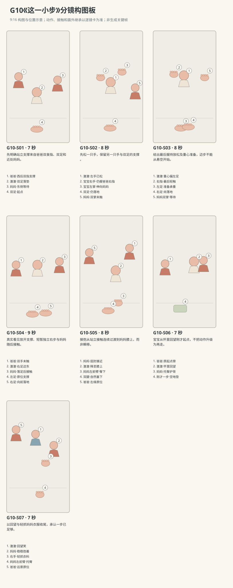

图示为构图位置示意；姿态、接触和画外继承以逐镜正文为准。

### 逐镜设计

#### G10-S01｜00—07 秒｜7 秒｜帧 [0, 168)

**镜头任务：**先明确站立支撑来自爸爸双食指、双足和近处妈妈。

**景别、机位与构图：**全身三人中景，南侧35厘米向北，爸爸左、宝宝中间面右、妈妈右；双手握点与双脚不裁切，三人间距清楚。

**摄影机与理由：**固定机位，让动作本身改变画面；不推拉遮盖接触。

**焦点：**焦点覆盖澈澈的眼睛、行动手与目标物；关键接触始终可辨。

**入态：**宝宝双足平踩地垫，右手握爸爸右食指、左手握爸爸左食指；爸爸跪坐西后，妈妈一步外东侧跪坐，空双掌在前。

**动作与表演：**

- 3 秒：爸爸保持双指高度稳定，身体没有向前推；妈妈看宝宝，掌心开放。

- 4 秒：宝宝看妈妈，再低头看看双脚，身体轻晃由握指和双足共同支撑。

**声音：**无对白、无音乐；西窗外极轻鸟声作底，前景保留连体衣摩擦与婴儿呼吸，动作触碰同步发声。

**出态：**宝宝仍双握双足支撑，视线回到妈妈，母亲双手尚离身体。

**切点与承接：**沿宝宝朝妈妈看的眼线切近支撑释放，空间方向不换。

**连续性：**全画明确三人位置、双指握点及双足接地；没有道具或未交代支撑。

**开始画面母稿：**

9:16竖幅，原创圆润三维生活动画，柔软棉布与自然皮肤质感，生活物理，无文字标语。澈澈深棕眼、短黑绒发、额前一撮向右弯，奶油色棉连体衣；身体按本条能力阶段呈现，表情与动作保留婴儿的专注和不熟练。 澈澈为R3能短暂放开支撑迈一步的故事能力阶段；爸爸短黑发砖陶上衣深灰裤，妈妈低马尾雾蓝上衣米色裤。 白天客厅西窗提供柔和漫射主光，暖墙反射补光；北墙固定沙发，东侧走廊，中央奶油地垫。 全身三人中景，南侧35厘米向北，爸爸左、宝宝中间面右、妈妈右；双手握点与双脚不裁切，三人间距清楚。 单一开始瞬间：宝宝双足平踩地垫，右手握爸爸右食指、左手握爸爸左食指；爸爸跪坐西后，妈妈一步外东侧跪坐，空双掌在前。 画面清楚呈现起态中已存在的支撑、视线与道具归属；不把后续动作叠画。

**视频变化母稿：**

9:16竖幅，原创圆润三维生活动画，柔软棉布与自然皮肤质感，生活物理，无文字标语。澈澈深棕眼、短黑绒发、额前一撮向右弯，奶油色棉连体衣；身体按本条能力阶段呈现，表情与动作保留婴儿的专注和不熟练。 澈澈为R3能短暂放开支撑迈一步的故事能力阶段；爸爸短黑发砖陶上衣深灰裤，妈妈低马尾雾蓝上衣米色裤。 白天客厅西窗提供柔和漫射主光，暖墙反射补光；北墙固定沙发，东侧走廊，中央奶油地垫。 本镜7秒，全身三人中景，南侧35厘米向北，爸爸左、宝宝中间面右、妈妈右；双手握点与双脚不裁切，三人间距清楚。 起态：宝宝双足平踩地垫，右手握爸爸右食指、左手握爸爸左食指；爸爸跪坐西后，妈妈一步外东侧跪坐，空双掌在前。 阶段1，持续3秒：爸爸保持双指高度稳定，身体没有向前推；妈妈看宝宝，掌心开放。 阶段2，持续4秒：宝宝看妈妈，再低头看看双脚，身体轻晃由握指和双足共同支撑。 摄影：固定机位，让动作本身改变画面；不推拉遮盖接触。 焦点：焦点覆盖澈澈的眼睛、行动手与目标物；关键接触始终可辨。 声音：无对白、无音乐；西窗外极轻鸟声作底，前景保留连体衣摩擦与婴儿呼吸，动作触碰同步发声。 终态：宝宝仍双握双足支撑，视线回到妈妈，母亲双手尚离身体。 连续性：全画明确三人位置、双指握点及双足接地；没有道具或未交代支撑。

#### G10-S02｜07—15 秒｜8 秒｜帧 [168, 360)

**镜头任务：**先松一只手，保留另一只手与双足的支撑。

**景别、机位与构图：**全身中近景，南侧35厘米，爸爸半身画左、宝宝中间、妈妈双掌画右；宝宝左右手、足底均可见。

**摄影机与理由：**固定机位，让动作本身改变画面；不推拉遮盖接触。

**焦点：**焦点覆盖澈澈的眼睛、行动手与目标物；关键接触始终可辨。

**入态：**宝宝两手仍握爸爸对应食指，妈妈双手开放在一步外，宝宝看妈妈。

**动作与表演：**

- 3 秒：宝宝左指慢慢张开，离开爸爸左食指，左掌朝妈妈伸去。

- 3 秒：爸爸空出的左手停在宝宝侧后、不触背；宝宝右手仍握爸爸右食指，双足留地。

- 2 秒：宝宝停住，看看伸出去的左掌，再看妈妈。

**声音：**无对白、无音乐；西窗外极轻鸟声作底，前景保留连体衣摩擦与婴儿呼吸，动作触碰同步发声。

**出态：**宝宝左掌空着伸向东，右手仍握爸爸右食指，双足不挪，爸爸左手空。

**切点与承接：**保留左掌伸出的方向，下一镜清楚看到最后右握怎样释放。

**连续性：**右握始终在画内，爸爸左手未换成背后托力；妈妈未触宝宝左掌。

**开始画面母稿：**

9:16竖幅，原创圆润三维生活动画，柔软棉布与自然皮肤质感，生活物理，无文字标语。澈澈深棕眼、短黑绒发、额前一撮向右弯，奶油色棉连体衣；身体按本条能力阶段呈现，表情与动作保留婴儿的专注和不熟练。 澈澈为R3能短暂放开支撑迈一步的故事能力阶段；爸爸短黑发砖陶上衣深灰裤，妈妈低马尾雾蓝上衣米色裤。 白天客厅西窗提供柔和漫射主光，暖墙反射补光；北墙固定沙发，东侧走廊，中央奶油地垫。 全身中近景，南侧35厘米，爸爸半身画左、宝宝中间、妈妈双掌画右；宝宝左右手、足底均可见。 单一开始瞬间：宝宝两手仍握爸爸对应食指，妈妈双手开放在一步外，宝宝看妈妈。 画面清楚呈现起态中已存在的支撑、视线与道具归属；不把后续动作叠画。

**视频变化母稿：**

9:16竖幅，原创圆润三维生活动画，柔软棉布与自然皮肤质感，生活物理，无文字标语。澈澈深棕眼、短黑绒发、额前一撮向右弯，奶油色棉连体衣；身体按本条能力阶段呈现，表情与动作保留婴儿的专注和不熟练。 澈澈为R3能短暂放开支撑迈一步的故事能力阶段；爸爸短黑发砖陶上衣深灰裤，妈妈低马尾雾蓝上衣米色裤。 白天客厅西窗提供柔和漫射主光，暖墙反射补光；北墙固定沙发，东侧走廊，中央奶油地垫。 本镜8秒，全身中近景，南侧35厘米，爸爸半身画左、宝宝中间、妈妈双掌画右；宝宝左右手、足底均可见。 起态：宝宝两手仍握爸爸对应食指，妈妈双手开放在一步外，宝宝看妈妈。 阶段1，持续3秒：宝宝左指慢慢张开，离开爸爸左食指，左掌朝妈妈伸去。 阶段2，持续3秒：爸爸空出的左手停在宝宝侧后、不触背；宝宝右手仍握爸爸右食指，双足留地。 阶段3，持续2秒：宝宝停住，看看伸出去的左掌，再看妈妈。 摄影：固定机位，让动作本身改变画面；不推拉遮盖接触。 焦点：焦点覆盖澈澈的眼睛、行动手与目标物；关键接触始终可辨。 声音：无对白、无音乐；西窗外极轻鸟声作底，前景保留连体衣摩擦与婴儿呼吸，动作触碰同步发声。 终态：宝宝左掌空着伸向东，右手仍握爸爸右食指，双足不挪，爸爸左手空。 连续性：右握始终在画内，爸爸左手未换成背后托力；妈妈未触宝宝左掌。

#### G10-S03｜15—23 秒｜8 秒｜帧 [360, 552)

**镜头任务：**给出最后握持放松及重心准备，迈步不能从悬空开始。

**景别、机位与构图：**全身侧面近景，南侧30厘米，宝宝居中面东、爸爸双手左缘、妈妈双掌右缘，双足及裤腿清楚。

**摄影机与理由：**固定机位，让动作本身改变画面；不推拉遮盖接触。

**焦点：**较深景深覆盖最后右指触点与双足，不能只聚焦表情。

**入态：**宝宝左掌伸向妈妈，右手握爸爸右食指，双脚踩实，身体略朝东。

**动作与表演：**

- 3 秒：宝宝轻轻弯膝再回到自然站高，把身体重量更多留在左脚，右脚仍接垫。

- 3 秒：右手指逐渐放松，爸爸右食指保持原位不抽走，妈妈双掌仍在前方等待。

- 2 秒：右手只剩指腹轻触爸爸食指，左掌向前，宝宝吸一小口气。

**声音：**无对白、无音乐；西窗外极轻鸟声作底，前景保留连体衣摩擦与婴儿呼吸，动作触碰同步发声。

**出态：**右指将松未松、双足仍落垫，重心偏左足，妈妈爸爸都没有移动躯干。

**切点与承接：**在最后接触尚存在时切同轴全身主镜，下一镜从这一指腹接触开始，不能省略脱离瞬间。

**连续性：**右足没有在有握持时先大步跨出；爸爸食指不拉人，妈妈双掌与衣服间有清楚空隙。

**开始画面母稿：**

9:16竖幅，原创圆润三维生活动画，柔软棉布与自然皮肤质感，生活物理，无文字标语。澈澈深棕眼、短黑绒发、额前一撮向右弯，奶油色棉连体衣；身体按本条能力阶段呈现，表情与动作保留婴儿的专注和不熟练。 澈澈为R3能短暂放开支撑迈一步的故事能力阶段；爸爸短黑发砖陶上衣深灰裤，妈妈低马尾雾蓝上衣米色裤。 白天客厅西窗提供柔和漫射主光，暖墙反射补光；北墙固定沙发，东侧走廊，中央奶油地垫。 全身侧面近景，南侧30厘米，宝宝居中面东、爸爸双手左缘、妈妈双掌右缘，双足及裤腿清楚。 单一开始瞬间：宝宝左掌伸向妈妈，右手握爸爸右食指，双脚踩实，身体略朝东。 画面清楚呈现起态中已存在的支撑、视线与道具归属；不把后续动作叠画。

**视频变化母稿：**

9:16竖幅，原创圆润三维生活动画，柔软棉布与自然皮肤质感，生活物理，无文字标语。澈澈深棕眼、短黑绒发、额前一撮向右弯，奶油色棉连体衣；身体按本条能力阶段呈现，表情与动作保留婴儿的专注和不熟练。 澈澈为R3能短暂放开支撑迈一步的故事能力阶段；爸爸短黑发砖陶上衣深灰裤，妈妈低马尾雾蓝上衣米色裤。 白天客厅西窗提供柔和漫射主光，暖墙反射补光；北墙固定沙发，东侧走廊，中央奶油地垫。 本镜8秒，全身侧面近景，南侧30厘米，宝宝居中面东、爸爸双手左缘、妈妈双掌右缘，双足及裤腿清楚。 起态：宝宝左掌伸向妈妈，右手握爸爸右食指，双脚踩实，身体略朝东。 阶段1，持续3秒：宝宝轻轻弯膝再回到自然站高，把身体重量更多留在左脚，右脚仍接垫。 阶段2，持续3秒：右手指逐渐放松，爸爸右食指保持原位不抽走，妈妈双掌仍在前方等待。 阶段3，持续2秒：右手只剩指腹轻触爸爸食指，左掌向前，宝宝吸一小口气。 摄影：固定机位，让动作本身改变画面；不推拉遮盖接触。 焦点：较深景深覆盖最后右指触点与双足，不能只聚焦表情。 声音：无对白、无音乐；西窗外极轻鸟声作底，前景保留连体衣摩擦与婴儿呼吸，动作触碰同步发声。 终态：右指将松未松、双足仍落垫，重心偏左足，妈妈爸爸都没有移动躯干。 连续性：右足没有在有握持时先大步跨出；爸爸食指不拉人，妈妈双掌与衣服间有清楚空隙。

#### G10-S04｜23—32 秒｜9 秒｜帧 [552, 768)

**镜头任务：**真实看见放开支撑、短暂独立右步与妈妈随后接触。

**景别、机位与构图：**全身动作主镜，南侧35厘米固定，爸爸双空手/宝宝全身/妈妈双掌都留画；不裁足、不切近、不慢镜掩盖。

**摄影机与理由：**固定机位，让动作本身改变画面；不推拉遮盖接触。

**焦点：**全身与两侧成人手保持同一可辨景深，特别保留脚底、最后握点脱离与接抱间隙。

**入态：**宝宝右指腹还轻触爸爸右食指，左掌已伸东，双足落垫，重心偏左足；妈妈双掌等待未触。

**动作与表演：**

- 2 秒：宝宝右指完全张开离开爸爸食指，两手向妈妈；爸爸双手留侧后近旁但均未触，宝宝左足承重。

- 3 秒：宝宝右足抬离垫一小段，右膝自然前送，短短迈向东侧妈妈，左足仍在起点承担重量。

- 4 秒：右足脚底落回地垫，身体随这一步前移；妈妈随后才用双掌轻稳躯干两侧，宝宝身体靠近她，爸爸双手仍空。

**声音：**无对白无音乐；第1—2秒右指离开轻衣擦、宝宝吸气；第3—5秒左足压垫轻响，第6秒附近右足落垫一声轻触，随后妈妈衣袖接近与宝宝呼气。

**出态：**宝宝右足在前左足在后均接垫，妈妈双掌已稳住躯干，爸爸在西后方双手未触。

**切点与承接：**右足落地和成人接触的先后都成立后再切接抱，不在空中切走。

**连续性：**独立窗口内双方成人与宝宝有空隙；只一步、无后推、无右脚滑行，衣裤腿和裸足对应连续。

**开始画面母稿：**

9:16竖幅，原创圆润三维生活动画，柔软棉布与自然皮肤质感，生活物理，无文字标语。澈澈深棕眼、短黑绒发、额前一撮向右弯，奶油色棉连体衣；身体按本条能力阶段呈现，表情与动作保留婴儿的专注和不熟练。 澈澈为R3能短暂放开支撑迈一步的故事能力阶段；爸爸短黑发砖陶上衣深灰裤，妈妈低马尾雾蓝上衣米色裤。 白天客厅西窗提供柔和漫射主光，暖墙反射补光；北墙固定沙发，东侧走廊，中央奶油地垫。 全身动作主镜起点，南侧35厘米高固定；爸爸画左、宝宝全身居中面东、妈妈双掌在右；宝宝右指腹仍轻触爸爸右食指，左掌已伸东，双足接垫，不裁足。 单一开始瞬间：宝宝右指腹还轻触爸爸右食指，左掌已伸东，双足落垫，重心偏左足；妈妈双掌等待未触。 本图焦点固定在：最后尚存的右指腹接触、左足负重与未离垫的右足，妈妈双掌与身体间的空隙。 仅呈现这一瞬间的身体支撑、视线与物件归属，不把未来阶段或相机路径叠画。

**视频变化母稿：**

9:16竖幅，原创圆润三维生活动画，柔软棉布与自然皮肤质感，生活物理，无文字标语。澈澈深棕眼、短黑绒发、额前一撮向右弯，奶油色棉连体衣；身体按本条能力阶段呈现，表情与动作保留婴儿的专注和不熟练。 澈澈为R3能短暂放开支撑迈一步的故事能力阶段；爸爸短黑发砖陶上衣深灰裤，妈妈低马尾雾蓝上衣米色裤。 白天客厅西窗提供柔和漫射主光，暖墙反射补光；北墙固定沙发，东侧走廊，中央奶油地垫。 本镜9秒，全身动作主镜，南侧35厘米固定，爸爸双空手/宝宝全身/妈妈双掌都留画；不裁足、不切近、不慢镜掩盖。 起态：宝宝右指腹还轻触爸爸右食指，左掌已伸东，双足落垫，重心偏左足；妈妈双掌等待未触。 阶段1，持续2秒：宝宝右指完全张开离开爸爸食指，两手向妈妈；爸爸双手留侧后近旁但均未触，宝宝左足承重。 阶段2，持续3秒：宝宝右足抬离垫一小段，右膝自然前送，短短迈向东侧妈妈，左足仍在起点承担重量。 阶段3，持续4秒：右足脚底落回地垫，身体随这一步前移；妈妈随后才用双掌轻稳躯干两侧，宝宝身体靠近她，爸爸双手仍空。 摄影：固定机位，让动作本身改变画面；不推拉遮盖接触。 焦点：全身与两侧成人手保持同一可辨景深，特别保留脚底、最后握点脱离与接抱间隙。 声音：无对白无音乐；第1—2秒右指离开轻衣擦、宝宝吸气；第3—5秒左足压垫轻响，第6秒附近右足落垫一声轻触，随后妈妈衣袖接近与宝宝呼气。 终态：宝宝右足在前左足在后均接垫，妈妈双掌已稳住躯干，爸爸在西后方双手未触。 连续性：独立窗口内双方成人与宝宝有空隙；只一步、无后推、无右脚滑行，衣裤腿和裸足对应连续。

#### G10-S05｜32—40 秒｜8 秒｜帧 [768, 960)

**镜头任务：**接抱从站立接触连续过渡到妈妈膝上，而非瞬移。

**景别、机位与构图：**全身双人中近景，南侧30厘米，宝宝在中右、妈妈右，爸爸空手留左缘；妈妈膝面与宝宝臀部、双足可见。

**摄影机与理由：**固定机位，让动作本身改变画面；不推拉遮盖接触。

**焦点：**优先让妈妈双掌、宝宝臀部落膝与腿脚受力转换清楚，再顾脸部。

**入态：**宝宝右足前左足后仍接垫，妈妈双掌稳住宝宝躯干两侧，自己跪坐在脚跟上。

**动作与表演：**

- 3 秒：妈妈屈肘把宝宝稳稳收近，宝宝两掌碰到她胸前衣料；双足随身体靠近作小幅受控位置调整，不再独立跨步。

- 2 秒：妈妈保持双掌托稳躯干，缓缓降低宝宝到自己膝面，宝宝屈膝，臀部落到并拢的双膝上。

- 3 秒：臀部已有膝面支撑后，妈妈左前臂移到臀下、右掌留背，稳托着把宝宝缓慢转成胸口朝南偏西的侧坐，双腿随整体自然垂在膝前；全过程臀背都有承托。

**声音：**无对白、无音乐；西窗外极轻鸟声作底，前景保留连体衣摩擦与婴儿呼吸，动作触碰同步发声。

**出态：**宝宝在妈妈膝上侧坐、胸口朝南偏西，臀部由膝面和左前臂支撑，右掌护背，双腿垂在膝前；爸爸仍在原地。

**切点与承接：**接抱链完成再切宝宝回望，保持臀部承托与背部手的位置。

**连续性：**妈妈不是先把宝宝吊离地；双掌稳躯干到臀部落膝后才换左前臂，脚离垫时已有明确膝面承托。

**开始画面母稿：**

9:16竖幅，原创圆润三维生活动画，柔软棉布与自然皮肤质感，生活物理，无文字标语。澈澈深棕眼、短黑绒发、额前一撮向右弯，奶油色棉连体衣；身体按本条能力阶段呈现，表情与动作保留婴儿的专注和不熟练。 澈澈为R3能短暂放开支撑迈一步的故事能力阶段；爸爸短黑发砖陶上衣深灰裤，妈妈低马尾雾蓝上衣米色裤。 白天客厅西窗提供柔和漫射主光，暖墙反射补光；北墙固定沙发，东侧走廊，中央奶油地垫。 全身双人中近景，南侧30厘米，宝宝在中右、妈妈右，爸爸空手留左缘；妈妈膝面与宝宝臀部、双足可见。 单一开始瞬间：宝宝右足前左足后仍接垫，妈妈双掌稳住宝宝躯干两侧，自己跪坐在脚跟上。 画面清楚呈现起态中已存在的支撑、视线与道具归属；不把后续动作叠画。

**视频变化母稿：**

9:16竖幅，原创圆润三维生活动画，柔软棉布与自然皮肤质感，生活物理，无文字标语。澈澈深棕眼、短黑绒发、额前一撮向右弯，奶油色棉连体衣；身体按本条能力阶段呈现，表情与动作保留婴儿的专注和不熟练。 澈澈为R3能短暂放开支撑迈一步的故事能力阶段；爸爸短黑发砖陶上衣深灰裤，妈妈低马尾雾蓝上衣米色裤。 白天客厅西窗提供柔和漫射主光，暖墙反射补光；北墙固定沙发，东侧走廊，中央奶油地垫。 本镜8秒，全身双人中近景，南侧30厘米，宝宝在中右、妈妈右，爸爸空手留左缘；妈妈膝面与宝宝臀部、双足可见。 起态：宝宝右足前左足后仍接垫，妈妈双掌稳住宝宝躯干两侧，自己跪坐在脚跟上。 阶段1，持续3秒：妈妈屈肘把宝宝稳稳收近，宝宝两掌碰到她胸前衣料；双足随身体靠近作小幅受控位置调整，不再独立跨步。 阶段2，持续2秒：妈妈保持双掌托稳躯干，缓缓降低宝宝到自己膝面，宝宝屈膝，臀部落到并拢的双膝上。 阶段3，持续3秒：臀部已有膝面支撑后，妈妈左前臂移到臀下、右掌留背，稳托着把宝宝缓慢转成胸口朝南偏西的侧坐，双腿随整体自然垂在膝前；全过程臀背都有承托。 摄影：固定机位，让动作本身改变画面；不推拉遮盖接触。 焦点：优先让妈妈双掌、宝宝臀部落膝与腿脚受力转换清楚，再顾脸部。 声音：无对白、无音乐；西窗外极轻鸟声作底，前景保留连体衣摩擦与婴儿呼吸，动作触碰同步发声。 终态：宝宝在妈妈膝上侧坐、胸口朝南偏西，臀部由膝面和左前臂支撑，右掌护背，双腿垂在膝前；爸爸仍在原地。 连续性：妈妈不是先把宝宝吊离地；双掌稳躯干到臀部落膝后才换左前臂，脚离垫时已有明确膝面承托。

#### G10-S06｜40—47 秒｜7 秒｜帧 [960, 1128)

**镜头任务：**宝宝从怀里回望刚才起点，不把动作升级为再走。

**景别、机位与构图：**三人中景，南侧35厘米，妈妈抱宝宝在右，爸爸原位左，中间空出刚才一步的地垫；母婴身体承托可见。

**摄影机与理由：**固定机位，让动作本身改变画面；不推拉遮盖接触。

**焦点：**焦点覆盖澈澈的眼睛、行动手与目标物；关键接触始终可辨。

**入态：**宝宝在妈妈膝上侧坐，胸口已朝南偏西，妈妈左前臂托臀、右掌护背，宝宝眼睛还看她胸前衣料。

**动作与表演：**

- 2 秒：宝宝靠着妈妈呼出小气，双手轻放她胸前。

- 3 秒：他先转眼，再小幅转脸看西侧爸爸，妈妈躯干保持侧向让他无需拧颈到背后。

- 2 秒：爸爸留原位坐低，看看宝宝再看刚才的起点，轻轻笑。

**声音：**无对白、无音乐；西窗外极轻鸟声作底，前景保留连体衣摩擦与婴儿呼吸，动作触碰同步发声。

**出态：**宝宝在有承托的怀里看向爸爸和原站位，爸爸仍坐西侧，妈妈手位不变。

**切点与承接：**沿宝宝视线切近母婴与远处爸爸，结尾只回应不重来。

**连续性：**宝宝躯干随坐膝姿朝西南，回看幅度自然；父母位置未换，双腿无新增迈步。

**开始画面母稿：**

9:16竖幅，原创圆润三维生活动画，柔软棉布与自然皮肤质感，生活物理，无文字标语。澈澈深棕眼、短黑绒发、额前一撮向右弯，奶油色棉连体衣；身体按本条能力阶段呈现，表情与动作保留婴儿的专注和不熟练。 澈澈为R3能短暂放开支撑迈一步的故事能力阶段；爸爸短黑发砖陶上衣深灰裤，妈妈低马尾雾蓝上衣米色裤。 白天客厅西窗提供柔和漫射主光，暖墙反射补光；北墙固定沙发，东侧走廊，中央奶油地垫。 三人中景，南侧35厘米，妈妈抱宝宝在右，爸爸原位左，中间空出刚才一步的地垫；母婴身体承托可见。 单一开始瞬间：宝宝在妈妈膝上侧坐，胸口已朝南偏西，妈妈左前臂托臀、右掌护背，宝宝眼睛还看她胸前衣料。 画面清楚呈现起态中已存在的支撑、视线与道具归属；不把后续动作叠画。

**视频变化母稿：**

9:16竖幅，原创圆润三维生活动画，柔软棉布与自然皮肤质感，生活物理，无文字标语。澈澈深棕眼、短黑绒发、额前一撮向右弯，奶油色棉连体衣；身体按本条能力阶段呈现，表情与动作保留婴儿的专注和不熟练。 澈澈为R3能短暂放开支撑迈一步的故事能力阶段；爸爸短黑发砖陶上衣深灰裤，妈妈低马尾雾蓝上衣米色裤。 白天客厅西窗提供柔和漫射主光，暖墙反射补光；北墙固定沙发，东侧走廊，中央奶油地垫。 本镜7秒，三人中景，南侧35厘米，妈妈抱宝宝在右，爸爸原位左，中间空出刚才一步的地垫；母婴身体承托可见。 起态：宝宝在妈妈膝上侧坐，胸口已朝南偏西，妈妈左前臂托臀、右掌护背，宝宝眼睛还看她胸前衣料。 阶段1，持续2秒：宝宝靠着妈妈呼出小气，双手轻放她胸前。 阶段2，持续3秒：他先转眼，再小幅转脸看西侧爸爸，妈妈躯干保持侧向让他无需拧颈到背后。 阶段3，持续2秒：爸爸留原位坐低，看看宝宝再看刚才的起点，轻轻笑。 摄影：固定机位，让动作本身改变画面；不推拉遮盖接触。 焦点：焦点覆盖澈澈的眼睛、行动手与目标物；关键接触始终可辨。 声音：无对白、无音乐；西窗外极轻鸟声作底，前景保留连体衣摩擦与婴儿呼吸，动作触碰同步发声。 终态：宝宝在有承托的怀里看向爸爸和原站位，爸爸仍坐西侧，妈妈手位不变。 连续性：宝宝躯干随坐膝姿朝西南，回看幅度自然；父母位置未换，双腿无新增迈步。

#### G10-S07｜47—54 秒｜7 秒｜帧 [1128, 1296)

**镜头任务：**以回望与轻抓妈妈衣服收尾，承认一步已足够。

**景别、机位与构图：**母婴近景，南侧35厘米，宝宝脸居中向左看，妈妈右侧，左前臂托臀留在下缘，爸爸在左后景柔虚。

**摄影机与理由：**固定机位，让动作本身改变画面；不推拉遮盖接触。

**焦点：**焦点覆盖澈澈的眼睛、行动手与目标物；关键接触始终可辨。

**入态：**宝宝坐妈妈膝上看西侧爸爸，妈妈左前臂托臀、右掌护背，宝宝双掌贴她胸前衣料。

**动作与表演：**

- 3 秒：宝宝看着爸爸笑一下，爸爸不伸手要求再走，只留在原处回应笑。

- 2 秒：宝宝右指轻轻抓住妈妈胸前一小片雾蓝衣料，身体靠回她怀里。

- 2 秒：妈妈右掌在背上保持稳定，不拍打催促；宝宝呼吸落稳，视线仍留爸爸方向。

**声音：**无对白无音乐；宝宝极轻笑气、右指捏棉布的一点摩擦、稳定呼吸，爸爸只微笑不另配词。

**出态：**宝宝在妈妈膝上被稳稳承托，右手轻抓衣料、左掌贴胸，爸爸原位微笑。

**切点与承接：**留在一步之后的安定里结束，无台词、奖杯音或再走一次的追加。

**连续性：**妈妈左右手与臀背承托连续，宝宝右手抓的是衣料而不是成人手指；全片只完成一小步。

**开始画面母稿：**

9:16竖幅，原创圆润三维生活动画，柔软棉布与自然皮肤质感，生活物理，无文字标语。澈澈深棕眼、短黑绒发、额前一撮向右弯，奶油色棉连体衣；身体按本条能力阶段呈现，表情与动作保留婴儿的专注和不熟练。 澈澈为R3能短暂放开支撑迈一步的故事能力阶段；爸爸短黑发砖陶上衣深灰裤，妈妈低马尾雾蓝上衣米色裤。 白天客厅西窗提供柔和漫射主光，暖墙反射补光；北墙固定沙发，东侧走廊，中央奶油地垫。 母婴近景，南侧35厘米，宝宝脸居中向左看，妈妈右侧，左前臂托臀留在下缘，爸爸在左后景柔虚。 单一开始瞬间：宝宝坐妈妈膝上看西侧爸爸，妈妈左前臂托臀、右掌护背，宝宝双掌贴她胸前衣料。 画面清楚呈现起态中已存在的支撑、视线与道具归属；不把后续动作叠画。

**视频变化母稿：**

9:16竖幅，原创圆润三维生活动画，柔软棉布与自然皮肤质感，生活物理，无文字标语。澈澈深棕眼、短黑绒发、额前一撮向右弯，奶油色棉连体衣；身体按本条能力阶段呈现，表情与动作保留婴儿的专注和不熟练。 澈澈为R3能短暂放开支撑迈一步的故事能力阶段；爸爸短黑发砖陶上衣深灰裤，妈妈低马尾雾蓝上衣米色裤。 白天客厅西窗提供柔和漫射主光，暖墙反射补光；北墙固定沙发，东侧走廊，中央奶油地垫。 本镜7秒，母婴近景，南侧35厘米，宝宝脸居中向左看，妈妈右侧，左前臂托臀留在下缘，爸爸在左后景柔虚。 起态：宝宝坐妈妈膝上看西侧爸爸，妈妈左前臂托臀、右掌护背，宝宝双掌贴她胸前衣料。 阶段1，持续3秒：宝宝看着爸爸笑一下，爸爸不伸手要求再走，只留在原处回应笑。 阶段2，持续2秒：宝宝右指轻轻抓住妈妈胸前一小片雾蓝衣料，身体靠回她怀里。 阶段3，持续2秒：妈妈右掌在背上保持稳定，不拍打催促；宝宝呼吸落稳，视线仍留爸爸方向。 摄影：固定机位，让动作本身改变画面；不推拉遮盖接触。 焦点：焦点覆盖澈澈的眼睛、行动手与目标物；关键接触始终可辨。 声音：无对白无音乐；宝宝极轻笑气、右指捏棉布的一点摩擦、稳定呼吸，爸爸只微笑不另配词。 终态：宝宝在妈妈膝上被稳稳承托，右手轻抓衣料、左掌贴胸，爸爸原位微笑。 连续性：妈妈左右手与臀背承托连续，宝宝右手抓的是衣料而不是成人手指；全片只完成一小步。

### 声音与剪辑

成人衣料与膝接垫的轻响、宝宝松握后小吸气、右足落垫的真实轻触、接抱后的呼气；不以脚步重击或胜利音乐放大动作，无口令对白。

正式台词：无；保留镜头声音中已写明的自然发声。

### 连续性与试片

- 连续性：最初宝宝右手握爸爸右食指、左手握爸爸左食指；先松左后松右，两处释放镜内可见。

- 连续性：独立一步向东，右足前迈、左足在原地承重；右足落地后妈妈双掌才接触，爸爸没有从后推。

- 连续性：妈妈接触先是双掌稳躯干，随后收近降低到膝上，左前臂承托臀部后右掌保持背部；不得瞬移到怀里。

- 连续性：父母始终在西/东两侧；近景不能抹掉双手是否接触的证据，主迈步全身镜不中断。

- 连续性：本条只迈这一小步，不把R3演成连续跑步、成人步幅或熟练转身走回。

- 试片：G10-S02到S04：左握释放、右握释放、短暂双方成人都未触、右足抬落四状态全部可见；成人推送、提前接住或跳切补成功则失败。

- 试片：G10-S04逐帧：左足承担迈步时重量、右腿连续并以短步落地，妈妈触躯干必须晚于右足落垫；漂浮、滑步、腿换位则失败。

- 试片：G10-S05：双掌稳定→身体收近降低→臀部落膝与左前臂承托→右手托背的接抱链成立；无承托抱起或瞬间切成坐怀则失败。

- 试片：G10-S06到S07：宝宝在妈妈怀里仅回望原起点，父母位置与宝宝双腿连续；把转头做成180度拧颈或再迈一步则失败。

**媒体待验证：**尚无媒体；此组最高接触风险，需先三维/骨骼预演双手释放、单足短暂承重和接抱，再审阅衣物、手指、脚趾及双方表情。

---

## G11《这样叫，也是爸爸》

**36 秒｜坐姿与手部互动｜角色：澈澈、妈妈、爸爸｜场景 L**

### 剧情正文

客厅里，澈澈坐在奶油色地垫中央，爸爸在西侧，妈妈坐在东侧陪他。妈妈等澈澈看向自己，轻轻问：“爸爸在哪儿？”澈澈先转动眼睛，再偏过脸，右手朝爸爸伸出去，食指略直，其余手指还松松蜷着。爸爸看见这只小手，才笑起来。澈澈把手收回腿上，又看看妈妈。妈妈这回换了家里已熟悉的称呼：“阿禾在哪儿？”家里平时也这样叫爸爸。澈澈停了片刻，仍把脸和右手转向同一位爸爸。爸爸没有换位置，笑意却比刚才更明显。妈妈顺着他的手看过去，轻声说：“还是爸爸呀。”澈澈看看两个大人的脸，右手慢慢放回腿上，也露出一点笑。

### 亲述来源与改编

原帖是家长自述，未独立核实。本片将生活机制改编为澈澈的原创故事。

- [RT05 · 换爸爸的名字再问，还是指同一个人](https://www.gzmama.com/thread-1457352-1-1.html)；作者自报年龄：原帖归在11—12个月记录；未给该日精确月龄。

- **采用的生活过程：**两次连续提问，先称爸爸、后换爸爸另一称呼，孩子两次都指向同一人。

- **采用的生活过程：**来源归在作者自报11—12个月分段，本片保留稳定坐姿，不倒算精确月龄。

- **本片原创改编：**角色换为澈澈家庭，房间方位、右手指认、爸爸等待及妈妈末句回应为原创。

- **本片原创改编：**“阿禾”及此前已熟悉这一昵称为可撤销剧情假设；它不是来源家庭或用户家庭的名字。

- **不作出的事实推断：**公开家长自述未独立核实；原文未记宝宝发声、具体手位或成人即时表情。

- **不作出的事实推断：**不称两称呼指认是所有11—12个月孩子应有能力，不把其他家庭反应并作原事件。

[查看原始过程与缺项](research/real-experiences/index.html#RT05)

### 导演与空间

**观察任务：**用两种熟悉称呼与两次相同指向，呈现宝宝对家人的认认与成人的意外；不让宝宝代替指认说完整句。

**空间与光位：**澈澈中央面南稳坐，妈妈东侧偏南坐地、画右；爸爸西侧偏北坐地、画左。妈妈与宝宝相距一前臂，爸爸在宝宝右前方看得见的位置。摄影机在南侧，右手指向西侧爸爸时画面向左，始终不镜像。北侧沙发为地理锚点；无手持道具。

**人物表演：**妈妈像日常聊天般问一次，等宝宝看清再问第二次，不连续催答。澈澈先转眼再随头肩小幅转向爸爸，伸右手指认，手型保留幼儿不熟练；爸爸不抢先招手提示，不用夸张装傻制造误导。

### 节拍覆盖

- **G11-b1**：前态：澈澈稳坐中央，双掌搭腿、目光在爸爸一侧；妈妈双掌在膝，爸爸双掌松放膝上。 过程：妈妈稍偏身等候，没有招手；澈澈把目光转到妈妈脸上。妈妈与澈澈相看，爸爸安静留在西侧，不指自己。 后态：宝宝已经看妈妈，三人手部均未指认。 观众观察：建立两个称呼将指向的同一位爸爸及稳定空间。 → G11-S01

- **G11-b2**：前态：澈澈双掌在腿上看妈妈，妈妈嘴合着、空双手在膝。 过程：妈妈面向宝宝用自然普通话说：“爸爸在哪儿？”嘴唇随问句开合，手仍在膝上。问句落完，澈澈先向画左转眼，再小幅转头找爸爸；右掌开始离腿但尚未完整伸出。 后态：宝宝脸已朝爸爸，右手刚抬，妈妈停声等待。 观众观察：让第一声称呼成为宝宝寻找目标的明确触发。 → G11-S02

- **G11-b3**：前态：宝宝头朝西侧爸爸，右掌已离腿，妈妈和爸爸均停声且空手在膝。 过程：澈澈右臂向爸爸伸出，食指略伸直、其余指松蜷，目光落爸爸脸。爸爸确认自己被指到，才嘴角上扬；双掌仍留膝，不替宝宝指认。宝宝把右手收回腿上，脸和眼睛转回妈妈。 后态：宝宝右手已回腿、重新看妈妈；爸爸原位微笑。 观众观察：把第一轮指认读清，并为第二轮真正重置空手状态。 → G11-S03

- **G11-b4**：前态：澈澈双掌已回腿、看妈妈；妈妈准备问第二句，爸爸画外西侧微笑。 过程：妈妈自然问：“阿禾在哪儿？”说完收口；不再补充爸爸的提示。澈澈停听一会儿，眼睛再次移到画左，头跟过去；右手在腿上开始抬起。 后态：宝宝第二次朝向同一位爸爸，右手刚离腿，妈妈安静等。 观众观察：换称呼而保持问题对象和空间，留出倾听。 → G11-S04

- **G11-b5**：前态：宝宝脸朝爸爸、右掌刚离腿；爸爸仍西侧同一位置，妈妈看着宝宝。 过程：宝宝右臂再次向画左爸爸伸出，手型略笨拙但目标清楚；爸爸不提前动手。爸爸看向那只小手，笑意加深；妈妈顺着右手看向爸爸，宝宝维持短暂指认。 后态：第二次右手仍指爸爸，三人看见同一对象，爸爸没有接近或挪位。 观众观察：让第二轮落到同一人，笑点由相同指向成立。 → G11-S05

- **G11-b6**：前态：宝宝右手指着爸爸，妈妈已顺指向看过爸爸，爸爸微笑。 过程：妈妈看回宝宝，轻柔带笑说：“还是爸爸呀。”手仍在膝，嘴部自然发音。宝宝把右手慢慢放回腿上，看看妈妈再看爸爸，嘴角出现小笑；爸爸只陪看不加问句。 后态：宝宝双掌回腿、骨盆双腿接地，父母原位陪笑。 观众观察：把成人的会意与宝宝收手后的笑放在同一段。 → G11-S06

### 分镜构图板

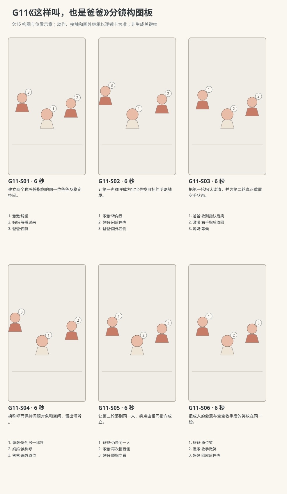

图示为构图位置示意；姿态、接触和画外继承以逐镜正文为准。

### 逐镜设计

#### G11-S01｜00—06 秒｜6 秒｜帧 [0, 144)

**镜头任务：**建立两个称呼将指向的同一位爸爸及稳定空间。

**景别、机位与构图：**三人中全景，南侧宝宝眼位略上；前景地垫，中景宝宝居中、妈妈画右、爸爸画左，后景北沙发。

**摄影机与理由：**固定南侧机位，让人物动作提供信息变化；不以推拉或切焦遮住接触。

**焦点：**保持本镜关键脸部与行动区域同时可读；不可见的画外状态只按连续性继承。

**入态：**澈澈稳坐中央，双掌搭腿、目光在爸爸一侧；妈妈双掌在膝，爸爸双掌松放膝上。

**动作与表演：**

- 3 秒：妈妈稍偏身等候，没有招手；澈澈把目光转到妈妈脸上。

- 3 秒：妈妈与澈澈相看，爸爸安静留在西侧，不指自己。

**声音：**无对白、无音乐；连续轻微室内底声，保留呼吸与衣料声；不添加解释旁白或笑声音效。

**出态：**宝宝已经看妈妈，三人手部均未指认。

**切点与承接：**切同侧共享中景，保留问话者嘴和宝宝的转头空间。

**连续性：**双腿骨盆落垫可见；无道具，不新增第四人。

**开始画面母稿：**

9:16竖幅，原创圆润三维生活动画，柔软棉布与自然皮肤质感，生活物理，无文字标语、无字幕。 澈澈深棕眼、短黑绒发、额前一撮向右弯，奶油色棉连体衣；外貌衣着为沿用母稿的可撤销暂拟，实际参考尚未绑定。 澈澈为R1稳定坐姿并能以手指认熟悉家人的阶段；不以精确月龄作普遍发展标准。 妈妈深棕短发、雾绿棉衬衫、深灰长裤；爸爸短黑发、砖陶衬衫、深灰长裤；外貌衣着为可撤销暂拟。 白天客厅西窗提供柔和漫射主光，暖墙反射补光；北墙固定沙发，东侧走廊，中央奶油地垫。 三人中全景，南侧宝宝眼位略上；前景地垫，中景宝宝居中、妈妈画右、爸爸画左，后景北沙发。 单一开始瞬间：澈澈稳坐中央，双掌搭腿、目光在爸爸一侧；妈妈双掌在膝，爸爸双掌松放膝上。  只画此刻的姿态、视线与道具归属，不把后续动作叠画。

**视频变化母稿：**

9:16竖幅，原创圆润三维生活动画，柔软棉布与自然皮肤质感，生活物理，无文字标语、无字幕。 澈澈深棕眼、短黑绒发、额前一撮向右弯，奶油色棉连体衣；外貌衣着为沿用母稿的可撤销暂拟，实际参考尚未绑定。 澈澈为R1稳定坐姿并能以手指认熟悉家人的阶段；不以精确月龄作普遍发展标准。 妈妈深棕短发、雾绿棉衬衫、深灰长裤；爸爸短黑发、砖陶衬衫、深灰长裤；外貌衣着为可撤销暂拟。 白天客厅西窗提供柔和漫射主光，暖墙反射补光；北墙固定沙发，东侧走廊，中央奶油地垫。 本镜6秒，三人中全景，南侧宝宝眼位略上；前景地垫，中景宝宝居中、妈妈画右、爸爸画左，后景北沙发。 起态：澈澈稳坐中央，双掌搭腿、目光在爸爸一侧；妈妈双掌在膝，爸爸双掌松放膝上。 阶段1，持续3秒：妈妈稍偏身等候，没有招手；澈澈把目光转到妈妈脸上。 阶段2，持续3秒：妈妈与澈澈相看，爸爸安静留在西侧，不指自己。 摄影：固定南侧机位，让人物动作提供信息变化；不以推拉或切焦遮住接触。 焦点：保持本镜关键脸部与行动区域同时可读；不可见的画外状态只按连续性继承。 声音：无对白、无音乐；连续轻微室内底声，保留呼吸与衣料声；不添加解释旁白或笑声音效。 终态：宝宝已经看妈妈，三人手部均未指认。 连续性：双腿骨盆落垫可见；无道具，不新增第四人。

#### G11-S02｜06—12 秒｜6 秒｜帧 [144, 288)

**镜头任务：**让第一声称呼成为宝宝寻找目标的明确触发。

**景别、机位与构图：**南侧双人中景，澈澈在画中偏左、妈妈在画右；爸爸西侧画外继承。

**摄影机与理由：**固定南侧机位，让人物动作提供信息变化；不以推拉或切焦遮住接触。

**焦点：**保持本镜关键脸部与行动区域同时可读；不可见的画外状态只按连续性继承。

**入态：**澈澈双掌在腿上看妈妈，妈妈嘴合着、空双手在膝。

**动作与表演：**

- 3 秒：妈妈面向宝宝用自然普通话说：“爸爸在哪儿？”嘴唇随问句开合，手仍在膝上。

- 3 秒：问句落完，澈澈先向画左转眼，再小幅转头找爸爸；右掌开始离腿但尚未完整伸出。

**声音：**妈妈{爸爸在哪儿？}，第1—3秒问完；之后无对白，保留宝宝呼吸，无音乐。

**出态：**宝宝脸已朝爸爸，右手刚抬，妈妈停声等待。

**切点与承接：**继续这一抬手相位切三人同侧中景，不重播转头。

**连续性：**爸爸画外仍西侧原坐位且未提示；宝宝不是看镜头回答。

**开始画面母稿：**

9:16竖幅，原创圆润三维生活动画，柔软棉布与自然皮肤质感，生活物理，无文字标语、无字幕。 澈澈深棕眼、短黑绒发、额前一撮向右弯，奶油色棉连体衣；外貌衣着为沿用母稿的可撤销暂拟，实际参考尚未绑定。 澈澈为R1稳定坐姿并能以手指认熟悉家人的阶段；不以精确月龄作普遍发展标准。 妈妈深棕短发、雾绿棉衬衫、深灰长裤；爸爸短黑发、砖陶衬衫、深灰长裤；外貌衣着为可撤销暂拟。 白天客厅西窗提供柔和漫射主光，暖墙反射补光；北墙固定沙发，东侧走廊，中央奶油地垫。 南侧双人中景，澈澈在画中偏左、妈妈在画右；爸爸西侧画外继承。 单一开始瞬间：澈澈双掌在腿上看妈妈，妈妈嘴合着、空双手在膝。  只画此刻的姿态、视线与道具归属，不把后续动作叠画。

**视频变化母稿：**

9:16竖幅，原创圆润三维生活动画，柔软棉布与自然皮肤质感，生活物理，无文字标语、无字幕。 澈澈深棕眼、短黑绒发、额前一撮向右弯，奶油色棉连体衣；外貌衣着为沿用母稿的可撤销暂拟，实际参考尚未绑定。 澈澈为R1稳定坐姿并能以手指认熟悉家人的阶段；不以精确月龄作普遍发展标准。 妈妈深棕短发、雾绿棉衬衫、深灰长裤；爸爸短黑发、砖陶衬衫、深灰长裤；外貌衣着为可撤销暂拟。 白天客厅西窗提供柔和漫射主光，暖墙反射补光；北墙固定沙发，东侧走廊，中央奶油地垫。 本镜6秒，南侧双人中景，澈澈在画中偏左、妈妈在画右；爸爸西侧画外继承。 起态：澈澈双掌在腿上看妈妈，妈妈嘴合着、空双手在膝。 阶段1，持续3秒：妈妈面向宝宝用自然普通话说：“爸爸在哪儿？”嘴唇随问句开合，手仍在膝上。 阶段2，持续3秒：问句落完，澈澈先向画左转眼，再小幅转头找爸爸；右掌开始离腿但尚未完整伸出。 摄影：固定南侧机位，让人物动作提供信息变化；不以推拉或切焦遮住接触。 焦点：保持本镜关键脸部与行动区域同时可读；不可见的画外状态只按连续性继承。 声音：妈妈{爸爸在哪儿？}，第1—3秒问完；之后无对白，保留宝宝呼吸，无音乐。 终态：宝宝脸已朝爸爸，右手刚抬，妈妈停声等待。 连续性：爸爸画外仍西侧原坐位且未提示；宝宝不是看镜头回答。

#### G11-S03｜12—18 秒｜6 秒｜帧 [288, 432)

**镜头任务：**把第一轮指认读清，并为第二轮真正重置空手状态。

**景别、机位与构图：**南侧三人中景，爸爸画左、宝宝居中、妈妈画右；宝宝右臂与爸爸面部在可读范围。

**摄影机与理由：**固定南侧机位，让人物动作提供信息变化；不以推拉或切焦遮住接触。

**焦点：**保持本镜关键脸部与行动区域同时可读；不可见的画外状态只按连续性继承。

**入态：**宝宝头朝西侧爸爸，右掌已离腿，妈妈和爸爸均停声且空手在膝。

**动作与表演：**

- 2 秒：澈澈右臂向爸爸伸出，食指略伸直、其余指松蜷，目光落爸爸脸。

- 2 秒：爸爸确认自己被指到，才嘴角上扬；双掌仍留膝，不替宝宝指认。

- 2 秒：宝宝把右手收回腿上，脸和眼睛转回妈妈。

**声音：**无对白、无音乐；连续轻微室内底声，保留呼吸与衣料声；不添加解释旁白或笑声音效。

**出态：**宝宝右手已回腿、重新看妈妈；爸爸原位微笑。

**切点与承接：**以右手落腿与回看妈妈完成为出点，切第二次问句。

**连续性：**第一轮指认在镜内完成并收手，爸爸全程原位。

**开始画面母稿：**

9:16竖幅，原创圆润三维生活动画，柔软棉布与自然皮肤质感，生活物理，无文字标语、无字幕。 澈澈深棕眼、短黑绒发、额前一撮向右弯，奶油色棉连体衣；外貌衣着为沿用母稿的可撤销暂拟，实际参考尚未绑定。 澈澈为R1稳定坐姿并能以手指认熟悉家人的阶段；不以精确月龄作普遍发展标准。 妈妈深棕短发、雾绿棉衬衫、深灰长裤；爸爸短黑发、砖陶衬衫、深灰长裤；外貌衣着为可撤销暂拟。 白天客厅西窗提供柔和漫射主光，暖墙反射补光；北墙固定沙发，东侧走廊，中央奶油地垫。 南侧三人中景，爸爸画左、宝宝居中、妈妈画右；宝宝右臂与爸爸面部在可读范围。 单一开始瞬间：宝宝头朝西侧爸爸，右掌已离腿，妈妈和爸爸均停声且空手在膝。  只画此刻的姿态、视线与道具归属，不把后续动作叠画。

**视频变化母稿：**

9:16竖幅，原创圆润三维生活动画，柔软棉布与自然皮肤质感，生活物理，无文字标语、无字幕。 澈澈深棕眼、短黑绒发、额前一撮向右弯，奶油色棉连体衣；外貌衣着为沿用母稿的可撤销暂拟，实际参考尚未绑定。 澈澈为R1稳定坐姿并能以手指认熟悉家人的阶段；不以精确月龄作普遍发展标准。 妈妈深棕短发、雾绿棉衬衫、深灰长裤；爸爸短黑发、砖陶衬衫、深灰长裤；外貌衣着为可撤销暂拟。 白天客厅西窗提供柔和漫射主光，暖墙反射补光；北墙固定沙发，东侧走廊，中央奶油地垫。 本镜6秒，南侧三人中景，爸爸画左、宝宝居中、妈妈画右；宝宝右臂与爸爸面部在可读范围。 起态：宝宝头朝西侧爸爸，右掌已离腿，妈妈和爸爸均停声且空手在膝。 阶段1，持续2秒：澈澈右臂向爸爸伸出，食指略伸直、其余指松蜷，目光落爸爸脸。 阶段2，持续2秒：爸爸确认自己被指到，才嘴角上扬；双掌仍留膝，不替宝宝指认。 阶段3，持续2秒：宝宝把右手收回腿上，脸和眼睛转回妈妈。 摄影：固定南侧机位，让人物动作提供信息变化；不以推拉或切焦遮住接触。 焦点：保持本镜关键脸部与行动区域同时可读；不可见的画外状态只按连续性继承。 声音：无对白、无音乐；连续轻微室内底声，保留呼吸与衣料声；不添加解释旁白或笑声音效。 终态：宝宝右手已回腿、重新看妈妈；爸爸原位微笑。 连续性：第一轮指认在镜内完成并收手，爸爸全程原位。

#### G11-S04｜18—24 秒｜6 秒｜帧 [432, 576)

**镜头任务：**换称呼而保持问题对象和空间，留出倾听。

**景别、机位与构图：**南侧双人中景，澈澈在画中偏左、妈妈在画右，妈妈嘴部与宝宝脸、双掌可见；爸爸西侧画外。

**摄影机与理由：**固定南侧机位，让人物动作提供信息变化；不以推拉或切焦遮住接触。

**焦点：**保持本镜关键脸部与行动区域同时可读；不可见的画外状态只按连续性继承。

**入态：**澈澈双掌已回腿、看妈妈；妈妈准备问第二句，爸爸画外西侧微笑。

**动作与表演：**

- 3 秒：妈妈自然问：“阿禾在哪儿？”说完收口；不再补充爸爸的提示。

- 3 秒：澈澈停听一会儿，眼睛再次移到画左，头跟过去；右手在腿上开始抬起。

**声音：**妈妈{阿禾在哪儿？}，第1—3秒说完；之后无对白、无提示音、无音乐。

**出态：**宝宝第二次朝向同一位爸爸，右手刚离腿，妈妈安静等。

**切点与承接：**继续第二次抬手切共享三人中景。

**连续性：**“阿禾”是片外已熟悉的可替换昵称；爸爸并未趁画外换位。

**开始画面母稿：**

9:16竖幅，原创圆润三维生活动画，柔软棉布与自然皮肤质感，生活物理，无文字标语、无字幕。 澈澈深棕眼、短黑绒发、额前一撮向右弯，奶油色棉连体衣；外貌衣着为沿用母稿的可撤销暂拟，实际参考尚未绑定。 澈澈为R1稳定坐姿并能以手指认熟悉家人的阶段；不以精确月龄作普遍发展标准。 妈妈深棕短发、雾绿棉衬衫、深灰长裤；爸爸短黑发、砖陶衬衫、深灰长裤；外貌衣着为可撤销暂拟。 白天客厅西窗提供柔和漫射主光，暖墙反射补光；北墙固定沙发，东侧走廊，中央奶油地垫。 南侧双人中景，澈澈在画中偏左、妈妈在画右，妈妈嘴部与宝宝脸、双掌可见；爸爸西侧画外。 单一开始瞬间：澈澈双掌已回腿、看妈妈；妈妈准备问第二句，爸爸画外西侧微笑。  只画此刻的姿态、视线与道具归属，不把后续动作叠画。

**视频变化母稿：**

9:16竖幅，原创圆润三维生活动画，柔软棉布与自然皮肤质感，生活物理，无文字标语、无字幕。 澈澈深棕眼、短黑绒发、额前一撮向右弯，奶油色棉连体衣；外貌衣着为沿用母稿的可撤销暂拟，实际参考尚未绑定。 澈澈为R1稳定坐姿并能以手指认熟悉家人的阶段；不以精确月龄作普遍发展标准。 妈妈深棕短发、雾绿棉衬衫、深灰长裤；爸爸短黑发、砖陶衬衫、深灰长裤；外貌衣着为可撤销暂拟。 白天客厅西窗提供柔和漫射主光，暖墙反射补光；北墙固定沙发，东侧走廊，中央奶油地垫。 本镜6秒，南侧双人中景，澈澈在画中偏左、妈妈在画右，妈妈嘴部与宝宝脸、双掌可见；爸爸西侧画外。 起态：澈澈双掌已回腿、看妈妈；妈妈准备问第二句，爸爸画外西侧微笑。 阶段1，持续3秒：妈妈自然问：“阿禾在哪儿？”说完收口；不再补充爸爸的提示。 阶段2，持续3秒：澈澈停听一会儿，眼睛再次移到画左，头跟过去；右手在腿上开始抬起。 摄影：固定南侧机位，让人物动作提供信息变化；不以推拉或切焦遮住接触。 焦点：保持本镜关键脸部与行动区域同时可读；不可见的画外状态只按连续性继承。 声音：妈妈{阿禾在哪儿？}，第1—3秒说完；之后无对白、无提示音、无音乐。 终态：宝宝第二次朝向同一位爸爸，右手刚离腿，妈妈安静等。 连续性：“阿禾”是片外已熟悉的可替换昵称；爸爸并未趁画外换位。

#### G11-S05｜24—30 秒｜6 秒｜帧 [576, 720)

**镜头任务：**让第二轮落到同一人，笑点由相同指向成立。

**景别、机位与构图：**南侧三人中景，爸爸画左、澈澈居中、妈妈画右；前景无遮挡，右手去向和爸爸脸同框。

**摄影机与理由：**固定南侧机位，让人物动作提供信息变化；不以推拉或切焦遮住接触。

**焦点：**保持本镜关键脸部与行动区域同时可读；不可见的画外状态只按连续性继承。

**入态：**宝宝脸朝爸爸、右掌刚离腿；爸爸仍西侧同一位置，妈妈看着宝宝。

**动作与表演：**

- 3 秒：宝宝右臂再次向画左爸爸伸出，手型略笨拙但目标清楚；爸爸不提前动手。

- 3 秒：爸爸看向那只小手，笑意加深；妈妈顺着右手看向爸爸，宝宝维持短暂指认。

**声音：**无对白、无音乐；连续轻微室内底声，保留呼吸与衣料声；不添加解释旁白或笑声音效。

**出态：**第二次右手仍指爸爸，三人看见同一对象，爸爸没有接近或挪位。

**切点与承接：**指认成立后切同侧稍宽结尾，允许宝宝随后收手。

**连续性：**这次为第二轮新抬手；两轮目标均为西侧爸爸；这一轮重新抬手指认，不能把同一次抬手重复剪接。

**开始画面母稿：**

9:16竖幅，原创圆润三维生活动画，柔软棉布与自然皮肤质感，生活物理，无文字标语、无字幕。 澈澈深棕眼、短黑绒发、额前一撮向右弯，奶油色棉连体衣；外貌衣着为沿用母稿的可撤销暂拟，实际参考尚未绑定。 澈澈为R1稳定坐姿并能以手指认熟悉家人的阶段；不以精确月龄作普遍发展标准。 妈妈深棕短发、雾绿棉衬衫、深灰长裤；爸爸短黑发、砖陶衬衫、深灰长裤；外貌衣着为可撤销暂拟。 白天客厅西窗提供柔和漫射主光，暖墙反射补光；北墙固定沙发，东侧走廊，中央奶油地垫。 南侧三人中景，爸爸画左、澈澈居中、妈妈画右；前景无遮挡，右手去向和爸爸脸同框。 单一开始瞬间：宝宝脸朝爸爸、右掌刚离腿；爸爸仍西侧同一位置，妈妈看着宝宝。  只画此刻的姿态、视线与道具归属，不把后续动作叠画。

**视频变化母稿：**

9:16竖幅，原创圆润三维生活动画，柔软棉布与自然皮肤质感，生活物理，无文字标语、无字幕。 澈澈深棕眼、短黑绒发、额前一撮向右弯，奶油色棉连体衣；外貌衣着为沿用母稿的可撤销暂拟，实际参考尚未绑定。 澈澈为R1稳定坐姿并能以手指认熟悉家人的阶段；不以精确月龄作普遍发展标准。 妈妈深棕短发、雾绿棉衬衫、深灰长裤；爸爸短黑发、砖陶衬衫、深灰长裤；外貌衣着为可撤销暂拟。 白天客厅西窗提供柔和漫射主光，暖墙反射补光；北墙固定沙发，东侧走廊，中央奶油地垫。 本镜6秒，南侧三人中景，爸爸画左、澈澈居中、妈妈画右；前景无遮挡，右手去向和爸爸脸同框。 起态：宝宝脸朝爸爸、右掌刚离腿；爸爸仍西侧同一位置，妈妈看着宝宝。 阶段1，持续3秒：宝宝右臂再次向画左爸爸伸出，手型略笨拙但目标清楚；爸爸不提前动手。 阶段2，持续3秒：爸爸看向那只小手，笑意加深；妈妈顺着右手看向爸爸，宝宝维持短暂指认。 摄影：固定南侧机位，让人物动作提供信息变化；不以推拉或切焦遮住接触。 焦点：保持本镜关键脸部与行动区域同时可读；不可见的画外状态只按连续性继承。 声音：无对白、无音乐；连续轻微室内底声，保留呼吸与衣料声；不添加解释旁白或笑声音效。 终态：第二次右手仍指爸爸，三人看见同一对象，爸爸没有接近或挪位。 连续性：这次为第二轮新抬手；两轮目标均为西侧爸爸；这一轮重新抬手指认，不能把同一次抬手重复剪接。

#### G11-S06｜30—36 秒｜6 秒｜帧 [720, 864)

**镜头任务：**把成人的会意与宝宝收手后的笑放在同一段。

**景别、机位与构图：**南侧三人中景，妈妈嘴部和宝宝脸可见，西侧爸爸留画左；北沙发和垫边固定。

**摄影机与理由：**固定南侧机位，让人物动作提供信息变化；不以推拉或切焦遮住接触。

**焦点：**保持本镜关键脸部与行动区域同时可读；不可见的画外状态只按连续性继承。

**入态：**宝宝右手指着爸爸，妈妈已顺指向看过爸爸，爸爸微笑。

**动作与表演：**

- 3 秒：妈妈看回宝宝，轻柔带笑说：“还是爸爸呀。”手仍在膝，嘴部自然发音。

- 3 秒：宝宝把右手慢慢放回腿上，看看妈妈再看爸爸，嘴角出现小笑；爸爸只陪看不加问句。

**声音：**妈妈{还是爸爸呀。}，第1—3秒，随后停声；宝宝只轻气声，无音乐、无字幕。

**出态：**宝宝双掌回腿、骨盆双腿接地，父母原位陪笑。

**切点与承接：**停在宝宝的小笑与三人共同注意，不追加第三次测验。

**连续性：**指向解除在镜内发生；没有成人纠正手型或让宝宝说完整话。

**开始画面母稿：**

9:16竖幅，原创圆润三维生活动画，柔软棉布与自然皮肤质感，生活物理，无文字标语、无字幕。 澈澈深棕眼、短黑绒发、额前一撮向右弯，奶油色棉连体衣；外貌衣着为沿用母稿的可撤销暂拟，实际参考尚未绑定。 澈澈为R1稳定坐姿并能以手指认熟悉家人的阶段；不以精确月龄作普遍发展标准。 妈妈深棕短发、雾绿棉衬衫、深灰长裤；爸爸短黑发、砖陶衬衫、深灰长裤；外貌衣着为可撤销暂拟。 白天客厅西窗提供柔和漫射主光，暖墙反射补光；北墙固定沙发，东侧走廊，中央奶油地垫。 南侧三人中景，妈妈嘴部和宝宝脸可见，西侧爸爸留画左；北沙发和垫边固定。 单一开始瞬间：宝宝右手指着爸爸，妈妈已顺指向看过爸爸，爸爸微笑。  只画此刻的姿态、视线与道具归属，不把后续动作叠画。

**视频变化母稿：**

9:16竖幅，原创圆润三维生活动画，柔软棉布与自然皮肤质感，生活物理，无文字标语、无字幕。 澈澈深棕眼、短黑绒发、额前一撮向右弯，奶油色棉连体衣；外貌衣着为沿用母稿的可撤销暂拟，实际参考尚未绑定。 澈澈为R1稳定坐姿并能以手指认熟悉家人的阶段；不以精确月龄作普遍发展标准。 妈妈深棕短发、雾绿棉衬衫、深灰长裤；爸爸短黑发、砖陶衬衫、深灰长裤；外貌衣着为可撤销暂拟。 白天客厅西窗提供柔和漫射主光，暖墙反射补光；北墙固定沙发，东侧走廊，中央奶油地垫。 本镜6秒，南侧三人中景，妈妈嘴部和宝宝脸可见，西侧爸爸留画左；北沙发和垫边固定。 起态：宝宝右手指着爸爸，妈妈已顺指向看过爸爸，爸爸微笑。 阶段1，持续3秒：妈妈看回宝宝，轻柔带笑说：“还是爸爸呀。”手仍在膝，嘴部自然发音。 阶段2，持续3秒：宝宝把右手慢慢放回腿上，看看妈妈再看爸爸，嘴角出现小笑；爸爸只陪看不加问句。 摄影：固定南侧机位，让人物动作提供信息变化；不以推拉或切焦遮住接触。 焦点：保持本镜关键脸部与行动区域同时可读；不可见的画外状态只按连续性继承。 声音：妈妈{还是爸爸呀。}，第1—3秒，随后停声；宝宝只轻气声，无音乐、无字幕。 终态：宝宝双掌回腿、骨盆双腿接地，父母原位陪笑。 连续性：指向解除在镜内发生；没有成人纠正手型或让宝宝说完整话。

### 声音与剪辑

三句妈妈的自然普通话互不重叠，问题结束后留足观察与指认空间。爸爸无对白，澈澈仅呼吸或非词轻气声；无音乐、无字幕。

- 妈妈：爸爸在哪儿？（G11-S02；镜内第1—3秒，嘴部可见、面向澈澈自然轻问；说完收口，后3秒留给宝宝转眼与转头。）

- 妈妈：阿禾在哪儿？（G11-S04；镜内第1—3秒，等澈澈看回自己后问；阿禾为已熟悉的暂拟爸爸称呼，不能演成第一次教新词；说完等待。）

- 妈妈：还是爸爸呀。（G11-S06；镜内第1—3秒，确认宝宝第二次已指向爸爸后才柔声说，语气带笑但嘴唇自然发音；后3秒停声看宝宝。）

### 连续性与试片

- 连续性：爸爸固定西侧、妈妈东侧，宝宝两次均用右手指向画左同一位爸爸；不因第二称呼换成别的角色。

- 连续性：“阿禾”仅是可撤销暂拟昵称，假设澈澈在片外已熟悉；不据此补造用户家庭姓名或声称宝宝当场学会。

- 连续性：R1为稳定坐姿和本片可见指认能力，骨盆双腿始终接地；不为够指向目标加入爬行或起立。

- 连续性：每次问句先完整结束，再有对应指认；爸爸在指认前不招手或指自己给答案。

- 连续性：澈澈不说爸爸、阿禾或成人完整句，只以目光、指向与轻气声回应。

- 试片：逐音核对三句妈妈台词及说话人，两个问题各在对应指认前结束；宝宝口型配成成人问句或两轮叠音则失败。

- 试片：G11-S03与S05对照：同一右手、同一西侧爸爸、固定沙发关系成立，第二轮不得切成另一人或镜像。

- 试片：S03→S04必须看见右手先收回腿上、视线回妈妈；S05才重新伸出，不能把一次指认重复剪两遍冒充两轮。

- 试片：无声试看片仍能看出问话者等待、宝宝两次看向并指向同一人；只有成人自我指点或靠字幕解释则失败。

**媒体待验证：**未生成媒体、未绑定人物或场景参考；两轮问答先后、手指自然程度、视线指向与昵称替换后的完整口型待实际试片。

---

## G12《换个办法也能钓到》

**42 秒｜稳步行走与初语｜角色：澈澈、妈妈｜场景 L**

### 剧情正文

白天客厅里，妈妈和澈澈坐在软托盘两侧。妈妈右手的短钓具下已经吸着一条大橙鱼；她把鱼放到盘里，左手轻压鱼身，右手抬走磁头，将短柄放在澈澈面前。澈澈用右手握住柄，把封闭大磁头移到鱼背上。碰稳以后，他往上一提，鱼跟着离开软盘。他盯住悬着的鱼，又把它放下，用左掌压住鱼，右手抬开磁头。鱼回到盘里，钓具仍在右手。这回他没有再用磁头去找鱼。右手把钓具停在面前，左手先碰了碰大鱼，随后直接把整条鱼拿起来。鱼背朝着磁头一点点挪过去，两者碰到，吸住了。澈澈左手松开，鱼仍挂在右手的钓具下面。他看看空左手，再把鱼稍微提起来。妈妈原本顺着钓具走的目光停住了，看见这条更直接的路线，才笑着说：“这样也行呀。”澈澈看向她，钓具和那条大鱼还连在一起。

### 亲述来源与改编

原帖是家长自述，未独立核实。本片将生活机制改编为澈澈的原创故事。

- [ZH04 · 钓鱼玩着玩着，改成拿鱼去碰磁铁](https://iamjane06.pixnet.net/blog/posts/12217834350)；作者自报年龄：作者自报1y2m时制作钓鱼教具；后来改玩法的具体月龄未注明。文章声明主体记录1岁—1岁9个月。。

- **采用的生活过程：**先用钓具找鱼，后来改用手把鱼凑到磁铁的动作方法变化。

- **本片原创改编：**原文1y2m开始制作教具，后来改玩法的具体月龄未知；本条抽取机制，原创为一个坐地互动场次，不称两次玩法原本同日发生。

- **本片原创改编：**封闭大磁头短硬柄、完整大鱼、唯一鱼和软盘、右手钓具左手送鱼、妈妈片尾反应与逐字台词均为原创。

- **不作出的事实推断：**家长亲述未独立核实；不称原文记录了妈妈即时笑容、台词或具体道具封装。

- **不作出的事实推断：**不声称这是1y2m当天发生的原始完整过程，也不把改玩法解读成存心作弊或认知测试结果。

[查看原始过程与缺项](research/real-experiences/index.html#ZH04)

### 导演与空间

**观察任务：**同一个磁吸目标出现两条路径：先移动钓具找鱼，再直接拿鱼找磁头；可见办法变化构成趣味，不给幼儿贴作弊标签。

**空间与光位：**澈澈中央偏西面东坐在垫上，妈妈东侧面西坐地，摄影机始终南侧。两人之间平铺浅蓝软托盘，只有一条橙色完整大鱼；短硬柄钓具末端为封闭大磁头，无长绳、无外露或可脱落的小磁件，大鱼背部封装可吸附片。鱼和磁头均以整件进入画面。

**人物表演：**澈澈是能协调双手、已有初语的幼儿，本片一直坐地。第一次认真移动右手钓具，成功后没有成人掌声打断；第二次左手把鱼搬向停住的磁头，眼睛在两个物件间找路线。妈妈看懂新方法后才说一句，不抢先示范。

### 节拍覆盖

- **G12-b1**：前态：妈妈右手握短硬柄钓具，大磁头已经吸着唯一橙色大鱼；鱼离托盘很低，宝宝双手空搭腿上看鱼。 过程：妈妈右手降低，让鱼身先落到托盘，钓具仍连着鱼。妈妈左掌轻压鱼身，右手向上抬开磁头；两件分离，鱼留盘中。妈妈把短柄平放到宝宝右手前，随后双手退回自己膝上。 后态：鱼独在盘里，钓具平放宝宝右手前，妈妈双手已退出。 观众观察：交代磁吸连接与解开，明确两人和唯一道具。 → G12-S01

- **G12-b2**：前态：短钓具平放宝宝右手前，鱼在盘里，宝宝双手空着，妈妈双掌在膝。 过程：澈澈右手包住短柄抬起，左掌仍搭腿，眼睛跟着大磁头。右手带磁头靠近并轻碰鱼背封装吸附区。确认接触后右腕向上抬，整鱼随磁头离盘少许，宝宝盯住连接处。 后态：宝宝右手提钓具，唯一大鱼挂在磁头下，左掌还空搭腿。 观众观察：清楚呈现先移动钓具找鱼的第一条路线。 → G12-S02

- **G12-b3**：前态：宝宝右手握短柄，鱼挂在低位磁头下，左掌空搭腿；妈妈画外膝上空手。 过程：右手降低钓具，让鱼腹先接软盘。宝宝左掌从腿上移到鱼身轻压，右手保持柄不换手。左掌压稳后，右手抬短柄让磁头与鱼背分离，再停在盘上方；左掌松开鱼留盘。 后态：鱼在盘里，右手持短柄让磁头停在盘上方，左手刚离鱼且空着。 观众观察：交代鱼回盘及两件重新分离，给第二路线真实起点。 → G12-S03

- **G12-b4**：前态：澈澈右手握短柄，磁头停在盘上方；左手空着，鱼躺在盘中央。 过程：宝宝看一眼右手的磁头，右腕不再带它追鱼，左手落到大鱼尾侧。左手沿鱼身摸到可包握的位置，手指合住鱼侧；右手仍把磁头留在眼前的低位。 后态：左手已握住整鱼侧面但鱼还贴盘，右手钓具低位保持。 观众观察：让观众先看到钓具停止，再看到宝宝把注意力转到鱼。 → G12-S04

- **G12-b5**：前态：宝宝左手握鱼侧且鱼腹贴盘，右手握短柄，大磁头停在盘上方低位。 过程：左手提起整条鱼，鱼腹离盘；右手保持短柄，磁头不追过去。左腕把鱼背转向大磁头，鱼和磁头之间仍有清楚空隙。左手带鱼缓慢靠近，鱼背刚碰到磁头，左手仍牢牢握鱼。 后态：鱼背与磁头已接触、左手仍持鱼，右手继续握柄。 观众观察：把“鱼去找磁头”的相反路径完整展示。 → G12-S05

- **G12-b6**：前态：鱼背已贴磁头，宝宝左手仍握鱼侧，右手握短柄；妈妈看连接处。 过程：宝宝右手维持柄的位置，左指慢慢张开，掌心离鱼。鱼仍挂在磁头下，左手退到胸前成为清楚空掌；宝宝眼睛从空掌看回鱼。右手再轻提短柄，鱼跟着升高一点，妈妈这才露出会意笑。 后态：左手完全空着在胸前，右手钓具下挂鱼；妈妈已看清第二条路线。 观众观察：让空左手证明新方法成功，而非左手一直托住鱼。 → G12-S06

- **G12-b7**：前态：澈澈右手持短柄挂鱼，左手空停胸前；妈妈已微笑、目光落连接处。 过程：宝宝抬眼看妈妈，右手保持钓具在低位。妈妈看回他，带笑轻声说：“这样也行呀。”嘴部自然发音，手不替他演示。妈妈停声，宝宝看看鱼又看看她，左手落回腿上，大鱼仍贴住磁头。 后态：幼儿坐姿不变，右手持钓具挂鱼，左手在腿，妈妈空手陪笑。 观众观察：把发现新办法后的亲子会意收住。 → G12-S07

### 分镜构图板

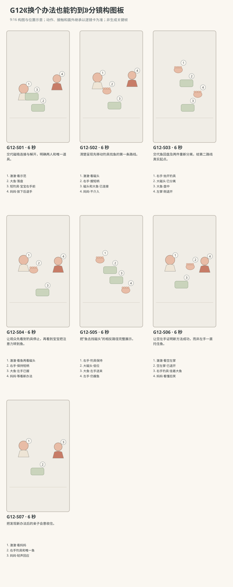

图示为构图位置示意；姿态、接触和画外继承以逐镜正文为准。

### 逐镜设计

#### G12-S01｜00—06 秒｜6 秒｜帧 [0, 144)

**镜头任务：**交代磁吸连接与解开，明确两人和唯一道具。

**景别、机位与构图：**南侧共享中全景，宝宝画左、妈妈画右，中间浅蓝软托盘；两双手与妈妈手下的大鱼完整可见。

**摄影机与理由：**固定南侧机位，让人物动作提供信息变化；不以推拉或切焦遮住接触。

**焦点：**保持本镜关键脸部与行动区域同时可读；不可见的画外状态只按连续性继承。

**入态：**妈妈右手握短硬柄钓具，大磁头已经吸着唯一橙色大鱼；鱼离托盘很低，宝宝双手空搭腿上看鱼。

**动作与表演：**

- 2 秒：妈妈右手降低，让鱼身先落到托盘，钓具仍连着鱼。

- 2 秒：妈妈左掌轻压鱼身，右手向上抬开磁头；两件分离，鱼留盘中。

- 2 秒：妈妈把短柄平放到宝宝右手前，随后双手退回自己膝上。

**声音：**无对白、无音乐；鱼落软盘轻闷声，磁头分离轻响和衣料声。

**出态：**鱼独在盘里，钓具平放宝宝右手前，妈妈双手已退出。

**切点与承接：**切同侧中近景，以宝宝伸右手接短柄为下一动作。

**连续性：**妈妈手持的唯一鱼只在落盘后解除吸附；无第二钓具或散落小件。

**开始画面母稿：**

9:16竖幅，原创圆润三维生活动画，柔软棉布与自然皮肤质感，生活物理，无文字标语、无字幕。 澈澈深棕眼、短黑绒发、额前一撮向右弯，奶油色棉连体衣；外貌衣着为沿用母稿的可撤销暂拟，实际参考尚未绑定。 澈澈为R4能协调双手与初语的幼儿阶段；本片全程坐地，不因阶段名称增加行走。 妈妈深棕短发、雾绿棉衬衫、深灰长裤；外貌衣着为可撤销暂拟。 白天客厅西窗提供柔和漫射主光，暖墙反射补光；北墙固定沙发，东侧走廊，中央奶油地垫。 南侧共享中全景，宝宝画左、妈妈画右，中间浅蓝软托盘；两双手与妈妈手下的大鱼完整可见。 单一开始瞬间：妈妈右手握短硬柄钓具，大磁头已经吸着唯一橙色大鱼；鱼离托盘很低，宝宝双手空搭腿上看鱼。  只画此刻的姿态、视线与道具归属，不把后续动作叠画。

**视频变化母稿：**

9:16竖幅，原创圆润三维生活动画，柔软棉布与自然皮肤质感，生活物理，无文字标语、无字幕。 澈澈深棕眼、短黑绒发、额前一撮向右弯，奶油色棉连体衣；外貌衣着为沿用母稿的可撤销暂拟，实际参考尚未绑定。 澈澈为R4能协调双手与初语的幼儿阶段；本片全程坐地，不因阶段名称增加行走。 妈妈深棕短发、雾绿棉衬衫、深灰长裤；外貌衣着为可撤销暂拟。 白天客厅西窗提供柔和漫射主光，暖墙反射补光；北墙固定沙发，东侧走廊，中央奶油地垫。 本镜6秒，南侧共享中全景，宝宝画左、妈妈画右，中间浅蓝软托盘；两双手与妈妈手下的大鱼完整可见。 起态：妈妈右手握短硬柄钓具，大磁头已经吸着唯一橙色大鱼；鱼离托盘很低，宝宝双手空搭腿上看鱼。 阶段1，持续2秒：妈妈右手降低，让鱼身先落到托盘，钓具仍连着鱼。 阶段2，持续2秒：妈妈左掌轻压鱼身，右手向上抬开磁头；两件分离，鱼留盘中。 阶段3，持续2秒：妈妈把短柄平放到宝宝右手前，随后双手退回自己膝上。 摄影：固定南侧机位，让人物动作提供信息变化；不以推拉或切焦遮住接触。 焦点：保持本镜关键脸部与行动区域同时可读；不可见的画外状态只按连续性继承。 声音：无对白、无音乐；鱼落软盘轻闷声，磁头分离轻响和衣料声。 终态：鱼独在盘里，钓具平放宝宝右手前，妈妈双手已退出。 连续性：妈妈手持的唯一鱼只在落盘后解除吸附；无第二钓具或散落小件。

#### G12-S02｜06—12 秒｜6 秒｜帧 [144, 288)

**镜头任务：**清楚呈现先移动钓具找鱼的第一条路线。

**景别、机位与构图：**南侧幼儿上身与托盘中近景，右腕、短柄、磁头和完整鱼同框；妈妈留画右边缘。

**摄影机与理由：**固定南侧机位，让人物动作提供信息变化；不以推拉或切焦遮住接触。

**焦点：**保持本镜关键脸部与行动区域同时可读；不可见的画外状态只按连续性继承。

**入态：**短钓具平放宝宝右手前，鱼在盘里，宝宝双手空着，妈妈双掌在膝。

**动作与表演：**

- 2 秒：澈澈右手包住短柄抬起，左掌仍搭腿，眼睛跟着大磁头。

- 2 秒：右手带磁头靠近并轻碰鱼背封装吸附区。

- 2 秒：确认接触后右腕向上抬，整鱼随磁头离盘少许，宝宝盯住连接处。

**声音：**无对白、无音乐；磁头碰鱼背后才轻闷响，鱼离盘后不加魔法音。

**出态：**宝宝右手提钓具，唯一大鱼挂在磁头下，左掌还空搭腿。

**切点与承接：**以成功连接状态切同侧手部覆盖，下一镜从鱼悬低处继续放下。

**连续性：**第一轮只有磁头主动接近盘内鱼；鱼在接触前不移动，右手左右不暗换。

**开始画面母稿：**

9:16竖幅，原创圆润三维生活动画，柔软棉布与自然皮肤质感，生活物理，无文字标语、无字幕。 澈澈深棕眼、短黑绒发、额前一撮向右弯，奶油色棉连体衣；外貌衣着为沿用母稿的可撤销暂拟，实际参考尚未绑定。 澈澈为R4能协调双手与初语的幼儿阶段；本片全程坐地，不因阶段名称增加行走。 妈妈深棕短发、雾绿棉衬衫、深灰长裤；外貌衣着为可撤销暂拟。 白天客厅西窗提供柔和漫射主光，暖墙反射补光；北墙固定沙发，东侧走廊，中央奶油地垫。 南侧幼儿上身与托盘中近景，右腕、短柄、磁头和完整鱼同框；妈妈留画右边缘。 单一开始瞬间：短钓具平放宝宝右手前，鱼在盘里，宝宝双手空着，妈妈双掌在膝。  只画此刻的姿态、视线与道具归属，不把后续动作叠画。

**视频变化母稿：**

9:16竖幅，原创圆润三维生活动画，柔软棉布与自然皮肤质感，生活物理，无文字标语、无字幕。 澈澈深棕眼、短黑绒发、额前一撮向右弯，奶油色棉连体衣；外貌衣着为沿用母稿的可撤销暂拟，实际参考尚未绑定。 澈澈为R4能协调双手与初语的幼儿阶段；本片全程坐地，不因阶段名称增加行走。 妈妈深棕短发、雾绿棉衬衫、深灰长裤；外貌衣着为可撤销暂拟。 白天客厅西窗提供柔和漫射主光，暖墙反射补光；北墙固定沙发，东侧走廊，中央奶油地垫。 本镜6秒，南侧幼儿上身与托盘中近景，右腕、短柄、磁头和完整鱼同框；妈妈留画右边缘。 起态：短钓具平放宝宝右手前，鱼在盘里，宝宝双手空着，妈妈双掌在膝。 阶段1，持续2秒：澈澈右手包住短柄抬起，左掌仍搭腿，眼睛跟着大磁头。 阶段2，持续2秒：右手带磁头靠近并轻碰鱼背封装吸附区。 阶段3，持续2秒：确认接触后右腕向上抬，整鱼随磁头离盘少许，宝宝盯住连接处。 摄影：固定南侧机位，让人物动作提供信息变化；不以推拉或切焦遮住接触。 焦点：保持本镜关键脸部与行动区域同时可读；不可见的画外状态只按连续性继承。 声音：无对白、无音乐；磁头碰鱼背后才轻闷响，鱼离盘后不加魔法音。 终态：宝宝右手提钓具，唯一大鱼挂在磁头下，左掌还空搭腿。 连续性：第一轮只有磁头主动接近盘内鱼；鱼在接触前不移动，右手左右不暗换。

#### G12-S03｜12—18 秒｜6 秒｜帧 [288, 432)

**镜头任务：**交代鱼回盘及两件重新分离，给第二路线真实起点。

**景别、机位与构图：**南侧斜俯手部中近景，宝宝两腕连上身，鱼、磁头和托盘整件入画。

**摄影机与理由：**固定南侧机位，让人物动作提供信息变化；不以推拉或切焦遮住接触。

**焦点：**焦点保留两手接触点和完整鱼背；宝宝视线画外继承向下看，不能称本特写看见眼睛。

**入态：**宝宝右手握短柄，鱼挂在低位磁头下，左掌空搭腿；妈妈画外膝上空手。

**动作与表演：**

- 2 秒：右手降低钓具，让鱼腹先接软盘。

- 2 秒：宝宝左掌从腿上移到鱼身轻压，右手保持柄不换手。

- 2 秒：左掌压稳后，右手抬短柄让磁头与鱼背分离，再停在盘上方；左掌松开鱼留盘。

**声音：**无对白、无音乐；鱼触盘、左掌擦鱼面、磁头脱开均随动作轻响。

**出态：**鱼在盘里，右手持短柄让磁头停在盘上方，左手刚离鱼且空着。

**切点与承接：**继续同一持柄状态切宝宝脸与双手，保留他换方法前的观察。

**连续性：**先有盘面与左掌承托，再解开吸附；画外妈妈始终未碰两件。

**开始画面母稿：**

9:16竖幅，原创圆润三维生活动画，柔软棉布与自然皮肤质感，生活物理，无文字标语、无字幕。 澈澈深棕眼、短黑绒发、额前一撮向右弯，奶油色棉连体衣；外貌衣着为沿用母稿的可撤销暂拟，实际参考尚未绑定。 澈澈为R4能协调双手与初语的幼儿阶段；本片全程坐地，不因阶段名称增加行走。 妈妈深棕短发、雾绿棉衬衫、深灰长裤；外貌衣着为可撤销暂拟。 白天客厅西窗提供柔和漫射主光，暖墙反射补光；北墙固定沙发，东侧走廊，中央奶油地垫。 南侧斜俯手部中近景，宝宝两腕连上身，鱼、磁头和托盘整件入画。 单一开始瞬间：宝宝右手握短柄，鱼挂在低位磁头下，左掌空搭腿；妈妈画外膝上空手。  只画此刻的姿态、视线与道具归属，不把后续动作叠画。

**视频变化母稿：**

9:16竖幅，原创圆润三维生活动画，柔软棉布与自然皮肤质感，生活物理，无文字标语、无字幕。 澈澈深棕眼、短黑绒发、额前一撮向右弯，奶油色棉连体衣；外貌衣着为沿用母稿的可撤销暂拟，实际参考尚未绑定。 澈澈为R4能协调双手与初语的幼儿阶段；本片全程坐地，不因阶段名称增加行走。 妈妈深棕短发、雾绿棉衬衫、深灰长裤；外貌衣着为可撤销暂拟。 白天客厅西窗提供柔和漫射主光，暖墙反射补光；北墙固定沙发，东侧走廊，中央奶油地垫。 本镜6秒，南侧斜俯手部中近景，宝宝两腕连上身，鱼、磁头和托盘整件入画。 起态：宝宝右手握短柄，鱼挂在低位磁头下，左掌空搭腿；妈妈画外膝上空手。 阶段1，持续2秒：右手降低钓具，让鱼腹先接软盘。 阶段2，持续2秒：宝宝左掌从腿上移到鱼身轻压，右手保持柄不换手。 阶段3，持续2秒：左掌压稳后，右手抬短柄让磁头与鱼背分离，再停在盘上方；左掌松开鱼留盘。 摄影：固定南侧机位，让人物动作提供信息变化；不以推拉或切焦遮住接触。 焦点：焦点保留两手接触点和完整鱼背；宝宝视线画外继承向下看，不能称本特写看见眼睛。 声音：无对白、无音乐；鱼触盘、左掌擦鱼面、磁头脱开均随动作轻响。 终态：鱼在盘里，右手持短柄让磁头停在盘上方，左手刚离鱼且空着。 连续性：先有盘面与左掌承托，再解开吸附；画外妈妈始终未碰两件。

#### G12-S04｜18—24 秒｜6 秒｜帧 [432, 576)

**镜头任务：**让观众先看到钓具停止，再看到宝宝把注意力转到鱼。

**景别、机位与构图：**南侧幼儿中景，脸、双手、盘和鱼均留画，妈妈在画右陪看；前景不设遮挡。

**摄影机与理由：**固定南侧机位，让人物动作提供信息变化；不以推拉或切焦遮住接触。

**焦点：**保持本镜关键脸部与行动区域同时可读；不可见的画外状态只按连续性继承。

**入态：**澈澈右手握短柄，磁头停在盘上方；左手空着，鱼躺在盘中央。

**动作与表演：**

- 3 秒：宝宝看一眼右手的磁头，右腕不再带它追鱼，左手落到大鱼尾侧。

- 3 秒：左手沿鱼身摸到可包握的位置，手指合住鱼侧；右手仍把磁头留在眼前的低位。

**声音：**无对白、无音乐；连续轻微室内底声，保留呼吸与衣料声；不添加解释旁白或笑声音效。

**出态：**左手已握住整鱼侧面但鱼还贴盘，右手钓具低位保持。

**切点与承接：**在左手将提鱼时切同侧手部中近景，继续提起相位。

**连续性：**左手先接触并抓住再提鱼；右手仍握短柄，钓具未凭空换位置。

**开始画面母稿：**

9:16竖幅，原创圆润三维生活动画，柔软棉布与自然皮肤质感，生活物理，无文字标语、无字幕。 澈澈深棕眼、短黑绒发、额前一撮向右弯，奶油色棉连体衣；外貌衣着为沿用母稿的可撤销暂拟，实际参考尚未绑定。 澈澈为R4能协调双手与初语的幼儿阶段；本片全程坐地，不因阶段名称增加行走。 妈妈深棕短发、雾绿棉衬衫、深灰长裤；外貌衣着为可撤销暂拟。 白天客厅西窗提供柔和漫射主光，暖墙反射补光；北墙固定沙发，东侧走廊，中央奶油地垫。 南侧幼儿中景，脸、双手、盘和鱼均留画，妈妈在画右陪看；前景不设遮挡。 单一开始瞬间：澈澈右手握短柄，磁头停在盘上方；左手空着，鱼躺在盘中央。  只画此刻的姿态、视线与道具归属，不把后续动作叠画。

**视频变化母稿：**

9:16竖幅，原创圆润三维生活动画，柔软棉布与自然皮肤质感，生活物理，无文字标语、无字幕。 澈澈深棕眼、短黑绒发、额前一撮向右弯，奶油色棉连体衣；外貌衣着为沿用母稿的可撤销暂拟，实际参考尚未绑定。 澈澈为R4能协调双手与初语的幼儿阶段；本片全程坐地，不因阶段名称增加行走。 妈妈深棕短发、雾绿棉衬衫、深灰长裤；外貌衣着为可撤销暂拟。 白天客厅西窗提供柔和漫射主光，暖墙反射补光；北墙固定沙发，东侧走廊，中央奶油地垫。 本镜6秒，南侧幼儿中景，脸、双手、盘和鱼均留画，妈妈在画右陪看；前景不设遮挡。 起态：澈澈右手握短柄，磁头停在盘上方；左手空着，鱼躺在盘中央。 阶段1，持续3秒：宝宝看一眼右手的磁头，右腕不再带它追鱼，左手落到大鱼尾侧。 阶段2，持续3秒：左手沿鱼身摸到可包握的位置，手指合住鱼侧；右手仍把磁头留在眼前的低位。 摄影：固定南侧机位，让人物动作提供信息变化；不以推拉或切焦遮住接触。 焦点：保持本镜关键脸部与行动区域同时可读；不可见的画外状态只按连续性继承。 声音：无对白、无音乐；连续轻微室内底声，保留呼吸与衣料声；不添加解释旁白或笑声音效。 终态：左手已握住整鱼侧面但鱼还贴盘，右手钓具低位保持。 连续性：左手先接触并抓住再提鱼；右手仍握短柄，钓具未凭空换位置。

#### G12-S05｜24—30 秒｜6 秒｜帧 [576, 720)

**镜头任务：**把“鱼去找磁头”的相反路径完整展示。

**景别、机位与构图：**南侧斜俯幼儿双手与上身中近景，右手钓具在画左、左手持鱼在画右；两腕和两个整件均留画。

**摄影机与理由：**固定南侧机位，让人物动作提供信息变化；不以推拉或切焦遮住接触。

**焦点：**固定清楚覆盖双手握点、鱼背与磁头，幼儿眼睛画外继承看连接处；不用浅景深隐藏间隙。

**入态：**宝宝左手握鱼侧且鱼腹贴盘，右手握短柄，大磁头停在盘上方低位。

**动作与表演：**

- 2 秒：左手提起整条鱼，鱼腹离盘；右手保持短柄，磁头不追过去。

- 2 秒：左腕把鱼背转向大磁头，鱼和磁头之间仍有清楚空隙。

- 2 秒：左手带鱼缓慢靠近，鱼背刚碰到磁头，左手仍牢牢握鱼。

**声音：**无对白、无音乐；左手提鱼摩擦，鱼背真正触磁头时才轻碰一声。

**出态：**鱼背与磁头已接触、左手仍持鱼，右手继续握柄。

**切点与承接：**在共同持有、刚吸附状态切同侧稍宽，让释放与后续结果可见。

**连续性：**只有左手带鱼走路径，磁头仍由右手定位；接触前不隔空吸鱼。

**开始画面母稿：**

9:16竖幅，原创圆润三维生活动画，柔软棉布与自然皮肤质感，生活物理，无文字标语、无字幕。 澈澈深棕眼、短黑绒发、额前一撮向右弯，奶油色棉连体衣；外貌衣着为沿用母稿的可撤销暂拟，实际参考尚未绑定。 澈澈为R4能协调双手与初语的幼儿阶段；本片全程坐地，不因阶段名称增加行走。 妈妈深棕短发、雾绿棉衬衫、深灰长裤；外貌衣着为可撤销暂拟。 白天客厅西窗提供柔和漫射主光，暖墙反射补光；北墙固定沙发，东侧走廊，中央奶油地垫。 南侧斜俯幼儿双手与上身中近景，右手钓具在画左、左手持鱼在画右；两腕和两个整件均留画。 单一开始瞬间：宝宝左手握鱼侧且鱼腹贴盘，右手握短柄，大磁头停在盘上方低位。  只画此刻的姿态、视线与道具归属，不把后续动作叠画。

**视频变化母稿：**

9:16竖幅，原创圆润三维生活动画，柔软棉布与自然皮肤质感，生活物理，无文字标语、无字幕。 澈澈深棕眼、短黑绒发、额前一撮向右弯，奶油色棉连体衣；外貌衣着为沿用母稿的可撤销暂拟，实际参考尚未绑定。 澈澈为R4能协调双手与初语的幼儿阶段；本片全程坐地，不因阶段名称增加行走。 妈妈深棕短发、雾绿棉衬衫、深灰长裤；外貌衣着为可撤销暂拟。 白天客厅西窗提供柔和漫射主光，暖墙反射补光；北墙固定沙发，东侧走廊，中央奶油地垫。 本镜6秒，南侧斜俯幼儿双手与上身中近景，右手钓具在画左、左手持鱼在画右；两腕和两个整件均留画。 起态：宝宝左手握鱼侧且鱼腹贴盘，右手握短柄，大磁头停在盘上方低位。 阶段1，持续2秒：左手提起整条鱼，鱼腹离盘；右手保持短柄，磁头不追过去。 阶段2，持续2秒：左腕把鱼背转向大磁头，鱼和磁头之间仍有清楚空隙。 阶段3，持续2秒：左手带鱼缓慢靠近，鱼背刚碰到磁头，左手仍牢牢握鱼。 摄影：固定南侧机位，让人物动作提供信息变化；不以推拉或切焦遮住接触。 焦点：固定清楚覆盖双手握点、鱼背与磁头，幼儿眼睛画外继承看连接处；不用浅景深隐藏间隙。 声音：无对白、无音乐；左手提鱼摩擦，鱼背真正触磁头时才轻碰一声。 终态：鱼背与磁头已接触、左手仍持鱼，右手继续握柄。 连续性：只有左手带鱼走路径，磁头仍由右手定位；接触前不隔空吸鱼。

#### G12-S06｜30—36 秒｜6 秒｜帧 [720, 864)

**镜头任务：**让空左手证明新方法成功，而非左手一直托住鱼。

**景别、机位与构图：**南侧幼儿中景，脸、双手和鱼完整留画；妈妈画右脸与膝上空手可见。

**摄影机与理由：**固定南侧机位，让人物动作提供信息变化；不以推拉或切焦遮住接触。

**焦点：**保持本镜关键脸部与行动区域同时可读；不可见的画外状态只按连续性继承。

**入态：**鱼背已贴磁头，宝宝左手仍握鱼侧，右手握短柄；妈妈看连接处。

**动作与表演：**

- 2 秒：宝宝右手维持柄的位置，左指慢慢张开，掌心离鱼。

- 2 秒：鱼仍挂在磁头下，左手退到胸前成为清楚空掌；宝宝眼睛从空掌看回鱼。

- 2 秒：右手再轻提短柄，鱼跟着升高一点，妈妈这才露出会意笑。

**声音：**无对白、无音乐；连续轻微室内底声，保留呼吸与衣料声；不添加解释旁白或笑声音效。

**出态：**左手完全空着在胸前，右手钓具下挂鱼；妈妈已看清第二条路线。

**切点与承接：**鱼仍连接时切共享中景结尾，不重新吸一次。

**连续性：**左手分离窗口清楚；整鱼重量由右手钓具通过磁头承接，妈妈未托。

**开始画面母稿：**

9:16竖幅，原创圆润三维生活动画，柔软棉布与自然皮肤质感，生活物理，无文字标语、无字幕。 澈澈深棕眼、短黑绒发、额前一撮向右弯，奶油色棉连体衣；外貌衣着为沿用母稿的可撤销暂拟，实际参考尚未绑定。 澈澈为R4能协调双手与初语的幼儿阶段；本片全程坐地，不因阶段名称增加行走。 妈妈深棕短发、雾绿棉衬衫、深灰长裤；外貌衣着为可撤销暂拟。 白天客厅西窗提供柔和漫射主光，暖墙反射补光；北墙固定沙发，东侧走廊，中央奶油地垫。 南侧幼儿中景，脸、双手和鱼完整留画；妈妈画右脸与膝上空手可见。 单一开始瞬间：鱼背已贴磁头，宝宝左手仍握鱼侧，右手握短柄；妈妈看连接处。  只画此刻的姿态、视线与道具归属，不把后续动作叠画。

**视频变化母稿：**

9:16竖幅，原创圆润三维生活动画，柔软棉布与自然皮肤质感，生活物理，无文字标语、无字幕。 澈澈深棕眼、短黑绒发、额前一撮向右弯，奶油色棉连体衣；外貌衣着为沿用母稿的可撤销暂拟，实际参考尚未绑定。 澈澈为R4能协调双手与初语的幼儿阶段；本片全程坐地，不因阶段名称增加行走。 妈妈深棕短发、雾绿棉衬衫、深灰长裤；外貌衣着为可撤销暂拟。 白天客厅西窗提供柔和漫射主光，暖墙反射补光；北墙固定沙发，东侧走廊，中央奶油地垫。 本镜6秒，南侧幼儿中景，脸、双手和鱼完整留画；妈妈画右脸与膝上空手可见。 起态：鱼背已贴磁头，宝宝左手仍握鱼侧，右手握短柄；妈妈看连接处。 阶段1，持续2秒：宝宝右手维持柄的位置，左指慢慢张开，掌心离鱼。 阶段2，持续2秒：鱼仍挂在磁头下，左手退到胸前成为清楚空掌；宝宝眼睛从空掌看回鱼。 阶段3，持续2秒：右手再轻提短柄，鱼跟着升高一点，妈妈这才露出会意笑。 摄影：固定南侧机位，让人物动作提供信息变化；不以推拉或切焦遮住接触。 焦点：保持本镜关键脸部与行动区域同时可读；不可见的画外状态只按连续性继承。 声音：无对白、无音乐；连续轻微室内底声，保留呼吸与衣料声；不添加解释旁白或笑声音效。 终态：左手完全空着在胸前，右手钓具下挂鱼；妈妈已看清第二条路线。 连续性：左手分离窗口清楚；整鱼重量由右手钓具通过磁头承接，妈妈未托。

#### G12-S07｜36—42 秒｜6 秒｜帧 [864, 1008)

**镜头任务：**把发现新办法后的亲子会意收住。

**景别、机位与构图：**南侧共享中景，宝宝画左、妈妈画右，短钓具与悬低大鱼居中可见，托盘仍在下方。

**摄影机与理由：**固定南侧机位，让人物动作提供信息变化；不以推拉或切焦遮住接触。

**焦点：**保持本镜关键脸部与行动区域同时可读；不可见的画外状态只按连续性继承。

**入态：**澈澈右手持短柄挂鱼，左手空停胸前；妈妈已微笑、目光落连接处。

**动作与表演：**

- 1 秒：宝宝抬眼看妈妈，右手保持钓具在低位。

- 3 秒：妈妈看回他，带笑轻声说：“这样也行呀。”嘴部自然发音，手不替他演示。

- 2 秒：妈妈停声，宝宝看看鱼又看看她，左手落回腿上，大鱼仍贴住磁头。

**声音：**妈妈{这样也行呀。}，第2—4秒；其余只轻呼吸和室内底声，无音乐、无字幕。

**出态：**幼儿坐姿不变，右手持钓具挂鱼，左手在腿，妈妈空手陪笑。

**切点与承接：**留在两人相看与鱼仍挂着的结果，结束前不加第三种玩法。

**连续性：**没有换手或额外鱼；妈妈的评价晚于实际第二次成功，无字幕与成人说教。

**开始画面母稿：**

9:16竖幅，原创圆润三维生活动画，柔软棉布与自然皮肤质感，生活物理，无文字标语、无字幕。 澈澈深棕眼、短黑绒发、额前一撮向右弯，奶油色棉连体衣；外貌衣着为沿用母稿的可撤销暂拟，实际参考尚未绑定。 澈澈为R4能协调双手与初语的幼儿阶段；本片全程坐地，不因阶段名称增加行走。 妈妈深棕短发、雾绿棉衬衫、深灰长裤；外貌衣着为可撤销暂拟。 白天客厅西窗提供柔和漫射主光，暖墙反射补光；北墙固定沙发，东侧走廊，中央奶油地垫。 南侧共享中景，宝宝画左、妈妈画右，短钓具与悬低大鱼居中可见，托盘仍在下方。 单一开始瞬间：澈澈右手持短柄挂鱼，左手空停胸前；妈妈已微笑、目光落连接处。  只画此刻的姿态、视线与道具归属，不把后续动作叠画。

**视频变化母稿：**

9:16竖幅，原创圆润三维生活动画，柔软棉布与自然皮肤质感，生活物理，无文字标语、无字幕。 澈澈深棕眼、短黑绒发、额前一撮向右弯，奶油色棉连体衣；外貌衣着为沿用母稿的可撤销暂拟，实际参考尚未绑定。 澈澈为R4能协调双手与初语的幼儿阶段；本片全程坐地，不因阶段名称增加行走。 妈妈深棕短发、雾绿棉衬衫、深灰长裤；外貌衣着为可撤销暂拟。 白天客厅西窗提供柔和漫射主光，暖墙反射补光；北墙固定沙发，东侧走廊，中央奶油地垫。 本镜6秒，南侧共享中景，宝宝画左、妈妈画右，短钓具与悬低大鱼居中可见，托盘仍在下方。 起态：澈澈右手持短柄挂鱼，左手空停胸前；妈妈已微笑、目光落连接处。 阶段1，持续1秒：宝宝抬眼看妈妈，右手保持钓具在低位。 阶段2，持续3秒：妈妈看回他，带笑轻声说：“这样也行呀。”嘴部自然发音，手不替他演示。 阶段3，持续2秒：妈妈停声，宝宝看看鱼又看看她，左手落回腿上，大鱼仍贴住磁头。 摄影：固定南侧机位，让人物动作提供信息变化；不以推拉或切焦遮住接触。 焦点：保持本镜关键脸部与行动区域同时可读；不可见的画外状态只按连续性继承。 声音：妈妈{这样也行呀。}，第2—4秒；其余只轻呼吸和室内底声，无音乐、无字幕。 终态：幼儿坐姿不变，右手持钓具挂鱼，左手在腿，妈妈空手陪笑。 连续性：没有换手或额外鱼；妈妈的评价晚于实际第二次成功，无字幕与成人说教。

### 声音与剪辑

磁头与封装鱼背接触只有轻轻一声闷碰，摩擦随触盘和提起发生；不加魔法吸附声。妈妈片尾一句普通话，幼儿只有非词轻气声；无音乐与字幕。

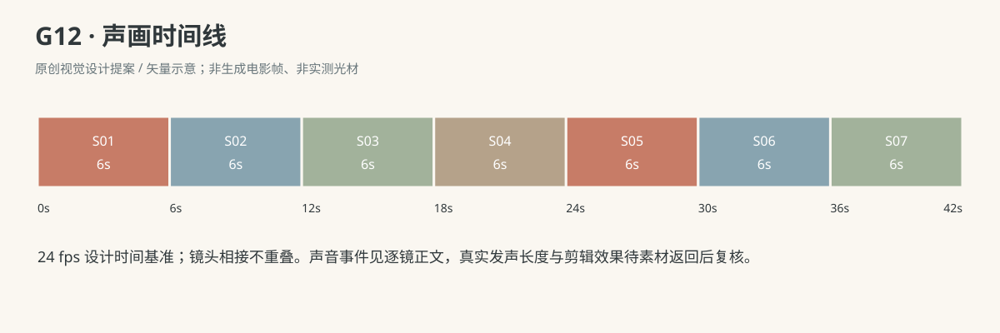

- 妈妈：这样也行呀。（G12-S07；第2—4秒，已看见鱼在左手松开后仍挂在磁头下，才面向澈澈带笑轻说；口部自然可见，不用教训或考试语气。）

### 连续性与试片

- 连续性：唯一一条大橙鱼、唯一短钓具；所有磁件封闭在大整件内部，画面不出现游离磁粒、外露尖件或长绳。

- 连续性：道具尺寸和封装结构为本片原创设计，不称原文教具实物或任何具体产品已验证。

- 连续性：澈澈全片坐地；自第二镜首次拿起钓具后，右手始终握短柄；第一轮鱼在托盘，第二轮由左手拿整鱼送向右手保持的磁头。

- 连续性：磁吸只在鱼背与磁头实际接触后发生；鱼不飞向磁头，不隔空悬浮。

- 连续性：左手释放前必须明确鱼背已吸住；右手提钓具后鱼才随动。妈妈不在第二轮暗扶鱼。

- 连续性：R4表示本片幼儿双手协调与初语能力，不要求本镜行走，也不标改变玩法的精确月龄。

- 试片：G12-S02：右手移动磁头、实际碰鱼背、鱼随提起的先后清楚；还未碰到鱼就自动上飞则失败。

- 试片：G12-S03：鱼先落盘且左手压稳，右手才抬离磁头；鱼和磁头复制、左手穿鱼或跳切解绑则失败。

- 试片：G12-S04到S06：右手短钓具位置基本不变，左手带整鱼靠近，先接触后左手松开；若仍由磁头追鱼则失去换方法的事件。

- 试片：S06→S07鱼仍吸在同一个磁头下，右手归属不换；成人评价不得早于第二次成功被看见。

**媒体待验证：**未生成媒体或绑定参考；待实片核验磁头/鱼背接触、封装完整、两种移动路径的区别与幼儿双手协调，文字设定不等于实物或媒体已验证。

---

## G13《这次，要鼓掌》

**58 秒｜幼儿拼图与短句｜角色：澈澈、妈妈｜场景 L**

### 剧情正文

第一天，客厅地垫上的七片房子拼图已经放好四片。澈澈拿着一片绿墙，转来转去，边缘总对不上。他皱起脸，把手边两片往垫上一推，丢下手里的那片：“不玩了！”妈妈先把三片捡回拼板旁，没有把整板替他完成。她拿起那片绿墙，转到对应方向，再把它放回澈澈掌中，陪他对准空位。澈澈压下去，卡进去了。余下两片也在妈妈指给他的轮廓里放好，妈妈等七片全部平齐，才轻轻拍手，澈澈抬脸听着。画面在这里溶接，明确省略了数日的日常和练习；沙发靠垫与布篮的位置已经变了。数日后，七片又全摆在拼板外，妈妈坐在稍远的东侧，双手搭膝。澈澈先放入橙色底座、左绿墙、右绿墙，再接着放红屋顶、黄门和两扇蓝窗，七片全由他的双手独自拿取、转向、放入；妈妈没有碰拼片。他低头按了按最后一片，抬头却发现妈妈还没有拍手。澈澈把双手伸到拼板两侧，平平端起，朝她挪近一小段。妈妈看清完整的房子，轻声说：“前几天还要一起拼，今天自己拼好啦。”澈澈等她说完，将拼板平放到两人之间，空出双手，朝妈妈伸出来：“鼓掌！”妈妈这才拍起手，澈澈也跟着拍了两下。拼板留在垫上，七片没有散，他笑着又低头确认了一遍。

### 亲述来源与改编

原帖是家长自述，未独立核实。本片将生活机制改编为澈澈的原创故事。

- [ZH06 · 七片拼图丢下后，几天后拿成品来要掌声](https://fishliao2005.pixnet.net/blog/posts/30405261)；作者自报年龄：标题自报满两岁七个月，正文称“这个月”；没有另列事件日龄。。

- **采用的生活过程：**作者自报2岁7个月；七片拼图受挫丢片、妈妈捡回陪做、完成后家人鼓掌，以及过几天自己完成拿来要掌声。

- **采用的生活过程：**保留跨几日的变化，不写成一次失败后数秒内学会。

- **本片原创改编：**七片房子图案、每片颜色与位置、初始四入三外、逐片帮助步骤及独立拼放顺序均为原创，原文没有这些细节。

- **本片原创改编：**妈妈具体台词、澈澈“鼓掌！”的逐字短句、沙发布置变化、双手平托和最后妈妈再次拍手为原创；原文只说最后要掌声，没交代家人再次拍掌。

- **不作出的事实推断：**公开家长亲述未独立核实；实际经过几次练习未知，本片中间数日不表示其间没有练习或其他成人帮助。

- **不作出的事实推断：**不使用原帖后半转载教养文章作为这次亲历，不把本片演成拼图训练成效或普遍月龄标准。

[查看原始过程与缺项](research/real-experiences/index.html#ZH06)

### 导演与空间

**观察任务：**把先前受挫后一起完成与数日后自己完成分开，让幼儿拿成品来要掌声成为主动分享时刻；成长经过不压成瞬间学会。

**空间与光位：**白天客厅中央地垫上，澈澈面南坐地，妈妈东侧面西南坐地，摄影机始终南侧。唯一浅木嵌板拼图有七块大图形，均非可互换的小碎片；原创房子图案：红屋顶、黄色门、两扇蓝窗、左右绿墙、橙色底座，一片一位。第一天北沙发靠垫靠西、布篮在垫东；数日后溶接到靠垫靠东、布篮收至沙发旁，拼板先以七片均外的状态重新建立。全片无字幕。

**人物表演：**第一天澈澈尝试不成后眉眼缩紧，把两片推落到软垫，短句说不玩了；妈妈先捡回物件，慢慢陪他对准，不责怪。数日后的独立拼放由头至尾覆盖，妈妈手始终在膝上。幼儿完成后用双手平托拼板短距离挪近，不拿会掉片的竖立姿势；要掌声是清楚的短句邀请。

### 节拍覆盖

- **G13-b1**：前态：第一天，拼板上红屋顶、黄门、左右蓝窗四片已入位；宝宝右手持左绿墙，右绿墙与橙底座在板旁，妈妈空手在膝。 过程：宝宝把左绿墙凑向对应空位，方向不对，边角顶住；他停下来皱眉，未用力硬压。他气恼说：“不玩了！”左手将板旁右绿墙与橙底座推到近处软垫，再把右手左绿墙放落到它们旁。三片均落在软垫上，双手退开，宝宝把脸偏开。 后态：板上仍四片，垫上三片；宝宝双手已空且偏脸，妈妈看见受挫。 观众观察：先让失败有真实的对不上，再出现不玩了与推片。 → G13-S01

- **G13-b2**：前态：板上四片未动、垫上三片，宝宝双手空搭腿，妈妈双手刚离膝。 过程：妈妈右手逐一把三片移回板旁，不改变板上四片。她拿左绿墙在对应空槽上方转正，停给宝宝看，再送到宝宝张开的右掌。宝宝右手握稳后妈妈先松开，再用左食指指空槽边缘；宝宝将左绿墙落入，妈妈指尖只在槽外轻引方向。 后态：左绿墙已由宝宝放入，板上五片；右绿墙和橙底座在外，妈妈手停槽边外、宝宝右手刚离片。 观众观察：妈妈先恢复可玩的物件，再给方向帮助，不直接替拼完。 → G13-S02

- **G13-b3**：前态：拼板已入五片，右绿墙与橙底座在外；宝宝右手空，妈妈左指在槽边外，右手空。 过程：妈妈先指橙底座空槽，宝宝右手拿橙底座、双手略转方向后放入；妈妈不拿片。妈妈再指右绿墙空槽，宝宝右手拿右绿墙放入并按平，七片完整；妈妈双手退出板边。妈妈确认最后一片平齐后轻拍两下，宝宝抬脸看她，肩膀放松。 后态：七片全在板，宝宝双手在板边、妈妈两次掌声已落，母子相看。 观众观察：完成第一次共同拼图，并将第一回掌声与成品绑定。 → G13-S03

- **G13-b4**：前态：经上一镜溶接明确已过数日；唯一七片全部摊在同一空拼板旁，宝宝双手空，妈妈坐东侧双掌搭膝。 过程：宝宝看空板与七片，妈妈只安静陪看；给七片均在外的状态一个可读瞬间。宝宝右手拿橙底座，左手扶板边，自行转正并放入底部槽。宝宝拿左绿墙转到左槽方向，放入并松手。宝宝拿右绿墙放入右槽，松手后看向余四片。 后态：橙底座、左右绿墙三片已入；红屋顶、黄门、左右蓝窗四片仍在板旁，妈妈手仍在膝。 观众观察：重建数日后七片全外的起点，并直接看到幼儿独放前三片。 → G13-S04

- **G13-b5**：前态：橙底座、左右绿墙三片已入；红屋顶、黄门、左右蓝窗四片在外，宝宝双手空，妈妈双手膝上。 过程：宝宝右手拿红屋顶、左手扶板，略转到尖角朝上后放入屋顶槽并松手。右手拿黄门对齐门槽，指腹放平后离开。右手拿左蓝窗，转到左窗方向后放入，左手始终扶板边。右手拿最后一片右蓝窗放入并按平，随后双手都离开拼片；宝宝低头核对整幅房子。 后态：七片全入、外面无余片，宝宝双手空停板边；妈妈从未碰片或板。 观众观察：不中断地完成余四片，证明后段是孩子独自做完。 → G13-S05

- **G13-b6**：前态：数日后七片完整嵌平，宝宝低头看成品、双手空在板边，妈妈东侧双手在膝。 过程：宝宝抬脸看妈妈，妈妈正安静看完整房子还未拍手。宝宝把左右手分别滑到拼板两侧下沿，双手承托后才低低抬起，板面近水平。他保持坐地，双脚和骨盆在垫上短短挪近妈妈，将水平板送到两人之间；妈妈低头看清成品。 后态：宝宝仍坐地、双手托板两侧、板面近水平在两人之间，妈妈已看见完整房子。 观众观察：孩子由完成转为主动分享，让端板动作有完整承托。 → G13-S06

- **G13-b7**：前态：妈妈已看见完整七片，宝宝仍双手托板两侧、坐地看她，妈妈双掌仍搭膝。 过程：妈妈看一眼房子再看宝宝，温柔说：“前几天还要一起拼，今天自己拼好啦。”嘴唇自然发音，不碰板也不提前拍掌。妈妈停声等，宝宝看着她，板仍平稳托在双手间。 后态：妈妈句尾完整结束、双手还在膝，宝宝坐地双手托板看妈妈。 观众观察：用自然亲子回应点明数日跨度，并留出孩子自己的请求。 → G13-S07

- **G13-b8**：前态：宝宝双手平托七片板在低位，妈妈上一句已完整结束、双手在膝，两人相看。 过程：宝宝把拼板慢慢降到两人中间软垫，板底落稳后双手离开、朝妈妈伸出。宝宝看妈妈清楚说：“鼓掌！”妈妈听完才抬起双手。妈妈先拍两下，宝宝看到后也拍两下；手掌相碰与分开完整，板留在垫上。宝宝停手笑，双手落回自己腿上，低头再确认完整房子；妈妈停止掌声、双手落回膝上陪他看。 后态：七片板平放地垫，宝宝双手已空放腿、妈妈双手回膝，幼儿笑着看自己的成品。 观众观察：先落板空手再要掌声，最后掌声由孩子主动邀请触发。 → G13-S08

### 分镜构图板

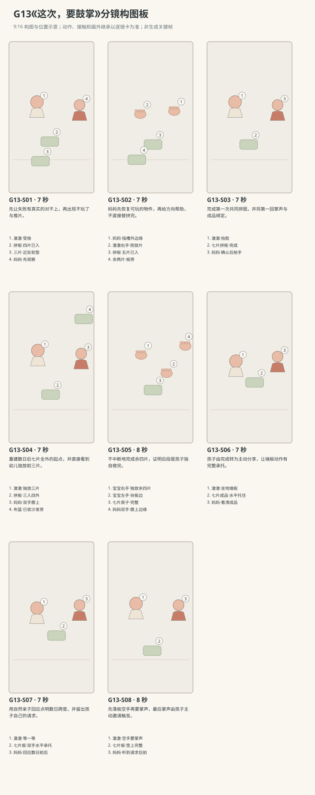

图示为构图位置示意；姿态、接触和画外继承以逐镜正文为准。

### 逐镜设计

#### G13-S01｜00—07 秒｜7 秒｜帧 [0, 168)

**镜头任务：**先让失败有真实的对不上，再出现不玩了与推片。

**景别、机位与构图：**南侧母子中景略俯，宝宝面南居中偏左、妈妈东侧画右；整拼板、七片归属和两人脸可读。

**摄影机与理由：**固定南侧机位，让人物动作提供信息变化；不以推拉或切焦遮住接触。

**焦点：**保持本镜关键脸部与行动区域同时可读；不可见的画外状态只按连续性继承。

**入态：**第一天，拼板上红屋顶、黄门、左右蓝窗四片已入位；宝宝右手持左绿墙，右绿墙与橙底座在板旁，妈妈空手在膝。

**动作与表演：**

- 3 秒：宝宝把左绿墙凑向对应空位，方向不对，边角顶住；他停下来皱眉，未用力硬压。

- 3 秒：他气恼说：“不玩了！”左手将板旁右绿墙与橙底座推到近处软垫，再把右手左绿墙放落到它们旁。

- 1 秒：三片均落在软垫上，双手退开，宝宝把脸偏开。

**声音：**澈澈{不玩了！}，第4—6秒；片落软垫有轻闷声，无音乐、无字幕。

**出态：**板上仍四片，垫上三片；宝宝双手已空且偏脸，妈妈看见受挫。

**切点与承接：**保持失败后的七片状态切妈妈捡片，不暗中复原。

**连续性：**推落是三大片落软垫，无散小零件；第一天靠垫靠西、布篮在垫东。

**开始画面母稿：**

9:16竖幅，原创圆润三维生活动画，柔软棉布与自然皮肤质感，生活物理，无文字标语、无字幕。 澈澈深棕眼、短黑绒发、额前一撮向右弯，奶油色棉连体衣；外貌衣着为沿用母稿的可撤销暂拟，实际参考尚未绑定。 澈澈为R5能操作大片拼图、坐地挪近与说短句的幼儿阶段；不是小月龄婴儿。 妈妈深棕短发、雾绿棉衬衫、深灰长裤；外貌衣着为可撤销暂拟。 白天客厅西窗提供柔和漫射主光，暖墙反射补光；北墙固定沙发，东侧走廊，中央奶油地垫。 南侧母子中景略俯，宝宝面南居中偏左、妈妈东侧画右；整拼板、七片归属和两人脸可读。 单一开始瞬间：第一天，拼板上红屋顶、黄门、左右蓝窗四片已入位；宝宝右手持左绿墙，右绿墙与橙底座在板旁，妈妈空手在膝。  只画此刻的姿态、视线与道具归属，不把后续动作叠画。

**视频变化母稿：**

9:16竖幅，原创圆润三维生活动画，柔软棉布与自然皮肤质感，生活物理，无文字标语、无字幕。 澈澈深棕眼、短黑绒发、额前一撮向右弯，奶油色棉连体衣；外貌衣着为沿用母稿的可撤销暂拟，实际参考尚未绑定。 澈澈为R5能操作大片拼图、坐地挪近与说短句的幼儿阶段；不是小月龄婴儿。 妈妈深棕短发、雾绿棉衬衫、深灰长裤；外貌衣着为可撤销暂拟。 白天客厅西窗提供柔和漫射主光，暖墙反射补光；北墙固定沙发，东侧走廊，中央奶油地垫。 本镜7秒，南侧母子中景略俯，宝宝面南居中偏左、妈妈东侧画右；整拼板、七片归属和两人脸可读。 起态：第一天，拼板上红屋顶、黄门、左右蓝窗四片已入位；宝宝右手持左绿墙，右绿墙与橙底座在板旁，妈妈空手在膝。 阶段1，持续3秒：宝宝把左绿墙凑向对应空位，方向不对，边角顶住；他停下来皱眉，未用力硬压。 阶段2，持续3秒：他气恼说：“不玩了！”左手将板旁右绿墙与橙底座推到近处软垫，再把右手左绿墙放落到它们旁。 阶段3，持续1秒：三片均落在软垫上，双手退开，宝宝把脸偏开。 摄影：固定南侧机位，让人物动作提供信息变化；不以推拉或切焦遮住接触。 焦点：保持本镜关键脸部与行动区域同时可读；不可见的画外状态只按连续性继承。 声音：澈澈{不玩了！}，第4—6秒；片落软垫有轻闷声，无音乐、无字幕。 终态：板上仍四片，垫上三片；宝宝双手已空且偏脸，妈妈看见受挫。 连续性：推落是三大片落软垫，无散小零件；第一天靠垫靠西、布篮在垫东。

#### G13-S02｜07—14 秒｜7 秒｜帧 [168, 336)

**镜头任务：**妈妈先恢复可玩的物件，再给方向帮助，不直接替拼完。

**景别、机位与构图：**南侧斜俯母子双手与上身中近景，整板和垫上三片可见，宝宝脸保留在画左上。

**摄影机与理由：**固定南侧机位，让人物动作提供信息变化；不以推拉或切焦遮住接触。

**焦点：**清楚覆盖拼板轮廓、妈妈指尖和宝宝持片掌；脸只保留受挫缓解的可读部分，不以浅景深遮手。

**入态：**板上四片未动、垫上三片，宝宝双手空搭腿，妈妈双手刚离膝。

**动作与表演：**

- 2 秒：妈妈右手逐一把三片移回板旁，不改变板上四片。

- 2 秒：她拿左绿墙在对应空槽上方转正，停给宝宝看，再送到宝宝张开的右掌。

- 3 秒：宝宝右手握稳后妈妈先松开，再用左食指指空槽边缘；宝宝将左绿墙落入，妈妈指尖只在槽外轻引方向。

**声音：**无对白、无音乐；大片轻碰木板、手指擦边及自然呼吸，妈妈不添加教养长句。

**出态：**左绿墙已由宝宝放入，板上五片；右绿墙和橙底座在外，妈妈手停槽边外、宝宝右手刚离片。

**切点与承接：**按五片已入、两片在外接下一次共同完成，不重放左绿墙。

**连续性：**转正、给宝宝、宝宝握稳后妈妈释放均可见；引导不是画外把三片一齐装满。

**开始画面母稿：**

9:16竖幅，原创圆润三维生活动画，柔软棉布与自然皮肤质感，生活物理，无文字标语、无字幕。 澈澈深棕眼、短黑绒发、额前一撮向右弯，奶油色棉连体衣；外貌衣着为沿用母稿的可撤销暂拟，实际参考尚未绑定。 澈澈为R5能操作大片拼图、坐地挪近与说短句的幼儿阶段；不是小月龄婴儿。 妈妈深棕短发、雾绿棉衬衫、深灰长裤；外貌衣着为可撤销暂拟。 白天客厅西窗提供柔和漫射主光，暖墙反射补光；北墙固定沙发，东侧走廊，中央奶油地垫。 南侧斜俯母子双手与上身中近景，整板和垫上三片可见，宝宝脸保留在画左上。 单一开始瞬间：板上四片未动、垫上三片，宝宝双手空搭腿，妈妈双手刚离膝。  只画此刻的姿态、视线与道具归属，不把后续动作叠画。

**视频变化母稿：**

9:16竖幅，原创圆润三维生活动画，柔软棉布与自然皮肤质感，生活物理，无文字标语、无字幕。 澈澈深棕眼、短黑绒发、额前一撮向右弯，奶油色棉连体衣；外貌衣着为沿用母稿的可撤销暂拟，实际参考尚未绑定。 澈澈为R5能操作大片拼图、坐地挪近与说短句的幼儿阶段；不是小月龄婴儿。 妈妈深棕短发、雾绿棉衬衫、深灰长裤；外貌衣着为可撤销暂拟。 白天客厅西窗提供柔和漫射主光，暖墙反射补光；北墙固定沙发，东侧走廊，中央奶油地垫。 本镜7秒，南侧斜俯母子双手与上身中近景，整板和垫上三片可见，宝宝脸保留在画左上。 起态：板上四片未动、垫上三片，宝宝双手空搭腿，妈妈双手刚离膝。 阶段1，持续2秒：妈妈右手逐一把三片移回板旁，不改变板上四片。 阶段2，持续2秒：她拿左绿墙在对应空槽上方转正，停给宝宝看，再送到宝宝张开的右掌。 阶段3，持续3秒：宝宝右手握稳后妈妈先松开，再用左食指指空槽边缘；宝宝将左绿墙落入，妈妈指尖只在槽外轻引方向。 摄影：固定南侧机位，让人物动作提供信息变化；不以推拉或切焦遮住接触。 焦点：清楚覆盖拼板轮廓、妈妈指尖和宝宝持片掌；脸只保留受挫缓解的可读部分，不以浅景深遮手。 声音：无对白、无音乐；大片轻碰木板、手指擦边及自然呼吸，妈妈不添加教养长句。 终态：左绿墙已由宝宝放入，板上五片；右绿墙和橙底座在外，妈妈手停槽边外、宝宝右手刚离片。 连续性：转正、给宝宝、宝宝握稳后妈妈释放均可见；引导不是画外把三片一齐装满。

#### G13-S03｜14—21 秒｜7 秒｜帧 [336, 504)

**镜头任务：**完成第一次共同拼图，并将第一回掌声与成品绑定。

**景别、机位与构图：**南侧母子中景略俯，整板与余两片在前景，两张脸在中景，北沙发靠垫靠西。

**摄影机与理由：**固定南侧机位，让人物动作提供信息变化；不以推拉或切焦遮住接触。

**焦点：**保持本镜关键脸部与行动区域同时可读；不可见的画外状态只按连续性继承。

**入态：**拼板已入五片，右绿墙与橙底座在外；宝宝右手空，妈妈左指在槽边外，右手空。

**动作与表演：**

- 3 秒：妈妈先指橙底座空槽，宝宝右手拿橙底座、双手略转方向后放入；妈妈不拿片。

- 2 秒：妈妈再指右绿墙空槽，宝宝右手拿右绿墙放入并按平，七片完整；妈妈双手退出板边。

- 2 秒：妈妈确认最后一片平齐后轻拍两下，宝宝抬脸看她，肩膀放松。

**声音：**无对白、无音乐；两次落片轻响，最后片平齐后才两下妈妈真实掌声，声尾不跨至数日后。

**出态：**七片全在板，宝宝双手在板边、妈妈两次掌声已落，母子相看。

**切点与承接：**此处明确跨数日溶接到S04，省略其间日常与练习；不要把S04当成连贯的立即重拼。

**连续性：**第一天共同完成；后镜须重建不同日期与七片均外状态，不能把本成品瞬间清空当连续动作。

**开始画面母稿：**

9:16竖幅，原创圆润三维生活动画，柔软棉布与自然皮肤质感，生活物理，无文字标语、无字幕。 澈澈深棕眼、短黑绒发、额前一撮向右弯，奶油色棉连体衣；外貌衣着为沿用母稿的可撤销暂拟，实际参考尚未绑定。 澈澈为R5能操作大片拼图、坐地挪近与说短句的幼儿阶段；不是小月龄婴儿。 妈妈深棕短发、雾绿棉衬衫、深灰长裤；外貌衣着为可撤销暂拟。 白天客厅西窗提供柔和漫射主光，暖墙反射补光；北墙固定沙发，东侧走廊，中央奶油地垫。 南侧母子中景略俯，整板与余两片在前景，两张脸在中景，北沙发靠垫靠西。 单一开始瞬间：拼板已入五片，右绿墙与橙底座在外；宝宝右手空，妈妈左指在槽边外，右手空。  只画此刻的姿态、视线与道具归属，不把后续动作叠画。

**视频变化母稿：**

9:16竖幅，原创圆润三维生活动画，柔软棉布与自然皮肤质感，生活物理，无文字标语、无字幕。 澈澈深棕眼、短黑绒发、额前一撮向右弯，奶油色棉连体衣；外貌衣着为沿用母稿的可撤销暂拟，实际参考尚未绑定。 澈澈为R5能操作大片拼图、坐地挪近与说短句的幼儿阶段；不是小月龄婴儿。 妈妈深棕短发、雾绿棉衬衫、深灰长裤；外貌衣着为可撤销暂拟。 白天客厅西窗提供柔和漫射主光，暖墙反射补光；北墙固定沙发，东侧走廊，中央奶油地垫。 本镜7秒，南侧母子中景略俯，整板与余两片在前景，两张脸在中景，北沙发靠垫靠西。 起态：拼板已入五片，右绿墙与橙底座在外；宝宝右手空，妈妈左指在槽边外，右手空。 阶段1，持续3秒：妈妈先指橙底座空槽，宝宝右手拿橙底座、双手略转方向后放入；妈妈不拿片。 阶段2，持续2秒：妈妈再指右绿墙空槽，宝宝右手拿右绿墙放入并按平，七片完整；妈妈双手退出板边。 阶段3，持续2秒：妈妈确认最后一片平齐后轻拍两下，宝宝抬脸看她，肩膀放松。 摄影：固定南侧机位，让人物动作提供信息变化；不以推拉或切焦遮住接触。 焦点：保持本镜关键脸部与行动区域同时可读；不可见的画外状态只按连续性继承。 声音：无对白、无音乐；两次落片轻响，最后片平齐后才两下妈妈真实掌声，声尾不跨至数日后。 终态：七片全在板，宝宝双手在板边、妈妈两次掌声已落，母子相看。 连续性：第一天共同完成；后镜须重建不同日期与七片均外状态，不能把本成品瞬间清空当连续动作。

#### G13-S04｜21—28 秒｜7 秒｜帧 [504, 672)

**镜头任务：**重建数日后七片全外的起点，并直接看到幼儿独放前三片。

**景别、机位与构图：**数日后南侧母子中景略俯，宝宝与整板在前中景，妈妈东侧坐得稍远且空双手在膝；靠垫靠东、布篮已收沙发旁。

**摄影机与理由：**固定南侧机位，让人物动作提供信息变化；不以推拉或切焦遮住接触。

**焦点：**整板、全部余片及妈妈膝上空手同时可读；不以移焦藏掉片数。

**入态：**经上一镜溶接明确已过数日；唯一七片全部摊在同一空拼板旁，宝宝双手空，妈妈坐东侧双掌搭膝。

**动作与表演：**

- 1 秒：宝宝看空板与七片，妈妈只安静陪看；给七片均在外的状态一个可读瞬间。

- 2 秒：宝宝右手拿橙底座，左手扶板边，自行转正并放入底部槽。

- 2 秒：宝宝拿左绿墙转到左槽方向，放入并松手。

- 2 秒：宝宝拿右绿墙放入右槽，松手后看向余四片。

**声音：**无对白、无音乐；独立取片、转片、落片声真实同步；前段掌声已结束，保留新的室内底声。

**出态：**橙底座、左右绿墙三片已入；红屋顶、黄门、左右蓝窗四片仍在板旁，妈妈手仍在膝。

**切点与承接：**继续同一次独立拼图切同侧斜俯覆盖，不省略任何余片放入。

**连续性：**本镜是数日后，非第一天马上重拼；三片均由宝宝操作，妈妈不触板或指槽。

**开始画面母稿：**

9:16竖幅，原创圆润三维生活动画，柔软棉布与自然皮肤质感，生活物理，无文字标语、无字幕。 澈澈深棕眼、短黑绒发、额前一撮向右弯，奶油色棉连体衣；外貌衣着为沿用母稿的可撤销暂拟，实际参考尚未绑定。 澈澈为R5能操作大片拼图、坐地挪近与说短句的幼儿阶段；不是小月龄婴儿。 妈妈深棕短发、雾绿棉衬衫、深灰长裤；外貌衣着为可撤销暂拟。 白天客厅西窗提供柔和漫射主光，暖墙反射补光；北墙固定沙发，东侧走廊，中央奶油地垫。 数日后南侧母子中景略俯，宝宝与整板在前中景，妈妈东侧坐得稍远且空双手在膝；靠垫靠东、布篮已收沙发旁。 单一开始瞬间：经上一镜溶接明确已过数日；唯一七片全部摊在同一空拼板旁，宝宝双手空，妈妈坐东侧双掌搭膝。 本静帧属于数日后的新时段；七片均在板外，靠垫与布篮位置已与第一天不同，不生成日期文字。 只画此刻的姿态、视线与道具归属，不把后续动作叠画。

**视频变化母稿：**

9:16竖幅，原创圆润三维生活动画，柔软棉布与自然皮肤质感，生活物理，无文字标语、无字幕。 澈澈深棕眼、短黑绒发、额前一撮向右弯，奶油色棉连体衣；外貌衣着为沿用母稿的可撤销暂拟，实际参考尚未绑定。 澈澈为R5能操作大片拼图、坐地挪近与说短句的幼儿阶段；不是小月龄婴儿。 妈妈深棕短发、雾绿棉衬衫、深灰长裤；外貌衣着为可撤销暂拟。 白天客厅西窗提供柔和漫射主光，暖墙反射补光；北墙固定沙发，东侧走廊，中央奶油地垫。 本镜7秒，数日后南侧母子中景略俯，宝宝与整板在前中景，妈妈东侧坐得稍远且空双手在膝；靠垫靠东、布篮已收沙发旁。 起态：经上一镜溶接明确已过数日；唯一七片全部摊在同一空拼板旁，宝宝双手空，妈妈坐东侧双掌搭膝。 阶段1，持续1秒：宝宝看空板与七片，妈妈只安静陪看；给七片均在外的状态一个可读瞬间。 阶段2，持续2秒：宝宝右手拿橙底座，左手扶板边，自行转正并放入底部槽。 阶段3，持续2秒：宝宝拿左绿墙转到左槽方向，放入并松手。 阶段4，持续2秒：宝宝拿右绿墙放入右槽，松手后看向余四片。 摄影：固定南侧机位，让人物动作提供信息变化；不以推拉或切焦遮住接触。 焦点：整板、全部余片及妈妈膝上空手同时可读；不以移焦藏掉片数。 声音：无对白、无音乐；独立取片、转片、落片声真实同步；前段掌声已结束，保留新的室内底声。 终态：橙底座、左右绿墙三片已入；红屋顶、黄门、左右蓝窗四片仍在板旁，妈妈手仍在膝。 连续性：本镜是数日后，非第一天马上重拼；三片均由宝宝操作，妈妈不触板或指槽。

#### G13-S05｜28—36 秒｜8 秒｜帧 [672, 864)

**镜头任务：**不中断地完成余四片，证明后段是孩子独自做完。

**景别、机位与构图：**南侧斜俯双手中近景，整拼板、四片在外和宝宝双腕完整入画；妈妈双掌在膝的边缘区域保留。

**摄影机与理由：**固定南侧机位，让人物动作提供信息变化；不以推拉或切焦遮住接触。

**焦点：**焦点覆盖七个槽位及所有外片，妈妈膝上空手仅边缘可辨；宝宝脸画外继承向下看，不能以此特写声称看到笑。

**入态：**橙底座、左右绿墙三片已入；红屋顶、黄门、左右蓝窗四片在外，宝宝双手空，妈妈双手膝上。

**动作与表演：**

- 2 秒：宝宝右手拿红屋顶、左手扶板，略转到尖角朝上后放入屋顶槽并松手。

- 2 秒：右手拿黄门对齐门槽，指腹放平后离开。

- 2 秒：右手拿左蓝窗，转到左窗方向后放入，左手始终扶板边。

- 2 秒：右手拿最后一片右蓝窗放入并按平，随后双手都离开拼片；宝宝低头核对整幅房子。

**声音：**无对白、无音乐；四次轻落片与衣料摩擦，妈妈不画外提示。

**出态：**七片全入、外面无余片，宝宝双手空停板边；妈妈从未碰片或板。

**切点与承接：**最后一片按平后切稍宽，先让成品完整可见再端起。

**连续性：**起态已有三片入板、四片在外，不新增片；四次拿取、调整、放下和松手都在本镜内可见，不用跳切补片。

**开始画面母稿：**

9:16竖幅，原创圆润三维生活动画，柔软棉布与自然皮肤质感，生活物理，无文字标语、无字幕。 澈澈深棕眼、短黑绒发、额前一撮向右弯，奶油色棉连体衣；外貌衣着为沿用母稿的可撤销暂拟，实际参考尚未绑定。 澈澈为R5能操作大片拼图、坐地挪近与说短句的幼儿阶段；不是小月龄婴儿。 妈妈深棕短发、雾绿棉衬衫、深灰长裤；外貌衣着为可撤销暂拟。 白天客厅西窗提供柔和漫射主光，暖墙反射补光；北墙固定沙发，东侧走廊，中央奶油地垫。 南侧斜俯双手中近景，整拼板、四片在外和宝宝双腕完整入画；妈妈双掌在膝的边缘区域保留。 单一开始瞬间：橙底座、左右绿墙三片已入；红屋顶、黄门、左右蓝窗四片在外，宝宝双手空，妈妈双手膝上。  只画此刻的姿态、视线与道具归属，不把后续动作叠画。

**视频变化母稿：**

9:16竖幅，原创圆润三维生活动画，柔软棉布与自然皮肤质感，生活物理，无文字标语、无字幕。 澈澈深棕眼、短黑绒发、额前一撮向右弯，奶油色棉连体衣；外貌衣着为沿用母稿的可撤销暂拟，实际参考尚未绑定。 澈澈为R5能操作大片拼图、坐地挪近与说短句的幼儿阶段；不是小月龄婴儿。 妈妈深棕短发、雾绿棉衬衫、深灰长裤；外貌衣着为可撤销暂拟。 白天客厅西窗提供柔和漫射主光，暖墙反射补光；北墙固定沙发，东侧走廊，中央奶油地垫。 本镜8秒，南侧斜俯双手中近景，整拼板、四片在外和宝宝双腕完整入画；妈妈双掌在膝的边缘区域保留。 起态：橙底座、左右绿墙三片已入；红屋顶、黄门、左右蓝窗四片在外，宝宝双手空，妈妈双手膝上。 阶段1，持续2秒：宝宝右手拿红屋顶、左手扶板，略转到尖角朝上后放入屋顶槽并松手。 阶段2，持续2秒：右手拿黄门对齐门槽，指腹放平后离开。 阶段3，持续2秒：右手拿左蓝窗，转到左窗方向后放入，左手始终扶板边。 阶段4，持续2秒：右手拿最后一片右蓝窗放入并按平，随后双手都离开拼片；宝宝低头核对整幅房子。 摄影：固定南侧机位，让人物动作提供信息变化；不以推拉或切焦遮住接触。 焦点：焦点覆盖七个槽位及所有外片，妈妈膝上空手仅边缘可辨；宝宝脸画外继承向下看，不能以此特写声称看到笑。 声音：无对白、无音乐；四次轻落片与衣料摩擦，妈妈不画外提示。 终态：七片全入、外面无余片，宝宝双手空停板边；妈妈从未碰片或板。 连续性：起态已有三片入板、四片在外，不新增片；四次拿取、调整、放下和松手都在本镜内可见，不用跳切补片。

#### G13-S06｜36—43 秒｜7 秒｜帧 [864, 1032)

**镜头任务：**孩子由完成转为主动分享，让端板动作有完整承托。

**景别、机位与构图：**南侧母子中全景，整板在前景、宝宝全身与妈妈近侧膝在画内；两人之间距离仅能坐地短挪。

**摄影机与理由：**固定南侧机位，让人物动作提供信息变化；不以推拉或切焦遮住接触。

**焦点：**保持本镜关键脸部与行动区域同时可读；不可见的画外状态只按连续性继承。

**入态：**数日后七片完整嵌平，宝宝低头看成品、双手空在板边，妈妈东侧双手在膝。

**动作与表演：**

- 2 秒：宝宝抬脸看妈妈，妈妈正安静看完整房子还未拍手。

- 2 秒：宝宝把左右手分别滑到拼板两侧下沿，双手承托后才低低抬起，板面近水平。

- 3 秒：他保持坐地，双脚和骨盆在垫上短短挪近妈妈，将水平板送到两人之间；妈妈低头看清成品。

**声音：**无对白、无音乐；连续轻微室内底声，保留呼吸与衣料声；不添加解释旁白或笑声音效。

**出态：**宝宝仍坐地、双手托板两侧、板面近水平在两人之间，妈妈已看见完整房子。

**切点与承接：**保持水平承托状态切同侧共享中景，让妈妈回应不丢板。

**连续性：**只有短距离坐地挪近，没有手持拼板站走；七片始终嵌在板内不悬空，双手未提前放开。

**开始画面母稿：**

9:16竖幅，原创圆润三维生活动画，柔软棉布与自然皮肤质感，生活物理，无文字标语、无字幕。 澈澈深棕眼、短黑绒发、额前一撮向右弯，奶油色棉连体衣；外貌衣着为沿用母稿的可撤销暂拟，实际参考尚未绑定。 澈澈为R5能操作大片拼图、坐地挪近与说短句的幼儿阶段；不是小月龄婴儿。 妈妈深棕短发、雾绿棉衬衫、深灰长裤；外貌衣着为可撤销暂拟。 白天客厅西窗提供柔和漫射主光，暖墙反射补光；北墙固定沙发，东侧走廊，中央奶油地垫。 南侧母子中全景，整板在前景、宝宝全身与妈妈近侧膝在画内；两人之间距离仅能坐地短挪。 单一开始瞬间：数日后七片完整嵌平，宝宝低头看成品、双手空在板边，妈妈东侧双手在膝。  只画此刻的姿态、视线与道具归属，不把后续动作叠画。

**视频变化母稿：**

9:16竖幅，原创圆润三维生活动画，柔软棉布与自然皮肤质感，生活物理，无文字标语、无字幕。 澈澈深棕眼、短黑绒发、额前一撮向右弯，奶油色棉连体衣；外貌衣着为沿用母稿的可撤销暂拟，实际参考尚未绑定。 澈澈为R5能操作大片拼图、坐地挪近与说短句的幼儿阶段；不是小月龄婴儿。 妈妈深棕短发、雾绿棉衬衫、深灰长裤；外貌衣着为可撤销暂拟。 白天客厅西窗提供柔和漫射主光，暖墙反射补光；北墙固定沙发，东侧走廊，中央奶油地垫。 本镜7秒，南侧母子中全景，整板在前景、宝宝全身与妈妈近侧膝在画内；两人之间距离仅能坐地短挪。 起态：数日后七片完整嵌平，宝宝低头看成品、双手空在板边，妈妈东侧双手在膝。 阶段1，持续2秒：宝宝抬脸看妈妈，妈妈正安静看完整房子还未拍手。 阶段2，持续2秒：宝宝把左右手分别滑到拼板两侧下沿，双手承托后才低低抬起，板面近水平。 阶段3，持续3秒：他保持坐地，双脚和骨盆在垫上短短挪近妈妈，将水平板送到两人之间；妈妈低头看清成品。 摄影：固定南侧机位，让人物动作提供信息变化；不以推拉或切焦遮住接触。 焦点：保持本镜关键脸部与行动区域同时可读；不可见的画外状态只按连续性继承。 声音：无对白、无音乐；连续轻微室内底声，保留呼吸与衣料声；不添加解释旁白或笑声音效。 终态：宝宝仍坐地、双手托板两侧、板面近水平在两人之间，妈妈已看见完整房子。 连续性：只有短距离坐地挪近，没有手持拼板站走；七片始终嵌在板内不悬空，双手未提前放开。

#### G13-S07｜43—50 秒｜7 秒｜帧 [1032, 1200)

**镜头任务：**用自然亲子回应点明数日跨度，并留出孩子自己的请求。

**景别、机位与构图：**南侧共享中景，妈妈画右嘴部清楚、宝宝画左端板，整幅房子在两人之间保持近水平。

**摄影机与理由：**固定南侧机位，让人物动作提供信息变化；不以推拉或切焦遮住接触。

**焦点：**保持本镜关键脸部与行动区域同时可读；不可见的画外状态只按连续性继承。

**入态：**妈妈已看见完整七片，宝宝仍双手托板两侧、坐地看她，妈妈双掌仍搭膝。

**动作与表演：**

- 6 秒：妈妈看一眼房子再看宝宝，温柔说：“前几天还要一起拼，今天自己拼好啦。”嘴唇自然发音，不碰板也不提前拍掌。

- 1 秒：妈妈停声等，宝宝看着她，板仍平稳托在双手间。

**声音：**妈妈{前几天还要一起拼，今天自己拼好啦。}，第1—6秒完整自然说完；宝宝仅呼吸，无音乐、无字幕。

**出态：**妈妈句尾完整结束、双手还在膝，宝宝坐地双手托板看妈妈。

**切点与承接：**延续端板状态到下一镜落板，不把话尾或拍掌声叠到请求前。

**连续性：**后段确为数日后，台词是原创提示时间的亲子短句；七片仍全在，板不靠空气承托。

**开始画面母稿：**

9:16竖幅，原创圆润三维生活动画，柔软棉布与自然皮肤质感，生活物理，无文字标语、无字幕。 澈澈深棕眼、短黑绒发、额前一撮向右弯，奶油色棉连体衣；外貌衣着为沿用母稿的可撤销暂拟，实际参考尚未绑定。 澈澈为R5能操作大片拼图、坐地挪近与说短句的幼儿阶段；不是小月龄婴儿。 妈妈深棕短发、雾绿棉衬衫、深灰长裤；外貌衣着为可撤销暂拟。 白天客厅西窗提供柔和漫射主光，暖墙反射补光；北墙固定沙发，东侧走廊，中央奶油地垫。 南侧共享中景，妈妈画右嘴部清楚、宝宝画左端板，整幅房子在两人之间保持近水平。 单一开始瞬间：妈妈已看见完整七片，宝宝仍双手托板两侧、坐地看她，妈妈双掌仍搭膝。  只画此刻的姿态、视线与道具归属，不把后续动作叠画。

**视频变化母稿：**

9:16竖幅，原创圆润三维生活动画，柔软棉布与自然皮肤质感，生活物理，无文字标语、无字幕。 澈澈深棕眼、短黑绒发、额前一撮向右弯，奶油色棉连体衣；外貌衣着为沿用母稿的可撤销暂拟，实际参考尚未绑定。 澈澈为R5能操作大片拼图、坐地挪近与说短句的幼儿阶段；不是小月龄婴儿。 妈妈深棕短发、雾绿棉衬衫、深灰长裤；外貌衣着为可撤销暂拟。 白天客厅西窗提供柔和漫射主光，暖墙反射补光；北墙固定沙发，东侧走廊，中央奶油地垫。 本镜7秒，南侧共享中景，妈妈画右嘴部清楚、宝宝画左端板，整幅房子在两人之间保持近水平。 起态：妈妈已看见完整七片，宝宝仍双手托板两侧、坐地看她，妈妈双掌仍搭膝。 阶段1，持续6秒：妈妈看一眼房子再看宝宝，温柔说：“前几天还要一起拼，今天自己拼好啦。”嘴唇自然发音，不碰板也不提前拍掌。 阶段2，持续1秒：妈妈停声等，宝宝看着她，板仍平稳托在双手间。 摄影：固定南侧机位，让人物动作提供信息变化；不以推拉或切焦遮住接触。 焦点：保持本镜关键脸部与行动区域同时可读；不可见的画外状态只按连续性继承。 声音：妈妈{前几天还要一起拼，今天自己拼好啦。}，第1—6秒完整自然说完；宝宝仅呼吸，无音乐、无字幕。 终态：妈妈句尾完整结束、双手还在膝，宝宝坐地双手托板看妈妈。 连续性：后段确为数日后，台词是原创提示时间的亲子短句；七片仍全在，板不靠空气承托。

#### G13-S08｜50—58 秒｜8 秒｜帧 [1200, 1392)

**镜头任务：**先落板空手再要掌声，最后掌声由孩子主动邀请触发。

**景别、机位与构图：**南侧母子共享中景略俯，地垫放板区、宝宝双手与母子两张脸均可见，妈妈空双手在膝。

**摄影机与理由：**固定南侧机位，让人物动作提供信息变化；不以推拉或切焦遮住接触。

**焦点：**保持本镜关键脸部与行动区域同时可读；不可见的画外状态只按连续性继承。

**入态：**宝宝双手平托七片板在低位，妈妈上一句已完整结束、双手在膝，两人相看。

**动作与表演：**

- 2 秒：宝宝把拼板慢慢降到两人中间软垫，板底落稳后双手离开、朝妈妈伸出。

- 1 秒：宝宝看妈妈清楚说：“鼓掌！”妈妈听完才抬起双手。

- 3 秒：妈妈先拍两下，宝宝看到后也拍两下；手掌相碰与分开完整，板留在垫上。

- 2 秒：宝宝停手笑，双手落回自己腿上，低头再确认完整房子；妈妈停止掌声、双手落回膝上陪他看。

**声音：**澈澈{鼓掌！}，第2—3秒；句尾后才妈妈两下掌声、宝宝随后两下掌声，各自同步真实碰掌；无音乐、无字幕。

**出态：**七片板平放地垫，宝宝双手已空放腿、妈妈双手回膝，幼儿笑着看自己的成品。

**切点与承接：**结束在成品与宝宝主动分享的结果；无额外教养结语。

**连续性：**板先承托到垫、双手空出再拍；最后一次妈妈掌声为原创结尾，不宣称来源原文已写。

**开始画面母稿：**

9:16竖幅，原创圆润三维生活动画，柔软棉布与自然皮肤质感，生活物理，无文字标语、无字幕。 澈澈深棕眼、短黑绒发、额前一撮向右弯，奶油色棉连体衣；外貌衣着为沿用母稿的可撤销暂拟，实际参考尚未绑定。 澈澈为R5能操作大片拼图、坐地挪近与说短句的幼儿阶段；不是小月龄婴儿。 妈妈深棕短发、雾绿棉衬衫、深灰长裤；外貌衣着为可撤销暂拟。 白天客厅西窗提供柔和漫射主光，暖墙反射补光；北墙固定沙发，东侧走廊，中央奶油地垫。 南侧母子共享中景略俯，地垫放板区、宝宝双手与母子两张脸均可见，妈妈空双手在膝。 单一开始瞬间：宝宝双手平托七片板在低位，妈妈上一句已完整结束、双手在膝，两人相看。  只画此刻的姿态、视线与道具归属，不把后续动作叠画。

**视频变化母稿：**

9:16竖幅，原创圆润三维生活动画，柔软棉布与自然皮肤质感，生活物理，无文字标语、无字幕。 澈澈深棕眼、短黑绒发、额前一撮向右弯，奶油色棉连体衣；外貌衣着为沿用母稿的可撤销暂拟，实际参考尚未绑定。 澈澈为R5能操作大片拼图、坐地挪近与说短句的幼儿阶段；不是小月龄婴儿。 妈妈深棕短发、雾绿棉衬衫、深灰长裤；外貌衣着为可撤销暂拟。 白天客厅西窗提供柔和漫射主光，暖墙反射补光；北墙固定沙发，东侧走廊，中央奶油地垫。 本镜8秒，南侧母子共享中景略俯，地垫放板区、宝宝双手与母子两张脸均可见，妈妈空双手在膝。 起态：宝宝双手平托七片板在低位，妈妈上一句已完整结束、双手在膝，两人相看。 阶段1，持续2秒：宝宝把拼板慢慢降到两人中间软垫，板底落稳后双手离开、朝妈妈伸出。 阶段2，持续1秒：宝宝看妈妈清楚说：“鼓掌！”妈妈听完才抬起双手。 阶段3，持续3秒：妈妈先拍两下，宝宝看到后也拍两下；手掌相碰与分开完整，板留在垫上。 阶段4，持续2秒：宝宝停手笑，双手落回自己腿上，低头再确认完整房子；妈妈停止掌声、双手落回膝上陪他看。 摄影：固定南侧机位，让人物动作提供信息变化；不以推拉或切焦遮住接触。 焦点：保持本镜关键脸部与行动区域同时可读；不可见的画外状态只按连续性继承。 声音：澈澈{鼓掌！}，第2—3秒；句尾后才妈妈两下掌声、宝宝随后两下掌声，各自同步真实碰掌；无音乐、无字幕。 终态：七片板平放地垫，宝宝双手已空放腿、妈妈双手回膝，幼儿笑着看自己的成品。 连续性：板先承托到垫、双手空出再拍；最后一次妈妈掌声为原创结尾，不宣称来源原文已写。

### 声音与剪辑

第一天短句“不玩了！”声音有受挫而非尖叫；拼片触软垫、木板轻响真实同步。数日后妈妈一句回望点明跨日，澈澈说“鼓掌！”，随后才有两人的真实拍掌声。全片无音乐、无字幕或画外教养解说。

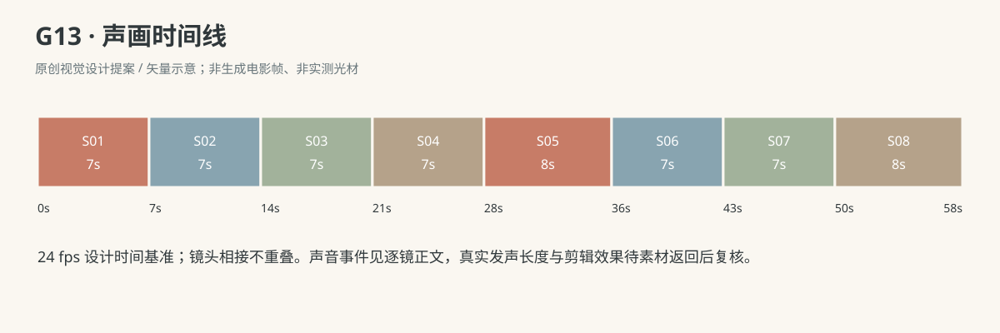

- 澈澈：不玩了！（G13-S01；镜内第4—6秒，放弃本次尝试时用幼儿自然短句说，气恼但不成人讽刺；说完后嘴自然合上。）

- 妈妈：前几天还要一起拼，今天自己拼好啦。（G13-S07；第1—6秒，已看见七片独立拼好且澈澈端来后，温柔自然普通话；“前几天”清楚但不刻意旁白腔，句尾完整落在本镜内。）

- 澈澈：鼓掌！（G13-S08；第2—3秒，拼板先平放、双手已空后看妈妈发出清楚短句；等句尾落下，妈妈才拍掌。）

### 连续性与试片

- 连续性：共两段时间，S03→S04以溶接明确省略数日；同一日光客厅保持地理，靠垫和布篮布置变更，后段台词明确“前几天”。无字幕、无时间文字卡。

- 连续性：唯一拼板和唯一七大片，房子图案与一片一位连续：红屋顶、黄门、左蓝窗、右蓝窗、左绿墙、右绿墙、橙底座。不得复制拼片或以图案变形完成。

- 连续性：第一天开场已有四片在板、三片在外，S01推落与放下的仍为这三片；妈妈捡回后只引导，不让七片自动满板。

- 连续性：数日后S04起七片均在板外，S04由澈澈独放三片，S05独放余下四片；妈妈双手全程膝上，不以切镜替幼儿完成关键放片。

- 连续性：端拼板前七片已经全部嵌平；澈澈双手托板两侧、板面始终近水平，只坐地短距挪近，不加入站立端盘。

- 连续性：S08先把板平放地垫、双手脱离，再说“鼓掌！”并等待妈妈拍；不得一边手持悬空板一边双手拍掌。

- 连续性：R5为幼儿拼图与短句阶段，不把这条搬给小月龄婴儿，也不声称所有2岁7个月孩子有同样过程。

- 试片：核对S03→S04为跨数日省略而非连续动作：第一天成品与第二天七片重置、布置变化及S07“前几天”互相支持；若看成受挫后立刻独自学会则失败。

- 试片：逐片检查：S04从七片在外到三片已入、四片在外；S05从3入4外到7入0外。每片拿取、方向调整与落位实际可见，切镜后凭空多片入位则失败。

- 试片：第一天妈妈辅助的接触与后段不介入可区分；S04/S05妈妈双手在膝或依画外连续性保持，不能出现隐藏成人摆片。

- 试片：S06双手平托板、S07保持水平、S08板先落垫并双手离板再拍掌；拼片悬浮、手穿板、板突然消失或拍掌时仍悬在空中则失败。

- 试片：准确听审三句台词不重叠，最后掌声晚于“鼓掌！”请求；第二次掌声是原创结果，不称原文已写。

**媒体待验证：**未生成媒体、未绑定人物/场景或拼图参考。跨日可读性、七片全过程、两日辅助差别、幼儿短句与平托后放板拍手需实际试片；七片在短镜内的自然操作速度若不足，应延长采用或另拆覆盖，不加速或跳过接触冒充完成。