# 小小日常：41 条完整剧情与分镜

当前原创创作稿。30—60 秒/条，9:16，24 fps 设计时间基准。矢量分镜是构图位置示意；没有生成图像、视频或音频，不代表作者采纳或生产验收。共享身份、服装、道具与世界地理见 authoring-brief.md；各片具体状态见正文。

## B01《脚就放这儿》

**30 秒｜坐姿与手部互动｜角色：澈澈、爸爸｜场景 L**

### 剧情正文

客厅的西窗把柔光铺到奶油色地垫上，婴儿车停在沙发前，爸爸坐在车旁整理布包。澈澈靠在雾蓝车座里，右脚跟搭着低矮软前沿，左脚留在座内；脸上没什么表情，只有脚趾轻轻舒展。爸爸收好一块布，抬眼看见那只脚，伸出右手，用指腹轻碰一下脚背。澈澈低头，把右腿慢慢收回，两只脚都落回座里。爸爸便低头继续理包，布料窸窣声中，澈澈的左膝抬起，左脚跟一点点越过软前沿，重新找到一个舒服的位置。爸爸再抬头，先看看换了边的小脚，嘴角松开，没再伸手。他把包放在身侧，自己的右腿也沿地垫慢慢伸直，脚跟落稳。爸爸的脚跟留在地垫上，澈澈的小脚仍搭着车沿；澈澈望着爸爸伸出的腿，动动自己的脚趾，爸爸也轻轻活动一下脚踝，两个人各自安静下来。

### 导演与空间

**观察任务：**观察屈膝搭脚的舒服姿态，结尾以爸爸伸腿形成自然呼应，不把放回脚写成管教。

**空间与光位：**客厅北墙固定沙发、西窗、东走廊入口、中央奶油地垫。S01停在地垫北半、朝南，轮刹锁定、雾蓝布座、深灰框架、低矮圆钝软前沿；澈澈半躺受座背与腹部约束带支撑，双腿可屈伸至前沿。爸爸坐车西侧地垫，布包在他西侧。相机均在南半区域朝北，爸爸画左、澈澈画右，西窗光由画左照入，暖墙反射填右脸。

**人物表演：**澈澈在有支撑的半躺姿态中看自己的脚，不抬臀悬身；爸爸整理布包，先注意脚的位置，后继续手头事，最后因久坐自然伸腿。

### 节拍覆盖

- **B01-b1**：搭脚姿态与爸爸整理包同时成立，观众先看见舒服而非危险失衡。 → B01-S01

- **B01-b2**：爸爸轻碰后宝宝将右脚收回，接触与反应完整。 → B01-S02、B01-S03

- **B01-b3**：爸爸注意力回包，宝宝改搭左脚；结尾大人自然伸腿呼应。 → B01-S04、B01-S05、B01-S06

### 分镜构图板

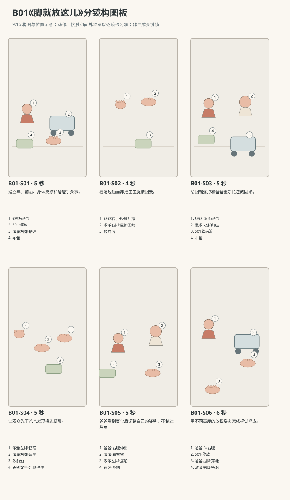

图示为构图位置示意；姿态、接触和画外继承以逐镜正文为准。

### 逐镜设计

#### B01-S01｜00—05 秒｜5 秒｜帧 [0, 120)

**镜头任务：**建立车、前沿、身体支撑和爸爸手头事。

**景别、机位与构图：**双人中全景，南侧低机位略俯，北沙发为后景；爸爸画左、车画右，澈澈右脚在车前沿画面偏左位置清楚。

**摄影机与理由：**固定，让人物动作而非运镜引导先看脚再看包。

**焦点：**保持车座、脚跟和爸爸前臂同在清楚范围。

**入态：**澈澈右脚跟已搭软前沿，左脚在座内；爸爸双手扶着敞开布包，眼看包内。

**动作与表演：**

- 2 秒：爸爸左手扶包口、右手把一块布折入包；澈澈右脚趾缓慢张开。

- 3 秒：澈澈低眼看脚，爸爸收回右手到包缘，随后抬眼注意那只搭着的脚。

**声音：**轻微布包摩擦与房间底声，无对白；脚趾动作不配卡通弹簧声。

**出态：**爸爸视线落在右脚背，右手停于包缘；宝宝右脚跟仍接前沿。

**切点与承接：**切到脚部接触覆盖，延续爸爸已经向脚看的视线。

**连续性：**画内见右脚跟接触前沿、左腿在座内及爸爸双手；车轮刹画外继承锁定。

**开始画面母稿：**

9:16竖幅原创三维生活动画，圆润但保留婴儿头身与关节尺度，皮肤柔和、棉布哑光、低反差暖中性色，动作遵循生活物理；无字幕、无标识、无额外人物。澈澈圆润脸颊、深棕眼、短黑绒发、额前一撮向右弯，穿奶油色棉连体衣，动作尚不完全熟练，神情专注而非成人式算计。爸爸短黑发、砖陶色棉衬衫、深灰长裤，表情温和自然。本图为单一开始瞬间，人物、物件与接触只取以下起态；裁切外人物不为展示外观强行入画。固定空间和材质：客厅北墙固定沙发、西窗、东侧走廊入口、中央奶油地垫。相机在南半区朝北，不越人物东西轴线；成人在西侧，主要双人视图成人画左、宝宝画右。西窗柔和漫射光由画左照入，暖墙反射填暗部，光位与房间方位固定。S01停在地垫北半朝南，轮刹锁定、雾蓝布座、深灰固定框架、低矮圆钝软前沿；澈澈半躺于座内，座背与腹部约束带承托躯干，屈膝可够前沿，不抬臀悬身。爸爸位于车西侧地垫，身旁有柔软布包。宝宝右脚在正面画左、左脚画右，具体搭沿状态只按本镜起态。构图范围：双人中全景，南侧低机位略俯，北沙发为后景；爸爸画左、车画右，澈澈右脚在车前沿画面偏左位置清楚。唯一此刻状态：澈澈右脚跟已搭软前沿，左脚在座内；爸爸双手扶着敞开布包，眼看包内。清晰度与焦点：保持车座、脚跟和爸爸前臂同在清楚范围。画面停在这个瞬间，不将后续动作阶段并列绘入。

**视频变化母稿：**

9:16竖幅原创三维生活动画，圆润但保留婴儿头身与关节尺度，皮肤柔和、棉布哑光、低反差暖中性色，动作遵循生活物理；无字幕、无标识、无额外人物。澈澈圆润脸颊、深棕眼、短黑绒发、额前一撮向右弯，穿奶油色棉连体衣，动作尚不完全熟练，神情专注而非成人式算计。爸爸短黑发、砖陶色棉衬衫、深灰长裤，表情温和自然。本镜有效时长5秒，为一个连续镜头。固定空间和材质：客厅北墙固定沙发、西窗、东侧走廊入口、中央奶油地垫。相机在南半区朝北，不越人物东西轴线；成人在西侧，主要双人视图成人画左、宝宝画右。西窗柔和漫射光由画左照入，暖墙反射填暗部，光位与房间方位固定。S01停在地垫北半朝南，轮刹锁定、雾蓝布座、深灰固定框架、低矮圆钝软前沿；澈澈半躺于座内，座背与腹部约束带承托躯干，屈膝可够前沿，不抬臀悬身。爸爸位于车西侧地垫，身旁有柔软布包。宝宝右脚在正面画左、左脚画右，具体搭沿状态只按本镜起态。摄影构图：双人中全景，南侧低机位略俯，北沙发为后景；爸爸画左、车画右，澈澈右脚在车前沿画面偏左位置清楚。摄影机：固定，让人物动作而非运镜引导先看脚再看包。焦点：保持车座、脚跟和爸爸前臂同在清楚范围。起态：澈澈右脚跟已搭软前沿，左脚在座内；爸爸双手扶着敞开布包，眼看包内。阶段1，2秒：爸爸左手扶包口、右手把一块布折入包；澈澈右脚趾缓慢张开。阶段2，3秒：澈澈低眼看脚，爸爸收回右手到包缘，随后抬眼注意那只搭着的脚。准确声音：轻微布包摩擦与房间底声，无对白；脚趾动作不配卡通弹簧声。终态：爸爸视线落在右脚背，右手停于包缘；宝宝右脚跟仍接前沿。接触和画外状态：画内见右脚跟接触前沿、左腿在座内及爸爸双手；车轮刹画外继承锁定。在该终态切出，不在本镜内部额外切镜。

#### B01-S02｜05—09 秒｜4 秒｜帧 [120, 216)

**镜头任务：**看清轻碰而非把宝宝腿按回去。

**景别、机位与构图：**脚部近景，南侧稍偏西朝车座，右脚背画中、爸爸右手从画左进入，前沿横过下部；只保留澈澈下半身。

**摄影机与理由：**固定，把接触点和脚的主动回缩留在一画面。

**焦点：**守住右手指腹与宝宝右脚背的接触平面。

**入态：**爸爸右手尚离右脚背约一指宽，澈澈右脚跟接软前沿；左脚留座内。

**动作与表演：**

- 1 秒：爸爸食指指腹缓慢靠近并轻碰右脚背，不握脚踝。

- 3 秒：澈澈右脚趾缩一下，右膝逐渐弯起，脚跟离开前沿，爸爸手指随即撤开。

**声音：**一声很轻的皮肤衣料触碰，宝宝短促鼻息；无对白。

**出态：**右脚离沿向座内回缩，爸爸右手已与脚分离。

**切点与承接：**在回缩尚未完成时切稍宽镜，继续同一次屈膝动作。

**连续性：**画内右脚离沿及成人右手释放可见；上身与腹部约束带画外保持座内支撑，左脚不换边。

**开始画面母稿：**

9:16竖幅原创三维生活动画，圆润但保留婴儿头身与关节尺度，皮肤柔和、棉布哑光、低反差暖中性色，动作遵循生活物理；无字幕、无标识、无额外人物。澈澈圆润脸颊、深棕眼、短黑绒发、额前一撮向右弯，穿奶油色棉连体衣，动作尚不完全熟练，神情专注而非成人式算计。爸爸短黑发、砖陶色棉衬衫、深灰长裤，表情温和自然。本图为单一开始瞬间，人物、物件与接触只取以下起态；裁切外人物不为展示外观强行入画。固定空间和材质：客厅北墙固定沙发、西窗、东侧走廊入口、中央奶油地垫。相机在南半区朝北，不越人物东西轴线；成人在西侧，主要双人视图成人画左、宝宝画右。西窗柔和漫射光由画左照入，暖墙反射填暗部，光位与房间方位固定。S01停在地垫北半朝南，轮刹锁定、雾蓝布座、深灰固定框架、低矮圆钝软前沿；澈澈半躺于座内，座背与腹部约束带承托躯干，屈膝可够前沿，不抬臀悬身。爸爸位于车西侧地垫，身旁有柔软布包。宝宝右脚在正面画左、左脚画右，具体搭沿状态只按本镜起态。构图范围：脚部近景，南侧稍偏西朝车座，右脚背画中、爸爸右手从画左进入，前沿横过下部；只保留澈澈下半身。唯一此刻状态：爸爸右手尚离右脚背约一指宽，澈澈右脚跟接软前沿；左脚留座内。清晰度与焦点：爸爸右手指腹与宝宝右脚背之间一指宽的间隙清楚；此刻两者尚未接触。画面停在这个瞬间，不将后续动作阶段并列绘入。

**视频变化母稿：**

9:16竖幅原创三维生活动画，圆润但保留婴儿头身与关节尺度，皮肤柔和、棉布哑光、低反差暖中性色，动作遵循生活物理；无字幕、无标识、无额外人物。澈澈圆润脸颊、深棕眼、短黑绒发、额前一撮向右弯，穿奶油色棉连体衣，动作尚不完全熟练，神情专注而非成人式算计。爸爸短黑发、砖陶色棉衬衫、深灰长裤，表情温和自然。本镜有效时长4秒，为一个连续镜头。固定空间和材质：客厅北墙固定沙发、西窗、东侧走廊入口、中央奶油地垫。相机在南半区朝北，不越人物东西轴线；成人在西侧，主要双人视图成人画左、宝宝画右。西窗柔和漫射光由画左照入，暖墙反射填暗部，光位与房间方位固定。S01停在地垫北半朝南，轮刹锁定、雾蓝布座、深灰固定框架、低矮圆钝软前沿；澈澈半躺于座内，座背与腹部约束带承托躯干，屈膝可够前沿，不抬臀悬身。爸爸位于车西侧地垫，身旁有柔软布包。宝宝右脚在正面画左、左脚画右，具体搭沿状态只按本镜起态。摄影构图：脚部近景，南侧稍偏西朝车座，右脚背画中、爸爸右手从画左进入，前沿横过下部；只保留澈澈下半身。摄影机：固定，把接触点和脚的主动回缩留在一画面。焦点：守住右手指腹与宝宝右脚背的接触平面。起态：爸爸右手尚离右脚背约一指宽，澈澈右脚跟接软前沿；左脚留座内。阶段1，1秒：爸爸食指指腹缓慢靠近并轻碰右脚背，不握脚踝。阶段2，3秒：澈澈右脚趾缩一下，右膝逐渐弯起，脚跟离开前沿，爸爸手指随即撤开。准确声音：一声很轻的皮肤衣料触碰，宝宝短促鼻息；无对白。终态：右脚离沿向座内回缩，爸爸右手已与脚分离。接触和画外状态：画内右脚离沿及成人右手释放可见；上身与腹部约束带画外保持座内支撑，左脚不换边。在该终态切出，不在本镜内部额外切镜。

#### B01-S03｜09—14 秒｜5 秒｜帧 [216, 336)

**镜头任务：**给回缩落点和爸爸重新忙包的因果。

**景别、机位与构图：**南侧中景，爸爸左、宝宝右，车座下部与前沿完整，右脚回落路径无遮挡。

**摄影机与理由：**固定，避免用反应特写藏去脚的去向。

**焦点：**澈澈两腿与爸爸转低的目光同处清楚范围。

**入态：**澈澈右脚在座内回落途中，爸爸右手已撤在车外；爸爸仍看腿。

**动作与表演：**

- 2 秒：右脚落回座内，与左脚分开；澈澈放松双膝。

- 3 秒：爸爸确认姿态后垂眼理包，右手回包口，澈澈视线从爸爸转向前沿。

**声音：**右脚擦雾蓝布座的细响，接布包窸窣；保留短静默。

**出态：**双脚均在座内；爸爸两手在布包上，宝宝看前沿。

**切点与承接：**切向左脚的抬起预备，时间连续，不重复收右脚。

**连续性：**两脚位置画内确认，爸爸双手回包画内确认；车刹与座背支撑保持。

**开始画面母稿：**

9:16竖幅原创三维生活动画，圆润但保留婴儿头身与关节尺度，皮肤柔和、棉布哑光、低反差暖中性色，动作遵循生活物理；无字幕、无标识、无额外人物。澈澈圆润脸颊、深棕眼、短黑绒发、额前一撮向右弯，穿奶油色棉连体衣，动作尚不完全熟练，神情专注而非成人式算计。爸爸短黑发、砖陶色棉衬衫、深灰长裤，表情温和自然。本图为单一开始瞬间，人物、物件与接触只取以下起态；裁切外人物不为展示外观强行入画。固定空间和材质：客厅北墙固定沙发、西窗、东侧走廊入口、中央奶油地垫。相机在南半区朝北，不越人物东西轴线；成人在西侧，主要双人视图成人画左、宝宝画右。西窗柔和漫射光由画左照入，暖墙反射填暗部，光位与房间方位固定。S01停在地垫北半朝南，轮刹锁定、雾蓝布座、深灰固定框架、低矮圆钝软前沿；澈澈半躺于座内，座背与腹部约束带承托躯干，屈膝可够前沿，不抬臀悬身。爸爸位于车西侧地垫，身旁有柔软布包。宝宝右脚在正面画左、左脚画右，具体搭沿状态只按本镜起态。构图范围：南侧中景，爸爸左、宝宝右，车座下部与前沿完整，右脚回落路径无遮挡。唯一此刻状态：澈澈右脚在座内回落途中，爸爸右手已撤在车外；爸爸仍看腿。清晰度与焦点：澈澈正在回落的右脚、仍留座内的左脚，以及爸爸仍看着两腿的目光同处清楚范围。画面停在这个瞬间，不将后续动作阶段并列绘入。

**视频变化母稿：**

9:16竖幅原创三维生活动画，圆润但保留婴儿头身与关节尺度，皮肤柔和、棉布哑光、低反差暖中性色，动作遵循生活物理；无字幕、无标识、无额外人物。澈澈圆润脸颊、深棕眼、短黑绒发、额前一撮向右弯，穿奶油色棉连体衣，动作尚不完全熟练，神情专注而非成人式算计。爸爸短黑发、砖陶色棉衬衫、深灰长裤，表情温和自然。本镜有效时长5秒，为一个连续镜头。固定空间和材质：客厅北墙固定沙发、西窗、东侧走廊入口、中央奶油地垫。相机在南半区朝北，不越人物东西轴线；成人在西侧，主要双人视图成人画左、宝宝画右。西窗柔和漫射光由画左照入，暖墙反射填暗部，光位与房间方位固定。S01停在地垫北半朝南，轮刹锁定、雾蓝布座、深灰固定框架、低矮圆钝软前沿；澈澈半躺于座内，座背与腹部约束带承托躯干，屈膝可够前沿，不抬臀悬身。爸爸位于车西侧地垫，身旁有柔软布包。宝宝右脚在正面画左、左脚画右，具体搭沿状态只按本镜起态。摄影构图：南侧中景，爸爸左、宝宝右，车座下部与前沿完整，右脚回落路径无遮挡。摄影机：固定，避免用反应特写藏去脚的去向。焦点：澈澈两腿与爸爸转低的目光同处清楚范围。起态：澈澈右脚在座内回落途中，爸爸右手已撤在车外；爸爸仍看腿。阶段1，2秒：右脚落回座内，与左脚分开；澈澈放松双膝。阶段2，3秒：爸爸确认姿态后垂眼理包，右手回包口，澈澈视线从爸爸转向前沿。准确声音：右脚擦雾蓝布座的细响，接布包窸窣；保留短静默。终态：双脚均在座内；爸爸两手在布包上，宝宝看前沿。接触和画外状态：两脚位置画内确认，爸爸双手回包画内确认；车刹与座背支撑保持。在该终态切出，不在本镜内部额外切镜。

#### B01-S04｜14—19 秒｜5 秒｜帧 [336, 456)

**镜头任务：**让观众先于爸爸发现换边搭脚。

**景别、机位与构图：**腿部中近景，南侧正面略俯，宝宝左脚在画右、右脚在画左内侧；爸爸理包手只在最左边缘。

**摄影机与理由：**固定，两条腿保持同框便于区分换边。

**焦点：**双脚与前沿清楚，背景包稍软但不抢焦。

**入态：**宝宝双脚在座内，左膝刚抬起；爸爸手在左边缘理包。

**动作与表演：**

- 2 秒：澈澈左膝继续抬起，小腿向前沿伸去，右脚安放座内。

- 2 秒：左脚跟越过软前沿，缓慢落稳；没有腿穿框或臀部离座。

- 1 秒：左脚趾摊开，爸爸理包手在边缘停住。

**声音：**布座轻响与包声先有后停，搭沿接触轻而软。

**出态：**左脚跟搭沿，右脚座内；爸爸手已停。

**切点与承接：**切爸爸与宝宝共享中景，接爸爸抬眼发现。

**连续性：**画内左脚跟落沿、右脚座内完整可见；上身画外继承靠座，不由脚部特写声称看见脸。

**开始画面母稿：**

9:16竖幅原创三维生活动画，圆润但保留婴儿头身与关节尺度，皮肤柔和、棉布哑光、低反差暖中性色，动作遵循生活物理；无字幕、无标识、无额外人物。澈澈圆润脸颊、深棕眼、短黑绒发、额前一撮向右弯，穿奶油色棉连体衣，动作尚不完全熟练，神情专注而非成人式算计。爸爸短黑发、砖陶色棉衬衫、深灰长裤，表情温和自然。本图为单一开始瞬间，人物、物件与接触只取以下起态；裁切外人物不为展示外观强行入画。固定空间和材质：客厅北墙固定沙发、西窗、东侧走廊入口、中央奶油地垫。相机在南半区朝北，不越人物东西轴线；成人在西侧，主要双人视图成人画左、宝宝画右。西窗柔和漫射光由画左照入，暖墙反射填暗部，光位与房间方位固定。S01停在地垫北半朝南，轮刹锁定、雾蓝布座、深灰固定框架、低矮圆钝软前沿；澈澈半躺于座内，座背与腹部约束带承托躯干，屈膝可够前沿，不抬臀悬身。爸爸位于车西侧地垫，身旁有柔软布包。宝宝右脚在正面画左、左脚画右，具体搭沿状态只按本镜起态。构图范围：腿部中近景，南侧正面略俯，宝宝左脚在画右、右脚在画左内侧；爸爸理包手只在最左边缘。唯一此刻状态：宝宝双脚在座内，左膝刚抬起；爸爸手在左边缘理包。清晰度与焦点：双脚与前沿清楚，背景包稍软但不抢焦。画面停在这个瞬间，不将后续动作阶段并列绘入。

**视频变化母稿：**

9:16竖幅原创三维生活动画，圆润但保留婴儿头身与关节尺度，皮肤柔和、棉布哑光、低反差暖中性色，动作遵循生活物理；无字幕、无标识、无额外人物。澈澈圆润脸颊、深棕眼、短黑绒发、额前一撮向右弯，穿奶油色棉连体衣，动作尚不完全熟练，神情专注而非成人式算计。爸爸短黑发、砖陶色棉衬衫、深灰长裤，表情温和自然。本镜有效时长5秒，为一个连续镜头。固定空间和材质：客厅北墙固定沙发、西窗、东侧走廊入口、中央奶油地垫。相机在南半区朝北，不越人物东西轴线；成人在西侧，主要双人视图成人画左、宝宝画右。西窗柔和漫射光由画左照入，暖墙反射填暗部，光位与房间方位固定。S01停在地垫北半朝南，轮刹锁定、雾蓝布座、深灰固定框架、低矮圆钝软前沿；澈澈半躺于座内，座背与腹部约束带承托躯干，屈膝可够前沿，不抬臀悬身。爸爸位于车西侧地垫，身旁有柔软布包。宝宝右脚在正面画左、左脚画右，具体搭沿状态只按本镜起态。摄影构图：腿部中近景，南侧正面略俯，宝宝左脚在画右、右脚在画左内侧；爸爸理包手只在最左边缘。摄影机：固定，两条腿保持同框便于区分换边。焦点：双脚与前沿清楚，背景包稍软但不抢焦。起态：宝宝双脚在座内，左膝刚抬起；爸爸手在左边缘理包。阶段1，2秒：澈澈左膝继续抬起，小腿向前沿伸去，右脚安放座内。阶段2，2秒：左脚跟越过软前沿，缓慢落稳；没有腿穿框或臀部离座。阶段3，1秒：左脚趾摊开，爸爸理包手在边缘停住。准确声音：布座轻响与包声先有后停，搭沿接触轻而软。终态：左脚跟搭沿，右脚座内；爸爸手已停。接触和画外状态：画内左脚跟落沿、右脚座内完整可见；上身画外继承靠座，不由脚部特写声称看见脸。在该终态切出，不在本镜内部额外切镜。

#### B01-S05｜19—24 秒｜5 秒｜帧 [456, 576)

**镜头任务：**爸爸看到变化后调整自己的姿势，不制造胜负。

**景别、机位与构图：**南侧双人中景，左爸爸右澈澈，爸爸脸与宝宝左脚均有足够尺寸，前景留爸爸伸腿通道。

**摄影机与理由：**固定，爸爸向下伸腿从画内发生，空间不跳。

**焦点：**先保持爸爸脸与左脚同清晰范围，无戏剧化切焦。

**入态：**爸爸双手在包上停住，宝宝左脚搭沿，右脚座内。

**动作与表演：**

- 2 秒：爸爸抬眼看看左脚，轻轻呼气，嘴角自然扬起；澈澈看回爸爸。

- 3 秒：爸爸合上布包放到西侧，左掌撑地，右腿沿地垫向南慢慢伸出。

**声音：**爸爸轻呼气、布包合拢声和裤料摩擦；无语义叹词。

**出态：**包在爸爸西侧地上，右腿伸出大半、脚跟将落地；宝宝仍搭左脚。

**切点与承接：**在伸腿动作中切更宽低镜继续落地，非省略瞬移。

**连续性：**画内包落地、左手撑地与右腿伸出；爸爸左腿保持屈坐，宝宝两脚归属不变。

**开始画面母稿：**

9:16竖幅原创三维生活动画，圆润但保留婴儿头身与关节尺度，皮肤柔和、棉布哑光、低反差暖中性色，动作遵循生活物理；无字幕、无标识、无额外人物。澈澈圆润脸颊、深棕眼、短黑绒发、额前一撮向右弯，穿奶油色棉连体衣，动作尚不完全熟练，神情专注而非成人式算计。爸爸短黑发、砖陶色棉衬衫、深灰长裤，表情温和自然。本图为单一开始瞬间，人物、物件与接触只取以下起态；裁切外人物不为展示外观强行入画。固定空间和材质：客厅北墙固定沙发、西窗、东侧走廊入口、中央奶油地垫。相机在南半区朝北，不越人物东西轴线；成人在西侧，主要双人视图成人画左、宝宝画右。西窗柔和漫射光由画左照入，暖墙反射填暗部，光位与房间方位固定。S01停在地垫北半朝南，轮刹锁定、雾蓝布座、深灰固定框架、低矮圆钝软前沿；澈澈半躺于座内，座背与腹部约束带承托躯干，屈膝可够前沿，不抬臀悬身。爸爸位于车西侧地垫，身旁有柔软布包。宝宝右脚在正面画左、左脚画右，具体搭沿状态只按本镜起态。构图范围：南侧双人中景，左爸爸右澈澈，爸爸脸与宝宝左脚均有足够尺寸，前景留爸爸伸腿通道。唯一此刻状态：爸爸双手在包上停住，宝宝左脚搭沿，右脚座内。清晰度与焦点：先保持爸爸脸与左脚同清晰范围，无戏剧化切焦。画面停在这个瞬间，不将后续动作阶段并列绘入。

**视频变化母稿：**

9:16竖幅原创三维生活动画，圆润但保留婴儿头身与关节尺度，皮肤柔和、棉布哑光、低反差暖中性色，动作遵循生活物理；无字幕、无标识、无额外人物。澈澈圆润脸颊、深棕眼、短黑绒发、额前一撮向右弯，穿奶油色棉连体衣，动作尚不完全熟练，神情专注而非成人式算计。爸爸短黑发、砖陶色棉衬衫、深灰长裤，表情温和自然。本镜有效时长5秒，为一个连续镜头。固定空间和材质：客厅北墙固定沙发、西窗、东侧走廊入口、中央奶油地垫。相机在南半区朝北，不越人物东西轴线；成人在西侧，主要双人视图成人画左、宝宝画右。西窗柔和漫射光由画左照入，暖墙反射填暗部，光位与房间方位固定。S01停在地垫北半朝南，轮刹锁定、雾蓝布座、深灰固定框架、低矮圆钝软前沿；澈澈半躺于座内，座背与腹部约束带承托躯干，屈膝可够前沿，不抬臀悬身。爸爸位于车西侧地垫，身旁有柔软布包。宝宝右脚在正面画左、左脚画右，具体搭沿状态只按本镜起态。摄影构图：南侧双人中景，左爸爸右澈澈，爸爸脸与宝宝左脚均有足够尺寸，前景留爸爸伸腿通道。摄影机：固定，爸爸向下伸腿从画内发生，空间不跳。焦点：先保持爸爸脸与左脚同清晰范围，无戏剧化切焦。起态：爸爸双手在包上停住，宝宝左脚搭沿，右脚座内。阶段1，2秒：爸爸抬眼看看左脚，轻轻呼气，嘴角自然扬起；澈澈看回爸爸。阶段2，3秒：爸爸合上布包放到西侧，左掌撑地，右腿沿地垫向南慢慢伸出。准确声音：爸爸轻呼气、布包合拢声和裤料摩擦；无语义叹词。终态：包在爸爸西侧地上，右腿伸出大半、脚跟将落地；宝宝仍搭左脚。接触和画外状态：画内包落地、左手撑地与右腿伸出；爸爸左腿保持屈坐，宝宝两脚归属不变。在该终态切出，不在本镜内部额外切镜。

#### B01-S06｜24—30 秒｜6 秒｜帧 [576, 720)

**镜头任务：**用不同高度的放松姿态完成视觉呼应。

**景别、机位与构图：**南侧低位双人全景，爸爸右脚在画左下地垫，宝宝左脚在画右中车沿，两张脸居上部，背景沙发稳住空间。

**摄影机与理由：**固定，留六秒看见腿脚和目光呼应，不另推脸总结。

**焦点：**两只关键脚与两人轮廓可读，适度景深不抹掉接触。

**入态：**爸爸右脚跟离地很近，左掌撑地；宝宝左脚搭沿、右脚在座内。

**动作与表演：**

- 2 秒：爸爸右脚跟落稳，身体稍后靠；澈澈目光跟着大脚落地。

- 2 秒：澈澈左脚趾轻动两下，爸爸松开左掌，将手放腿上，缓慢转一下右脚踝。

- 2 秒：爸爸与宝宝各自安静看着自己的腿脚，轻微笑意留住，不看镜头。

**声音：**裤料一声擦地与宝宝轻呼气，环境底声自然延至片尾；不加笑声罐头。

**出态：**宝宝左脚仍稳搭沿，爸爸右脚跟在地，包未移动。

**切点与承接：**在姿态呼应已可读、两人呼吸仍持续时结束，不补文字道理。

**连续性：**画内两脚高度不同、各自承托可见；右脚留座与爸爸左腿屈坐按宽景维持，车刹始终未解。

**开始画面母稿：**

9:16竖幅原创三维生活动画，圆润但保留婴儿头身与关节尺度，皮肤柔和、棉布哑光、低反差暖中性色，动作遵循生活物理；无字幕、无标识、无额外人物。澈澈圆润脸颊、深棕眼、短黑绒发、额前一撮向右弯，穿奶油色棉连体衣，动作尚不完全熟练，神情专注而非成人式算计。爸爸短黑发、砖陶色棉衬衫、深灰长裤，表情温和自然。本图为单一开始瞬间，人物、物件与接触只取以下起态；裁切外人物不为展示外观强行入画。固定空间和材质：客厅北墙固定沙发、西窗、东侧走廊入口、中央奶油地垫。相机在南半区朝北，不越人物东西轴线；成人在西侧，主要双人视图成人画左、宝宝画右。西窗柔和漫射光由画左照入，暖墙反射填暗部，光位与房间方位固定。S01停在地垫北半朝南，轮刹锁定、雾蓝布座、深灰固定框架、低矮圆钝软前沿；澈澈半躺于座内，座背与腹部约束带承托躯干，屈膝可够前沿，不抬臀悬身。爸爸位于车西侧地垫，身旁有柔软布包。宝宝右脚在正面画左、左脚画右，具体搭沿状态只按本镜起态。构图范围：南侧低位双人全景，爸爸右脚在画左下地垫，宝宝左脚在画右中车沿，两张脸居上部，背景沙发稳住空间。唯一此刻状态：爸爸右脚跟离地很近，左掌撑地；宝宝左脚搭沿、右脚在座内。清晰度与焦点：两只关键脚与两人轮廓可读，适度景深不抹掉接触。画面停在这个瞬间，不将后续动作阶段并列绘入。

**视频变化母稿：**

9:16竖幅原创三维生活动画，圆润但保留婴儿头身与关节尺度，皮肤柔和、棉布哑光、低反差暖中性色，动作遵循生活物理；无字幕、无标识、无额外人物。澈澈圆润脸颊、深棕眼、短黑绒发、额前一撮向右弯，穿奶油色棉连体衣，动作尚不完全熟练，神情专注而非成人式算计。爸爸短黑发、砖陶色棉衬衫、深灰长裤，表情温和自然。本镜有效时长6秒，为一个连续镜头。固定空间和材质：客厅北墙固定沙发、西窗、东侧走廊入口、中央奶油地垫。相机在南半区朝北，不越人物东西轴线；成人在西侧，主要双人视图成人画左、宝宝画右。西窗柔和漫射光由画左照入，暖墙反射填暗部，光位与房间方位固定。S01停在地垫北半朝南，轮刹锁定、雾蓝布座、深灰固定框架、低矮圆钝软前沿；澈澈半躺于座内，座背与腹部约束带承托躯干，屈膝可够前沿，不抬臀悬身。爸爸位于车西侧地垫，身旁有柔软布包。宝宝右脚在正面画左、左脚画右，具体搭沿状态只按本镜起态。摄影构图：南侧低位双人全景，爸爸右脚在画左下地垫，宝宝左脚在画右中车沿，两张脸居上部，背景沙发稳住空间。摄影机：固定，留六秒看见腿脚和目光呼应，不另推脸总结。焦点：两只关键脚与两人轮廓可读，适度景深不抹掉接触。起态：爸爸右脚跟离地很近，左掌撑地；宝宝左脚搭沿、右脚在座内。阶段1，2秒：爸爸右脚跟落稳，身体稍后靠；澈澈目光跟着大脚落地。阶段2，2秒：澈澈左脚趾轻动两下，爸爸松开左掌，将手放腿上，缓慢转一下右脚踝。阶段3，2秒：爸爸与宝宝各自安静看着自己的腿脚，轻微笑意留住，不看镜头。准确声音：裤料一声擦地与宝宝轻呼气，环境底声自然延至片尾；不加笑声罐头。终态：宝宝左脚仍稳搭沿，爸爸右脚跟在地，包未移动。接触和画外状态：画内两脚高度不同、各自承托可见；右脚留座与爸爸左腿屈坐按宽景维持，车刹始终未解。在该终态切出，不在本镜内部额外切镜。

### 声音与剪辑

全片无语义对白、无旁白、无音乐；不以成人配音解释宝宝动机。连续室内安静底声保持声场，动作拟音按各镜接触同步，婴儿气息与咿呀使用自然短音而非成人语调。

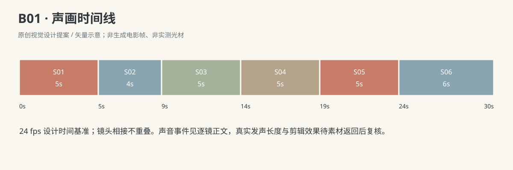

正式台词：无；保留镜头声音中已写明的自然发声。

### 连续性与试片

- 连续性：澈澈右脚先搭沿并收回，随后换左脚；不得左右镜像或变成两脚同时悬空。

- 连续性：S01朝南、轮刹锁定，澈澈躯干受座背和约束带支撑，爸爸不拉脚踝。

- 连续性：爸爸西侧画左，西窗主光；布包从爸爸膝前到西侧地上有镜内过程。

- 试片：B01-S02—S04：逐帧能看见右脚离沿、回座、左脚抬起落沿；若左右交换或腿穿框即失败。

- 试片：B01-S05—S06：爸爸右腿伸出与落地必须接续同一次动作；若片尾大脚小脚缺承托或六秒只剩空等则回调覆盖。

**媒体待验证：**待实际动作预演核对车座深度、脚跟够沿与腿部关节；待试片验证脚趾小动作能否在竖幅中读到，尚无媒体质量结论。

---

## B02《再捡一下》

**45 秒｜坐姿与手部互动｜角色：澈澈、爸爸｜场景 L**

### 剧情正文

奶油地垫铺在沙发前，爸爸侧坐在澈澈左边，西窗的光照亮两人之间那一小块空地。澈澈坐得有靠，右手攥着珊瑚色布环，低头看了很久，忽然张开手。布环软软落在腿前，澈澈的目光跟着往下走。爸爸俯身用右手捡起，把环重新递到宝宝右掌里，等小手握稳才松开。澈澈抬起手，先看看布环，又看一眼爸爸，手指再次张开。爸爸这次伸得快一些，环还是落在掌边，滑回地垫。爸爸看着空掌轻轻笑了一口气，澈澈仍认真盯着环，没有跟着笑。爸爸把它拾起递回，慢慢把右掌摊在下方等着。澈澈又松手，环落进掌心，没有再往下走。宝宝盯住这个新的落点，身体只微微前倾。爸爸的左手从旁边过来，准备取走右掌里的环，左食指刚伸到附近，澈澈空着的右手便握住了它。爸爸停住，右掌托着环，左食指留在小手里。他看看两只被占住的手，又看看澈澈；澈澈只顾观察那根会轻轻弯曲的手指。

### 亲述来源与改编

原帖是家长自述，未独立核实。本片将生活机制改编为澈澈的原创故事。

- [IN03 · 高脚椅里的玩具钥匙一次次掉下，家长一次次捡](https://andbabybmakesthree.wordpress.com/2007/08/15/gravity-spot/)；作者自报年龄：未注明；正文作者没有直接自报当时月龄。

- **采用的生活过程：**重复松手、物件下落、成人捡回、宝宝追看落点的循环；家长会被逗笑，宝宝没有跟着笑。

- **本片原创改编：**原帖玩具车钥匙换成项目既有珊瑚软布环，场地改为有靠坐姿地垫；爸爸的具体笑声时点、接掌停住及末尾握食指均为原创具体化。

- **不作出的事实推断：**原帖未自报确切月龄，本片R1是动画能力设计，不是原帖年龄。

- **不作出的事实推断：**不把家长对“故意”的解释当作已验证的婴儿动机；未声称这是原事件逐镜复刻。

[查看原始过程与缺项](research/real-experiences/index.html#IN03)

### 导演与空间

**观察任务：**把松手、落下、捡回变成宝宝的观察循环；成人被重复动作逗出短笑，宝宝始终认真追落点，末段大人两手被不同任务占用。

**空间与光位：**客厅北沙发、西窗、东走廊；澈澈坐中央地垫北侧朝南，背后低而稳的靠垫支撑，双脚落垫。爸爸在西侧朝东南坐，右手可达宝宝胸前与两人间地垫。P01珊瑚色大软布环起始由宝宝右手持在胸前，左手空放左腿。南侧机位始终不跨两人东西轴线，爸爸画左、宝宝画右，西窗柔光从左入。

**人物表演：**澈澈先看布环落点，再把目光移向捡回的成人手，始终专注、不安排笑声或奸笑挑眉来表达试探；爸爸原本把环递给宝宝，发现循环后调整右手接取方式，左手按自己的任务来取环。 爸爸的短笑由看到第二次落物触发，不提前预演。

### 节拍覆盖

- **B02-b1**：宝宝松手落环，爸爸完整捡回并交付。 → B02-S01、B02-S02

- **B02-b2**：第二次目光先看大人，落环滑掌，父亲调整接法。 → B02-S03、B02-S04

- **B02-b3**：右掌接住第三次落环；左食指被宝宝右手握住，两手各有归属。 → B02-S05、B02-S06、B02-S07

### 分镜构图板

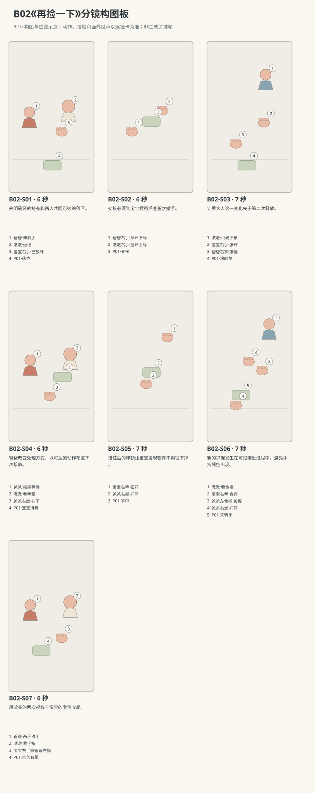

图示为构图位置示意；姿态、接触和画外继承以逐镜正文为准。

### 逐镜设计

#### B02-S01｜00—06 秒｜6 秒｜帧 [0, 144)

**镜头任务：**先明确环的持有和两人共同可达的落区。

**景别、机位与构图：**南侧双人中全景，宝宝画右有靠坐，爸爸画左；两人间地垫空地在下半，环在宝宝胸前。

**摄影机与理由：**固定，让第一次掉落全程可见。

**焦点：**宝宝右手、P01与地垫落点同清楚。

**入态：**宝宝右手攥P01胸前，左手空放左腿；爸爸右手在自己右膝、左手在左膝。

**动作与表演：**

- 2 秒：澈澈低眼转动右腕，看看布环边缘。

- 2 秒：右指依次松开，环垂直落到腿前地垫，澈澈目光追到落点。

- 2 秒：爸爸看向落环，右手从膝上向地垫伸去，左手仍留左膝。

**声音：**环落垫一声闷软轻响，爸爸衣袖摩擦；无对白。

**出态：**P01平躺地垫，宝宝双手空，爸爸右手接近环但尚未抓住。

**切点与承接：**切手部近景接右手伸向环的同一动作。

**连续性：**画内看见右手释放、布环落点；宝宝左手未持环、爸爸左手膝上保持。

**开始画面母稿：**

9:16竖幅原创三维生活动画，圆润但保留婴儿头身与关节尺度，皮肤柔和、棉布哑光、低反差暖中性色，动作遵循生活物理；无字幕、无标识、无额外人物。澈澈圆润脸颊、深棕眼、短黑绒发、额前一撮向右弯，穿奶油色棉连体衣，动作尚不完全熟练，神情专注而非成人式算计。爸爸短黑发、砖陶色棉衬衫、深灰长裤，表情温和自然。本图为单一开始瞬间，人物、物件与接触只取以下起态；裁切外人物不为展示外观强行入画。固定空间和材质：客厅北墙固定沙发、西窗、东侧走廊入口、中央奶油地垫。相机在南半区朝北，不越人物东西轴线；成人在西侧，主要双人视图成人画左、宝宝画右。西窗柔和漫射光由画左照入，暖墙反射填暗部，光位与房间方位固定。澈澈朝南有靠坐于地垫北侧，稳固低靠垫承背，双脚落垫；爸爸西侧坐，手可达宝宝胸前与两人间地垫。P01为珊瑚色大软布环，只有一只；具体持有、落点和左右手按本镜起态，不预设仍在最初持有人手中。构图范围：南侧双人中全景，宝宝画右有靠坐，爸爸画左；两人间地垫空地在下半，环在宝宝胸前。唯一此刻状态：宝宝右手攥P01胸前，左手空放左腿；爸爸右手在自己右膝、左手在左膝。清晰度与焦点：宝宝右手、P01与地垫落点同清楚。画面停在这个瞬间，不将后续动作阶段并列绘入。

**视频变化母稿：**

9:16竖幅原创三维生活动画，圆润但保留婴儿头身与关节尺度，皮肤柔和、棉布哑光、低反差暖中性色，动作遵循生活物理；无字幕、无标识、无额外人物。澈澈圆润脸颊、深棕眼、短黑绒发、额前一撮向右弯，穿奶油色棉连体衣，动作尚不完全熟练，神情专注而非成人式算计。爸爸短黑发、砖陶色棉衬衫、深灰长裤，表情温和自然。本镜有效时长6秒，为一个连续镜头。固定空间和材质：客厅北墙固定沙发、西窗、东侧走廊入口、中央奶油地垫。相机在南半区朝北，不越人物东西轴线；成人在西侧，主要双人视图成人画左、宝宝画右。西窗柔和漫射光由画左照入，暖墙反射填暗部，光位与房间方位固定。澈澈朝南有靠坐于地垫北侧，稳固低靠垫承背，双脚落垫；爸爸西侧坐，手可达宝宝胸前与两人间地垫。P01为珊瑚色大软布环，只有一只；具体持有、落点和左右手按本镜起态，不预设仍在最初持有人手中。摄影构图：南侧双人中全景，宝宝画右有靠坐，爸爸画左；两人间地垫空地在下半，环在宝宝胸前。摄影机：固定，让第一次掉落全程可见。焦点：宝宝右手、P01与地垫落点同清楚。起态：宝宝右手攥P01胸前，左手空放左腿；爸爸右手在自己右膝、左手在左膝。阶段1，2秒：澈澈低眼转动右腕，看看布环边缘。阶段2，2秒：右指依次松开，环垂直落到腿前地垫，澈澈目光追到落点。阶段3，2秒：爸爸看向落环，右手从膝上向地垫伸去，左手仍留左膝。准确声音：环落垫一声闷软轻响，爸爸衣袖摩擦；无对白。终态：P01平躺地垫，宝宝双手空，爸爸右手接近环但尚未抓住。接触和画外状态：画内看见右手释放、布环落点；宝宝左手未持环、爸爸左手膝上保持。在该终态切出，不在本镜内部额外切镜。

#### B02-S02｜06—12 秒｜6 秒｜帧 [144, 288)

**镜头任务：**交接必须到宝宝握稳后爸爸才撤手。

**景别、机位与构图：**南侧偏西手部近景，地垫下部与宝宝右掌上部同框，爸爸右手从左下进入。

**摄影机与理由：**固定，展示捡起到交付的完整路径。

**焦点：**保持两只右手与环的接触边缘清楚。

**入态：**P01平躺两人间地垫；爸爸右手已伸至环侧，宝宝右掌空在胸下。

**动作与表演：**

- 2 秒：爸爸右手捏起布环外侧，从地垫缓慢举到宝宝右掌前。

- 2 秒：宝宝右手包住布环上缘，爸爸仍扶下缘，短暂双持。

- 2 秒：宝宝抓稳后，爸爸右指松开撤至膝旁；宝宝将环举回胸前。

**声音：**布环揉动细响，宝宝一声短咿呀，不含词语。

**出态：**P01仅归宝宝右手，爸爸右手空并撤开。

**切点与承接：**按举环完成后的停顿切脸与手的中近景。

**连续性：**画内双持到单持明确；宝宝左手画外仍空放左腿，爸爸左手画外仍在膝上。

**开始画面母稿：**

9:16竖幅原创三维生活动画，圆润但保留婴儿头身与关节尺度，皮肤柔和、棉布哑光、低反差暖中性色，动作遵循生活物理；无字幕、无标识、无额外人物。澈澈圆润脸颊、深棕眼、短黑绒发、额前一撮向右弯，穿奶油色棉连体衣，动作尚不完全熟练，神情专注而非成人式算计。爸爸短黑发、砖陶色棉衬衫、深灰长裤，表情温和自然。本图为单一开始瞬间，人物、物件与接触只取以下起态；裁切外人物不为展示外观强行入画。固定空间和材质：客厅北墙固定沙发、西窗、东侧走廊入口、中央奶油地垫。相机在南半区朝北，不越人物东西轴线；成人在西侧，主要双人视图成人画左、宝宝画右。西窗柔和漫射光由画左照入，暖墙反射填暗部，光位与房间方位固定。澈澈朝南有靠坐于地垫北侧，稳固低靠垫承背，双脚落垫；爸爸西侧坐，手可达宝宝胸前与两人间地垫。P01为珊瑚色大软布环，只有一只；具体持有、落点和左右手按本镜起态，不预设仍在最初持有人手中。构图范围：南侧偏西手部近景，地垫下部与宝宝右掌上部同框，爸爸右手位于左下环侧。唯一此刻状态：P01平躺两人间地垫；爸爸右手已伸至环侧，宝宝右掌空在胸下。清晰度与焦点：保持地垫上的P01、环侧爸爸右手及尚未触环的宝宝空右掌清楚。画面停在这个瞬间，不将后续动作阶段并列绘入。

**视频变化母稿：**

9:16竖幅原创三维生活动画，圆润但保留婴儿头身与关节尺度，皮肤柔和、棉布哑光、低反差暖中性色，动作遵循生活物理；无字幕、无标识、无额外人物。澈澈圆润脸颊、深棕眼、短黑绒发、额前一撮向右弯，穿奶油色棉连体衣，动作尚不完全熟练，神情专注而非成人式算计。爸爸短黑发、砖陶色棉衬衫、深灰长裤，表情温和自然。本镜有效时长6秒，为一个连续镜头。固定空间和材质：客厅北墙固定沙发、西窗、东侧走廊入口、中央奶油地垫。相机在南半区朝北，不越人物东西轴线；成人在西侧，主要双人视图成人画左、宝宝画右。西窗柔和漫射光由画左照入，暖墙反射填暗部，光位与房间方位固定。澈澈朝南有靠坐于地垫北侧，稳固低靠垫承背，双脚落垫；爸爸西侧坐，手可达宝宝胸前与两人间地垫。P01为珊瑚色大软布环，只有一只；具体持有、落点和左右手按本镜起态，不预设仍在最初持有人手中。摄影构图：南侧偏西手部近景，地垫下部与宝宝右掌上部同框，爸爸右手从左下进入。摄影机：固定，展示捡起到交付的完整路径。焦点：保持两只右手与环的接触边缘清楚。起态：P01平躺两人间地垫；爸爸右手已伸至环侧，宝宝右掌空在胸下。阶段1，2秒：爸爸右手捏起布环外侧，从地垫缓慢举到宝宝右掌前。阶段2，2秒：宝宝右手包住布环上缘，爸爸仍扶下缘，短暂双持。阶段3，2秒：宝宝抓稳后，爸爸右指松开撤至膝旁；宝宝将环举回胸前。准确声音：布环揉动细响，宝宝一声短咿呀，不含词语。终态：P01仅归宝宝右手，爸爸右手空并撤开。接触和画外状态：画内双持到单持明确；宝宝左手画外仍空放左腿，爸爸左手画外仍在膝上。在该终态切出，不在本镜内部额外切镜。

#### B02-S03｜12—19 秒｜7 秒｜帧 [288, 456)

**镜头任务：**让看大人这一变化先于第二次释放。

**景别、机位与构图：**宝宝中近景从南侧拍，脸在上、右手环在下，爸爸脸只在左边缘可辨，落区留在底部。

**摄影机与理由：**固定，给视线转移独立时间，不用特效强调故意。

**焦点：**脸、右手环和近侧爸爸侧脸均可读。

**入态：**澈澈右手持P01胸前，爸爸右手空在膝边；两人间地垫空。

**动作与表演：**

- 2 秒：澈澈低眼看环，再抬眼望爸爸脸。

- 2 秒：澈澈目光回到环，右手慢慢张开；爸爸看到指缝松开才伸右手。

- 3 秒：P01落在爸爸右掌边缘，软环弯折后滑到地垫，澈澈眼睛跟着从掌移到垫。 环落稳后，爸爸低低笑出一口气；宝宝仍专注看环，没有笑。

**声音：**软布碰掌后落垫的两段轻响；环落垫后爸爸短促呼气笑一声，宝宝只保留平稳鼻息，不配婴儿笑声；无对白。

**出态：**P01在爸爸掌前的地垫，右掌空；宝宝右掌空伸着。

**切点与承接：**切稍宽镜接父亲拾取，保留宝宝已经向下的视线。

**连续性：**画内宝宝右手放开、爸爸右掌接偏与环落垫连续，爸爸左手不参与。

**开始画面母稿：**

9:16竖幅原创三维生活动画，圆润但保留婴儿头身与关节尺度，皮肤柔和、棉布哑光、低反差暖中性色，动作遵循生活物理；无字幕、无标识、无额外人物。澈澈圆润脸颊、深棕眼、短黑绒发、额前一撮向右弯，穿奶油色棉连体衣，动作尚不完全熟练，神情专注而非成人式算计。爸爸短黑发、砖陶色棉衬衫、深灰长裤，表情温和自然。本图为单一开始瞬间，人物、物件与接触只取以下起态；裁切外人物不为展示外观强行入画。固定空间和材质：客厅北墙固定沙发、西窗、东侧走廊入口、中央奶油地垫。相机在南半区朝北，不越人物东西轴线；成人在西侧，主要双人视图成人画左、宝宝画右。西窗柔和漫射光由画左照入，暖墙反射填暗部，光位与房间方位固定。澈澈朝南有靠坐于地垫北侧，稳固低靠垫承背，双脚落垫；爸爸西侧坐，手可达宝宝胸前与两人间地垫。P01为珊瑚色大软布环，只有一只；具体持有、落点和左右手按本镜起态，不预设仍在最初持有人手中。构图范围：宝宝中近景从南侧拍，脸在上、右手环在下，爸爸脸只在左边缘可辨，落区留在底部。唯一此刻状态：澈澈右手持P01胸前，爸爸右手空在膝边；两人间地垫空。清晰度与焦点：脸、右手环和近侧爸爸侧脸均可读。画面停在这个瞬间，不将后续动作阶段并列绘入。

**视频变化母稿：**

9:16竖幅原创三维生活动画，圆润但保留婴儿头身与关节尺度，皮肤柔和、棉布哑光、低反差暖中性色，动作遵循生活物理；无字幕、无标识、无额外人物。澈澈圆润脸颊、深棕眼、短黑绒发、额前一撮向右弯，穿奶油色棉连体衣，动作尚不完全熟练，神情专注而非成人式算计。爸爸短黑发、砖陶色棉衬衫、深灰长裤，表情温和自然。本镜有效时长7秒，为一个连续镜头。固定空间和材质：客厅北墙固定沙发、西窗、东侧走廊入口、中央奶油地垫。相机在南半区朝北，不越人物东西轴线；成人在西侧，主要双人视图成人画左、宝宝画右。西窗柔和漫射光由画左照入，暖墙反射填暗部，光位与房间方位固定。澈澈朝南有靠坐于地垫北侧，稳固低靠垫承背，双脚落垫；爸爸西侧坐，手可达宝宝胸前与两人间地垫。P01为珊瑚色大软布环，只有一只；具体持有、落点和左右手按本镜起态，不预设仍在最初持有人手中。摄影构图：宝宝中近景从南侧拍，脸在上、右手环在下，爸爸脸只在左边缘可辨，落区留在底部。摄影机：固定，给视线转移独立时间，不用特效强调故意。焦点：脸、右手环和近侧爸爸侧脸均可读。起态：澈澈右手持P01胸前，爸爸右手空在膝边；两人间地垫空。阶段1，2秒：澈澈低眼看环，再抬眼望爸爸脸。阶段2，2秒：澈澈目光回到环，右手慢慢张开；爸爸看到指缝松开才伸右手。阶段3，3秒：P01落在爸爸右掌边缘，软环弯折后滑到地垫，澈澈眼睛跟着从掌移到垫。 环落稳后，爸爸低低笑出一口气；宝宝仍专注看环，没有笑。准确声音：软布碰掌后落垫的两段轻响；环落垫后爸爸短促呼气笑一声，宝宝只保留平稳鼻息，不配婴儿笑声；无对白。终态：P01在爸爸掌前的地垫，右掌空；宝宝右掌空伸着。接触和画外状态：画内宝宝右手放开、爸爸右掌接偏与环落垫连续，爸爸左手不参与。在该终态切出，不在本镜内部额外切镜。

#### B02-S04｜19—25 秒｜6 秒｜帧 [456, 600)

**镜头任务：**爸爸改变处理方式，以可达的动作布置下次接取。

**景别、机位与构图：**南侧双人中景，地垫落点、宝宝右掌与爸爸两手均入画，爸爸仍左宝宝右。

**摄影机与理由：**固定，连续展示拾回、交付和摊掌，无跳过关键交接。

**焦点：**环与双手为主要清晰区，宝宝面部保留反应。

**入态：**P01在地垫，爸爸右掌在环侧，宝宝双手空。

**动作与表演：**

- 2 秒：爸爸右手拾起环并送至宝宝右掌，宝宝右指合拢。

- 2 秒：爸爸确认宝宝握稳后松开，右手向下转成掌心朝上。

- 2 秒：右掌停在宝宝右手下方一掌距离，左手仍在爸爸左膝；澈澈看看下方手掌。

**声音：**拾环布声和衣袖声，末段两秒安静保留宝宝轻气息。

**出态：**宝宝右手持环，爸爸右掌摊于环下；左手仍膝上。

**切点与承接：**沿摊掌的位置切向第三次落环的近景。

**连续性：**画内交接及右掌旋转可见；宝宝左手空、爸爸左手空均明确。

**开始画面母稿：**

9:16竖幅原创三维生活动画，圆润但保留婴儿头身与关节尺度，皮肤柔和、棉布哑光、低反差暖中性色，动作遵循生活物理；无字幕、无标识、无额外人物。澈澈圆润脸颊、深棕眼、短黑绒发、额前一撮向右弯，穿奶油色棉连体衣，动作尚不完全熟练，神情专注而非成人式算计。爸爸短黑发、砖陶色棉衬衫、深灰长裤，表情温和自然。本图为单一开始瞬间，人物、物件与接触只取以下起态；裁切外人物不为展示外观强行入画。固定空间和材质：客厅北墙固定沙发、西窗、东侧走廊入口、中央奶油地垫。相机在南半区朝北，不越人物东西轴线；成人在西侧，主要双人视图成人画左、宝宝画右。西窗柔和漫射光由画左照入，暖墙反射填暗部，光位与房间方位固定。澈澈朝南有靠坐于地垫北侧，稳固低靠垫承背，双脚落垫；爸爸西侧坐，手可达宝宝胸前与两人间地垫。P01为珊瑚色大软布环，只有一只；具体持有、落点和左右手按本镜起态，不预设仍在最初持有人手中。构图范围：南侧双人中景，地垫落点、宝宝右掌与爸爸两手均入画，爸爸仍左宝宝右。唯一此刻状态：P01在地垫，爸爸右掌在环侧，宝宝双手空。清晰度与焦点：环与双手为主要清晰区，宝宝面部保留反应。画面停在这个瞬间，不将后续动作阶段并列绘入。

**视频变化母稿：**

9:16竖幅原创三维生活动画，圆润但保留婴儿头身与关节尺度，皮肤柔和、棉布哑光、低反差暖中性色，动作遵循生活物理；无字幕、无标识、无额外人物。澈澈圆润脸颊、深棕眼、短黑绒发、额前一撮向右弯，穿奶油色棉连体衣，动作尚不完全熟练，神情专注而非成人式算计。爸爸短黑发、砖陶色棉衬衫、深灰长裤，表情温和自然。本镜有效时长6秒，为一个连续镜头。固定空间和材质：客厅北墙固定沙发、西窗、东侧走廊入口、中央奶油地垫。相机在南半区朝北，不越人物东西轴线；成人在西侧，主要双人视图成人画左、宝宝画右。西窗柔和漫射光由画左照入，暖墙反射填暗部，光位与房间方位固定。澈澈朝南有靠坐于地垫北侧，稳固低靠垫承背，双脚落垫；爸爸西侧坐，手可达宝宝胸前与两人间地垫。P01为珊瑚色大软布环，只有一只；具体持有、落点和左右手按本镜起态，不预设仍在最初持有人手中。摄影构图：南侧双人中景，地垫落点、宝宝右掌与爸爸两手均入画，爸爸仍左宝宝右。摄影机：固定，连续展示拾回、交付和摊掌，无跳过关键交接。焦点：环与双手为主要清晰区，宝宝面部保留反应。起态：P01在地垫，爸爸右掌在环侧，宝宝双手空。阶段1，2秒：爸爸右手拾起环并送至宝宝右掌，宝宝右指合拢。阶段2，2秒：爸爸确认宝宝握稳后松开，右手向下转成掌心朝上。阶段3，2秒：右掌停在宝宝右手下方一掌距离，左手仍在爸爸左膝；澈澈看看下方手掌。准确声音：拾环布声和衣袖声，末段两秒安静保留宝宝轻气息。终态：宝宝右手持环，爸爸右掌摊于环下；左手仍膝上。接触和画外状态：画内交接及右掌旋转可见；宝宝左手空、爸爸左手空均明确。在该终态切出，不在本镜内部额外切镜。

#### B02-S05｜25—32 秒｜7 秒｜帧 [600, 768)

**镜头任务：**接住后的停顿让宝宝发现物件不再往下掉。

**景别、机位与构图：**南侧手部近景，宝宝右手在右上、爸爸右掌横在中下，地垫下缘清楚，左食指尚不入画。

**摄影机与理由：**固定，手掌和物件不靠切镜完成接触。

**焦点：**保持宝宝右手、环落点与爸爸掌面清楚。

**入态：**P01由宝宝右手持于爸爸右掌上方；爸爸掌心朝上稳定。

**动作与表演：**

- 2 秒：宝宝看看掌面，右指慢慢打开。

- 2 秒：P01落入右掌并轻折一下；爸爸右手仅微微下沉承接，不立刻收走。

- 3 秒：澈澈空右手停在上方，手指微张；目光留在环上，爸爸右掌也停住。

**声音：**轻软布环落掌声，比落地更短；宝宝细微鼻息，空出观察停顿。

**出态：**P01由爸爸右掌托住；宝宝右手空悬，左手仍空放腿。

**切点与承接：**切稍宽中近景揭示爸爸左手靠近，时间连续。

**连续性：**画内右掌接住和宝宝完全释放可见；爸爸左手画外仍在左膝，尚未触环。

**开始画面母稿：**

9:16竖幅原创三维生活动画，圆润但保留婴儿头身与关节尺度，皮肤柔和、棉布哑光、低反差暖中性色，动作遵循生活物理；无字幕、无标识、无额外人物。澈澈圆润脸颊、深棕眼、短黑绒发、额前一撮向右弯，穿奶油色棉连体衣，动作尚不完全熟练，神情专注而非成人式算计。爸爸短黑发、砖陶色棉衬衫、深灰长裤，表情温和自然。本图为单一开始瞬间，人物、物件与接触只取以下起态；裁切外人物不为展示外观强行入画。固定空间和材质：客厅北墙固定沙发、西窗、东侧走廊入口、中央奶油地垫。相机在南半区朝北，不越人物东西轴线；成人在西侧，主要双人视图成人画左、宝宝画右。西窗柔和漫射光由画左照入，暖墙反射填暗部，光位与房间方位固定。澈澈朝南有靠坐于地垫北侧，稳固低靠垫承背，双脚落垫；爸爸西侧坐，手可达宝宝胸前与两人间地垫。P01为珊瑚色大软布环，只有一只；具体持有、落点和左右手按本镜起态，不预设仍在最初持有人手中。构图范围：南侧手部近景，宝宝右手在右上、爸爸右掌横在中下，地垫下缘清楚，左食指尚不入画。唯一此刻状态：P01由宝宝右手持于爸爸右掌上方；爸爸掌心朝上稳定。清晰度与焦点：保持宝宝右手、环落点与爸爸掌面清楚。画面停在这个瞬间，不将后续动作阶段并列绘入。

**视频变化母稿：**

9:16竖幅原创三维生活动画，圆润但保留婴儿头身与关节尺度，皮肤柔和、棉布哑光、低反差暖中性色，动作遵循生活物理；无字幕、无标识、无额外人物。澈澈圆润脸颊、深棕眼、短黑绒发、额前一撮向右弯，穿奶油色棉连体衣，动作尚不完全熟练，神情专注而非成人式算计。爸爸短黑发、砖陶色棉衬衫、深灰长裤，表情温和自然。本镜有效时长7秒，为一个连续镜头。固定空间和材质：客厅北墙固定沙发、西窗、东侧走廊入口、中央奶油地垫。相机在南半区朝北，不越人物东西轴线；成人在西侧，主要双人视图成人画左、宝宝画右。西窗柔和漫射光由画左照入，暖墙反射填暗部，光位与房间方位固定。澈澈朝南有靠坐于地垫北侧，稳固低靠垫承背，双脚落垫；爸爸西侧坐，手可达宝宝胸前与两人间地垫。P01为珊瑚色大软布环，只有一只；具体持有、落点和左右手按本镜起态，不预设仍在最初持有人手中。摄影构图：南侧手部近景，宝宝右手在右上、爸爸右掌横在中下，地垫下缘清楚，左食指尚不入画。摄影机：固定，手掌和物件不靠切镜完成接触。焦点：保持宝宝右手、环落点与爸爸掌面清楚。起态：P01由宝宝右手持于爸爸右掌上方；爸爸掌心朝上稳定。阶段1，2秒：宝宝看看掌面，右指慢慢打开。阶段2，2秒：P01落入右掌并轻折一下；爸爸右手仅微微下沉承接，不立刻收走。阶段3，3秒：澈澈空右手停在上方，手指微张；目光留在环上，爸爸右掌也停住。准确声音：轻软布环落掌声，比落地更短；宝宝细微鼻息，空出观察停顿。终态：P01由爸爸右掌托住；宝宝右手空悬，左手仍空放腿。接触和画外状态：画内右掌接住和宝宝完全释放可见；爸爸左手画外仍在左膝，尚未触环。在该终态切出，不在本镜内部额外切镜。

#### B02-S06｜32—39 秒｜7 秒｜帧 [768, 936)

**镜头任务：**新的抓握发生在可见接近过程中，避免手指凭空出现。

**景别、机位与构图：**南侧双手与宝宝脸中近景，爸爸左手自左上进入，右掌环在左下，宝宝右手在右侧；脸在上方看接触。

**摄影机与理由：**固定，保证左食指、宝宝右指与右掌环同时清楚。

**焦点：**对准左食指与宝宝右手握合平面，P01仍能辨认。

**入态：**爸爸右掌托P01，左手仍在膝侧即将抬起；宝宝空右手悬在右掌上方。

**动作与表演：**

- 2 秒：爸爸左手伸向右掌中的环，左食指先经过宝宝右手前，尚未碰环。

- 3 秒：宝宝右手转向左食指，先触指侧再慢慢合拢；爸爸感到抓握即停止左手前移。

- 2 秒：爸爸左食指保持轻弯不抽走，右掌仍托环；宝宝低眼看指尖。

**声音：**衣袖声、手指皮肤轻碰声极轻，宝宝一声无词低咿呀。

**出态：**宝宝右手握爸爸左食指；P01仍在爸爸右掌，爸爸左手未持环。

**切点与承接：**切双人稍宽反应镜，保留两种不同持有关系。

**连续性：**画内明确宝宝右手抓成人左食指，成人右掌独托P01；宝宝左手仍空在腿边画内下缘。

**开始画面母稿：**

9:16竖幅原创三维生活动画，圆润但保留婴儿头身与关节尺度，皮肤柔和、棉布哑光、低反差暖中性色，动作遵循生活物理；无字幕、无标识、无额外人物。澈澈圆润脸颊、深棕眼、短黑绒发、额前一撮向右弯，穿奶油色棉连体衣，动作尚不完全熟练，神情专注而非成人式算计。爸爸短黑发、砖陶色棉衬衫、深灰长裤，表情温和自然。本图为单一开始瞬间，人物、物件与接触只取以下起态；裁切外人物不为展示外观强行入画。固定空间和材质：客厅北墙固定沙发、西窗、东侧走廊入口、中央奶油地垫。相机在南半区朝北，不越人物东西轴线；成人在西侧，主要双人视图成人画左、宝宝画右。西窗柔和漫射光由画左照入，暖墙反射填暗部，光位与房间方位固定。澈澈朝南有靠坐于地垫北侧，稳固低靠垫承背，双脚落垫；爸爸西侧坐，手可达宝宝胸前与两人间地垫。P01为珊瑚色大软布环，只有一只；具体持有、落点和左右手按本镜起态，不预设仍在最初持有人手中。构图范围：南侧双手与宝宝脸中近景，爸爸左手仍在画左膝旁，画左上预留其抬手通道，右掌环在左下，宝宝空右手在右侧；脸在上方看向托环掌面。唯一此刻状态：爸爸右掌托P01，左手仍在膝侧即将抬起；宝宝空右手悬在右掌上方。清晰度与焦点：宝宝尚未合握的空右手与爸爸右掌中的P01清楚；此刻尚无宝宝右手握成人左食指的接触。画面停在这个瞬间，不将后续动作阶段并列绘入。

**视频变化母稿：**

9:16竖幅原创三维生活动画，圆润但保留婴儿头身与关节尺度，皮肤柔和、棉布哑光、低反差暖中性色，动作遵循生活物理；无字幕、无标识、无额外人物。澈澈圆润脸颊、深棕眼、短黑绒发、额前一撮向右弯，穿奶油色棉连体衣，动作尚不完全熟练，神情专注而非成人式算计。爸爸短黑发、砖陶色棉衬衫、深灰长裤，表情温和自然。本镜有效时长7秒，为一个连续镜头。固定空间和材质：客厅北墙固定沙发、西窗、东侧走廊入口、中央奶油地垫。相机在南半区朝北，不越人物东西轴线；成人在西侧，主要双人视图成人画左、宝宝画右。西窗柔和漫射光由画左照入，暖墙反射填暗部，光位与房间方位固定。澈澈朝南有靠坐于地垫北侧，稳固低靠垫承背，双脚落垫；爸爸西侧坐，手可达宝宝胸前与两人间地垫。P01为珊瑚色大软布环，只有一只；具体持有、落点和左右手按本镜起态，不预设仍在最初持有人手中。摄影构图：南侧双手与宝宝脸中近景，爸爸左手自左上进入，右掌环在左下，宝宝右手在右侧；脸在上方看接触。摄影机：固定，保证左食指、宝宝右指与右掌环同时清楚。焦点：对准左食指与宝宝右手握合平面，P01仍能辨认。起态：爸爸右掌托P01，左手仍在膝侧即将抬起；宝宝空右手悬在右掌上方。阶段1，2秒：爸爸左手伸向右掌中的环，左食指先经过宝宝右手前，尚未碰环。阶段2，3秒：宝宝右手转向左食指，先触指侧再慢慢合拢；爸爸感到抓握即停止左手前移。阶段3，2秒：爸爸左食指保持轻弯不抽走，右掌仍托环；宝宝低眼看指尖。准确声音：衣袖声、手指皮肤轻碰声极轻，宝宝一声无词低咿呀。终态：宝宝右手握爸爸左食指；P01仍在爸爸右掌，爸爸左手未持环。接触和画外状态：画内明确宝宝右手抓成人左食指，成人右掌独托P01；宝宝左手仍空在腿边画内下缘。在该终态切出，不在本镜内部额外切镜。

#### B02-S07｜39—45 秒｜6 秒｜帧 [936, 1080)

**镜头任务：**用父亲的两次视线与宝宝的专注收尾。

**景别、机位与构图：**南侧双人中景，爸爸画左、宝宝画右，右掌环在下部左、左食指与宝宝右手在下部右，两张脸和两个接触点都不遮挡。

**摄影机与理由：**固定，给观众一眼核对两手被占，不做摇摆逗笑。

**焦点：**两人表情和两处接触置同一清楚纵深。

**入态：**爸爸右掌托环，左食指被宝宝右手握住，宝宝左手空放腿。

**动作与表演：**

- 2 秒：爸爸先看右掌布环，再看被握住的左食指，嘴角轻轻松开。

- 2 秒：爸爸左食指在不挣脱的范围内略弯，澈澈盯住弯曲，拇指跟着轻动。

- 2 秒：爸爸抬眼看宝宝，宝宝仍看指头；两人维持这场意外的新游戏。

**声音：**爸爸一声轻笑气息与宝宝短咿呀，房间底声连续，无旁白。

**出态：**布环仍在右掌、左食指仍由宝宝右手握着，没有物件转移。

**切点与承接：**在关系与归属已看清的静动相间中结束，不再加一次掉环。

**连续性：**画内两只成人手和宝宝右手归属同时成立；支撑靠垫、双脚落垫及宝宝左手空闲维持。

**开始画面母稿：**

9:16竖幅原创三维生活动画，圆润但保留婴儿头身与关节尺度，皮肤柔和、棉布哑光、低反差暖中性色，动作遵循生活物理；无字幕、无标识、无额外人物。澈澈圆润脸颊、深棕眼、短黑绒发、额前一撮向右弯，穿奶油色棉连体衣，动作尚不完全熟练，神情专注而非成人式算计。爸爸短黑发、砖陶色棉衬衫、深灰长裤，表情温和自然。本图为单一开始瞬间，人物、物件与接触只取以下起态；裁切外人物不为展示外观强行入画。固定空间和材质：客厅北墙固定沙发、西窗、东侧走廊入口、中央奶油地垫。相机在南半区朝北，不越人物东西轴线；成人在西侧，主要双人视图成人画左、宝宝画右。西窗柔和漫射光由画左照入，暖墙反射填暗部，光位与房间方位固定。澈澈朝南有靠坐于地垫北侧，稳固低靠垫承背，双脚落垫；爸爸西侧坐，手可达宝宝胸前与两人间地垫。P01为珊瑚色大软布环，只有一只；具体持有、落点和左右手按本镜起态，不预设仍在最初持有人手中。构图范围：南侧双人中景，爸爸画左、宝宝画右，右掌环在下部左、左食指与宝宝右手在下部右，两张脸和两个接触点都不遮挡。唯一此刻状态：爸爸右掌托环，左食指被宝宝右手握住，宝宝左手空放腿。清晰度与焦点：两人表情和两处接触置同一清楚纵深。画面停在这个瞬间，不将后续动作阶段并列绘入。

**视频变化母稿：**

9:16竖幅原创三维生活动画，圆润但保留婴儿头身与关节尺度，皮肤柔和、棉布哑光、低反差暖中性色，动作遵循生活物理；无字幕、无标识、无额外人物。澈澈圆润脸颊、深棕眼、短黑绒发、额前一撮向右弯，穿奶油色棉连体衣，动作尚不完全熟练，神情专注而非成人式算计。爸爸短黑发、砖陶色棉衬衫、深灰长裤，表情温和自然。本镜有效时长6秒，为一个连续镜头。固定空间和材质：客厅北墙固定沙发、西窗、东侧走廊入口、中央奶油地垫。相机在南半区朝北，不越人物东西轴线；成人在西侧，主要双人视图成人画左、宝宝画右。西窗柔和漫射光由画左照入，暖墙反射填暗部，光位与房间方位固定。澈澈朝南有靠坐于地垫北侧，稳固低靠垫承背，双脚落垫；爸爸西侧坐，手可达宝宝胸前与两人间地垫。P01为珊瑚色大软布环，只有一只；具体持有、落点和左右手按本镜起态，不预设仍在最初持有人手中。摄影构图：南侧双人中景，爸爸画左、宝宝画右，右掌环在下部左、左食指与宝宝右手在下部右，两张脸和两个接触点都不遮挡。摄影机：固定，给观众一眼核对两手被占，不做摇摆逗笑。焦点：两人表情和两处接触置同一清楚纵深。起态：爸爸右掌托环，左食指被宝宝右手握住，宝宝左手空放腿。阶段1，2秒：爸爸先看右掌布环，再看被握住的左食指，嘴角轻轻松开。阶段2，2秒：爸爸左食指在不挣脱的范围内略弯，澈澈盯住弯曲，拇指跟着轻动。阶段3，2秒：爸爸抬眼看宝宝，宝宝仍看指头；两人维持这场意外的新游戏。准确声音：爸爸一声轻笑气息与宝宝短咿呀，房间底声连续，无旁白。终态：布环仍在右掌、左食指仍由宝宝右手握着，没有物件转移。接触和画外状态：画内两只成人手和宝宝右手归属同时成立；支撑靠垫、双脚落垫及宝宝左手空闲维持。在该终态切出，不在本镜内部额外切镜。

### 声音与剪辑

全片无语义对白、无旁白、无音乐；不以成人配音解释宝宝动机。连续室内安静底声保持声场，动作拟音按各镜接触同步，婴儿气息与咿呀使用自然短音而非成人语调。 B02-S03爸爸在布环落垫后短笑，澈澈全片不发笑；不把原帖家长的笑转移给宝宝。

正式台词：无；保留镜头声音中已写明的自然发声。

### 连续性与试片

- 连续性：P01仅一只；三次释放都由宝宝右手完成，爸爸始终用右手捡回或接住。

- 连续性：末段宝宝右手握爸爸左食指，爸爸右掌托P01；宝宝左手空放腿，不换手、不增指。

- 连续性：澈澈坐姿背后有靠垫、双脚落垫；爸爸在西侧，南侧相机不镜像成人左右手。

- 试片：B02-S01—S04：每次布环掉落、拾起、双持、宝宝握稳、成人撤手均能定位；若环瞬移回手即失败。

- 试片：B02-S05—S07：静音观看能指出布环在哪只成人手、宝宝握哪根手指；若两个接触重叠难读或任何手换边即失败。

- 试片：B02-S03与S05：第二次滑掌落垫、第三次落掌停住的声音和画面结果必须不同；若都变成同一循环则重剪。

- 试片：B02-S03：成人笑必须在第二次布环落垫后，宝宝仍追落点、无同步笑；不得用宝宝偷笑把观察写成恶作剧。

**媒体待验证：**待试片验证布环重力弯折、皮肤手指接触与握合拓扑、三次释放的节奏区别；未生成视频或声音。

---

## B03《袜子刚穿好》

**36 秒｜坐姿与手部互动｜角色：澈澈、爸爸｜场景 L**

### 剧情正文

沙发前的地垫上，澈澈靠着低靠垫坐稳，左右两只脚都套上了雾蓝短袜。爸爸坐在西窗一侧，右手最后抚平右袜尖。袜下的小脚趾忽然蜷起，把袜尖拱出一小道褶，爸爸停了停，等脚趾稍松再顺平布料，撤手去折膝边的小布。澈澈的目光留在那只袜子上，右手伸下去，先摸摸袜尖，再把软布攥进掌中。小手往上抬，袜子被拉长一点，脚还没出来；澈澈停住，低头看看，再屈起右膝，把脚往身边收。袜跟慢慢越过脚跟，布料松下来，最后整只袜子脱出，留在右手里。澈澈举起这件刚才还贴在脚上的东西，翻一下手腕，袜口垂着，右脚趾在地垫上伸展开。爸爸维持着手里那块半折的小布，目光从袜子移到宝宝专注的脸，没急着把袜子拿回。澈澈还在摸袜口，左脚轻轻挪动，另一只完整的雾蓝袜子伸进视线。小手不动了，目光一点点移过去；爸爸也看见了，手里的小布尚未折完。

### 亲述来源与改编

原帖是家长自述，未独立核实。本片将生活机制改编为澈澈的原创故事。

- [IN08 · 脚趾一蜷、脚一弯，袜子和鞋都难留住](https://www.reddit.com/r/beyondthebump/comments/ppp6vj/comment/hd5n8le/)；作者自报年龄：11个月；所选评论原文为in his little 11 month life。

- **采用的生活过程：**穿袜穿鞋时宝宝会蜷脚趾、弯脚，大人不容易整理平整的生活观察。

- **本片原创改编：**项目原有的右手摸袜尖、抓布、屈膝、把右袜完整脱下、关注左袜，是本片原创过程，不来自IN08。

- **本片原创改编：**地垫、有靠坐姿、爸爸折布、左右袜及精确动作均为动画设计。

- **不作出的事实推断：**原帖未说明袜子怎样变湿、鞋子怎样离脚；没有记录宝宝亲手脱袜。

- **不作出的事实推断：**本片不声称脱袜行为是原帖已观察事实，也不据此推断11个月儿童统一能力。

[查看原始过程与缺项](research/real-experiences/index.html#IN08)

### 导演与空间

**观察任务：**观察脚趾蜷缩、袜尖变形以及袜子从穿着物变成手中研究对象，末尾目光发现另一只袜子；脱袜过程为原创改编。

**空间与光位：**客厅北沙发、西窗、东入口；澈澈在中央地垫北侧靠稳固低靠垫朝南坐，爸爸坐在西侧，南半区拍摄不越轴。P06两只雾蓝短袜分别穿左右脚，开镜爸爸右手正在抚平宝宝右袜尖，左手空放自己膝上。宝宝右手在右腿旁、左手在左腿，右脚在画左、左脚画右。西窗漫射光从画左入，脚与手不埋入阴影。

**人物表演：**澈澈注意新贴脚的布料并抓住大块袜尖，保持坐姿支撑，不将脱袜演成报复；爸爸完成穿袜后准备折叠旁边小布，不反复阻止，末尾看见宝宝关注换对象。 开头脚趾在袜内先蜷后松，爸爸随小脚停手而不压直脚趾；后续右手脱袜仍为本片原创行为。

### 节拍覆盖

- **B03-b1**：穿袜已完成，宝宝摸到右袜尖。 → B03-S01、B03-S02

- **B03-b2**：握袜、拉长、屈膝与脚跟脱出构成完整脱袜动作。 → B03-S03、B03-S04

- **B03-b3**：宝宝研究手中右袜，目光发现仍穿着的左袜。 → B03-S05、B03-S06

### 分镜构图板

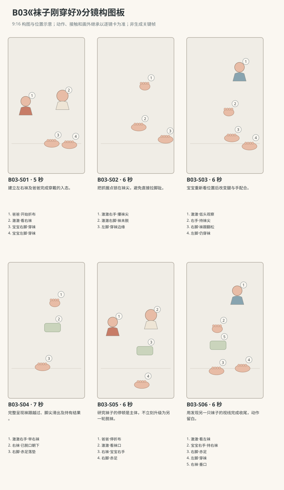

图示为构图位置示意；姿态、接触和画外继承以逐镜正文为准。

### 逐镜设计

#### B03-S01｜00—05 秒｜5 秒｜帧 [0, 120)

**镜头任务：**建立左右袜及爸爸完成穿戴的入态。

**景别、机位与构图：**南侧中景略俯，澈澈画右、爸爸画左，两只脚在下部；右脚画左、左脚画右，袜尖可辨。

**摄影机与理由：**固定，爸爸撤手后让宝宝目光接管注意力。

**焦点：**双袜与宝宝面部同清晰，靠垫轮廓可见。

**入态：**P06左右袜均已穿好，爸爸右手指腹压在宝宝右袜尖，左手在自己膝上；宝宝双手空。

**动作与表演：**

- 2 秒：澈澈右脚趾在袜内蜷起，袜尖拱出细褶；爸爸右手指腹停止抚动，等脚趾稍松后顺平表面，松开并撤至膝旁。

- 3 秒：爸爸低头拿起膝边小布折叠，澈澈低眼盯住右袜，右手移向右膝。

**声音：**脚趾蜷起时袜料很轻的摩擦，爸爸抚平后撤手再接折布窸窣；无对白，不为脚趾配弹簧声。

**出态：**右袜完整穿着，宝宝右手停在右膝，爸爸双手转到折布。

**切点与承接：**切右脚与右手近景，接宝宝正在下降的右手。

**连续性：**画内两袜完整、右手撤离清楚；爸爸折布另有独立任务，不把袜子转入成人手。

**开始画面母稿：**

9:16竖幅原创三维生活动画，圆润但保留婴儿头身与关节尺度，皮肤柔和、棉布哑光、低反差暖中性色，动作遵循生活物理；无字幕、无标识、无额外人物。澈澈圆润脸颊、深棕眼、短黑绒发、额前一撮向右弯，穿奶油色棉连体衣，动作尚不完全熟练，神情专注而非成人式算计。爸爸短黑发、砖陶色棉衬衫、深灰长裤，表情温和自然。本图为单一开始瞬间，人物、物件与接触只取以下起态；裁切外人物不为展示外观强行入画。固定空间和材质：客厅北墙固定沙发、西窗、东侧走廊入口、中央奶油地垫。相机在南半区朝北，不越人物东西轴线；成人在西侧，主要双人视图成人画左、宝宝画右。西窗柔和漫射光由画左照入，暖墙反射填暗部，光位与房间方位固定。澈澈有低靠垫支持朝南坐，爸爸西侧坐；正面图宝宝右脚画左、左脚画右。P06为一对雾蓝短袜，左右袜与赤足状态以本镜起态为准；爸爸整理的奶油小布为P04，物件均无额外副本。构图范围：南侧中景略俯，澈澈画右、爸爸画左，两只脚在下部；右脚画左、左脚画右，袜尖可辨。唯一此刻状态：P06左右袜均已穿好，爸爸右手指腹压在宝宝右袜尖，左手在自己膝上；宝宝双手空。清晰度与焦点：双袜与宝宝面部同清晰，靠垫轮廓可见。画面停在这个瞬间，不将后续动作阶段并列绘入。

**视频变化母稿：**

9:16竖幅原创三维生活动画，圆润但保留婴儿头身与关节尺度，皮肤柔和、棉布哑光、低反差暖中性色，动作遵循生活物理；无字幕、无标识、无额外人物。澈澈圆润脸颊、深棕眼、短黑绒发、额前一撮向右弯，穿奶油色棉连体衣，动作尚不完全熟练，神情专注而非成人式算计。爸爸短黑发、砖陶色棉衬衫、深灰长裤，表情温和自然。本镜有效时长5秒，为一个连续镜头。固定空间和材质：客厅北墙固定沙发、西窗、东侧走廊入口、中央奶油地垫。相机在南半区朝北，不越人物东西轴线；成人在西侧，主要双人视图成人画左、宝宝画右。西窗柔和漫射光由画左照入，暖墙反射填暗部，光位与房间方位固定。澈澈有低靠垫支持朝南坐，爸爸西侧坐；正面图宝宝右脚画左、左脚画右。P06为一对雾蓝短袜，左右袜与赤足状态以本镜起态为准；爸爸整理的奶油小布为P04，物件均无额外副本。摄影构图：南侧中景略俯，澈澈画右、爸爸画左，两只脚在下部；右脚画左、左脚画右，袜尖可辨。摄影机：固定，爸爸撤手后让宝宝目光接管注意力。焦点：双袜与宝宝面部同清晰，靠垫轮廓可见。起态：P06左右袜均已穿好，爸爸右手指腹压在宝宝右袜尖，左手在自己膝上；宝宝双手空。阶段1，2秒：澈澈右脚趾在袜内蜷起，袜尖拱出细褶；爸爸右手指腹停止抚动，等脚趾稍松后顺平表面，松开并撤至膝旁。阶段2，3秒：爸爸低头拿起膝边小布折叠，澈澈低眼盯住右袜，右手移向右膝。准确声音：脚趾蜷起时袜料很轻的摩擦，爸爸抚平后撤手再接折布窸窣；无对白，不为脚趾配弹簧声。终态：右袜完整穿着，宝宝右手停在右膝，爸爸双手转到折布。接触和画外状态：画内两袜完整、右手撤离清楚；爸爸折布另有独立任务，不把袜子转入成人手。在该终态切出，不在本镜内部额外切镜。

#### B03-S02｜05—11 秒｜6 秒｜帧 [120, 264)

**镜头任务：**把抓握点锁在袜尖，避免直接拉脚趾。

**景别、机位与构图：**南侧低位手脚近景，宝宝右脚横在下部、右手自右上靠近，左脚只保留右边缘穿袜轮廓。

**摄影机与理由：**固定，完整看见触摸到整掌攥布。

**焦点：**右手指与袜尖布面接触清楚，脚趾形体不变。

**入态：**宝宝右手距右袜尖一掌，右脚跟在地垫；爸爸手不在脚区。

**动作与表演：**

- 2 秒：宝宝右掌碰到袜尖，指腹来回摸一次布面。

- 2 秒：右拇指与其余手指合拢，攥住袜尖一团松布，不夹皮肤。

- 2 秒：右手向上抬一点，袜料拉长，右脚跟仍落垫。

**声音：**细软棉料摩擦，不配拉伸弹簧声；爸爸折布声在画左外继续。

**出态：**右手攥右袜尖，袜料已轻拉长但袜跟未脱。

**切点与承接：**切带宝宝脸的较宽镜，延续拉长后的观察停顿。

**连续性：**右手只抓袜尖布；右脚仍穿袜，左袜画内边缘保持完整。

**开始画面母稿：**

9:16竖幅原创三维生活动画，圆润但保留婴儿头身与关节尺度，皮肤柔和、棉布哑光、低反差暖中性色，动作遵循生活物理；无字幕、无标识、无额外人物。澈澈圆润脸颊、深棕眼、短黑绒发、额前一撮向右弯，穿奶油色棉连体衣，动作尚不完全熟练，神情专注而非成人式算计。爸爸短黑发、砖陶色棉衬衫、深灰长裤，表情温和自然。本图为单一开始瞬间，人物、物件与接触只取以下起态；裁切外人物不为展示外观强行入画。固定空间和材质：客厅北墙固定沙发、西窗、东侧走廊入口、中央奶油地垫。相机在南半区朝北，不越人物东西轴线；成人在西侧，主要双人视图成人画左、宝宝画右。西窗柔和漫射光由画左照入，暖墙反射填暗部，光位与房间方位固定。澈澈有低靠垫支持朝南坐，爸爸西侧坐；正面图宝宝右脚画左、左脚画右。P06为一对雾蓝短袜，左右袜与赤足状态以本镜起态为准；爸爸整理的奶油小布为P04，物件均无额外副本。构图范围：南侧低位手脚近景，宝宝右脚横在下部、空右手位于右上、距右袜尖一掌，左脚只保留右边缘穿袜轮廓。唯一此刻状态：宝宝右手距右袜尖一掌，右脚跟在地垫；爸爸手不在脚区。清晰度与焦点：宝宝空右手与右袜尖之间一掌的间隙、袜尖布面及脚跟都清楚，此刻尚未接触。画面停在这个瞬间，不将后续动作阶段并列绘入。

**视频变化母稿：**

9:16竖幅原创三维生活动画，圆润但保留婴儿头身与关节尺度，皮肤柔和、棉布哑光、低反差暖中性色，动作遵循生活物理；无字幕、无标识、无额外人物。澈澈圆润脸颊、深棕眼、短黑绒发、额前一撮向右弯，穿奶油色棉连体衣，动作尚不完全熟练，神情专注而非成人式算计。爸爸短黑发、砖陶色棉衬衫、深灰长裤，表情温和自然。本镜有效时长6秒，为一个连续镜头。固定空间和材质：客厅北墙固定沙发、西窗、东侧走廊入口、中央奶油地垫。相机在南半区朝北，不越人物东西轴线；成人在西侧，主要双人视图成人画左、宝宝画右。西窗柔和漫射光由画左照入，暖墙反射填暗部，光位与房间方位固定。澈澈有低靠垫支持朝南坐，爸爸西侧坐；正面图宝宝右脚画左、左脚画右。P06为一对雾蓝短袜，左右袜与赤足状态以本镜起态为准；爸爸整理的奶油小布为P04，物件均无额外副本。摄影构图：南侧低位手脚近景，宝宝右脚横在下部、右手自右上靠近，左脚只保留右边缘穿袜轮廓。摄影机：固定，完整看见触摸到整掌攥布。焦点：右手指与袜尖布面接触清楚，脚趾形体不变。起态：宝宝右手距右袜尖一掌，右脚跟在地垫；爸爸手不在脚区。阶段1，2秒：宝宝右掌碰到袜尖，指腹来回摸一次布面。阶段2，2秒：右拇指与其余手指合拢，攥住袜尖一团松布，不夹皮肤。阶段3，2秒：右手向上抬一点，袜料拉长，右脚跟仍落垫。准确声音：细软棉料摩擦，不配拉伸弹簧声；爸爸折布声在画左外继续。终态：右手攥右袜尖，袜料已轻拉长但袜跟未脱。接触和画外状态：右手只抓袜尖布；右脚仍穿袜，左袜画内边缘保持完整。在该终态切出，不在本镜内部额外切镜。

#### B03-S03｜11—17 秒｜6 秒｜帧 [264, 408)

**镜头任务：**宝宝重新看位置后改变腿与手配合。

**景别、机位与构图：**南侧宝宝中近景，脸上部、两膝下部，右手袜尖在画左下，爸爸肩膀只在左边缘。

**摄影机与理由：**固定，容纳先看再屈膝，表情不变成用力较劲。

**焦点：**脸与右手袜尖同纵深，保留袜跟位置。

**入态：**宝宝右手攥拉长右袜尖，右脚跟仍在垫上，左手空放左腿。

**动作与表演：**

- 2 秒：澈澈停手，低头看被拉长的布，再看右脚跟。

- 2 秒：右膝缓慢屈起、右脚往身边回收，右手向上保持小幅牵引。

- 2 秒：袜跟被牵到脚跟后缘，布料开始翻松，宝宝肩膀不后仰。

**声音：**右脚轻擦地垫、袜料摩擦，折布声逐渐停。

**出态：**右袜跟处已松翻但脚尖仍在袜内，右手仍持同一袜尖。

**切点与承接：**切袜跟脱出的细节覆盖，动作连续。

**连续性：**画内右膝屈曲与袜跟翻松，左手仍空置左腿；成人手没有暗中脱袜。

**开始画面母稿：**

9:16竖幅原创三维生活动画，圆润但保留婴儿头身与关节尺度，皮肤柔和、棉布哑光、低反差暖中性色，动作遵循生活物理；无字幕、无标识、无额外人物。澈澈圆润脸颊、深棕眼、短黑绒发、额前一撮向右弯，穿奶油色棉连体衣，动作尚不完全熟练，神情专注而非成人式算计。爸爸短黑发、砖陶色棉衬衫、深灰长裤，表情温和自然。本图为单一开始瞬间，人物、物件与接触只取以下起态；裁切外人物不为展示外观强行入画。固定空间和材质：客厅北墙固定沙发、西窗、东侧走廊入口、中央奶油地垫。相机在南半区朝北，不越人物东西轴线；成人在西侧，主要双人视图成人画左、宝宝画右。西窗柔和漫射光由画左照入，暖墙反射填暗部，光位与房间方位固定。澈澈有低靠垫支持朝南坐，爸爸西侧坐；正面图宝宝右脚画左、左脚画右。P06为一对雾蓝短袜，左右袜与赤足状态以本镜起态为准；爸爸整理的奶油小布为P04，物件均无额外副本。构图范围：南侧宝宝中近景，脸上部、两膝下部，右手袜尖在画左下，爸爸肩膀只在左边缘。唯一此刻状态：宝宝右手攥拉长右袜尖，右脚跟仍在垫上，左手空放左腿。清晰度与焦点：脸与右手袜尖同纵深，保留袜跟位置。画面停在这个瞬间，不将后续动作阶段并列绘入。

**视频变化母稿：**

9:16竖幅原创三维生活动画，圆润但保留婴儿头身与关节尺度，皮肤柔和、棉布哑光、低反差暖中性色，动作遵循生活物理；无字幕、无标识、无额外人物。澈澈圆润脸颊、深棕眼、短黑绒发、额前一撮向右弯，穿奶油色棉连体衣，动作尚不完全熟练，神情专注而非成人式算计。爸爸短黑发、砖陶色棉衬衫、深灰长裤，表情温和自然。本镜有效时长6秒，为一个连续镜头。固定空间和材质：客厅北墙固定沙发、西窗、东侧走廊入口、中央奶油地垫。相机在南半区朝北，不越人物东西轴线；成人在西侧，主要双人视图成人画左、宝宝画右。西窗柔和漫射光由画左照入，暖墙反射填暗部，光位与房间方位固定。澈澈有低靠垫支持朝南坐，爸爸西侧坐；正面图宝宝右脚画左、左脚画右。P06为一对雾蓝短袜，左右袜与赤足状态以本镜起态为准；爸爸整理的奶油小布为P04，物件均无额外副本。摄影构图：南侧宝宝中近景，脸上部、两膝下部，右手袜尖在画左下，爸爸肩膀只在左边缘。摄影机：固定，容纳先看再屈膝，表情不变成用力较劲。焦点：脸与右手袜尖同纵深，保留袜跟位置。起态：宝宝右手攥拉长右袜尖，右脚跟仍在垫上，左手空放左腿。阶段1，2秒：澈澈停手，低头看被拉长的布，再看右脚跟。阶段2，2秒：右膝缓慢屈起、右脚往身边回收，右手向上保持小幅牵引。阶段3，2秒：袜跟被牵到脚跟后缘，布料开始翻松，宝宝肩膀不后仰。准确声音：右脚轻擦地垫、袜料摩擦，折布声逐渐停。终态：右袜跟处已松翻但脚尖仍在袜内，右手仍持同一袜尖。接触和画外状态：画内右膝屈曲与袜跟翻松，左手仍空置左腿；成人手没有暗中脱袜。在该终态切出，不在本镜内部额外切镜。

#### B03-S04｜17—24 秒｜7 秒｜帧 [408, 576)

**镜头任务：**完整呈现袜跟越过、脚尖滑出及持有结果。

**景别、机位与构图：**南侧偏西的手脚特写，右袜口、脚跟与手完整入画，左脚不强塞特写。

**摄影机与理由：**固定，接触持续到袜子完全离脚，不用跳切代替。

**焦点：**右脚轮廓、袜口及宝宝右手保持清楚。

**入态：**右袜跟已经翻松，脚尖仍在袜内；右手攥同一袜尖，右膝屈起。

**动作与表演：**

- 3 秒：右手缓慢向胸前抬，袜口越过右脚跟，右踝稍伸，脚从松袜里退。

- 2 秒：脚尖最后滑出，右袜完全留在宝宝右手，空右脚下放落到地垫。

- 2 秒：宝宝右手略停，袜口向下垂，右脚趾展开。

**声音：**棉袜滑出声很轻，赤脚落垫一声软擦；无夸张成功音效。

**出态：**右脚赤足落垫，右袜由宝宝右手举着，左袜画外仍穿好。

**切点与承接：**切脸与举袜中近景，继承袜口垂下状态。

**连续性：**画内右袜完全离脚、右手持有、右脚落垫可验；左手空放左腿与左袜穿着是画外继承。

**开始画面母稿：**

9:16竖幅原创三维生活动画，圆润但保留婴儿头身与关节尺度，皮肤柔和、棉布哑光、低反差暖中性色，动作遵循生活物理；无字幕、无标识、无额外人物。澈澈圆润脸颊、深棕眼、短黑绒发、额前一撮向右弯，穿奶油色棉连体衣，动作尚不完全熟练，神情专注而非成人式算计。爸爸短黑发、砖陶色棉衬衫、深灰长裤，表情温和自然。本图为单一开始瞬间，人物、物件与接触只取以下起态；裁切外人物不为展示外观强行入画。固定空间和材质：客厅北墙固定沙发、西窗、东侧走廊入口、中央奶油地垫。相机在南半区朝北，不越人物东西轴线；成人在西侧，主要双人视图成人画左、宝宝画右。西窗柔和漫射光由画左照入，暖墙反射填暗部，光位与房间方位固定。澈澈有低靠垫支持朝南坐，爸爸西侧坐；正面图宝宝右脚画左、左脚画右。P06为一对雾蓝短袜，左右袜与赤足状态以本镜起态为准；爸爸整理的奶油小布为P04，物件均无额外副本。构图范围：南侧偏西的手脚特写，右袜口、脚跟与手完整入画，左脚不强塞特写。唯一此刻状态：右袜跟已经翻松，脚尖仍在袜内；右手攥同一袜尖，右膝屈起。清晰度与焦点：右脚轮廓、袜口及宝宝右手保持清楚。画面停在这个瞬间，不将后续动作阶段并列绘入。

**视频变化母稿：**

9:16竖幅原创三维生活动画，圆润但保留婴儿头身与关节尺度，皮肤柔和、棉布哑光、低反差暖中性色，动作遵循生活物理；无字幕、无标识、无额外人物。澈澈圆润脸颊、深棕眼、短黑绒发、额前一撮向右弯，穿奶油色棉连体衣，动作尚不完全熟练，神情专注而非成人式算计。爸爸短黑发、砖陶色棉衬衫、深灰长裤，表情温和自然。本镜有效时长7秒，为一个连续镜头。固定空间和材质：客厅北墙固定沙发、西窗、东侧走廊入口、中央奶油地垫。相机在南半区朝北，不越人物东西轴线；成人在西侧，主要双人视图成人画左、宝宝画右。西窗柔和漫射光由画左照入，暖墙反射填暗部，光位与房间方位固定。澈澈有低靠垫支持朝南坐，爸爸西侧坐；正面图宝宝右脚画左、左脚画右。P06为一对雾蓝短袜，左右袜与赤足状态以本镜起态为准；爸爸整理的奶油小布为P04，物件均无额外副本。摄影构图：南侧偏西的手脚特写，右袜口、脚跟与手完整入画，左脚不强塞特写。摄影机：固定，接触持续到袜子完全离脚，不用跳切代替。焦点：右脚轮廓、袜口及宝宝右手保持清楚。起态：右袜跟已经翻松，脚尖仍在袜内；右手攥同一袜尖，右膝屈起。阶段1，3秒：右手缓慢向胸前抬，袜口越过右脚跟，右踝稍伸，脚从松袜里退。阶段2，2秒：脚尖最后滑出，右袜完全留在宝宝右手，空右脚下放落到地垫。阶段3，2秒：宝宝右手略停，袜口向下垂，右脚趾展开。准确声音：棉袜滑出声很轻，赤脚落垫一声软擦；无夸张成功音效。终态：右脚赤足落垫，右袜由宝宝右手举着，左袜画外仍穿好。接触和画外状态：画内右袜完全离脚、右手持有、右脚落垫可验；左手空放左腿与左袜穿着是画外继承。在该终态切出，不在本镜内部额外切镜。

#### B03-S05｜24—30 秒｜6 秒｜帧 [576, 720)

**镜头任务：**研究袜子的停顿是主体，不立刻升级为另一轮脱袜。

**景别、机位与构图：**南侧宝宝中近景，右手袜子在胸下清楚，爸爸侧脸在画左；赤右脚在下缘可见。

**摄影机与理由：**固定，让手腕翻面和爸爸持续停手的观察形成两层注意。

**焦点：**宝宝脸、袜口与爸爸侧脸可读，背景不抢。

**入态：**宝宝右手举脱下的右袜，袜口垂下；爸爸双手拿半折小布，正看向宝宝。

**动作与表演：**

- 2 秒：澈澈轻转右腕，看看袜口，右拇指慢慢摸过卷边。

- 2 秒：爸爸维持半折布不动，目光由袜口移到宝宝专注的脸，浮出轻微笑意。

- 2 秒：澈澈仍看袜口，左脚在画右下缓慢往前挪一点。

**声音：**袜边轻揉声，房间静默与呼吸，不发成人评论。

**出态：**右袜在右手、右脚赤足；左脚开始进入宝宝向下视野。

**切点与承接：**沿宝宝视线切低角度揭示仍穿袜的左脚。

**连续性：**画内袜持有、赤足与爸爸手中布清楚；左袜未被任何人脱动。

**开始画面母稿：**

9:16竖幅原创三维生活动画，圆润但保留婴儿头身与关节尺度，皮肤柔和、棉布哑光、低反差暖中性色，动作遵循生活物理；无字幕、无标识、无额外人物。澈澈圆润脸颊、深棕眼、短黑绒发、额前一撮向右弯，穿奶油色棉连体衣，动作尚不完全熟练，神情专注而非成人式算计。爸爸短黑发、砖陶色棉衬衫、深灰长裤，表情温和自然。本图为单一开始瞬间，人物、物件与接触只取以下起态；裁切外人物不为展示外观强行入画。固定空间和材质：客厅北墙固定沙发、西窗、东侧走廊入口、中央奶油地垫。相机在南半区朝北，不越人物东西轴线；成人在西侧，主要双人视图成人画左、宝宝画右。西窗柔和漫射光由画左照入，暖墙反射填暗部，光位与房间方位固定。澈澈有低靠垫支持朝南坐，爸爸西侧坐；正面图宝宝右脚画左、左脚画右。P06为一对雾蓝短袜，左右袜与赤足状态以本镜起态为准；爸爸整理的奶油小布为P04，物件均无额外副本。构图范围：南侧宝宝中近景，右手袜子在胸下清楚，爸爸侧脸在画左；赤右脚在下缘可见。唯一此刻状态：宝宝右手举脱下的右袜，袜口垂下；爸爸双手拿半折小布，正看向宝宝。清晰度与焦点：宝宝脸、袜口与爸爸侧脸可读，背景不抢。画面停在这个瞬间，不将后续动作阶段并列绘入。

**视频变化母稿：**

9:16竖幅原创三维生活动画，圆润但保留婴儿头身与关节尺度，皮肤柔和、棉布哑光、低反差暖中性色，动作遵循生活物理；无字幕、无标识、无额外人物。澈澈圆润脸颊、深棕眼、短黑绒发、额前一撮向右弯，穿奶油色棉连体衣，动作尚不完全熟练，神情专注而非成人式算计。爸爸短黑发、砖陶色棉衬衫、深灰长裤，表情温和自然。本镜有效时长6秒，为一个连续镜头。固定空间和材质：客厅北墙固定沙发、西窗、东侧走廊入口、中央奶油地垫。相机在南半区朝北，不越人物东西轴线；成人在西侧，主要双人视图成人画左、宝宝画右。西窗柔和漫射光由画左照入，暖墙反射填暗部，光位与房间方位固定。澈澈有低靠垫支持朝南坐，爸爸西侧坐；正面图宝宝右脚画左、左脚画右。P06为一对雾蓝短袜，左右袜与赤足状态以本镜起态为准；爸爸整理的奶油小布为P04，物件均无额外副本。摄影构图：南侧宝宝中近景，右手袜子在胸下清楚，爸爸侧脸在画左；赤右脚在下缘可见。摄影机：固定，让手腕翻面和爸爸持续停手的观察形成两层注意。焦点：宝宝脸、袜口与爸爸侧脸可读，背景不抢。起态：宝宝右手举脱下的右袜，袜口垂下；爸爸双手拿半折小布，正看向宝宝。阶段1，2秒：澈澈轻转右腕，看看袜口，右拇指慢慢摸过卷边。阶段2，2秒：爸爸维持半折布不动，目光由袜口移到宝宝专注的脸，浮出轻微笑意。阶段3，2秒：澈澈仍看袜口，左脚在画右下缓慢往前挪一点。准确声音：袜边轻揉声，房间静默与呼吸，不发成人评论。终态：右袜在右手、右脚赤足；左脚开始进入宝宝向下视野。接触和画外状态：画内袜持有、赤足与爸爸手中布清楚；左袜未被任何人脱动。在该终态切出，不在本镜内部额外切镜。

#### B03-S06｜30—36 秒｜6 秒｜帧 [720, 864)

**镜头任务：**用发现另一只袜子的视线完成收尾，动作留白。

**景别、机位与构图：**南侧略高中近景，宝宝脸居上，右袜在画左胸下，穿袜左脚画右下、赤右脚画左下均可辨。

**摄影机与理由：**固定，不推向左袜制造新的任务承诺。

**焦点：**宝宝眼睛、右袜与左袜都能识别，焦点保持。

**入态：**右手持脱下右袜，右脚赤足；左脚穿袜已挪到较前位置。

**动作与表演：**

- 2 秒：左脚袜尖轻晃一下，宝宝眼神从手中袜口移到左脚。

- 2 秒：右手暂时不再揉袜，宝宝盯着左袜；爸爸目光也落向左脚。

- 2 秒：爸爸保持半折布不动，宝宝左脚趾在袜下轻轻顶一下，停在新的专注中。

**声音：**袜下脚趾动作不另加音效，最后留呼吸和极轻布声。

**出态：**右袜仍在宝宝右手，左袜仍穿脚上，没有开始第二次脱袜。

**切点与承接：**在新注意对象成立时结束，避免机械重演。

**连续性：**画内左右袜、赤右脚及宝宝右手同框；爸爸半折小布未丢失，靠垫支撑保持。

**开始画面母稿：**

9:16竖幅原创三维生活动画，圆润但保留婴儿头身与关节尺度，皮肤柔和、棉布哑光、低反差暖中性色，动作遵循生活物理；无字幕、无标识、无额外人物。澈澈圆润脸颊、深棕眼、短黑绒发、额前一撮向右弯，穿奶油色棉连体衣，动作尚不完全熟练，神情专注而非成人式算计。爸爸短黑发、砖陶色棉衬衫、深灰长裤，表情温和自然。本图为单一开始瞬间，人物、物件与接触只取以下起态；裁切外人物不为展示外观强行入画。固定空间和材质：客厅北墙固定沙发、西窗、东侧走廊入口、中央奶油地垫。相机在南半区朝北，不越人物东西轴线；成人在西侧，主要双人视图成人画左、宝宝画右。西窗柔和漫射光由画左照入，暖墙反射填暗部，光位与房间方位固定。澈澈有低靠垫支持朝南坐，爸爸西侧坐；正面图宝宝右脚画左、左脚画右。P06为一对雾蓝短袜，左右袜与赤足状态以本镜起态为准；爸爸整理的奶油小布为P04，物件均无额外副本。构图范围：南侧略高中近景，宝宝脸居上，右袜在画左胸下，穿袜左脚画右下、赤右脚画左下均可辨。唯一此刻状态：右手持脱下右袜，右脚赤足；左脚穿袜已挪到较前位置。清晰度与焦点：宝宝眼睛、右袜与左袜都能识别，焦点保持。画面停在这个瞬间，不将后续动作阶段并列绘入。

**视频变化母稿：**

9:16竖幅原创三维生活动画，圆润但保留婴儿头身与关节尺度，皮肤柔和、棉布哑光、低反差暖中性色，动作遵循生活物理；无字幕、无标识、无额外人物。澈澈圆润脸颊、深棕眼、短黑绒发、额前一撮向右弯，穿奶油色棉连体衣，动作尚不完全熟练，神情专注而非成人式算计。爸爸短黑发、砖陶色棉衬衫、深灰长裤，表情温和自然。本镜有效时长6秒，为一个连续镜头。固定空间和材质：客厅北墙固定沙发、西窗、东侧走廊入口、中央奶油地垫。相机在南半区朝北，不越人物东西轴线；成人在西侧，主要双人视图成人画左、宝宝画右。西窗柔和漫射光由画左照入，暖墙反射填暗部，光位与房间方位固定。澈澈有低靠垫支持朝南坐，爸爸西侧坐；正面图宝宝右脚画左、左脚画右。P06为一对雾蓝短袜，左右袜与赤足状态以本镜起态为准；爸爸整理的奶油小布为P04，物件均无额外副本。摄影构图：南侧略高中近景，宝宝脸居上，右袜在画左胸下，穿袜左脚画右下、赤右脚画左下均可辨。摄影机：固定，不推向左袜制造新的任务承诺。焦点：宝宝眼睛、右袜与左袜都能识别，焦点保持。起态：右手持脱下右袜，右脚赤足；左脚穿袜已挪到较前位置。阶段1，2秒：左脚袜尖轻晃一下，宝宝眼神从手中袜口移到左脚。阶段2，2秒：右手暂时不再揉袜，宝宝盯着左袜；爸爸目光也落向左脚。阶段3，2秒：爸爸保持半折布不动，宝宝左脚趾在袜下轻轻顶一下，停在新的专注中。准确声音：袜下脚趾动作不另加音效，最后留呼吸和极轻布声。终态：右袜仍在宝宝右手，左袜仍穿脚上，没有开始第二次脱袜。接触和画外状态：画内左右袜、赤右脚及宝宝右手同框；爸爸半折小布未丢失，靠垫支撑保持。在该终态切出，不在本镜内部额外切镜。

### 声音与剪辑

全片无语义对白、无旁白、无音乐；不以成人配音解释宝宝动机。连续室内安静底声保持声场，动作拟音按各镜接触同步，婴儿气息与咿呀使用自然短音而非成人语调。

正式台词：无；保留镜头声音中已写明的自然发声。

### 连续性与试片

- 连续性：右袜先脱且始终由宝宝右手持，左袜直至片尾完整穿着；右脚赤足后不得重新穿袜。

- 连续性：宝宝右手只抓袜尖大块布料，不抓皮肤；爸爸在脱袜过程双手都忙半折小布。

- 连续性：双膝动作在靠垫支持的坐姿内，右脚回收不过肩，左右脚不互换。

- 试片：B03-S02—S04：袜尖拉长、袜跟翻松、脚尖滑出三段接触应连续；若袜体穿脚、凭空消失或直接换持有即失败。

- 试片：B03-S05—S06：静音能分辨右手拿脱下右袜、左脚还穿袜；若两个蓝袜合成一物或目光没有新对象则失败。

- 试片：B03-S01：脚趾只在袜内轻蜷再松，布尖随之拱褶；爸爸停手顺应而非压直脚趾。S02仍从袜子完整穿在右脚的状态开始。

**媒体待验证：**待动作试片核对脚趾、袜口与皮肤的遮挡和脱离；末镜左右袜辨识需实际竖幅审看，无媒体已完成声明。

---

## B04《手心里有什么》

**30 秒｜仰卧与翻身探索｜角色：澈澈、妈妈｜场景 L**

### 剧情正文

西窗的柔光照着中央地垫。澈澈仰卧在沙发前，头朝北，右手举在脸前，左手松松放在胸侧。那只小手先握成一个不太紧的拳，再慢慢展开，拇指比别的手指晚松一点；澈澈的眼睛跟着指尖，嘴巴微张，连脚都暂时安静了。手腕往一边翻，掌心变成手背，他停一下，又翻回来。妈妈坐在西侧，原本要拿绿色软积木陪玩，看见宝宝盯得这么认真，便先把积木移到他右肩外侧的地垫上。澈澈听到轻轻的布擦声，眼神向旁边瞥去，小手也降到胸前。他看了一眼积木，没有伸手，反而把右手重新举到视线里，张开手指，挡住一小部分绿色。妈妈扶着积木的手停住，慢慢撤回膝上。澈澈继续翻动手腕，偶尔碰一下自己的左掌，眼睛仍没离开右手；妈妈在旁边安静地看，积木就留在光里，今天暂时没有轮到它。

### 导演与空间

**观察任务：**以宝宝对自己手掌的持续观察取代玩具推销式刺激，观看满足来自细微转腕与目光保持。

**空间与光位：**客厅北沙发、西窗、东走廊。澈澈仰卧中央地垫，头靠北、脚朝南，双肩与后脑受垫支撑；妈妈坐西侧，右手起始拿P03鼠尾草绿大软积木，左手空放膝上。P03放置目标为宝宝右肩外侧可见地垫，不压身体。南侧偏高机位看向北，不绕到宝宝头后，西窗柔光左入。

**人物表演：**澈澈右手举在胸前到视线间，左手自然放胸侧，缓慢张合转腕；妈妈原本递玩具，发现宝宝对手更有兴趣后停止展示，在侧边陪看，不强行把物件塞手里。

### 节拍覆盖

- **B04-b1**：宝宝已经专注于自己手掌，缓慢张合与转腕形成观察。 → B04-S01、B04-S02

- **B04-b2**：妈妈放玩具引出短暂旁视，宝宝主动把注意力回到手上。 → B04-S03、B04-S04

- **B04-b3**：成人撤去展示动作，宝宝继续研究，玩具留在一侧。 → B04-S05

### 分镜构图板

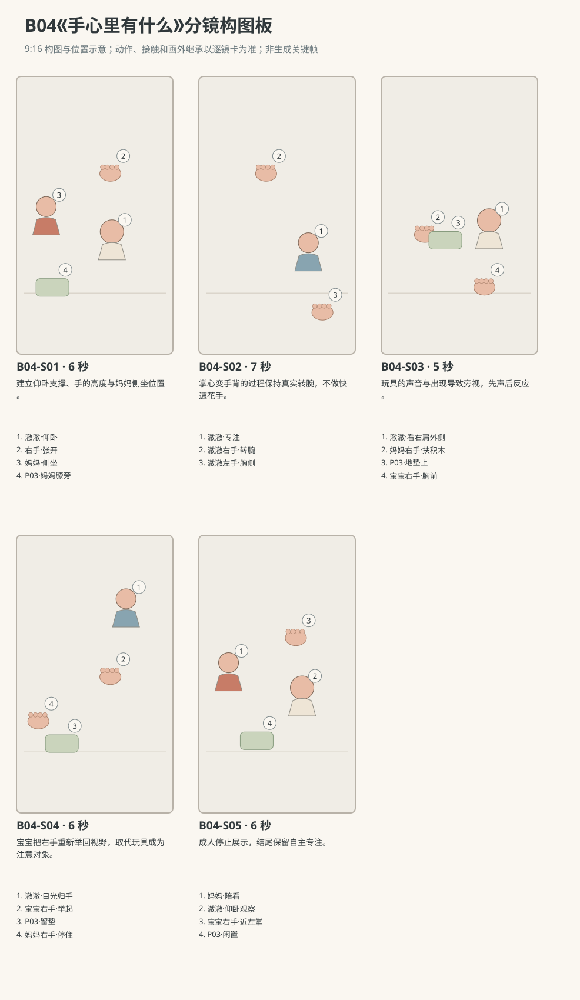

图示为构图位置示意；姿态、接触和画外继承以逐镜正文为准。

### 逐镜设计

#### B04-S01｜00—06 秒｜6 秒｜帧 [0, 144)

**镜头任务：**建立仰卧支撑、手的高度与妈妈侧坐位置。

**景别、机位与构图：**南侧略高的中全景，宝宝头在画上脚在画下，妈妈位于画左边缘，右手举在宝宝脸前不遮全部眼睛。

**摄影机与理由：**固定，保留整块地垫与身体接地，避免手悬空位置不明。

**焦点：**宝宝眼睛与右手为清楚主体，妈妈只作侧面轮廓。

**入态：**澈澈仰卧，右手半握在胸前上方，左手放胸侧；妈妈右手持P03在自己膝旁。

**动作与表演：**

- 2 秒：澈澈把右手略举高到视线前，眼睛向手指聚拢。

- 2 秒：右手慢慢握拢，掌心仍留小空隙。

- 2 秒：右手再展开，拇指稍晚打开，目光跟到拇指。

**声音：**自然呼吸与连体衣轻擦垫声，无对白无音乐。

**出态：**右手张开在脸前，左手胸侧，妈妈P03仍在膝旁。

**切点与承接：**切手与眼睛近景放大观察细节，姿态连续。

**连续性：**画内后脑、背和地垫接地清楚；右手无物，左手无物，妈妈持P03不混入宝宝手。

**开始画面母稿：**

9:16竖幅原创三维生活动画，圆润但保留婴儿头身与关节尺度，皮肤柔和、棉布哑光、低反差暖中性色，动作遵循生活物理；无字幕、无标识、无额外人物。澈澈圆润脸颊、深棕眼、短黑绒发、额前一撮向右弯，穿奶油色棉连体衣，动作尚不完全熟练，神情专注而非成人式算计。妈妈深棕低马尾、雾蓝棉上衣、米色长裤，回应轻柔而不夸张。本图为单一开始瞬间，人物、物件与接触只取以下起态；裁切外人物不为展示外观强行入画。固定空间和材质：客厅北墙固定沙发、西窗、东侧走廊入口、中央奶油地垫。相机在南半区朝北，不越人物东西轴线；成人在西侧，主要双人视图成人画左、宝宝画右。西窗柔和漫射光由画左照入，暖墙反射填暗部，光位与房间方位固定。澈澈仰卧地垫、头北脚南，后脑肩背受垫承托；妈妈坐西侧。P03为鼠尾草绿大软积木，正面芥末太阳缝线、背面宽奶油布标；放置区是宝宝右肩外侧地垫。宝宝双手均无物，右手是主要观察对象，积木归属和手臂高度以本镜起态为准。构图范围：南侧略高的中全景，宝宝头在画上脚在画下，妈妈位于画左边缘，持积木的右手留在她膝旁；澈澈右手半握在自己胸前上方，不遮全部眼睛。唯一此刻状态：澈澈仰卧，右手半握在胸前上方，左手放胸侧；妈妈右手持P03在自己膝旁。清晰度与焦点：宝宝眼睛与右手为清楚主体，妈妈只作侧面轮廓。画面停在这个瞬间，不将后续动作阶段并列绘入。

**视频变化母稿：**

9:16竖幅原创三维生活动画，圆润但保留婴儿头身与关节尺度，皮肤柔和、棉布哑光、低反差暖中性色，动作遵循生活物理；无字幕、无标识、无额外人物。澈澈圆润脸颊、深棕眼、短黑绒发、额前一撮向右弯，穿奶油色棉连体衣，动作尚不完全熟练，神情专注而非成人式算计。妈妈深棕低马尾、雾蓝棉上衣、米色长裤，回应轻柔而不夸张。本镜有效时长6秒，为一个连续镜头。固定空间和材质：客厅北墙固定沙发、西窗、东侧走廊入口、中央奶油地垫。相机在南半区朝北，不越人物东西轴线；成人在西侧，主要双人视图成人画左、宝宝画右。西窗柔和漫射光由画左照入，暖墙反射填暗部，光位与房间方位固定。澈澈仰卧地垫、头北脚南，后脑肩背受垫承托；妈妈坐西侧。P03为鼠尾草绿大软积木，正面芥末太阳缝线、背面宽奶油布标；放置区是宝宝右肩外侧地垫。宝宝双手均无物，右手是主要观察对象，积木归属和手臂高度以本镜起态为准。摄影构图：南侧略高的中全景，宝宝头在画上脚在画下，妈妈位于画左边缘，右手举在宝宝脸前不遮全部眼睛。摄影机：固定，保留整块地垫与身体接地，避免手悬空位置不明。焦点：宝宝眼睛与右手为清楚主体，妈妈只作侧面轮廓。起态：澈澈仰卧，右手半握在胸前上方，左手放胸侧；妈妈右手持P03在自己膝旁。阶段1，2秒：澈澈把右手略举高到视线前，眼睛向手指聚拢。阶段2，2秒：右手慢慢握拢，掌心仍留小空隙。阶段3，2秒：右手再展开，拇指稍晚打开，目光跟到拇指。准确声音：自然呼吸与连体衣轻擦垫声，无对白无音乐。终态：右手张开在脸前，左手胸侧，妈妈P03仍在膝旁。接触和画外状态：画内后脑、背和地垫接地清楚；右手无物，左手无物，妈妈持P03不混入宝宝手。在该终态切出，不在本镜内部额外切镜。

#### B04-S02｜06—13 秒｜7 秒｜帧 [144, 312)

**镜头任务：**掌心变手背的过程保持真实转腕，不做快速花手。

**景别、机位与构图：**南侧偏西高位近景，宝宝脸在右下、右手在左上，视线与手处在短纵深；左手仅在胸缘。

**摄影机与理由：**固定，婴儿慢动作本身提供变化，摄影机不抢先。

**焦点：**对准眼睛到右手的短距离范围，掌纹与指尖可读。

**入态：**澈澈右掌向自己，手指松开；双眼已看向右手。

**动作与表演：**

- 3 秒：右腕慢慢向外转，掌心逐渐侧过去，澈澈目光沿指尖移动。

- 2 秒：手背进入眼前，澈澈停住，嘴唇微张不作惊讶表演。

- 2 秒：右腕慢慢转回掌心，左手在胸侧微动但不抓右手。

**声音：**宝宝轻鼻息，指头动作不配亮晶晶音效。

**出态：**右掌重新朝向宝宝，举手高度与开镜一致。

**切点与承接：**在手掌停稳时切妈妈带物件的共享近景。

**连续性：**画内右腕转动、视线跟随可见；仰卧全身支撑与妈妈膝旁P03为画外继承。

**开始画面母稿：**

9:16竖幅原创三维生活动画，圆润但保留婴儿头身与关节尺度，皮肤柔和、棉布哑光、低反差暖中性色，动作遵循生活物理；无字幕、无标识、无额外人物。澈澈圆润脸颊、深棕眼、短黑绒发、额前一撮向右弯，穿奶油色棉连体衣，动作尚不完全熟练，神情专注而非成人式算计。妈妈深棕低马尾、雾蓝棉上衣、米色长裤，回应轻柔而不夸张。本图为单一开始瞬间，人物、物件与接触只取以下起态；裁切外人物不为展示外观强行入画。固定空间和材质：客厅北墙固定沙发、西窗、东侧走廊入口、中央奶油地垫。相机在南半区朝北，不越人物东西轴线；成人在西侧，主要双人视图成人画左、宝宝画右。西窗柔和漫射光由画左照入，暖墙反射填暗部，光位与房间方位固定。澈澈仰卧地垫、头北脚南，后脑肩背受垫承托；妈妈坐西侧。P03为鼠尾草绿大软积木，正面芥末太阳缝线、背面宽奶油布标；放置区是宝宝右肩外侧地垫。宝宝双手均无物，右手是主要观察对象，积木归属和手臂高度以本镜起态为准。构图范围：南侧偏西高位近景，宝宝脸在右下、右手在左上，视线与手处在短纵深；左手仅在胸缘。唯一此刻状态：澈澈右掌向自己，手指松开；双眼已看向右手。清晰度与焦点：对准眼睛到右手的短距离范围，掌纹与指尖可读。画面停在这个瞬间，不将后续动作阶段并列绘入。

**视频变化母稿：**

9:16竖幅原创三维生活动画，圆润但保留婴儿头身与关节尺度，皮肤柔和、棉布哑光、低反差暖中性色，动作遵循生活物理；无字幕、无标识、无额外人物。澈澈圆润脸颊、深棕眼、短黑绒发、额前一撮向右弯，穿奶油色棉连体衣，动作尚不完全熟练，神情专注而非成人式算计。妈妈深棕低马尾、雾蓝棉上衣、米色长裤，回应轻柔而不夸张。本镜有效时长7秒，为一个连续镜头。固定空间和材质：客厅北墙固定沙发、西窗、东侧走廊入口、中央奶油地垫。相机在南半区朝北，不越人物东西轴线；成人在西侧，主要双人视图成人画左、宝宝画右。西窗柔和漫射光由画左照入，暖墙反射填暗部，光位与房间方位固定。澈澈仰卧地垫、头北脚南，后脑肩背受垫承托；妈妈坐西侧。P03为鼠尾草绿大软积木，正面芥末太阳缝线、背面宽奶油布标；放置区是宝宝右肩外侧地垫。宝宝双手均无物，右手是主要观察对象，积木归属和手臂高度以本镜起态为准。摄影构图：南侧偏西高位近景，宝宝脸在右下、右手在左上，视线与手处在短纵深；左手仅在胸缘。摄影机：固定，婴儿慢动作本身提供变化，摄影机不抢先。焦点：对准眼睛到右手的短距离范围，掌纹与指尖可读。起态：澈澈右掌向自己，手指松开；双眼已看向右手。阶段1，3秒：右腕慢慢向外转，掌心逐渐侧过去，澈澈目光沿指尖移动。阶段2，2秒：手背进入眼前，澈澈停住，嘴唇微张不作惊讶表演。阶段3，2秒：右腕慢慢转回掌心，左手在胸侧微动但不抓右手。准确声音：宝宝轻鼻息，指头动作不配亮晶晶音效。终态：右掌重新朝向宝宝，举手高度与开镜一致。接触和画外状态：画内右腕转动、视线跟随可见；仰卧全身支撑与妈妈膝旁P03为画外继承。在该终态切出，不在本镜内部额外切镜。

#### B04-S03｜13—18 秒｜5 秒｜帧 [312, 432)

**镜头任务：**玩具的声音与出现导致旁视，先声后反应。

**景别、机位与构图：**南侧中景略俯，妈妈右手持P03在画左，宝宝右肩外侧地垫为空，宝宝脸与双手在画中右。

**摄影机与理由：**固定，P03从成人膝旁到垫面的移动可见。

**焦点：**妈妈手中P03与宝宝眼线同清晰范围。

**入态：**妈妈右手持P03膝旁，澈澈右手举在脸前、左手胸侧。

**动作与表演：**

- 2 秒：妈妈右手把P03平移到宝宝右肩外侧地垫，软积木接垫时发轻擦声。

- 2 秒：澈澈听到声音才向自己右侧转眼，右手降到胸前。

- 1 秒：妈妈右掌仍轻扶积木侧面，澈澈短暂看着绿色布面。

**声音：**积木接地垫的布擦声在转眼之前响，环境底声连续。

**出态：**P03已在宝宝右肩外侧，妈妈右手轻扶；宝宝看积木，右手胸前。

**切点与承接：**切宝宝眼、手、积木同框，保持已完成的旁视不重新转头。

**连续性：**画内物件移动及落垫可见；宝宝右肩外侧对应画左，不换边。

**开始画面母稿：**

9:16竖幅原创三维生活动画，圆润但保留婴儿头身与关节尺度，皮肤柔和、棉布哑光、低反差暖中性色，动作遵循生活物理；无字幕、无标识、无额外人物。澈澈圆润脸颊、深棕眼、短黑绒发、额前一撮向右弯，穿奶油色棉连体衣，动作尚不完全熟练，神情专注而非成人式算计。妈妈深棕低马尾、雾蓝棉上衣、米色长裤，回应轻柔而不夸张。本图为单一开始瞬间，人物、物件与接触只取以下起态；裁切外人物不为展示外观强行入画。固定空间和材质：客厅北墙固定沙发、西窗、东侧走廊入口、中央奶油地垫。相机在南半区朝北，不越人物东西轴线；成人在西侧，主要双人视图成人画左、宝宝画右。西窗柔和漫射光由画左照入，暖墙反射填暗部，光位与房间方位固定。澈澈仰卧地垫、头北脚南，后脑肩背受垫承托；妈妈坐西侧。P03为鼠尾草绿大软积木，正面芥末太阳缝线、背面宽奶油布标；放置区是宝宝右肩外侧地垫。宝宝双手均无物，右手是主要观察对象，积木归属和手臂高度以本镜起态为准。构图范围：南侧中景略俯，妈妈右手持P03在画左，宝宝右肩外侧地垫为空，宝宝脸与双手在画中右。唯一此刻状态：妈妈右手持P03膝旁，澈澈右手举在脸前、左手胸侧。清晰度与焦点：妈妈手中P03与宝宝眼线同清晰范围。画面停在这个瞬间，不将后续动作阶段并列绘入。

**视频变化母稿：**

9:16竖幅原创三维生活动画，圆润但保留婴儿头身与关节尺度，皮肤柔和、棉布哑光、低反差暖中性色，动作遵循生活物理；无字幕、无标识、无额外人物。澈澈圆润脸颊、深棕眼、短黑绒发、额前一撮向右弯，穿奶油色棉连体衣，动作尚不完全熟练，神情专注而非成人式算计。妈妈深棕低马尾、雾蓝棉上衣、米色长裤，回应轻柔而不夸张。本镜有效时长5秒，为一个连续镜头。固定空间和材质：客厅北墙固定沙发、西窗、东侧走廊入口、中央奶油地垫。相机在南半区朝北，不越人物东西轴线；成人在西侧，主要双人视图成人画左、宝宝画右。西窗柔和漫射光由画左照入，暖墙反射填暗部，光位与房间方位固定。澈澈仰卧地垫、头北脚南，后脑肩背受垫承托；妈妈坐西侧。P03为鼠尾草绿大软积木，正面芥末太阳缝线、背面宽奶油布标；放置区是宝宝右肩外侧地垫。宝宝双手均无物，右手是主要观察对象，积木归属和手臂高度以本镜起态为准。摄影构图：南侧中景略俯，妈妈右手持P03在画左，宝宝右肩外侧地垫为空，宝宝脸与双手在画中右。摄影机：固定，P03从成人膝旁到垫面的移动可见。焦点：妈妈手中P03与宝宝眼线同清晰范围。起态：妈妈右手持P03膝旁，澈澈右手举在脸前、左手胸侧。阶段1，2秒：妈妈右手把P03平移到宝宝右肩外侧地垫，软积木接垫时发轻擦声。阶段2，2秒：澈澈听到声音才向自己右侧转眼，右手降到胸前。阶段3，1秒：妈妈右掌仍轻扶积木侧面，澈澈短暂看着绿色布面。准确声音：积木接地垫的布擦声在转眼之前响，环境底声连续。终态：P03已在宝宝右肩外侧，妈妈右手轻扶；宝宝看积木，右手胸前。接触和画外状态：画内物件移动及落垫可见；宝宝右肩外侧对应画左，不换边。在该终态切出，不在本镜内部额外切镜。

#### B04-S04｜18—24 秒｜6 秒｜帧 [432, 576)

**镜头任务：**宝宝把右手重新举回视野，取代玩具成为注意对象。

**景别、机位与构图：**南侧高位中近景，宝宝眼睛在画上、右手在中、P03在画左下，妈妈手只保留画左边缘。

**摄影机与理由：**固定，不通过切焦宣告玩具无趣，由宝宝视线说明选择。

**焦点：**右手与眼睛清楚，P03保持可辨认但不压过手。

**入态：**澈澈看P03，右手降在胸前；妈妈右手仍轻扶积木。

**动作与表演：**

- 2 秒：澈澈眼睛看积木片刻，右手手指自发张开。

- 2 秒：右手再次抬起到脸前，经过眼睛与积木之间，视线跟着转回指尖。

- 2 秒：宝宝转一下右腕，妈妈看见目光变化，扶积木的手停止动作。

**声音：**衣袖轻擦、宝宝短促无词气声，妈妈不说引导词。

**出态：**澈澈重新看右手，P03留右肩外侧，妈妈右手停在积木旁。

**切点与承接：**切回较宽视图，让妈妈撤手与宝宝继续观察共同成立。

**连续性：**画内右手升起并接管视线；积木始终在右肩外侧，不移动到宝宝另一侧。

**开始画面母稿：**

9:16竖幅原创三维生活动画，圆润但保留婴儿头身与关节尺度，皮肤柔和、棉布哑光、低反差暖中性色，动作遵循生活物理；无字幕、无标识、无额外人物。澈澈圆润脸颊、深棕眼、短黑绒发、额前一撮向右弯，穿奶油色棉连体衣，动作尚不完全熟练，神情专注而非成人式算计。妈妈深棕低马尾、雾蓝棉上衣、米色长裤，回应轻柔而不夸张。本图为单一开始瞬间，人物、物件与接触只取以下起态；裁切外人物不为展示外观强行入画。固定空间和材质：客厅北墙固定沙发、西窗、东侧走廊入口、中央奶油地垫。相机在南半区朝北，不越人物东西轴线；成人在西侧，主要双人视图成人画左、宝宝画右。西窗柔和漫射光由画左照入，暖墙反射填暗部，光位与房间方位固定。澈澈仰卧地垫、头北脚南，后脑肩背受垫承托；妈妈坐西侧。P03为鼠尾草绿大软积木，正面芥末太阳缝线、背面宽奶油布标；放置区是宝宝右肩外侧地垫。宝宝双手均无物，右手是主要观察对象，积木归属和手臂高度以本镜起态为准。构图范围：南侧高位中近景，宝宝眼睛在画上、右手在中、P03在画左下，妈妈手只保留画左边缘。唯一此刻状态：澈澈看P03，右手降在胸前；妈妈右手仍轻扶积木。清晰度与焦点：右手与眼睛清楚，P03保持可辨认但不压过手。画面停在这个瞬间，不将后续动作阶段并列绘入。

**视频变化母稿：**

9:16竖幅原创三维生活动画，圆润但保留婴儿头身与关节尺度，皮肤柔和、棉布哑光、低反差暖中性色，动作遵循生活物理；无字幕、无标识、无额外人物。澈澈圆润脸颊、深棕眼、短黑绒发、额前一撮向右弯，穿奶油色棉连体衣，动作尚不完全熟练，神情专注而非成人式算计。妈妈深棕低马尾、雾蓝棉上衣、米色长裤，回应轻柔而不夸张。本镜有效时长6秒，为一个连续镜头。固定空间和材质：客厅北墙固定沙发、西窗、东侧走廊入口、中央奶油地垫。相机在南半区朝北，不越人物东西轴线；成人在西侧，主要双人视图成人画左、宝宝画右。西窗柔和漫射光由画左照入，暖墙反射填暗部，光位与房间方位固定。澈澈仰卧地垫、头北脚南，后脑肩背受垫承托；妈妈坐西侧。P03为鼠尾草绿大软积木，正面芥末太阳缝线、背面宽奶油布标；放置区是宝宝右肩外侧地垫。宝宝双手均无物，右手是主要观察对象，积木归属和手臂高度以本镜起态为准。摄影构图：南侧高位中近景，宝宝眼睛在画上、右手在中、P03在画左下，妈妈手只保留画左边缘。摄影机：固定，不通过切焦宣告玩具无趣，由宝宝视线说明选择。焦点：右手与眼睛清楚，P03保持可辨认但不压过手。起态：澈澈看P03，右手降在胸前；妈妈右手仍轻扶积木。阶段1，2秒：澈澈眼睛看积木片刻，右手手指自发张开。阶段2，2秒：右手再次抬起到脸前，经过眼睛与积木之间，视线跟着转回指尖。阶段3，2秒：宝宝转一下右腕，妈妈看见目光变化，扶积木的手停止动作。准确声音：衣袖轻擦、宝宝短促无词气声，妈妈不说引导词。终态：澈澈重新看右手，P03留右肩外侧，妈妈右手停在积木旁。接触和画外状态：画内右手升起并接管视线；积木始终在右肩外侧，不移动到宝宝另一侧。在该终态切出，不在本镜内部额外切镜。

#### B04-S05｜24—30 秒｜6 秒｜帧 [576, 720)

**镜头任务：**成人停止展示，结尾保留自主专注。

**景别、机位与构图：**南侧略高双人中景，妈妈画左、仰卧宝宝画右；P03在右肩外侧画中左下，右手和眼睛都能读。

**摄影机与理由：**固定，与开镜尺度呼应，让细小持续动作收尾。

**焦点：**宝宝眼睛右手及妈妈温和目光同可读，不做末尾拉焦。

**入态：**宝宝举右手看，妈妈右手停在P03侧，左手在膝。

**动作与表演：**

- 2 秒：妈妈右手离开积木撤回膝上，P03留垫上不倾倒。

- 2 秒：澈澈右掌轻碰左掌边缘，又分开一点，继续看自己的手。

- 2 秒：妈妈放松肩膀安静看着，宝宝手指缓慢张合，镜头停在持续活动里。

**声音：**极轻掌面接触与自然呼吸，室内底声延至片尾。

**出态：**妈妈双手回膝，P03留地；宝宝右手仍举、左手胸侧。

**切点与承接：**在宝宝专注仍持续时结束，不补成长结论或字幕。

**连续性：**画内成人撤手、玩具留地与宝宝空手都可见；背部始终受地垫支持。

**开始画面母稿：**

9:16竖幅原创三维生活动画，圆润但保留婴儿头身与关节尺度，皮肤柔和、棉布哑光、低反差暖中性色，动作遵循生活物理；无字幕、无标识、无额外人物。澈澈圆润脸颊、深棕眼、短黑绒发、额前一撮向右弯，穿奶油色棉连体衣，动作尚不完全熟练，神情专注而非成人式算计。妈妈深棕低马尾、雾蓝棉上衣、米色长裤，回应轻柔而不夸张。本图为单一开始瞬间，人物、物件与接触只取以下起态；裁切外人物不为展示外观强行入画。固定空间和材质：客厅北墙固定沙发、西窗、东侧走廊入口、中央奶油地垫。相机在南半区朝北，不越人物东西轴线；成人在西侧，主要双人视图成人画左、宝宝画右。西窗柔和漫射光由画左照入，暖墙反射填暗部，光位与房间方位固定。澈澈仰卧地垫、头北脚南，后脑肩背受垫承托；妈妈坐西侧。P03为鼠尾草绿大软积木，正面芥末太阳缝线、背面宽奶油布标；放置区是宝宝右肩外侧地垫。宝宝双手均无物，右手是主要观察对象，积木归属和手臂高度以本镜起态为准。构图范围：南侧略高双人中景，妈妈画左、仰卧宝宝画右；P03在右肩外侧画中左下，右手和眼睛都能读。唯一此刻状态：宝宝举右手看，妈妈右手停在P03侧，左手在膝。清晰度与焦点：宝宝眼睛右手及妈妈温和目光同可读，不做末尾拉焦。画面停在这个瞬间，不将后续动作阶段并列绘入。

**视频变化母稿：**

9:16竖幅原创三维生活动画，圆润但保留婴儿头身与关节尺度，皮肤柔和、棉布哑光、低反差暖中性色，动作遵循生活物理；无字幕、无标识、无额外人物。澈澈圆润脸颊、深棕眼、短黑绒发、额前一撮向右弯，穿奶油色棉连体衣，动作尚不完全熟练，神情专注而非成人式算计。妈妈深棕低马尾、雾蓝棉上衣、米色长裤，回应轻柔而不夸张。本镜有效时长6秒，为一个连续镜头。固定空间和材质：客厅北墙固定沙发、西窗、东侧走廊入口、中央奶油地垫。相机在南半区朝北，不越人物东西轴线；成人在西侧，主要双人视图成人画左、宝宝画右。西窗柔和漫射光由画左照入，暖墙反射填暗部，光位与房间方位固定。澈澈仰卧地垫、头北脚南，后脑肩背受垫承托；妈妈坐西侧。P03为鼠尾草绿大软积木，正面芥末太阳缝线、背面宽奶油布标；放置区是宝宝右肩外侧地垫。宝宝双手均无物，右手是主要观察对象，积木归属和手臂高度以本镜起态为准。摄影构图：南侧略高双人中景，妈妈画左、仰卧宝宝画右；P03在右肩外侧画中左下，右手和眼睛都能读。摄影机：固定，与开镜尺度呼应，让细小持续动作收尾。焦点：宝宝眼睛右手及妈妈温和目光同可读，不做末尾拉焦。起态：宝宝举右手看，妈妈右手停在P03侧，左手在膝。阶段1，2秒：妈妈右手离开积木撤回膝上，P03留垫上不倾倒。阶段2，2秒：澈澈右掌轻碰左掌边缘，又分开一点，继续看自己的手。阶段3，2秒：妈妈放松肩膀安静看着，宝宝手指缓慢张合，镜头停在持续活动里。准确声音：极轻掌面接触与自然呼吸，室内底声延至片尾。终态：妈妈双手回膝，P03留地；宝宝右手仍举、左手胸侧。接触和画外状态：画内成人撤手、玩具留地与宝宝空手都可见；背部始终受地垫支持。在该终态切出，不在本镜内部额外切镜。

### 声音与剪辑

全片无语义对白、无旁白、无音乐；不以成人配音解释宝宝动机。连续室内安静底声保持声场，动作拟音按各镜接触同步，婴儿气息与咿呀使用自然短音而非成人语调。

正式台词：无；保留镜头声音中已写明的自然发声。

### 连续性与试片

- 连续性：R0仰卧，无坐起或抬肩悬空；后脑、背部始终由地垫承托。

- 连续性：宝宝右手是主要观察对象，左手在胸侧；P03只从妈妈右手到宝宝右肩外侧地垫，不进入宝宝手。

- 连续性：西窗在世界西侧，南半区机位保持光从画左入，玩具不随切镜换边。

- 试片：B04-S01—S02：右腕转动与目光应缓慢可读，若手指独立高速舞动或眼睛漂向镜头即失败。

- 试片：B04-S03—S05：声音先引出短暂旁视，随后宝宝主动重新看手；若用玩具突然消失或妈妈强制搬头完成选择则失败。

**媒体待验证：**待实际媒体验证仰卧手眼空间关系、视线落点与慢动作的观看时长；目前是设计稿，无真实首帧或配音。

---

## B05《玩具背面比较好玩》

**36 秒｜坐姿与手部互动｜角色：澈澈、爸爸｜场景 L**

### 剧情正文

地垫中央，爸爸坐在澈澈身边，举着一块绿色软积木，太阳图案正对宝宝。西窗的光照亮黄色缝线，爸爸左指点一下太阳，右手稳稳托着下方。澈澈看见积木，双手伸过来，先碰到两侧，再把它抱到腿上。爸爸等他接稳才撤手。积木在小手间慢慢翻过去，太阳朝向地垫，背面的奶油色大布标露了出来。澈澈左手压住积木，右掌抓住布标中段，揉一下，停住听，再揉一下。爸爸原本要把图案转回来，手指伸到半路，看见宝宝盯着布标，便没有碰积木。澈澈继续转动手腕，布标折成一小道波纹，发出极轻的布响。爸爸低下身，也用左指轻轻摸布标旁边空着的布面。声音有一点不同，澈澈抬眼看看他，再低头把布标揉响。爸爸跟着轻轻摸一次，两个人不急着说话；绿色积木稳稳留在宝宝腿上，太阳图案今天朝着下面，也没有关系。

### 导演与空间

**观察任务：**把成人看图案、宝宝摸布标的不同注意点变成共享发现，不把爸爸写成失败的玩具推销者。

**空间与光位：**客厅北沙发、西窗、东入口；澈澈有低靠垫支撑坐在地垫北侧朝南，爸爸在西侧。P03为鼠尾草绿色大软积木，本条正面缝芥末色太阳图案、背面有一块宽大的奶油色缝合布标，两者不在同一面；标签两端缝牢、留可揉中段，无可脱小件。爸爸右手起始托积木下部，左手轻指太阳。相机在南半区，爸爸左宝宝右，西窗柔光左入。

**人物表演：**爸爸准备介绍正面图案，宝宝双手接稳后左手托底、右手探索背面大布标，主要是整掌抓揉而非精细捏针；爸爸观察后用左指触另一处布面，不拉扯宝宝握点。

### 节拍覆盖

- **B05-b1**：成人展示正面并完成交接，宝宝翻面露出背标。 → B05-S01、B05-S02、B05-S03

- **B05-b2**：宝宝抓揉布标并停听，爸爸因观察到专注而停止翻回。 → B05-S04

- **B05-b3**：爸爸触摸另一片布面，双方以细声回应共享注意。 → B05-S05、B05-S06

### 分镜构图板

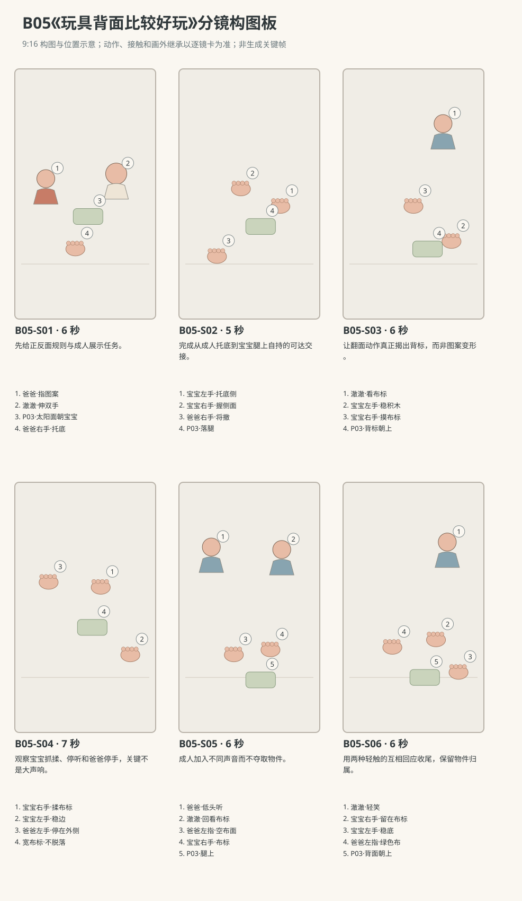

图示为构图位置示意；姿态、接触和画外继承以逐镜正文为准。

### 逐镜设计

#### B05-S01｜00—06 秒｜6 秒｜帧 [0, 144)

**镜头任务：**先给正反面规则与成人展示任务。

**景别、机位与构图：**南侧双人中景，爸爸画左、澈澈画右，积木在两人中间偏右，太阳正面朝宝宝，画面见其斜侧轮廓。

**摄影机与理由：**固定，成人指图案与宝宝接近同框。

**焦点：**爸爸左指、太阳缝线与宝宝双手为清楚主体。

**入态：**爸爸右手托P03下部，左食指靠近正面太阳；宝宝双手空在腿上。

**动作与表演：**

- 2 秒：爸爸左指轻点太阳缝线，澈澈眼神先看图案。

- 2 秒：澈澈双手离腿伸向积木左右侧，爸爸右手继续托住。

- 2 秒：宝宝双手贴到积木侧面，爸爸左指撤开，右手未放。

**声音：**点布面细响，宝宝轻咿呀；无语义对白。

**出态：**积木由爸爸右手托底、宝宝双手接触侧面双持。

**切点与承接：**切交接近景确认抓稳与落腿。

**连续性：**画内双持成立，布标在背面暂未完全显露；爸爸左手已空。

**开始画面母稿：**

9:16竖幅原创三维生活动画，圆润但保留婴儿头身与关节尺度，皮肤柔和、棉布哑光、低反差暖中性色，动作遵循生活物理；无字幕、无标识、无额外人物。澈澈圆润脸颊、深棕眼、短黑绒发、额前一撮向右弯，穿奶油色棉连体衣，动作尚不完全熟练，神情专注而非成人式算计。爸爸短黑发、砖陶色棉衬衫、深灰长裤，表情温和自然。本图为单一开始瞬间，人物、物件与接触只取以下起态；裁切外人物不为展示外观强行入画。固定空间和材质：客厅北墙固定沙发、西窗、东侧走廊入口、中央奶油地垫。相机在南半区朝北，不越人物东西轴线；成人在西侧，主要双人视图成人画左、宝宝画右。西窗柔和漫射光由画左照入，暖墙反射填暗部，光位与房间方位固定。澈澈靠低靠垫朝南坐，爸爸西侧坐。P03为鼠尾草绿大软积木，正面芥末太阳缝线、背面一块宽大奶油缝合布标，两者在不同面；布标两端缝牢、可揉中段柔软，无脱落小件。具体正反朝向、归属与接触以本镜起态为准。构图范围：南侧双人中景，爸爸画左、澈澈画右，积木在两人中间偏右，太阳正面朝宝宝，画面见其斜侧轮廓。唯一此刻状态：爸爸右手托P03下部，左食指靠近正面太阳；宝宝双手空在腿上。清晰度与焦点：爸爸左指、太阳缝线与宝宝双手为清楚主体。画面停在这个瞬间，不将后续动作阶段并列绘入。

**视频变化母稿：**

9:16竖幅原创三维生活动画，圆润但保留婴儿头身与关节尺度，皮肤柔和、棉布哑光、低反差暖中性色，动作遵循生活物理；无字幕、无标识、无额外人物。澈澈圆润脸颊、深棕眼、短黑绒发、额前一撮向右弯，穿奶油色棉连体衣，动作尚不完全熟练，神情专注而非成人式算计。爸爸短黑发、砖陶色棉衬衫、深灰长裤，表情温和自然。本镜有效时长6秒，为一个连续镜头。固定空间和材质：客厅北墙固定沙发、西窗、东侧走廊入口、中央奶油地垫。相机在南半区朝北，不越人物东西轴线；成人在西侧，主要双人视图成人画左、宝宝画右。西窗柔和漫射光由画左照入，暖墙反射填暗部，光位与房间方位固定。澈澈靠低靠垫朝南坐，爸爸西侧坐。P03为鼠尾草绿大软积木，正面芥末太阳缝线、背面一块宽大奶油缝合布标，两者在不同面；布标两端缝牢、可揉中段柔软，无脱落小件。具体正反朝向、归属与接触以本镜起态为准。摄影构图：南侧双人中景，爸爸画左、澈澈画右，积木在两人中间偏右，太阳正面朝宝宝，画面见其斜侧轮廓。摄影机：固定，成人指图案与宝宝接近同框。焦点：爸爸左指、太阳缝线与宝宝双手为清楚主体。起态：爸爸右手托P03下部，左食指靠近正面太阳；宝宝双手空在腿上。阶段1，2秒：爸爸左指轻点太阳缝线，澈澈眼神先看图案。阶段2，2秒：澈澈双手离腿伸向积木左右侧，爸爸右手继续托住。阶段3，2秒：宝宝双手贴到积木侧面，爸爸左指撤开，右手未放。准确声音：点布面细响，宝宝轻咿呀；无语义对白。终态：积木由爸爸右手托底、宝宝双手接触侧面双持。接触和画外状态：画内双持成立，布标在背面暂未完全显露；爸爸左手已空。在该终态切出，不在本镜内部额外切镜。

#### B05-S02｜06—11 秒｜5 秒｜帧 [144, 264)

**镜头任务：**完成从成人托底到宝宝腿上自持的可达交接。

**景别、机位与构图：**南侧略俯手部近景，宝宝两手夹积木两侧，爸爸右手在底，宝宝双腿占下部，正面太阳斜朝上。

**摄影机与理由：**固定，积木落腿与成人松手连续可验。

**焦点：**三只手和积木下缘清楚，不用浅景深遮接触。

**入态：**爸爸右手托P03，宝宝双手贴两侧，积木尚在腿上方。

**动作与表演：**

- 2 秒：宝宝双手合抱积木，爸爸右手托着一起下降到宝宝大腿。

- 1 秒：积木下边接触双腿，重量落稳。

- 2 秒：爸爸右指依次松开撤出，宝宝左手改托左下缘、右手握右侧。

**声音：**积木接棉衣的软擦声，爸爸袖口微响。

**出态：**P03只归宝宝双手并靠腿支撑，爸爸双手空。

**切点与承接：**切宝宝脸与翻面动作，接双手已自持状态。

**连续性：**画内成人释放发生在落腿之后；宝宝身体仍有靠垫，不靠积木支撑坐姿。

**开始画面母稿：**

9:16竖幅原创三维生活动画，圆润但保留婴儿头身与关节尺度，皮肤柔和、棉布哑光、低反差暖中性色，动作遵循生活物理；无字幕、无标识、无额外人物。澈澈圆润脸颊、深棕眼、短黑绒发、额前一撮向右弯，穿奶油色棉连体衣，动作尚不完全熟练，神情专注而非成人式算计。爸爸短黑发、砖陶色棉衬衫、深灰长裤，表情温和自然。本图为单一开始瞬间，人物、物件与接触只取以下起态；裁切外人物不为展示外观强行入画。固定空间和材质：客厅北墙固定沙发、西窗、东侧走廊入口、中央奶油地垫。相机在南半区朝北，不越人物东西轴线；成人在西侧，主要双人视图成人画左、宝宝画右。西窗柔和漫射光由画左照入，暖墙反射填暗部，光位与房间方位固定。澈澈靠低靠垫朝南坐，爸爸西侧坐。P03为鼠尾草绿大软积木，正面芥末太阳缝线、背面一块宽大奶油缝合布标，两者在不同面；布标两端缝牢、可揉中段柔软，无脱落小件。具体正反朝向、归属与接触以本镜起态为准。构图范围：南侧略俯手部近景，宝宝两手夹积木两侧，爸爸右手在底，宝宝双腿占下部，正面太阳斜朝上。唯一此刻状态：爸爸右手托P03，宝宝双手贴两侧，积木尚在腿上方。清晰度与焦点：三只手和积木下缘清楚，不用浅景深遮接触。画面停在这个瞬间，不将后续动作阶段并列绘入。

**视频变化母稿：**

9:16竖幅原创三维生活动画，圆润但保留婴儿头身与关节尺度，皮肤柔和、棉布哑光、低反差暖中性色，动作遵循生活物理；无字幕、无标识、无额外人物。澈澈圆润脸颊、深棕眼、短黑绒发、额前一撮向右弯，穿奶油色棉连体衣，动作尚不完全熟练，神情专注而非成人式算计。爸爸短黑发、砖陶色棉衬衫、深灰长裤，表情温和自然。本镜有效时长5秒，为一个连续镜头。固定空间和材质：客厅北墙固定沙发、西窗、东侧走廊入口、中央奶油地垫。相机在南半区朝北，不越人物东西轴线；成人在西侧，主要双人视图成人画左、宝宝画右。西窗柔和漫射光由画左照入，暖墙反射填暗部，光位与房间方位固定。澈澈靠低靠垫朝南坐，爸爸西侧坐。P03为鼠尾草绿大软积木，正面芥末太阳缝线、背面一块宽大奶油缝合布标，两者在不同面；布标两端缝牢、可揉中段柔软，无脱落小件。具体正反朝向、归属与接触以本镜起态为准。摄影构图：南侧略俯手部近景，宝宝两手夹积木两侧，爸爸右手在底，宝宝双腿占下部，正面太阳斜朝上。摄影机：固定，积木落腿与成人松手连续可验。焦点：三只手和积木下缘清楚，不用浅景深遮接触。起态：爸爸右手托P03，宝宝双手贴两侧，积木尚在腿上方。阶段1，2秒：宝宝双手合抱积木，爸爸右手托着一起下降到宝宝大腿。阶段2，1秒：积木下边接触双腿，重量落稳。阶段3，2秒：爸爸右指依次松开撤出，宝宝左手改托左下缘、右手握右侧。准确声音：积木接棉衣的软擦声，爸爸袖口微响。终态：P03只归宝宝双手并靠腿支撑，爸爸双手空。接触和画外状态：画内成人释放发生在落腿之后；宝宝身体仍有靠垫，不靠积木支撑坐姿。在该终态切出，不在本镜内部额外切镜。

#### B05-S03｜11—17 秒｜6 秒｜帧 [264, 408)

**镜头任务：**让翻面动作真正揭出背标，而非图案变形。

**景别、机位与构图：**南侧宝宝中近景，积木与双手在中下，脸上部；太阳一面最初斜向镜头下方，爸爸肩在左缘。

**摄影机与理由：**固定，翻转角度保持可见，背标出现才有信息变化。

**焦点：**保持积木两侧边缘与手接触清楚，宝宝目光可读。

**入态：**宝宝双手持P03在腿上，太阳斜朝上，背标仍在远侧。

**动作与表演：**

- 3 秒：宝宝两腕慢慢转动积木，左手托底、右手拉上侧，太阳向下翻。

- 2 秒：背面奶油色宽布标朝上显露，宝宝视线落在凸起布边。

- 1 秒：宝宝左手把积木稳在腿上，右掌移到布标中段。

**声音：**积木擦衣布声，无魔法揭示音效。

**出态：**太阳面朝下，宽布标朝上；左手稳积木，右手接触布标。

**切点与承接：**切布标抓揉细节，接右掌刚接触中段。

**连续性：**画内翻面完整，太阳和布标保持不同面；爸爸双手画外空置膝旁。

**开始画面母稿：**

9:16竖幅原创三维生活动画，圆润但保留婴儿头身与关节尺度，皮肤柔和、棉布哑光、低反差暖中性色，动作遵循生活物理；无字幕、无标识、无额外人物。澈澈圆润脸颊、深棕眼、短黑绒发、额前一撮向右弯，穿奶油色棉连体衣，动作尚不完全熟练，神情专注而非成人式算计。爸爸短黑发、砖陶色棉衬衫、深灰长裤，表情温和自然。本图为单一开始瞬间，人物、物件与接触只取以下起态；裁切外人物不为展示外观强行入画。固定空间和材质：客厅北墙固定沙发、西窗、东侧走廊入口、中央奶油地垫。相机在南半区朝北，不越人物东西轴线；成人在西侧，主要双人视图成人画左、宝宝画右。西窗柔和漫射光由画左照入，暖墙反射填暗部，光位与房间方位固定。澈澈靠低靠垫朝南坐，爸爸西侧坐。P03为鼠尾草绿大软积木，正面芥末太阳缝线、背面一块宽大奶油缝合布标，两者在不同面；布标两端缝牢、可揉中段柔软，无脱落小件。具体正反朝向、归属与接触以本镜起态为准。构图范围：南侧宝宝中近景，积木与双手在中下，脸上部；太阳一面最初斜向镜头下方，爸爸肩在左缘。唯一此刻状态：宝宝双手持P03在腿上，太阳斜朝上，背标仍在远侧。清晰度与焦点：保持积木两侧边缘与手接触清楚，宝宝目光可读。画面停在这个瞬间，不将后续动作阶段并列绘入。

**视频变化母稿：**

9:16竖幅原创三维生活动画，圆润但保留婴儿头身与关节尺度，皮肤柔和、棉布哑光、低反差暖中性色，动作遵循生活物理；无字幕、无标识、无额外人物。澈澈圆润脸颊、深棕眼、短黑绒发、额前一撮向右弯，穿奶油色棉连体衣，动作尚不完全熟练，神情专注而非成人式算计。爸爸短黑发、砖陶色棉衬衫、深灰长裤，表情温和自然。本镜有效时长6秒，为一个连续镜头。固定空间和材质：客厅北墙固定沙发、西窗、东侧走廊入口、中央奶油地垫。相机在南半区朝北，不越人物东西轴线；成人在西侧，主要双人视图成人画左、宝宝画右。西窗柔和漫射光由画左照入，暖墙反射填暗部，光位与房间方位固定。澈澈靠低靠垫朝南坐，爸爸西侧坐。P03为鼠尾草绿大软积木，正面芥末太阳缝线、背面一块宽大奶油缝合布标，两者在不同面；布标两端缝牢、可揉中段柔软，无脱落小件。具体正反朝向、归属与接触以本镜起态为准。摄影构图：南侧宝宝中近景，积木与双手在中下，脸上部；太阳一面最初斜向镜头下方，爸爸肩在左缘。摄影机：固定，翻转角度保持可见，背标出现才有信息变化。焦点：保持积木两侧边缘与手接触清楚，宝宝目光可读。起态：宝宝双手持P03在腿上，太阳斜朝上，背标仍在远侧。阶段1，3秒：宝宝两腕慢慢转动积木，左手托底、右手拉上侧，太阳向下翻。阶段2，2秒：背面奶油色宽布标朝上显露，宝宝视线落在凸起布边。阶段3，1秒：宝宝左手把积木稳在腿上，右掌移到布标中段。准确声音：积木擦衣布声，无魔法揭示音效。终态：太阳面朝下，宽布标朝上；左手稳积木，右手接触布标。接触和画外状态：画内翻面完整，太阳和布标保持不同面；爸爸双手画外空置膝旁。在该终态切出，不在本镜内部额外切镜。

#### B05-S04｜17—24 秒｜7 秒｜帧 [408, 576)

**镜头任务：**观察宝宝抓揉、停听和爸爸停手，关键不是大声响。

**景别、机位与构图：**南侧偏西近景，布标与宝宝右手居中，左手稳积木在右下；爸爸空左手从左边缘将近。

**摄影机与理由：**固定，用成人手的停住表达发现，不急切切脸。

**焦点：**布标抓握处与爸爸悬停手指同清楚。

**入态：**宝宝右掌搭宽布标中段、左手压积木侧；爸爸左手距积木一掌。

**动作与表演：**

- 2 秒：宝宝右拇指与其余手指抓住布标中段，轻揉出一道折皱。

- 2 秒：宝宝停手听，爸爸左指本要转积木，靠近后停在布标外，不接触。

- 3 秒：宝宝再揉一次，爸爸左手转成放松手形，退开少许。

**声音：**两次细布摩擦之间留两秒安静；爸爸无失望叹气。

**出态：**宝宝右手仍抓布标，爸爸左手悬在旁边空布面外，未翻积木。

**切点与承接：**切两人共享中近景，让爸爸接收宝宝的声音与目光。

**连续性：**画内宝宝右掌握布标、左手稳积木；爸爸左手无拉扯、积木太阳面保持向下。

**开始画面母稿：**

9:16竖幅原创三维生活动画，圆润但保留婴儿头身与关节尺度，皮肤柔和、棉布哑光、低反差暖中性色，动作遵循生活物理；无字幕、无标识、无额外人物。澈澈圆润脸颊、深棕眼、短黑绒发、额前一撮向右弯，穿奶油色棉连体衣，动作尚不完全熟练，神情专注而非成人式算计。爸爸短黑发、砖陶色棉衬衫、深灰长裤，表情温和自然。本图为单一开始瞬间，人物、物件与接触只取以下起态；裁切外人物不为展示外观强行入画。固定空间和材质：客厅北墙固定沙发、西窗、东侧走廊入口、中央奶油地垫。相机在南半区朝北，不越人物东西轴线；成人在西侧，主要双人视图成人画左、宝宝画右。西窗柔和漫射光由画左照入，暖墙反射填暗部，光位与房间方位固定。澈澈靠低靠垫朝南坐，爸爸西侧坐。P03为鼠尾草绿大软积木，正面芥末太阳缝线、背面一块宽大奶油缝合布标，两者在不同面；布标两端缝牢、可揉中段柔软，无脱落小件。具体正反朝向、归属与接触以本镜起态为准。构图范围：南侧偏西近景，布标与宝宝右手居中，左手稳积木在右下；爸爸空左手从左边缘将近。唯一此刻状态：宝宝右掌搭宽布标中段、左手压积木侧；爸爸左手距积木一掌。清晰度与焦点：布标抓握处与爸爸悬停手指同清楚。画面停在这个瞬间，不将后续动作阶段并列绘入。

**视频变化母稿：**

9:16竖幅原创三维生活动画，圆润但保留婴儿头身与关节尺度，皮肤柔和、棉布哑光、低反差暖中性色，动作遵循生活物理；无字幕、无标识、无额外人物。澈澈圆润脸颊、深棕眼、短黑绒发、额前一撮向右弯，穿奶油色棉连体衣，动作尚不完全熟练，神情专注而非成人式算计。爸爸短黑发、砖陶色棉衬衫、深灰长裤，表情温和自然。本镜有效时长7秒，为一个连续镜头。固定空间和材质：客厅北墙固定沙发、西窗、东侧走廊入口、中央奶油地垫。相机在南半区朝北，不越人物东西轴线；成人在西侧，主要双人视图成人画左、宝宝画右。西窗柔和漫射光由画左照入，暖墙反射填暗部，光位与房间方位固定。澈澈靠低靠垫朝南坐，爸爸西侧坐。P03为鼠尾草绿大软积木，正面芥末太阳缝线、背面一块宽大奶油缝合布标，两者在不同面；布标两端缝牢、可揉中段柔软，无脱落小件。具体正反朝向、归属与接触以本镜起态为准。摄影构图：南侧偏西近景，布标与宝宝右手居中，左手稳积木在右下；爸爸空左手从左边缘将近。摄影机：固定，用成人手的停住表达发现，不急切切脸。焦点：布标抓握处与爸爸悬停手指同清楚。起态：宝宝右掌搭宽布标中段、左手压积木侧；爸爸左手距积木一掌。阶段1，2秒：宝宝右拇指与其余手指抓住布标中段，轻揉出一道折皱。阶段2，2秒：宝宝停手听，爸爸左指本要转积木，靠近后停在布标外，不接触。阶段3，3秒：宝宝再揉一次，爸爸左手转成放松手形，退开少许。准确声音：两次细布摩擦之间留两秒安静；爸爸无失望叹气。终态：宝宝右手仍抓布标，爸爸左手悬在旁边空布面外，未翻积木。接触和画外状态：画内宝宝右掌握布标、左手稳积木；爸爸左手无拉扯、积木太阳面保持向下。在该终态切出，不在本镜内部额外切镜。

#### B05-S05｜24—30 秒｜6 秒｜帧 [576, 720)

**镜头任务：**成人加入不同声音而不夺取物件。

**景别、机位与构图：**南侧双人中近景，爸爸脸在左上、宝宝脸右上，积木与宝宝两手下部；爸爸左指可从左侧到达另一片空布面。

**摄影机与理由：**固定，同框显示爸爸先观察再触摸的顺序。

**焦点：**两张脸与相邻触摸处保持可读。

**入态：**宝宝右手抓布标，左手稳P03；爸爸左手在空布面外，右手自己膝上。

**动作与表演：**

- 2 秒：爸爸看看宝宝抓握处，再低头将左指轻放布标旁边的绿色空布面。

- 2 秒：爸爸左指轻蹭一下绿色布，澈澈抬眼看爸爸。

- 2 秒：爸爸停指等待，澈澈视线回到布标，右手又轻轻揉起。

**声音：**绿色软布轻擦与标签声有细微区别，不夸张成乐器；宝宝低短咿呀。

**出态：**爸爸左指停空布面，宝宝右手揉布标，积木仍在宝宝腿上。

**切点与承接：**接稍低共享近景，延续两人听同一物件的节奏。

**连续性：**画内成人左指与宝宝右握点分离，不抢物；爸爸右手空在膝上。

**开始画面母稿：**

9:16竖幅原创三维生活动画，圆润但保留婴儿头身与关节尺度，皮肤柔和、棉布哑光、低反差暖中性色，动作遵循生活物理；无字幕、无标识、无额外人物。澈澈圆润脸颊、深棕眼、短黑绒发、额前一撮向右弯，穿奶油色棉连体衣，动作尚不完全熟练，神情专注而非成人式算计。爸爸短黑发、砖陶色棉衬衫、深灰长裤，表情温和自然。本图为单一开始瞬间，人物、物件与接触只取以下起态；裁切外人物不为展示外观强行入画。固定空间和材质：客厅北墙固定沙发、西窗、东侧走廊入口、中央奶油地垫。相机在南半区朝北，不越人物东西轴线；成人在西侧，主要双人视图成人画左、宝宝画右。西窗柔和漫射光由画左照入，暖墙反射填暗部，光位与房间方位固定。澈澈靠低靠垫朝南坐，爸爸西侧坐。P03为鼠尾草绿大软积木，正面芥末太阳缝线、背面一块宽大奶油缝合布标，两者在不同面；布标两端缝牢、可揉中段柔软，无脱落小件。具体正反朝向、归属与接触以本镜起态为准。构图范围：南侧双人中近景，爸爸脸在左上、宝宝脸右上，积木与宝宝两手下部；爸爸左指可从左侧到达另一片空布面。唯一此刻状态：宝宝右手抓布标，左手稳P03；爸爸左手在空布面外，右手自己膝上。清晰度与焦点：两张脸、宝宝右手已抓住的布标与爸爸尚在空布面外的左手指清楚；成人指尚未触布。画面停在这个瞬间，不将后续动作阶段并列绘入。

**视频变化母稿：**

9:16竖幅原创三维生活动画，圆润但保留婴儿头身与关节尺度，皮肤柔和、棉布哑光、低反差暖中性色，动作遵循生活物理；无字幕、无标识、无额外人物。澈澈圆润脸颊、深棕眼、短黑绒发、额前一撮向右弯，穿奶油色棉连体衣，动作尚不完全熟练，神情专注而非成人式算计。爸爸短黑发、砖陶色棉衬衫、深灰长裤，表情温和自然。本镜有效时长6秒，为一个连续镜头。固定空间和材质：客厅北墙固定沙发、西窗、东侧走廊入口、中央奶油地垫。相机在南半区朝北，不越人物东西轴线；成人在西侧，主要双人视图成人画左、宝宝画右。西窗柔和漫射光由画左照入，暖墙反射填暗部，光位与房间方位固定。澈澈靠低靠垫朝南坐，爸爸西侧坐。P03为鼠尾草绿大软积木，正面芥末太阳缝线、背面一块宽大奶油缝合布标，两者在不同面；布标两端缝牢、可揉中段柔软，无脱落小件。具体正反朝向、归属与接触以本镜起态为准。摄影构图：南侧双人中近景，爸爸脸在左上、宝宝脸右上，积木与宝宝两手下部；爸爸左指可从左侧到达另一片空布面。摄影机：固定，同框显示爸爸先观察再触摸的顺序。焦点：两张脸与相邻触摸处保持可读。起态：宝宝右手抓布标，左手稳P03；爸爸左手在空布面外，右手自己膝上。阶段1，2秒：爸爸看看宝宝抓握处，再低头将左指轻放布标旁边的绿色空布面。阶段2，2秒：爸爸左指轻蹭一下绿色布，澈澈抬眼看爸爸。阶段3，2秒：爸爸停指等待，澈澈视线回到布标，右手又轻轻揉起。准确声音：绿色软布轻擦与标签声有细微区别，不夸张成乐器；宝宝低短咿呀。终态：爸爸左指停空布面，宝宝右手揉布标，积木仍在宝宝腿上。接触和画外状态：画内成人左指与宝宝右握点分离，不抢物；爸爸右手空在膝上。在该终态切出，不在本镜内部额外切镜。

#### B05-S06｜30—36 秒｜6 秒｜帧 [720, 864)

**镜头任务：**用两种轻触的互相回应收尾，保留物件归属。

**景别、机位与构图：**南侧略高共享中近景，宝宝脸在画右上、爸爸下半脸画左上，积木居中下，三处互动接触清楚，爸爸右手在画外保持膝上。

**摄影机与理由：**固定，细声和微笑足够，不加入抚头结论。

**焦点：**积木、两处触摸与宝宝眼神清楚。

**入态：**宝宝右手抓布标、左手稳积木，爸爸左指轻放绿色布面、右手膝上。

**动作与表演：**

- 2 秒：宝宝完成一次揉标，停下来听；爸爸等布声停后轻蹭绿色布一次。

- 2 秒：澈澈看一下爸爸手指，嘴角慢慢松开，右手仍握布标不放。

- 2 秒：爸爸也微笑，双方停手但保持接触，积木稳在腿上。

**声音：**两次轻布声有先后与留白，片尾只有呼吸与环境底声。

**出态：**P03背标朝上、太阳朝下；宝宝双手持稳，爸爸左指轻触空布面。

**切点与承接：**在共享注意成立时结束，不转回太阳作正确答案。

**连续性：**画内右手布标、左手积木、成人左指空布面三种接触不混；爸爸右手画外膝上继承。

**开始画面母稿：**

9:16竖幅原创三维生活动画，圆润但保留婴儿头身与关节尺度，皮肤柔和、棉布哑光、低反差暖中性色，动作遵循生活物理；无字幕、无标识、无额外人物。澈澈圆润脸颊、深棕眼、短黑绒发、额前一撮向右弯，穿奶油色棉连体衣，动作尚不完全熟练，神情专注而非成人式算计。爸爸短黑发、砖陶色棉衬衫、深灰长裤，表情温和自然。本图为单一开始瞬间，人物、物件与接触只取以下起态；裁切外人物不为展示外观强行入画。固定空间和材质：客厅北墙固定沙发、西窗、东侧走廊入口、中央奶油地垫。相机在南半区朝北，不越人物东西轴线；成人在西侧，主要双人视图成人画左、宝宝画右。西窗柔和漫射光由画左照入，暖墙反射填暗部，光位与房间方位固定。澈澈靠低靠垫朝南坐，爸爸西侧坐。P03为鼠尾草绿大软积木，正面芥末太阳缝线、背面一块宽大奶油缝合布标，两者在不同面；布标两端缝牢、可揉中段柔软，无脱落小件。具体正反朝向、归属与接触以本镜起态为准。构图范围：南侧略高共享中近景，宝宝脸在画右上、爸爸下半脸画左上，积木居中下，三处互动接触清楚，爸爸右手在画外保持膝上。唯一此刻状态：宝宝右手抓布标、左手稳积木，爸爸左指轻放绿色布面、右手膝上。清晰度与焦点：积木、两处触摸与宝宝眼神清楚。画面停在这个瞬间，不将后续动作阶段并列绘入。

**视频变化母稿：**

9:16竖幅原创三维生活动画，圆润但保留婴儿头身与关节尺度，皮肤柔和、棉布哑光、低反差暖中性色，动作遵循生活物理；无字幕、无标识、无额外人物。澈澈圆润脸颊、深棕眼、短黑绒发、额前一撮向右弯，穿奶油色棉连体衣，动作尚不完全熟练，神情专注而非成人式算计。爸爸短黑发、砖陶色棉衬衫、深灰长裤，表情温和自然。本镜有效时长6秒，为一个连续镜头。固定空间和材质：客厅北墙固定沙发、西窗、东侧走廊入口、中央奶油地垫。相机在南半区朝北，不越人物东西轴线；成人在西侧，主要双人视图成人画左、宝宝画右。西窗柔和漫射光由画左照入，暖墙反射填暗部，光位与房间方位固定。澈澈靠低靠垫朝南坐，爸爸西侧坐。P03为鼠尾草绿大软积木，正面芥末太阳缝线、背面一块宽大奶油缝合布标，两者在不同面；布标两端缝牢、可揉中段柔软，无脱落小件。具体正反朝向、归属与接触以本镜起态为准。摄影构图：南侧略高共享中近景，宝宝脸在画右上、爸爸下半脸画左上，积木居中下，三处互动接触清楚，爸爸右手在画外保持膝上。摄影机：固定，细声和微笑足够，不加入抚头结论。焦点：积木、两处触摸与宝宝眼神清楚。起态：宝宝右手抓布标、左手稳积木，爸爸左指轻放绿色布面、右手膝上。阶段1，2秒：宝宝完成一次揉标，停下来听；爸爸等布声停后轻蹭绿色布一次。阶段2，2秒：澈澈看一下爸爸手指，嘴角慢慢松开，右手仍握布标不放。阶段3，2秒：爸爸也微笑，双方停手但保持接触，积木稳在腿上。准确声音：两次轻布声有先后与留白，片尾只有呼吸与环境底声。终态：P03背标朝上、太阳朝下；宝宝双手持稳，爸爸左指轻触空布面。接触和画外状态：画内右手布标、左手积木、成人左指空布面三种接触不混；爸爸右手画外膝上继承。在该终态切出，不在本镜内部额外切镜。

### 声音与剪辑

全片无语义对白、无旁白、无音乐；不以成人配音解释宝宝动机。连续室内安静底声保持声场，动作拟音按各镜接触同步，婴儿气息与咿呀使用自然短音而非成人语调。

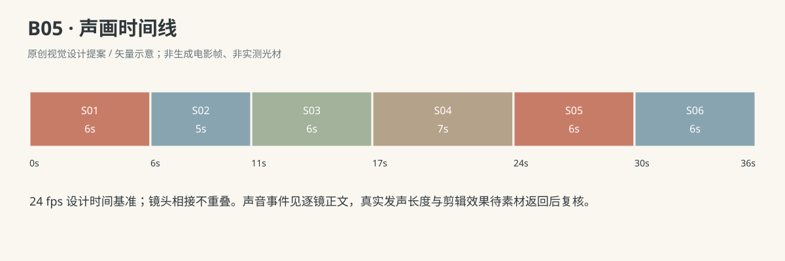

正式台词：无；保留镜头声音中已写明的自然发声。

### 连续性与试片

- 连续性：P03本条太阳正面、宽布标背面固定；翻面后直到片尾太阳朝下，不让贴图随镜头换面。

- 连续性：宝宝左手稳积木、右掌揉布标，爸爸仅左指触旁边绿色布，三种接触点分离。

- 连续性：布标两端牢缝、宽大柔软，无剪断、脱落或入口动作；宝宝有靠坐，积木由双腿承托。

- 试片：B05-S01—S03：交接、落腿、翻面连续，若成人松手早于宝宝接稳或太阳与布标同时同面即失败。

- 试片：B05-S04—S06：能区分宝宝揉标和爸爸蹭空布面；若成人翻回物件、夺走布标或所有细声被音乐盖住即失败。

**媒体待验证：**待试片核对大软积木在腿上的稳定、双手翻面、布标抓握与布料拟音；本文不代表真实布声已录制或视觉质量已通过。

---

## B06《哈欠还没打完》

**30 秒｜仰卧与翻身探索｜角色：澈澈、妈妈｜场景 L**

### 剧情正文

午后的客厅比平时安静一点，西窗光落在地垫上，澈澈仰卧着，妈妈坐在旁边，膝上放着折好的布巾。澈澈嘴巴慢慢张大，打了一个长哈欠，右手从胸侧抬起，停在脸旁。哈欠还没结束，眼睛已经眯起来；等嘴巴合上，那只手仍半举着，手指松松弯着。妈妈看见这副模样，把理布巾的左手放轻，连移动右手布环的动作也慢下来。她原本想把环放到宝宝右肩外侧，等会儿再收；珊瑚色刚滑进澈澈的视线，小手便轻动了一下。眼睑没有一下子弹开，而是先露出一条缝，眼睛跟着环转，嘴巴也放松下来。妈妈停住环，给宝宝留出够到的距离。澈澈把半举着的右手往旁边伸，摸到环边，手指拢起来，眼睛渐渐睁圆。妈妈等他抓稳，才撤开手。布环到了澈澈胸前，他低眼认真看着；妈妈看看还没动过的布巾，笑着把手放回膝上。澈澈的眼睛跟着胸前的小环，右手稳稳攥着；妈妈双手放在膝上，安静看着他。

### 导演与空间

**观察任务：**以长哈欠造成大人的安静判断，再由一个真实进入视野的玩具引出注意回转，不演假睡。

**空间与光位：**客厅北沙发、西窗、东入口；澈澈仰卧中央地垫，头北脚南，后脑肩背贴垫，右手原在胸侧。妈妈坐西侧，右手持P01珊瑚布环在自己膝旁，左手扶膝上折好的P04奶油布巾。相机南半区看北，妈妈画左、宝宝画右，西窗较弱柔光由画左入，环境不随眼睛闭合变暗。

**人物表演：**澈澈是真的打哈欠，口部松展、眼睑缓慢合拢，右臂顺着身体活动抬起而非戏剧性定格；妈妈先收小动作准备安静放下布环，宝宝看见后重新关注，她顺势完成递环。

### 节拍覆盖

- **B06-b1**：长哈欠与半举小手让妈妈减小动作。 → B06-S01、B06-S02

- **B06-b2**：妈妈安静移环入视野，宝宝逐渐重新关注。 → B06-S03

- **B06-b3**：宝宝右手可达伸握，成人确认后释放，举环研究收尾。 → B06-S04、B06-S05

### 分镜构图板

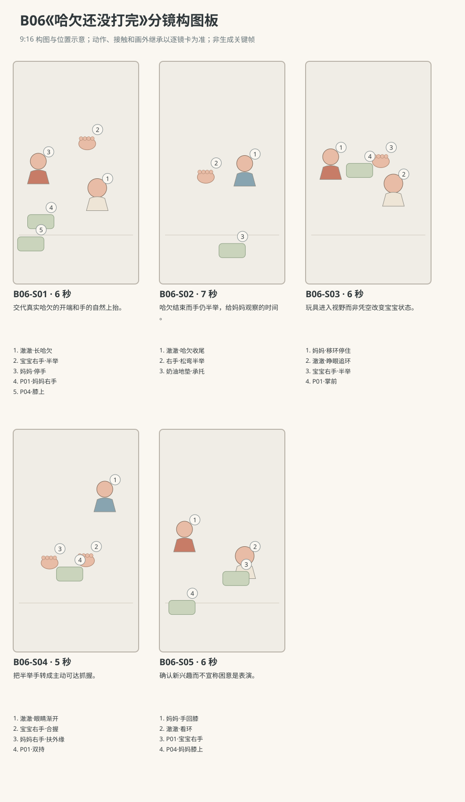

图示为构图位置示意；姿态、接触和画外继承以逐镜正文为准。

### 逐镜设计

#### B06-S01｜00—06 秒｜6 秒｜帧 [0, 144)

**镜头任务：**交代真实哈欠的开端和手的自然上抬。

**景别、机位与构图：**南侧略高中景，宝宝仰卧在画中右，妈妈侧坐画左，宝宝脸、右臂和胸部可见，妈妈膝上布巾与布环分开。

**摄影机与理由：**固定，维持安静观察尺度，不用急推制造困意。

**焦点：**宝宝脸和右臂为清楚主体，妈妈两手仍可辨认。

**入态：**澈澈仰卧，嘴唇刚张开、右手在胸侧；妈妈右手持P01、左手扶P04在膝。

**动作与表演：**

- 2 秒：宝宝下颌慢慢放松，哈欠展开，眼睑下垂。

- 2 秒：右臂从胸侧缓慢抬到脸旁，手指松弯，肩背仍贴垫。

- 2 秒：长哈欠仍在继续，妈妈看见后，左手停在布巾边缘。

**声音：**自然轻哈欠气声，妈妈理布声在末段停止，不加困倦配音。

**出态：**宝宝嘴仍张着、右手半举；妈妈左手停布巾，右手持环膝旁。

**切点与承接：**切宝宝脸与半举右手，延续未完成哈欠。

**连续性：**画内仰卧支撑、右臂上抬可见；布环属于妈妈右手，P04属于妈妈膝上左手扶。

**开始画面母稿：**

9:16竖幅原创三维生活动画，圆润但保留婴儿头身与关节尺度，皮肤柔和、棉布哑光、低反差暖中性色，动作遵循生活物理；无字幕、无标识、无额外人物。澈澈圆润脸颊、深棕眼、短黑绒发、额前一撮向右弯，穿奶油色棉连体衣，动作尚不完全熟练，神情专注而非成人式算计。妈妈深棕低马尾、雾蓝棉上衣、米色长裤，回应轻柔而不夸张。本图为单一开始瞬间，人物、物件与接触只取以下起态；裁切外人物不为展示外观强行入画。固定空间和材质：客厅北墙固定沙发、西窗、东侧走廊入口、中央奶油地垫。相机在南半区朝北，不越人物东西轴线；成人在西侧，主要双人视图成人画左、宝宝画右。西窗柔和漫射光由画左照入，暖墙反射填暗部，光位与房间方位固定。西窗光较弱但持续不变。澈澈仰卧地垫，头北脚南，后脑肩背受垫承托；妈妈西侧坐。P01为珊瑚大软布环，P04为妈妈膝上的奶油布巾，右手高度、眼睑状态与布环归属均以本镜起态为准。构图范围：南侧略高中景，宝宝仰卧在画中右，妈妈侧坐画左，宝宝脸、右臂和胸部可见，妈妈膝上布巾与布环分开。唯一此刻状态：澈澈仰卧，嘴唇刚张开、右手在胸侧；妈妈右手持P01、左手扶P04在膝。清晰度与焦点：宝宝脸和右臂为清楚主体，妈妈两手仍可辨认。画面停在这个瞬间，不将后续动作阶段并列绘入。

**视频变化母稿：**

9:16竖幅原创三维生活动画，圆润但保留婴儿头身与关节尺度，皮肤柔和、棉布哑光、低反差暖中性色，动作遵循生活物理；无字幕、无标识、无额外人物。澈澈圆润脸颊、深棕眼、短黑绒发、额前一撮向右弯，穿奶油色棉连体衣，动作尚不完全熟练，神情专注而非成人式算计。妈妈深棕低马尾、雾蓝棉上衣、米色长裤，回应轻柔而不夸张。本镜有效时长6秒，为一个连续镜头。固定空间和材质：客厅北墙固定沙发、西窗、东侧走廊入口、中央奶油地垫。相机在南半区朝北，不越人物东西轴线；成人在西侧，主要双人视图成人画左、宝宝画右。西窗柔和漫射光由画左照入，暖墙反射填暗部，光位与房间方位固定。西窗光较弱但持续不变。澈澈仰卧地垫，头北脚南，后脑肩背受垫承托；妈妈西侧坐。P01为珊瑚大软布环，P04为妈妈膝上的奶油布巾，右手高度、眼睑状态与布环归属均以本镜起态为准。摄影构图：南侧略高中景，宝宝仰卧在画中右，妈妈侧坐画左，宝宝脸、右臂和胸部可见，妈妈膝上布巾与布环分开。摄影机：固定，维持安静观察尺度，不用急推制造困意。焦点：宝宝脸和右臂为清楚主体，妈妈两手仍可辨认。起态：澈澈仰卧，嘴唇刚张开、右手在胸侧；妈妈右手持P01、左手扶P04在膝。阶段1，2秒：宝宝下颌慢慢放松，哈欠展开，眼睑下垂。阶段2，2秒：右臂从胸侧缓慢抬到脸旁，手指松弯，肩背仍贴垫。阶段3，2秒：长哈欠仍在继续，妈妈看见后，左手停在布巾边缘。准确声音：自然轻哈欠气声，妈妈理布声在末段停止，不加困倦配音。终态：宝宝嘴仍张着、右手半举；妈妈左手停布巾，右手持环膝旁。接触和画外状态：画内仰卧支撑、右臂上抬可见；布环属于妈妈右手，P04属于妈妈膝上左手扶。在该终态切出，不在本镜内部额外切镜。

#### B06-S02｜06—13 秒｜7 秒｜帧 [144, 312)

**镜头任务：**哈欠结束而手仍半举，给妈妈观察的时间。

**景别、机位与构图：**南侧偏西宝宝近景，脸在画右上、右手在左中、胸口下缘可见，妈妈仅袖口在左边缘。

**摄影机与理由：**固定，避免把半举手拍成悬停特效。

**焦点：**眼睑、嘴角与松弯右指同时清楚。

**入态：**宝宝哈欠进行中，右手半举脸旁、指间松开。

**动作与表演：**

- 3 秒：哈欠缓慢结束，下颌合拢，眼睑先几乎闭起。

- 2 秒：宝宝呼气，右肘自然稍降一点但手仍在脸旁，指尖轻动。

- 2 秒：眼睛保持微闭，脸部放松，妈妈画外移动物件的布声变轻。

**声音：**哈欠声自然收尾后留轻呼吸；画左外妈妈布料细响很轻。

**出态：**宝宝嘴已闭、眼睛微闭，右手仍半举但略低，肩背未离垫。

**切点与承接：**切共享画面看妈妈实际移环，环境声连续。

**连续性：**画内只确认宝宝脸、右手与胸侧；妈妈P01和P04归属为画外继承，不声称此近景看见它们。

**开始画面母稿：**

9:16竖幅原创三维生活动画，圆润但保留婴儿头身与关节尺度，皮肤柔和、棉布哑光、低反差暖中性色，动作遵循生活物理；无字幕、无标识、无额外人物。澈澈圆润脸颊、深棕眼、短黑绒发、额前一撮向右弯，穿奶油色棉连体衣，动作尚不完全熟练，神情专注而非成人式算计。妈妈深棕低马尾、雾蓝棉上衣、米色长裤，回应轻柔而不夸张。本图为单一开始瞬间，人物、物件与接触只取以下起态；裁切外人物不为展示外观强行入画。固定空间和材质：客厅北墙固定沙发、西窗、东侧走廊入口、中央奶油地垫。相机在南半区朝北，不越人物东西轴线；成人在西侧，主要双人视图成人画左、宝宝画右。西窗柔和漫射光由画左照入，暖墙反射填暗部，光位与房间方位固定。西窗光较弱但持续不变。澈澈仰卧地垫，头北脚南，后脑肩背受垫承托；妈妈西侧坐。P01为珊瑚大软布环，P04为妈妈膝上的奶油布巾，右手高度、眼睑状态与布环归属均以本镜起态为准。构图范围：南侧偏西宝宝近景，脸在画右上、右手在左中、胸口下缘可见，妈妈仅袖口在左边缘。唯一此刻状态：宝宝哈欠进行中，右手半举脸旁、指间松开。清晰度与焦点：眼睑、嘴角与松弯右指同时清楚。画面停在这个瞬间，不将后续动作阶段并列绘入。

**视频变化母稿：**

9:16竖幅原创三维生活动画，圆润但保留婴儿头身与关节尺度，皮肤柔和、棉布哑光、低反差暖中性色，动作遵循生活物理；无字幕、无标识、无额外人物。澈澈圆润脸颊、深棕眼、短黑绒发、额前一撮向右弯，穿奶油色棉连体衣，动作尚不完全熟练，神情专注而非成人式算计。妈妈深棕低马尾、雾蓝棉上衣、米色长裤，回应轻柔而不夸张。本镜有效时长7秒，为一个连续镜头。固定空间和材质：客厅北墙固定沙发、西窗、东侧走廊入口、中央奶油地垫。相机在南半区朝北，不越人物东西轴线；成人在西侧，主要双人视图成人画左、宝宝画右。西窗柔和漫射光由画左照入，暖墙反射填暗部，光位与房间方位固定。西窗光较弱但持续不变。澈澈仰卧地垫，头北脚南，后脑肩背受垫承托；妈妈西侧坐。P01为珊瑚大软布环，P04为妈妈膝上的奶油布巾，右手高度、眼睑状态与布环归属均以本镜起态为准。摄影构图：南侧偏西宝宝近景，脸在画右上、右手在左中、胸口下缘可见，妈妈仅袖口在左边缘。摄影机：固定，避免把半举手拍成悬停特效。焦点：眼睑、嘴角与松弯右指同时清楚。起态：宝宝哈欠进行中，右手半举脸旁、指间松开。阶段1，3秒：哈欠缓慢结束，下颌合拢，眼睑先几乎闭起。阶段2，2秒：宝宝呼气，右肘自然稍降一点但手仍在脸旁，指尖轻动。阶段3，2秒：眼睛保持微闭，脸部放松，妈妈画外移动物件的布声变轻。准确声音：哈欠声自然收尾后留轻呼吸；画左外妈妈布料细响很轻。终态：宝宝嘴已闭、眼睛微闭，右手仍半举但略低，肩背未离垫。接触和画外状态：画内只确认宝宝脸、右手与胸侧；妈妈P01和P04归属为画外继承，不声称此近景看见它们。在该终态切出，不在本镜内部额外切镜。

#### B06-S03｜13—19 秒｜6 秒｜帧 [312, 456)

**镜头任务：**玩具进入视野而非凭空改变宝宝状态。

**景别、机位与构图：**南侧略高中景，妈妈画左、宝宝画右，P01可从妈妈膝旁沿短路径移到宝宝右肩外侧，右手半举在两者之间。

**摄影机与理由：**固定，保留环移动、眼睛追随的先后。

**焦点：**P01与宝宝眼睛同清晰范围，妈妈手不会遮宝宝脸。

**入态：**妈妈右手持P01膝旁，左手放P04上；宝宝眼睛微闭、右手半举。

**动作与表演：**

- 2 秒：妈妈右手缓慢将P01移向宝宝右肩外侧地垫上方，尚未落地。

- 2 秒：珊瑚环进入宝宝斜前视野，宝宝先动右指，再睁开一点眼睛追看。

- 2 秒：妈妈发现目光跟随，右手在距宝宝右掌半掌处停住，不继续放地。

**声音：**布环轻擦袖口，宝宝呼吸正常，无唤醒叫声。

**出态：**妈妈右手持环停在宝宝右手可达处；宝宝眼睛已半开，看着环。

**切点与承接：**切伸手近景，保持宝宝已看环、成人已停手。

**连续性：**画内P01从膝旁移近全程可见，妈妈仍持环未放；宝宝左手胸侧不参与。

**开始画面母稿：**

9:16竖幅原创三维生活动画，圆润但保留婴儿头身与关节尺度，皮肤柔和、棉布哑光、低反差暖中性色，动作遵循生活物理；无字幕、无标识、无额外人物。澈澈圆润脸颊、深棕眼、短黑绒发、额前一撮向右弯，穿奶油色棉连体衣，动作尚不完全熟练，神情专注而非成人式算计。妈妈深棕低马尾、雾蓝棉上衣、米色长裤，回应轻柔而不夸张。本图为单一开始瞬间，人物、物件与接触只取以下起态；裁切外人物不为展示外观强行入画。固定空间和材质：客厅北墙固定沙发、西窗、东侧走廊入口、中央奶油地垫。相机在南半区朝北，不越人物东西轴线；成人在西侧，主要双人视图成人画左、宝宝画右。西窗柔和漫射光由画左照入，暖墙反射填暗部，光位与房间方位固定。西窗光较弱但持续不变。澈澈仰卧地垫，头北脚南，后脑肩背受垫承托；妈妈西侧坐。P01为珊瑚大软布环，P04为妈妈膝上的奶油布巾，右手高度、眼睑状态与布环归属均以本镜起态为准。构图范围：南侧略高中景，妈妈画左、宝宝画右，P01可从妈妈膝旁沿短路径移到宝宝右肩外侧，右手半举在两者之间。唯一此刻状态：妈妈右手持P01膝旁，左手放P04上；宝宝眼睛微闭、右手半举。清晰度与焦点：P01与宝宝眼睛同清晰范围，妈妈手不会遮宝宝脸。画面停在这个瞬间，不将后续动作阶段并列绘入。

**视频变化母稿：**

9:16竖幅原创三维生活动画，圆润但保留婴儿头身与关节尺度，皮肤柔和、棉布哑光、低反差暖中性色，动作遵循生活物理；无字幕、无标识、无额外人物。澈澈圆润脸颊、深棕眼、短黑绒发、额前一撮向右弯，穿奶油色棉连体衣，动作尚不完全熟练，神情专注而非成人式算计。妈妈深棕低马尾、雾蓝棉上衣、米色长裤，回应轻柔而不夸张。本镜有效时长6秒，为一个连续镜头。固定空间和材质：客厅北墙固定沙发、西窗、东侧走廊入口、中央奶油地垫。相机在南半区朝北，不越人物东西轴线；成人在西侧，主要双人视图成人画左、宝宝画右。西窗柔和漫射光由画左照入，暖墙反射填暗部，光位与房间方位固定。西窗光较弱但持续不变。澈澈仰卧地垫，头北脚南，后脑肩背受垫承托；妈妈西侧坐。P01为珊瑚大软布环，P04为妈妈膝上的奶油布巾，右手高度、眼睑状态与布环归属均以本镜起态为准。摄影构图：南侧略高中景，妈妈画左、宝宝画右，P01可从妈妈膝旁沿短路径移到宝宝右肩外侧，右手半举在两者之间。摄影机：固定，保留环移动、眼睛追随的先后。焦点：P01与宝宝眼睛同清晰范围，妈妈手不会遮宝宝脸。起态：妈妈右手持P01膝旁，左手放P04上；宝宝眼睛微闭、右手半举。阶段1，2秒：妈妈右手缓慢将P01移向宝宝右肩外侧地垫上方，尚未落地。阶段2，2秒：珊瑚环进入宝宝斜前视野，宝宝先动右指，再睁开一点眼睛追看。阶段3，2秒：妈妈发现目光跟随，右手在距宝宝右掌半掌处停住，不继续放地。准确声音：布环轻擦袖口，宝宝呼吸正常，无唤醒叫声。终态：妈妈右手持环停在宝宝右手可达处；宝宝眼睛已半开，看着环。接触和画外状态：画内P01从膝旁移近全程可见，妈妈仍持环未放；宝宝左手胸侧不参与。在该终态切出，不在本镜内部额外切镜。

#### B06-S04｜19—24 秒｜5 秒｜帧 [456, 576)

**镜头任务：**把半举手转成主动可达抓握。

**景别、机位与构图：**南侧宝宝手脸中近景，右手与P01在脸侧下方，不遮眼睛；妈妈右手由画左托环外缘。

**摄影机与理由：**固定，不通过推镜缩短手和环距离。

**焦点：**右手指与布环边缘清楚，眼睛保留半开变化。

**入态：**宝宝右手离P01半掌，妈妈右指持环外缘；宝宝半睁眼看环。

**动作与表演：**

- 2 秒：宝宝右臂向环伸出小幅距离，掌心先触布面，眼睛继续睁开。

- 2 秒：右手指慢慢合拢包住环上缘，妈妈保持扶外缘。

- 1 秒：宝宝抓稳后稍屈肘，妈妈右指准备松开但仍接触。

**声音：**布环轻揉声，宝宝短小无词咿呀，哈欠声不重复。

**出态：**宝宝右手握环上缘，妈妈右手仍扶外缘，短暂双持。

**切点与承接：**切较宽镜接成人释放，不能在切点提前变单持。

**连续性：**画内右手抓稳与成人扶持同时成立，宝宝左手仍胸侧、肩背贴垫。

**开始画面母稿：**

9:16竖幅原创三维生活动画，圆润但保留婴儿头身与关节尺度，皮肤柔和、棉布哑光、低反差暖中性色，动作遵循生活物理；无字幕、无标识、无额外人物。澈澈圆润脸颊、深棕眼、短黑绒发、额前一撮向右弯，穿奶油色棉连体衣，动作尚不完全熟练，神情专注而非成人式算计。妈妈深棕低马尾、雾蓝棉上衣、米色长裤，回应轻柔而不夸张。本图为单一开始瞬间，人物、物件与接触只取以下起态；裁切外人物不为展示外观强行入画。固定空间和材质：客厅北墙固定沙发、西窗、东侧走廊入口、中央奶油地垫。相机在南半区朝北，不越人物东西轴线；成人在西侧，主要双人视图成人画左、宝宝画右。西窗柔和漫射光由画左照入，暖墙反射填暗部，光位与房间方位固定。西窗光较弱但持续不变。澈澈仰卧地垫，头北脚南，后脑肩背受垫承托；妈妈西侧坐。P01为珊瑚大软布环，P04为妈妈膝上的奶油布巾，右手高度、眼睑状态与布环归属均以本镜起态为准。构图范围：南侧宝宝手脸中近景，右手与P01在脸侧下方，不遮眼睛；妈妈右手由画左托环外缘。唯一此刻状态：宝宝右手离P01半掌，妈妈右指持环外缘；宝宝半睁眼看环。清晰度与焦点：右手指与布环边缘清楚，眼睛保留半开变化。画面停在这个瞬间，不将后续动作阶段并列绘入。

**视频变化母稿：**

9:16竖幅原创三维生活动画，圆润但保留婴儿头身与关节尺度，皮肤柔和、棉布哑光、低反差暖中性色，动作遵循生活物理；无字幕、无标识、无额外人物。澈澈圆润脸颊、深棕眼、短黑绒发、额前一撮向右弯，穿奶油色棉连体衣，动作尚不完全熟练，神情专注而非成人式算计。妈妈深棕低马尾、雾蓝棉上衣、米色长裤，回应轻柔而不夸张。本镜有效时长5秒，为一个连续镜头。固定空间和材质：客厅北墙固定沙发、西窗、东侧走廊入口、中央奶油地垫。相机在南半区朝北，不越人物东西轴线；成人在西侧，主要双人视图成人画左、宝宝画右。西窗柔和漫射光由画左照入，暖墙反射填暗部，光位与房间方位固定。西窗光较弱但持续不变。澈澈仰卧地垫，头北脚南，后脑肩背受垫承托；妈妈西侧坐。P01为珊瑚大软布环，P04为妈妈膝上的奶油布巾，右手高度、眼睑状态与布环归属均以本镜起态为准。摄影构图：南侧宝宝手脸中近景，右手与P01在脸侧下方，不遮眼睛；妈妈右手由画左托环外缘。摄影机：固定，不通过推镜缩短手和环距离。焦点：右手指与布环边缘清楚，眼睛保留半开变化。起态：宝宝右手离P01半掌，妈妈右指持环外缘；宝宝半睁眼看环。阶段1，2秒：宝宝右臂向环伸出小幅距离，掌心先触布面，眼睛继续睁开。阶段2，2秒：右手指慢慢合拢包住环上缘，妈妈保持扶外缘。阶段3，1秒：宝宝抓稳后稍屈肘，妈妈右指准备松开但仍接触。准确声音：布环轻揉声，宝宝短小无词咿呀，哈欠声不重复。终态：宝宝右手握环上缘，妈妈右手仍扶外缘，短暂双持。接触和画外状态：画内右手抓稳与成人扶持同时成立，宝宝左手仍胸侧、肩背贴垫。在该终态切出，不在本镜内部额外切镜。

#### B06-S05｜24—30 秒｜6 秒｜帧 [576, 720)

**镜头任务：**确认新兴趣而不宣称困意是表演。

**景别、机位与构图：**南侧略高中景，宝宝仰卧右侧、妈妈左侧，环在宝宝右胸前，妈妈膝上P04仍可辨。

**摄影机与理由：**固定，以手回膝和宝宝举环形成温和尾声。

**焦点：**宝宝眼睛、右手环与妈妈表情同范围清楚。

**入态：**宝宝右手与妈妈右手双持P01，宝宝眼睛已睁开看环。

**动作与表演：**

- 2 秒：妈妈右指松开撤回膝上，宝宝右肘慢弯，把环带到胸前。

- 2 秒：澈澈眼睛睁得更圆，认真看布环，左手在胸侧轻动但未接环。

- 2 秒：妈妈看看膝上布巾，再看宝宝，轻笑气息后安静坐着。

**声音：**成人轻笑气息、宝宝自然咿呀与棉料细响，室内底声延续。

**出态：**P01仅在宝宝右手胸前，妈妈双手在膝上，P04未离膝。

**切点与承接：**在宝宝注视环仍持续时结束，不接睡着镜头。

**连续性：**画内成人释放与环移到胸前连续；无坐起、抬背或手凭空换边。

**开始画面母稿：**

9:16竖幅原创三维生活动画，圆润但保留婴儿头身与关节尺度，皮肤柔和、棉布哑光、低反差暖中性色，动作遵循生活物理；无字幕、无标识、无额外人物。澈澈圆润脸颊、深棕眼、短黑绒发、额前一撮向右弯，穿奶油色棉连体衣，动作尚不完全熟练，神情专注而非成人式算计。妈妈深棕低马尾、雾蓝棉上衣、米色长裤，回应轻柔而不夸张。本图为单一开始瞬间，人物、物件与接触只取以下起态；裁切外人物不为展示外观强行入画。固定空间和材质：客厅北墙固定沙发、西窗、东侧走廊入口、中央奶油地垫。相机在南半区朝北，不越人物东西轴线；成人在西侧，主要双人视图成人画左、宝宝画右。西窗柔和漫射光由画左照入，暖墙反射填暗部，光位与房间方位固定。西窗光较弱但持续不变。澈澈仰卧地垫，头北脚南，后脑肩背受垫承托；妈妈西侧坐。P01为珊瑚大软布环，P04为妈妈膝上的奶油布巾，右手高度、眼睑状态与布环归属均以本镜起态为准。构图范围：南侧略高中景，宝宝仰卧右侧、妈妈左侧，环在宝宝右胸前，妈妈膝上P04仍可辨。唯一此刻状态：宝宝右手与妈妈右手双持P01，宝宝眼睛已睁开看环。清晰度与焦点：宝宝眼睛、右手环与妈妈表情同范围清楚。画面停在这个瞬间，不将后续动作阶段并列绘入。

**视频变化母稿：**

9:16竖幅原创三维生活动画，圆润但保留婴儿头身与关节尺度，皮肤柔和、棉布哑光、低反差暖中性色，动作遵循生活物理；无字幕、无标识、无额外人物。澈澈圆润脸颊、深棕眼、短黑绒发、额前一撮向右弯，穿奶油色棉连体衣，动作尚不完全熟练，神情专注而非成人式算计。妈妈深棕低马尾、雾蓝棉上衣、米色长裤，回应轻柔而不夸张。本镜有效时长6秒，为一个连续镜头。固定空间和材质：客厅北墙固定沙发、西窗、东侧走廊入口、中央奶油地垫。相机在南半区朝北，不越人物东西轴线；成人在西侧，主要双人视图成人画左、宝宝画右。西窗柔和漫射光由画左照入，暖墙反射填暗部，光位与房间方位固定。西窗光较弱但持续不变。澈澈仰卧地垫，头北脚南，后脑肩背受垫承托；妈妈西侧坐。P01为珊瑚大软布环，P04为妈妈膝上的奶油布巾，右手高度、眼睑状态与布环归属均以本镜起态为准。摄影构图：南侧略高中景，宝宝仰卧右侧、妈妈左侧，环在宝宝右胸前，妈妈膝上P04仍可辨。摄影机：固定，以手回膝和宝宝举环形成温和尾声。焦点：宝宝眼睛、右手环与妈妈表情同范围清楚。起态：宝宝右手与妈妈右手双持P01，宝宝眼睛已睁开看环。阶段1，2秒：妈妈右指松开撤回膝上，宝宝右肘慢弯，把环带到胸前。阶段2，2秒：澈澈眼睛睁得更圆，认真看布环，左手在胸侧轻动但未接环。阶段3，2秒：妈妈看看膝上布巾，再看宝宝，轻笑气息后安静坐着。准确声音：成人轻笑气息、宝宝自然咿呀与棉料细响，室内底声延续。终态：P01仅在宝宝右手胸前，妈妈双手在膝上，P04未离膝。接触和画外状态：画内成人释放与环移到胸前连续；无坐起、抬背或手凭空换边。在该终态切出，不在本镜内部额外切镜。

### 声音与剪辑

全片无语义对白、无旁白、无音乐；不以成人配音解释宝宝动机。连续室内安静底声保持声场，动作拟音按各镜接触同步，婴儿气息与咿呀使用自然短音而非成人语调。

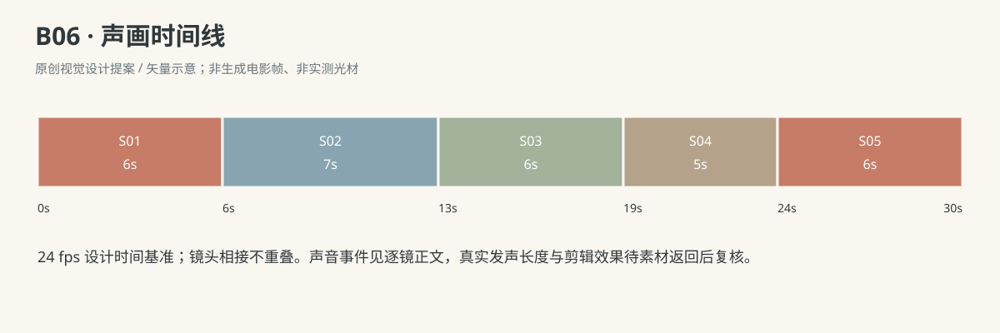

正式台词：无；保留镜头声音中已写明的自然发声。

### 连续性与试片

- 连续性：宝宝R0仰卧，右手从胸侧抬到脸旁再伸握P01；不由半举手直接切成坐姿。

- 连续性：P01从妈妈右手到双持再到宝宝右手；P04全片在妈妈膝上。

- 连续性：哈欠和重新关注都用渐变眼睑与气息，不以突然弹眼、假睡奸笑或灯光变暗制造效果。

- 试片：B06-S01—S02：哈欠只能完成一次，切镜续同一口气，若嘴型重新开合重演或右臂瞬移即失败。

- 试片：B06-S03—S05：宝宝看见环后才追视伸手，且成人待抓稳再松；若环未入视野宝宝已精准伸抓，或双持被省略则失败。

**媒体待验证：**待试片核对长哈欠自然声长、眼睑渐开、仰卧伸手范围与抓握；未录音未生成媒体。

---

## B07《我已经藏好了》

**36 秒｜坐姿与手部互动｜角色：澈澈、爸爸｜场景 L**

### 剧情正文

西窗的光铺在客厅地垫上，澈澈有靠地坐在北侧，奶油布巾搭着腿，爸爸在西侧坐着，双手放在膝上，抬眼看过来。澈澈右手握起布角，慢慢把边缘举到右眼旁，露着的左眼认真望向爸爸。爸爸停下手，只安静等着，没碰宝宝的布。过了一会儿，澈澈自己把布降到下巴旁；爸爸看见右眼重新露出，才把眉毛轻轻抬高，向他亮出一个惊喜笑脸，轻声说：“找到啦！”澈澈盯着那张忽然变化的脸，先吸一小口气，再笑出短短两声，手里仍攥着同一角。笑尾过去，澈澈重新把布举到右眼旁。爸爸这回把双手都放回膝上，收住表情等。露在布外的小嘴已经弯起来，右手却还停了一下，随后把布放低。爸爸在右眼露出后又抬起眉，澈澈再笑，布巾慢慢落回腿上；爸爸也跟着呼气笑了一下，手没有伸过去。

### 亲述来源与改编

原帖是家长自述，未独立核实。本片将生活机制改编为澈澈的原创故事。

- [IN02 · 宝宝自己拉毯露脸，大人的夸张回应让游戏继续](https://www.reddit.com/r/NewParents/comments/18l1b3e/8_month_old_playing_peekaboo_can_she_be_more_cute/)；作者自报年龄：8个月。

- **采用的生活过程：**宝宝自己举起遮挡、稍等、自己降下；成人明显回应后宝宝更开心，并再次主动发起的往返过程。

- **本片原创改编：**原帖是8个月宝宝在婴儿床拉毯盖脸；本片改为R1有靠坐姿的地垫，只用布边遮右眼并持续露鼻口。

- **本片原创改编：**爸爸膝上等候、眉毛回应、准确中文台词“找到啦！”、六镜时长与结束在布回腿均为原创。

- **不作出的事实推断：**不称本片是原事件逐镜复刻；原帖没有具体台词、手位、准确次数或结束动作。

- **不作出的事实推断：**不把原帖行为推广为所有8个月婴儿应会的能力。

[查看原始过程与缺项](research/real-experiences/index.html#IN02)

### 导演与空间

**观察任务：**宝宝先举布又自己降下，成人接收到露眼时刻才回应；第二轮由宝宝再次发起，把主动与等待拍清楚，不解释婴儿认知理论。

**空间与光位：**客厅北沙发、西窗、东入口；澈澈靠低靠垫在地垫北部朝南坐，爸爸西侧略朝东南。P04是唯一奶油布巾，布边由宝宝右手持同一角、只遮自己的右眼，左眼鼻口持续露出；布巾当前高度与所有手位只按本镜起态。爸爸不遮眼、不碰宝宝布巾，双手位置按本镜起态。相机南侧朝北，两张脸保持能看清所需可见眼睛的三分之四角度；宝宝右眼在画面偏左。西窗柔光从左来，布不遮住鼻口。

**人物表演：**澈澈右手持布角，把布边抬到右眼旁，露着的左眼始终看爸爸；第一次自己降布后，才收到爸爸略夸张但轻声的回应。宝宝因回应笑开，再主动举布、停顿和降下。爸爸先等触发再反应，不代替宝宝操纵布。

### 节拍覆盖

- **B07-b1**：宝宝主动举布至右眼旁；爸爸停止手头动作并等露眼，不抢先表演。 → B07-S01、B07-S02

- **B07-b2**：宝宝自己降布；爸爸看到右眼露出才给惊喜回应，宝宝因此笑。 → B07-S03、B07-S04

- **B07-b3**：宝宝再次举布发起，成人等待，降布后再回应，落回安静共处。 → B07-S05、B07-S06

### 分镜构图板

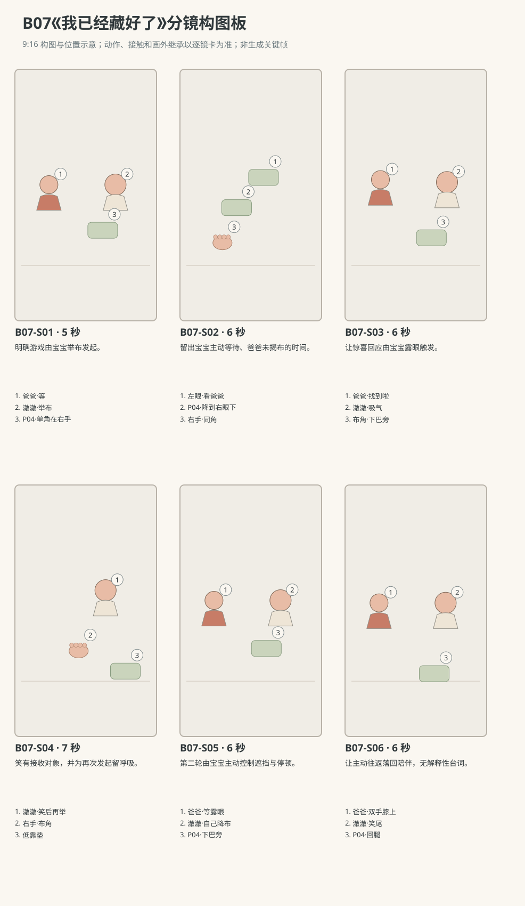

图示为构图位置示意；姿态、接触和画外继承以逐镜正文为准。

### 逐镜设计

#### B07-S01｜00—05 秒｜5 秒｜帧 [0, 120)

**镜头任务：**明确游戏由宝宝举布发起。

**景别、机位与构图：**南侧双人中景，爸爸左、澈澈右，布巾腿上、宝宝右手与两张脸同见，北沙发后景。

**摄影机与理由：**固定，让举布成为唯一信息变化。

**焦点：**宝宝右手布角与爸爸接收动作的眼神同时清楚。

**入态：**澈澈右手握P04一角，布主体搭腿，左手空放左腿；爸爸双手空放自己膝上，眼正抬向宝宝。

**动作与表演：**

- 2 秒：澈澈看爸爸一眼，右手抓稳布角；爸爸双手留膝上，接收到宝宝的目光。

- 3 秒：澈澈右手将布边慢慢举向右脸，爸爸看着布边上升，不伸手。

**声音：**薄布轻响，安静房间底声，无对白。

**出态：**布边在宝宝右眼下方、尚未挡眼，爸爸双手膝上看宝宝。

**切点与承接：**切近景继续同一次抬布，不重演从腿上拿起。

**连续性：**P04唯一且宝宝右手始终握同一角；左手空放腿，宝宝背后靠垫支撑画内可见。

**开始画面母稿：**

9:16竖幅原创三维生活动画，圆润而保留婴儿头身与关节尺度，皮肤柔和、棉布哑光、低反差暖中性色，动作有真实重量；无字幕、无标识、无额外人物。澈澈圆润脸颊、深棕眼、短黑绒发、额前一撮向右弯，穿奶油色棉连体衣，不作成人式算计表情。爸爸短黑发，穿砖陶色棉衬衫、深灰长裤，表情自然温和。本图为单一开始瞬间；裁切外人物不为展示外观强行入画。固定空间和材质：客厅北沙发、西窗、东入口；澈澈靠低靠垫在地垫北部朝南坐，爸爸西侧略朝东南。P04是唯一奶油布巾，布边由宝宝右手持同一角、只遮自己的右眼，左眼鼻口持续露出；布巾当前高度与所有手位只按本镜起态。爸爸不遮眼、不碰宝宝布巾，双手位置按本镜起态。相机南侧朝北，两张脸保持能看清所需可见眼睛的三分之四角度；宝宝右眼在画面偏左。西窗柔光从左来，布不遮住鼻口。构图范围：南侧双人中景，爸爸左、澈澈右，布巾腿上、宝宝右手与两张脸同见，北沙发后景。唯一此刻状态：澈澈右手握P04一角，布主体搭腿，左手空放左腿；爸爸双手空放自己膝上，眼正抬向宝宝。清晰度与焦点：宝宝右手布角与爸爸接收动作的眼神同时清楚。只呈现这个起态，不将后续动作阶段并列绘入。

**视频变化母稿：**

9:16竖幅原创三维生活动画，圆润而保留婴儿头身与关节尺度，皮肤柔和、棉布哑光、低反差暖中性色，动作有真实重量；无字幕、无标识、无额外人物。澈澈圆润脸颊、深棕眼、短黑绒发、额前一撮向右弯，穿奶油色棉连体衣，不作成人式算计表情。爸爸短黑发，穿砖陶色棉衬衫、深灰长裤，表情自然温和。本镜有效时长5秒，为一个连续镜头。固定空间和材质：客厅北沙发、西窗、东入口；澈澈靠低靠垫在地垫北部朝南坐，爸爸西侧略朝东南。P04是唯一奶油布巾，布边由宝宝右手持同一角、只遮自己的右眼，左眼鼻口持续露出；布巾当前高度与所有手位只按本镜起态。爸爸不遮眼、不碰宝宝布巾，双手位置按本镜起态。相机南侧朝北，两张脸保持能看清所需可见眼睛的三分之四角度；宝宝右眼在画面偏左。西窗柔光从左来，布不遮住鼻口。摄影构图：南侧双人中景，爸爸左、澈澈右，布巾腿上、宝宝右手与两张脸同见，北沙发后景。摄影机：固定，让举布成为唯一信息变化。焦点：宝宝右手布角与爸爸接收动作的眼神同时清楚。起态：澈澈右手握P04一角，布主体搭腿，左手空放左腿；爸爸双手空放自己膝上，眼正抬向宝宝。阶段1，2秒：澈澈看爸爸一眼，右手抓稳布角；爸爸双手留膝上，接收到宝宝的目光。阶段2，3秒：澈澈右手将布边慢慢举向右脸，爸爸看着布边上升，不伸手。准确声音：薄布轻响，安静房间底声，无对白。终态：布边在宝宝右眼下方、尚未挡眼，爸爸双手膝上看宝宝。接触和画外状态：P04唯一且宝宝右手始终握同一角；左手空放腿，宝宝背后靠垫支撑画内可见。在该终态切出，不在本镜内部额外切镜。

#### B07-S02｜05—11 秒｜6 秒｜帧 [120, 264)

**镜头任务：**留出宝宝主动等待、爸爸未揭布的时间。

**景别、机位与构图：**宝宝中近景，同轴南侧略西，右眼画面偏左、左眼和鼻口露出；爸爸脸只在画左边缘。

**摄影机与理由：**固定，保留左眼与成人的视线通路。

**焦点：**布边和露着的左眼清楚，不把布后右眼当作可见。

**入态：**布边在宝宝右眼下方、尚未挡眼，爸爸双手膝上看宝宝。

**动作与表演：**

- 2 秒：右手继续抬起一点，P04边缘只挡右眼；左眼看爸爸，鼻口露出。

- 2 秒：澈澈停住，露着的左眼仍看爸爸，嘴唇放松；爸爸安静等，不先笑出声。

- 2 秒：宝宝右肘略放松，布边开始下降到右眼下缘，右眼正重新露出。

**声音：**宝宝轻微呼吸、布擦右脸侧细响，无对白、无预先笑声。

**出态：**布边刚降到右眼下方，右眼已经露出；宝宝右手仍握布角，爸爸安静看着。

**切点与承接：**在露眼发生后切双人反应，成人回应不抢在触发前。

**连续性：**画内见布角被右手牵引、鼻口露出；左手腿上和靠垫画外继承，爸爸未触布。

**开始画面母稿：**

9:16竖幅原创三维生活动画，圆润而保留婴儿头身与关节尺度，皮肤柔和、棉布哑光、低反差暖中性色，动作有真实重量；无字幕、无标识、无额外人物。澈澈圆润脸颊、深棕眼、短黑绒发、额前一撮向右弯，穿奶油色棉连体衣，不作成人式算计表情。爸爸短黑发，穿砖陶色棉衬衫、深灰长裤，表情自然温和。本图为单一开始瞬间；裁切外人物不为展示外观强行入画。固定空间和材质：客厅北沙发、西窗、东入口；澈澈靠低靠垫在地垫北部朝南坐，爸爸西侧略朝东南。P04是唯一奶油布巾，布边由宝宝右手持同一角、只遮自己的右眼，左眼鼻口持续露出；布巾当前高度与所有手位只按本镜起态。爸爸不遮眼、不碰宝宝布巾，双手位置按本镜起态。相机南侧朝北，两张脸保持能看清所需可见眼睛的三分之四角度；宝宝右眼在画面偏左。西窗柔光从左来，布不遮住鼻口。构图范围：宝宝中近景，同轴南侧略西；布边停右眼下方，此刻双眼、鼻口都露出；爸爸脸只在画左边缘。唯一此刻状态：布边在宝宝右眼下方、尚未挡眼，爸爸双手膝上看宝宝。清晰度与焦点：布边、仍露出的右眼与看向爸爸的左眼清楚；布此刻尚未挡住右眼。只呈现这个起态，不将后续动作阶段并列绘入。

**视频变化母稿：**

9:16竖幅原创三维生活动画，圆润而保留婴儿头身与关节尺度，皮肤柔和、棉布哑光、低反差暖中性色，动作有真实重量；无字幕、无标识、无额外人物。澈澈圆润脸颊、深棕眼、短黑绒发、额前一撮向右弯，穿奶油色棉连体衣，不作成人式算计表情。爸爸短黑发，穿砖陶色棉衬衫、深灰长裤，表情自然温和。本镜有效时长6秒，为一个连续镜头。固定空间和材质：客厅北沙发、西窗、东入口；澈澈靠低靠垫在地垫北部朝南坐，爸爸西侧略朝东南。P04是唯一奶油布巾，布边由宝宝右手持同一角、只遮自己的右眼，左眼鼻口持续露出；布巾当前高度与所有手位只按本镜起态。爸爸不遮眼、不碰宝宝布巾，双手位置按本镜起态。相机南侧朝北，两张脸保持能看清所需可见眼睛的三分之四角度；宝宝右眼在画面偏左。西窗柔光从左来，布不遮住鼻口。摄影构图：宝宝中近景，同轴南侧略西，右眼画面偏左、左眼和鼻口露出；爸爸脸只在画左边缘。摄影机：固定，保留左眼与成人的视线通路。焦点：布边和露着的左眼清楚，不把布后右眼当作可见。起态：布边在宝宝右眼下方、尚未挡眼，爸爸双手膝上看宝宝。阶段1，2秒：右手继续抬起一点，P04边缘只挡右眼；左眼看爸爸，鼻口露出。阶段2，2秒：澈澈停住，露着的左眼仍看爸爸，嘴唇放松；爸爸安静等，不先笑出声。阶段3，2秒：宝宝右肘略放松，布边开始下降到右眼下缘，右眼正重新露出。准确声音：宝宝轻微呼吸、布擦右脸侧细响，无对白、无预先笑声。终态：布边刚降到右眼下方，右眼已经露出；宝宝右手仍握布角，爸爸安静看着。接触和画外状态：画内见布角被右手牵引、鼻口露出；左手腿上和靠垫画外继承，爸爸未触布。在该终态切出，不在本镜内部额外切镜。

#### B07-S03｜11—17 秒｜6 秒｜帧 [264, 408)

**镜头任务：**让惊喜回应由宝宝露眼触发。

**景别、机位与构图：**南侧双人中近景，爸爸左、宝宝右，成人眉眼和宝宝双眼、嘴部可读，布在宝宝下巴下。

**摄影机与理由：**固定，成人变化与宝宝接收留在同一镜。

**焦点：**两张脸在清楚范围，布角持有可读。

**入态：**布边刚降到右眼下方，右眼已经露出；宝宝右手仍握布角，爸爸安静看着。

**动作与表演：**

- 2 秒：澈澈把布继续降到下巴旁；爸爸确认右眼露出后轻抬眉、亮出笑脸。

- 2 秒：爸爸对宝宝轻声说“找到啦！”，嘴部清楚可见，双手仍膝上。

- 2 秒：澈澈看着爸爸变化的脸，先吸一小口气，嘴角张开，笑声即将出来。

**声音：**爸爸准确台词“找到啦！”，轻快但不高声；台词结束后宝宝短吸气，尚不叠加成人笑声。

**出态：**布在宝宝下巴旁，右手持角；宝宝看爸爸、嘴角张开且吸气已结束；爸爸表情惊喜。

**切点与承接：**切宝宝笑的覆盖，续接同一次吸气后的发声。

**连续性：**爸爸双手膝上画内可见，右手未遮自己脸；宝宝鼻口全露，左手腿上。

**开始画面母稿：**

9:16竖幅原创三维生活动画，圆润而保留婴儿头身与关节尺度，皮肤柔和、棉布哑光、低反差暖中性色，动作有真实重量；无字幕、无标识、无额外人物。澈澈圆润脸颊、深棕眼、短黑绒发、额前一撮向右弯，穿奶油色棉连体衣，不作成人式算计表情。爸爸短黑发，穿砖陶色棉衬衫、深灰长裤，表情自然温和。本图为单一开始瞬间；裁切外人物不为展示外观强行入画。固定空间和材质：客厅北沙发、西窗、东入口；澈澈靠低靠垫在地垫北部朝南坐，爸爸西侧略朝东南。P04是唯一奶油布巾，布边由宝宝右手持同一角、只遮自己的右眼，左眼鼻口持续露出；布巾当前高度与所有手位只按本镜起态。爸爸不遮眼、不碰宝宝布巾，双手位置按本镜起态。相机南侧朝北，两张脸保持能看清所需可见眼睛的三分之四角度；宝宝右眼在画面偏左。西窗柔光从左来，布不遮住鼻口。构图范围：南侧双人中近景，爸爸画左、宝宝画右；布边此刻刚在宝宝右眼下方、尚未降到下巴，右手握同角，成人双手膝上。唯一此刻状态：布边刚降到右眼下方，右眼已经露出；宝宝右手仍握布角，爸爸安静看着。清晰度与焦点：两张脸与刚露出的宝宝右眼、眼下布边和右手握点清楚。只呈现这个起态，不将后续动作阶段并列绘入。

**视频变化母稿：**

9:16竖幅原创三维生活动画，圆润而保留婴儿头身与关节尺度，皮肤柔和、棉布哑光、低反差暖中性色，动作有真实重量；无字幕、无标识、无额外人物。澈澈圆润脸颊、深棕眼、短黑绒发、额前一撮向右弯，穿奶油色棉连体衣，不作成人式算计表情。爸爸短黑发，穿砖陶色棉衬衫、深灰长裤，表情自然温和。本镜有效时长6秒，为一个连续镜头。固定空间和材质：客厅北沙发、西窗、东入口；澈澈靠低靠垫在地垫北部朝南坐，爸爸西侧略朝东南。P04是唯一奶油布巾，布边由宝宝右手持同一角、只遮自己的右眼，左眼鼻口持续露出；布巾当前高度与所有手位只按本镜起态。爸爸不遮眼、不碰宝宝布巾，双手位置按本镜起态。相机南侧朝北，两张脸保持能看清所需可见眼睛的三分之四角度；宝宝右眼在画面偏左。西窗柔光从左来，布不遮住鼻口。摄影构图：南侧双人中近景，爸爸左、宝宝右，成人眉眼和宝宝双眼、嘴部可读，布在宝宝下巴下。摄影机：固定，成人变化与宝宝接收留在同一镜。焦点：两张脸在清楚范围，布角持有可读。起态：布边刚降到右眼下方，右眼已经露出；宝宝右手仍握布角，爸爸安静看着。阶段1，2秒：澈澈把布继续降到下巴旁；爸爸确认右眼露出后轻抬眉、亮出笑脸。阶段2，2秒：爸爸对宝宝轻声说“找到啦！”，嘴部清楚可见，双手仍膝上。阶段3，2秒：澈澈看着爸爸变化的脸，先吸一小口气，嘴角张开，笑声即将出来。准确声音：爸爸准确台词“找到啦！”，轻快但不高声；台词结束后宝宝短吸气，尚不叠加成人笑声。终态：布在宝宝下巴旁，右手持角；宝宝看爸爸、嘴角张开且吸气已结束；爸爸表情惊喜。接触和画外状态：爸爸双手膝上画内可见，右手未遮自己脸；宝宝鼻口全露，左手腿上。在该终态切出，不在本镜内部额外切镜。

#### B07-S04｜17—24 秒｜7 秒｜帧 [408, 576)

**镜头任务：**笑有接收对象，并为再次发起留呼吸。

**景别、机位与构图：**宝宝中近景，同轴朝北略西，爸爸露出画左小半侧脸，布角与右手留在下缘。

**摄影机与理由：**固定，观察笑起、收尾和重新看布。

**焦点：**宝宝眼睛与嘴部清楚，右手布角不虚化消失。

**入态：**布在宝宝下巴旁，右手持角；宝宝看爸爸、嘴角张开且吸气已结束；爸爸表情惊喜。

**动作与表演：**

- 3 秒：澈澈笑出短短两声，肩膀随呼气轻动，背部仍有靠。

- 2 秒：笑尾落下，宝宝自然吸气，低眼看手里的布角；爸爸只轻微笑，不出声抢节奏。

- 2 秒：澈澈重新屈右肘举布，边缘升到右脸下方，视线又回到爸爸。

**声音：**自然婴儿短笑两声，随后安静吸气，薄布摩擦；无新对白。

**出态：**布边到宝宝右眼下方尚未遮住，右手仍握同角；宝宝已停笑，看爸爸准备再举。

**切点与承接：**切稍宽镜完成第二次遮右眼，不重复第一次笑。

**连续性：**爸爸仍在西侧且双手膝上画外继承；左手空腿上，P04右手牵引，身体没有前扑。

**开始画面母稿：**

9:16竖幅原创三维生活动画，圆润而保留婴儿头身与关节尺度，皮肤柔和、棉布哑光、低反差暖中性色，动作有真实重量；无字幕、无标识、无额外人物。澈澈圆润脸颊、深棕眼、短黑绒发、额前一撮向右弯，穿奶油色棉连体衣，不作成人式算计表情。爸爸短黑发，穿砖陶色棉衬衫、深灰长裤，表情自然温和。本图为单一开始瞬间；裁切外人物不为展示外观强行入画。固定空间和材质：客厅北沙发、西窗、东入口；澈澈靠低靠垫在地垫北部朝南坐，爸爸西侧略朝东南。P04是唯一奶油布巾，布边由宝宝右手持同一角、只遮自己的右眼，左眼鼻口持续露出；布巾当前高度与所有手位只按本镜起态。爸爸不遮眼、不碰宝宝布巾，双手位置按本镜起态。相机南侧朝北，两张脸保持能看清所需可见眼睛的三分之四角度；宝宝右眼在画面偏左。西窗柔光从左来，布不遮住鼻口。构图范围：宝宝中近景，同轴朝北略西，爸爸露出画左小半侧脸，布角与右手留在下缘。唯一此刻状态：布在宝宝下巴旁，右手持角；宝宝看爸爸、嘴角张开且吸气已结束；爸爸表情惊喜。清晰度与焦点：宝宝眼睛与嘴部清楚，右手布角不虚化消失。只呈现这个起态，不将后续动作阶段并列绘入。

**视频变化母稿：**

9:16竖幅原创三维生活动画，圆润而保留婴儿头身与关节尺度，皮肤柔和、棉布哑光、低反差暖中性色，动作有真实重量；无字幕、无标识、无额外人物。澈澈圆润脸颊、深棕眼、短黑绒发、额前一撮向右弯，穿奶油色棉连体衣，不作成人式算计表情。爸爸短黑发，穿砖陶色棉衬衫、深灰长裤，表情自然温和。本镜有效时长7秒，为一个连续镜头。固定空间和材质：客厅北沙发、西窗、东入口；澈澈靠低靠垫在地垫北部朝南坐，爸爸西侧略朝东南。P04是唯一奶油布巾，布边由宝宝右手持同一角、只遮自己的右眼，左眼鼻口持续露出；布巾当前高度与所有手位只按本镜起态。爸爸不遮眼、不碰宝宝布巾，双手位置按本镜起态。相机南侧朝北，两张脸保持能看清所需可见眼睛的三分之四角度；宝宝右眼在画面偏左。西窗柔光从左来，布不遮住鼻口。摄影构图：宝宝中近景，同轴朝北略西，爸爸露出画左小半侧脸，布角与右手留在下缘。摄影机：固定，观察笑起、收尾和重新看布。焦点：宝宝眼睛与嘴部清楚，右手布角不虚化消失。起态：布在宝宝下巴旁，右手持角；宝宝看爸爸、嘴角张开且吸气已结束；爸爸表情惊喜。阶段1，3秒：澈澈笑出短短两声，肩膀随呼气轻动，背部仍有靠。阶段2，2秒：笑尾落下，宝宝自然吸气，低眼看手里的布角；爸爸只轻微笑，不出声抢节奏。阶段3，2秒：澈澈重新屈右肘举布，边缘升到右脸下方，视线又回到爸爸。准确声音：自然婴儿短笑两声，随后安静吸气，薄布摩擦；无新对白。终态：布边到宝宝右眼下方尚未遮住，右手仍握同角；宝宝已停笑，看爸爸准备再举。接触和画外状态：爸爸仍在西侧且双手膝上画外继承；左手空腿上，P04右手牵引，身体没有前扑。在该终态切出，不在本镜内部额外切镜。

#### B07-S05｜24—30 秒｜6 秒｜帧 [576, 720)

**镜头任务：**第二轮由宝宝主动控制遮挡与停顿。

**景别、机位与构图：**南侧双人中景，爸爸左、宝宝右，手膝和两脸同见，布只在右脸侧。

**摄影机与理由：**固定，不靠切镜制造布突然遮上。

**焦点：**宝宝露着的左眼和爸爸等候的脸同时可读。

**入态：**布边到宝宝右眼下方尚未遮住，右手仍握同角；宝宝已停笑，看爸爸准备再举。

**动作与表演：**

- 2 秒：澈澈右手再抬一点，布边挡到右眼，左眼和鼻口始终露出。

- 2 秒：爸爸收住夸张表情，嘴角留一点笑，双手膝上安静等；宝宝小嘴先弯起来。

- 2 秒：宝宝右手自己下放，布边越过右眼；爸爸等眼睛露出才再抬眉。

**声音：**布巾擦动和宝宝带笑的短鼻息，无对白，爸爸不先发“找到”声。

**出态：**宝宝双眼已露出、布在下巴旁；爸爸眉毛再抬起、嘴角笑开，双手仍膝上。

**切点与承接：**以第二轮露眼后的反应接末镜。

**连续性：**P04右手不换持角，左手腿上；爸爸从未碰布或用手遮脸，宝宝鼻口始终无遮挡。

**开始画面母稿：**

9:16竖幅原创三维生活动画，圆润而保留婴儿头身与关节尺度，皮肤柔和、棉布哑光、低反差暖中性色，动作有真实重量；无字幕、无标识、无额外人物。澈澈圆润脸颊、深棕眼、短黑绒发、额前一撮向右弯，穿奶油色棉连体衣，不作成人式算计表情。爸爸短黑发，穿砖陶色棉衬衫、深灰长裤，表情自然温和。本图为单一开始瞬间；裁切外人物不为展示外观强行入画。固定空间和材质：客厅北沙发、西窗、东入口；澈澈靠低靠垫在地垫北部朝南坐，爸爸西侧略朝东南。P04是唯一奶油布巾，布边由宝宝右手持同一角、只遮自己的右眼，左眼鼻口持续露出；布巾当前高度与所有手位只按本镜起态。爸爸不遮眼、不碰宝宝布巾，双手位置按本镜起态。相机南侧朝北，两张脸保持能看清所需可见眼睛的三分之四角度；宝宝右眼在画面偏左。西窗柔光从左来，布不遮住鼻口。构图范围：南侧双人中景，爸爸左、宝宝右，手膝和两脸同见，布只在右脸侧。唯一此刻状态：布边到宝宝右眼下方尚未遮住，右手仍握同角；宝宝已停笑，看爸爸准备再举。清晰度与焦点：宝宝露着的左眼和爸爸等候的脸同时可读。只呈现这个起态，不将后续动作阶段并列绘入。

**视频变化母稿：**

9:16竖幅原创三维生活动画，圆润而保留婴儿头身与关节尺度，皮肤柔和、棉布哑光、低反差暖中性色，动作有真实重量；无字幕、无标识、无额外人物。澈澈圆润脸颊、深棕眼、短黑绒发、额前一撮向右弯，穿奶油色棉连体衣，不作成人式算计表情。爸爸短黑发，穿砖陶色棉衬衫、深灰长裤，表情自然温和。本镜有效时长6秒，为一个连续镜头。固定空间和材质：客厅北沙发、西窗、东入口；澈澈靠低靠垫在地垫北部朝南坐，爸爸西侧略朝东南。P04是唯一奶油布巾，布边由宝宝右手持同一角、只遮自己的右眼，左眼鼻口持续露出；布巾当前高度与所有手位只按本镜起态。爸爸不遮眼、不碰宝宝布巾，双手位置按本镜起态。相机南侧朝北，两张脸保持能看清所需可见眼睛的三分之四角度；宝宝右眼在画面偏左。西窗柔光从左来，布不遮住鼻口。摄影构图：南侧双人中景，爸爸左、宝宝右，手膝和两脸同见，布只在右脸侧。摄影机：固定，不靠切镜制造布突然遮上。焦点：宝宝露着的左眼和爸爸等候的脸同时可读。起态：布边到宝宝右眼下方尚未遮住，右手仍握同角；宝宝已停笑，看爸爸准备再举。阶段1，2秒：澈澈右手再抬一点，布边挡到右眼，左眼和鼻口始终露出。阶段2，2秒：爸爸收住夸张表情，嘴角留一点笑，双手膝上安静等；宝宝小嘴先弯起来。阶段3，2秒：宝宝右手自己下放，布边越过右眼；爸爸等眼睛露出才再抬眉。准确声音：布巾擦动和宝宝带笑的短鼻息，无对白，爸爸不先发“找到”声。终态：宝宝双眼已露出、布在下巴旁；爸爸眉毛再抬起、嘴角笑开，双手仍膝上。接触和画外状态：P04右手不换持角，左手腿上；爸爸从未碰布或用手遮脸，宝宝鼻口始终无遮挡。在该终态切出，不在本镜内部额外切镜。

#### B07-S06｜30—36 秒｜6 秒｜帧 [720, 864)

**镜头任务：**让主动往返落回陪伴，无解释性台词。

**景别、机位与构图：**南侧双人中景略宽，前景地垫，中景两人及布，后景北沙发。

**摄影机与理由：**固定，以布回腿与共同呼气作为收束。

**焦点：**宝宝笑脸、爸爸接收到笑的脸与布的落点保持可读。

**入态：**宝宝双眼已露出、布在下巴旁；爸爸眉毛再抬起、嘴角笑开，双手仍膝上。

**动作与表演：**

- 2 秒：澈澈看到爸爸表情再变，笑出一声，右手随放松继续下落。

- 2 秒：P04主体回搭宝宝腿面，右手仍握角；爸爸在宝宝笑声后呼气笑一下。

- 2 秒：两人笑尾收住，澈澈看看腿上布再看爸爸；爸爸保持小笑等着，手不伸过去。

**声音：**先宝宝一声短笑，后爸爸轻呼气笑，尾部留安静房间声；无对白。

**出态：**P04搭腿、宝宝右手握同角，左手空腿上；爸爸双手膝上，两人互看。

**切点与承接：**保留两秒呼吸尾，不新增第三次举布。

**连续性：**布落回腿完整画内可见，宝宝支撑和成人手膝可见；全片无盖鼻口、无布自动运动。

**开始画面母稿：**

9:16竖幅原创三维生活动画，圆润而保留婴儿头身与关节尺度，皮肤柔和、棉布哑光、低反差暖中性色，动作有真实重量；无字幕、无标识、无额外人物。澈澈圆润脸颊、深棕眼、短黑绒发、额前一撮向右弯，穿奶油色棉连体衣，不作成人式算计表情。爸爸短黑发，穿砖陶色棉衬衫、深灰长裤，表情自然温和。本图为单一开始瞬间；裁切外人物不为展示外观强行入画。固定空间和材质：客厅北沙发、西窗、东入口；澈澈靠低靠垫在地垫北部朝南坐，爸爸西侧略朝东南。P04是唯一奶油布巾，布边由宝宝右手持同一角、只遮自己的右眼，左眼鼻口持续露出；布巾当前高度与所有手位只按本镜起态。爸爸不遮眼、不碰宝宝布巾，双手位置按本镜起态。相机南侧朝北，两张脸保持能看清所需可见眼睛的三分之四角度；宝宝右眼在画面偏左。西窗柔光从左来，布不遮住鼻口。构图范围：南侧双人中景略宽，前景地垫，中景两人及布，后景北沙发。唯一此刻状态：宝宝双眼已露出、布在下巴旁；爸爸眉毛再抬起、嘴角笑开，双手仍膝上。清晰度与焦点：宝宝笑脸、爸爸接收到笑的脸与布的落点保持可读。只呈现这个起态，不将后续动作阶段并列绘入。

**视频变化母稿：**

9:16竖幅原创三维生活动画，圆润而保留婴儿头身与关节尺度，皮肤柔和、棉布哑光、低反差暖中性色，动作有真实重量；无字幕、无标识、无额外人物。澈澈圆润脸颊、深棕眼、短黑绒发、额前一撮向右弯，穿奶油色棉连体衣，不作成人式算计表情。爸爸短黑发，穿砖陶色棉衬衫、深灰长裤，表情自然温和。本镜有效时长6秒，为一个连续镜头。固定空间和材质：客厅北沙发、西窗、东入口；澈澈靠低靠垫在地垫北部朝南坐，爸爸西侧略朝东南。P04是唯一奶油布巾，布边由宝宝右手持同一角、只遮自己的右眼，左眼鼻口持续露出；布巾当前高度与所有手位只按本镜起态。爸爸不遮眼、不碰宝宝布巾，双手位置按本镜起态。相机南侧朝北，两张脸保持能看清所需可见眼睛的三分之四角度；宝宝右眼在画面偏左。西窗柔光从左来，布不遮住鼻口。摄影构图：南侧双人中景略宽，前景地垫，中景两人及布，后景北沙发。摄影机：固定，以布回腿与共同呼气作为收束。焦点：宝宝笑脸、爸爸接收到笑的脸与布的落点保持可读。起态：宝宝双眼已露出、布在下巴旁；爸爸眉毛再抬起、嘴角笑开，双手仍膝上。阶段1，2秒：澈澈看到爸爸表情再变，笑出一声，右手随放松继续下落。阶段2，2秒：P04主体回搭宝宝腿面，右手仍握角；爸爸在宝宝笑声后呼气笑一下。阶段3，2秒：两人笑尾收住，澈澈看看腿上布再看爸爸；爸爸保持小笑等着，手不伸过去。准确声音：先宝宝一声短笑，后爸爸轻呼气笑，尾部留安静房间声；无对白。终态：P04搭腿、宝宝右手握同角，左手空腿上；爸爸双手膝上，两人互看。接触和画外状态：布落回腿完整画内可见，宝宝支撑和成人手膝可见；全片无盖鼻口、无布自动运动。在该终态切出，不在本镜内部额外切镜。

### 声音与剪辑

安静客厅底声连续，布巾摩擦与手动升降同步；B07-S03只有爸爸“找到啦！”一句普通话，第一轮说完再接宝宝吸气与短笑。第二轮用爸爸眉眼回应，不重复配词。婴儿自然笑、呼吸和短鼻息，不配成人内心独白或音乐提示。

- 爸爸：找到啦！（B07-S03；本镜第3—4秒，宝宝右眼已经露出且布降到下巴旁后，轻快轻声对澈澈说；完整说完再让宝宝吸气笑，不复述于第二轮。）

### 连续性与试片

- 连续性：P04唯一且始终由宝宝右手握同一角；每次升降有右手牵引，爸爸双手均膝上，不揭布、不遮自己的眼。

- 连续性：宝宝只遮自己的右眼；左眼、鼻口全片露出，靠垫支持的坐姿不变。

- 连续性：第一轮宝宝自行降布露眼后，爸爸才能抬眉并说“找到啦！”，台词结束再接宝宝吸气笑；第二轮爸爸等待露眼再变表情。

- 连续性：第二轮由宝宝在笑尾收住后重新举布发起，不是成人拿布重复表演；末镜布回腿，未开始第三轮。

- 试片：S01—S02：能连续指出宝宝右手握同角、布从腿升至右眼再开始下降，若自动漂动、遮鼻口或多布即失败。

- 试片：S02—S04：右眼露出→成人惊喜和短句→宝宝吸气→笑声顺序可定位，若成人抢先反应或宝宝笑盖住台词则失败。

- 试片：S04—S06：宝宝停笑才再举布，第二轮成人仅等候并在露眼后回应；如复制第一轮完全相同声音或爸爸替宝宝拉布则失败。

- 试片：全片：右眼在正面画面偏左，左眼始终看得到爸爸；两人轴线和西窗左侧光不反转。

**媒体待验证：**已完成主动发起、可见遮挡、成人等待与笑声触发的文字设计；未绑定参考图、未生成媒体。待试片核对布角持有、右眼遮挡不侵鼻口、婴儿吸气笑尾、成人接收和第二轮时序。

---

## B08《嘴巴里的小马达》

**30 秒｜仰卧与翻身探索｜角色：澈澈、妈妈｜场景 L**

### 剧情正文

沙发前的地垫上，澈澈仰卧着，双手松松放在胸侧，妈妈坐在西窗旁折一块奶油布巾。澈澈嘴唇轻轻抿起，腮边绷了一点，忽然送出一个短短的“噗”。声音不大，连自己也像停住了；嘴唇松开，眼睛向下瞥，接着安静看着面前的光。妈妈折布的手慢下来，抬眼望过去，没有立刻模仿。澈澈呼吸一会儿，又把嘴唇抿回刚才的样子，试了一下，只漏出一小股气，没有那个声音。他停得更久，右手在胸侧抓了一把空气，嘴角仍认真地绷着。等气息顺过来，小嘴再轻轻合上，终于又送出一声湿软的“噗”。这次声音稍短，澈澈眼睛睁开一点，嘴角慢慢松下来，发出一声咿呀似的笑。妈妈手里的布巾已经折好，却还留在膝上；她看看宝宝的嘴，再看看他亮起来的眼睛，跟着轻轻笑一下。澈澈右手动动，嘴唇又微微拢起，像这场独自发现的小练习还没有结束。

### 导演与空间

**观察任务：**观察宝宝偶然发出噗声后的停听和再次尝试；乐趣来自自己制造声音，不靠成人解说或魔法。

**空间与光位：**客厅北沙发、西窗、东入口；澈澈仰卧中央地垫头北脚南，妈妈坐西侧，P04奶油布巾在妈妈膝上由双手轻扶。澈澈双手无物、放胸侧，不把任何东西放入口。南半区略高机位朝北，妈妈画左宝宝画右，西窗软光左入，嘴唇边缘与脸颊不过曝。

**人物表演：**澈澈嘴唇从松闭到轻抿，腮部只有小幅自然变化，短噗声之后停住听；妈妈原本折布，听见才抬眼停手，保持安静，不用重复拟声诱导宝宝完成任务。

### 节拍覆盖

- **B08-b1**：首次噗声引出宝宝和妈妈的停顿。 → B08-S01、B08-S02

- **B08-b2**：宝宝再次试口形，第一次只有气流；安静后发出相似短声。 → B08-S03、B08-S04

- **B08-b3**：宝宝笑意与妈妈轻回应结束，不把口部动作夸张成人笑话。 → B08-S05

### 分镜构图板

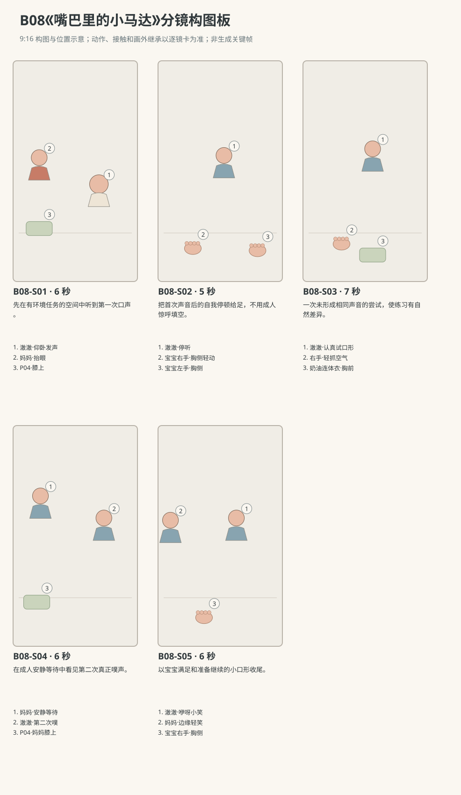

图示为构图位置示意；姿态、接触和画外继承以逐镜正文为准。

### 逐镜设计

#### B08-S01｜00—06 秒｜6 秒｜帧 [0, 144)

**镜头任务：**先在有环境任务的空间中听到第一次口声。

**景别、机位与构图：**南侧略高中景，宝宝仰卧画右、妈妈侧坐画左；宝宝头脸尺寸可读，妈妈双手折P04在膝。

**摄影机与理由：**固定，声音先从宝宝自然活动中出现，不先推嘴预告笑点。

**焦点：**宝宝脸与妈妈折布手在可读范围，口唇清楚。

**入态：**澈澈嘴唇松闭、双手胸侧无物，妈妈双手扶P04折叠。

**动作与表演：**

- 2 秒：澈澈嘴唇轻抿、腮部小幅绷起，双眼看上方；妈妈同时压好布巾最后一道折痕。

- 1 秒：宝宝呼一小口气，发出短湿软噗声。

- 3 秒：宝宝口唇松开后停住，妈妈听见才停下整理布巾、抬眼看他。

**声音：**第一声无词“噗”只在呼气瞬间，布声随后停；不加发动机拟音。

**出态：**宝宝嘴松开、表情专注，妈妈双手停布上且眼看宝宝。

**切点与承接：**切宝宝脸近景延续噗声后的停听，不重复发声。

**连续性：**画内宝宝口中无物、两手胸侧，妈妈布巾不靠宝宝口鼻。

**开始画面母稿：**

9:16竖幅原创三维生活动画，圆润但保留婴儿头身与关节尺度，皮肤柔和、棉布哑光、低反差暖中性色，动作遵循生活物理；无字幕、无标识、无额外人物。澈澈圆润脸颊、深棕眼、短黑绒发、额前一撮向右弯，穿奶油色棉连体衣，动作尚不完全熟练，神情专注而非成人式算计。妈妈深棕低马尾、雾蓝棉上衣、米色长裤，回应轻柔而不夸张。本图为单一开始瞬间，人物、物件与接触只取以下起态；裁切外人物不为展示外观强行入画。固定空间和材质：客厅北墙固定沙发、西窗、东侧走廊入口、中央奶油地垫。相机在南半区朝北，不越人物东西轴线；成人在西侧，主要双人视图成人画左、宝宝画右。西窗柔和漫射光由画左照入，暖墙反射填暗部，光位与房间方位固定。澈澈仰卧地垫、头北脚南，后脑肩背受垫承托，双手无物放胸侧、口中无物；妈妈西侧坐，P04奶油布巾在其膝上。眼睛嘴唇与成人手部动作状态以本镜起态为准，口部只是自然小幅活动。构图范围：南侧略高中景，宝宝仰卧画右、妈妈侧坐画左；宝宝头脸尺寸可读，妈妈双手折P04在膝。唯一此刻状态：澈澈嘴唇松闭、双手胸侧无物，妈妈双手扶P04折叠。清晰度与焦点：宝宝脸与妈妈折布手在可读范围，口唇清楚。画面停在这个瞬间，不将后续动作阶段并列绘入。

**视频变化母稿：**

9:16竖幅原创三维生活动画，圆润但保留婴儿头身与关节尺度，皮肤柔和、棉布哑光、低反差暖中性色，动作遵循生活物理；无字幕、无标识、无额外人物。澈澈圆润脸颊、深棕眼、短黑绒发、额前一撮向右弯，穿奶油色棉连体衣，动作尚不完全熟练，神情专注而非成人式算计。妈妈深棕低马尾、雾蓝棉上衣、米色长裤，回应轻柔而不夸张。本镜有效时长6秒，为一个连续镜头。固定空间和材质：客厅北墙固定沙发、西窗、东侧走廊入口、中央奶油地垫。相机在南半区朝北，不越人物东西轴线；成人在西侧，主要双人视图成人画左、宝宝画右。西窗柔和漫射光由画左照入，暖墙反射填暗部，光位与房间方位固定。澈澈仰卧地垫、头北脚南，后脑肩背受垫承托，双手无物放胸侧、口中无物；妈妈西侧坐，P04奶油布巾在其膝上。眼睛嘴唇与成人手部动作状态以本镜起态为准，口部只是自然小幅活动。摄影构图：南侧略高中景，宝宝仰卧画右、妈妈侧坐画左；宝宝头脸尺寸可读，妈妈双手折P04在膝。摄影机：固定，声音先从宝宝自然活动中出现，不先推嘴预告笑点。焦点：宝宝脸与妈妈折布手在可读范围，口唇清楚。起态：澈澈嘴唇松闭、双手胸侧无物，妈妈双手扶P04折叠。阶段1，2秒：澈澈嘴唇轻抿、腮部小幅绷起，双眼看上方；妈妈同时压好布巾最后一道折痕。阶段2，1秒：宝宝呼一小口气，发出短湿软噗声。阶段3，3秒：宝宝口唇松开后停住，妈妈听见才停下整理布巾、抬眼看他。准确声音：第一声无词“噗”只在呼气瞬间，布声随后停；不加发动机拟音。终态：宝宝嘴松开、表情专注，妈妈双手停布上且眼看宝宝。接触和画外状态：画内宝宝口中无物、两手胸侧，妈妈布巾不靠宝宝口鼻。在该终态切出，不在本镜内部额外切镜。

#### B08-S02｜06—11 秒｜5 秒｜帧 [144, 264)

**镜头任务：**把首次声音后的自我停顿给足，不用成人惊呼填空。

**景别、机位与构图：**南侧偏西面部近景，宝宝脸居中，胸侧双手在下缘；妈妈完全画外。

**摄影机与理由：**固定，保留微小眼神与唇缝，不做夸张口腔特写。

**焦点：**宝宝眼睛与嘴唇都清楚，景深不只锁唇。

**入态：**宝宝已发完首次噗声，嘴唇松开，双眼看上方，双手胸侧。

**动作与表演：**

- 2 秒：宝宝眼睛短暂向下瞥，嘴唇保持放松，不再发声。

- 3 秒：眼神回到上方，右手指在胸侧松抓一下，呼吸自然，脸颊恢复平常。

**声音：**五秒只有自然呼吸与室内底声，第一次噗声不在切后重播。

**出态：**宝宝表情平静、嘴唇松，右手松开，未再次发声。

**切点与承接：**留在同一观察轴切稍近嘴眼镜，为再次尝试提供细节。

**连续性：**画内无口中物、无夸张腮膨胀；妈妈停折布与P04膝上为画外继承。

**开始画面母稿：**

9:16竖幅原创三维生活动画，圆润但保留婴儿头身与关节尺度，皮肤柔和、棉布哑光、低反差暖中性色，动作遵循生活物理；无字幕、无标识、无额外人物。澈澈圆润脸颊、深棕眼、短黑绒发、额前一撮向右弯，穿奶油色棉连体衣，动作尚不完全熟练，神情专注而非成人式算计。妈妈深棕低马尾、雾蓝棉上衣、米色长裤，回应轻柔而不夸张。本图为单一开始瞬间，人物、物件与接触只取以下起态；裁切外人物不为展示外观强行入画。固定空间和材质：客厅北墙固定沙发、西窗、东侧走廊入口、中央奶油地垫。相机在南半区朝北，不越人物东西轴线；成人在西侧，主要双人视图成人画左、宝宝画右。西窗柔和漫射光由画左照入，暖墙反射填暗部，光位与房间方位固定。澈澈仰卧地垫、头北脚南，后脑肩背受垫承托，双手无物放胸侧、口中无物；妈妈西侧坐，P04奶油布巾在其膝上。眼睛嘴唇与成人手部动作状态以本镜起态为准，口部只是自然小幅活动。构图范围：南侧偏西面部近景，宝宝脸居中，胸侧双手在下缘；妈妈完全画外。唯一此刻状态：宝宝已发完首次噗声，嘴唇松开，双眼看上方，双手胸侧。清晰度与焦点：宝宝眼睛与嘴唇都清楚，景深不只锁唇。画面停在这个瞬间，不将后续动作阶段并列绘入。

**视频变化母稿：**

9:16竖幅原创三维生活动画，圆润但保留婴儿头身与关节尺度，皮肤柔和、棉布哑光、低反差暖中性色，动作遵循生活物理；无字幕、无标识、无额外人物。澈澈圆润脸颊、深棕眼、短黑绒发、额前一撮向右弯，穿奶油色棉连体衣，动作尚不完全熟练，神情专注而非成人式算计。妈妈深棕低马尾、雾蓝棉上衣、米色长裤，回应轻柔而不夸张。本镜有效时长5秒，为一个连续镜头。固定空间和材质：客厅北墙固定沙发、西窗、东侧走廊入口、中央奶油地垫。相机在南半区朝北，不越人物东西轴线；成人在西侧，主要双人视图成人画左、宝宝画右。西窗柔和漫射光由画左照入，暖墙反射填暗部，光位与房间方位固定。澈澈仰卧地垫、头北脚南，后脑肩背受垫承托，双手无物放胸侧、口中无物；妈妈西侧坐，P04奶油布巾在其膝上。眼睛嘴唇与成人手部动作状态以本镜起态为准，口部只是自然小幅活动。摄影构图：南侧偏西面部近景，宝宝脸居中，胸侧双手在下缘；妈妈完全画外。摄影机：固定，保留微小眼神与唇缝，不做夸张口腔特写。焦点：宝宝眼睛与嘴唇都清楚，景深不只锁唇。起态：宝宝已发完首次噗声，嘴唇松开，双眼看上方，双手胸侧。阶段1，2秒：宝宝眼睛短暂向下瞥，嘴唇保持放松，不再发声。阶段2，3秒：眼神回到上方，右手指在胸侧松抓一下，呼吸自然，脸颊恢复平常。准确声音：五秒只有自然呼吸与室内底声，第一次噗声不在切后重播。终态：宝宝表情平静、嘴唇松，右手松开，未再次发声。接触和画外状态：画内无口中物、无夸张腮膨胀；妈妈停折布与P04膝上为画外继承。在该终态切出，不在本镜内部额外切镜。

#### B08-S03｜11—18 秒｜7 秒｜帧 [264, 432)

**镜头任务：**一次未形成相同声音的尝试，使练习有自然差异。

**景别、机位与构图：**南侧略高的脸与上胸近景，嘴位于画中央偏下、双眼在上，右手下缘可见。

**摄影机与理由：**固定，不切入嘴里，不用镜头抖动模拟发声。

**焦点：**嘴唇开合与眼睛专注同清楚。

**入态：**澈澈嘴唇松开、呼吸平稳，双手无物胸侧。

**动作与表演：**

- 2 秒：宝宝轻抿嘴唇，腮部略收紧。

- 2 秒：一小股气流从唇缝漏出，只发轻“呼”，没有噗声；宝宝口唇随即松开。

- 3 秒：宝宝停住，右手在胸侧抓一下空气再松开，留足恢复呼吸的时间。

**声音：**一声很轻漏气“呼”，之后三秒呼吸留白；不后期补成第二次噗。

**出态：**宝宝嘴唇重新放松、右手松开，尚未笑。

**切点与承接：**切共享中近景，保留停顿同时让妈妈的等待可见。

**连续性：**画内口唇与右手动作同步但不拟人化成打节拍；妈妈无画外模仿声。

**开始画面母稿：**

9:16竖幅原创三维生活动画，圆润但保留婴儿头身与关节尺度，皮肤柔和、棉布哑光、低反差暖中性色，动作遵循生活物理；无字幕、无标识、无额外人物。澈澈圆润脸颊、深棕眼、短黑绒发、额前一撮向右弯，穿奶油色棉连体衣，动作尚不完全熟练，神情专注而非成人式算计。妈妈深棕低马尾、雾蓝棉上衣、米色长裤，回应轻柔而不夸张。本图为单一开始瞬间，人物、物件与接触只取以下起态；裁切外人物不为展示外观强行入画。固定空间和材质：客厅北墙固定沙发、西窗、东侧走廊入口、中央奶油地垫。相机在南半区朝北，不越人物东西轴线；成人在西侧，主要双人视图成人画左、宝宝画右。西窗柔和漫射光由画左照入，暖墙反射填暗部，光位与房间方位固定。澈澈仰卧地垫、头北脚南，后脑肩背受垫承托，双手无物放胸侧、口中无物；妈妈西侧坐，P04奶油布巾在其膝上。眼睛嘴唇与成人手部动作状态以本镜起态为准，口部只是自然小幅活动。构图范围：南侧略高的脸与上胸近景，嘴位于画中央偏下、双眼在上，右手下缘可见。唯一此刻状态：澈澈嘴唇松开、呼吸平稳，双手无物胸侧。清晰度与焦点：澈澈松开的嘴唇与专注眼睛同清楚，此刻保持平稳呼吸。画面停在这个瞬间，不将后续动作阶段并列绘入。

**视频变化母稿：**

9:16竖幅原创三维生活动画，圆润但保留婴儿头身与关节尺度，皮肤柔和、棉布哑光、低反差暖中性色，动作遵循生活物理；无字幕、无标识、无额外人物。澈澈圆润脸颊、深棕眼、短黑绒发、额前一撮向右弯，穿奶油色棉连体衣，动作尚不完全熟练，神情专注而非成人式算计。妈妈深棕低马尾、雾蓝棉上衣、米色长裤，回应轻柔而不夸张。本镜有效时长7秒，为一个连续镜头。固定空间和材质：客厅北墙固定沙发、西窗、东侧走廊入口、中央奶油地垫。相机在南半区朝北，不越人物东西轴线；成人在西侧，主要双人视图成人画左、宝宝画右。西窗柔和漫射光由画左照入，暖墙反射填暗部，光位与房间方位固定。澈澈仰卧地垫、头北脚南，后脑肩背受垫承托，双手无物放胸侧、口中无物；妈妈西侧坐，P04奶油布巾在其膝上。眼睛嘴唇与成人手部动作状态以本镜起态为准，口部只是自然小幅活动。摄影构图：南侧略高的脸与上胸近景，嘴位于画中央偏下、双眼在上，右手下缘可见。摄影机：固定，不切入嘴里，不用镜头抖动模拟发声。焦点：嘴唇开合与眼睛专注同清楚。起态：澈澈嘴唇松开、呼吸平稳，双手无物胸侧。阶段1，2秒：宝宝轻抿嘴唇，腮部略收紧。阶段2，2秒：一小股气流从唇缝漏出，只发轻“呼”，没有噗声；宝宝口唇随即松开。阶段3，3秒：宝宝停住，右手在胸侧抓一下空气再松开，留足恢复呼吸的时间。准确声音：一声很轻漏气“呼”，之后三秒呼吸留白；不后期补成第二次噗。终态：宝宝嘴唇重新放松、右手松开，尚未笑。接触和画外状态：画内口唇与右手动作同步但不拟人化成打节拍；妈妈无画外模仿声。在该终态切出，不在本镜内部额外切镜。

#### B08-S04｜18—24 秒｜6 秒｜帧 [432, 576)

**镜头任务：**在成人安静等待中看见第二次真正噗声。

**景别、机位与构图：**南侧共享中近景，宝宝脸在右、妈妈脸在左上，两人间留空，妈妈膝上布巾在下左。

**摄影机与理由：**固定，妈妈保持等待，使声音的主动归属清楚。

**焦点：**宝宝嘴眼为主体，妈妈反应清楚但不抢。

**入态：**宝宝刚恢复松口呼吸，妈妈双手停在已折好的P04上，看宝宝。

**动作与表演：**

- 2 秒：妈妈轻放松肩膀不出声，澈澈嘴唇缓慢重新轻合。

- 1 秒：宝宝呼气发出第二声较短的噗，妈妈看到嘴唇振动才嘴角微动。

- 3 秒：澈澈口唇松开，眼睛睁大一点，停听这次声音，妈妈继续等。

**声音：**第二声短湿软噗与唇动同步，前后自然呼吸；成人不发教学拟声。

**出态：**第二次噗已结束，宝宝眼睛更亮、嘴角刚要松开；妈妈仍安静。

**切点与承接：**切宝宝更近反应镜，接嘴角刚发生的变化而非重新发声。

**连续性：**画内声音由宝宝口产生，妈妈口未模仿；P04仍在妈妈膝上。

**开始画面母稿：**

9:16竖幅原创三维生活动画，圆润但保留婴儿头身与关节尺度，皮肤柔和、棉布哑光、低反差暖中性色，动作遵循生活物理；无字幕、无标识、无额外人物。澈澈圆润脸颊、深棕眼、短黑绒发、额前一撮向右弯，穿奶油色棉连体衣，动作尚不完全熟练，神情专注而非成人式算计。妈妈深棕低马尾、雾蓝棉上衣、米色长裤，回应轻柔而不夸张。本图为单一开始瞬间，人物、物件与接触只取以下起态；裁切外人物不为展示外观强行入画。固定空间和材质：客厅北墙固定沙发、西窗、东侧走廊入口、中央奶油地垫。相机在南半区朝北，不越人物东西轴线；成人在西侧，主要双人视图成人画左、宝宝画右。西窗柔和漫射光由画左照入，暖墙反射填暗部，光位与房间方位固定。澈澈仰卧地垫、头北脚南，后脑肩背受垫承托，双手无物放胸侧、口中无物；妈妈西侧坐，P04奶油布巾在其膝上。眼睛嘴唇与成人手部动作状态以本镜起态为准，口部只是自然小幅活动。构图范围：南侧共享中近景，宝宝脸在右、妈妈脸在左上，两人间留空，妈妈膝上布巾在下左。唯一此刻状态：宝宝刚恢复松口呼吸，妈妈双手停在已折好的P04上，看宝宝。清晰度与焦点：宝宝嘴眼为主体，妈妈反应清楚但不抢。画面停在这个瞬间，不将后续动作阶段并列绘入。

**视频变化母稿：**

9:16竖幅原创三维生活动画，圆润但保留婴儿头身与关节尺度，皮肤柔和、棉布哑光、低反差暖中性色，动作遵循生活物理；无字幕、无标识、无额外人物。澈澈圆润脸颊、深棕眼、短黑绒发、额前一撮向右弯，穿奶油色棉连体衣，动作尚不完全熟练，神情专注而非成人式算计。妈妈深棕低马尾、雾蓝棉上衣、米色长裤，回应轻柔而不夸张。本镜有效时长6秒，为一个连续镜头。固定空间和材质：客厅北墙固定沙发、西窗、东侧走廊入口、中央奶油地垫。相机在南半区朝北，不越人物东西轴线；成人在西侧，主要双人视图成人画左、宝宝画右。西窗柔和漫射光由画左照入，暖墙反射填暗部，光位与房间方位固定。澈澈仰卧地垫、头北脚南，后脑肩背受垫承托，双手无物放胸侧、口中无物；妈妈西侧坐，P04奶油布巾在其膝上。眼睛嘴唇与成人手部动作状态以本镜起态为准，口部只是自然小幅活动。摄影构图：南侧共享中近景，宝宝脸在右、妈妈脸在左上，两人间留空，妈妈膝上布巾在下左。摄影机：固定，妈妈保持等待，使声音的主动归属清楚。焦点：宝宝嘴眼为主体，妈妈反应清楚但不抢。起态：宝宝刚恢复松口呼吸，妈妈双手停在已折好的P04上，看宝宝。阶段1，2秒：妈妈轻放松肩膀不出声，澈澈嘴唇缓慢重新轻合。阶段2，1秒：宝宝呼气发出第二声较短的噗，妈妈看到嘴唇振动才嘴角微动。阶段3，3秒：澈澈口唇松开，眼睛睁大一点，停听这次声音，妈妈继续等。准确声音：第二声短湿软噗与唇动同步，前后自然呼吸；成人不发教学拟声。终态：第二次噗已结束，宝宝眼睛更亮、嘴角刚要松开；妈妈仍安静。接触和画外状态：画内声音由宝宝口产生，妈妈口未模仿；P04仍在妈妈膝上。在该终态切出，不在本镜内部额外切镜。

#### B08-S05｜24—30 秒｜6 秒｜帧 [576, 720)

**镜头任务：**以宝宝满足和准备继续的小口形收尾。

**景别、机位与构图：**南侧宝宝近景带妈妈半张脸画左边缘，宝宝右手胸侧与嘴眼同框。

**摄影机与理由：**固定，最后不推成夸张开心大笑，停在小发现里。

**焦点：**宝宝眼睛、嘴角与妈妈边缘微笑可读。

**入态：**宝宝第二次噗声刚结束、嘴角将松开，妈妈看他。

**动作与表演：**

- 2 秒：宝宝嘴角慢慢翘起来，发一声短咿呀笑，右手轻动。

- 2 秒：妈妈听见笑才轻笑一下，手不进画逗弄宝宝。

- 2 秒：宝宝笑声收住，嘴唇微拢但不再出第三声，眼神继续专注。

**声音：**宝宝短咿呀笑、成人轻笑气息各有先后，结尾留呼吸，不加马达声。

**出态：**宝宝嘴唇微拢准备继续，右手胸侧；成人仍坐西侧，布巾膝上。

**切点与承接：**在活动可继续的起势中结束，声音不机械循环。

**连续性：**画内嘴唇自然小幅动作；妈妈双手与P04画外膝上继承，宝宝不突然坐起。

**开始画面母稿：**

9:16竖幅原创三维生活动画，圆润但保留婴儿头身与关节尺度，皮肤柔和、棉布哑光、低反差暖中性色，动作遵循生活物理；无字幕、无标识、无额外人物。澈澈圆润脸颊、深棕眼、短黑绒发、额前一撮向右弯，穿奶油色棉连体衣，动作尚不完全熟练，神情专注而非成人式算计。妈妈深棕低马尾、雾蓝棉上衣、米色长裤，回应轻柔而不夸张。本图为单一开始瞬间，人物、物件与接触只取以下起态；裁切外人物不为展示外观强行入画。固定空间和材质：客厅北墙固定沙发、西窗、东侧走廊入口、中央奶油地垫。相机在南半区朝北，不越人物东西轴线；成人在西侧，主要双人视图成人画左、宝宝画右。西窗柔和漫射光由画左照入，暖墙反射填暗部，光位与房间方位固定。澈澈仰卧地垫、头北脚南，后脑肩背受垫承托，双手无物放胸侧、口中无物；妈妈西侧坐，P04奶油布巾在其膝上。眼睛嘴唇与成人手部动作状态以本镜起态为准，口部只是自然小幅活动。构图范围：南侧宝宝近景带妈妈半张脸画左边缘，宝宝右手胸侧与嘴眼同框。唯一此刻状态：宝宝第二次噗声刚结束、嘴角将松开，妈妈看他。清晰度与焦点：宝宝眼睛、嘴角与妈妈边缘微笑可读。画面停在这个瞬间，不将后续动作阶段并列绘入。

**视频变化母稿：**

9:16竖幅原创三维生活动画，圆润但保留婴儿头身与关节尺度，皮肤柔和、棉布哑光、低反差暖中性色，动作遵循生活物理；无字幕、无标识、无额外人物。澈澈圆润脸颊、深棕眼、短黑绒发、额前一撮向右弯，穿奶油色棉连体衣，动作尚不完全熟练，神情专注而非成人式算计。妈妈深棕低马尾、雾蓝棉上衣、米色长裤，回应轻柔而不夸张。本镜有效时长6秒，为一个连续镜头。固定空间和材质：客厅北墙固定沙发、西窗、东侧走廊入口、中央奶油地垫。相机在南半区朝北，不越人物东西轴线；成人在西侧，主要双人视图成人画左、宝宝画右。西窗柔和漫射光由画左照入，暖墙反射填暗部，光位与房间方位固定。澈澈仰卧地垫、头北脚南，后脑肩背受垫承托，双手无物放胸侧、口中无物；妈妈西侧坐，P04奶油布巾在其膝上。眼睛嘴唇与成人手部动作状态以本镜起态为准，口部只是自然小幅活动。摄影构图：南侧宝宝近景带妈妈半张脸画左边缘，宝宝右手胸侧与嘴眼同框。摄影机：固定，最后不推成夸张开心大笑，停在小发现里。焦点：宝宝眼睛、嘴角与妈妈边缘微笑可读。起态：宝宝第二次噗声刚结束、嘴角将松开，妈妈看他。阶段1，2秒：宝宝嘴角慢慢翘起来，发一声短咿呀笑，右手轻动。阶段2，2秒：妈妈听见笑才轻笑一下，手不进画逗弄宝宝。阶段3，2秒：宝宝笑声收住，嘴唇微拢但不再出第三声，眼神继续专注。准确声音：宝宝短咿呀笑、成人轻笑气息各有先后，结尾留呼吸，不加马达声。终态：宝宝嘴唇微拢准备继续，右手胸侧；成人仍坐西侧，布巾膝上。接触和画外状态：画内嘴唇自然小幅动作；妈妈双手与P04画外膝上继承，宝宝不突然坐起。在该终态切出，不在本镜内部额外切镜。

### 声音与剪辑

全片无语义对白、无旁白、无音乐；不以成人配音解释宝宝动机。连续室内安静底声保持声场，动作拟音按各镜接触同步，婴儿气息与咿呀使用自然短音而非成人语调。

正式台词：无；保留镜头声音中已写明的自然发声。

### 连续性与试片

- 连续性：全片口中无物、双手不入口；腮部只小幅变化，无鼓成气球或喷射特效。

- 连续性：有效口声为第一次噗、一次轻漏气呼、第二次噗，片尾不再完整重复噗。

- 连续性：妈妈只在听到后停手和微笑，不先行模仿；P04始终在其膝上。

- 试片：B08-S01—S04：两次噗和一次漏气对应准确嘴唇阶段，若全部替换同一口声或口唇不动已响声则失败。

- 试片：B08-S02—S05：宝宝停听、再次尝试、笑意有可见区别；若靠成人旁白解释动机或夸张成人奸笑才成立则失败。

**媒体待验证：**待声音小样核对自然婴儿口声、呼吸留白与嘴型；待视频确认嘴唇拓扑及慢节奏可看性，均尚无媒体证据。

---

## B09《这个声音，再一下》

**36 秒｜坐姿与手部互动｜角色：澈澈、妈妈｜场景 L**

### 剧情正文

西窗边的地垫上，澈澈坐得有靠，一本蓝绿布书摊在腿上，妈妈在西侧陪着。宝宝左手压住普通绿色页，右手把另一侧带黄色宽边的软页抓皱，清脆的布响立刻冒出来。手一松，声音也停，他低头听了一会儿，又抓一下，这次短一点。妈妈看到书页松开，像平常那样伸出右手，将响纸页由宝宝右侧翻过书脊，盖到另一边，露出下一张普通布页。澈澈的眼睛跟着那条黄色宽边走，右手越过书脊，摸到刚翻过去的页边。妈妈发现小手抓住了，便撤开自己的右手。宝宝慢慢将软页拉回，页角先皱起，再整个翻回原来的位置，左手始终稳着书。黄色宽边重新朝上，澈澈放开抓页的手，改用整只右掌压下去；“哗啦”一声比刚才长一些，他的肩膀轻轻动了一下，抬头看看妈妈，接着笑开。妈妈也笑，手仍留在膝边。宝宝再低头，掌心还搭在这页上，没有急着看下一幅图。

### 导演与空间

**观察任务：**让响纸页的声音与翻页后的追回形成可见因果；宝宝寻找的是同一物件带来的感觉，不安排成人考验。

**空间与光位：**客厅北沙发、西窗、东入口；澈澈靠稳固低靠垫朝南坐，妈妈西侧。P05蓝绿布书打开平放宝宝双腿，书脊朝南北；带芥末宽边的响纸页在宝宝右手侧即画左，普通绿色页画右。响纸页可由画左越书脊翻向画右，宝宝可在腿上可达范围将同一页翻回。宝宝左掌起始稳普通页外侧、右掌在响纸页上，妈妈双手空放膝。南侧机位、西窗左入，不从北侧反打。

**人物表演：**宝宝先小幅整掌抓揉响纸页，停听后重复；妈妈依平常陪读任务翻页，见宝宝抓住旧页便松手等候；宝宝右手只抓宽页边，不用精细分薄页动作，坐姿始终有靠。

### 节拍覆盖

- **B09-b1**：同一响纸页被抓揉并停听，书与左右手归属明确。 → B09-S01、B09-S02

- **B09-b2**：妈妈翻响纸页，宝宝跟踪宽边并抓住翻回，成人在抓稳后退手。 → B09-S03、B09-S04

- **B09-b3**：整掌按压更长布响引出笑，声音与触摸关系回收。 → B09-S05、B09-S06

### 分镜构图板

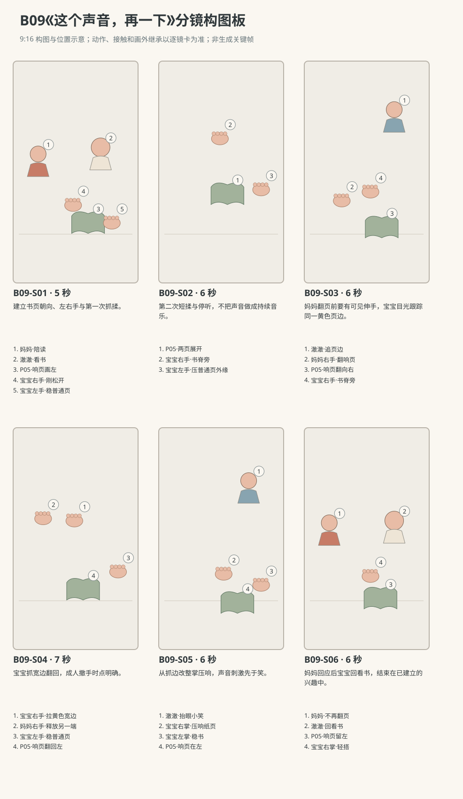

图示为构图位置示意；姿态、接触和画外继承以逐镜正文为准。

### 逐镜设计

#### B09-S01｜00—05 秒｜5 秒｜帧 [0, 120)

**镜头任务：**建立书页朝向、左右手与第一次抓揉。

**景别、机位与构图：**南侧略高双人中景，宝宝画右、妈妈画左，书摊腿上占下半，响纸芥末边页画左、普通页画右。

**摄影机与理由：**固定，第一声源和宝宝手动作同框。

**焦点：**书页、两只宝宝手和宝宝低头目光清楚。

**入态：**宝宝左掌稳普通页外侧，右掌搭响纸页，妈妈两手空膝上。

**动作与表演：**

- 2 秒：宝宝右拇指与四指把响纸页中段抓出松皱，页内短脆布响随抓揉同时发出。

- 1 秒：宝宝手停住，响纸声随之收住。

- 2 秒：宝宝右手慢慢松开，目光仍落响纸页，妈妈看他等候。

**声音：**短响纸声与抓揉同步，松手后归静，房间底声不断。

**出态：**响纸页已松开但有浅皱，宝宝右手轻搭其上，左掌稳普通页。

**切点与承接：**切书与双手近景，接第一次停听后的状态。

**连续性：**画内书开向、左掌稳书与右手声源可见；妈妈无翻页动作。

**开始画面母稿：**

9:16竖幅原创三维生活动画，圆润但保留婴儿头身与关节尺度，皮肤柔和、棉布哑光、低反差暖中性色，动作遵循生活物理；无字幕、无标识、无额外人物。澈澈圆润脸颊、深棕眼、短黑绒发、额前一撮向右弯，穿奶油色棉连体衣，动作尚不完全熟练，神情专注而非成人式算计。妈妈深棕低马尾、雾蓝棉上衣、米色长裤，回应轻柔而不夸张。本图为单一开始瞬间，人物、物件与接触只取以下起态；裁切外人物不为展示外观强行入画。固定空间和材质：客厅北墙固定沙发、西窗、东侧走廊入口、中央奶油地垫。相机在南半区朝北，不越人物东西轴线；成人在西侧，主要双人视图成人画左、宝宝画右。西窗柔和漫射光由画左照入，暖墙反射填暗部，光位与房间方位固定。澈澈靠低靠垫朝南坐，妈妈西侧。P05蓝绿布书平放宝宝双腿，书脊南北；带芥末宽边的同一响纸页与普通绿色页可辨，页边宽软、两端缝牢。宝宝左掌稳普通页外侧，右手操作响纸页；页面当前所在侧、成人是否持页均以本镜起态为准，不以全场最初开书方向覆盖后续翻页状态。构图范围：南侧略高双人中景，宝宝画右、妈妈画左，书摊腿上占下半，响纸芥末边页画左、普通页画右。唯一此刻状态：宝宝左掌稳普通页外侧，右掌搭响纸页，妈妈两手空膝上。清晰度与焦点：书页、两只宝宝手和宝宝低头目光清楚。画面停在这个瞬间，不将后续动作阶段并列绘入。

**视频变化母稿：**

9:16竖幅原创三维生活动画，圆润但保留婴儿头身与关节尺度，皮肤柔和、棉布哑光、低反差暖中性色，动作遵循生活物理；无字幕、无标识、无额外人物。澈澈圆润脸颊、深棕眼、短黑绒发、额前一撮向右弯，穿奶油色棉连体衣，动作尚不完全熟练，神情专注而非成人式算计。妈妈深棕低马尾、雾蓝棉上衣、米色长裤，回应轻柔而不夸张。本镜有效时长5秒，为一个连续镜头。固定空间和材质：客厅北墙固定沙发、西窗、东侧走廊入口、中央奶油地垫。相机在南半区朝北，不越人物东西轴线；成人在西侧，主要双人视图成人画左、宝宝画右。西窗柔和漫射光由画左照入，暖墙反射填暗部，光位与房间方位固定。澈澈靠低靠垫朝南坐，妈妈西侧。P05蓝绿布书平放宝宝双腿，书脊南北；带芥末宽边的同一响纸页与普通绿色页可辨，页边宽软、两端缝牢。宝宝左掌稳普通页外侧，右手操作响纸页；页面当前所在侧、成人是否持页均以本镜起态为准，不以全场最初开书方向覆盖后续翻页状态。摄影构图：南侧略高双人中景，宝宝画右、妈妈画左，书摊腿上占下半，响纸芥末边页画左、普通页画右。摄影机：固定，第一声源和宝宝手动作同框。焦点：书页、两只宝宝手和宝宝低头目光清楚。起态：宝宝左掌稳普通页外侧，右掌搭响纸页，妈妈两手空膝上。阶段1，2秒：宝宝右拇指与四指把响纸页中段抓出松皱，页内短脆布响随抓揉同时发出。阶段2，1秒：宝宝手停住，响纸声随之收住。阶段3，2秒：宝宝右手慢慢松开，目光仍落响纸页，妈妈看他等候。准确声音：短响纸声与抓揉同步，松手后归静，房间底声不断。终态：响纸页已松开但有浅皱，宝宝右手轻搭其上，左掌稳普通页。接触和画外状态：画内书开向、左掌稳书与右手声源可见；妈妈无翻页动作。在该终态切出，不在本镜内部额外切镜。

#### B09-S02｜05—11 秒｜6 秒｜帧 [120, 264)

**镜头任务：**第二次短揉与停听，不把声音做成持续音乐。

**景别、机位与构图：**南侧略俯书页手部近景，书脊中间、黄色边响页画左、绿色普通页画右，宝宝两手完整入画。

**摄影机与理由：**固定，页皱、放开与静音停顿持续同框。

**焦点：**右手抓握处和左手稳书处清楚，页边颜色可辨。

**入态：**右手松搭响纸页，左掌稳普通页外侧；妈妈手画外膝上。

**动作与表演：**

- 2 秒：宝宝等了一会儿，右掌再次合拢抓揉响纸页，幅度比第一次小，短响与这次抓揉同步发出。

- 1 秒：右手松开，短响随之收住。

- 3 秒：宝宝右手退到书脊旁放松，响纸页展回，留三秒安静。

**声音：**一次较短布响后明确留白，不循环响纸采样铺满全镜。

**出态：**宝宝右手空搭书脊旁，响纸页画左可翻，左掌仍稳画右普通页。

**切点与承接：**切妈妈入手的共享中近景，接页面已经松开的条件。

**连续性：**画内仅宝宝触书；右手已离响页中段，成人翻页不会穿过宝宝握点。

**开始画面母稿：**

9:16竖幅原创三维生活动画，圆润但保留婴儿头身与关节尺度，皮肤柔和、棉布哑光、低反差暖中性色，动作遵循生活物理；无字幕、无标识、无额外人物。澈澈圆润脸颊、深棕眼、短黑绒发、额前一撮向右弯，穿奶油色棉连体衣，动作尚不完全熟练，神情专注而非成人式算计。妈妈深棕低马尾、雾蓝棉上衣、米色长裤，回应轻柔而不夸张。本图为单一开始瞬间，人物、物件与接触只取以下起态；裁切外人物不为展示外观强行入画。固定空间和材质：客厅北墙固定沙发、西窗、东侧走廊入口、中央奶油地垫。相机在南半区朝北，不越人物东西轴线；成人在西侧，主要双人视图成人画左、宝宝画右。西窗柔和漫射光由画左照入，暖墙反射填暗部，光位与房间方位固定。澈澈靠低靠垫朝南坐，妈妈西侧。P05蓝绿布书平放宝宝双腿，书脊南北；带芥末宽边的同一响纸页与普通绿色页可辨，页边宽软、两端缝牢。宝宝左掌稳普通页外侧，右手操作响纸页；页面当前所在侧、成人是否持页均以本镜起态为准，不以全场最初开书方向覆盖后续翻页状态。构图范围：南侧略俯书页手部近景，书脊中间、黄色边响页画左、绿色普通页画右，宝宝两手完整入画。唯一此刻状态：右手松搭响纸页，左掌稳普通页外侧；妈妈手画外膝上。清晰度与焦点：右手抓握处和左手稳书处清楚，页边颜色可辨。画面停在这个瞬间，不将后续动作阶段并列绘入。

**视频变化母稿：**

9:16竖幅原创三维生活动画，圆润但保留婴儿头身与关节尺度，皮肤柔和、棉布哑光、低反差暖中性色，动作遵循生活物理；无字幕、无标识、无额外人物。澈澈圆润脸颊、深棕眼、短黑绒发、额前一撮向右弯，穿奶油色棉连体衣，动作尚不完全熟练，神情专注而非成人式算计。妈妈深棕低马尾、雾蓝棉上衣、米色长裤，回应轻柔而不夸张。本镜有效时长6秒，为一个连续镜头。固定空间和材质：客厅北墙固定沙发、西窗、东侧走廊入口、中央奶油地垫。相机在南半区朝北，不越人物东西轴线；成人在西侧，主要双人视图成人画左、宝宝画右。西窗柔和漫射光由画左照入，暖墙反射填暗部，光位与房间方位固定。澈澈靠低靠垫朝南坐，妈妈西侧。P05蓝绿布书平放宝宝双腿，书脊南北；带芥末宽边的同一响纸页与普通绿色页可辨，页边宽软、两端缝牢。宝宝左掌稳普通页外侧，右手操作响纸页；页面当前所在侧、成人是否持页均以本镜起态为准，不以全场最初开书方向覆盖后续翻页状态。摄影构图：南侧略俯书页手部近景，书脊中间、黄色边响页画左、绿色普通页画右，宝宝两手完整入画。摄影机：固定，页皱、放开与静音停顿持续同框。焦点：右手抓握处和左手稳书处清楚，页边颜色可辨。起态：右手松搭响纸页，左掌稳普通页外侧；妈妈手画外膝上。阶段1，2秒：宝宝等了一会儿，右掌再次合拢抓揉响纸页，幅度比第一次小，短响与这次抓揉同步发出。阶段2，1秒：右手松开，短响随之收住。阶段3，3秒：宝宝右手退到书脊旁放松，响纸页展回，留三秒安静。准确声音：一次较短布响后明确留白，不循环响纸采样铺满全镜。终态：宝宝右手空搭书脊旁，响纸页画左可翻，左掌仍稳画右普通页。接触和画外状态：画内仅宝宝触书；右手已离响页中段，成人翻页不会穿过宝宝握点。在该终态切出，不在本镜内部额外切镜。

#### B09-S03｜11—17 秒｜6 秒｜帧 [264, 408)

**镜头任务：**妈妈翻页前要有可见伸手，宝宝目光跟踪同一黄色页边。

**景别、机位与构图：**南侧宝宝与妈妈手中近景，宝宝脸上、书下；妈妈右手从画左靠近响纸页外缘。

**摄影机与理由：**固定，不剪去翻页跨书脊路径。

**焦点：**黄色页边、成人右手与宝宝眼睛清楚。

**入态：**响纸页画左松开，宝宝右手在书脊旁，左掌稳普通页外缘，妈妈右手从膝旁将抬。

**动作与表演：**

- 2 秒：妈妈右手从膝旁伸至黄色宽页边，指腹轻握外缘。

- 2 秒：妈妈将响纸页抬起、由画左越书脊翻向画右，宝宝眼睛跟页边移动。

- 2 秒：响纸页落在画右普通页内侧，黄色宽边仍可见，妈妈右手仍轻扶页边。

**声音：**一次翻页软响，响纸随弯折有轻声但不等同整掌压响；无讲故事对白。

**出态：**响纸页已翻到画右，妈妈右手轻扶；宝宝右手空在书脊旁、目光看黄色边。

**切点与承接：**切手部近景接宝宝右手向已翻页边靠近。

**连续性：**画内同一黄色宽边随页左到右，宝宝左掌在普通页外缘未被压进翻页内；妈妈右手持页不持宝宝手。

**开始画面母稿：**

9:16竖幅原创三维生活动画，圆润但保留婴儿头身与关节尺度，皮肤柔和、棉布哑光、低反差暖中性色，动作遵循生活物理；无字幕、无标识、无额外人物。澈澈圆润脸颊、深棕眼、短黑绒发、额前一撮向右弯，穿奶油色棉连体衣，动作尚不完全熟练，神情专注而非成人式算计。妈妈深棕低马尾、雾蓝棉上衣、米色长裤，回应轻柔而不夸张。本图为单一开始瞬间，人物、物件与接触只取以下起态；裁切外人物不为展示外观强行入画。固定空间和材质：客厅北墙固定沙发、西窗、东侧走廊入口、中央奶油地垫。相机在南半区朝北，不越人物东西轴线；成人在西侧，主要双人视图成人画左、宝宝画右。西窗柔和漫射光由画左照入，暖墙反射填暗部，光位与房间方位固定。澈澈靠低靠垫朝南坐，妈妈西侧。P05蓝绿布书平放宝宝双腿，书脊南北；带芥末宽边的同一响纸页与普通绿色页可辨，页边宽软、两端缝牢。宝宝左掌稳普通页外侧，右手操作响纸页；页面当前所在侧、成人是否持页均以本镜起态为准，不以全场最初开书方向覆盖后续翻页状态。构图范围：南侧宝宝与妈妈手中近景，宝宝脸上、书下；妈妈右手仍在画左膝旁，响纸页外缘前保留伸手通道。唯一此刻状态：响纸页画左松开，宝宝右手在书脊旁，左掌稳普通页外缘，妈妈右手从膝旁将抬。清晰度与焦点：黄色页边、成人右手与宝宝眼睛清楚。画面停在这个瞬间，不将后续动作阶段并列绘入。

**视频变化母稿：**

9:16竖幅原创三维生活动画，圆润但保留婴儿头身与关节尺度，皮肤柔和、棉布哑光、低反差暖中性色，动作遵循生活物理；无字幕、无标识、无额外人物。澈澈圆润脸颊、深棕眼、短黑绒发、额前一撮向右弯，穿奶油色棉连体衣，动作尚不完全熟练，神情专注而非成人式算计。妈妈深棕低马尾、雾蓝棉上衣、米色长裤，回应轻柔而不夸张。本镜有效时长6秒，为一个连续镜头。固定空间和材质：客厅北墙固定沙发、西窗、东侧走廊入口、中央奶油地垫。相机在南半区朝北，不越人物东西轴线；成人在西侧，主要双人视图成人画左、宝宝画右。西窗柔和漫射光由画左照入，暖墙反射填暗部，光位与房间方位固定。澈澈靠低靠垫朝南坐，妈妈西侧。P05蓝绿布书平放宝宝双腿，书脊南北；带芥末宽边的同一响纸页与普通绿色页可辨，页边宽软、两端缝牢。宝宝左掌稳普通页外侧，右手操作响纸页；页面当前所在侧、成人是否持页均以本镜起态为准，不以全场最初开书方向覆盖后续翻页状态。摄影构图：南侧宝宝与妈妈手中近景，宝宝脸上、书下；妈妈右手从画左靠近响纸页外缘。摄影机：固定，不剪去翻页跨书脊路径。焦点：黄色页边、成人右手与宝宝眼睛清楚。起态：响纸页画左松开，宝宝右手在书脊旁，左掌稳普通页外缘，妈妈右手从膝旁将抬。阶段1，2秒：妈妈右手从膝旁伸至黄色宽页边，指腹轻握外缘。阶段2，2秒：妈妈将响纸页抬起、由画左越书脊翻向画右，宝宝眼睛跟页边移动。阶段3，2秒：响纸页落在画右普通页内侧，黄色宽边仍可见，妈妈右手仍轻扶页边。准确声音：一次翻页软响，响纸随弯折有轻声但不等同整掌压响；无讲故事对白。终态：响纸页已翻到画右，妈妈右手轻扶；宝宝右手空在书脊旁、目光看黄色边。接触和画外状态：画内同一黄色宽边随页左到右，宝宝左掌在普通页外缘未被压进翻页内；妈妈右手持页不持宝宝手。在该终态切出，不在本镜内部额外切镜。

#### B09-S04｜17—24 秒｜7 秒｜帧 [408, 576)

**镜头任务：**宝宝抓宽边翻回，成人撤手时点明确。

**景别、机位与构图：**南侧高位手部近景，书脊中、黄色页边位于画右内侧，宝宝左掌仍压最右普通页外缘，宝宝右手可跨到页边。

**摄影机与理由：**固定，完整展示抓到、成人放开、翻回三段。

**焦点：**宝宝右手与成人右手在不同页边段的接触清楚。

**入态：**妈妈右手扶黄色边靠书脊端，宝宝右手空在书脊左侧、左掌稳书。

**动作与表演：**

- 2 秒：宝宝右手越过书脊，整掌抓住黄色宽边的中段，妈妈右手仍轻扶另一端。

- 1 秒：妈妈确认宝宝抓住页边后松开撤出，右手回膝。

- 3 秒：宝宝右手将响纸页从画右拉起，越过书脊翻回画左，左掌保持书不滑。

- 1 秒：响纸页落回画左，黄色边朝上，宝宝右手仍抓边。

**声音：**翻页与响纸折动细响连续，页落腿上一声软擦；妈妈无催促声。

**出态：**响纸页画左恢复原位，宝宝右手抓黄色边，妈妈右手已退膝。

**切点与承接：**切宝宝脸与书同框，接翻回后的右手换成整掌按压。

**连续性：**画内两人先双持不同段再成人释放，宝宝右手独自翻回；左掌不与右手交换，书无瞬移。

**开始画面母稿：**

9:16竖幅原创三维生活动画，圆润但保留婴儿头身与关节尺度，皮肤柔和、棉布哑光、低反差暖中性色，动作遵循生活物理；无字幕、无标识、无额外人物。澈澈圆润脸颊、深棕眼、短黑绒发、额前一撮向右弯，穿奶油色棉连体衣，动作尚不完全熟练，神情专注而非成人式算计。妈妈深棕低马尾、雾蓝棉上衣、米色长裤，回应轻柔而不夸张。本图为单一开始瞬间，人物、物件与接触只取以下起态；裁切外人物不为展示外观强行入画。固定空间和材质：客厅北墙固定沙发、西窗、东侧走廊入口、中央奶油地垫。相机在南半区朝北，不越人物东西轴线；成人在西侧，主要双人视图成人画左、宝宝画右。西窗柔和漫射光由画左照入，暖墙反射填暗部，光位与房间方位固定。澈澈靠低靠垫朝南坐，妈妈西侧。P05蓝绿布书平放宝宝双腿，书脊南北；带芥末宽边的同一响纸页与普通绿色页可辨，页边宽软、两端缝牢。宝宝左掌稳普通页外侧，右手操作响纸页；页面当前所在侧、成人是否持页均以本镜起态为准，不以全场最初开书方向覆盖后续翻页状态。构图范围：南侧高位手部近景，书脊中、黄色页边位于画右内侧，宝宝左掌仍压最右普通页外缘，宝宝右手可跨到页边。唯一此刻状态：妈妈右手扶黄色边靠书脊端，宝宝右手空在书脊左侧、左掌稳书。清晰度与焦点：妈妈右手在黄色页边靠书脊端的握点、宝宝空右手与页边之间的距离清楚；宝宝右手此刻尚未触页。画面停在这个瞬间，不将后续动作阶段并列绘入。

**视频变化母稿：**

9:16竖幅原创三维生活动画，圆润但保留婴儿头身与关节尺度，皮肤柔和、棉布哑光、低反差暖中性色，动作遵循生活物理；无字幕、无标识、无额外人物。澈澈圆润脸颊、深棕眼、短黑绒发、额前一撮向右弯，穿奶油色棉连体衣，动作尚不完全熟练，神情专注而非成人式算计。妈妈深棕低马尾、雾蓝棉上衣、米色长裤，回应轻柔而不夸张。本镜有效时长7秒，为一个连续镜头。固定空间和材质：客厅北墙固定沙发、西窗、东侧走廊入口、中央奶油地垫。相机在南半区朝北，不越人物东西轴线；成人在西侧，主要双人视图成人画左、宝宝画右。西窗柔和漫射光由画左照入，暖墙反射填暗部，光位与房间方位固定。澈澈靠低靠垫朝南坐，妈妈西侧。P05蓝绿布书平放宝宝双腿，书脊南北；带芥末宽边的同一响纸页与普通绿色页可辨，页边宽软、两端缝牢。宝宝左掌稳普通页外侧，右手操作响纸页；页面当前所在侧、成人是否持页均以本镜起态为准，不以全场最初开书方向覆盖后续翻页状态。摄影构图：南侧高位手部近景，书脊中、黄色页边位于画右内侧，宝宝左掌仍压最右普通页外缘，宝宝右手可跨到页边。摄影机：固定，完整展示抓到、成人放开、翻回三段。焦点：宝宝右手与成人右手在不同页边段的接触清楚。起态：妈妈右手扶黄色边靠书脊端，宝宝右手空在书脊左侧、左掌稳书。阶段1，2秒：宝宝右手越过书脊，整掌抓住黄色宽边的中段，妈妈右手仍轻扶另一端。阶段2，1秒：妈妈确认宝宝抓住页边后松开撤出，右手回膝。阶段3，3秒：宝宝右手将响纸页从画右拉起，越过书脊翻回画左，左掌保持书不滑。阶段4，1秒：响纸页落回画左，黄色边朝上，宝宝右手仍抓边。准确声音：翻页与响纸折动细响连续，页落腿上一声软擦；妈妈无催促声。终态：响纸页画左恢复原位，宝宝右手抓黄色边，妈妈右手已退膝。接触和画外状态：画内两人先双持不同段再成人释放，宝宝右手独自翻回；左掌不与右手交换，书无瞬移。在该终态切出，不在本镜内部额外切镜。

#### B09-S05｜24—30 秒｜6 秒｜帧 [576, 720)

**镜头任务：**从抓边改整掌压响，声音刺激先于笑。

**景别、机位与构图：**南侧宝宝中近景，脸居上、书与两掌下部，妈妈肩与半脸在画左；响页仍画左。

**摄影机与理由：**固定，手掌压纸和脸反应同框，避免声画猜来源。

**焦点：**宝宝右掌与眼睛同清楚，书脊不被裁掉。

**入态：**宝宝右手抓响纸页黄色边，左掌稳普通页，妈妈右手膝上。

**动作与表演：**

- 2 秒：宝宝右手放开宽边、手掌展开，慢慢落到响纸页中段。

- 1 秒：整只右掌向下压出较长“哗啦”布响，页面在掌下起皱。

- 3 秒：宝宝肩膀轻动，先抬眼看妈妈，嘴角随后松开，小笑开始。

**声音：**整掌按压一声较长“哗啦”，强度自然不刺耳；之后宝宝短笑起声。

**出态：**右掌压响纸页、左掌稳书，宝宝正看妈妈并开始笑。

**切点与承接：**切共享中景续笑，不重压页面重播响声。

**连续性：**画内右掌由抓边到压中段过程完整；成人不在画外替宝宝按书。

**开始画面母稿：**

9:16竖幅原创三维生活动画，圆润但保留婴儿头身与关节尺度，皮肤柔和、棉布哑光、低反差暖中性色，动作遵循生活物理；无字幕、无标识、无额外人物。澈澈圆润脸颊、深棕眼、短黑绒发、额前一撮向右弯，穿奶油色棉连体衣，动作尚不完全熟练，神情专注而非成人式算计。妈妈深棕低马尾、雾蓝棉上衣、米色长裤，回应轻柔而不夸张。本图为单一开始瞬间，人物、物件与接触只取以下起态；裁切外人物不为展示外观强行入画。固定空间和材质：客厅北墙固定沙发、西窗、东侧走廊入口、中央奶油地垫。相机在南半区朝北，不越人物东西轴线；成人在西侧，主要双人视图成人画左、宝宝画右。西窗柔和漫射光由画左照入，暖墙反射填暗部，光位与房间方位固定。澈澈靠低靠垫朝南坐，妈妈西侧。P05蓝绿布书平放宝宝双腿，书脊南北；带芥末宽边的同一响纸页与普通绿色页可辨，页边宽软、两端缝牢。宝宝左掌稳普通页外侧，右手操作响纸页；页面当前所在侧、成人是否持页均以本镜起态为准，不以全场最初开书方向覆盖后续翻页状态。构图范围：南侧宝宝中近景，脸居上、书与两掌下部，妈妈肩与半脸在画左；响页仍画左。唯一此刻状态：宝宝右手抓响纸页黄色边，左掌稳普通页，妈妈右手膝上。清晰度与焦点：宝宝右掌与眼睛同清楚，书脊不被裁掉。画面停在这个瞬间，不将后续动作阶段并列绘入。

**视频变化母稿：**

9:16竖幅原创三维生活动画，圆润但保留婴儿头身与关节尺度，皮肤柔和、棉布哑光、低反差暖中性色，动作遵循生活物理；无字幕、无标识、无额外人物。澈澈圆润脸颊、深棕眼、短黑绒发、额前一撮向右弯，穿奶油色棉连体衣，动作尚不完全熟练，神情专注而非成人式算计。妈妈深棕低马尾、雾蓝棉上衣、米色长裤，回应轻柔而不夸张。本镜有效时长6秒，为一个连续镜头。固定空间和材质：客厅北墙固定沙发、西窗、东侧走廊入口、中央奶油地垫。相机在南半区朝北，不越人物东西轴线；成人在西侧，主要双人视图成人画左、宝宝画右。西窗柔和漫射光由画左照入，暖墙反射填暗部，光位与房间方位固定。澈澈靠低靠垫朝南坐，妈妈西侧。P05蓝绿布书平放宝宝双腿，书脊南北；带芥末宽边的同一响纸页与普通绿色页可辨，页边宽软、两端缝牢。宝宝左掌稳普通页外侧，右手操作响纸页；页面当前所在侧、成人是否持页均以本镜起态为准，不以全场最初开书方向覆盖后续翻页状态。摄影构图：南侧宝宝中近景，脸居上、书与两掌下部，妈妈肩与半脸在画左；响页仍画左。摄影机：固定，手掌压纸和脸反应同框，避免声画猜来源。焦点：宝宝右掌与眼睛同清楚，书脊不被裁掉。起态：宝宝右手抓响纸页黄色边，左掌稳普通页，妈妈右手膝上。阶段1，2秒：宝宝右手放开宽边、手掌展开，慢慢落到响纸页中段。阶段2，1秒：整只右掌向下压出较长“哗啦”布响，页面在掌下起皱。阶段3，3秒：宝宝肩膀轻动，先抬眼看妈妈，嘴角随后松开，小笑开始。准确声音：整掌按压一声较长“哗啦”，强度自然不刺耳；之后宝宝短笑起声。终态：右掌压响纸页、左掌稳书，宝宝正看妈妈并开始笑。接触和画外状态：画内右掌由抓边到压中段过程完整；成人不在画外替宝宝按书。在该终态切出，不在本镜内部额外切镜。

#### B09-S06｜30—36 秒｜6 秒｜帧 [720, 864)

**镜头任务：**妈妈回应后宝宝回看书，结束在已建立的兴趣中。

**景别、机位与构图：**南侧双人中景，妈妈画左、宝宝画右，两张脸与腿上开书清楚，成人双手留膝旁。

**摄影机与理由：**固定，保留宝宝从家长回到物件的注意变化。

**焦点：**双脸与宝宝右掌书页可读，环境柔和。

**入态：**宝宝右掌压响页、左掌稳书，抬眼笑向妈妈，妈妈正看宝宝。

**动作与表演：**

- 2 秒：妈妈看见笑后轻笑一下，双手留膝边不再翻书。

- 2 秒：宝宝笑声收住，低头回看黄色页边，右掌稍放松但不移页。

- 2 秒：页面随掌力放松发一小声回弹布响，宝宝认真听，左掌仍稳普通页。

**声音：**宝宝短笑承接前镜，妈妈轻笑后安静；末段一声极轻布回响与自然呼吸。

**出态：**书保持打开、响页画左，宝宝右掌搭响页、左掌稳普通页。

**切点与承接：**在宝宝再次倾听的持续状态结束，不机械再翻一次页。

**连续性：**画内母亲双手空膝、书归宝宝双腿与双手；黄色边与响页位置到片尾一致。

**开始画面母稿：**

9:16竖幅原创三维生活动画，圆润但保留婴儿头身与关节尺度，皮肤柔和、棉布哑光、低反差暖中性色，动作遵循生活物理；无字幕、无标识、无额外人物。澈澈圆润脸颊、深棕眼、短黑绒发、额前一撮向右弯，穿奶油色棉连体衣，动作尚不完全熟练，神情专注而非成人式算计。妈妈深棕低马尾、雾蓝棉上衣、米色长裤，回应轻柔而不夸张。本图为单一开始瞬间，人物、物件与接触只取以下起态；裁切外人物不为展示外观强行入画。固定空间和材质：客厅北墙固定沙发、西窗、东侧走廊入口、中央奶油地垫。相机在南半区朝北，不越人物东西轴线；成人在西侧，主要双人视图成人画左、宝宝画右。西窗柔和漫射光由画左照入，暖墙反射填暗部，光位与房间方位固定。澈澈靠低靠垫朝南坐，妈妈西侧。P05蓝绿布书平放宝宝双腿，书脊南北；带芥末宽边的同一响纸页与普通绿色页可辨，页边宽软、两端缝牢。宝宝左掌稳普通页外侧，右手操作响纸页；页面当前所在侧、成人是否持页均以本镜起态为准，不以全场最初开书方向覆盖后续翻页状态。构图范围：南侧双人中景，妈妈画左、宝宝画右，两张脸与腿上开书清楚，成人双手留膝旁。唯一此刻状态：宝宝右掌压响页、左掌稳书，抬眼笑向妈妈，妈妈正看宝宝。清晰度与焦点：双脸与宝宝右掌书页可读，环境柔和。画面停在这个瞬间，不将后续动作阶段并列绘入。

**视频变化母稿：**

9:16竖幅原创三维生活动画，圆润但保留婴儿头身与关节尺度，皮肤柔和、棉布哑光、低反差暖中性色，动作遵循生活物理；无字幕、无标识、无额外人物。澈澈圆润脸颊、深棕眼、短黑绒发、额前一撮向右弯，穿奶油色棉连体衣，动作尚不完全熟练，神情专注而非成人式算计。妈妈深棕低马尾、雾蓝棉上衣、米色长裤，回应轻柔而不夸张。本镜有效时长6秒，为一个连续镜头。固定空间和材质：客厅北墙固定沙发、西窗、东侧走廊入口、中央奶油地垫。相机在南半区朝北，不越人物东西轴线；成人在西侧，主要双人视图成人画左、宝宝画右。西窗柔和漫射光由画左照入，暖墙反射填暗部，光位与房间方位固定。澈澈靠低靠垫朝南坐，妈妈西侧。P05蓝绿布书平放宝宝双腿，书脊南北；带芥末宽边的同一响纸页与普通绿色页可辨，页边宽软、两端缝牢。宝宝左掌稳普通页外侧，右手操作响纸页；页面当前所在侧、成人是否持页均以本镜起态为准，不以全场最初开书方向覆盖后续翻页状态。摄影构图：南侧双人中景，妈妈画左、宝宝画右，两张脸与腿上开书清楚，成人双手留膝旁。摄影机：固定，保留宝宝从家长回到物件的注意变化。焦点：双脸与宝宝右掌书页可读，环境柔和。起态：宝宝右掌压响页、左掌稳书，抬眼笑向妈妈，妈妈正看宝宝。阶段1，2秒：妈妈看见笑后轻笑一下，双手留膝边不再翻书。阶段2，2秒：宝宝笑声收住，低头回看黄色页边，右掌稍放松但不移页。阶段3，2秒：页面随掌力放松发一小声回弹布响，宝宝认真听，左掌仍稳普通页。准确声音：宝宝短笑承接前镜，妈妈轻笑后安静；末段一声极轻布回响与自然呼吸。终态：书保持打开、响页画左，宝宝右掌搭响页、左掌稳普通页。接触和画外状态：画内母亲双手空膝、书归宝宝双腿与双手；黄色边与响页位置到片尾一致。在该终态切出，不在本镜内部额外切镜。

### 声音与剪辑

全片无语义对白、无旁白、无音乐；不以成人配音解释宝宝动机。连续室内安静底声保持声场，动作拟音按各镜接触同步，婴儿气息与咿呀使用自然短音而非成人语调。

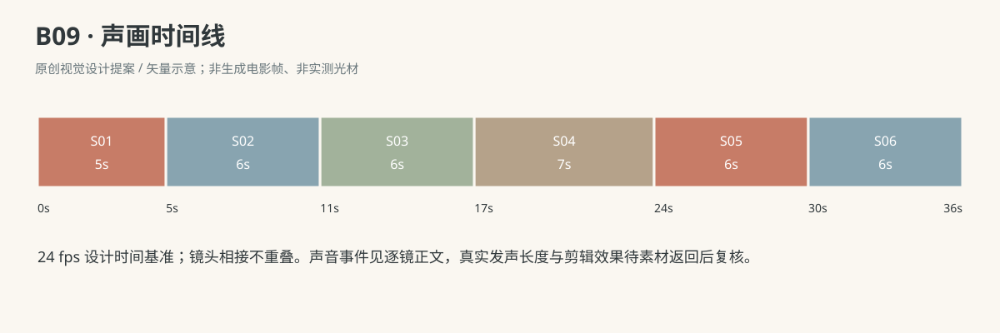

正式台词：无；保留镜头声音中已写明的自然发声。

### 连续性与试片

- 连续性：P05书脊南北，黄色宽边响纸页起始画左，翻到画右再被同一右手翻回画左；普通页不凭空变成响纸页。

- 连续性：宝宝左掌始终稳普通页外缘，右手抓揉、抓黄色边、翻回、整掌压，妈妈只右手翻页后回膝。

- 连续性：声音随页面抓揉或折弯真实起落，静止停听段不持续播放响纸。

- 试片：B09-S03—S04：黄色页边跨书脊的方向必须左到右再右到左，手抓的是同一宽边；若页面瞬间换图、成人未放手却独立翻回即失败。

- 试片：B09-S05—S06：整掌按压先响、宝宝再抬眼笑，静音仍可定位声源动作；若笑早于刺激或单靠拟音补不可见动作则失败。

**媒体待验证：**待布书弯折、宽页边抓握、页面拓扑与真实响纸录音试验；未生成媒体、未确认声音强弱实际可感。

---

## B10《什么都想敲一下》

**42 秒｜坐姿与手部互动｜角色：澈澈、爸爸｜场景 L**

### 剧情正文

客厅中央的低支撑座前，浅灰托盘稳稳固定着，澈澈右手握住绿色软积木，左手搭在托盘另一侧。爸爸坐在西窗一边，刚要把玩具收好。澈澈抬起右手，积木轻轻落在托盘上，发出一声短闷响。他停下来看看接触的地方，再抬一点，又落一下。爸爸看见宝宝暂时停手，伸出左掌准备接积木，掌心朝上，停在托盘边。澈澈的目光移到那只手，右腕也转过去，积木底面轻轻碰上掌心。爸爸的手自然沉了一点，声音比托盘上的短而软。澈澈愣着看看掌面，又看看托盘，右手没有松开。爸爸原本要合拢接物的手指停住，重新把左掌摊平。宝宝将积木挪回托盘，轻落一下，停听，再挪到掌心碰一下，眼睛跟着两个落点走。最后积木下沿轻靠爸爸左掌，宝宝右手仍握住侧面，像还在看哪里会响。爸爸低眼看一会儿，保持手掌平稳，嘴角慢慢松开；另一只手留在自己膝上，收拾的事暂时等一等。

### 导演与空间

**观察任务：**比较同一软积木轻敲固定托盘与成人掌面的不同回应，不做重击或宝宝有意惩罚。

**空间与光位：**客厅北沙发、西窗、东入口；澈澈坐中央地垫北侧的低支撑座，背与骨盆受座面承托，朝南，前方固定浅灰圆边托盘T01，托盘不压腿。爸爸西侧坐在地垫，右手空在膝上，左掌可伸至宝宝右侧托盘上方。P03鼠尾草绿大软积木起始归宝宝右手，太阳面朝上、大布标在背面，宝宝左手空放托盘靠自身左侧。机位南半区，爸爸画左、宝宝画右，西窗光左入。

**人物表演：**宝宝右手用很小腕臂幅度抬积木再轻落，始终握着不抛掷；爸爸要接回积木，先伸左掌等待，接收到敲掌后选择继续稳掌，右手不抢。

### 节拍覆盖

- **B10-b1**：宝宝用右手握软积木轻敲托盘并停听。 → B10-S01、B10-S02

- **B10-b2**：爸爸左掌请求接物，宝宝轻敲掌面，双方观察声音与触感变化。 → B10-S03、B10-S04、B10-S05

- **B10-b3**：宝宝在托盘和掌面各轻试一次；成人改为稳定等待，积木仍归宝宝右手。 → B10-S06、B10-S07

### 分镜构图板

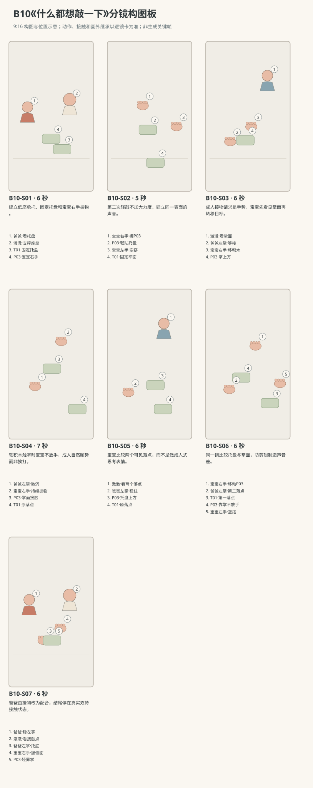

图示为构图位置示意；姿态、接触和画外继承以逐镜正文为准。

### 逐镜设计

#### B10-S01｜00—06 秒｜6 秒｜帧 [0, 144)

**镜头任务：**建立低座承托、固定托盘和宝宝右手握物。

**景别、机位与构图：**南侧双人中景，爸爸左宝宝右，托盘横过下半，P03在宝宝右手即画面偏左手侧，左手空放托盘画右。

**摄影机与理由：**固定，抬起到第一落点完整同框。

**焦点：**右手积木、托盘接触点与宝宝眼睛清楚。

**入态：**宝宝右手握P03侧面并轻放托盘上，太阳朝上；左掌空放托盘，爸爸双手空膝上。

**动作与表演：**

- 2 秒：宝宝右腕连同积木抬起一个很小距离，眼睛看托盘原落点。

- 2 秒：积木底面轻落托盘，右手始终握紧侧面，不放手。

- 2 秒：宝宝停住看接触处，爸爸把目光从旁边空玩具盒转向托盘。

**声音：**软积木碰托盘一声短闷响，房间底声和衣料声轻；无对白。

**出态：**P03由宝宝右手握着贴托盘，左手仍空搭另一侧，爸爸看向接触点。

**切点与承接：**切手与托盘近景，让停听及再次试敲可读。

**连续性：**画内固定托盘、双手归属清楚；爸爸右膝旁浅木玩具盒P07可在边缘存在但未使用。

**开始画面母稿：**

9:16竖幅原创三维生活动画，圆润但保留婴儿头身与关节尺度，皮肤柔和、棉布哑光、低反差暖中性色，动作遵循生活物理；无字幕、无标识、无额外人物。澈澈圆润脸颊、深棕眼、短黑绒发、额前一撮向右弯，穿奶油色棉连体衣，动作尚不完全熟练，神情专注而非成人式算计。爸爸短黑发、砖陶色棉衬衫、深灰长裤，表情温和自然。本图为单一开始瞬间，人物、物件与接触只取以下起态；裁切外人物不为展示外观强行入画。固定空间和材质：客厅北墙固定沙发、西窗、东侧走廊入口、中央奶油地垫。相机在南半区朝北，不越人物东西轴线；成人在西侧，主要双人视图成人画左、宝宝画右。西窗柔和漫射光由画左照入，暖墙反射填暗部，光位与房间方位固定。澈澈在低支撑座朝南坐，背部骨盆受承托，T01浅灰圆边托盘固定在身前、不压腿。爸爸西侧坐，右手空在膝，左掌可达宝宝右侧托盘上方；宝宝左手空放托盘自身左侧，右手始终握唯一P03。P03鼠尾草绿软积木太阳面朝上、背标在背面；浅木P07玩具盒在爸爸西侧地垫，未装入积木。积木具体贴托盘、悬起或接掌按本镜起态。构图范围：南侧双人中景，爸爸左宝宝右，托盘横过下半，P03在宝宝右手即画面偏左手侧，左手空放托盘画右。唯一此刻状态：宝宝右手握P03侧面并轻放托盘上，太阳朝上；左掌空放托盘，爸爸双手空膝上。清晰度与焦点：右手积木、托盘接触点与宝宝眼睛清楚。画面停在这个瞬间，不将后续动作阶段并列绘入。

**视频变化母稿：**

9:16竖幅原创三维生活动画，圆润但保留婴儿头身与关节尺度，皮肤柔和、棉布哑光、低反差暖中性色，动作遵循生活物理；无字幕、无标识、无额外人物。澈澈圆润脸颊、深棕眼、短黑绒发、额前一撮向右弯，穿奶油色棉连体衣，动作尚不完全熟练，神情专注而非成人式算计。爸爸短黑发、砖陶色棉衬衫、深灰长裤，表情温和自然。本镜有效时长6秒，为一个连续镜头。固定空间和材质：客厅北墙固定沙发、西窗、东侧走廊入口、中央奶油地垫。相机在南半区朝北，不越人物东西轴线；成人在西侧，主要双人视图成人画左、宝宝画右。西窗柔和漫射光由画左照入，暖墙反射填暗部，光位与房间方位固定。澈澈在低支撑座朝南坐，背部骨盆受承托，T01浅灰圆边托盘固定在身前、不压腿。爸爸西侧坐，右手空在膝，左掌可达宝宝右侧托盘上方；宝宝左手空放托盘自身左侧，右手始终握唯一P03。P03鼠尾草绿软积木太阳面朝上、背标在背面；浅木P07玩具盒在爸爸西侧地垫，未装入积木。积木具体贴托盘、悬起或接掌按本镜起态。摄影构图：南侧双人中景，爸爸左宝宝右，托盘横过下半，P03在宝宝右手即画面偏左手侧，左手空放托盘画右。摄影机：固定，抬起到第一落点完整同框。焦点：右手积木、托盘接触点与宝宝眼睛清楚。起态：宝宝右手握P03侧面并轻放托盘上，太阳朝上；左掌空放托盘，爸爸双手空膝上。阶段1，2秒：宝宝右腕连同积木抬起一个很小距离，眼睛看托盘原落点。阶段2，2秒：积木底面轻落托盘，右手始终握紧侧面，不放手。阶段3，2秒：宝宝停住看接触处，爸爸把目光从旁边空玩具盒转向托盘。准确声音：软积木碰托盘一声短闷响，房间底声和衣料声轻；无对白。终态：P03由宝宝右手握着贴托盘，左手仍空搭另一侧，爸爸看向接触点。接触和画外状态：画内固定托盘、双手归属清楚；爸爸右膝旁浅木玩具盒P07可在边缘存在但未使用。在该终态切出，不在本镜内部额外切镜。

#### B10-S02｜06—11 秒｜5 秒｜帧 [144, 264)

**镜头任务：**第二次轻敲不加大力度，建立同一表面的声音。

**景别、机位与构图：**南侧略俯手部近景，P03与右手画中左、宝宝左掌画右，托盘表面下部完整。

**摄影机与理由：**固定，接触点不被手背遮挡。

**焦点：**积木底与托盘间小间隙清楚，左掌保持可辨。

**入态：**宝宝右手握P03贴托盘，左掌空放远离敲点的托盘画右。

**动作与表演：**

- 2 秒：宝宝保持接触停听，然后将P03再抬小幅距离。

- 1 秒：积木底轻碰同一托盘位置，太阳面保持朝上。

- 2 秒：右手保持握物停住，宝宝左指在托盘上放松，不一起敲击。

**声音：**第二声短闷响与第一声质地相近，之后两秒留白；不放连敲节拍。

**出态：**积木贴托盘、宝宝右手不松，左手仍在右侧空放。

**切点与承接：**切父亲入掌的中近景，接停听状态。

**连续性：**画内右手持续持物，两次敲都非释放掉落；左手不接积木。

**开始画面母稿：**

9:16竖幅原创三维生活动画，圆润但保留婴儿头身与关节尺度，皮肤柔和、棉布哑光、低反差暖中性色，动作遵循生活物理；无字幕、无标识、无额外人物。澈澈圆润脸颊、深棕眼、短黑绒发、额前一撮向右弯，穿奶油色棉连体衣，动作尚不完全熟练，神情专注而非成人式算计。爸爸短黑发、砖陶色棉衬衫、深灰长裤，表情温和自然。本图为单一开始瞬间，人物、物件与接触只取以下起态；裁切外人物不为展示外观强行入画。固定空间和材质：客厅北墙固定沙发、西窗、东侧走廊入口、中央奶油地垫。相机在南半区朝北，不越人物东西轴线；成人在西侧，主要双人视图成人画左、宝宝画右。西窗柔和漫射光由画左照入，暖墙反射填暗部，光位与房间方位固定。澈澈在低支撑座朝南坐，背部骨盆受承托，T01浅灰圆边托盘固定在身前、不压腿。爸爸西侧坐，右手空在膝，左掌可达宝宝右侧托盘上方；宝宝左手空放托盘自身左侧，右手始终握唯一P03。P03鼠尾草绿软积木太阳面朝上、背标在背面；浅木P07玩具盒在爸爸西侧地垫，未装入积木。积木具体贴托盘、悬起或接掌按本镜起态。构图范围：南侧略俯手部近景，P03与右手画中左、宝宝左掌画右，托盘表面下部完整。唯一此刻状态：宝宝右手握P03贴托盘，左掌空放远离敲点的托盘画右。清晰度与焦点：宝宝右手持续握住P03侧面，积木底面贴着托盘的接触清楚；宝宝左掌空放托盘另一侧。画面停在这个瞬间，不将后续动作阶段并列绘入。

**视频变化母稿：**

9:16竖幅原创三维生活动画，圆润但保留婴儿头身与关节尺度，皮肤柔和、棉布哑光、低反差暖中性色，动作遵循生活物理；无字幕、无标识、无额外人物。澈澈圆润脸颊、深棕眼、短黑绒发、额前一撮向右弯，穿奶油色棉连体衣，动作尚不完全熟练，神情专注而非成人式算计。爸爸短黑发、砖陶色棉衬衫、深灰长裤，表情温和自然。本镜有效时长5秒，为一个连续镜头。固定空间和材质：客厅北墙固定沙发、西窗、东侧走廊入口、中央奶油地垫。相机在南半区朝北，不越人物东西轴线；成人在西侧，主要双人视图成人画左、宝宝画右。西窗柔和漫射光由画左照入，暖墙反射填暗部，光位与房间方位固定。澈澈在低支撑座朝南坐，背部骨盆受承托，T01浅灰圆边托盘固定在身前、不压腿。爸爸西侧坐，右手空在膝，左掌可达宝宝右侧托盘上方；宝宝左手空放托盘自身左侧，右手始终握唯一P03。P03鼠尾草绿软积木太阳面朝上、背标在背面；浅木P07玩具盒在爸爸西侧地垫，未装入积木。积木具体贴托盘、悬起或接掌按本镜起态。摄影构图：南侧略俯手部近景，P03与右手画中左、宝宝左掌画右，托盘表面下部完整。摄影机：固定，接触点不被手背遮挡。焦点：积木底与托盘间小间隙清楚，左掌保持可辨。起态：宝宝右手握P03贴托盘，左掌空放远离敲点的托盘画右。阶段1，2秒：宝宝保持接触停听，然后将P03再抬小幅距离。阶段2，1秒：积木底轻碰同一托盘位置，太阳面保持朝上。阶段3，2秒：右手保持握物停住，宝宝左指在托盘上放松，不一起敲击。准确声音：第二声短闷响与第一声质地相近，之后两秒留白；不放连敲节拍。终态：积木贴托盘、宝宝右手不松，左手仍在右侧空放。接触和画外状态：画内右手持续持物，两次敲都非释放掉落；左手不接积木。在该终态切出，不在本镜内部额外切镜。

#### B10-S03｜11—17 秒｜6 秒｜帧 [264, 408)

**镜头任务：**成人接物请求是手势，宝宝先看见掌面再转移目标。

**景别、机位与构图：**南侧宝宝与成人手中近景，宝宝脸上、托盘下，爸爸左前臂从画左伸入，掌面在托盘左侧近宝宝右手。

**摄影机与理由：**固定，爸爸左掌从膝旁到等待位置可见。

**焦点：**宝宝眼睛、左成人掌与P03同清楚。

**入态：**爸爸左手空在左膝，宝宝右手握P03贴托盘，左掌仍托盘画右。

**动作与表演：**

- 2 秒：爸爸左手从膝旁抬起，掌心向上伸到托盘边，距积木一个小手掌。

- 2 秒：宝宝目光从积木落点移向成人左掌，爸爸左掌停住等接。

- 2 秒：宝宝右腕向成人掌方向转，P03离开托盘，小幅移到掌上方，尚未接触。

**声音：**成人袖口轻擦，宝宝一声低咿呀；爸爸不说“给我”等语义台词。

**出态：**P03仍宝宝右手握着，悬在爸爸左掌上方小距离。

**切点与承接：**切接触近景续向下轻落，不重新从托盘起手。

**连续性：**画内成人左掌等待、宝宝右手持积木移位可见；爸爸右手画外仍在右膝。

**开始画面母稿：**

9:16竖幅原创三维生活动画，圆润但保留婴儿头身与关节尺度，皮肤柔和、棉布哑光、低反差暖中性色，动作遵循生活物理；无字幕、无标识、无额外人物。澈澈圆润脸颊、深棕眼、短黑绒发、额前一撮向右弯，穿奶油色棉连体衣，动作尚不完全熟练，神情专注而非成人式算计。爸爸短黑发、砖陶色棉衬衫、深灰长裤，表情温和自然。本图为单一开始瞬间，人物、物件与接触只取以下起态；裁切外人物不为展示外观强行入画。固定空间和材质：客厅北墙固定沙发、西窗、东侧走廊入口、中央奶油地垫。相机在南半区朝北，不越人物东西轴线；成人在西侧，主要双人视图成人画左、宝宝画右。西窗柔和漫射光由画左照入，暖墙反射填暗部，光位与房间方位固定。澈澈在低支撑座朝南坐，背部骨盆受承托，T01浅灰圆边托盘固定在身前、不压腿。爸爸西侧坐，右手空在膝，左掌可达宝宝右侧托盘上方；宝宝左手空放托盘自身左侧，右手始终握唯一P03。P03鼠尾草绿软积木太阳面朝上、背标在背面；浅木P07玩具盒在爸爸西侧地垫，未装入积木。积木具体贴托盘、悬起或接掌按本镜起态。构图范围：南侧双人中近景，宝宝脸在上、托盘在下，画左下包含爸爸左膝与空左手；托盘左侧保留伸掌空间。唯一此刻状态：爸爸左手空在左膝，宝宝右手握P03贴托盘，左掌仍托盘画右。清晰度与焦点：宝宝眼睛、右手所握P03与爸爸膝旁空左手同清楚，成人左掌尚未伸到托盘旁。画面停在这个瞬间，不将后续动作阶段并列绘入。

**视频变化母稿：**

9:16竖幅原创三维生活动画，圆润但保留婴儿头身与关节尺度，皮肤柔和、棉布哑光、低反差暖中性色，动作遵循生活物理；无字幕、无标识、无额外人物。澈澈圆润脸颊、深棕眼、短黑绒发、额前一撮向右弯，穿奶油色棉连体衣，动作尚不完全熟练，神情专注而非成人式算计。爸爸短黑发、砖陶色棉衬衫、深灰长裤，表情温和自然。本镜有效时长6秒，为一个连续镜头。固定空间和材质：客厅北墙固定沙发、西窗、东侧走廊入口、中央奶油地垫。相机在南半区朝北，不越人物东西轴线；成人在西侧，主要双人视图成人画左、宝宝画右。西窗柔和漫射光由画左照入，暖墙反射填暗部，光位与房间方位固定。澈澈在低支撑座朝南坐，背部骨盆受承托，T01浅灰圆边托盘固定在身前、不压腿。爸爸西侧坐，右手空在膝，左掌可达宝宝右侧托盘上方；宝宝左手空放托盘自身左侧，右手始终握唯一P03。P03鼠尾草绿软积木太阳面朝上、背标在背面；浅木P07玩具盒在爸爸西侧地垫，未装入积木。积木具体贴托盘、悬起或接掌按本镜起态。摄影构图：南侧宝宝与成人手中近景，宝宝脸上、托盘下，爸爸左前臂从画左伸入，掌面在托盘左侧近宝宝右手。摄影机：固定，爸爸左掌从膝旁到等待位置可见。焦点：宝宝眼睛、左成人掌与P03同清楚。起态：爸爸左手空在左膝，宝宝右手握P03贴托盘，左掌仍托盘画右。阶段1，2秒：爸爸左手从膝旁抬起，掌心向上伸到托盘边，距积木一个小手掌。阶段2，2秒：宝宝目光从积木落点移向成人左掌，爸爸左掌停住等接。阶段3，2秒：宝宝右腕向成人掌方向转，P03离开托盘，小幅移到掌上方，尚未接触。准确声音：成人袖口轻擦，宝宝一声低咿呀；爸爸不说“给我”等语义台词。终态：P03仍宝宝右手握着，悬在爸爸左掌上方小距离。接触和画外状态：画内成人左掌等待、宝宝右手持积木移位可见；爸爸右手画外仍在右膝。在该终态切出，不在本镜内部额外切镜。

#### B10-S04｜17—24 秒｜7 秒｜帧 [408, 576)

**镜头任务：**软积木触掌时宝宝不放手，成人自然顺势而非挨打。

**景别、机位与构图：**南侧偏西的手部近景，爸爸左掌画左下，宝宝右手与积木画中上，托盘原落点画右下；接触各面不重叠遮掉。

**摄影机与理由：**固定，掌面微沉、宝宝持续握物均需可见。

**焦点：**P03底面和爸爸左掌接触边缘最清楚，右手指仍有轮廓。

**入态：**P03由宝宝右手握住，底面在爸爸左掌上方小距离；成人左指松开待接。

**动作与表演：**

- 2 秒：宝宝右臂缓慢落下，积木底面轻碰爸爸左掌，右指不松开。

- 2 秒：爸爸掌面随接触下沉一点，手指本要合拢接物又停住。

- 3 秒：宝宝保持轻贴，右手稍提起令积木离掌，爸爸重新摊平左掌等待。

**声音：**一声较托盘短软的轻触声，手掌与布面细响；不配痛叫或重击。

**出态：**宝宝右手仍握P03，刚离开爸爸摊平左掌，托盘空落点在旁。

**切点与承接：**切带脸镜接观察两落点，延续已离掌状态。

**连续性：**画内成人左掌只承接接触、不取得积木；宝宝右手保持抓握，爸爸右手未入。

**开始画面母稿：**

9:16竖幅原创三维生活动画，圆润但保留婴儿头身与关节尺度，皮肤柔和、棉布哑光、低反差暖中性色，动作遵循生活物理；无字幕、无标识、无额外人物。澈澈圆润脸颊、深棕眼、短黑绒发、额前一撮向右弯，穿奶油色棉连体衣，动作尚不完全熟练，神情专注而非成人式算计。爸爸短黑发、砖陶色棉衬衫、深灰长裤，表情温和自然。本图为单一开始瞬间，人物、物件与接触只取以下起态；裁切外人物不为展示外观强行入画。固定空间和材质：客厅北墙固定沙发、西窗、东侧走廊入口、中央奶油地垫。相机在南半区朝北，不越人物东西轴线；成人在西侧，主要双人视图成人画左、宝宝画右。西窗柔和漫射光由画左照入，暖墙反射填暗部，光位与房间方位固定。澈澈在低支撑座朝南坐，背部骨盆受承托，T01浅灰圆边托盘固定在身前、不压腿。爸爸西侧坐，右手空在膝，左掌可达宝宝右侧托盘上方；宝宝左手空放托盘自身左侧，右手始终握唯一P03。P03鼠尾草绿软积木太阳面朝上、背标在背面；浅木P07玩具盒在爸爸西侧地垫，未装入积木。积木具体贴托盘、悬起或接掌按本镜起态。构图范围：南侧偏西的手部近景，爸爸左掌画左下，宝宝右手与积木画中上，托盘原落点画右下；物件底面与掌面均可见，不互相遮掉。唯一此刻状态：P03由宝宝右手握住，底面在爸爸左掌上方小距离；成人左指松开待接。清晰度与焦点：P03底面与爸爸左掌之间尚存的小间隙清楚，宝宝右指仍握积木侧面，此刻没有掌面接触。画面停在这个瞬间，不将后续动作阶段并列绘入。

**视频变化母稿：**

9:16竖幅原创三维生活动画，圆润但保留婴儿头身与关节尺度，皮肤柔和、棉布哑光、低反差暖中性色，动作遵循生活物理；无字幕、无标识、无额外人物。澈澈圆润脸颊、深棕眼、短黑绒发、额前一撮向右弯，穿奶油色棉连体衣，动作尚不完全熟练，神情专注而非成人式算计。爸爸短黑发、砖陶色棉衬衫、深灰长裤，表情温和自然。本镜有效时长7秒，为一个连续镜头。固定空间和材质：客厅北墙固定沙发、西窗、东侧走廊入口、中央奶油地垫。相机在南半区朝北，不越人物东西轴线；成人在西侧，主要双人视图成人画左、宝宝画右。西窗柔和漫射光由画左照入，暖墙反射填暗部，光位与房间方位固定。澈澈在低支撑座朝南坐，背部骨盆受承托，T01浅灰圆边托盘固定在身前、不压腿。爸爸西侧坐，右手空在膝，左掌可达宝宝右侧托盘上方；宝宝左手空放托盘自身左侧，右手始终握唯一P03。P03鼠尾草绿软积木太阳面朝上、背标在背面；浅木P07玩具盒在爸爸西侧地垫，未装入积木。积木具体贴托盘、悬起或接掌按本镜起态。摄影构图：南侧偏西的手部近景，爸爸左掌画左下，宝宝右手与积木画中上，托盘原落点画右下；接触各面不重叠遮掉。摄影机：固定，掌面微沉、宝宝持续握物均需可见。焦点：P03底面和爸爸左掌接触边缘最清楚，右手指仍有轮廓。起态：P03由宝宝右手握住，底面在爸爸左掌上方小距离；成人左指松开待接。阶段1，2秒：宝宝右臂缓慢落下，积木底面轻碰爸爸左掌，右指不松开。阶段2，2秒：爸爸掌面随接触下沉一点，手指本要合拢接物又停住。阶段3，3秒：宝宝保持轻贴，右手稍提起令积木离掌，爸爸重新摊平左掌等待。准确声音：一声较托盘短软的轻触声，手掌与布面细响；不配痛叫或重击。终态：宝宝右手仍握P03，刚离开爸爸摊平左掌，托盘空落点在旁。接触和画外状态：画内成人左掌只承接接触、不取得积木；宝宝右手保持抓握，爸爸右手未入。在该终态切出，不在本镜内部额外切镜。

#### B10-S05｜24—30 秒｜6 秒｜帧 [576, 720)

**镜头任务：**宝宝比较两个可见落点，而不是做成人式思考表情。

**景别、机位与构图：**南侧宝宝中近景，脸上部，爸爸左掌在画左下，托盘原落点画右下，宝宝右手P03在中间。

**摄影机与理由：**固定，用眼线往返明确比较，不加灯泡或文字。

**焦点：**宝宝眼睛和两个落点可读，物件保持适当尺寸。

**入态：**宝宝右手握P03离掌小距离，爸爸左掌摊平，托盘原落点空。

**动作与表演：**

- 2 秒：澈澈先看爸爸左掌，嘴唇微张，右手不动。

- 2 秒：目光移到托盘原落点，再回到手中积木。

- 2 秒：宝宝右手带积木向托盘移回，爸爸左掌保持原处，身体不前倾追物。

**声音：**自然宝宝气息与微弱衣料声，六秒不额外补敲击。

**出态：**P03在托盘原落点上方，右手持有；爸爸左掌仍在托盘边。

**切点与承接：**切双落点较宽近景接一次托盘与一次掌面试触。

**连续性：**画内眼线两个对象存在，成人掌不随切点移动，宝宝左手仍空搭托盘画右。

**开始画面母稿：**

9:16竖幅原创三维生活动画，圆润但保留婴儿头身与关节尺度，皮肤柔和、棉布哑光、低反差暖中性色，动作遵循生活物理；无字幕、无标识、无额外人物。澈澈圆润脸颊、深棕眼、短黑绒发、额前一撮向右弯，穿奶油色棉连体衣，动作尚不完全熟练，神情专注而非成人式算计。爸爸短黑发、砖陶色棉衬衫、深灰长裤，表情温和自然。本图为单一开始瞬间，人物、物件与接触只取以下起态；裁切外人物不为展示外观强行入画。固定空间和材质：客厅北墙固定沙发、西窗、东侧走廊入口、中央奶油地垫。相机在南半区朝北，不越人物东西轴线；成人在西侧，主要双人视图成人画左、宝宝画右。西窗柔和漫射光由画左照入，暖墙反射填暗部，光位与房间方位固定。澈澈在低支撑座朝南坐，背部骨盆受承托，T01浅灰圆边托盘固定在身前、不压腿。爸爸西侧坐，右手空在膝，左掌可达宝宝右侧托盘上方；宝宝左手空放托盘自身左侧，右手始终握唯一P03。P03鼠尾草绿软积木太阳面朝上、背标在背面；浅木P07玩具盒在爸爸西侧地垫，未装入积木。积木具体贴托盘、悬起或接掌按本镜起态。构图范围：南侧宝宝中近景，脸上部，爸爸左掌在画左下，托盘原落点画右下，宝宝右手P03在中间。唯一此刻状态：宝宝右手握P03离掌小距离，爸爸左掌摊平，托盘原落点空。清晰度与焦点：宝宝眼睛和两个落点可读，物件保持适当尺寸。画面停在这个瞬间，不将后续动作阶段并列绘入。

**视频变化母稿：**

9:16竖幅原创三维生活动画，圆润但保留婴儿头身与关节尺度，皮肤柔和、棉布哑光、低反差暖中性色，动作遵循生活物理；无字幕、无标识、无额外人物。澈澈圆润脸颊、深棕眼、短黑绒发、额前一撮向右弯，穿奶油色棉连体衣，动作尚不完全熟练，神情专注而非成人式算计。爸爸短黑发、砖陶色棉衬衫、深灰长裤，表情温和自然。本镜有效时长6秒，为一个连续镜头。固定空间和材质：客厅北墙固定沙发、西窗、东侧走廊入口、中央奶油地垫。相机在南半区朝北，不越人物东西轴线；成人在西侧，主要双人视图成人画左、宝宝画右。西窗柔和漫射光由画左照入，暖墙反射填暗部，光位与房间方位固定。澈澈在低支撑座朝南坐，背部骨盆受承托，T01浅灰圆边托盘固定在身前、不压腿。爸爸西侧坐，右手空在膝，左掌可达宝宝右侧托盘上方；宝宝左手空放托盘自身左侧，右手始终握唯一P03。P03鼠尾草绿软积木太阳面朝上、背标在背面；浅木P07玩具盒在爸爸西侧地垫，未装入积木。积木具体贴托盘、悬起或接掌按本镜起态。摄影构图：南侧宝宝中近景，脸上部，爸爸左掌在画左下，托盘原落点画右下，宝宝右手P03在中间。摄影机：固定，用眼线往返明确比较，不加灯泡或文字。焦点：宝宝眼睛和两个落点可读，物件保持适当尺寸。起态：宝宝右手握P03离掌小距离，爸爸左掌摊平，托盘原落点空。阶段1，2秒：澈澈先看爸爸左掌，嘴唇微张，右手不动。阶段2，2秒：目光移到托盘原落点，再回到手中积木。阶段3，2秒：宝宝右手带积木向托盘移回，爸爸左掌保持原处，身体不前倾追物。准确声音：自然宝宝气息与微弱衣料声，六秒不额外补敲击。终态：P03在托盘原落点上方，右手持有；爸爸左掌仍在托盘边。接触和画外状态：画内眼线两个对象存在，成人掌不随切点移动，宝宝左手仍空搭托盘画右。在该终态切出，不在本镜内部额外切镜。

#### B10-S06｜30—36 秒｜6 秒｜帧 [720, 864)

**镜头任务：**同一镜比较托盘与掌面，防剪辑制造声音差。

**景别、机位与构图：**南侧略俯中近景同时容纳宝宝双手、P03、成人左掌与托盘落点，脸保留上缘眼睛。

**摄影机与理由：**固定，不切分两次轻触，便于比较物理与声音。

**焦点：**两落点与宝宝右手全程清楚，焦点不来回抢。

**入态：**P03由宝宝右手握于托盘落点上方，成人左掌稳定在旁，宝宝左手不动。

**动作与表演：**

- 2 秒：宝宝将积木轻放一下托盘，发短闷声后停半拍。

- 2 秒：右手提起积木，小幅横移到爸爸左掌上方。

- 2 秒：积木底面轻碰成人左掌，声更短软；右手保持握侧面，底面靠在掌上。

**声音：**托盘短闷声、半拍静默、掌面短软声先后清楚；不使用夸大音高对照。

**出态：**P03底面轻靠爸爸左掌、宝宝右手仍握侧面，非完成转交。

**切点与承接：**切共享中景收父亲选择稳掌、宝宝继续看的关系。

**连续性：**画内两次接触之间有提起横移，积木不穿托盘；左成人手只作落点，宝宝左手空放。

**开始画面母稿：**

9:16竖幅原创三维生活动画，圆润但保留婴儿头身与关节尺度，皮肤柔和、棉布哑光、低反差暖中性色，动作遵循生活物理；无字幕、无标识、无额外人物。澈澈圆润脸颊、深棕眼、短黑绒发、额前一撮向右弯，穿奶油色棉连体衣，动作尚不完全熟练，神情专注而非成人式算计。爸爸短黑发、砖陶色棉衬衫、深灰长裤，表情温和自然。本图为单一开始瞬间，人物、物件与接触只取以下起态；裁切外人物不为展示外观强行入画。固定空间和材质：客厅北墙固定沙发、西窗、东侧走廊入口、中央奶油地垫。相机在南半区朝北，不越人物东西轴线；成人在西侧，主要双人视图成人画左、宝宝画右。西窗柔和漫射光由画左照入，暖墙反射填暗部，光位与房间方位固定。澈澈在低支撑座朝南坐，背部骨盆受承托，T01浅灰圆边托盘固定在身前、不压腿。爸爸西侧坐，右手空在膝，左掌可达宝宝右侧托盘上方；宝宝左手空放托盘自身左侧，右手始终握唯一P03。P03鼠尾草绿软积木太阳面朝上、背标在背面；浅木P07玩具盒在爸爸西侧地垫，未装入积木。积木具体贴托盘、悬起或接掌按本镜起态。构图范围：南侧略俯中近景同时容纳宝宝双手、P03、成人左掌与托盘落点，脸保留上缘眼睛。唯一此刻状态：P03由宝宝右手握于托盘落点上方，成人左掌稳定在旁，宝宝左手不动。清晰度与焦点：两落点与宝宝右手全程清楚，焦点不来回抢。画面停在这个瞬间，不将后续动作阶段并列绘入。

**视频变化母稿：**

9:16竖幅原创三维生活动画，圆润但保留婴儿头身与关节尺度，皮肤柔和、棉布哑光、低反差暖中性色，动作遵循生活物理；无字幕、无标识、无额外人物。澈澈圆润脸颊、深棕眼、短黑绒发、额前一撮向右弯，穿奶油色棉连体衣，动作尚不完全熟练，神情专注而非成人式算计。爸爸短黑发、砖陶色棉衬衫、深灰长裤，表情温和自然。本镜有效时长6秒，为一个连续镜头。固定空间和材质：客厅北墙固定沙发、西窗、东侧走廊入口、中央奶油地垫。相机在南半区朝北，不越人物东西轴线；成人在西侧，主要双人视图成人画左、宝宝画右。西窗柔和漫射光由画左照入，暖墙反射填暗部，光位与房间方位固定。澈澈在低支撑座朝南坐，背部骨盆受承托，T01浅灰圆边托盘固定在身前、不压腿。爸爸西侧坐，右手空在膝，左掌可达宝宝右侧托盘上方；宝宝左手空放托盘自身左侧，右手始终握唯一P03。P03鼠尾草绿软积木太阳面朝上、背标在背面；浅木P07玩具盒在爸爸西侧地垫，未装入积木。积木具体贴托盘、悬起或接掌按本镜起态。摄影构图：南侧略俯中近景同时容纳宝宝双手、P03、成人左掌与托盘落点，脸保留上缘眼睛。摄影机：固定，不切分两次轻触，便于比较物理与声音。焦点：两落点与宝宝右手全程清楚，焦点不来回抢。起态：P03由宝宝右手握于托盘落点上方，成人左掌稳定在旁，宝宝左手不动。阶段1，2秒：宝宝将积木轻放一下托盘，发短闷声后停半拍。阶段2，2秒：右手提起积木，小幅横移到爸爸左掌上方。阶段3，2秒：积木底面轻碰成人左掌，声更短软；右手保持握侧面，底面靠在掌上。准确声音：托盘短闷声、半拍静默、掌面短软声先后清楚；不使用夸大音高对照。终态：P03底面轻靠爸爸左掌、宝宝右手仍握侧面，非完成转交。接触和画外状态：画内两次接触之间有提起横移，积木不穿托盘；左成人手只作落点，宝宝左手空放。在该终态切出，不在本镜内部额外切镜。

#### B10-S07｜36—42 秒｜6 秒｜帧 [864, 1008)

**镜头任务：**爸爸由接物改为配合，结尾停在真实双持接触状态。

**景别、机位与构图：**南侧双人中景，爸爸左宝宝右，两张脸上部、爸爸左掌与宝宝右手积木在中下，固定托盘可辨。

**摄影机与理由：**固定，不加第四轮敲击，给成人独立反应。

**焦点：**爸爸眼神、宝宝专注与积木承托清楚。

**入态：**积木底面靠爸爸左掌，宝宝右手握侧面；爸爸右手右膝，宝宝左掌托盘空放。

**动作与表演：**

- 2 秒：爸爸低头看看自己摊着的左掌，原本想合拢的手指放松，保持承托。

- 2 秒：宝宝看积木与掌的交界，右腕轻调整，积木仍贴掌不敲。

- 2 秒：爸爸嘴角松开，抬眼看宝宝；宝宝还在看接触处，收拾的手势没有继续。

**声音：**只留呼吸和软布轻擦，成人轻笑气息可有但无台词，片尾不再追加敲声。

**出态：**P03宝宝右手握、爸爸左掌轻托，右成人手仍膝上；托盘与低座固定。

**切点与承接：**在两人安静配合的小活动中结束，不用玩具盒盖作笑点。

**连续性：**画内双持接触不等于交接，宝宝没有放开；身体支撑与左右手位置保持到片尾。

**开始画面母稿：**

9:16竖幅原创三维生活动画，圆润但保留婴儿头身与关节尺度，皮肤柔和、棉布哑光、低反差暖中性色，动作遵循生活物理；无字幕、无标识、无额外人物。澈澈圆润脸颊、深棕眼、短黑绒发、额前一撮向右弯，穿奶油色棉连体衣，动作尚不完全熟练，神情专注而非成人式算计。爸爸短黑发、砖陶色棉衬衫、深灰长裤，表情温和自然。本图为单一开始瞬间，人物、物件与接触只取以下起态；裁切外人物不为展示外观强行入画。固定空间和材质：客厅北墙固定沙发、西窗、东侧走廊入口、中央奶油地垫。相机在南半区朝北，不越人物东西轴线；成人在西侧，主要双人视图成人画左、宝宝画右。西窗柔和漫射光由画左照入，暖墙反射填暗部，光位与房间方位固定。澈澈在低支撑座朝南坐，背部骨盆受承托，T01浅灰圆边托盘固定在身前、不压腿。爸爸西侧坐，右手空在膝，左掌可达宝宝右侧托盘上方；宝宝左手空放托盘自身左侧，右手始终握唯一P03。P03鼠尾草绿软积木太阳面朝上、背标在背面；浅木P07玩具盒在爸爸西侧地垫，未装入积木。积木具体贴托盘、悬起或接掌按本镜起态。构图范围：南侧双人中景，爸爸左宝宝右，两张脸上部、爸爸左掌与宝宝右手积木在中下，固定托盘可辨。唯一此刻状态：积木底面靠爸爸左掌，宝宝右手握侧面；爸爸右手右膝，宝宝左掌托盘空放。清晰度与焦点：爸爸眼神、宝宝专注与积木承托清楚。画面停在这个瞬间，不将后续动作阶段并列绘入。

**视频变化母稿：**

9:16竖幅原创三维生活动画，圆润但保留婴儿头身与关节尺度，皮肤柔和、棉布哑光、低反差暖中性色，动作遵循生活物理；无字幕、无标识、无额外人物。澈澈圆润脸颊、深棕眼、短黑绒发、额前一撮向右弯，穿奶油色棉连体衣，动作尚不完全熟练，神情专注而非成人式算计。爸爸短黑发、砖陶色棉衬衫、深灰长裤，表情温和自然。本镜有效时长6秒，为一个连续镜头。固定空间和材质：客厅北墙固定沙发、西窗、东侧走廊入口、中央奶油地垫。相机在南半区朝北，不越人物东西轴线；成人在西侧，主要双人视图成人画左、宝宝画右。西窗柔和漫射光由画左照入，暖墙反射填暗部，光位与房间方位固定。澈澈在低支撑座朝南坐，背部骨盆受承托，T01浅灰圆边托盘固定在身前、不压腿。爸爸西侧坐，右手空在膝，左掌可达宝宝右侧托盘上方；宝宝左手空放托盘自身左侧，右手始终握唯一P03。P03鼠尾草绿软积木太阳面朝上、背标在背面；浅木P07玩具盒在爸爸西侧地垫，未装入积木。积木具体贴托盘、悬起或接掌按本镜起态。摄影构图：南侧双人中景，爸爸左宝宝右，两张脸上部、爸爸左掌与宝宝右手积木在中下，固定托盘可辨。摄影机：固定，不加第四轮敲击，给成人独立反应。焦点：爸爸眼神、宝宝专注与积木承托清楚。起态：积木底面靠爸爸左掌，宝宝右手握侧面；爸爸右手右膝，宝宝左掌托盘空放。阶段1，2秒：爸爸低头看看自己摊着的左掌，原本想合拢的手指放松，保持承托。阶段2，2秒：宝宝看积木与掌的交界，右腕轻调整，积木仍贴掌不敲。阶段3，2秒：爸爸嘴角松开，抬眼看宝宝；宝宝还在看接触处，收拾的手势没有继续。准确声音：只留呼吸和软布轻擦，成人轻笑气息可有但无台词，片尾不再追加敲声。终态：P03宝宝右手握、爸爸左掌轻托，右成人手仍膝上；托盘与低座固定。接触和画外状态：画内双持接触不等于交接，宝宝没有放开；身体支撑与左右手位置保持到片尾。在该终态切出，不在本镜内部额外切镜。

### 声音与剪辑

全片无语义对白、无旁白、无音乐；不以成人配音解释宝宝动机。连续室内安静底声保持声场，动作拟音按各镜接触同步，婴儿气息与咿呀使用自然短音而非成人语调。

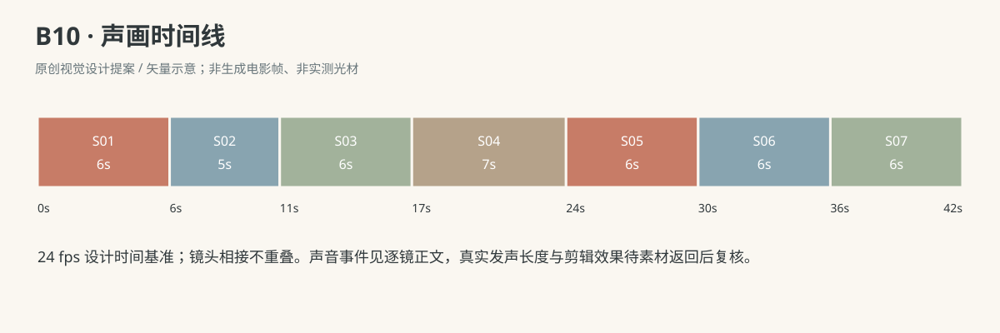

正式台词：无；保留镜头声音中已写明的自然发声。

### 连续性与试片

- 连续性：P03全片由宝宝右手握侧面，所有敲击为小幅轻触；最后爸爸左掌承托但宝宝未放手。

- 连续性：爸爸只伸左掌请求接物，右手始终在膝上；宝宝左手空放托盘另一侧。

- 连续性：T01固定浅灰圆边托盘、低座支撑不随身体晃动；P03太阳面朝上，背标不脱落，画面不新增第二个积木。

- 试片：B10-S03—S04：掌面先进入视野、宝宝再转腕移积木，接触轻且成人不痛叫；若演成甩手重击、故意惩罚或积木释放即失败。

- 试片：B10-S05—S06：两个落点同镜可见、每次横移前有提起；若靠切镜瞬移或仅音效假装不同材质即失败。

- 试片：B10-S07：能一眼说明宝宝右手仍握物、爸爸左掌只是托底；若变成人已接走或左右手镜像则失败。

**媒体待验证：**待试片核对积木软体、固定托盘、成人掌微沉与婴儿握持，待实录验证两个接触声差异；无视频生成或声音已验收声明。

---

## B11《我还没松手呢》

**30 秒｜坐姿与手部互动｜角色：澈澈、爸爸｜场景 L**

### 剧情正文

西窗的柔光落在客厅地垫上，澈澈靠着低靠垫坐好，爸爸在西侧，右手捏着一只珊瑚色软布环，随手转看缝边。布环慢慢转到两人之间，澈澈的眼睛跟着它，空右手抬到胸前。环沿刚进入够得到的位置，那只小手突然伸出去，碰到布缘便合拢，抓稳后立即屈肘往胸前收。爸爸的右手顺着让了一点，这才松开；环已经到了澈澈怀前，他的拇指和食指却还悬在原处，保持着捏环的样子。澈澈低头，压压软边，又转着看环孔。爸爸看看自己空着的手指，眨一下眼，手指慢慢松开，再看宝宝。澈澈的左食指也凑过来，沿着内缘摸一小段。爸爸嘴角松开，轻轻笑了一口气，终于把空右手收回膝上。澈澈将左掌贴向外缘，双手短暂握住同一只环，右指慢慢松开。环转到左手，爸爸的目光也跟过去，双手安静留在膝上；澈澈只顾看左手里的新角度，空右掌轻轻张了一下。

### 亲述来源与改编

原帖是家长自述，未独立核实。本片将生活机制改编为澈澈的原创故事。

- [RT07 · 大口亲妈妈的同时，把眼镜拿走](https://www.miloandbehold.com/misty/2016-04-16-bad-sleep/)；作者自报年龄：同一宝宝系列在2016-04-14明确写满8个月；本篇4月16日未重写月龄。

- **采用的生活过程：**只保留婴儿伸手抓物可能出乎成人反应预期这一生活方向；核心“短距离迅速一把抓走”来自用户既有选题。

- **本片原创改编：**珊瑚软环、爸爸转环、单次快抓、成人指尖迟一拍、双手交接全部是本项目原创连续场景。

- **不作出的事实推断：**RT07是亲吻同时抓眼镜的母亲自述，不是本片抢软环的真实原型逐镜过程。

- **不作出的事实推断：**同一作者前一日“手快”的笼统记录没有具体物件与完整经过；不与RT07拼成一次真实事件，不断言宝宝预谋。

[查看原始过程与缺项](research/real-experiences/index.html#RT07)

### 导演与空间

**观察任务：**观察宝宝短距离伸手之快与成人收回空手之慢的时间差，快抓只有一次，后半转为真实的软环探索与安静跟随，不把宝宝演成成人式抢夺赢家。

**空间与光位：**客厅北墙固定沙发、西窗、东侧走廊入口、中央奶油地垫。澈澈朝南有靠坐于地垫北侧，稳固低靠垫承背、骨盆落垫，双脚自然落垫；爸爸坐在澈澈西侧，两人之间留短距手部活动空间。相机在南半区朝北，不越两人的东西轴线；主要共享镜爸爸画左、澈澈画右，宝宝右手在自身右前方即画面偏左一侧。西窗柔和漫射光由画左照入，暖墙填暗部。唯一道具P01是珊瑚色大软布环，柔软棉布、完整环孔；爸爸起初以右拇指和食指捏住靠爸爸一侧外缘，宝宝之后抓靠自己一侧外缘，两个握点分开可见。没有桌面、托盘或第二只环。

**人物表演：**爸爸原在随手转看软环的缝边，注意力跟着自己指间的布料，并非故意逗抢；右手无意带环进入澈澈可达范围。澈澈先看移动的软环，突然作一次短距离伸手，抓稳后屈肘收向胸前，背和骨盆不离支撑。爸爸顺着小幅移动松指，不与婴儿拔河；手已经空了，视线和捏环手势才晚半拍反应。后半宝宝专注研究软边，爸爸先看空手再看宝宝，轻笑后收手，最后只用目光跟随换手。

### 节拍覆盖

- **B11-b1**：爸爸随手转看布环，宝宝注意力跟随；环由成人手部小幅移动进入短距可达范围，尚无交接。 → B11-S01

- **B11-b2**：宝宝短距快伸手，先抓稳再屈肘收环；爸爸随后松指，物件已经离手，空指姿势尚停留。 → B11-S02

- **B11-b3**：宝宝立刻转入软环探索；爸爸先看空手再看宝宝，理解眼前变化的反应慢于手部释放。 → B11-S03、B11-S04

- **B11-b4**：爸爸轻笑收手不再追环；宝宝自然右转左手，成人只用目光跟随，结束于各自安静的姿态。 → B11-S05、B11-S06

### 分镜构图板

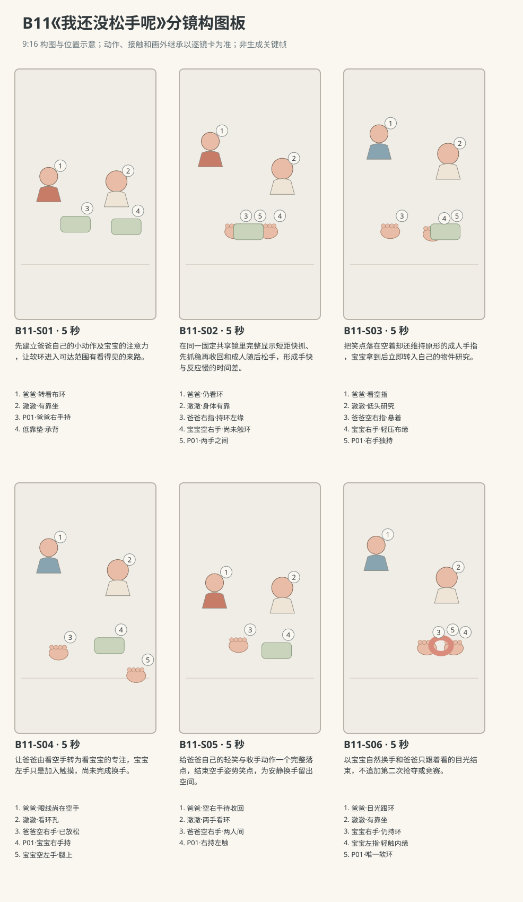

图示为构图位置示意；姿态、接触和画外继承以逐镜正文为准。

### 逐镜设计

#### B11-S01｜00—05 秒｜5 秒｜帧 [0, 120)

**镜头任务：**先建立爸爸自己的小动作及宝宝的注意力，让软环进入可达范围有看得见的来路。

**景别、机位与构图：**南侧略高的双人中全景朝北，爸爸画左、澈澈画右，北沙发作后景；低靠垫、宝宝骨盆与双脚在下部可见。爸爸右手持环在两人之间偏画左，宝宝两只空手与胸前空间均不遮挡。

**摄影机与理由：**固定，不追环或推近；先让观众看到成人转看布料，再看到宝宝目光跟上。

**焦点：**爸爸右指所持软环、宝宝双眼及空右手都清楚，靠垫和地垫保留可辨轮廓。

**入态：**澈澈有靠坐，右手空放右腿、左手空放左腿，眼看爸爸手里唯一P01；爸爸右拇指与食指捏环外缘于自己右膝上方，左手空放左膝。

**动作与表演：**

- 2 秒：爸爸低眼转看P01的缝边，右拇指和食指轻搓布缘，环随指间调整缓慢转过一小角度；澈澈眼睛跟着环。

- 2 秒：爸爸右前臂自然向两人之间挪一小掌，把环转成斜竖面；澈澈抬起空右手到胸前，背部仍贴低靠垫，左手留腿上。

- 1 秒：爸爸的转环动作放缓，靠宝宝的一侧外缘停在空右指前一小掌的距离；澈澈盯住那段布缘，没有提前抓住。

**声音：**安静室内底声，爸爸指间转布的轻擦声；无对白、旁白、音乐或提示抢夺的音效。

**出态：**P01由爸爸右拇指与食指捏住靠爸爸一侧外缘，环斜竖在两人之间，靠宝宝一侧外缘距澈澈空右指一小掌；宝宝空右手在胸前、左手腿上，爸爸左手左膝，眼仍看环。

**切点与承接：**沿同一南侧方向切稍紧的固定共享中景，继承环的位置、空右手和两者之间的短距离，不跳过接近过程。

**连续性：**画内看清唯一环仍归爸爸右手、宝宝双手为空及低靠垫承托；爸爸左手不参与转环。环进入范围靠成人右前臂的小幅移动，不靠宝宝向前扑。

**开始画面母稿：**

9:16竖幅原创三维家庭生活动画，圆润但保留婴儿头身、关节与身体重量，皮肤柔和、棉布哑光、低反差暖中性色；动作遵循生活物理。宝宝名叫澈澈，R1有靠坐与手部互动，不据此设定统一月龄；爸爸表情温和，有自己的注意力节奏。人物与场景参考尚未提供，身份和可见服装以后续确认参考为准，不凭空绑定素材。无字幕、无标识、无额外人物。本图为单一开始瞬间，人物、物件与接触只取以下起态；裁切外人物不为展示外观强行入画。固定空间和材质：客厅北墙固定沙发、西窗、东侧走廊入口、中央奶油地垫。相机在南半区朝北，不越人物东西轴线，爸爸在西侧画左，澈澈在东侧画右；西窗柔和漫射光由画左照入，暖墙反射填暗部。澈澈朝南有靠坐，低靠垫承背、骨盆与双脚落垫，不前扑、不抬臀；爸爸西侧坐，左手全程放左膝。唯一P01为珊瑚色大软布环，柔软棉布且环孔完整，具体持有与接触只按本镜起态，不预设仍归爸爸。构图范围：南侧略高的双人中全景朝北，爸爸画左、澈澈画右，北沙发作后景；低靠垫、宝宝骨盆与双脚在下部可见。爸爸右手持环在两人之间偏画左，宝宝两只空手与胸前空间均不遮挡。唯一此刻状态：澈澈有靠坐，右手空放右腿、左手空放左腿，眼看爸爸手里唯一P01；爸爸右拇指与食指捏环外缘于自己右膝上方，左手空放左膝。清晰度与焦点：爸爸右指所持软环、宝宝双眼及空右手都清楚，靠垫和地垫保留可辨轮廓。画面停在这个瞬间，不将后续动作阶段并列绘入。只画当前姿态与当前接触，不画动作轨迹、分格或未来终态。

**视频变化母稿：**

9:16竖幅原创三维家庭生活动画，圆润但保留婴儿头身、关节与身体重量，皮肤柔和、棉布哑光、低反差暖中性色；动作遵循生活物理。宝宝名叫澈澈，R1有靠坐与手部互动，不据此设定统一月龄；爸爸表情温和，有自己的注意力节奏。人物与场景参考尚未提供，身份和可见服装以后续确认参考为准，不凭空绑定素材。无字幕、无标识、无额外人物。本镜有效时长5秒，为一个连续镜头。固定空间和材质：客厅北墙固定沙发、西窗、东侧走廊入口、中央奶油地垫。相机在南半区朝北，不越人物东西轴线，爸爸在西侧画左，澈澈在东侧画右；西窗柔和漫射光由画左照入，暖墙反射填暗部。澈澈朝南有靠坐，低靠垫承背、骨盆与双脚落垫，不前扑、不抬臀；爸爸西侧坐，左手全程放左膝。唯一P01为珊瑚色大软布环，柔软棉布且环孔完整，具体持有与接触只按本镜起态，不预设仍归爸爸。摄影构图：南侧略高的双人中全景朝北，爸爸画左、澈澈画右，北沙发作后景；低靠垫、宝宝骨盆与双脚在下部可见。爸爸右手持环在两人之间偏画左，宝宝两只空手与胸前空间均不遮挡。摄影机：固定，不追环或推近；先让观众看到成人转看布料，再看到宝宝目光跟上。焦点：爸爸右指所持软环、宝宝双眼及空右手都清楚，靠垫和地垫保留可辨轮廓。起态：澈澈有靠坐，右手空放右腿、左手空放左腿，眼看爸爸手里唯一P01；爸爸右拇指与食指捏环外缘于自己右膝上方，左手空放左膝。阶段1，2秒：爸爸低眼转看P01的缝边，右拇指和食指轻搓布缘，环随指间调整缓慢转过一小角度；澈澈眼睛跟着环。阶段2，2秒：爸爸右前臂自然向两人之间挪一小掌，把环转成斜竖面；澈澈抬起空右手到胸前，背部仍贴低靠垫，左手留腿上。阶段3，1秒：爸爸的转环动作放缓，靠宝宝的一侧外缘停在空右指前一小掌的距离；澈澈盯住那段布缘，没有提前抓住。准确声音：安静室内底声，爸爸指间转布的轻擦声；无对白、旁白、音乐或提示抢夺的音效。终态：P01由爸爸右拇指与食指捏住靠爸爸一侧外缘，环斜竖在两人之间，靠宝宝一侧外缘距澈澈空右指一小掌；宝宝空右手在胸前、左手腿上，爸爸左手左膝，眼仍看环。接触和画外状态：画内看清唯一环仍归爸爸右手、宝宝双手为空及低靠垫承托；爸爸左手不参与转环。环进入范围靠成人右前臂的小幅移动，不靠宝宝向前扑。在该终态切出，不在本镜内部额外切镜；不增添人物、道具、语义对白或解释旁白。

#### B11-S02｜05—10 秒｜5 秒｜帧 [120, 240)

**镜头任务：**在同一固定共享镜里完整显示短距快抓、先抓稳再收回和成人随后松手，形成手快与反应慢的时间差。

**景别、机位与构图：**南侧固定共享中景略俯，爸爸画左、澈澈画右，两张脸居上；P01在中下偏左，爸爸右指在环的画左外缘，宝宝空右手在环的画右侧，初始一小掌间隙清楚。构图包含宝宝背靠垫和骨盆落垫位置，手与环不被脸、另一只手或身体遮住。

**摄影机与理由：**全镜固定，一镜到底显示伸手、触布、合指、屈肘、成人松指及空手停留；不用插入反应特写、甩镜、速度坡或慢动作。

**焦点：**爸爸右指当前捏住的外缘、宝宝空右手及其间一小掌空隙清楚，环孔与宝宝右肘可读，成人和宝宝眼睛可辨；不靠运动模糊遮动作。

**入态：**P01由爸爸右拇指与食指捏住靠爸爸一侧外缘，环斜竖在两人之间，靠宝宝一侧外缘距澈澈空右指一小掌；宝宝空右手在胸前、左手腿上，爸爸左手左膝，眼仍看环。

**动作与表演：**

- 1 秒：爸爸指间只再缓慢转动一点布缘；澈澈目光固定在靠自己的一侧外缘，右掌由半握松开，尚未触环。

- 1 秒：澈澈右前臂突然作短距离伸出，右指先碰到靠自己一侧外缘，随即合拢抓稳；爸爸右指仍捏另一侧，短暂双持清楚可见，宝宝背和骨盆不离支撑。

- 1 秒：宝宝抓稳后屈右肘，把环向胸前收回一小掌；爸爸右手沿势让出很小距离，随后拇指和食指分开释放外缘，不抵住环或拉宝宝，环由宝宝右手独持。

- 2 秒：环停在澈澈胸前，宝宝低眼看布缘；爸爸空右手留在原处，拇指和食指松弯成近似捏环的姿势，眼睛才跟到宝宝胸前的环，手没有追过去。

**声音：**先一声轻微转布声，快抓时短促布擦、收至胸前时衣料轻响；抓稳和成人释放对应实接触，不配嗖声、重击或抢夺胜利音。无对白。

**出态：**P01只由澈澈右手握在胸前，左手仍腿上；爸爸空右手悬在两人间、拇指食指仍松弯成捏环形，左手留膝，目光落在宝宝胸前的环；宝宝背和骨盆承托未变。

**切点与承接：**在环已独归宝宝、成人空指还悬着的停顿后切稍紧共享镜，不在双持或松指中切开。

**连续性：**画内完整证明宝宝先触布合握、随后屈肘，再由爸爸松指；P01不瞬移、不复制、不过度拉长，爸爸没有抓宝宝腕臂。快只来自短距离动作，成人反应延迟另由空手停留表现。

**开始画面母稿：**

9:16竖幅原创三维家庭生活动画，圆润但保留婴儿头身、关节与身体重量，皮肤柔和、棉布哑光、低反差暖中性色；动作遵循生活物理。宝宝名叫澈澈，R1有靠坐与手部互动，不据此设定统一月龄；爸爸表情温和，有自己的注意力节奏。人物与场景参考尚未提供，身份和可见服装以后续确认参考为准，不凭空绑定素材。无字幕、无标识、无额外人物。本图为单一开始瞬间，人物、物件与接触只取以下起态；裁切外人物不为展示外观强行入画。固定空间和材质：客厅北墙固定沙发、西窗、东侧走廊入口、中央奶油地垫。相机在南半区朝北，不越人物东西轴线，爸爸在西侧画左，澈澈在东侧画右；西窗柔和漫射光由画左照入，暖墙反射填暗部。澈澈朝南有靠坐，低靠垫承背、骨盆与双脚落垫，不前扑、不抬臀；爸爸西侧坐，左手全程放左膝。唯一P01为珊瑚色大软布环，柔软棉布且环孔完整，具体持有与接触只按本镜起态，不预设仍归爸爸。构图范围：南侧固定共享中景略俯，爸爸画左、澈澈画右，两张脸居上；P01在中下偏左，爸爸右指在环的画左外缘，宝宝空右手在环的画右侧，初始一小掌间隙清楚。构图包含宝宝背靠垫和骨盆落垫位置，手与环不被脸、另一只手或身体遮住。唯一此刻状态：P01由爸爸右拇指与食指捏住靠爸爸一侧外缘，环斜竖在两人之间，靠宝宝一侧外缘距澈澈空右指一小掌；宝宝空右手在胸前、左手腿上，爸爸左手左膝，眼仍看环。清晰度与焦点：爸爸右指当前捏住的外缘、宝宝空右手及其间一小掌空隙清楚，环孔与宝宝右肘可读，成人和宝宝眼睛可辨；不靠运动模糊遮动作。画面停在这个瞬间，不将后续动作阶段并列绘入。只画当前姿态与当前接触，不画动作轨迹、分格或未来终态。

**视频变化母稿：**

9:16竖幅原创三维家庭生活动画，圆润但保留婴儿头身、关节与身体重量，皮肤柔和、棉布哑光、低反差暖中性色；动作遵循生活物理。宝宝名叫澈澈，R1有靠坐与手部互动，不据此设定统一月龄；爸爸表情温和，有自己的注意力节奏。人物与场景参考尚未提供，身份和可见服装以后续确认参考为准，不凭空绑定素材。无字幕、无标识、无额外人物。本镜有效时长5秒，为一个连续镜头。固定空间和材质：客厅北墙固定沙发、西窗、东侧走廊入口、中央奶油地垫。相机在南半区朝北，不越人物东西轴线，爸爸在西侧画左，澈澈在东侧画右；西窗柔和漫射光由画左照入，暖墙反射填暗部。澈澈朝南有靠坐，低靠垫承背、骨盆与双脚落垫，不前扑、不抬臀；爸爸西侧坐，左手全程放左膝。唯一P01为珊瑚色大软布环，柔软棉布且环孔完整，具体持有与接触只按本镜起态，不预设仍归爸爸。摄影构图：南侧固定共享中景略俯，爸爸画左、澈澈画右，两张脸居上；P01在中下偏左，爸爸右指在环的画左外缘，宝宝空右手在环的画右侧，初始一小掌间隙清楚。构图包含宝宝背靠垫和骨盆落垫位置，手与环不被脸、另一只手或身体遮住。摄影机：全镜固定，一镜到底显示伸手、触布、合指、屈肘、成人松指及空手停留；不用插入反应特写、甩镜、速度坡或慢动作。焦点：爸爸右指当前捏住的外缘、宝宝空右手及其间一小掌空隙清楚，环孔与宝宝右肘可读，成人和宝宝眼睛可辨；不靠运动模糊遮动作。起态：P01由爸爸右拇指与食指捏住靠爸爸一侧外缘，环斜竖在两人之间，靠宝宝一侧外缘距澈澈空右指一小掌；宝宝空右手在胸前、左手腿上，爸爸左手左膝，眼仍看环。阶段1，1秒：爸爸指间只再缓慢转动一点布缘；澈澈目光固定在靠自己的一侧外缘，右掌由半握松开，尚未触环。阶段2，1秒：澈澈右前臂突然作短距离伸出，右指先碰到靠自己一侧外缘，随即合拢抓稳；爸爸右指仍捏另一侧，短暂双持清楚可见，宝宝背和骨盆不离支撑。阶段3，1秒：宝宝抓稳后屈右肘，把环向胸前收回一小掌；爸爸右手沿势让出很小距离，随后拇指和食指分开释放外缘，不抵住环或拉宝宝，环由宝宝右手独持。阶段4，2秒：环停在澈澈胸前，宝宝低眼看布缘；爸爸空右手留在原处，拇指和食指松弯成近似捏环的姿势，眼睛才跟到宝宝胸前的环，手没有追过去。准确声音：先一声轻微转布声，快抓时短促布擦、收至胸前时衣料轻响；抓稳和成人释放对应实接触，不配嗖声、重击或抢夺胜利音。无对白。终态：P01只由澈澈右手握在胸前，左手仍腿上；爸爸空右手悬在两人间、拇指食指仍松弯成捏环形，左手留膝，目光落在宝宝胸前的环；宝宝背和骨盆承托未变。接触和画外状态：画内完整证明宝宝先触布合握、随后屈肘，再由爸爸松指；P01不瞬移、不复制、不过度拉长，爸爸没有抓宝宝腕臂。快只来自短距离动作，成人反应延迟另由空手停留表现。在该终态切出，不在本镜内部额外切镜；不增添人物、道具、语义对白或解释旁白。

#### B11-S03｜10—15 秒｜5 秒｜帧 [240, 360)

**镜头任务：**把笑点落在空着却还维持原形的成人手指，宝宝拿到后立即转入自己的物件研究。

**景别、机位与构图：**南侧稍紧共享中近景，爸爸脸在画左上、宝宝脸在画右上；爸爸空右指在左中，宝宝右手和P01在右中胸前，环孔和右拇指均可见，宝宝空左手保留下缘。

**摄影机与理由：**固定，让爸爸眼线从环转向自己空手，同时保留宝宝研究动作，避免用单独成人特写替代两者关系。

**焦点：**爸爸空右拇指和食指、宝宝右手所握软环与两人眼睛同时可读，空指间确实没有布料。

**入态：**P01只由澈澈右手握在胸前，左手仍腿上；爸爸空右手悬在两人间、拇指食指仍松弯成捏环形，左手留膝，目光落在宝宝胸前的环；宝宝背和骨盆承托未变。

**动作与表演：**

- 2 秒：澈澈右拇指轻压所握布缘，软布局部瘪下又回弹，环孔仍完整；爸爸视线从环移回自己悬着的空右指。

- 3 秒：爸爸盯着空指，轻眨一下眼，拇指和食指渐渐松开成放松的空手，右手仍悬在两人间；澈澈把环在右手中小幅转斜，低头研究内缘，左手保持腿上。

**声音：**只留软布受压的细擦、呼吸和安静室内底声；爸爸此镜不说话、不痛叫，宝宝不发成人得意笑声。

**出态：**P01仍由澈澈右手在胸前独持、环面稍斜，左手空放腿上；爸爸低眼看自己悬着的空右手，手指已经自然松开，左手膝上，嘴角尚平。

**切点与承接：**接爸爸从空手重新看向宝宝的眼线，下一镜保持环和空指的相对位置。

**连续性：**画内能分清爸爸空右手和宝宝持环右手，爸爸看自己的手只是晚半拍反应，没有第二次索取；宝宝右拇指只揉自己已握住的一段，不凭空换握到环另一侧。

**开始画面母稿：**

9:16竖幅原创三维家庭生活动画，圆润但保留婴儿头身、关节与身体重量，皮肤柔和、棉布哑光、低反差暖中性色；动作遵循生活物理。宝宝名叫澈澈，R1有靠坐与手部互动，不据此设定统一月龄；爸爸表情温和，有自己的注意力节奏。人物与场景参考尚未提供，身份和可见服装以后续确认参考为准，不凭空绑定素材。无字幕、无标识、无额外人物。本图为单一开始瞬间，人物、物件与接触只取以下起态；裁切外人物不为展示外观强行入画。固定空间和材质：客厅北墙固定沙发、西窗、东侧走廊入口、中央奶油地垫。相机在南半区朝北，不越人物东西轴线，爸爸在西侧画左，澈澈在东侧画右；西窗柔和漫射光由画左照入，暖墙反射填暗部。澈澈朝南有靠坐，低靠垫承背、骨盆与双脚落垫，不前扑、不抬臀；爸爸西侧坐，左手全程放左膝。唯一P01为珊瑚色大软布环，柔软棉布且环孔完整，具体持有与接触只按本镜起态，不预设仍归爸爸。构图范围：南侧稍紧共享中近景，爸爸脸在画左上、宝宝脸在画右上；爸爸空右指在左中，宝宝右手和P01在右中胸前，环孔和右拇指均可见，宝宝空左手保留下缘。唯一此刻状态：P01只由澈澈右手握在胸前，左手仍腿上；爸爸空右手悬在两人间、拇指食指仍松弯成捏环形，左手留膝，目光落在宝宝胸前的环；宝宝背和骨盆承托未变。清晰度与焦点：爸爸空右拇指和食指、宝宝右手所握软环与两人眼睛同时可读，空指间确实没有布料。画面停在这个瞬间，不将后续动作阶段并列绘入。只画当前姿态与当前接触，不画动作轨迹、分格或未来终态。

**视频变化母稿：**

9:16竖幅原创三维家庭生活动画，圆润但保留婴儿头身、关节与身体重量，皮肤柔和、棉布哑光、低反差暖中性色；动作遵循生活物理。宝宝名叫澈澈，R1有靠坐与手部互动，不据此设定统一月龄；爸爸表情温和，有自己的注意力节奏。人物与场景参考尚未提供，身份和可见服装以后续确认参考为准，不凭空绑定素材。无字幕、无标识、无额外人物。本镜有效时长5秒，为一个连续镜头。固定空间和材质：客厅北墙固定沙发、西窗、东侧走廊入口、中央奶油地垫。相机在南半区朝北，不越人物东西轴线，爸爸在西侧画左，澈澈在东侧画右；西窗柔和漫射光由画左照入，暖墙反射填暗部。澈澈朝南有靠坐，低靠垫承背、骨盆与双脚落垫，不前扑、不抬臀；爸爸西侧坐，左手全程放左膝。唯一P01为珊瑚色大软布环，柔软棉布且环孔完整，具体持有与接触只按本镜起态，不预设仍归爸爸。摄影构图：南侧稍紧共享中近景，爸爸脸在画左上、宝宝脸在画右上；爸爸空右指在左中，宝宝右手和P01在右中胸前，环孔和右拇指均可见，宝宝空左手保留下缘。摄影机：固定，让爸爸眼线从环转向自己空手，同时保留宝宝研究动作，避免用单独成人特写替代两者关系。焦点：爸爸空右拇指和食指、宝宝右手所握软环与两人眼睛同时可读，空指间确实没有布料。起态：P01只由澈澈右手握在胸前，左手仍腿上；爸爸空右手悬在两人间、拇指食指仍松弯成捏环形，左手留膝，目光落在宝宝胸前的环；宝宝背和骨盆承托未变。阶段1，2秒：澈澈右拇指轻压所握布缘，软布局部瘪下又回弹，环孔仍完整；爸爸视线从环移回自己悬着的空右指。阶段2，3秒：爸爸盯着空指，轻眨一下眼，拇指和食指渐渐松开成放松的空手，右手仍悬在两人间；澈澈把环在右手中小幅转斜，低头研究内缘，左手保持腿上。准确声音：只留软布受压的细擦、呼吸和安静室内底声；爸爸此镜不说话、不痛叫，宝宝不发成人得意笑声。终态：P01仍由澈澈右手在胸前独持、环面稍斜，左手空放腿上；爸爸低眼看自己悬着的空右手，手指已经自然松开，左手膝上，嘴角尚平。接触和画外状态：画内能分清爸爸空右手和宝宝持环右手，爸爸看自己的手只是晚半拍反应，没有第二次索取；宝宝右拇指只揉自己已握住的一段，不凭空换握到环另一侧。在该终态切出，不在本镜内部额外切镜；不增添人物、道具、语义对白或解释旁白。

#### B11-S04｜15—20 秒｜5 秒｜帧 [360, 480)

**镜头任务：**让爸爸由看空手转为看宝宝的专注，宝宝左手只是加入触摸，尚未完成换手。

**景别、机位与构图：**南侧共享中近景，爸爸画左、宝宝画右，两张脸及胸前软环同框；爸爸放松的空右手停在画左下，宝宝空左手仍在腿上画右下。环的内缘和宝宝右手握点分开可见。

**摄影机与理由：**固定，靠爸爸的眼线和嘴角、宝宝左手逐渐靠近形成变化，不沿环转动绕轴。

**焦点：**两人眼睛、宝宝右手持环点和仍空的左手清楚，成人空指只作可辨前景，不抢焦。

**入态：**P01仍由澈澈右手在胸前独持、环面稍斜，左手空放腿上；爸爸低眼看自己悬着的空右手，手指已经自然松开，左手膝上，嘴角尚平。

**动作与表演：**

- 2 秒：爸爸从空右指抬眼看澈澈；宝宝只盯着环孔，右腕转一点，让内缘朝向自己，环仍在胸前。

- 2 秒：澈澈抬起左手，左食指先轻碰环的内缘，摸过一小段；右手始终握住外缘，左手此时只触摸、不合握。

- 1 秒：爸爸看着那根探索的左食指，嘴角慢慢松开；自己的空右手仍留两人之间，没有重新伸向环。

**声音：**宝宝左指擦软布的轻响，留一小段安静呼吸；无对白，成人尚未发笑，不用配乐解释情绪。

**出态：**澈澈右手握P01外缘于胸前，左指轻贴内缘但尚未合握；爸爸看宝宝双手，嘴角微松，空右手仍悬在两人间，左手膝上。

**切点与承接：**切稍宽共享中景，让下一镜的成人放松收手有可见去处；宝宝两手与环保持当前接触。

**连续性：**画内明确左指只是触摸，P01仍归宝宝右手；爸爸空右指没有接近环，左手未离膝。身体支撑、环孔和软布身份延续。

**开始画面母稿：**

9:16竖幅原创三维家庭生活动画，圆润但保留婴儿头身、关节与身体重量，皮肤柔和、棉布哑光、低反差暖中性色；动作遵循生活物理。宝宝名叫澈澈，R1有靠坐与手部互动，不据此设定统一月龄；爸爸表情温和，有自己的注意力节奏。人物与场景参考尚未提供，身份和可见服装以后续确认参考为准，不凭空绑定素材。无字幕、无标识、无额外人物。本图为单一开始瞬间，人物、物件与接触只取以下起态；裁切外人物不为展示外观强行入画。固定空间和材质：客厅北墙固定沙发、西窗、东侧走廊入口、中央奶油地垫。相机在南半区朝北，不越人物东西轴线，爸爸在西侧画左，澈澈在东侧画右；西窗柔和漫射光由画左照入，暖墙反射填暗部。澈澈朝南有靠坐，低靠垫承背、骨盆与双脚落垫，不前扑、不抬臀；爸爸西侧坐，左手全程放左膝。唯一P01为珊瑚色大软布环，柔软棉布且环孔完整，具体持有与接触只按本镜起态，不预设仍归爸爸。构图范围：南侧共享中近景，爸爸画左、宝宝画右，两张脸及胸前软环同框；爸爸放松的空右手停在画左下，宝宝空左手仍在腿上画右下。环的内缘和宝宝右手握点分开可见。唯一此刻状态：P01仍由澈澈右手在胸前独持、环面稍斜，左手空放腿上；爸爸低眼看自己悬着的空右手，手指已经自然松开，左手膝上，嘴角尚平。清晰度与焦点：两人眼睛、宝宝右手持环点和仍空的左手清楚，成人空指只作可辨前景，不抢焦。画面停在这个瞬间，不将后续动作阶段并列绘入。只画当前姿态与当前接触，不画动作轨迹、分格或未来终态。

**视频变化母稿：**

9:16竖幅原创三维家庭生活动画，圆润但保留婴儿头身、关节与身体重量，皮肤柔和、棉布哑光、低反差暖中性色；动作遵循生活物理。宝宝名叫澈澈，R1有靠坐与手部互动，不据此设定统一月龄；爸爸表情温和，有自己的注意力节奏。人物与场景参考尚未提供，身份和可见服装以后续确认参考为准，不凭空绑定素材。无字幕、无标识、无额外人物。本镜有效时长5秒，为一个连续镜头。固定空间和材质：客厅北墙固定沙发、西窗、东侧走廊入口、中央奶油地垫。相机在南半区朝北，不越人物东西轴线，爸爸在西侧画左，澈澈在东侧画右；西窗柔和漫射光由画左照入，暖墙反射填暗部。澈澈朝南有靠坐，低靠垫承背、骨盆与双脚落垫，不前扑、不抬臀；爸爸西侧坐，左手全程放左膝。唯一P01为珊瑚色大软布环，柔软棉布且环孔完整，具体持有与接触只按本镜起态，不预设仍归爸爸。摄影构图：南侧共享中近景，爸爸画左、宝宝画右，两张脸及胸前软环同框；爸爸放松的空右手停在画左下，宝宝空左手仍在腿上画右下。环的内缘和宝宝右手握点分开可见。摄影机：固定，靠爸爸的眼线和嘴角、宝宝左手逐渐靠近形成变化，不沿环转动绕轴。焦点：两人眼睛、宝宝右手持环点和仍空的左手清楚，成人空指只作可辨前景，不抢焦。起态：P01仍由澈澈右手在胸前独持、环面稍斜，左手空放腿上；爸爸低眼看自己悬着的空右手，手指已经自然松开，左手膝上，嘴角尚平。阶段1，2秒：爸爸从空右指抬眼看澈澈；宝宝只盯着环孔，右腕转一点，让内缘朝向自己，环仍在胸前。阶段2，2秒：澈澈抬起左手，左食指先轻碰环的内缘，摸过一小段；右手始终握住外缘，左手此时只触摸、不合握。阶段3，1秒：爸爸看着那根探索的左食指，嘴角慢慢松开；自己的空右手仍留两人之间，没有重新伸向环。准确声音：宝宝左指擦软布的轻响，留一小段安静呼吸；无对白，成人尚未发笑，不用配乐解释情绪。终态：澈澈右手握P01外缘于胸前，左指轻贴内缘但尚未合握；爸爸看宝宝双手，嘴角微松，空右手仍悬在两人间，左手膝上。接触和画外状态：画内明确左指只是触摸，P01仍归宝宝右手；爸爸空右指没有接近环，左手未离膝。身体支撑、环孔和软布身份延续。在该终态切出，不在本镜内部额外切镜；不增添人物、道具、语义对白或解释旁白。

#### B11-S05｜20—25 秒｜5 秒｜帧 [480, 600)

**镜头任务：**给爸爸自己的轻笑与收手动作一个完整落点，结束空手姿势笑点，为安静换手留出空间。

**景别、机位与构图：**南侧双人中景略俯，爸爸画左、宝宝画右，两张脸在上；爸爸空右手在两人间、右膝在画左下同框，左手放左膝。宝宝胸前P01、右手握点和轻贴内缘的左指均可见，低靠垫仍在背后。

**摄影机与理由：**固定，略宽于前镜是为了完整看见空右手回膝，而非藏掉收手动作。

**焦点：**爸爸表情、空右手到右膝的可见空间及宝宝两手环保持清楚，不把远近虚化成接触错误。

**入态：**澈澈右手握P01外缘于胸前，左指轻贴内缘但尚未合握；爸爸看宝宝双手，嘴角微松，空右手仍悬在两人间，左手膝上。

**动作与表演：**

- 2 秒：爸爸低低笑出一口气，空右手轻垂一点、手腕放松；澈澈继续用左指摸内缘，没有抬眼回应。

- 3 秒：爸爸空右手沿自己的前臂方向收回，落在右膝，视线仍跟着宝宝双手；澈澈右手把环微转向身体左侧，左指仍轻贴，身体不前扑。

**声音：**爸爸一声很轻的自然笑气，跟随手放膝的一点衣料声；宝宝摸环只有随接触出现的轻微细擦，不拉成夸张连续音。无对白、旁白和音乐。

**出态：**爸爸双手各自落膝、面带小笑，看宝宝胸前的P01；澈澈右手仍握外缘，左指轻贴内缘，环稍向宝宝左侧倾，背和骨盆有靠。

**切点与承接：**保留同一南侧方向接最后共享镜，明确成人双手已经退回，接下来只由宝宝两手交换环。

**连续性：**爸爸右手画内完整回右膝，左手从未离左膝；收回后不再碰环。宝宝左指触摸不等于左手已经接管，环在右手持续受控，无掉落声。

**开始画面母稿：**

9:16竖幅原创三维家庭生活动画，圆润但保留婴儿头身、关节与身体重量，皮肤柔和、棉布哑光、低反差暖中性色；动作遵循生活物理。宝宝名叫澈澈，R1有靠坐与手部互动，不据此设定统一月龄；爸爸表情温和，有自己的注意力节奏。人物与场景参考尚未提供，身份和可见服装以后续确认参考为准，不凭空绑定素材。无字幕、无标识、无额外人物。本图为单一开始瞬间，人物、物件与接触只取以下起态；裁切外人物不为展示外观强行入画。固定空间和材质：客厅北墙固定沙发、西窗、东侧走廊入口、中央奶油地垫。相机在南半区朝北，不越人物东西轴线，爸爸在西侧画左，澈澈在东侧画右；西窗柔和漫射光由画左照入，暖墙反射填暗部。澈澈朝南有靠坐，低靠垫承背、骨盆与双脚落垫，不前扑、不抬臀；爸爸西侧坐，左手全程放左膝。唯一P01为珊瑚色大软布环，柔软棉布且环孔完整，具体持有与接触只按本镜起态，不预设仍归爸爸。构图范围：南侧双人中景略俯，爸爸画左、宝宝画右，两张脸在上；爸爸空右手在两人间、右膝在画左下同框，左手放左膝。宝宝胸前P01、右手握点和轻贴内缘的左指均可见，低靠垫仍在背后。唯一此刻状态：澈澈右手握P01外缘于胸前，左指轻贴内缘但尚未合握；爸爸看宝宝双手，嘴角微松，空右手仍悬在两人间，左手膝上。清晰度与焦点：爸爸表情、空右手到右膝的可见空间及宝宝两手环保持清楚，不把远近虚化成接触错误。画面停在这个瞬间，不将后续动作阶段并列绘入。只画当前姿态与当前接触，不画动作轨迹、分格或未来终态。

**视频变化母稿：**

9:16竖幅原创三维家庭生活动画，圆润但保留婴儿头身、关节与身体重量，皮肤柔和、棉布哑光、低反差暖中性色；动作遵循生活物理。宝宝名叫澈澈，R1有靠坐与手部互动，不据此设定统一月龄；爸爸表情温和，有自己的注意力节奏。人物与场景参考尚未提供，身份和可见服装以后续确认参考为准，不凭空绑定素材。无字幕、无标识、无额外人物。本镜有效时长5秒，为一个连续镜头。固定空间和材质：客厅北墙固定沙发、西窗、东侧走廊入口、中央奶油地垫。相机在南半区朝北，不越人物东西轴线，爸爸在西侧画左，澈澈在东侧画右；西窗柔和漫射光由画左照入，暖墙反射填暗部。澈澈朝南有靠坐，低靠垫承背、骨盆与双脚落垫，不前扑、不抬臀；爸爸西侧坐，左手全程放左膝。唯一P01为珊瑚色大软布环，柔软棉布且环孔完整，具体持有与接触只按本镜起态，不预设仍归爸爸。摄影构图：南侧双人中景略俯，爸爸画左、宝宝画右，两张脸在上；爸爸空右手在两人间、右膝在画左下同框，左手放左膝。宝宝胸前P01、右手握点和轻贴内缘的左指均可见，低靠垫仍在背后。摄影机：固定，略宽于前镜是为了完整看见空右手回膝，而非藏掉收手动作。焦点：爸爸表情、空右手到右膝的可见空间及宝宝两手环保持清楚，不把远近虚化成接触错误。起态：澈澈右手握P01外缘于胸前，左指轻贴内缘但尚未合握；爸爸看宝宝双手，嘴角微松，空右手仍悬在两人间，左手膝上。阶段1，2秒：爸爸低低笑出一口气，空右手轻垂一点、手腕放松；澈澈继续用左指摸内缘，没有抬眼回应。阶段2，3秒：爸爸空右手沿自己的前臂方向收回，落在右膝，视线仍跟着宝宝双手；澈澈右手把环微转向身体左侧，左指仍轻贴，身体不前扑。准确声音：爸爸一声很轻的自然笑气，跟随手放膝的一点衣料声；宝宝摸环只有随接触出现的轻微细擦，不拉成夸张连续音。无对白、旁白和音乐。终态：爸爸双手各自落膝、面带小笑，看宝宝胸前的P01；澈澈右手仍握外缘，左指轻贴内缘，环稍向宝宝左侧倾，背和骨盆有靠。接触和画外状态：爸爸右手画内完整回右膝，左手从未离左膝；收回后不再碰环。宝宝左指触摸不等于左手已经接管，环在右手持续受控，无掉落声。在该终态切出，不在本镜内部额外切镜；不增添人物、道具、语义对白或解释旁白。

#### B11-S06｜25—30 秒｜5 秒｜帧 [600, 720)

**镜头任务：**以宝宝自然换手和爸爸只跟着看的目光结束，不追加第二次抢夺或竞赛。

**景别、机位与构图：**南侧固定双人中景，爸爸画左、宝宝画右，与前镜方向一致；爸爸双手各放膝在左下清楚，宝宝右手持环、左指触内缘在胸前中右，双手接触区无遮挡。低靠垫轮廓和宝宝双腿保留，不把身体画成站立。

**摄影机与理由：**全镜固定，换手的左指合握、短暂双持和右指打开在一镜内完成；不用切镜替换持有人。

**焦点：**宝宝右手已握住的外缘、左指当前轻触的内缘及P01环孔清楚，爸爸目光保持可读；不转焦遮去手指接触。

**入态：**爸爸双手各自落膝、面带小笑，看宝宝胸前的P01；澈澈右手仍握外缘，左指轻贴内缘，环稍向宝宝左侧倾，背和骨盆有靠。

**动作与表演：**

- 2 秒：澈澈把左指从内缘移到靠自己左侧的外缘，左掌贴住后合拢，形成左右手同时握住同一软环的短暂双持；右手没有提前放开。

- 1 秒：宝宝右指逐渐松开，P01完整留在已抓稳的左手，右手空悬胸前；爸爸目光顺着环向宝宝左侧移动，双手仍膝上。

- 2 秒：澈澈低头看左手里的环，空右掌轻张一下后停住；爸爸保持小笑，只看着他，没有伸手接回。

**声音：**左手合握和右手释放的一点棉布摩擦，随后留呼吸和室内底声；无落物声、重复抢夺音效或片尾追加笑点台词。

**出态：**P01由澈澈左手独持胸前偏左侧，右手空在胸前；爸爸双手仍各自膝上，视线跟着左手里的环，低靠垫与坐姿支撑不变。

**切点与承接：**在宝宝专注看左手里的环、爸爸安静跟随的状态结束，不循环回成人持环。

**连续性：**画内先左手抓稳、短暂双持、再右手释放，只有一只P01；爸爸双手画内留膝，未抢回。宝宝左手在正面画右，右手在正面画左，不镜像换手。片尾维持环孔与软体形变连续。

**开始画面母稿：**

9:16竖幅原创三维家庭生活动画，圆润但保留婴儿头身、关节与身体重量，皮肤柔和、棉布哑光、低反差暖中性色；动作遵循生活物理。宝宝名叫澈澈，R1有靠坐与手部互动，不据此设定统一月龄；爸爸表情温和，有自己的注意力节奏。人物与场景参考尚未提供，身份和可见服装以后续确认参考为准，不凭空绑定素材。无字幕、无标识、无额外人物。本图为单一开始瞬间，人物、物件与接触只取以下起态；裁切外人物不为展示外观强行入画。固定空间和材质：客厅北墙固定沙发、西窗、东侧走廊入口、中央奶油地垫。相机在南半区朝北，不越人物东西轴线，爸爸在西侧画左，澈澈在东侧画右；西窗柔和漫射光由画左照入，暖墙反射填暗部。澈澈朝南有靠坐，低靠垫承背、骨盆与双脚落垫，不前扑、不抬臀；爸爸西侧坐，左手全程放左膝。唯一P01为珊瑚色大软布环，柔软棉布且环孔完整，具体持有与接触只按本镜起态，不预设仍归爸爸。构图范围：南侧固定双人中景，爸爸画左、宝宝画右，与前镜方向一致；爸爸双手各放膝在左下清楚，宝宝右手持环、左指触内缘在胸前中右，双手接触区无遮挡。低靠垫轮廓和宝宝双腿保留，不把身体画成站立。唯一此刻状态：爸爸双手各自落膝、面带小笑，看宝宝胸前的P01；澈澈右手仍握外缘，左指轻贴内缘，环稍向宝宝左侧倾，背和骨盆有靠。清晰度与焦点：宝宝右手已握住的外缘、左指当前轻触的内缘及P01环孔清楚，爸爸目光保持可读；不转焦遮去手指接触。画面停在这个瞬间，不将后续动作阶段并列绘入。只画当前姿态与当前接触，不画动作轨迹、分格或未来终态。

**视频变化母稿：**

9:16竖幅原创三维家庭生活动画，圆润但保留婴儿头身、关节与身体重量，皮肤柔和、棉布哑光、低反差暖中性色；动作遵循生活物理。宝宝名叫澈澈，R1有靠坐与手部互动，不据此设定统一月龄；爸爸表情温和，有自己的注意力节奏。人物与场景参考尚未提供，身份和可见服装以后续确认参考为准，不凭空绑定素材。无字幕、无标识、无额外人物。本镜有效时长5秒，为一个连续镜头。固定空间和材质：客厅北墙固定沙发、西窗、东侧走廊入口、中央奶油地垫。相机在南半区朝北，不越人物东西轴线，爸爸在西侧画左，澈澈在东侧画右；西窗柔和漫射光由画左照入，暖墙反射填暗部。澈澈朝南有靠坐，低靠垫承背、骨盆与双脚落垫，不前扑、不抬臀；爸爸西侧坐，左手全程放左膝。唯一P01为珊瑚色大软布环，柔软棉布且环孔完整，具体持有与接触只按本镜起态，不预设仍归爸爸。摄影构图：南侧固定双人中景，爸爸画左、宝宝画右，与前镜方向一致；爸爸双手各放膝在左下清楚，宝宝右手持环、左指触内缘在胸前中右，双手接触区无遮挡。低靠垫轮廓和宝宝双腿保留，不把身体画成站立。摄影机：全镜固定，换手的左指合握、短暂双持和右指打开在一镜内完成；不用切镜替换持有人。焦点：宝宝右手已握住的外缘、左指当前轻触的内缘及P01环孔清楚，爸爸目光保持可读；不转焦遮去手指接触。起态：爸爸双手各自落膝、面带小笑，看宝宝胸前的P01；澈澈右手仍握外缘，左指轻贴内缘，环稍向宝宝左侧倾，背和骨盆有靠。阶段1，2秒：澈澈把左指从内缘移到靠自己左侧的外缘，左掌贴住后合拢，形成左右手同时握住同一软环的短暂双持；右手没有提前放开。阶段2，1秒：宝宝右指逐渐松开，P01完整留在已抓稳的左手，右手空悬胸前；爸爸目光顺着环向宝宝左侧移动，双手仍膝上。阶段3，2秒：澈澈低头看左手里的环，空右掌轻张一下后停住；爸爸保持小笑，只看着他，没有伸手接回。准确声音：左手合握和右手释放的一点棉布摩擦，随后留呼吸和室内底声；无落物声、重复抢夺音效或片尾追加笑点台词。终态：P01由澈澈左手独持胸前偏左侧，右手空在胸前；爸爸双手仍各自膝上，视线跟着左手里的环，低靠垫与坐姿支撑不变。接触和画外状态：画内先左手抓稳、短暂双持、再右手释放，只有一只P01；爸爸双手画内留膝，未抢回。宝宝左手在正面画右，右手在正面画左，不镜像换手。片尾维持环孔与软体形变连续。在该终态切出，不在本镜内部额外切镜；不增添人物、道具、语义对白或解释旁白。

### 声音与剪辑

全片无语义对白、无旁白、无背景音乐；片名不是爸爸的口头台词。连续轻室内底声维持客厅声场；布环擦指、软布受压、贴近胸前的衣料声均跟随实接触，快抓不配嗖声或冲击声。爸爸只在B11-S05轻笑一口气，不用夸张惊叫代替晚半拍目光与空手表演，宝宝保留自然呼吸，不配成人得意口气。

正式台词：无；保留镜头声音中已写明的自然发声。

### 连续性与试片

- 连续性：宝宝正式名字为澈澈；R1有靠坐只说明本条能力，低靠垫承背、骨盆与双脚落垫贯穿全片，不用前扑或被拉起制造速度。

- 连续性：P01只有一只珊瑚色大软布环，初归爸爸右拇指与食指；B11-S02宝宝右手抓近己外缘，爸爸仍持另一缘，短暂双持后爸爸释放，环再归宝宝右手。所有握点与释放必须实际出现。

- 连续性：关键快抓全部留在B11-S02同一固定共享镜；动作距离只一小掌，先合握、再屈肘、成人沿势让位并松指，不拉腕、不拔河，不用瞬移、隐藏切镜、加速坡或超能力轨迹。

- 连续性：爸爸左手全程左膝；右手在S02释放后留两人间，S03先看空指并逐渐松开手指、S04再看宝宝，S05轻笑收至右膝，S06双手均膝上只用目光跟随。

- 连续性：宝宝左手在S01—S03空放腿上，S04—S05只触摸内缘；S06先左手抓稳、双持、右指再释放，尾态左手独持环。正面宝宝右手在画面偏左、左手偏右，不镜像替换。

- 连续性：全部相机位于南半区朝北，爸爸在西侧画左，宝宝画右；西窗光从画左照入。背景北沙发、低靠垫和地垫不变，不增加托盘或其他可抢物。

- 连续性：当前人物和场景参考尚未提供，不把P01制作编号当作上传素材或绑定首帧；外观以后续参考核对，软环结构、左右手、支撑与可达距离仍需实际试片。

- 试片：B11-S01—S02：首图需看见环仍在爸爸右指、宝宝空右手与外缘有一小掌间隙；若开始图已双持、已收环到胸前或宝宝前扑，则失败。

- 试片：B11-S02：不切镜逐帧能指出触布、宝宝右指合握、屈肘收回、爸爸松指的先后；若借遮挡、模糊、速度坡或环瞬移跳过其中一步，则失败。

- 试片：B11-S02：宝宝背与骨盆保持支撑，爸爸先沿势小幅让位再释放、不抵住环；若环被拉成长带、宝宝腕臂被牵扯、成人强拉或身体离靠垫，则失败。

- 试片：B11-S03—S05：静音试看仍能读出爸爸先看空指、再看宝宝、微笑后收手；若全程只看环、演成恼怒追抢或靠旁白解释反应慢，则失败。

- 试片：B11-S04—S06：S04左指只是触摸，S06左手抓稳后右手才释放，只有一只环；若首图已左手持环、交接中环漂浮复制或左右手镜像，则失败。

- 试片：B11-S05—S06：爸爸右手回膝全程可见，末镜双手留膝不再伸出；若追加第二轮抢夺或把成人收手藏到画外后重置，则失败。

- 试片：B11全部开始画面：只保留该镜起态的空手、已握或未触状态；若S02首帧已抓环、S03仍画成人持环、S06首帧已完成换手，则失败。

**媒体待验证：**仅完成故事、六镜导演卡、单瞬间开始画面与视频母稿，未生成或上传媒体。待实际参考核对婴儿头身与坐姿承托、软环尺寸与布缘厚度；待动态试片验证短距快抓的指节闭合、短暂双持、成人顺势释放与空指延迟、最后换手接触，以及无嗖声时喜剧节奏仍可读。

---

## B12《拖鞋来电话》

**36 秒｜坐姿与手部互动｜角色：澈澈、妈妈｜场景 L**

### 剧情正文

客厅沙发前，妈妈在地垫西边折一块浅灰小布，澈澈靠着低靠垫坐在她旁边。一只洗净未穿的雾蓝布拖鞋放在两人中间，软鞋跟挨着澈澈的右膝。澈澈先用指尖蹭鞋跟，再把那团软布攥进右掌，提离地垫。鞋头晃了一下，他停住看清，慢慢把鞋跟送到自己的右耳旁，鞋头斜朝前下方，小嘴没有被盖住。“喂？”含混的一声之后，是几下认真得不得了的咿呀。妈妈折布的手停在半路，顺着声音抬眼，先看宝宝的脸，再看贴着耳朵的拖鞋，忍不住笑出一口气：“谁呀？”澈澈望她一眼，仍对着这只“电话”咿呀。妈妈没接走鞋，只带着笑等他。声音停下，澈澈把拖鞋降到胸前，低头摸摸鞋口的软边。妈妈把刚才那一折慢慢折完，再抬眼时，他还专注地看着这件奇怪的东西。

### 亲述来源与改编

原帖是家长自述，未独立核实。本片将生活机制改编为澈澈的原创故事。

- [IN05 · 十个月宝宝把拖鞋贴到耳边当电话](https://www.reddit.com/r/NewParents/comments/1m0wd4b/whats_the_funniest_thing_your_kiddo_does/)；作者自报年龄：10个月。

- **采用的生活过程：**家长自报10个月宝宝把随机物件放耳边，先说一次hi再咿呀；其中一次拿的是家长拖鞋，家长夫妻被逗笑。

- **本片原创改编：**本片只保留妈妈一位成人；干净软拖鞋、地垫坐姿、右手路线、折布任务、降鞋结尾为原创具体化。

- **本片原创改编：**原帖hi改为短中文“喂？”，妈妈“谁呀？”是新增中文对白。

- **不作出的事实推断：**原帖没有录明准确手位、谁教动作或如何结束，不将本片新增过程当作原帖事实。

- **不作出的事实推断：**R1是本片能力设计，不声称所有10个月宝宝都能说中文词或理解电话功能。

[查看原始过程与缺项](research/real-experiences/index.html#IN05)

### 导演与空间

**观察任务：**由宝宝把拖鞋贴耳的动作制造用途反差；成人看见具体物件后才被逗笑，宝宝继续认真咿呀。

**空间与光位：**客厅北墙沙发、西窗、东走廊、中央奶油地垫。澈澈有靠坐在垫北半朝南，背后稳固低靠垫、双脚落垫；妈妈坐西侧，浅灰小布是她正在整理的唯一折布道具，折叠进度与手位以本镜起态为准。宝宝关注的道具是一只干净、未穿用、轻薄柔软的雾蓝布拖鞋，圆鞋头、短软鞋跟、无硬配件和图案，仅此一只；地垫或手中位置、持有与朝向只按本镜起态。相机始终在南侧朝北，不越两人东西轴；妈妈画左、澈澈画右，宝宝右手在画面偏中。西窗柔光由左入，暖墙反射填暗部。

**人物表演：**澈澈先摸软鞋跟再提起，贴到右耳时很认真，只含混发一次短“喂？”与不成句的咿呀；不演成成人办公。妈妈原本折布，听声转眼看清物件后忍笑，轻问而不抢走拖鞋。

### 节拍覆盖

- **B12-b1**：宝宝摸到软鞋跟、抓稳、提起；妈妈仍在折布，尚未发现用途变化。 → B12-S01、B12-S02

- **B12-b2**：鞋跟贴耳后宝宝发短音，妈妈听见并看清拖鞋才笑和回应。 → B12-S03、B12-S04

- **B12-b3**：宝宝继续咿呀再降下观察，妈妈完成手里的一折，趣味留在认真与反差。 → B12-S05、B12-S06

### 分镜构图板

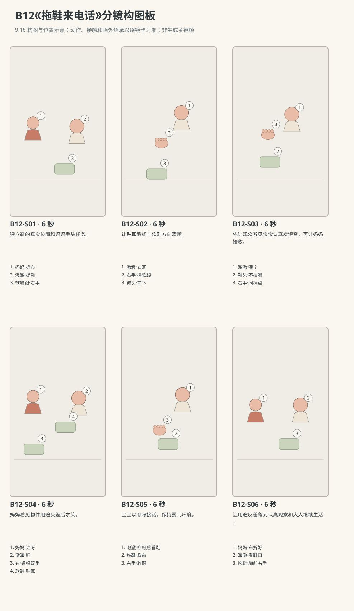

图示为构图位置示意；姿态、接触和画外继承以逐镜正文为准。

### 逐镜设计

#### B12-S01｜00—06 秒｜6 秒｜帧 [0, 144)

**镜头任务：**建立鞋的真实位置和妈妈手头任务。

**景别、机位与构图：**南侧低中全景，妈妈左、宝宝右，鞋在中下方宝宝右膝前，布在妈妈膝上，后景北沙发。

**摄影机与理由：**固定，让手由膝到鞋的接触可见。

**焦点：**宝宝右手、软鞋跟与妈妈手中布在清楚范围。

**入态：**澈澈有靠坐，双手空放各自腿上；干净雾蓝布拖鞋平放其右膝前，鞋跟靠宝宝、鞋头朝南；妈妈双手拿半折浅灰布，眼看布。

**动作与表演：**

- 2 秒：澈澈低眼看到鞋，右手离开右腿向软鞋跟伸去。

- 2 秒：右指先碰鞋跟、轻揉一小下，再合拢攥稳鞋跟布料。

- 2 秒：右手把鞋提离地垫一指宽，鞋头自然垂一点；妈妈继续折布，没有抬眼。

**声音：**指腹擦软鞋布面细响、折布窸窣，无对白。

**出态：**拖鞋由宝宝右手抓鞋跟、刚离垫，鞋头朝前下；左手腿上，妈妈仍低头双手持半折布。

**切点与承接：**切近景沿同一次提鞋继续。

**连续性：**抓鞋跟与鞋离地画内可见；背部靠垫、双脚落垫可见，妈妈不碰鞋。

**开始画面母稿：**

9:16竖幅原创三维生活动画，圆润而保留婴儿头身与关节尺度，皮肤柔和、棉布哑光、低反差暖中性色，动作有真实重量；无字幕、无标识、无额外人物。澈澈圆润脸颊、深棕眼、短黑绒发、额前一撮向右弯，穿奶油色棉连体衣，不作成人式算计表情。妈妈深棕低马尾，穿雾蓝棉上衣、米色长裤，表情自然温和。本图为单一开始瞬间；裁切外人物不为展示外观强行入画。固定空间和材质：客厅北墙沙发、西窗、东走廊、中央奶油地垫。澈澈有靠坐在垫北半朝南，背后稳固低靠垫、双脚落垫；妈妈坐西侧，浅灰小布是她正在整理的唯一折布道具，折叠进度与手位以本镜起态为准。宝宝关注的道具是一只干净、未穿用、轻薄柔软的雾蓝布拖鞋，圆鞋头、短软鞋跟、无硬配件和图案，仅此一只；地垫或手中位置、持有与朝向只按本镜起态。相机始终在南侧朝北，不越两人东西轴；妈妈画左、澈澈画右，宝宝右手在画面偏中。西窗柔光由左入，暖墙反射填暗部。构图范围：南侧低中全景，妈妈左、宝宝右，鞋在中下方宝宝右膝前，布在妈妈膝上，后景北沙发。唯一此刻状态：澈澈有靠坐，双手空放各自腿上；干净雾蓝布拖鞋平放其右膝前，鞋跟靠宝宝、鞋头朝南；妈妈双手拿半折浅灰布，眼看布。清晰度与焦点：宝宝右手、软鞋跟与妈妈手中布在清楚范围。只呈现这个起态，不将后续动作阶段并列绘入。

**视频变化母稿：**

9:16竖幅原创三维生活动画，圆润而保留婴儿头身与关节尺度，皮肤柔和、棉布哑光、低反差暖中性色，动作有真实重量；无字幕、无标识、无额外人物。澈澈圆润脸颊、深棕眼、短黑绒发、额前一撮向右弯，穿奶油色棉连体衣，不作成人式算计表情。妈妈深棕低马尾，穿雾蓝棉上衣、米色长裤，表情自然温和。本镜有效时长6秒，为一个连续镜头。固定空间和材质：客厅北墙沙发、西窗、东走廊、中央奶油地垫。澈澈有靠坐在垫北半朝南，背后稳固低靠垫、双脚落垫；妈妈坐西侧，浅灰小布是她正在整理的唯一折布道具，折叠进度与手位以本镜起态为准。宝宝关注的道具是一只干净、未穿用、轻薄柔软的雾蓝布拖鞋，圆鞋头、短软鞋跟、无硬配件和图案，仅此一只；地垫或手中位置、持有与朝向只按本镜起态。相机始终在南侧朝北，不越两人东西轴；妈妈画左、澈澈画右，宝宝右手在画面偏中。西窗柔光由左入，暖墙反射填暗部。摄影构图：南侧低中全景，妈妈左、宝宝右，鞋在中下方宝宝右膝前，布在妈妈膝上，后景北沙发。摄影机：固定，让手由膝到鞋的接触可见。焦点：宝宝右手、软鞋跟与妈妈手中布在清楚范围。起态：澈澈有靠坐，双手空放各自腿上；干净雾蓝布拖鞋平放其右膝前，鞋跟靠宝宝、鞋头朝南；妈妈双手拿半折浅灰布，眼看布。阶段1，2秒：澈澈低眼看到鞋，右手离开右腿向软鞋跟伸去。阶段2，2秒：右指先碰鞋跟、轻揉一小下，再合拢攥稳鞋跟布料。阶段3，2秒：右手把鞋提离地垫一指宽，鞋头自然垂一点；妈妈继续折布，没有抬眼。准确声音：指腹擦软鞋布面细响、折布窸窣，无对白。终态：拖鞋由宝宝右手抓鞋跟、刚离垫，鞋头朝前下；左手腿上，妈妈仍低头双手持半折布。接触和画外状态：抓鞋跟与鞋离地画内可见；背部靠垫、双脚落垫可见，妈妈不碰鞋。在该终态切出，不在本镜内部额外切镜。

#### B12-S02｜06—12 秒｜6 秒｜帧 [144, 288)

**镜头任务：**让贴耳路线与软鞋方向清楚。

**景别、机位与构图：**宝宝中近景，南侧同轴，右耳在画面偏中，手鞋从下方上行；妈妈膝上折布只留画左边缘。

**摄影机与理由：**固定，不用甩镜把接触藏去。

**焦点：**右手握鞋跟、右耳外侧与嘴部共同可读。

**入态：**拖鞋由宝宝右手抓鞋跟、刚离垫，鞋头朝前下；左手腿上，妈妈仍低头双手持半折布。

**动作与表演：**

- 2 秒：宝宝屈右肘把鞋提到胸前，低眼看晃动的鞋头。

- 2 秒：右腕小幅转向，让软鞋跟靠近右耳外侧，鞋头斜朝前下而非挡嘴。

- 2 秒：鞋跟轻贴耳旁，右手停住；宝宝眼神转向妈妈，嘴鼻完全露出。

**声音：**鞋布轻擦衣袖、平稳鼻息，无来电声、无对白。

**出态：**宝宝右手持软鞋跟轻贴右耳，鞋头斜朝前下，嘴鼻露出；左手腿上，妈妈仍折布。

**切点与承接：**切同轴脸部覆盖，在贴耳成立后才发声。

**连续性：**鞋跟接触耳外侧可见，不插耳道；妈妈与宝宝左手画外继承，只有一只鞋。

**开始画面母稿：**

9:16竖幅原创三维生活动画，圆润而保留婴儿头身与关节尺度，皮肤柔和、棉布哑光、低反差暖中性色，动作有真实重量；无字幕、无标识、无额外人物。澈澈圆润脸颊、深棕眼、短黑绒发、额前一撮向右弯，穿奶油色棉连体衣，不作成人式算计表情。妈妈深棕低马尾，穿雾蓝棉上衣、米色长裤，表情自然温和。本图为单一开始瞬间；裁切外人物不为展示外观强行入画。固定空间和材质：客厅北墙沙发、西窗、东走廊、中央奶油地垫。澈澈有靠坐在垫北半朝南，背后稳固低靠垫、双脚落垫；妈妈坐西侧，浅灰小布是她正在整理的唯一折布道具，折叠进度与手位以本镜起态为准。宝宝关注的道具是一只干净、未穿用、轻薄柔软的雾蓝布拖鞋，圆鞋头、短软鞋跟、无硬配件和图案，仅此一只；地垫或手中位置、持有与朝向只按本镜起态。相机始终在南侧朝北，不越两人东西轴；妈妈画左、澈澈画右，宝宝右手在画面偏中。西窗柔光由左入，暖墙反射填暗部。构图范围：宝宝中近景，南侧同轴；右手在腿前攥鞋跟，鞋刚离地垫一指宽，鞋头朝前下，右耳与嘴部在画面上方露出。唯一此刻状态：拖鞋由宝宝右手抓鞋跟、刚离垫，鞋头朝前下；左手腿上，妈妈仍低头双手持半折布。清晰度与焦点：宝宝右手握鞋跟和鞋与地垫的间隙清楚；耳与鞋此刻没有接触。只呈现这个起态，不将后续动作阶段并列绘入。

**视频变化母稿：**

9:16竖幅原创三维生活动画，圆润而保留婴儿头身与关节尺度，皮肤柔和、棉布哑光、低反差暖中性色，动作有真实重量；无字幕、无标识、无额外人物。澈澈圆润脸颊、深棕眼、短黑绒发、额前一撮向右弯，穿奶油色棉连体衣，不作成人式算计表情。妈妈深棕低马尾，穿雾蓝棉上衣、米色长裤，表情自然温和。本镜有效时长6秒，为一个连续镜头。固定空间和材质：客厅北墙沙发、西窗、东走廊、中央奶油地垫。澈澈有靠坐在垫北半朝南，背后稳固低靠垫、双脚落垫；妈妈坐西侧，浅灰小布是她正在整理的唯一折布道具，折叠进度与手位以本镜起态为准。宝宝关注的道具是一只干净、未穿用、轻薄柔软的雾蓝布拖鞋，圆鞋头、短软鞋跟、无硬配件和图案，仅此一只；地垫或手中位置、持有与朝向只按本镜起态。相机始终在南侧朝北，不越两人东西轴；妈妈画左、澈澈画右，宝宝右手在画面偏中。西窗柔光由左入，暖墙反射填暗部。摄影构图：宝宝中近景，南侧同轴，右耳在画面偏中，手鞋从下方上行；妈妈膝上折布只留画左边缘。摄影机：固定，不用甩镜把接触藏去。焦点：右手握鞋跟、右耳外侧与嘴部共同可读。起态：拖鞋由宝宝右手抓鞋跟、刚离垫，鞋头朝前下；左手腿上，妈妈仍低头双手持半折布。阶段1，2秒：宝宝屈右肘把鞋提到胸前，低眼看晃动的鞋头。阶段2，2秒：右腕小幅转向，让软鞋跟靠近右耳外侧，鞋头斜朝前下而非挡嘴。阶段3，2秒：鞋跟轻贴耳旁，右手停住；宝宝眼神转向妈妈，嘴鼻完全露出。准确声音：鞋布轻擦衣袖、平稳鼻息，无来电声、无对白。终态：宝宝右手持软鞋跟轻贴右耳，鞋头斜朝前下，嘴鼻露出；左手腿上，妈妈仍折布。接触和画外状态：鞋跟接触耳外侧可见，不插耳道；妈妈与宝宝左手画外继承，只有一只鞋。在该终态切出，不在本镜内部额外切镜。

#### B12-S03｜12—18 秒｜6 秒｜帧 [288, 432)

**镜头任务：**先让观众听见宝宝认真发短音，再让妈妈接收。

**景别、机位与构图：**宝宝脸部近景，右耳与鞋跟同见、鞋头在画左下，妈妈画外在宝宝视线方向。

**摄影机与理由：**固定，保持嘴与物件可读，避免只拍鞋。

**焦点：**宝宝眼嘴、软鞋跟耳侧接触和右指清楚。

**入态：**宝宝右手持软鞋跟轻贴右耳，鞋头斜朝前下，嘴鼻露出；左手腿上，妈妈仍折布。

**动作与表演：**

- 1 秒：宝宝停半拍，嘴微张，右手稳住鞋跟。

- 2 秒：朝妈妈方向发出一次含混短音“喂？”，嘴部自然开合，不用成年人的发音腔。

- 3 秒：宝宝接几下不成句的咿呀，目光短短移回鞋头；画外妈妈折布声停止。

**声音：**准确短音“喂？”后接自然婴儿咿呀；鞋不响铃，折布声在听见后停止，无妈妈台词。

**出态：**鞋仍贴右耳、右手同持点，宝宝咿呀刚收声；妈妈画外折布动作已停。

**切点与承接：**咿呀收声再切妈妈反应，不重叠下一句。

**连续性：**宝宝左手空腿上与妈妈双手持布画外继承；鞋头没有接触嘴鼻。

**开始画面母稿：**

9:16竖幅原创三维生活动画，圆润而保留婴儿头身与关节尺度，皮肤柔和、棉布哑光、低反差暖中性色，动作有真实重量；无字幕、无标识、无额外人物。澈澈圆润脸颊、深棕眼、短黑绒发、额前一撮向右弯，穿奶油色棉连体衣，不作成人式算计表情。妈妈深棕低马尾，穿雾蓝棉上衣、米色长裤，表情自然温和。本图为单一开始瞬间；裁切外人物不为展示外观强行入画。固定空间和材质：客厅北墙沙发、西窗、东走廊、中央奶油地垫。澈澈有靠坐在垫北半朝南，背后稳固低靠垫、双脚落垫；妈妈坐西侧，浅灰小布是她正在整理的唯一折布道具，折叠进度与手位以本镜起态为准。宝宝关注的道具是一只干净、未穿用、轻薄柔软的雾蓝布拖鞋，圆鞋头、短软鞋跟、无硬配件和图案，仅此一只；地垫或手中位置、持有与朝向只按本镜起态。相机始终在南侧朝北，不越两人东西轴；妈妈画左、澈澈画右，宝宝右手在画面偏中。西窗柔光由左入，暖墙反射填暗部。构图范围：宝宝脸部近景，右耳与鞋跟同见、鞋头在画左下，妈妈画外在宝宝视线方向。唯一此刻状态：宝宝右手持软鞋跟轻贴右耳，鞋头斜朝前下，嘴鼻露出；左手腿上，妈妈仍折布。清晰度与焦点：宝宝眼嘴、软鞋跟耳侧接触和右指清楚。只呈现这个起态，不将后续动作阶段并列绘入。

**视频变化母稿：**

9:16竖幅原创三维生活动画，圆润而保留婴儿头身与关节尺度，皮肤柔和、棉布哑光、低反差暖中性色，动作有真实重量；无字幕、无标识、无额外人物。澈澈圆润脸颊、深棕眼、短黑绒发、额前一撮向右弯，穿奶油色棉连体衣，不作成人式算计表情。妈妈深棕低马尾，穿雾蓝棉上衣、米色长裤，表情自然温和。本镜有效时长6秒，为一个连续镜头。固定空间和材质：客厅北墙沙发、西窗、东走廊、中央奶油地垫。澈澈有靠坐在垫北半朝南，背后稳固低靠垫、双脚落垫；妈妈坐西侧，浅灰小布是她正在整理的唯一折布道具，折叠进度与手位以本镜起态为准。宝宝关注的道具是一只干净、未穿用、轻薄柔软的雾蓝布拖鞋，圆鞋头、短软鞋跟、无硬配件和图案，仅此一只；地垫或手中位置、持有与朝向只按本镜起态。相机始终在南侧朝北，不越两人东西轴；妈妈画左、澈澈画右，宝宝右手在画面偏中。西窗柔光由左入，暖墙反射填暗部。摄影构图：宝宝脸部近景，右耳与鞋跟同见、鞋头在画左下，妈妈画外在宝宝视线方向。摄影机：固定，保持嘴与物件可读，避免只拍鞋。焦点：宝宝眼嘴、软鞋跟耳侧接触和右指清楚。起态：宝宝右手持软鞋跟轻贴右耳，鞋头斜朝前下，嘴鼻露出；左手腿上，妈妈仍折布。阶段1，1秒：宝宝停半拍，嘴微张，右手稳住鞋跟。阶段2，2秒：朝妈妈方向发出一次含混短音“喂？”，嘴部自然开合，不用成年人的发音腔。阶段3，3秒：宝宝接几下不成句的咿呀，目光短短移回鞋头；画外妈妈折布声停止。准确声音：准确短音“喂？”后接自然婴儿咿呀；鞋不响铃，折布声在听见后停止，无妈妈台词。终态：鞋仍贴右耳、右手同持点，宝宝咿呀刚收声；妈妈画外折布动作已停。接触和画外状态：宝宝左手空腿上与妈妈双手持布画外继承；鞋头没有接触嘴鼻。在该终态切出，不在本镜内部额外切镜。

#### B12-S04｜18—24 秒｜6 秒｜帧 [432, 576)

**镜头任务：**妈妈看见物件用途反差后才笑。

**景别、机位与构图：**南侧双人中近景，妈妈左、宝宝右，鞋贴耳清楚，半折布在妈妈双手间占画左下。

**摄影机与理由：**固定，保留妈妈从布到鞋的视线过程。

**焦点：**两张脸与贴耳鞋跟处在共同清晰范围。

**入态：**鞋仍贴右耳、右手同持点，宝宝咿呀刚收声；妈妈双手拿半折布且动作已停，目光仍低在布上。

**动作与表演：**

- 2 秒：妈妈顺声音抬眼，先看宝宝脸，再把视线落到耳旁的拖鞋。

- 1 秒：妈妈看到鞋跟贴耳，嘴角抿一下仍忍不住呼气笑。

- 2 秒：妈妈对宝宝带笑轻声问“谁呀？”，双手仍拿布，不伸手取鞋。

- 1 秒：妈妈说完收声等，宝宝看向她，鞋仍贴右耳。

**声音：**妈妈先轻呼气笑，再准确台词“谁呀？”，结束留一秒空隙；宝宝不抢说完整句。

**出态：**妈妈看宝宝且双手拿半折布，嘴部收住；宝宝右手鞋跟贴耳、看妈妈，尚未再咿呀。

**切点与承接：**在问句结束后切宝宝回应。

**连续性：**折布未完成、鞋未换手均画内可见；妈妈不把布举耳，不新添第二个电话道具。

**开始画面母稿：**

9:16竖幅原创三维生活动画，圆润而保留婴儿头身与关节尺度，皮肤柔和、棉布哑光、低反差暖中性色，动作有真实重量；无字幕、无标识、无额外人物。澈澈圆润脸颊、深棕眼、短黑绒发、额前一撮向右弯，穿奶油色棉连体衣，不作成人式算计表情。妈妈深棕低马尾，穿雾蓝棉上衣、米色长裤，表情自然温和。本图为单一开始瞬间；裁切外人物不为展示外观强行入画。固定空间和材质：客厅北墙沙发、西窗、东走廊、中央奶油地垫。澈澈有靠坐在垫北半朝南，背后稳固低靠垫、双脚落垫；妈妈坐西侧，浅灰小布是她正在整理的唯一折布道具，折叠进度与手位以本镜起态为准。宝宝关注的道具是一只干净、未穿用、轻薄柔软的雾蓝布拖鞋，圆鞋头、短软鞋跟、无硬配件和图案，仅此一只；地垫或手中位置、持有与朝向只按本镜起态。相机始终在南侧朝北，不越两人东西轴；妈妈画左、澈澈画右，宝宝右手在画面偏中。西窗柔光由左入，暖墙反射填暗部。构图范围：南侧双人中近景，妈妈左、宝宝右，鞋贴耳清楚，半折布在妈妈双手间占画左下。唯一此刻状态：鞋仍贴右耳、右手同持点，宝宝咿呀刚收声；妈妈双手拿半折布且动作已停，目光仍低在布上。清晰度与焦点：两张脸与贴耳鞋跟处在共同清晰范围。只呈现这个起态，不将后续动作阶段并列绘入。

**视频变化母稿：**

9:16竖幅原创三维生活动画，圆润而保留婴儿头身与关节尺度，皮肤柔和、棉布哑光、低反差暖中性色，动作有真实重量；无字幕、无标识、无额外人物。澈澈圆润脸颊、深棕眼、短黑绒发、额前一撮向右弯，穿奶油色棉连体衣，不作成人式算计表情。妈妈深棕低马尾，穿雾蓝棉上衣、米色长裤，表情自然温和。本镜有效时长6秒，为一个连续镜头。固定空间和材质：客厅北墙沙发、西窗、东走廊、中央奶油地垫。澈澈有靠坐在垫北半朝南，背后稳固低靠垫、双脚落垫；妈妈坐西侧，浅灰小布是她正在整理的唯一折布道具，折叠进度与手位以本镜起态为准。宝宝关注的道具是一只干净、未穿用、轻薄柔软的雾蓝布拖鞋，圆鞋头、短软鞋跟、无硬配件和图案，仅此一只；地垫或手中位置、持有与朝向只按本镜起态。相机始终在南侧朝北，不越两人东西轴；妈妈画左、澈澈画右，宝宝右手在画面偏中。西窗柔光由左入，暖墙反射填暗部。摄影构图：南侧双人中近景，妈妈左、宝宝右，鞋贴耳清楚，半折布在妈妈双手间占画左下。摄影机：固定，保留妈妈从布到鞋的视线过程。焦点：两张脸与贴耳鞋跟处在共同清晰范围。起态：鞋仍贴右耳、右手同持点，宝宝咿呀刚收声；妈妈双手拿半折布且动作已停，目光仍低在布上。阶段1，2秒：妈妈顺声音抬眼，先看宝宝脸，再把视线落到耳旁的拖鞋。阶段2，1秒：妈妈看到鞋跟贴耳，嘴角抿一下仍忍不住呼气笑。阶段3，2秒：妈妈对宝宝带笑轻声问“谁呀？”，双手仍拿布，不伸手取鞋。阶段4，1秒：妈妈说完收声等，宝宝看向她，鞋仍贴右耳。准确声音：妈妈先轻呼气笑，再准确台词“谁呀？”，结束留一秒空隙；宝宝不抢说完整句。终态：妈妈看宝宝且双手拿半折布，嘴部收住；宝宝右手鞋跟贴耳、看妈妈，尚未再咿呀。接触和画外状态：折布未完成、鞋未换手均画内可见；妈妈不把布举耳，不新添第二个电话道具。在该终态切出，不在本镜内部额外切镜。

#### B12-S05｜24—30 秒｜6 秒｜帧 [576, 720)

**镜头任务：**宝宝以咿呀接话，保持婴儿尺度。

**景别、机位与构图：**宝宝中近景，同轴，妈妈只在画左留侧脸，嘴鼻、鞋跟与右手同见。

**摄影机与理由：**固定，让发声和稍后降鞋的因果完整。

**焦点：**宝宝嘴部、右手握点及鞋的下降方向清楚。

**入态：**妈妈看宝宝且双手拿半折布，嘴部收住；宝宝右手鞋跟贴耳、看妈妈，尚未再咿呀。

**动作与表演：**

- 3 秒：宝宝对着妈妈咿呀两小串，右手仍把鞋跟轻放耳旁；妈妈只含笑听。

- 1 秒：咿呀停下，宝宝吸一小口气，视线转向鞋。

- 2 秒：右肘缓慢放低，软鞋跟离耳，下落到胸前，鞋头仍朝前下。

**声音：**自然不成词婴儿咿呀两小串，停声后轻吸气与鞋擦衣料声；无新台词。

**出态：**拖鞋由宝宝右手握鞋跟落在胸前，耳已分离；宝宝低眼看鞋，左手腿上，妈妈双手仍持布。

**切点与承接：**切稍宽镜，把落点和妈妈手头事一并收束。

**连续性：**鞋从耳旁下降到胸前连续可见；左手未加入抓握，妈妈不取鞋。

**开始画面母稿：**

9:16竖幅原创三维生活动画，圆润而保留婴儿头身与关节尺度，皮肤柔和、棉布哑光、低反差暖中性色，动作有真实重量；无字幕、无标识、无额外人物。澈澈圆润脸颊、深棕眼、短黑绒发、额前一撮向右弯，穿奶油色棉连体衣，不作成人式算计表情。妈妈深棕低马尾，穿雾蓝棉上衣、米色长裤，表情自然温和。本图为单一开始瞬间；裁切外人物不为展示外观强行入画。固定空间和材质：客厅北墙沙发、西窗、东走廊、中央奶油地垫。澈澈有靠坐在垫北半朝南，背后稳固低靠垫、双脚落垫；妈妈坐西侧，浅灰小布是她正在整理的唯一折布道具，折叠进度与手位以本镜起态为准。宝宝关注的道具是一只干净、未穿用、轻薄柔软的雾蓝布拖鞋，圆鞋头、短软鞋跟、无硬配件和图案，仅此一只；地垫或手中位置、持有与朝向只按本镜起态。相机始终在南侧朝北，不越两人东西轴；妈妈画左、澈澈画右，宝宝右手在画面偏中。西窗柔光由左入，暖墙反射填暗部。构图范围：宝宝中近景，同轴，妈妈只在画左留侧脸，嘴鼻、鞋跟与右手同见。唯一此刻状态：妈妈看宝宝且双手拿半折布，嘴部收住；宝宝右手鞋跟贴耳、看妈妈，尚未再咿呀。清晰度与焦点：宝宝嘴部、右手握点及鞋的下降方向清楚。只呈现这个起态，不将后续动作阶段并列绘入。

**视频变化母稿：**

9:16竖幅原创三维生活动画，圆润而保留婴儿头身与关节尺度，皮肤柔和、棉布哑光、低反差暖中性色，动作有真实重量；无字幕、无标识、无额外人物。澈澈圆润脸颊、深棕眼、短黑绒发、额前一撮向右弯，穿奶油色棉连体衣，不作成人式算计表情。妈妈深棕低马尾，穿雾蓝棉上衣、米色长裤，表情自然温和。本镜有效时长6秒，为一个连续镜头。固定空间和材质：客厅北墙沙发、西窗、东走廊、中央奶油地垫。澈澈有靠坐在垫北半朝南，背后稳固低靠垫、双脚落垫；妈妈坐西侧，浅灰小布是她正在整理的唯一折布道具，折叠进度与手位以本镜起态为准。宝宝关注的道具是一只干净、未穿用、轻薄柔软的雾蓝布拖鞋，圆鞋头、短软鞋跟、无硬配件和图案，仅此一只；地垫或手中位置、持有与朝向只按本镜起态。相机始终在南侧朝北，不越两人东西轴；妈妈画左、澈澈画右，宝宝右手在画面偏中。西窗柔光由左入，暖墙反射填暗部。摄影构图：宝宝中近景，同轴，妈妈只在画左留侧脸，嘴鼻、鞋跟与右手同见。摄影机：固定，让发声和稍后降鞋的因果完整。焦点：宝宝嘴部、右手握点及鞋的下降方向清楚。起态：妈妈看宝宝且双手拿半折布，嘴部收住；宝宝右手鞋跟贴耳、看妈妈，尚未再咿呀。阶段1，3秒：宝宝对着妈妈咿呀两小串，右手仍把鞋跟轻放耳旁；妈妈只含笑听。阶段2，1秒：咿呀停下，宝宝吸一小口气，视线转向鞋。阶段3，2秒：右肘缓慢放低，软鞋跟离耳，下落到胸前，鞋头仍朝前下。准确声音：自然不成词婴儿咿呀两小串，停声后轻吸气与鞋擦衣料声；无新台词。终态：拖鞋由宝宝右手握鞋跟落在胸前，耳已分离；宝宝低眼看鞋，左手腿上，妈妈双手仍持布。接触和画外状态：鞋从耳旁下降到胸前连续可见；左手未加入抓握，妈妈不取鞋。在该终态切出，不在本镜内部额外切镜。

#### B12-S06｜30—36 秒｜6 秒｜帧 [720, 864)

**镜头任务：**让用途反差落到认真观察和大人继续生活。

**景别、机位与构图：**南侧双人中景，地垫前景、两人中景、沙发后景，鞋在宝宝胸前、布在妈妈膝上。

**摄影机与理由：**固定，不新增第三个笑点。

**焦点：**宝宝看鞋的眼神、右手与妈妈最后一折同时可读。

**入态：**拖鞋由宝宝右手握鞋跟落在胸前，耳已分离；宝宝低眼看鞋，左手腿上，妈妈双手仍持布。

**动作与表演：**

- 2 秒：宝宝轻转右腕，低头看拖鞋软开口，手指在鞋跟布面压一下。

- 2 秒：妈妈垂眼把停在半路的那一折完成，浅灰布在双掌间对齐。

- 2 秒：妈妈再抬眼含笑看他；宝宝仍研究鞋口，右手在胸前停住。

**声音：**软鞋布与折布轻响，宝宝安静鼻息，妈妈一口轻缓呼气；无对白和音乐。

**出态：**宝宝右手仍握同一只拖鞋胸前，左手腿上；妈妈双手持折好的浅灰布，看宝宝。

**切点与承接：**保留静默尾，不再加响铃或第二轮成人对白。

**连续性：**鞋和布各自持有在画内确认；澈澈背部有靠、脚在地垫，角色与光位不变。

**开始画面母稿：**

9:16竖幅原创三维生活动画，圆润而保留婴儿头身与关节尺度，皮肤柔和、棉布哑光、低反差暖中性色，动作有真实重量；无字幕、无标识、无额外人物。澈澈圆润脸颊、深棕眼、短黑绒发、额前一撮向右弯，穿奶油色棉连体衣，不作成人式算计表情。妈妈深棕低马尾，穿雾蓝棉上衣、米色长裤，表情自然温和。本图为单一开始瞬间；裁切外人物不为展示外观强行入画。固定空间和材质：客厅北墙沙发、西窗、东走廊、中央奶油地垫。澈澈有靠坐在垫北半朝南，背后稳固低靠垫、双脚落垫；妈妈坐西侧，浅灰小布是她正在整理的唯一折布道具，折叠进度与手位以本镜起态为准。宝宝关注的道具是一只干净、未穿用、轻薄柔软的雾蓝布拖鞋，圆鞋头、短软鞋跟、无硬配件和图案，仅此一只；地垫或手中位置、持有与朝向只按本镜起态。相机始终在南侧朝北，不越两人东西轴；妈妈画左、澈澈画右，宝宝右手在画面偏中。西窗柔光由左入，暖墙反射填暗部。构图范围：南侧双人中景，地垫前景、两人中景、沙发后景，鞋在宝宝胸前、布在妈妈膝上。唯一此刻状态：拖鞋由宝宝右手握鞋跟落在胸前，耳已分离；宝宝低眼看鞋，左手腿上，妈妈双手仍持布。清晰度与焦点：宝宝看鞋的眼神、右手与妈妈最后一折同时可读。只呈现这个起态，不将后续动作阶段并列绘入。

**视频变化母稿：**

9:16竖幅原创三维生活动画，圆润而保留婴儿头身与关节尺度，皮肤柔和、棉布哑光、低反差暖中性色，动作有真实重量；无字幕、无标识、无额外人物。澈澈圆润脸颊、深棕眼、短黑绒发、额前一撮向右弯，穿奶油色棉连体衣，不作成人式算计表情。妈妈深棕低马尾，穿雾蓝棉上衣、米色长裤，表情自然温和。本镜有效时长6秒，为一个连续镜头。固定空间和材质：客厅北墙沙发、西窗、东走廊、中央奶油地垫。澈澈有靠坐在垫北半朝南，背后稳固低靠垫、双脚落垫；妈妈坐西侧，浅灰小布是她正在整理的唯一折布道具，折叠进度与手位以本镜起态为准。宝宝关注的道具是一只干净、未穿用、轻薄柔软的雾蓝布拖鞋，圆鞋头、短软鞋跟、无硬配件和图案，仅此一只；地垫或手中位置、持有与朝向只按本镜起态。相机始终在南侧朝北，不越两人东西轴；妈妈画左、澈澈画右，宝宝右手在画面偏中。西窗柔光由左入，暖墙反射填暗部。摄影构图：南侧双人中景，地垫前景、两人中景、沙发后景，鞋在宝宝胸前、布在妈妈膝上。摄影机：固定，不新增第三个笑点。焦点：宝宝看鞋的眼神、右手与妈妈最后一折同时可读。起态：拖鞋由宝宝右手握鞋跟落在胸前，耳已分离；宝宝低眼看鞋，左手腿上，妈妈双手仍持布。阶段1，2秒：宝宝轻转右腕，低头看拖鞋软开口，手指在鞋跟布面压一下。阶段2，2秒：妈妈垂眼把停在半路的那一折完成，浅灰布在双掌间对齐。阶段3，2秒：妈妈再抬眼含笑看他；宝宝仍研究鞋口，右手在胸前停住。准确声音：软鞋布与折布轻响，宝宝安静鼻息，妈妈一口轻缓呼气；无对白和音乐。终态：宝宝右手仍握同一只拖鞋胸前，左手腿上；妈妈双手持折好的浅灰布，看宝宝。接触和画外状态：鞋和布各自持有在画内确认；澈澈背部有靠、脚在地垫，角色与光位不变。在该终态切出，不在本镜内部额外切镜。

### 声音与剪辑

连续安静客厅底声、软鞋布面轻擦和折布窸窣。澈澈仅一个含混“喂？”及不成词咿呀，妈妈“谁呀？”一句，轮流接声；没有铃声、来电音、电话另一端声音、旁白或音乐。

- 澈澈：喂？（B12-S03；本镜第2—3秒，拖鞋软跟已经轻贴右耳且嘴部露出；只有一个含混短音，带婴儿尚不熟练的气声，不说后续成人句子。）

- 妈妈：谁呀？（B12-S04；本镜第4—5秒，先看清贴耳的是拖鞋、轻笑后，带笑轻声问宝宝；台词说完才在下一镜接宝宝咿呀。）

### 连续性与试片

- 连续性：全片仅一只干净雾蓝软布拖鞋，由宝宝右手抓鞋跟；先抓稳提起再贴右耳，嘴鼻持续露出，不把鞋塞嘴。

- 连续性：左手始终空放宝宝左腿；背部与骨盆有靠，举鞋不靠前扑或悬身。

- 连续性：妈妈双手拿浅灰小布，先听见、看清拖鞋再笑，不抢先反应或把鞋当成真正响铃。

- 连续性：原帖hi改成一个短“喂？”属于中文改编；不得生成成人长对白、开会语气或神秘来电角色。

- 试片：S01—S02：鞋从地垫经右手鞋跟提起，最后软跟接右耳、鞋头斜向前下，若鞋突然换持点、翻成硬电话或漂浮即失败。

- 试片：S03—S05：宝宝含混短音和咿呀、妈妈停折布抬眼、看见鞋再笑与轻问的次序可读；不得给妈妈未看见物件时的预知笑。

- 试片：S06：鞋降到胸前由右手持，妈妈完成同一块布的一折；无鞋自动回脚、双鞋或新角色。

**媒体待验证：**新片为完整文字设计，未提供真实角色场景参考、未绑定首帧、未生成图像视频或声音。待实片核对单手提软鞋、耳侧接触、唇部露出、单音及成人反应节奏。

---

## B13《亲一下，眼镜呢》

**36 秒｜坐姿与手部互动｜角色：澈澈、妈妈｜场景 L**

### 剧情正文

柔光落在客厅地垫上，妈妈戴着浅棕眼镜坐在澈澈西侧，宝宝靠着低靠垫，正看她的脸。妈妈轻声问：“亲亲？”把右脸颊慢慢凑近。澈澈小嘴张开，往那片脸颊贴了一下，空右手也摸到旁边的镜框，手指一合。妈妈感觉到镜架被带动，头顺着小手的方向略让一点，右掌从膝上托到下方；眼镜滑离耳侧和鼻梁，落在澈澈的右手里。妈妈眨眨眼，低声“咦？”了一下，澈澈看着她没戴眼镜的脸，笑出了声。妈妈没拽回，只把掌心留在下面。澈澈低头转眼镜，左食指点点圆角框沿；妈妈右掌轻轻接住下缘的重量，让镜片始终离着小嘴。宝宝又抬头看她，空左掌从镜框旁移开，慢慢贴上妈妈刚才被亲的脸颊。妈妈保持着距离，轻声说：“我在这儿。”澈澈看看她的眼睛，嘴角又弯了一点。眼镜还在他右手和妈妈托着的掌心之间，两个人都安静下来。

### 亲述来源与改编

原帖是家长自述，未独立核实。本片将生活机制改编为澈澈的原创故事。

- [RT07 · 大口亲妈妈的同时，把眼镜拿走](https://www.miloandbehold.com/misty/2016-04-16-bad-sleep/)；作者自报年龄：同一宝宝系列在2016-04-14明确写满8个月；本篇4月16日未重写月龄。

- **采用的生活过程：**母亲自述宝宝有张嘴亲吻自己的举动，同时会抓眼镜并笑；母亲自己也无法确定二者是否有计划地连在一起。

- **本片原创改编：**将日记里反复发生的概括改为一次地垫上的完整互动；左右手、亲右脸颊、眼镜滑离过程、妈妈托底、后续触脸及三句中文均为原创具体化。

- **本片原创改编：**本片不使用配隐形眼镜的支线，收在母亲与宝宝继续亲近。

- **不作出的事实推断：**不声称母亲原帖写下这些精确手位、即时回应或单次结局；8个月来自同一系列邻近日记，非本篇再次明注。

- **不作出的事实推断：**不认定亲吻是抢镜掩护、不判定宝宝有算计，也不以为本片与“手快”概括共同构成同一次真实记录。

[查看原始过程与缺项](research/real-experiences/index.html#RT07)

### 导演与空间

**观察任务：**把亲近时顺手抓到眼镜的巧合拍成身体互动：妈妈先接住突发变化，再陪宝宝看物件，不给婴儿加预谋。

**空间与光位：**客厅北沙发、西窗、东走廊、中央奶油地垫。澈澈有靠坐在地垫北半朝南，稳固低靠垫托住背与骨盆，双脚落垫；妈妈坐其西侧、身体略朝东南，脸可在不牵拉宝宝的距离内靠近。唯一眼镜为浅棕细框圆角眼镜，透明镜片、短柔和镜腿、无链绳；戴在脸上还是离脸、持有与承托、双方手位均只按本镜起态。眼镜离脸后只在本镜指定的手和成人承接掌之间，不靠近宝宝嘴。相机南侧不越东西轴，妈妈画左、澈澈画右，右耳与右手按实际身体不镜像；西窗柔光从画左来，镜片有轻柔反光但不遮眼。

**人物表演：**妈妈以轻声邀请和微俯身表达亲近；澈澈张嘴靠上她右脸颊，右手碰到眼镜外框便合拢，动作像同一时刻自然发生的抓物。妈妈随势退小距离、掌心托底，不猛抽头或拽镜。宝宝拿到后笑一下再研究，脸上无得逞表情。

### 节拍覆盖

- **B13-b1**：妈妈凑右脸颊，宝宝同时亲近和摸到镜框；两项动作同场发生，不宣称算计。 → B13-S01、B13-S02

- **B13-b2**：眼镜离脸后成人眨眼、宝宝笑；妈妈不拉扯，转为托住下缘陪看。 → B13-S03、B13-S04

- **B13-b3**：宝宝从物件转回妈妈面孔，左掌贴脸；眼镜持有状态持续，亲近落在新的接触上。 → B13-S05、B13-S06

### 分镜构图板

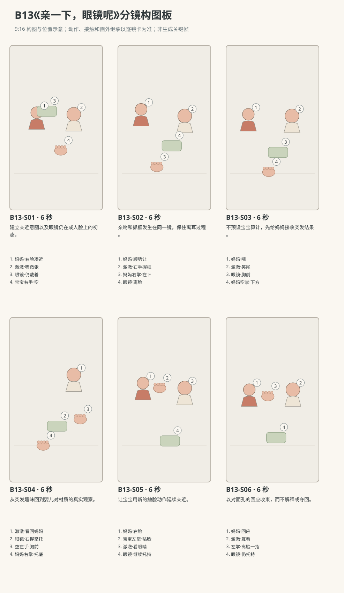

图示为构图位置示意；姿态、接触和画外继承以逐镜正文为准。

### 逐镜设计

#### B13-S01｜00—06 秒｜6 秒｜帧 [0, 144)

**镜头任务：**建立亲近意图以及眼镜仍在成人脸上的初态。

**景别、机位与构图：**南侧双人中景，妈妈左、宝宝右，两人脸与双手膝上可见，低靠垫在宝宝身后。

**摄影机与理由：**固定，以妈妈靠近缩短实际距离。

**焦点：**成人眼镜、宝宝目光和两人面部清楚。

**入态：**妈妈戴浅棕圆角眼镜、双手各在自己膝上，面向宝宝；澈澈有靠坐、双手各在腿上，眼看妈妈脸。

**动作与表演：**

- 1 秒：妈妈看着宝宝轻轻笑，宝宝眼神留在她眼睛。

- 2 秒：妈妈嘴部露出，轻声问“亲亲？”，宝宝嘴微张。

- 3 秒：妈妈说完把右脸颊慢慢靠近宝宝嘴边；宝宝空右手从腿上抬起，尚未碰镜框。

**声音：**准确台词“亲亲？”后只留轻呼吸与棉布摩擦，无夸张亲吻音。

**出态：**妈妈右脸颊距宝宝嘴约一指，眼镜仍戴着；宝宝右手空抬在胸前、指尖近镜框但未碰，左手腿上；妈妈双手仍膝上。

**切点与承接：**切同轴较近镜，连续完成脸与手的两项接触。

**连续性：**眼镜仍戴在鼻梁，近侧镜腿与耳的接触画内可见；远侧耳被头部遮挡，镜腿仍佩戴的状态画外继承。宝宝背部靠垫支撑画内，右手尚未抓镜。

**开始画面母稿：**

9:16竖幅原创三维生活动画，圆润而保留婴儿头身与关节尺度，皮肤柔和、棉布哑光、低反差暖中性色，动作有真实重量；无字幕、无标识、无额外人物。澈澈圆润脸颊、深棕眼、短黑绒发、额前一撮向右弯，穿奶油色棉连体衣，不作成人式算计表情。妈妈深棕低马尾，穿雾蓝棉上衣、米色长裤，表情自然温和。本图为单一开始瞬间；裁切外人物不为展示外观强行入画。固定空间和材质：客厅北沙发、西窗、东走廊、中央奶油地垫。澈澈有靠坐在地垫北半朝南，稳固低靠垫托住背与骨盆，双脚落垫；妈妈坐其西侧、身体略朝东南，脸可在不牵拉宝宝的距离内靠近。唯一眼镜为浅棕细框圆角眼镜，透明镜片、短柔和镜腿、无链绳；戴在脸上还是离脸、持有与承托、双方手位均只按本镜起态。眼镜离脸后只在本镜指定的手和成人承接掌之间，不靠近宝宝嘴。相机南侧不越东西轴，妈妈画左、澈澈画右，右耳与右手按实际身体不镜像；西窗柔光从画左来，镜片有轻柔反光但不遮眼。构图范围：南侧双人中景，妈妈左、宝宝右，两人脸与双手膝上可见，低靠垫在宝宝身后。唯一此刻状态：妈妈戴浅棕圆角眼镜、双手各在自己膝上，面向宝宝；澈澈有靠坐、双手各在腿上，眼看妈妈脸。清晰度与焦点：成人眼镜、宝宝目光和两人面部清楚。只呈现这个起态，不将后续动作阶段并列绘入。

**视频变化母稿：**

9:16竖幅原创三维生活动画，圆润而保留婴儿头身与关节尺度，皮肤柔和、棉布哑光、低反差暖中性色，动作有真实重量；无字幕、无标识、无额外人物。澈澈圆润脸颊、深棕眼、短黑绒发、额前一撮向右弯，穿奶油色棉连体衣，不作成人式算计表情。妈妈深棕低马尾，穿雾蓝棉上衣、米色长裤，表情自然温和。本镜有效时长6秒，为一个连续镜头。固定空间和材质：客厅北沙发、西窗、东走廊、中央奶油地垫。澈澈有靠坐在地垫北半朝南，稳固低靠垫托住背与骨盆，双脚落垫；妈妈坐其西侧、身体略朝东南，脸可在不牵拉宝宝的距离内靠近。唯一眼镜为浅棕细框圆角眼镜，透明镜片、短柔和镜腿、无链绳；戴在脸上还是离脸、持有与承托、双方手位均只按本镜起态。眼镜离脸后只在本镜指定的手和成人承接掌之间，不靠近宝宝嘴。相机南侧不越东西轴，妈妈画左、澈澈画右，右耳与右手按实际身体不镜像；西窗柔光从画左来，镜片有轻柔反光但不遮眼。摄影构图：南侧双人中景，妈妈左、宝宝右，两人脸与双手膝上可见，低靠垫在宝宝身后。摄影机：固定，以妈妈靠近缩短实际距离。焦点：成人眼镜、宝宝目光和两人面部清楚。起态：妈妈戴浅棕圆角眼镜、双手各在自己膝上，面向宝宝；澈澈有靠坐、双手各在腿上，眼看妈妈脸。阶段1，1秒：妈妈看着宝宝轻轻笑，宝宝眼神留在她眼睛。阶段2，2秒：妈妈嘴部露出，轻声问“亲亲？”，宝宝嘴微张。阶段3，3秒：妈妈说完把右脸颊慢慢靠近宝宝嘴边；宝宝空右手从腿上抬起，尚未碰镜框。准确声音：准确台词“亲亲？”后只留轻呼吸与棉布摩擦，无夸张亲吻音。终态：妈妈右脸颊距宝宝嘴约一指，眼镜仍戴着；宝宝右手空抬在胸前、指尖近镜框但未碰，左手腿上；妈妈双手仍膝上。接触和画外状态：眼镜仍戴在鼻梁，近侧镜腿与耳的接触画内可见；远侧耳被头部遮挡，镜腿仍佩戴的状态画外继承。宝宝背部靠垫支撑画内，右手尚未抓镜。在该终态切出，不在本镜内部额外切镜。

#### B13-S02｜06—12 秒｜6 秒｜帧 [144, 288)

**镜头任务：**亲吻和抓框发生在同一镜，保住离耳过程。

**景别、机位与构图：**南侧双人近景略俯，妈妈右脸在画左、宝宝脸画右，镜框、右手、耳侧与成人右掌的路径留在下部。

**摄影机与理由：**固定，接触区不被裁掉，不靠快切隐去眼镜脱离。

**焦点：**宝宝嘴与母亲脸颊、手框接点和镜腿耳侧保持足够清楚。

**入态：**妈妈右脸颊距宝宝嘴约一指，眼镜仍戴着；宝宝右手空抬在胸前、指尖近镜框但未碰，左手腿上；妈妈双手仍膝上。

**动作与表演：**

- 2 秒：宝宝张嘴轻贴妈妈右脸颊，同时右指碰到外侧圆角框沿并合拢，眼镜仍在鼻梁耳侧。

- 2 秒：宝宝嘴离开脸颊、屈右肘带框向胸前一点；妈妈察觉后头顺势微低并让一点，镜腿自然前滑离耳，右掌从膝上抬到框下方。

- 2 秒：镜框离开鼻梁并完全离脸，宝宝右手握框停胸前；妈妈右掌空托在下方未拉框，脸转向宝宝。

**声音：**轻呼吸、很轻的镜框摩擦衣料声，无框架弹射声，无对白。

**出态：**眼镜完全离脸，由宝宝右手握框在胸前；妈妈脸无眼镜、右掌空停框下方，左手膝上；宝宝左手仍腿上，嘴未碰镜。

**切点与承接：**眼镜真正离脸后切成人与宝宝反应。

**连续性：**近侧镜腿离耳、镜框离鼻梁与妈妈顺势让位、托掌过程画内可见；远侧镜腿在头部遮挡后随整副眼镜离脸显露，离开前的耳侧接触画外继承。眼镜唯一，宝宝支撑与左手腿上画外继承。

**开始画面母稿：**

9:16竖幅原创三维生活动画，圆润而保留婴儿头身与关节尺度，皮肤柔和、棉布哑光、低反差暖中性色，动作有真实重量；无字幕、无标识、无额外人物。澈澈圆润脸颊、深棕眼、短黑绒发、额前一撮向右弯，穿奶油色棉连体衣，不作成人式算计表情。妈妈深棕低马尾，穿雾蓝棉上衣、米色长裤，表情自然温和。本图为单一开始瞬间；裁切外人物不为展示外观强行入画。固定空间和材质：客厅北沙发、西窗、东走廊、中央奶油地垫。澈澈有靠坐在地垫北半朝南，稳固低靠垫托住背与骨盆，双脚落垫；妈妈坐其西侧、身体略朝东南，脸可在不牵拉宝宝的距离内靠近。唯一眼镜为浅棕细框圆角眼镜，透明镜片、短柔和镜腿、无链绳；戴在脸上还是离脸、持有与承托、双方手位均只按本镜起态。眼镜离脸后只在本镜指定的手和成人承接掌之间，不靠近宝宝嘴。相机南侧不越东西轴，妈妈画左、澈澈画右，右耳与右手按实际身体不镜像；西窗柔光从画左来，镜片有轻柔反光但不遮眼。构图范围：南侧双人近景略俯，妈妈右脸在画左、宝宝脸画右，镜框、右手、耳侧与成人右掌的路径留在下部。唯一此刻状态：妈妈右脸颊距宝宝嘴约一指，眼镜仍戴着；宝宝右手空抬在胸前、指尖近镜框但未碰，左手腿上；妈妈双手仍膝上。清晰度与焦点：宝宝嘴与妈妈右脸颊之间的一指间距、空右指到镜框间隙，以及近侧镜腿仍接耳的状态清楚；此刻没有手框接触。只呈现这个起态，不将后续动作阶段并列绘入。

**视频变化母稿：**

9:16竖幅原创三维生活动画，圆润而保留婴儿头身与关节尺度，皮肤柔和、棉布哑光、低反差暖中性色，动作有真实重量；无字幕、无标识、无额外人物。澈澈圆润脸颊、深棕眼、短黑绒发、额前一撮向右弯，穿奶油色棉连体衣，不作成人式算计表情。妈妈深棕低马尾，穿雾蓝棉上衣、米色长裤，表情自然温和。本镜有效时长6秒，为一个连续镜头。固定空间和材质：客厅北沙发、西窗、东走廊、中央奶油地垫。澈澈有靠坐在地垫北半朝南，稳固低靠垫托住背与骨盆，双脚落垫；妈妈坐其西侧、身体略朝东南，脸可在不牵拉宝宝的距离内靠近。唯一眼镜为浅棕细框圆角眼镜，透明镜片、短柔和镜腿、无链绳；戴在脸上还是离脸、持有与承托、双方手位均只按本镜起态。眼镜离脸后只在本镜指定的手和成人承接掌之间，不靠近宝宝嘴。相机南侧不越东西轴，妈妈画左、澈澈画右，右耳与右手按实际身体不镜像；西窗柔光从画左来，镜片有轻柔反光但不遮眼。摄影构图：南侧双人近景略俯，妈妈右脸在画左、宝宝脸画右，镜框、右手、耳侧与成人右掌的路径留在下部。摄影机：固定，接触区不被裁掉，不靠快切隐去眼镜脱离。焦点：宝宝嘴与母亲脸颊、手框接点和镜腿耳侧保持足够清楚。起态：妈妈右脸颊距宝宝嘴约一指，眼镜仍戴着；宝宝右手空抬在胸前、指尖近镜框但未碰，左手腿上；妈妈双手仍膝上。阶段1，2秒：宝宝张嘴轻贴妈妈右脸颊，同时右指碰到外侧圆角框沿并合拢，眼镜仍在鼻梁耳侧。阶段2，2秒：宝宝嘴离开脸颊、屈右肘带框向胸前一点；妈妈察觉后头顺势微低并让一点，镜腿自然前滑离耳，右掌从膝上抬到框下方。阶段3，2秒：镜框离开鼻梁并完全离脸，宝宝右手握框停胸前；妈妈右掌空托在下方未拉框，脸转向宝宝。准确声音：轻呼吸、很轻的镜框摩擦衣料声，无框架弹射声，无对白。终态：眼镜完全离脸，由宝宝右手握框在胸前；妈妈脸无眼镜、右掌空停框下方，左手膝上；宝宝左手仍腿上，嘴未碰镜。接触和画外状态：近侧镜腿离耳、镜框离鼻梁与妈妈顺势让位、托掌过程画内可见；远侧镜腿在头部遮挡后随整副眼镜离脸显露，离开前的耳侧接触画外继承。眼镜唯一，宝宝支撑与左手腿上画外继承。在该终态切出，不在本镜内部额外切镜。

#### B13-S03｜12—18 秒｜6 秒｜帧 [288, 432)

**镜头任务：**不预设宝宝算计，先给妈妈接收突发结果。

**景别、机位与构图：**南侧双人中近景，妈妈无镜的脸在左，宝宝与胸前眼镜在右，空托掌完整在框下。

**摄影机与理由：**固定，让视线从空鼻梁到宝宝手自然变化。

**焦点：**两张脸、唯一眼镜与托掌同在清楚范围。

**入态：**眼镜完全离脸，由宝宝右手握框在胸前；妈妈脸无眼镜、右掌空停框下方，左手膝上；宝宝左手仍腿上，嘴未碰镜。

**动作与表演：**

- 1 秒：妈妈轻眨一下眼，目光落到宝宝手里的眼镜。

- 2 秒：妈妈带意外气声轻说“咦？”，嘴角随即松开，没有急着伸手拿。

- 3 秒：宝宝看妈妈没戴镜的脸，笑出一声，右手仍握框，妈妈只含笑等他笑尾落下。

**声音：**妈妈准确短音“咦？”结束后接宝宝自然一声短笑，尾部安静呼吸，无重叠台词。

**出态：**宝宝笑声已收、右手仍握眼镜胸前、左手腿上；妈妈微笑看宝宝，右掌仍在框下，左手膝上。

**切点与承接：**笑尾收住再切宝宝研究物件。

**连续性：**妈妈鼻梁耳边无残留第二副镜片；宝宝握点不换、镜框离嘴，双手归属画内清楚。

**开始画面母稿：**

9:16竖幅原创三维生活动画，圆润而保留婴儿头身与关节尺度，皮肤柔和、棉布哑光、低反差暖中性色，动作有真实重量；无字幕、无标识、无额外人物。澈澈圆润脸颊、深棕眼、短黑绒发、额前一撮向右弯，穿奶油色棉连体衣，不作成人式算计表情。妈妈深棕低马尾，穿雾蓝棉上衣、米色长裤，表情自然温和。本图为单一开始瞬间；裁切外人物不为展示外观强行入画。固定空间和材质：客厅北沙发、西窗、东走廊、中央奶油地垫。澈澈有靠坐在地垫北半朝南，稳固低靠垫托住背与骨盆，双脚落垫；妈妈坐其西侧、身体略朝东南，脸可在不牵拉宝宝的距离内靠近。唯一眼镜为浅棕细框圆角眼镜，透明镜片、短柔和镜腿、无链绳；戴在脸上还是离脸、持有与承托、双方手位均只按本镜起态。眼镜离脸后只在本镜指定的手和成人承接掌之间，不靠近宝宝嘴。相机南侧不越东西轴，妈妈画左、澈澈画右，右耳与右手按实际身体不镜像；西窗柔光从画左来，镜片有轻柔反光但不遮眼。构图范围：南侧双人中近景，妈妈无镜的脸在左，宝宝与胸前眼镜在右，空托掌完整在框下。唯一此刻状态：眼镜完全离脸，由宝宝右手握框在胸前；妈妈脸无眼镜、右掌空停框下方，左手膝上；宝宝左手仍腿上，嘴未碰镜。清晰度与焦点：两张脸、唯一眼镜与托掌同在清楚范围。只呈现这个起态，不将后续动作阶段并列绘入。

**视频变化母稿：**

9:16竖幅原创三维生活动画，圆润而保留婴儿头身与关节尺度，皮肤柔和、棉布哑光、低反差暖中性色，动作有真实重量；无字幕、无标识、无额外人物。澈澈圆润脸颊、深棕眼、短黑绒发、额前一撮向右弯，穿奶油色棉连体衣，不作成人式算计表情。妈妈深棕低马尾，穿雾蓝棉上衣、米色长裤，表情自然温和。本镜有效时长6秒，为一个连续镜头。固定空间和材质：客厅北沙发、西窗、东走廊、中央奶油地垫。澈澈有靠坐在地垫北半朝南，稳固低靠垫托住背与骨盆，双脚落垫；妈妈坐其西侧、身体略朝东南，脸可在不牵拉宝宝的距离内靠近。唯一眼镜为浅棕细框圆角眼镜，透明镜片、短柔和镜腿、无链绳；戴在脸上还是离脸、持有与承托、双方手位均只按本镜起态。眼镜离脸后只在本镜指定的手和成人承接掌之间，不靠近宝宝嘴。相机南侧不越东西轴，妈妈画左、澈澈画右，右耳与右手按实际身体不镜像；西窗柔光从画左来，镜片有轻柔反光但不遮眼。摄影构图：南侧双人中近景，妈妈无镜的脸在左，宝宝与胸前眼镜在右，空托掌完整在框下。摄影机：固定，让视线从空鼻梁到宝宝手自然变化。焦点：两张脸、唯一眼镜与托掌同在清楚范围。起态：眼镜完全离脸，由宝宝右手握框在胸前；妈妈脸无眼镜、右掌空停框下方，左手膝上；宝宝左手仍腿上，嘴未碰镜。阶段1，1秒：妈妈轻眨一下眼，目光落到宝宝手里的眼镜。阶段2，2秒：妈妈带意外气声轻说“咦？”，嘴角随即松开，没有急着伸手拿。阶段3，3秒：宝宝看妈妈没戴镜的脸，笑出一声，右手仍握框，妈妈只含笑等他笑尾落下。准确声音：妈妈准确短音“咦？”结束后接宝宝自然一声短笑，尾部安静呼吸，无重叠台词。终态：宝宝笑声已收、右手仍握眼镜胸前、左手腿上；妈妈微笑看宝宝，右掌仍在框下，左手膝上。接触和画外状态：妈妈鼻梁耳边无残留第二副镜片；宝宝握点不换、镜框离嘴，双手归属画内清楚。在该终态切出，不在本镜内部额外切镜。

#### B13-S04｜18—24 秒｜6 秒｜帧 [432, 576)

**镜头任务：**从突发趣味回到婴儿对材质的真实观察。

**景别、机位与构图：**手脸中近景，宝宝眼睛在上、镜框在胸前下部，妈妈右掌从画左下进入托框下缘。

**摄影机与理由：**固定，镜片角度变化由右腕而非镜头绕行产生。

**焦点：**宝宝目光、右手握框与成人掌面接触同时清楚。

**入态：**宝宝笑声已收、右手仍握眼镜胸前、左手腿上；妈妈微笑看宝宝，右掌仍在框下，左手膝上。

**动作与表演：**

- 2 秒：宝宝低眼看框，右腕微转让镜片斜向自己，妈妈右掌跟随到下缘并轻托住重量，不从上抓。

- 2 秒：宝宝左手从腿上抬起，左食指点一下圆角框沿，右手始终握住另一段框。

- 2 秒：宝宝左指离框，停在自己胸前，抬眼重新看妈妈；眼镜仍在右手和妈妈右掌之间。

**声音：**指腹轻碰框沿的极轻细声、自然鼻息，无对白，不配玻璃清脆敲击。

**出态：**宝宝右手握眼镜、妈妈右掌托下缘，框低于嘴且离嘴一掌；宝宝空左手在胸前、目光转向妈妈无镜的脸；妈妈左手膝上。

**切点与承接：**接宝宝把注意力从物件转回面孔。

**连续性：**左指触框后已经分离画内可见；眼镜不折断、不出现第二镜架，宝宝左手未形成第二主握持。

**开始画面母稿：**

9:16竖幅原创三维生活动画，圆润而保留婴儿头身与关节尺度，皮肤柔和、棉布哑光、低反差暖中性色，动作有真实重量；无字幕、无标识、无额外人物。澈澈圆润脸颊、深棕眼、短黑绒发、额前一撮向右弯，穿奶油色棉连体衣，不作成人式算计表情。妈妈深棕低马尾，穿雾蓝棉上衣、米色长裤，表情自然温和。本图为单一开始瞬间；裁切外人物不为展示外观强行入画。固定空间和材质：客厅北沙发、西窗、东走廊、中央奶油地垫。澈澈有靠坐在地垫北半朝南，稳固低靠垫托住背与骨盆，双脚落垫；妈妈坐其西侧、身体略朝东南，脸可在不牵拉宝宝的距离内靠近。唯一眼镜为浅棕细框圆角眼镜，透明镜片、短柔和镜腿、无链绳；戴在脸上还是离脸、持有与承托、双方手位均只按本镜起态。眼镜离脸后只在本镜指定的手和成人承接掌之间，不靠近宝宝嘴。相机南侧不越东西轴，妈妈画左、澈澈画右，右耳与右手按实际身体不镜像；西窗柔光从画左来，镜片有轻柔反光但不遮眼。构图范围：宝宝眼睛在上、右手眼镜在胸前下部，妈妈右掌在画左下方空停、尚未接触眼镜，宝宝左手空放腿上。唯一此刻状态：宝宝笑声已收、右手仍握眼镜胸前、左手腿上；妈妈微笑看宝宝，右掌仍在框下，左手膝上。清晰度与焦点：宝宝右手握框、眼镜下缘与妈妈空托掌之间的间隙清楚；左手尚未抬起。只呈现这个起态，不将后续动作阶段并列绘入。

**视频变化母稿：**

9:16竖幅原创三维生活动画，圆润而保留婴儿头身与关节尺度，皮肤柔和、棉布哑光、低反差暖中性色，动作有真实重量；无字幕、无标识、无额外人物。澈澈圆润脸颊、深棕眼、短黑绒发、额前一撮向右弯，穿奶油色棉连体衣，不作成人式算计表情。妈妈深棕低马尾，穿雾蓝棉上衣、米色长裤，表情自然温和。本镜有效时长6秒，为一个连续镜头。固定空间和材质：客厅北沙发、西窗、东走廊、中央奶油地垫。澈澈有靠坐在地垫北半朝南，稳固低靠垫托住背与骨盆，双脚落垫；妈妈坐其西侧、身体略朝东南，脸可在不牵拉宝宝的距离内靠近。唯一眼镜为浅棕细框圆角眼镜，透明镜片、短柔和镜腿、无链绳；戴在脸上还是离脸、持有与承托、双方手位均只按本镜起态。眼镜离脸后只在本镜指定的手和成人承接掌之间，不靠近宝宝嘴。相机南侧不越东西轴，妈妈画左、澈澈画右，右耳与右手按实际身体不镜像；西窗柔光从画左来，镜片有轻柔反光但不遮眼。摄影构图：手脸中近景，宝宝眼睛在上、镜框在胸前下部，妈妈右掌从画左下进入托框下缘。摄影机：固定，镜片角度变化由右腕而非镜头绕行产生。焦点：宝宝目光、右手握框与成人掌面接触同时清楚。起态：宝宝笑声已收、右手仍握眼镜胸前、左手腿上；妈妈微笑看宝宝，右掌仍在框下，左手膝上。阶段1，2秒：宝宝低眼看框，右腕微转让镜片斜向自己，妈妈右掌跟随到下缘并轻托住重量，不从上抓。阶段2，2秒：宝宝左手从腿上抬起，左食指点一下圆角框沿，右手始终握住另一段框。阶段3，2秒：宝宝左指离框，停在自己胸前，抬眼重新看妈妈；眼镜仍在右手和妈妈右掌之间。准确声音：指腹轻碰框沿的极轻细声、自然鼻息，无对白，不配玻璃清脆敲击。终态：宝宝右手握眼镜、妈妈右掌托下缘，框低于嘴且离嘴一掌；宝宝空左手在胸前、目光转向妈妈无镜的脸；妈妈左手膝上。接触和画外状态：左指触框后已经分离画内可见；眼镜不折断、不出现第二镜架，宝宝左手未形成第二主握持。在该终态切出，不在本镜内部额外切镜。

#### B13-S05｜24—30 秒｜6 秒｜帧 [576, 720)

**镜头任务：**让宝宝用新的触脸动作延续亲近。

**景别、机位与构图：**南侧双人中近景，妈妈右脸在左、宝宝左掌上行路径在中、眼镜托持区在下。

**摄影机与理由：**固定，保留左掌离物与触脸的全过程。

**焦点：**宝宝左掌到母亲右脸颊的接触、眼线和下方持镜状态共同可读。

**入态：**宝宝右手握眼镜、妈妈右掌托下缘，框低于嘴且离嘴一掌；宝宝空左手在胸前、目光转向妈妈无镜的脸；妈妈左手膝上。

**动作与表演：**

- 2 秒：妈妈留在可触及距离、不主动把脸压进手里；宝宝看她眼睛，左掌从胸前慢慢伸向她右脸。

- 2 秒：宝宝左指腹先碰右脸颊，再让小掌轻贴，手指自然弯曲不抓眼耳。

- 2 秒：妈妈接收到触碰，嘴角柔和一点，宝宝保持左掌贴脸，右手仍握眼镜。

**声音：**小掌触皮肤轻微细声，平稳呼吸，无对白。

**出态：**宝宝左掌轻贴妈妈右脸颊并看妈妈双眼；右手握眼镜胸前、妈妈右掌托框下缘，妈妈左手仍膝上。

**切点与承接：**接同一接触状态下的成人短句和安静收束。

**连续性：**左掌只触脸颊而非眼球；眼镜握框与托底画内，双臂未交叉穿透，宝宝仍背靠垫。

**开始画面母稿：**

9:16竖幅原创三维生活动画，圆润而保留婴儿头身与关节尺度，皮肤柔和、棉布哑光、低反差暖中性色，动作有真实重量；无字幕、无标识、无额外人物。澈澈圆润脸颊、深棕眼、短黑绒发、额前一撮向右弯，穿奶油色棉连体衣，不作成人式算计表情。妈妈深棕低马尾，穿雾蓝棉上衣、米色长裤，表情自然温和。本图为单一开始瞬间；裁切外人物不为展示外观强行入画。固定空间和材质：客厅北沙发、西窗、东走廊、中央奶油地垫。澈澈有靠坐在地垫北半朝南，稳固低靠垫托住背与骨盆，双脚落垫；妈妈坐其西侧、身体略朝东南，脸可在不牵拉宝宝的距离内靠近。唯一眼镜为浅棕细框圆角眼镜，透明镜片、短柔和镜腿、无链绳；戴在脸上还是离脸、持有与承托、双方手位均只按本镜起态。眼镜离脸后只在本镜指定的手和成人承接掌之间，不靠近宝宝嘴。相机南侧不越东西轴，妈妈画左、澈澈画右，右耳与右手按实际身体不镜像；西窗柔光从画左来，镜片有轻柔反光但不遮眼。构图范围：南侧双人中近景，妈妈右脸画左，宝宝空左手在胸前画中、尚未触脸；宝宝右手与妈妈右掌共同持托的眼镜在下方。唯一此刻状态：宝宝右手握眼镜、妈妈右掌托下缘，框低于嘴且离嘴一掌；宝宝空左手在胸前、目光转向妈妈无镜的脸；妈妈左手膝上。清晰度与焦点：宝宝看向妈妈的眼神、空左掌到妈妈右脸的间距，以及右手握框与成人右掌托底的接触清楚。只呈现这个起态，不将后续动作阶段并列绘入。

**视频变化母稿：**

9:16竖幅原创三维生活动画，圆润而保留婴儿头身与关节尺度，皮肤柔和、棉布哑光、低反差暖中性色，动作有真实重量；无字幕、无标识、无额外人物。澈澈圆润脸颊、深棕眼、短黑绒发、额前一撮向右弯，穿奶油色棉连体衣，不作成人式算计表情。妈妈深棕低马尾，穿雾蓝棉上衣、米色长裤，表情自然温和。本镜有效时长6秒，为一个连续镜头。固定空间和材质：客厅北沙发、西窗、东走廊、中央奶油地垫。澈澈有靠坐在地垫北半朝南，稳固低靠垫托住背与骨盆，双脚落垫；妈妈坐其西侧、身体略朝东南，脸可在不牵拉宝宝的距离内靠近。唯一眼镜为浅棕细框圆角眼镜，透明镜片、短柔和镜腿、无链绳；戴在脸上还是离脸、持有与承托、双方手位均只按本镜起态。眼镜离脸后只在本镜指定的手和成人承接掌之间，不靠近宝宝嘴。相机南侧不越东西轴，妈妈画左、澈澈画右，右耳与右手按实际身体不镜像；西窗柔光从画左来，镜片有轻柔反光但不遮眼。摄影构图：南侧双人中近景，妈妈右脸在左、宝宝左掌上行路径在中、眼镜托持区在下。摄影机：固定，保留左掌离物与触脸的全过程。焦点：宝宝左掌到母亲右脸颊的接触、眼线和下方持镜状态共同可读。起态：宝宝右手握眼镜、妈妈右掌托下缘，框低于嘴且离嘴一掌；宝宝空左手在胸前、目光转向妈妈无镜的脸；妈妈左手膝上。阶段1，2秒：妈妈留在可触及距离、不主动把脸压进手里；宝宝看她眼睛，左掌从胸前慢慢伸向她右脸。阶段2，2秒：宝宝左指腹先碰右脸颊，再让小掌轻贴，手指自然弯曲不抓眼耳。阶段3，2秒：妈妈接收到触碰，嘴角柔和一点，宝宝保持左掌贴脸，右手仍握眼镜。准确声音：小掌触皮肤轻微细声，平稳呼吸，无对白。终态：宝宝左掌轻贴妈妈右脸颊并看妈妈双眼；右手握眼镜胸前、妈妈右掌托框下缘，妈妈左手仍膝上。接触和画外状态：左掌只触脸颊而非眼球；眼镜握框与托底画内，双臂未交叉穿透，宝宝仍背靠垫。在该终态切出，不在本镜内部额外切镜。

#### B13-S06｜30—36 秒｜6 秒｜帧 [720, 864)

**镜头任务：**以对面孔的回应收束，而不解释或夺回。

**景别、机位与构图：**南侧双人中景稍宽，前景地垫、中景两人接触和托镜、后景沙发；成人嘴部可见。

**摄影机与理由：**固定，留出一口共同安静呼吸。

**焦点：**两张脸、左掌贴脸和眼镜在胸前的托持可读。

**入态：**宝宝左掌轻贴妈妈右脸颊并看妈妈双眼；右手握眼镜胸前、妈妈右掌托框下缘，妈妈左手仍膝上。

**动作与表演：**

- 1 秒：两人保持目光，妈妈下颌放松，宝宝鼻息轻缓。

- 3 秒：妈妈柔声说“我在这儿。”，说话不顶动宝宝掌心；宝宝只听，不插成人台词。

- 2 秒：妈妈收声，宝宝嘴角弯一点，左掌在脸颊轻轻松开一指宽后停住；右手仍握眼镜，成人掌心继续托底。

**声音：**准确台词“我在这儿。”，说完留两秒自然鼻息，无新笑声强提示或音乐。

**出态：**宝宝左掌离妈妈右脸颊一指宽、空停两人间，右手仍握眼镜胸前；妈妈右掌托框、左手膝上，两人含笑互看。

**切点与承接：**用这个完整接触结束态停尾，不补成人突然拿镜或宝宝把镜送嘴。

**连续性：**左掌与脸已分离可见，右手握框及妈妈右掌托底持续画内；眼镜未归妈妈脸，结尾不偷换。

**开始画面母稿：**

9:16竖幅原创三维生活动画，圆润而保留婴儿头身与关节尺度，皮肤柔和、棉布哑光、低反差暖中性色，动作有真实重量；无字幕、无标识、无额外人物。澈澈圆润脸颊、深棕眼、短黑绒发、额前一撮向右弯，穿奶油色棉连体衣，不作成人式算计表情。妈妈深棕低马尾，穿雾蓝棉上衣、米色长裤，表情自然温和。本图为单一开始瞬间；裁切外人物不为展示外观强行入画。固定空间和材质：客厅北沙发、西窗、东走廊、中央奶油地垫。澈澈有靠坐在地垫北半朝南，稳固低靠垫托住背与骨盆，双脚落垫；妈妈坐其西侧、身体略朝东南，脸可在不牵拉宝宝的距离内靠近。唯一眼镜为浅棕细框圆角眼镜，透明镜片、短柔和镜腿、无链绳；戴在脸上还是离脸、持有与承托、双方手位均只按本镜起态。眼镜离脸后只在本镜指定的手和成人承接掌之间，不靠近宝宝嘴。相机南侧不越东西轴，妈妈画左、澈澈画右，右耳与右手按实际身体不镜像；西窗柔光从画左来，镜片有轻柔反光但不遮眼。构图范围：南侧双人中景稍宽，前景地垫、中景两人接触和托镜、后景沙发；成人嘴部可见。唯一此刻状态：宝宝左掌轻贴妈妈右脸颊并看妈妈双眼；右手握眼镜胸前、妈妈右掌托框下缘，妈妈左手仍膝上。清晰度与焦点：两张脸、左掌贴脸和眼镜在胸前的托持可读。只呈现这个起态，不将后续动作阶段并列绘入。

**视频变化母稿：**

9:16竖幅原创三维生活动画，圆润而保留婴儿头身与关节尺度，皮肤柔和、棉布哑光、低反差暖中性色，动作有真实重量；无字幕、无标识、无额外人物。澈澈圆润脸颊、深棕眼、短黑绒发、额前一撮向右弯，穿奶油色棉连体衣，不作成人式算计表情。妈妈深棕低马尾，穿雾蓝棉上衣、米色长裤，表情自然温和。本镜有效时长6秒，为一个连续镜头。固定空间和材质：客厅北沙发、西窗、东走廊、中央奶油地垫。澈澈有靠坐在地垫北半朝南，稳固低靠垫托住背与骨盆，双脚落垫；妈妈坐其西侧、身体略朝东南，脸可在不牵拉宝宝的距离内靠近。唯一眼镜为浅棕细框圆角眼镜，透明镜片、短柔和镜腿、无链绳；戴在脸上还是离脸、持有与承托、双方手位均只按本镜起态。眼镜离脸后只在本镜指定的手和成人承接掌之间，不靠近宝宝嘴。相机南侧不越东西轴，妈妈画左、澈澈画右，右耳与右手按实际身体不镜像；西窗柔光从画左来，镜片有轻柔反光但不遮眼。摄影构图：南侧双人中景稍宽，前景地垫、中景两人接触和托镜、后景沙发；成人嘴部可见。摄影机：固定，留出一口共同安静呼吸。焦点：两张脸、左掌贴脸和眼镜在胸前的托持可读。起态：宝宝左掌轻贴妈妈右脸颊并看妈妈双眼；右手握眼镜胸前、妈妈右掌托框下缘，妈妈左手仍膝上。阶段1，1秒：两人保持目光，妈妈下颌放松，宝宝鼻息轻缓。阶段2，3秒：妈妈柔声说“我在这儿。”，说话不顶动宝宝掌心；宝宝只听，不插成人台词。阶段3，2秒：妈妈收声，宝宝嘴角弯一点，左掌在脸颊轻轻松开一指宽后停住；右手仍握眼镜，成人掌心继续托底。准确声音：准确台词“我在这儿。”，说完留两秒自然鼻息，无新笑声强提示或音乐。终态：宝宝左掌离妈妈右脸颊一指宽、空停两人间，右手仍握眼镜胸前；妈妈右掌托框、左手膝上，两人含笑互看。接触和画外状态：左掌与脸已分离可见，右手握框及妈妈右掌托底持续画内；眼镜未归妈妈脸，结尾不偷换。在该终态切出，不在本镜内部额外切镜。

### 声音与剪辑

连续安静客厅声场。脸颊轻贴只用自然短呼吸与衣料声，不配夸张啵声；眼镜接触是轻微框架摩擦。妈妈三句短中文轮流与宝宝一声笑、呼吸错开，无音乐、旁白或婴儿心声。

- 妈妈：亲亲？（B13-S01；本镜第2—3秒，嘴部露出、脸尚未接触宝宝时轻问；说完再靠近。）

- 妈妈：咦？（B13-S03；本镜第2—3秒，眼镜已离开自己面孔、看清宝宝握着后，带一点意外气声轻说。）

- 妈妈：我在这儿。（B13-S06；本镜第2—4秒，在宝宝左掌已轻贴自己右脸颊、双眼看向自己后柔声回应；不配“被骗了”等判断台词。）

### 连续性与试片

- 连续性：妈妈仅一副浅棕圆角眼镜；宝宝右手先接触再合握外框，近侧镜腿离耳与镜框离鼻梁过程在S02同镜完成，远侧镜腿在遮挡后随整副镜架离脸显露，不从妈妈脸上瞬移。

- 连续性：妈妈随势让位、右掌从下承接，不与婴儿抢拉；后续右掌只托下缘不改变宝宝右手主握点，镜框远离嘴鼻。

- 连续性：宝宝背与骨盆始终有低靠垫支撑，亲近只是头与上身小幅前移，不前扑、不过度伸臂；左手先腿上，后触框再离开摸妈妈脸。

- 连续性：情绪是突发接触后的惊讶与笑，不写宝宝计划、胜利或妈妈被算计；不把它与前一天笼统手速文字拼成同一真实事件。

- 试片：S01—S02：先邀请后靠脸，宝宝唇与右脸颊接触、右手握外框并存，近侧镜腿随后清楚离耳、远侧在整副离脸后显露；若只剩抓镜、吞掉亲近或眼镜穿脸即失败。

- 试片：S02—S04：母亲右手从膝到下方再托框有明确路径，没有反向拉扯和镜框突然换手；镜框不进宝宝口鼻。

- 试片：S03：妈妈的意外短音和宝宝笑发生在镜架确实离脸后，不能提前得意笑；镜片/额外镜架不得残留在妈妈脸上。

- 试片：S05—S06：宝宝左手先离框再贴母亲右脸颊，右手仍握眼镜、成人右掌托下缘；静音能指出两只宝宝手各在做什么。

**媒体待验证：**已完成亲吻与取镜并行动作、离耳过程、托底和手脸接触的文字设计；未收到人物场景参考、未生成媒体。实际试片需重点检查眼镜镜腿与耳朵遮挡、成人顺势让位、嘴与镜框间距、婴儿表情和持续持有。

---

## B14《怎么喝不到》

**42 秒｜坐姿与手部互动｜角色：澈澈、爸爸｜场景 L**

### 剧情正文

客厅餐椅旁，爸爸坐在澈澈西侧，宝宝握着那只雾蓝双把手吸管杯，杯里还剩小半杯奶。澈澈把柔软吸嘴送到唇边，吸了两下，眉间微微挤起。嘴离开吸嘴，他低头看杯，随后把杯底轻轻敲在浅灰餐盘上，一下，又一下。爸爸听到声音才看过来：“怎么了？”他把手伸到杯下，等澈澈松手后接住，转着看看仍在杯中的奶。爸爸左手稳杯、右手拧开盖，把盖下方转向自己：接口空着，原来内吸管没装。他轻轻呼一口气：“忘装了。”西侧低桌的白布上，那套洗净的吸管和小重力球还平躺着。爸爸把杯体放稳，接好吸管，再把盖和吸管组件一起放回杯口，拧紧。杯递回来，澈澈双手重新握稳，爸爸才松手。柔软吸嘴又到了小嘴边，这回杯中的奶缓缓动了一下；宝宝平静地吸一口，目光落在杯里。爸爸空着的双手回到膝上，原来的敲杯声没有再响。

### 亲述来源与改编

原帖是家长自述，未独立核实。本片将生活机制改编为澈澈的原创故事。

- [RT01 · 突然敲奶瓶，原来少装了吸管](https://changchen.me/blog/20260530/paipai_one_year/)；作者自报年龄：作者自报12个月（一周岁）。

- **采用的生活过程：**父亲自述自报12个月宝宝平日喝奶专注，某早却拿喜爱的奶瓶敲餐椅；父亲仔细检查，发现漏装内吸管/重力球。

- **本片原创改编：**本片用透明双把手饮奶吸管杯把内吸管结构显影；先短吸无果、轻敲两次、具体左右手、餐椅空间和爸爸短句都是原创具体化。

- **本片原创改编：**洁净组件在侧桌、现场装回、递接及宝宝继续喝奶，是原帖未写的原创结尾。

- **不作出的事实推断：**原帖只记录检查发现漏装，没有记录补装后的宝宝反应，不把本片复喝奶当原帖事实。

- **不作出的事实推断：**不将原帖没有写到的复喝奶结尾当作真实记录，也不复用作者原文和照片。

[查看原始过程与缺项](research/real-experiences/index.html#RT01)

### 导演与空间

**观察任务：**让平常的饮奶动作卡住，再由敲杯提示成人检查；观众与爸爸在看到盖子下方时才确认漏装内吸管，原创修复尾让错误回到可理解的小事。

**空间与光位：**客厅北沙发、西窗、东走廊。澈澈坐在中央地垫北半一把雾蓝有背餐椅中，腹部固定带、座背与脚踏共同支撑，面朝南；浅灰餐盘在胸下，宝宝不站起。爸爸坐餐椅西侧低凳，自己的西侧有稳固低侧桌，宝宝伸手够不到；侧桌铺白布，洁净内吸管组件在白布、成人手中还是杯内只按本镜起态，前几镜侧桌在构图外。唯一透明饮奶吸管杯有两侧雾蓝把手、宽杯底、带外露柔软短吸嘴的螺纹杯盖，乳白液体低于半杯；杯嘴依靠盖下接口连接的软吸管和重力球出液，杯内组件缺失还是已装好只按本镜起态；它不是靠倒置奶嘴出液的普通奶瓶。内吸管组件仅一套，拆装只由爸爸完成；杯体、杯盖、组件位置只按本镜起态。相机南侧朝北不越轴，爸爸画左、宝宝画右，西窗柔光从画左入，杯体不过曝。

**人物表演：**澈澈双手握两把手尝试短吸，喝不到后移开嘴、看杯、用杯底轻敲餐盘两下，不演盛怒摔瓶。爸爸先听敲击、检查，再看到缺件才明白，动作不赶；装好后交回，宝宝恢复平常喝奶，成人只安静确认。

### 节拍覆盖

- **B14-b1**：杯中有奶却短吸无果；宝宝轻敲杯底给出与平日不同的可见信号。 → B14-S01、B14-S02

- **B14-b2**：爸爸先接杯检查，再开盖看到内吸管接口空着；不知道原因时不提前说破。 → B14-S03、B14-S04

- **B14-b3**：成人接组件、合盖与递回的过程完整，宝宝恢复短吸作为明确标注的原创收束。 → B14-S05、B14-S06、B14-S07

### 分镜构图板

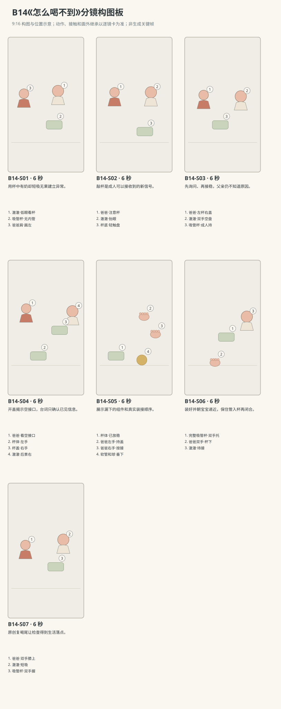

图示为构图位置示意；姿态、接触和画外继承以逐镜正文为准。

### 逐镜设计

#### B14-S01｜00—06 秒｜6 秒｜帧 [0, 144)

**镜头任务：**用杯中有奶却短吸无果建立异常。

**景别、机位与构图：**南侧宝宝中近景，餐椅靠背后景、宝宝中景，双把手与杯内半杯奶在下部；爸爸仅画左留肩。

**摄影机与理由：**固定，让嘴与杯的距离变化主导注意。

**焦点：**宝宝唇部、软吸嘴和透明杯内液体清楚，初始内管确实不存在。

**入态：**澈澈餐椅坐稳，双手各握吸管杯一侧把手，杯在胸前、短软吸嘴距唇一指，杯中奶低于一半、盖下无内吸管；爸爸双手自己膝上，尚未注意异常。

**动作与表演：**

- 2 秒：澈澈屈双肘把杯送近，嘴唇自然含住软吸嘴，杯体保持直立微斜。

- 2 秒：澈澈短吸两下，液面只随握持轻晃，没有奶沿内管上行，眉间微微挤起。

- 2 秒：宝宝嘴松开吸嘴，把杯降到胸下，低眼看杯中奶，双手仍握把手。

**声音：**轻柔口息与衣料声，无明显吸入奶的吞咽声，无对白。

**出态：**宝宝嘴与吸嘴分离，双手持杯胸下并低眼看；杯中奶仍低于一半、内管缺失；爸爸尚未接杯。

**切点与承接：**切稍宽镜，延续杯向餐盘下降。

**连续性：**固定带、座背支撑画内；外部软嘴仍在盖上，杯盖封闭，内管与重力球在西侧桌画外白布上未动。

**开始画面母稿：**

9:16竖幅原创三维生活动画，圆润而保留婴儿头身与关节尺度，皮肤柔和、棉布哑光、低反差暖中性色，动作有真实重量；无字幕、无标识、无额外人物。澈澈圆润脸颊、深棕眼、短黑绒发、额前一撮向右弯，穿奶油色棉连体衣，不作成人式算计表情。爸爸短黑发，穿砖陶色棉衬衫、深灰长裤，表情自然温和。本图为单一开始瞬间；裁切外人物不为展示外观强行入画。固定空间和材质：客厅北沙发、西窗、东走廊。澈澈坐在中央地垫北半一把雾蓝有背餐椅中，腹部固定带、座背与脚踏共同支撑，面朝南；浅灰餐盘在胸下，宝宝不站起。爸爸坐餐椅西侧低凳，自己的西侧有稳固低侧桌，宝宝伸手够不到；侧桌铺白布，洁净内吸管组件在白布、成人手中还是杯内只按本镜起态，前几镜侧桌在构图外。唯一透明饮奶吸管杯有两侧雾蓝把手、宽杯底、带外露柔软短吸嘴的螺纹杯盖，乳白液体低于半杯；杯嘴依靠盖下接口连接的软吸管和重力球出液，杯内组件缺失还是已装好只按本镜起态；它不是靠倒置奶嘴出液的普通奶瓶。内吸管组件仅一套，拆装只由爸爸完成；杯体、杯盖、组件位置只按本镜起态。相机南侧朝北不越轴，爸爸画左、宝宝画右，西窗柔光从画左入，杯体不过曝。构图范围：南侧宝宝中近景，餐椅靠背后景、宝宝中景，双把手与杯内半杯奶在下部；爸爸仅画左留肩。唯一此刻状态：澈澈餐椅坐稳，双手各握吸管杯一侧把手，杯在胸前、短软吸嘴距唇一指，杯中奶低于一半、盖下无内吸管；爸爸双手自己膝上，尚未注意异常。清晰度与焦点：宝宝唇部、软吸嘴和透明杯内液体清楚，初始内管确实不存在。只呈现这个起态，不将后续动作阶段并列绘入。

**视频变化母稿：**

9:16竖幅原创三维生活动画，圆润而保留婴儿头身与关节尺度，皮肤柔和、棉布哑光、低反差暖中性色，动作有真实重量；无字幕、无标识、无额外人物。澈澈圆润脸颊、深棕眼、短黑绒发、额前一撮向右弯，穿奶油色棉连体衣，不作成人式算计表情。爸爸短黑发，穿砖陶色棉衬衫、深灰长裤，表情自然温和。本镜有效时长6秒，为一个连续镜头。固定空间和材质：客厅北沙发、西窗、东走廊。澈澈坐在中央地垫北半一把雾蓝有背餐椅中，腹部固定带、座背与脚踏共同支撑，面朝南；浅灰餐盘在胸下，宝宝不站起。爸爸坐餐椅西侧低凳，自己的西侧有稳固低侧桌，宝宝伸手够不到；侧桌铺白布，洁净内吸管组件在白布、成人手中还是杯内只按本镜起态，前几镜侧桌在构图外。唯一透明饮奶吸管杯有两侧雾蓝把手、宽杯底、带外露柔软短吸嘴的螺纹杯盖，乳白液体低于半杯；杯嘴依靠盖下接口连接的软吸管和重力球出液，杯内组件缺失还是已装好只按本镜起态；它不是靠倒置奶嘴出液的普通奶瓶。内吸管组件仅一套，拆装只由爸爸完成；杯体、杯盖、组件位置只按本镜起态。相机南侧朝北不越轴，爸爸画左、宝宝画右，西窗柔光从画左入，杯体不过曝。摄影构图：南侧宝宝中近景，餐椅靠背后景、宝宝中景，双把手与杯内半杯奶在下部；爸爸仅画左留肩。摄影机：固定，让嘴与杯的距离变化主导注意。焦点：宝宝唇部、软吸嘴和透明杯内液体清楚，初始内管确实不存在。起态：澈澈餐椅坐稳，双手各握吸管杯一侧把手，杯在胸前、短软吸嘴距唇一指，杯中奶低于一半、盖下无内吸管；爸爸双手自己膝上，尚未注意异常。阶段1，2秒：澈澈屈双肘把杯送近，嘴唇自然含住软吸嘴，杯体保持直立微斜。阶段2，2秒：澈澈短吸两下，液面只随握持轻晃，没有奶沿内管上行，眉间微微挤起。阶段3，2秒：宝宝嘴松开吸嘴，把杯降到胸下，低眼看杯中奶，双手仍握把手。准确声音：轻柔口息与衣料声，无明显吸入奶的吞咽声，无对白。终态：宝宝嘴与吸嘴分离，双手持杯胸下并低眼看；杯中奶仍低于一半、内管缺失；爸爸尚未接杯。接触和画外状态：固定带、座背支撑画内；外部软嘴仍在盖上，杯盖封闭，内管与重力球在西侧桌画外白布上未动。在该终态切出，不在本镜内部额外切镜。

#### B14-S02｜06—12 秒｜6 秒｜帧 [144, 288)

**镜头任务：**敲杯是成人可以接收到的新信号。

**景别、机位与构图：**南侧双人中景，爸爸左、宝宝右，餐盘和杯底接触点在中下，爸爸膝上双手可见。

**摄影机与理由：**固定，把两次敲击与成人听见后的转眼放一镜。

**焦点：**杯底餐盘接触与成人目光变化同处可读范围。

**入态：**宝宝嘴与吸嘴分离，双手持杯胸下并低眼看；杯中奶仍低于一半、内管缺失；爸爸尚未接杯、双手膝上。

**动作与表演：**

- 2 秒：宝宝双手把杯往下放，杯底轻敲餐盘一次，立即离盘少许。

- 2 秒：宝宝再把杯底轻敲餐盘一次，之后留杯底靠在盘上，不继续砸。

- 2 秒：爸爸听到第二声后望向杯子，身体略前倾，双手仍膝上，宝宝抬眼看他。

**声音：**两次轻闷的杯底碰盘声，间隔清楚；液体轻晃，无夸张砸击、无对白。

**出态：**杯底停餐盘、宝宝双手仍握两把手；爸爸已看杯且略前倾、双手膝上，宝宝抬眼看爸爸。

**切点与承接：**在敲击结束后的注意状态切接杯，不重复敲声。

**连续性：**宝宝没有站起或大幅前扑；杯底敲盘画内可见，内管仍画外侧桌，爸爸尚未触杯。

**开始画面母稿：**

9:16竖幅原创三维生活动画，圆润而保留婴儿头身与关节尺度，皮肤柔和、棉布哑光、低反差暖中性色，动作有真实重量；无字幕、无标识、无额外人物。澈澈圆润脸颊、深棕眼、短黑绒发、额前一撮向右弯，穿奶油色棉连体衣，不作成人式算计表情。爸爸短黑发，穿砖陶色棉衬衫、深灰长裤，表情自然温和。本图为单一开始瞬间；裁切外人物不为展示外观强行入画。固定空间和材质：客厅北沙发、西窗、东走廊。澈澈坐在中央地垫北半一把雾蓝有背餐椅中，腹部固定带、座背与脚踏共同支撑，面朝南；浅灰餐盘在胸下，宝宝不站起。爸爸坐餐椅西侧低凳，自己的西侧有稳固低侧桌，宝宝伸手够不到；侧桌铺白布，洁净内吸管组件在白布、成人手中还是杯内只按本镜起态，前几镜侧桌在构图外。唯一透明饮奶吸管杯有两侧雾蓝把手、宽杯底、带外露柔软短吸嘴的螺纹杯盖，乳白液体低于半杯；杯嘴依靠盖下接口连接的软吸管和重力球出液，杯内组件缺失还是已装好只按本镜起态；它不是靠倒置奶嘴出液的普通奶瓶。内吸管组件仅一套，拆装只由爸爸完成；杯体、杯盖、组件位置只按本镜起态。相机南侧朝北不越轴，爸爸画左、宝宝画右，西窗柔光从画左入，杯体不过曝。构图范围：南侧双人中景，爸爸左、宝宝右；宝宝双手杯在胸下，餐盘平面位于其下且杯底尚有间隙，爸爸双手仍膝上。唯一此刻状态：宝宝嘴与吸嘴分离，双手持杯胸下并低眼看；杯中奶仍低于一半、内管缺失；爸爸尚未接杯、双手膝上。清晰度与焦点：宝宝双握把手、杯底与餐盘的间隙，以及爸爸未前倾的姿态清楚；此刻杯底尚未接盘。只呈现这个起态，不将后续动作阶段并列绘入。

**视频变化母稿：**

9:16竖幅原创三维生活动画，圆润而保留婴儿头身与关节尺度，皮肤柔和、棉布哑光、低反差暖中性色，动作有真实重量；无字幕、无标识、无额外人物。澈澈圆润脸颊、深棕眼、短黑绒发、额前一撮向右弯，穿奶油色棉连体衣，不作成人式算计表情。爸爸短黑发，穿砖陶色棉衬衫、深灰长裤，表情自然温和。本镜有效时长6秒，为一个连续镜头。固定空间和材质：客厅北沙发、西窗、东走廊。澈澈坐在中央地垫北半一把雾蓝有背餐椅中，腹部固定带、座背与脚踏共同支撑，面朝南；浅灰餐盘在胸下，宝宝不站起。爸爸坐餐椅西侧低凳，自己的西侧有稳固低侧桌，宝宝伸手够不到；侧桌铺白布，洁净内吸管组件在白布、成人手中还是杯内只按本镜起态，前几镜侧桌在构图外。唯一透明饮奶吸管杯有两侧雾蓝把手、宽杯底、带外露柔软短吸嘴的螺纹杯盖，乳白液体低于半杯；杯嘴依靠盖下接口连接的软吸管和重力球出液，杯内组件缺失还是已装好只按本镜起态；它不是靠倒置奶嘴出液的普通奶瓶。内吸管组件仅一套，拆装只由爸爸完成；杯体、杯盖、组件位置只按本镜起态。相机南侧朝北不越轴，爸爸画左、宝宝画右，西窗柔光从画左入，杯体不过曝。摄影构图：南侧双人中景，爸爸左、宝宝右，餐盘和杯底接触点在中下，爸爸膝上双手可见。摄影机：固定，把两次敲击与成人听见后的转眼放一镜。焦点：杯底餐盘接触与成人目光变化同处可读范围。起态：宝宝嘴与吸嘴分离，双手持杯胸下并低眼看；杯中奶仍低于一半、内管缺失；爸爸尚未接杯、双手膝上。阶段1，2秒：宝宝双手把杯往下放，杯底轻敲餐盘一次，立即离盘少许。阶段2，2秒：宝宝再把杯底轻敲餐盘一次，之后留杯底靠在盘上，不继续砸。阶段3，2秒：爸爸听到第二声后望向杯子，身体略前倾，双手仍膝上，宝宝抬眼看他。准确声音：两次轻闷的杯底碰盘声，间隔清楚；液体轻晃，无夸张砸击、无对白。终态：杯底停餐盘、宝宝双手仍握两把手；爸爸已看杯且略前倾、双手膝上，宝宝抬眼看爸爸。接触和画外状态：宝宝没有站起或大幅前扑；杯底敲盘画内可见，内管仍画外侧桌，爸爸尚未触杯。在该终态切出，不在本镜内部额外切镜。

#### B14-S03｜12—18 秒｜6 秒｜帧 [288, 432)

**镜头任务：**先询问、再接稳，父亲仍不知道原因。

**景别、机位与构图：**南侧双人中近景，爸爸脸在左上、接杯双手在中下，宝宝脸右上和两把手可见。

**摄影机与理由：**固定，让接触与释放成为信息。

**焦点：**成人托杯底、宝宝双手释放与两张脸清楚。

**入态：**杯底停餐盘、宝宝双手仍握两把手；爸爸已看杯且略前倾、双手膝上，宝宝抬眼看爸爸。

**动作与表演：**

- 2 秒：爸爸先对宝宝轻声问“怎么了？”，右手从膝上伸到杯底侧，左手靠近杯身，尚不抽走。

- 2 秒：爸爸右手托杯底、左手扶杯身；宝宝先松右把手再松左把手，双手空落餐盘。

- 2 秒：爸爸把杯收向自己，左手稳杯身，右手从杯底移到盖边，低眼查看杯中奶。

**声音：**准确台词“怎么了？”，之后把手轻擦手指与棉袖声；无爸爸先说故障原因。

**出态：**爸爸左手稳杯体、右手扶盖边，杯已离宝宝手且仍封闭；宝宝双手空放餐盘，目光看爸爸杯子。

**切点与承接：**切较近覆盖，持续爸爸的同一次检查。

**连续性：**接杯短暂共持和宝宝双手释放均画内；杯中奶量不变，组件仍西侧桌画外。

**开始画面母稿：**

9:16竖幅原创三维生活动画，圆润而保留婴儿头身与关节尺度，皮肤柔和、棉布哑光、低反差暖中性色，动作有真实重量；无字幕、无标识、无额外人物。澈澈圆润脸颊、深棕眼、短黑绒发、额前一撮向右弯，穿奶油色棉连体衣，不作成人式算计表情。爸爸短黑发，穿砖陶色棉衬衫、深灰长裤，表情自然温和。本图为单一开始瞬间；裁切外人物不为展示外观强行入画。固定空间和材质：客厅北沙发、西窗、东走廊。澈澈坐在中央地垫北半一把雾蓝有背餐椅中，腹部固定带、座背与脚踏共同支撑，面朝南；浅灰餐盘在胸下，宝宝不站起。爸爸坐餐椅西侧低凳，自己的西侧有稳固低侧桌，宝宝伸手够不到；侧桌铺白布，洁净内吸管组件在白布、成人手中还是杯内只按本镜起态，前几镜侧桌在构图外。唯一透明饮奶吸管杯有两侧雾蓝把手、宽杯底、带外露柔软短吸嘴的螺纹杯盖，乳白液体低于半杯；杯嘴依靠盖下接口连接的软吸管和重力球出液，杯内组件缺失还是已装好只按本镜起态；它不是靠倒置奶嘴出液的普通奶瓶。内吸管组件仅一套，拆装只由爸爸完成；杯体、杯盖、组件位置只按本镜起态。相机南侧朝北不越轴，爸爸画左、宝宝画右，西窗柔光从画左入，杯体不过曝。构图范围：南侧双人中近景，爸爸脸在左上、两只空手仍在自己膝上；宝宝画右双手握两把手，杯底接餐盘，宝宝看爸爸。唯一此刻状态：杯底停餐盘、宝宝双手仍握两把手；爸爸已看杯且略前倾、双手膝上，宝宝抬眼看爸爸。清晰度与焦点：爸爸空双手在膝、宝宝双手仍握把手与杯底接盘状态清楚；成人尚未托杯底，宝宝尚未释放。只呈现这个起态，不将后续动作阶段并列绘入。

**视频变化母稿：**

9:16竖幅原创三维生活动画，圆润而保留婴儿头身与关节尺度，皮肤柔和、棉布哑光、低反差暖中性色，动作有真实重量；无字幕、无标识、无额外人物。澈澈圆润脸颊、深棕眼、短黑绒发、额前一撮向右弯，穿奶油色棉连体衣，不作成人式算计表情。爸爸短黑发，穿砖陶色棉衬衫、深灰长裤，表情自然温和。本镜有效时长6秒，为一个连续镜头。固定空间和材质：客厅北沙发、西窗、东走廊。澈澈坐在中央地垫北半一把雾蓝有背餐椅中，腹部固定带、座背与脚踏共同支撑，面朝南；浅灰餐盘在胸下，宝宝不站起。爸爸坐餐椅西侧低凳，自己的西侧有稳固低侧桌，宝宝伸手够不到；侧桌铺白布，洁净内吸管组件在白布、成人手中还是杯内只按本镜起态，前几镜侧桌在构图外。唯一透明饮奶吸管杯有两侧雾蓝把手、宽杯底、带外露柔软短吸嘴的螺纹杯盖，乳白液体低于半杯；杯嘴依靠盖下接口连接的软吸管和重力球出液，杯内组件缺失还是已装好只按本镜起态；它不是靠倒置奶嘴出液的普通奶瓶。内吸管组件仅一套，拆装只由爸爸完成；杯体、杯盖、组件位置只按本镜起态。相机南侧朝北不越轴，爸爸画左、宝宝画右，西窗柔光从画左入，杯体不过曝。摄影构图：南侧双人中近景，爸爸脸在左上、接杯双手在中下，宝宝脸右上和两把手可见。摄影机：固定，让接触与释放成为信息。焦点：成人托杯底、宝宝双手释放与两张脸清楚。起态：杯底停餐盘、宝宝双手仍握两把手；爸爸已看杯且略前倾、双手膝上，宝宝抬眼看爸爸。阶段1，2秒：爸爸先对宝宝轻声问“怎么了？”，右手从膝上伸到杯底侧，左手靠近杯身，尚不抽走。阶段2，2秒：爸爸右手托杯底、左手扶杯身；宝宝先松右把手再松左把手，双手空落餐盘。阶段3，2秒：爸爸把杯收向自己，左手稳杯身，右手从杯底移到盖边，低眼查看杯中奶。准确声音：准确台词“怎么了？”，之后把手轻擦手指与棉袖声；无爸爸先说故障原因。终态：爸爸左手稳杯体、右手扶盖边，杯已离宝宝手且仍封闭；宝宝双手空放餐盘，目光看爸爸杯子。接触和画外状态：接杯短暂共持和宝宝双手释放均画内；杯中奶量不变，组件仍西侧桌画外。在该终态切出，不在本镜内部额外切镜。

#### B14-S04｜18—24 秒｜6 秒｜帧 [432, 576)

**镜头任务：**开盖揭示空接口，台词只确认已见信息。

**景别、机位与构图：**南侧偏西中近景，不越轴；爸爸脸在左上，左手杯体中下、右手杯盖偏右上，宝宝只留画右后景。

**摄影机与理由：**固定，前两秒旋盖、后两秒空接口转向自己，不用镜头穿杯。

**焦点：**旋盖接缝、分离后的盖下空接口与爸爸低眼可读，杯口不被手遮。

**入态：**爸爸左手稳杯体、右手扶盖边，杯已离宝宝手且仍封闭；宝宝双手空放餐盘，目光看爸爸杯子。

**动作与表演：**

- 2 秒：爸爸左手稳杯身，右手转动雾蓝螺纹盖，盖沿逐渐离杯口。

- 2 秒：右手提起盖并把下方空接口转向自己，杯内没有垂下的吸管或球，爸爸视线从杯内移向接口。

- 2 秒：爸爸确认空接口，轻轻呼气说“忘装了。”，双手各持杯体与杯盖停住。

**声音：**盖沿轻微摩擦后，爸爸准确台词“忘装了。”，平静自语，不归咎宝宝。

**出态：**爸爸左手持敞口杯体，右手持杯盖、盖下空接口可见；组件尚未装，宝宝双手空餐盘看着。

**切点与承接：**以缺件明确状态切向侧桌，不把装配藏在剪点。

**连续性：**外部软吸嘴和盖为一体可见，杯中没有第二条内管；宝宝身体与手盘状态画外继承，侧桌在爸爸西侧。

**开始画面母稿：**

9:16竖幅原创三维生活动画，圆润而保留婴儿头身与关节尺度，皮肤柔和、棉布哑光、低反差暖中性色，动作有真实重量；无字幕、无标识、无额外人物。澈澈圆润脸颊、深棕眼、短黑绒发、额前一撮向右弯，穿奶油色棉连体衣，不作成人式算计表情。爸爸短黑发，穿砖陶色棉衬衫、深灰长裤，表情自然温和。本图为单一开始瞬间；裁切外人物不为展示外观强行入画。固定空间和材质：客厅北沙发、西窗、东走廊。澈澈坐在中央地垫北半一把雾蓝有背餐椅中，腹部固定带、座背与脚踏共同支撑，面朝南；浅灰餐盘在胸下，宝宝不站起。爸爸坐餐椅西侧低凳，自己的西侧有稳固低侧桌，宝宝伸手够不到；侧桌铺白布，洁净内吸管组件在白布、成人手中还是杯内只按本镜起态，前几镜侧桌在构图外。唯一透明饮奶吸管杯有两侧雾蓝把手、宽杯底、带外露柔软短吸嘴的螺纹杯盖，乳白液体低于半杯；杯嘴依靠盖下接口连接的软吸管和重力球出液，杯内组件缺失还是已装好只按本镜起态；它不是靠倒置奶嘴出液的普通奶瓶。内吸管组件仅一套，拆装只由爸爸完成；杯体、杯盖、组件位置只按本镜起态。相机南侧朝北不越轴，爸爸画左、宝宝画右，西窗柔光从画左入，杯体不过曝。构图范围：南侧偏西中近景，不越轴；爸爸脸在左上，左手握杯体中下，右指仍扶闭合盖边，宝宝仅画右后景。唯一此刻状态：爸爸左手稳杯体、右手扶盖边，杯已离宝宝手且仍封闭；宝宝双手空放餐盘，目光看爸爸杯子。清晰度与焦点：爸爸左手稳住杯体、右指仍扶封闭盖沿与低眼视线清楚；杯盖此刻尚未打开，盖下接口不可见。只呈现这个起态，不将后续动作阶段并列绘入。

**视频变化母稿：**

9:16竖幅原创三维生活动画，圆润而保留婴儿头身与关节尺度，皮肤柔和、棉布哑光、低反差暖中性色，动作有真实重量；无字幕、无标识、无额外人物。澈澈圆润脸颊、深棕眼、短黑绒发、额前一撮向右弯，穿奶油色棉连体衣，不作成人式算计表情。爸爸短黑发，穿砖陶色棉衬衫、深灰长裤，表情自然温和。本镜有效时长6秒，为一个连续镜头。固定空间和材质：客厅北沙发、西窗、东走廊。澈澈坐在中央地垫北半一把雾蓝有背餐椅中，腹部固定带、座背与脚踏共同支撑，面朝南；浅灰餐盘在胸下，宝宝不站起。爸爸坐餐椅西侧低凳，自己的西侧有稳固低侧桌，宝宝伸手够不到；侧桌铺白布，洁净内吸管组件在白布、成人手中还是杯内只按本镜起态，前几镜侧桌在构图外。唯一透明饮奶吸管杯有两侧雾蓝把手、宽杯底、带外露柔软短吸嘴的螺纹杯盖，乳白液体低于半杯；杯嘴依靠盖下接口连接的软吸管和重力球出液，杯内组件缺失还是已装好只按本镜起态；它不是靠倒置奶嘴出液的普通奶瓶。内吸管组件仅一套，拆装只由爸爸完成；杯体、杯盖、组件位置只按本镜起态。相机南侧朝北不越轴，爸爸画左、宝宝画右，西窗柔光从画左入，杯体不过曝。摄影构图：南侧偏西中近景，不越轴；爸爸脸在左上，左手杯体中下、右手杯盖偏右上，宝宝只留画右后景。摄影机：固定，前两秒旋盖、后两秒空接口转向自己，不用镜头穿杯。焦点：旋盖接缝、分离后的盖下空接口与爸爸低眼可读，杯口不被手遮。起态：爸爸左手稳杯体、右手扶盖边，杯已离宝宝手且仍封闭；宝宝双手空放餐盘，目光看爸爸杯子。阶段1，2秒：爸爸左手稳杯身，右手转动雾蓝螺纹盖，盖沿逐渐离杯口。阶段2，2秒：右手提起盖并把下方空接口转向自己，杯内没有垂下的吸管或球，爸爸视线从杯内移向接口。阶段3，2秒：爸爸确认空接口，轻轻呼气说“忘装了。”，双手各持杯体与杯盖停住。准确声音：盖沿轻微摩擦后，爸爸准确台词“忘装了。”，平静自语，不归咎宝宝。终态：爸爸左手持敞口杯体，右手持杯盖、盖下空接口可见；组件尚未装，宝宝双手空餐盘看着。接触和画外状态：外部软吸嘴和盖为一体可见，杯中没有第二条内管；宝宝身体与手盘状态画外继承，侧桌在爸爸西侧。在该终态切出，不在本镜内部额外切镜。

#### B14-S05｜24—30 秒｜6 秒｜帧 [576, 720)

**镜头任务：**展示漏下的组件和真实装接顺序。

**景别、机位与构图：**南侧偏西手部近景，侧桌白布为前景，爸爸双手中景；杯体在画左下、组件原位画中、盖在画右，宝宝不入画。

**摄影机与理由：**固定，保证杯体放稳、换持与接管可核。

**焦点：**杯体底部、杯盖下接口与右手所取组件的连接端共同清楚。

**入态：**爸爸左手持敞口杯体，右手持杯盖、盖下空接口可见；组件尚未装，宝宝双手空餐盘看着；西侧桌白布上平放唯一洁净软吸管和重力球组件。

**动作与表演：**

- 1 秒：爸爸左手把杯体直立放稳在侧桌白布左侧，松开杯体。

- 1 秒：爸爸左手接住右手中的杯盖，盖下接口朝右下，右手释放盖。

- 2 秒：右手拿起软吸管组件的连接端，重力球连在软管另一端自然垂下，移向左手杯盖下接口。

- 2 秒：右指把连接端轻按入盖下接口到位，左手稳住杯盖，重力球悬在下方，不接触桌面。

**声音：**杯底轻落布面、盖在掌间换持的细响、组件按接的轻声，无对白，不用金属卡扣大响。

**出态：**杯体敞口直立侧桌白布左侧；爸爸左手持已接内吸管的杯盖，管与球垂下，右指在接口旁已松力；宝宝画外双手空餐盘。

**切点与承接：**切略宽手部覆盖，接组件入杯并旋盖。

**连续性：**所有小组件只在成人手中，侧桌宝宝够不到；内管一套已离白布，杯内仍无管且杯口敞开。

**开始画面母稿：**

9:16竖幅原创三维生活动画，圆润而保留婴儿头身与关节尺度，皮肤柔和、棉布哑光、低反差暖中性色，动作有真实重量；无字幕、无标识、无额外人物。澈澈圆润脸颊、深棕眼、短黑绒发、额前一撮向右弯，穿奶油色棉连体衣，不作成人式算计表情。爸爸短黑发，穿砖陶色棉衬衫、深灰长裤，表情自然温和。本图为单一开始瞬间；裁切外人物不为展示外观强行入画。固定空间和材质：客厅北沙发、西窗、东走廊。澈澈坐在中央地垫北半一把雾蓝有背餐椅中，腹部固定带、座背与脚踏共同支撑，面朝南；浅灰餐盘在胸下，宝宝不站起。爸爸坐餐椅西侧低凳，自己的西侧有稳固低侧桌，宝宝伸手够不到；侧桌铺白布，洁净内吸管组件在白布、成人手中还是杯内只按本镜起态，前几镜侧桌在构图外。唯一透明饮奶吸管杯有两侧雾蓝把手、宽杯底、带外露柔软短吸嘴的螺纹杯盖，乳白液体低于半杯；杯嘴依靠盖下接口连接的软吸管和重力球出液，杯内组件缺失还是已装好只按本镜起态；它不是靠倒置奶嘴出液的普通奶瓶。内吸管组件仅一套，拆装只由爸爸完成；杯体、杯盖、组件位置只按本镜起态。相机南侧朝北不越轴，爸爸画左、宝宝画右，西窗柔光从画左入，杯体不过曝。构图范围：南侧偏西手部近景；爸爸左手持敞口杯体在画左、右手持取下的杯盖在画右，侧桌白布及唯一未拿起的内管组件在下方。唯一此刻状态：爸爸左手持敞口杯体，右手持杯盖、盖下空接口可见；组件尚未装，宝宝双手空餐盘看着；西侧桌白布上平放唯一洁净软吸管和重力球组件。清晰度与焦点：左手敞口杯体、右手空接口杯盖，以及白布上尚未拿起的唯一内管和重力球组件分别可读。只呈现这个起态，不将后续动作阶段并列绘入。

**视频变化母稿：**

9:16竖幅原创三维生活动画，圆润而保留婴儿头身与关节尺度，皮肤柔和、棉布哑光、低反差暖中性色，动作有真实重量；无字幕、无标识、无额外人物。澈澈圆润脸颊、深棕眼、短黑绒发、额前一撮向右弯，穿奶油色棉连体衣，不作成人式算计表情。爸爸短黑发，穿砖陶色棉衬衫、深灰长裤，表情自然温和。本镜有效时长6秒，为一个连续镜头。固定空间和材质：客厅北沙发、西窗、东走廊。澈澈坐在中央地垫北半一把雾蓝有背餐椅中，腹部固定带、座背与脚踏共同支撑，面朝南；浅灰餐盘在胸下，宝宝不站起。爸爸坐餐椅西侧低凳，自己的西侧有稳固低侧桌，宝宝伸手够不到；侧桌铺白布，洁净内吸管组件在白布、成人手中还是杯内只按本镜起态，前几镜侧桌在构图外。唯一透明饮奶吸管杯有两侧雾蓝把手、宽杯底、带外露柔软短吸嘴的螺纹杯盖，乳白液体低于半杯；杯嘴依靠盖下接口连接的软吸管和重力球出液，杯内组件缺失还是已装好只按本镜起态；它不是靠倒置奶嘴出液的普通奶瓶。内吸管组件仅一套，拆装只由爸爸完成；杯体、杯盖、组件位置只按本镜起态。相机南侧朝北不越轴，爸爸画左、宝宝画右，西窗柔光从画左入，杯体不过曝。摄影构图：南侧偏西手部近景，侧桌白布为前景，爸爸双手中景；杯体在画左下、组件原位画中、盖在画右，宝宝不入画。摄影机：固定，保证杯体放稳、换持与接管可核。焦点：杯体底部、杯盖下接口与右手所取组件的连接端共同清楚。起态：爸爸左手持敞口杯体，右手持杯盖、盖下空接口可见；组件尚未装，宝宝双手空餐盘看着；西侧桌白布上平放唯一洁净软吸管和重力球组件。阶段1，1秒：爸爸左手把杯体直立放稳在侧桌白布左侧，松开杯体。阶段2，1秒：爸爸左手接住右手中的杯盖，盖下接口朝右下，右手释放盖。阶段3，2秒：右手拿起软吸管组件的连接端，重力球连在软管另一端自然垂下，移向左手杯盖下接口。阶段4，2秒：右指把连接端轻按入盖下接口到位，左手稳住杯盖，重力球悬在下方，不接触桌面。准确声音：杯底轻落布面、盖在掌间换持的细响、组件按接的轻声，无对白，不用金属卡扣大响。终态：杯体敞口直立侧桌白布左侧；爸爸左手持已接内吸管的杯盖，管与球垂下，右指在接口旁已松力；宝宝画外双手空餐盘。接触和画外状态：所有小组件只在成人手中，侧桌宝宝够不到；内管一套已离白布，杯内仍无管且杯口敞开。在该终态切出，不在本镜内部额外切镜。

#### B14-S06｜30—36 秒｜6 秒｜帧 [720, 864)

**镜头任务：**装好并朝宝宝递近，保住管入杯再闭合。

**景别、机位与构图：**南侧偏西双手中近景，侧桌前景，杯盖内管从上方入杯、宝宝餐盘在画右边缘。

**摄影机与理由：**固定，盖合与旋紧不靠视线外完成。

**焦点：**内管和重力球的入杯路径、杯口接缝与成人两手清楚。

**入态：**杯体敞口直立侧桌白布左侧；爸爸左手持已接内吸管的杯盖，管与球垂下，右指在接口旁已松力；宝宝画外双手空餐盘。

**动作与表演：**

- 1 秒：爸爸右手离开接口，握住侧桌上杯体外壁，杯底仍接白布。

- 2 秒：左手把已接管杯盖移到杯口上方，先让重力球与软管完整进入杯内，再将盖口对正杯口。

- 2 秒：右手稳杯，左手旋紧雾蓝盖，内管连接在盖下且球沉向杯底，液体只轻晃。

- 1 秒：爸爸双手移到杯身下半部共同托住完整杯子，将杯送向宝宝餐盘前，不碰宝宝手。

**声音：**管球入液的极轻声、旋盖摩擦与衣袖声，无对白。

**出态：**杯已完整装好并旋紧，内管与球可见；爸爸双手共同托杯身下半部，送到宝宝餐盘前，宝宝双手仍空在盘上、未接。

**切点与承接：**切双人递接，宝宝先握稳再成人松。

**连续性：**无组件残留白布、没有第二根吸管；两把手空出供宝宝接，成人不握吸嘴，奶量仍低于半杯。

**开始画面母稿：**

9:16竖幅原创三维生活动画，圆润而保留婴儿头身与关节尺度，皮肤柔和、棉布哑光、低反差暖中性色，动作有真实重量；无字幕、无标识、无额外人物。澈澈圆润脸颊、深棕眼、短黑绒发、额前一撮向右弯，穿奶油色棉连体衣，不作成人式算计表情。爸爸短黑发，穿砖陶色棉衬衫、深灰长裤，表情自然温和。本图为单一开始瞬间；裁切外人物不为展示外观强行入画。固定空间和材质：客厅北沙发、西窗、东走廊。澈澈坐在中央地垫北半一把雾蓝有背餐椅中，腹部固定带、座背与脚踏共同支撑，面朝南；浅灰餐盘在胸下，宝宝不站起。爸爸坐餐椅西侧低凳，自己的西侧有稳固低侧桌，宝宝伸手够不到；侧桌铺白布，洁净内吸管组件在白布、成人手中还是杯内只按本镜起态，前几镜侧桌在构图外。唯一透明饮奶吸管杯有两侧雾蓝把手、宽杯底、带外露柔软短吸嘴的螺纹杯盖，乳白液体低于半杯；杯嘴依靠盖下接口连接的软吸管和重力球出液，杯内组件缺失还是已装好只按本镜起态；它不是靠倒置奶嘴出液的普通奶瓶。内吸管组件仅一套，拆装只由爸爸完成；杯体、杯盖、组件位置只按本镜起态。相机南侧朝北不越轴，爸爸画左、宝宝画右，西窗柔光从画左入，杯体不过曝。构图范围：南侧偏西双手中近景；杯体敞口直立侧桌白布上，爸爸左手持已接管杯盖、软管与球在杯外垂着，右指仍在盖下接口旁，宝宝餐盘在画右边缘。唯一此刻状态：杯体敞口直立侧桌白布左侧；爸爸左手持已接内吸管的杯盖，管与球垂下，右指在接口旁已松力；宝宝画外双手空餐盘。清晰度与焦点：桌面直立杯体、左手盖下连接处、杯外下垂的软管和球、尚未取杯的右手分别清楚；没有管球已经入杯的状态。只呈现这个起态，不将后续动作阶段并列绘入。

**视频变化母稿：**

9:16竖幅原创三维生活动画，圆润而保留婴儿头身与关节尺度，皮肤柔和、棉布哑光、低反差暖中性色，动作有真实重量；无字幕、无标识、无额外人物。澈澈圆润脸颊、深棕眼、短黑绒发、额前一撮向右弯，穿奶油色棉连体衣，不作成人式算计表情。爸爸短黑发，穿砖陶色棉衬衫、深灰长裤，表情自然温和。本镜有效时长6秒，为一个连续镜头。固定空间和材质：客厅北沙发、西窗、东走廊。澈澈坐在中央地垫北半一把雾蓝有背餐椅中，腹部固定带、座背与脚踏共同支撑，面朝南；浅灰餐盘在胸下，宝宝不站起。爸爸坐餐椅西侧低凳，自己的西侧有稳固低侧桌，宝宝伸手够不到；侧桌铺白布，洁净内吸管组件在白布、成人手中还是杯内只按本镜起态，前几镜侧桌在构图外。唯一透明饮奶吸管杯有两侧雾蓝把手、宽杯底、带外露柔软短吸嘴的螺纹杯盖，乳白液体低于半杯；杯嘴依靠盖下接口连接的软吸管和重力球出液，杯内组件缺失还是已装好只按本镜起态；它不是靠倒置奶嘴出液的普通奶瓶。内吸管组件仅一套，拆装只由爸爸完成；杯体、杯盖、组件位置只按本镜起态。相机南侧朝北不越轴，爸爸画左、宝宝画右，西窗柔光从画左入，杯体不过曝。摄影构图：南侧偏西双手中近景，侧桌前景，杯盖内管从上方入杯、宝宝餐盘在画右边缘。摄影机：固定，盖合与旋紧不靠视线外完成。焦点：内管和重力球的入杯路径、杯口接缝与成人两手清楚。起态：杯体敞口直立侧桌白布左侧；爸爸左手持已接内吸管的杯盖，管与球垂下，右指在接口旁已松力；宝宝画外双手空餐盘。阶段1，1秒：爸爸右手离开接口，握住侧桌上杯体外壁，杯底仍接白布。阶段2，2秒：左手把已接管杯盖移到杯口上方，先让重力球与软管完整进入杯内，再将盖口对正杯口。阶段3，2秒：右手稳杯，左手旋紧雾蓝盖，内管连接在盖下且球沉向杯底，液体只轻晃。阶段4，1秒：爸爸双手移到杯身下半部共同托住完整杯子，将杯送向宝宝餐盘前，不碰宝宝手。准确声音：管球入液的极轻声、旋盖摩擦与衣袖声，无对白。终态：杯已完整装好并旋紧，内管与球可见；爸爸双手共同托杯身下半部，送到宝宝餐盘前，宝宝双手仍空在盘上、未接。接触和画外状态：无组件残留白布、没有第二根吸管；两把手空出供宝宝接，成人不握吸嘴，奶量仍低于半杯。在该终态切出，不在本镜内部额外切镜。

#### B14-S07｜36—42 秒｜6 秒｜帧 [864, 1008)

**镜头任务：**原创复喝尾让检查得到生活落点。

**景别、机位与构图：**南侧双人中景，爸爸左、宝宝右，杯、双把手、成人手膝与宝宝嘴部可见；北沙发后景。

**摄影机与理由：**固定，接杯与短吸留在同一镜，确认恢复。

**焦点：**双把手握稳、成人撤手和宝宝唇部同在清楚范围。

**入态：**杯已完整装好并旋紧，内管与球可见；爸爸双手共同托杯身下半部，送到宝宝餐盘前，宝宝双手仍空在盘上、未接。

**动作与表演：**

- 2 秒：宝宝双手分别抓住两侧把手，爸爸等抓稳后依次松开两手，空手收回自己膝上。

- 2 秒：宝宝把杯举近嘴，唇含短软吸嘴自然短吸一口；一小段奶沿已接内管上行，杯内奶量只有很小变化。

- 2 秒：宝宝平静地停一口气，双手仍持杯靠唇，爸爸看一眼确认后放松肩，双手留膝。

**声音：**把手轻擦、自然短吸和一口克制吞咽，尾留平缓呼吸；无台词、无夸张成功音效。

**出态：**宝宝双手握把手、软吸嘴近唇，杯内内管正常且奶仍低于一半；爸爸双手空在膝上，平静看宝宝，无再敲杯。

**切点与承接：**保留安静尾，此段复喝是原创收束，不再加教训。

**连续性：**宝宝抓稳与成人双手释放画内可见；餐椅背带脚踏支撑保持，杯不瞬间喝空、不换成普通奶嘴瓶。

**开始画面母稿：**

9:16竖幅原创三维生活动画，圆润而保留婴儿头身与关节尺度，皮肤柔和、棉布哑光、低反差暖中性色，动作有真实重量；无字幕、无标识、无额外人物。澈澈圆润脸颊、深棕眼、短黑绒发、额前一撮向右弯，穿奶油色棉连体衣，不作成人式算计表情。爸爸短黑发，穿砖陶色棉衬衫、深灰长裤，表情自然温和。本图为单一开始瞬间；裁切外人物不为展示外观强行入画。固定空间和材质：客厅北沙发、西窗、东走廊。澈澈坐在中央地垫北半一把雾蓝有背餐椅中，腹部固定带、座背与脚踏共同支撑，面朝南；浅灰餐盘在胸下，宝宝不站起。爸爸坐餐椅西侧低凳，自己的西侧有稳固低侧桌，宝宝伸手够不到；侧桌铺白布，洁净内吸管组件在白布、成人手中还是杯内只按本镜起态，前几镜侧桌在构图外。唯一透明饮奶吸管杯有两侧雾蓝把手、宽杯底、带外露柔软短吸嘴的螺纹杯盖，乳白液体低于半杯；杯嘴依靠盖下接口连接的软吸管和重力球出液，杯内组件缺失还是已装好只按本镜起态；它不是靠倒置奶嘴出液的普通奶瓶。内吸管组件仅一套，拆装只由爸爸完成；杯体、杯盖、组件位置只按本镜起态。相机南侧朝北不越轴，爸爸画左、宝宝画右，西窗柔光从画左入，杯体不过曝。构图范围：南侧双人中景，爸爸左、宝宝右；爸爸双手仍托完整杯子下半部，停宝宝餐盘前，宝宝空双手在餐盘上，两把手空出，吸嘴未接唇。唯一此刻状态：杯已完整装好并旋紧，内管与球可见；爸爸双手共同托杯身下半部，送到宝宝餐盘前，宝宝双手仍空在盘上、未接。清晰度与焦点：宝宝空手与杯把手之间的间隙、成人双手持续托杯下半部，以及杯内已装管球清楚；不提前画成宝宝握稳或成人撤手。只呈现这个起态，不将后续动作阶段并列绘入。

**视频变化母稿：**

9:16竖幅原创三维生活动画，圆润而保留婴儿头身与关节尺度，皮肤柔和、棉布哑光、低反差暖中性色，动作有真实重量；无字幕、无标识、无额外人物。澈澈圆润脸颊、深棕眼、短黑绒发、额前一撮向右弯，穿奶油色棉连体衣，不作成人式算计表情。爸爸短黑发，穿砖陶色棉衬衫、深灰长裤，表情自然温和。本镜有效时长6秒，为一个连续镜头。固定空间和材质：客厅北沙发、西窗、东走廊。澈澈坐在中央地垫北半一把雾蓝有背餐椅中，腹部固定带、座背与脚踏共同支撑，面朝南；浅灰餐盘在胸下，宝宝不站起。爸爸坐餐椅西侧低凳，自己的西侧有稳固低侧桌，宝宝伸手够不到；侧桌铺白布，洁净内吸管组件在白布、成人手中还是杯内只按本镜起态，前几镜侧桌在构图外。唯一透明饮奶吸管杯有两侧雾蓝把手、宽杯底、带外露柔软短吸嘴的螺纹杯盖，乳白液体低于半杯；杯嘴依靠盖下接口连接的软吸管和重力球出液，杯内组件缺失还是已装好只按本镜起态；它不是靠倒置奶嘴出液的普通奶瓶。内吸管组件仅一套，拆装只由爸爸完成；杯体、杯盖、组件位置只按本镜起态。相机南侧朝北不越轴，爸爸画左、宝宝画右，西窗柔光从画左入，杯体不过曝。摄影构图：南侧双人中景，爸爸左、宝宝右，杯、双把手、成人手膝与宝宝嘴部可见；北沙发后景。摄影机：固定，接杯与短吸留在同一镜，确认恢复。焦点：双把手握稳、成人撤手和宝宝唇部同在清楚范围。起态：杯已完整装好并旋紧，内管与球可见；爸爸双手共同托杯身下半部，送到宝宝餐盘前，宝宝双手仍空在盘上、未接。阶段1，2秒：宝宝双手分别抓住两侧把手，爸爸等抓稳后依次松开两手，空手收回自己膝上。阶段2，2秒：宝宝把杯举近嘴，唇含短软吸嘴自然短吸一口；一小段奶沿已接内管上行，杯内奶量只有很小变化。阶段3，2秒：宝宝平静地停一口气，双手仍持杯靠唇，爸爸看一眼确认后放松肩，双手留膝。准确声音：把手轻擦、自然短吸和一口克制吞咽，尾留平缓呼吸；无台词、无夸张成功音效。终态：宝宝双手握把手、软吸嘴近唇，杯内内管正常且奶仍低于一半；爸爸双手空在膝上，平静看宝宝，无再敲杯。接触和画外状态：宝宝抓稳与成人双手释放画内可见；餐椅背带脚踏支撑保持，杯不瞬间喝空、不换成普通奶嘴瓶。在该终态切出，不在本镜内部额外切镜。

### 声音与剪辑

安静房间底声连续。前段只有自然短吸与没有出液的轻口息，不夸大空吸咕噜；两次杯底敲餐盘各有轻闷接触声。爸爸两句短中文与宝宝动作错开；旋盖、组件轻按和递接拟音随画面，结尾短吸与一口自然吞咽克制。无音乐、旁白或批评宝宝的话。

- 爸爸：怎么了？（B14-S03；本镜第1—2秒，先听完第二次敲杯，望向澈澈后轻问；不是批评敲击。）

- 爸爸：忘装了。（B14-S04；本镜第5—6秒，杯盖已打开且空接口可见、自己检查后才轻声自语，带一点发现疏漏的呼气。）

### 连续性与试片

- 连续性：透明饮奶吸管杯初始内吸管和重力球漏装、杯中仍有奶；外部短软吸嘴一直属于杯盖，不用普通倒置奶嘴瓶替换这一故障机制。

- 连续性：唯一杯子：先宝宝双手握两把手，爸爸接稳宝宝才松；爸爸左手杯体右手盖打开，后按S05/S06明确换持装配，再双手递回宝宝，不能凭空修好。

- 连续性：宝宝敲两次且只是杯底轻触餐盘，不用杯子砸自己或砸人；座背、固定带与脚踏支撑贯穿，内吸管组件始终由成人在够不到的侧桌处理。

- 连续性：S04看到空接口后才说“忘装了。”；S05真实展示内吸管接盖，S06组件入杯并拧盖，S07短吸有液流为原创尾，不能倒用成原帖已记录结局。

- 试片：S01—S02：可分辨杯中有奶、软吸嘴接唇、短吸不出液、移嘴再敲两次；初态不能已有内吸管，杯盖不应自行开。

- 试片：S03—S04：接杯双持→宝宝释放→成人左稳杯右旋盖→杯盖离杯→空接口朝自己，顺序完整；若父亲未检查就先指缺件则失败。

- 试片：S05：杯体先稳定侧桌，杯盖右手转左手，右手拿组件接盖；吸管球不能被画成杯里已有另一套，也不能进入宝宝手。

- 试片：S06—S07：盖下吸管先完整进杯再旋紧，宝宝双手抓两把手后成人才双松；杯中奶量前后一致，结尾不瞬间喝空。

- 试片：全片静音审看能定位宝宝异常动作、成人查杯和真实漏装原因；仅靠台词告知漏装或盖体瞬移即失败。

**媒体待验证：**完整文字分镜与独立复制稿已写，未绑定真实参考或生成媒体。待试片验证杯体透明层、空接口与内管可读性、餐椅姿态、两次轻敲、开盖装管的手序、递接和末尾短吸；文字检查不能证明饮奶口型或液体运动正确。

---

## F01《这个才好笑》

**45 秒｜坐姿与手部互动｜角色：澈澈、爸爸｜场景 L**

### 剧情正文

西窗的光落在客厅地垫上，澈澈坐在沙发前，爸爸盘腿坐在斜对面。爸爸把眼睛睁圆，鼓起脸颊，又慢慢缩成一个小小的噘嘴。澈澈没有笑，只低下巴仔细看，手指还捏着自己的衣角。爸爸换了个挑眉的表情，等了一会儿，见他依旧认真，终于呼出一口气，肩膀松下来。他用两手揉揉发酸的脸，掌根停在脸颊两边，不经意把嘴角挤成了一个歪歪的笑。澈澈先眨一下眼，忽然咯咯笑起来，身体向前晃了一点，又用手撑住地垫。爸爸停住手，愣着看他。笑声小下去，爸爸试着把掌根放回刚才的位置，可一看见澈澈还盯着自己，他就先笑漏了气。澈澈也重新笑起来。爸爸没再把脸挤得更怪，只放下手，向前凑近一点，两个人看着对方把这阵笑慢慢笑完。

### 导演与空间

**观察任务：**让观众从澈澈认真观察到突然发笑，发现亲密关系里无意的小动作比用力表演更好笑。

**空间与光位：**L客厅北墙沙发、西窗、东走廊、中央奶油地垫。澈澈坐在地垫北半部朝南，爸爸盘腿坐西南侧朝东北，两人相隔一臂。摄影始终在两人连线东南侧，宽镜中爸爸偏左、澈澈偏右；西窗漫射光落在两人西侧脸颊，背景沙发不换边。无手持玩具。

**人物表演：**澈澈能稳坐，双手可抓衣或撑垫，笑时保持坐骨着地；目光先查爸爸眉眼再落到手与脸接触。爸爸原本想逗他笑，主动做脸部小游戏，失败后真正歇一下，揉脸源自肌肉发酸。两人都允许停顿，不让澈澈机械地按大人指令笑。

### 节拍覆盖

- **F01-b1**：建立两人的相对位置与爸爸主动逗笑、澈澈认真观看的关系。 前态：澈澈坐地垫北部，双膝自然张开，右手捏衣角、左掌在左膝外撑垫。爸爸盘腿坐西南侧，双手落膝，正看澈澈。 后态：爸爸仍鼓腮，澈澈认真盯着他的眼鼻区域，手位未变。 → F01-S01

- **F01-b2**：展示爸爸用力设计的第二个表情仍没有换来笑声。 前态：爸爸鼓腮看澈澈，肩膀平稳，澈澈后脑在右前景，爸爸双手仍在膝上。 后态：爸爸嘴唇回松，眉毛还半抬着，等待已变成一点点疲惫。 → F01-S02

- **F01-b3**：让宝宝的专注与爸爸真正放松下来同时成立，为无意表情留空隙。 前态：澈澈认真看爸爸，右指捏连体衣、左掌撑垫；爸爸左前景眉毛略抬，尚未揉脸。 后态：爸爸双掌已来到脸旁但尚未压脸；澈澈目光落在掌根与脸颊的间隙。 → F01-S03

- **F01-b4**：无意揉脸形成真正刺激，宝宝在看清之后才开始笑。 前态：爸爸双手悬在脸旁，澈澈右手捏衣角、左掌撑垫，正盯着双掌。 后态：爸爸掌根轻贴两颊未继续揉，澈澈双掌在垫上、身体回到稳定坐姿，仍在笑。 → F01-S04

- **F01-b5**：爸爸想复制那个无意的表情，却被宝宝的笑先逗笑。 前态：爸爸掌根仍轻贴两颊，澈澈双掌撑垫，笑声开始变短。 后态：爸爸双手在膝上、自然笑，澈澈双掌仍在垫上，目光互相对着。 → F01-S05

- **F01-b6**：以共同笑完而非再制造怪脸收束关系。 前态：爸爸双手在膝上自然笑，澈澈稳坐双掌撑垫，抬眼看爸爸。 后态：爸爸双手落膝、澈澈双掌撑垫，笑意尚在但动作静下来。 → F01-S06

### 分镜构图板

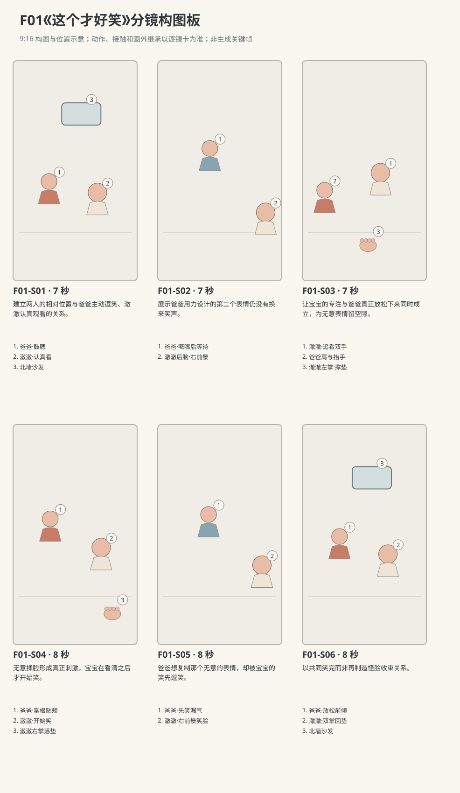

图示为构图位置示意；姿态、接触和画外继承以逐镜正文为准。

### 逐镜设计

#### F01-S01｜00—07 秒｜7 秒｜帧 [0, 168)

**镜头任务：**建立两人的相对位置与爸爸主动逗笑、澈澈认真观看的关系。

**景别、机位与构图：**中全景，机位离地约澈澈眼高，东南朝西北，爸爸左前景、澈澈右中景、沙发横在后景；留出两人之间的视线通道。

**摄影机与理由：**固定，先让观众看清距离和爸爸如何进入宝宝注意范围，不追表情。

**焦点：**两人面部共同清晰；爸爸抬头后澈澈视线仍可读。

**入态：**澈澈坐地垫北部，双膝自然张开，右手捏衣角、左掌在左膝外撑垫。爸爸盘腿坐西南侧，双手落膝，正看澈澈。

**动作与表演：**

- 3 秒：爸爸把肩膀放低到澈澈视线高度，缓慢睁圆眼睛；澈澈从爸爸衣领看向眼睛。

- 4 秒：爸爸鼓起两颊并保持，眼神等回应；澈澈微低下巴，仍捏着衣角，没有笑。

**声音：**爸爸一次轻吸气后闭口；澈澈平稳鼻息、棉布轻摩擦，远处环境底声，无对白无音乐。

**出态：**爸爸仍鼓腮，澈澈认真盯着他的眼鼻区域，手位未变。

**切点与承接：**在爸爸准备换表情的吸气前切近，保留澈澈未笑的事实。

**连续性：**画内可见两人坐骨着地及澈澈双手归属；无物件出入，后镜继承爸爸鼓腮终态。

**开始画面母稿：**

9:16竖幅，原创三维生活动画，圆润而有重量的造型，棉布细纹、柔和皮肤层次与可读的小表情；动作按真实生活物理及婴儿当下能力展开，不用成人化算计表情。澈澈为圆脸、深棕眼、短黑绒发、额前一小撮向右弯的头发，穿奶油色棉连体衣。爸爸短黑发，砖陶色棉衬衫、深灰长裤。本镜开始画面为单一瞬间：澈澈坐地垫北部，双膝自然张开，右手捏衣角、左掌在左膝外撑垫。爸爸盘腿坐西南侧，双手落膝，正看澈澈。 场次方位与光位：L客厅北墙沙发、西窗、东侧走廊、中央地垫。澈澈在地垫北半朝南，爸爸在西南侧朝东北；摄影始终在二人连线东南侧，宽镜爸爸左、宝宝右。西窗漫射为唯一主光，环境方位不反转。 摄影构图：中全景，机位离地约澈澈眼高，东南朝西北，爸爸左前景、澈澈右中景、沙发横在后景；留出两人之间的视线通道。 当前焦点：澈澈与爸爸当前互望的双眼、宝宝捏衣角的右指。只呈现上述起态，不把后续动作拼入一张画面。

**视频变化母稿：**

9:16竖幅，原创三维生活动画，圆润而有重量的造型，棉布细纹、柔和皮肤层次与可读的小表情；动作按真实生活物理及婴儿当下能力展开，不用成人化算计表情。澈澈为圆脸、深棕眼、短黑绒发、额前一小撮向右弯的头发，穿奶油色棉连体衣。爸爸短黑发，砖陶色棉衬衫、深灰长裤。制作一段7秒连续镜头。本段人物和能力：澈澈、爸爸，澈澈为R1。空间光位：L客厅北墙沙发、西窗、东侧走廊、中央地垫。澈澈在地垫北半朝南，爸爸在西南侧朝东北；摄影始终在二人连线东南侧，宽镜爸爸左、宝宝右。西窗漫射为唯一主光，环境方位不反转。 起态：澈澈坐地垫北部，双膝自然张开，右手捏衣角、左掌在左膝外撑垫。爸爸盘腿坐西南侧，双手落膝，正看澈澈。 摄影：中全景，机位离地约澈澈眼高，东南朝西北，爸爸左前景、澈澈右中景、沙发横在后景；留出两人之间的视线通道。 相机行为：固定，先让观众看清距离和爸爸如何进入宝宝注意范围，不追表情。 焦点：两人面部共同清晰；爸爸抬头后澈澈视线仍可读。 时间过程：第1阶段3秒：爸爸把肩膀放低到澈澈视线高度，缓慢睁圆眼睛；澈澈从爸爸衣领看向眼睛。；第2阶段4秒：爸爸鼓起两颊并保持，眼神等回应；澈澈微低下巴，仍捏着衣角，没有笑。。声音：爸爸一次轻吸气后闭口；澈澈平稳鼻息、棉布轻摩擦，远处环境底声，无对白无音乐。 终态：爸爸仍鼓腮，澈澈认真盯着他的眼鼻区域，手位未变。 连续性：画内可见两人坐骨着地及澈澈双手归属；无物件出入，后镜继承爸爸鼓腮终态。 不加未写出的对白、人物或道具。

#### F01-S02｜07—14 秒｜7 秒｜帧 [168, 336)

**镜头任务：**展示爸爸用力设计的第二个表情仍没有换来笑声。

**景别、机位与构图：**爸爸近景，东南侧略向西北，脸居左中，右画缘保留澈澈一小块后脑轮廓，爸爸双手膝上不入脸部区域。

**摄影机与理由：**固定；用脸部尺寸读懂鼓腮到噘嘴的变化，不用推镜夸大。

**焦点：**爸爸双眼与嘴角；澈澈前景轮廓轻虚。

**入态：**爸爸鼓腮看澈澈，肩膀平稳，澈澈后脑在右前景，爸爸双手仍在膝上。

**动作与表演：**

- 3 秒：爸爸慢慢呼掉腮里的气，嘴唇收成小圆口，眉毛向上抬。

- 4 秒：爸爸把小圆口偏向一侧又回正，等两拍，目光始终落在澈澈脸上。

**声音：**爸爸很轻的放气声、布料声，澈澈无笑声；无对白。

**出态：**爸爸嘴唇回松，眉毛还半抬着，等待已变成一点点疲惫。

**切点与承接：**随爸爸视线切向澈澈，核对回应而非继续加码表演。

**连续性：**画内爸爸未抬手；澈澈右手捏衣角、左掌撑垫在画外继承，位置不换。

**开始画面母稿：**

9:16竖幅，原创三维生活动画，圆润而有重量的造型，棉布细纹、柔和皮肤层次与可读的小表情；动作按真实生活物理及婴儿当下能力展开，不用成人化算计表情。澈澈为圆脸、深棕眼、短黑绒发、额前一小撮向右弯的头发，穿奶油色棉连体衣。爸爸短黑发，砖陶色棉衬衫、深灰长裤。本镜开始画面为单一瞬间：爸爸鼓腮看澈澈，肩膀平稳，澈澈后脑在右前景，爸爸双手仍在膝上。 场次方位与光位：L客厅北墙沙发、西窗、东侧走廊、中央地垫。澈澈在地垫北半朝南，爸爸在西南侧朝东北；摄影始终在二人连线东南侧，宽镜爸爸左、宝宝右。西窗漫射为唯一主光，环境方位不反转。 摄影构图：爸爸近景，东南侧略向西北，脸居左中，右画缘保留澈澈一小块后脑轮廓，爸爸双手膝上不入脸部区域。 当前焦点：爸爸鼓起的双颊与双眼，右前景宝宝后脑略虚。只呈现上述起态，不把后续动作拼入一张画面。

**视频变化母稿：**

9:16竖幅，原创三维生活动画，圆润而有重量的造型，棉布细纹、柔和皮肤层次与可读的小表情；动作按真实生活物理及婴儿当下能力展开，不用成人化算计表情。澈澈为圆脸、深棕眼、短黑绒发、额前一小撮向右弯的头发，穿奶油色棉连体衣。爸爸短黑发，砖陶色棉衬衫、深灰长裤。制作一段7秒连续镜头。本段人物和能力：澈澈、爸爸，澈澈为R1。空间光位：L客厅北墙沙发、西窗、东侧走廊、中央地垫。澈澈在地垫北半朝南，爸爸在西南侧朝东北；摄影始终在二人连线东南侧，宽镜爸爸左、宝宝右。西窗漫射为唯一主光，环境方位不反转。 起态：爸爸鼓腮看澈澈，肩膀平稳，澈澈后脑在右前景，爸爸双手仍在膝上。 摄影：爸爸近景，东南侧略向西北，脸居左中，右画缘保留澈澈一小块后脑轮廓，爸爸双手膝上不入脸部区域。 相机行为：固定；用脸部尺寸读懂鼓腮到噘嘴的变化，不用推镜夸大。 焦点：爸爸双眼与嘴角；澈澈前景轮廓轻虚。 时间过程：第1阶段3秒：爸爸慢慢呼掉腮里的气，嘴唇收成小圆口，眉毛向上抬。；第2阶段4秒：爸爸把小圆口偏向一侧又回正，等两拍，目光始终落在澈澈脸上。。声音：爸爸很轻的放气声、布料声，澈澈无笑声；无对白。 终态：爸爸嘴唇回松，眉毛还半抬着，等待已变成一点点疲惫。 连续性：画内爸爸未抬手；澈澈右手捏衣角、左掌撑垫在画外继承，位置不换。 不加未写出的对白、人物或道具。

#### F01-S03｜14—21 秒｜7 秒｜帧 [336, 504)

**镜头任务：**让宝宝的专注与爸爸真正放松下来同时成立，为无意表情留空隙。

**景别、机位与构图：**澈澈中近景，机位仍东南侧朝北略偏西，澈澈居右中，爸爸眉眼、嘴与肩颈留在左前景边缘，脸部不遮澈澈眼线，左下缘预留抬手通道；下缘包括澈澈衣角与撑垫左掌。

**摄影机与理由：**固定；在宝宝视线移动中等到爸爸呼气，不替宝宝做夸张反应。

**焦点：**澈澈眼睛；爸爸肩膀下降仍保留可辨轮廓。

**入态：**澈澈认真看爸爸，右指捏连体衣、左掌撑垫；爸爸左前景眉毛略抬，尚未揉脸。

**动作与表演：**

- 3 秒：澈澈看爸爸的眉毛，再把视线缓缓落到嘴上，嘴唇微分但没有发笑。

- 4 秒：爸爸呼气、放下肩膀，两只手从膝上抬向脸颊；澈澈眼睛跟着手向上看。

**声音：**爸爸自然叹出一小口气；衣袖掠动，澈澈轻鼻息，无对白无音乐。

**出态：**爸爸双掌已来到脸旁但尚未压脸；澈澈目光落在掌根与脸颊的间隙。

**切点与承接：**在掌根即将接触时切到能同时读脸和宝宝的二人镜，接完整触碰。

**连续性：**澈澈双手尚未换位；爸爸双手从画外膝位自左下缘进入脸旁后可见，膝部不作为本镜画内证据；后镜不得让手已提前揉过。

**开始画面母稿：**

9:16竖幅，原创三维生活动画，圆润而有重量的造型，棉布细纹、柔和皮肤层次与可读的小表情；动作按真实生活物理及婴儿当下能力展开，不用成人化算计表情。澈澈为圆脸、深棕眼、短黑绒发、额前一小撮向右弯的头发，穿奶油色棉连体衣。爸爸短黑发，砖陶色棉衬衫、深灰长裤。本镜开始画面为单一瞬间：澈澈认真看爸爸，右指捏连体衣、左掌撑垫；爸爸左前景眉毛略抬，尚未揉脸。 场次方位与光位：L客厅北墙沙发、西窗、东侧走廊、中央地垫。澈澈在地垫北半朝南，爸爸在西南侧朝东北；摄影始终在二人连线东南侧，宽镜爸爸左、宝宝右。西窗漫射为唯一主光，环境方位不反转。 摄影构图：澈澈中近景，机位仍东南侧朝北略偏西，澈澈居右中，爸爸眉眼、嘴与肩颈留在左前景边缘，脸部不遮澈澈眼线，左下缘预留抬手通道；下缘包括澈澈衣角与撑垫左掌。 当前焦点：澈澈观察爸爸的双眼、胸前右指与撑垫左掌。只呈现上述起态，不把后续动作拼入一张画面。

**视频变化母稿：**

9:16竖幅，原创三维生活动画，圆润而有重量的造型，棉布细纹、柔和皮肤层次与可读的小表情；动作按真实生活物理及婴儿当下能力展开，不用成人化算计表情。澈澈为圆脸、深棕眼、短黑绒发、额前一小撮向右弯的头发，穿奶油色棉连体衣。爸爸短黑发，砖陶色棉衬衫、深灰长裤。制作一段7秒连续镜头。本段人物和能力：澈澈、爸爸，澈澈为R1。空间光位：L客厅北墙沙发、西窗、东侧走廊、中央地垫。澈澈在地垫北半朝南，爸爸在西南侧朝东北；摄影始终在二人连线东南侧，宽镜爸爸左、宝宝右。西窗漫射为唯一主光，环境方位不反转。 起态：澈澈认真看爸爸，右指捏连体衣、左掌撑垫；爸爸左前景眉毛略抬，尚未揉脸。 摄影：澈澈中近景，机位仍东南侧朝北略偏西，澈澈居右中，爸爸眉眼、嘴与肩颈留在左前景边缘，脸部不遮澈澈眼线，左下缘预留抬手通道；下缘包括澈澈衣角与撑垫左掌。 相机行为：固定；在宝宝视线移动中等到爸爸呼气，不替宝宝做夸张反应。 焦点：澈澈眼睛；爸爸肩膀下降仍保留可辨轮廓。 时间过程：第1阶段3秒：澈澈看爸爸的眉毛，再把视线缓缓落到嘴上，嘴唇微分但没有发笑。；第2阶段4秒：爸爸呼气、放下肩膀，两只手从膝上抬向脸颊；澈澈眼睛跟着手向上看。。声音：爸爸自然叹出一小口气；衣袖掠动，澈澈轻鼻息，无对白无音乐。 终态：爸爸双掌已来到脸旁但尚未压脸；澈澈目光落在掌根与脸颊的间隙。 连续性：澈澈双手尚未换位；爸爸双手从画外膝位自左下缘进入脸旁后可见，膝部不作为本镜画内证据；后镜不得让手已提前揉过。 不加未写出的对白、人物或道具。

#### F01-S04｜21—29 秒｜8 秒｜帧 [504, 696)

**镜头任务：**无意揉脸形成真正刺激，宝宝在看清之后才开始笑。

**景别、机位与构图：**紧凑二人中景，东南侧机位，爸爸左、澈澈右，两张脸与爸爸两只掌根同框，下缘留澈澈右手到垫的路径。

**摄影机与理由：**固定；接触与反应在同一镜内完成，避免剪辑替代因果。

**焦点：**前3秒爸爸掌根和嘴角为重，随后小幅移焦澈澈双眼与张开的笑嘴；两人均留可辨清晰度。

**入态：**爸爸双手悬在脸旁，澈澈右手捏衣角、左掌撑垫，正盯着双掌。

**动作与表演：**

- 3 秒：爸爸闭一下眼，用两掌根轻揉脸颊，再停在两边，把嘴角不经意挤成歪笑。

- 2 秒：澈澈眨眼看清嘴角，嘴角先动，随后发出一声短笑。

- 3 秒：短笑连成咯咯声，澈澈向前晃一点，右手松开衣角落到右膝外地垫，爸爸立刻停住掌根看他。

**声音：**掌根擦脸细声先出现；第4秒后才有澈澈短笑，第6秒起接自然咯咯声。爸爸无对白，环境保持低。

**出态：**爸爸掌根轻贴两颊未继续揉，澈澈双掌在垫上、身体回到稳定坐姿，仍在笑。

**切点与承接：**笑声越过切点，转到爸爸对意外成功的反应。

**连续性：**同框实际可见右手由衣角到地垫，左掌始终接地；爸爸掌根仅压软组织。

**开始画面母稿：**

9:16竖幅，原创三维生活动画，圆润而有重量的造型，棉布细纹、柔和皮肤层次与可读的小表情；动作按真实生活物理及婴儿当下能力展开，不用成人化算计表情。澈澈为圆脸、深棕眼、短黑绒发、额前一小撮向右弯的头发，穿奶油色棉连体衣。爸爸短黑发，砖陶色棉衬衫、深灰长裤。本镜开始画面为单一瞬间：爸爸双手悬在脸旁，澈澈右手捏衣角、左掌撑垫，正盯着双掌。 场次方位与光位：L客厅北墙沙发、西窗、东侧走廊、中央地垫。澈澈在地垫北半朝南，爸爸在西南侧朝东北；摄影始终在二人连线东南侧，宽镜爸爸左、宝宝右。西窗漫射为唯一主光，环境方位不反转。 摄影构图：紧凑二人中景，东南侧机位，爸爸左、澈澈右，两张脸与爸爸两只掌根同框，下缘留澈澈右手到垫的路径。 当前焦点：爸爸尚未触脸的双掌、掌根与双颊间隙，以及澈澈看手的双眼。只呈现上述起态，不把后续动作拼入一张画面。

**视频变化母稿：**

9:16竖幅，原创三维生活动画，圆润而有重量的造型，棉布细纹、柔和皮肤层次与可读的小表情；动作按真实生活物理及婴儿当下能力展开，不用成人化算计表情。澈澈为圆脸、深棕眼、短黑绒发、额前一小撮向右弯的头发，穿奶油色棉连体衣。爸爸短黑发，砖陶色棉衬衫、深灰长裤。制作一段8秒连续镜头。本段人物和能力：澈澈、爸爸，澈澈为R1。空间光位：L客厅北墙沙发、西窗、东侧走廊、中央地垫。澈澈在地垫北半朝南，爸爸在西南侧朝东北；摄影始终在二人连线东南侧，宽镜爸爸左、宝宝右。西窗漫射为唯一主光，环境方位不反转。 起态：爸爸双手悬在脸旁，澈澈右手捏衣角、左掌撑垫，正盯着双掌。 摄影：紧凑二人中景，东南侧机位，爸爸左、澈澈右，两张脸与爸爸两只掌根同框，下缘留澈澈右手到垫的路径。 相机行为：固定；接触与反应在同一镜内完成，避免剪辑替代因果。 焦点：前3秒爸爸掌根和嘴角为重，随后小幅移焦澈澈双眼与张开的笑嘴；两人均留可辨清晰度。 时间过程：第1阶段3秒：爸爸闭一下眼，用两掌根轻揉脸颊，再停在两边，把嘴角不经意挤成歪笑。；第2阶段2秒：澈澈眨眼看清嘴角，嘴角先动，随后发出一声短笑。；第3阶段3秒：短笑连成咯咯声，澈澈向前晃一点，右手松开衣角落到右膝外地垫，爸爸立刻停住掌根看他。。声音：掌根擦脸细声先出现；第4秒后才有澈澈短笑，第6秒起接自然咯咯声。爸爸无对白，环境保持低。 终态：爸爸掌根轻贴两颊未继续揉，澈澈双掌在垫上、身体回到稳定坐姿，仍在笑。 连续性：同框实际可见右手由衣角到地垫，左掌始终接地；爸爸掌根仅压软组织。 不加未写出的对白、人物或道具。

#### F01-S05｜29—37 秒｜8 秒｜帧 [696, 888)

**镜头任务：**爸爸想复制那个无意的表情，却被宝宝的笑先逗笑。

**景别、机位与构图：**爸爸中近景，仍从东南侧拍，爸爸左中、澈澈右前景侧脸可辨，爸爸双手和嘴均在框内。

**摄影机与理由：**固定，保持喜剧来自停住、重试和笑漏气，不添加突兀变焦。

**焦点：**爸爸眼睛和掌根；澈澈侧脸保持轻浅景深中的可辨笑态。

**入态：**爸爸掌根仍轻贴两颊，澈澈双掌撑垫，笑声开始变短。

**动作与表演：**

- 3 秒：爸爸松开双手一点，眼睛睁大看澈澈，自己嘴角已经扬起；澈澈吸一小口气。

- 3 秒：爸爸试着把掌根放回原接触点，刚要挤嘴角，眼神撞上澈澈的眼睛，先笑漏一口气。

- 2 秒：爸爸随笑把手放到膝上，脸完全回松；澈澈又笑了一声。

**声音：**澈澈笑声先收、爸爸短促笑气后起，再接澈澈一次笑；无对白，无罐头笑声。

**出态：**爸爸双手在膝上、自然笑，澈澈双掌仍在垫上，目光互相对着。

**切点与承接：**沿双人的相互视线切回稍宽，给笑自然结束的空间。

**连续性：**爸爸手位由脸到膝清楚完成；画外澈澈右左掌均撑垫，未抓回衣角。

**开始画面母稿：**

9:16竖幅，原创三维生活动画，圆润而有重量的造型，棉布细纹、柔和皮肤层次与可读的小表情；动作按真实生活物理及婴儿当下能力展开，不用成人化算计表情。澈澈为圆脸、深棕眼、短黑绒发、额前一小撮向右弯的头发，穿奶油色棉连体衣。爸爸短黑发，砖陶色棉衬衫、深灰长裤。本镜开始画面为单一瞬间：爸爸掌根仍轻贴两颊，澈澈双掌撑垫，笑声开始变短。 场次方位与光位：L客厅北墙沙发、西窗、东侧走廊、中央地垫。澈澈在地垫北半朝南，爸爸在西南侧朝东北；摄影始终在二人连线东南侧，宽镜爸爸左、宝宝右。西窗漫射为唯一主光，环境方位不反转。 摄影构图：爸爸中近景，仍从东南侧拍，爸爸左中、澈澈右前景侧脸可辨，爸爸双手和嘴均在框内。 当前焦点：爸爸掌根轻贴双颊的接触处与澈澈右前景笑脸。只呈现上述起态，不把后续动作拼入一张画面。

**视频变化母稿：**

9:16竖幅，原创三维生活动画，圆润而有重量的造型，棉布细纹、柔和皮肤层次与可读的小表情；动作按真实生活物理及婴儿当下能力展开，不用成人化算计表情。澈澈为圆脸、深棕眼、短黑绒发、额前一小撮向右弯的头发，穿奶油色棉连体衣。爸爸短黑发，砖陶色棉衬衫、深灰长裤。制作一段8秒连续镜头。本段人物和能力：澈澈、爸爸，澈澈为R1。空间光位：L客厅北墙沙发、西窗、东侧走廊、中央地垫。澈澈在地垫北半朝南，爸爸在西南侧朝东北；摄影始终在二人连线东南侧，宽镜爸爸左、宝宝右。西窗漫射为唯一主光，环境方位不反转。 起态：爸爸掌根仍轻贴两颊，澈澈双掌撑垫，笑声开始变短。 摄影：爸爸中近景，仍从东南侧拍，爸爸左中、澈澈右前景侧脸可辨，爸爸双手和嘴均在框内。 相机行为：固定，保持喜剧来自停住、重试和笑漏气，不添加突兀变焦。 焦点：爸爸眼睛和掌根；澈澈侧脸保持轻浅景深中的可辨笑态。 时间过程：第1阶段3秒：爸爸松开双手一点，眼睛睁大看澈澈，自己嘴角已经扬起；澈澈吸一小口气。；第2阶段3秒：爸爸试着把掌根放回原接触点，刚要挤嘴角，眼神撞上澈澈的眼睛，先笑漏一口气。；第3阶段2秒：爸爸随笑把手放到膝上，脸完全回松；澈澈又笑了一声。。声音：澈澈笑声先收、爸爸短促笑气后起，再接澈澈一次笑；无对白，无罐头笑声。 终态：爸爸双手在膝上、自然笑，澈澈双掌仍在垫上，目光互相对着。 连续性：爸爸手位由脸到膝清楚完成；画外澈澈右左掌均撑垫，未抓回衣角。 不加未写出的对白、人物或道具。

#### F01-S06｜37—45 秒｜8 秒｜帧 [888, 1080)

**镜头任务：**以共同笑完而非再制造怪脸收束关系。

**景别、机位与构图：**二人中景，与S01同轴同方向，爸爸左、澈澈右，双人上身与澈澈撑垫双掌可见，沙发在后。

**摄影机与理由：**轻缓向前移动约一掌距离，触发于爸爸微倾身；目的是把共同笑声收近，不改角色大小关系。

**焦点：**两人眼睛同在清晰范围；不在最后一刻转移焦点。

**入态：**爸爸双手在膝上自然笑，澈澈稳坐双掌撑垫，抬眼看爸爸。

**动作与表演：**

- 3 秒：爸爸微倾身让脸更近一点，停在澈澈可看清的距离；澈澈笑得肩膀轻动。

- 3 秒：两人笑声渐短，澈澈抬起右手离垫，轻轻碰一下自己的嘴角，爸爸看着这个动作又短笑。

- 2 秒：澈澈把右掌放回右膝外地垫，两人带着未完全收起的笑对视。

**声音：**真实的双人笑声逐渐落回呼吸，末两秒只剩短鼻息与环境声；无对白无音乐。

**出态：**爸爸双手落膝、澈澈双掌撑垫，笑意尚在但动作静下来。

**切点与承接：**在末次呼吸后停住结束，不加文字、额外反应或新道具。

**连续性：**右手离垫再回垫全程可见；爸爸未碰宝宝，不产生切后接抱；西窗亮侧一致。

**开始画面母稿：**

9:16竖幅，原创三维生活动画，圆润而有重量的造型，棉布细纹、柔和皮肤层次与可读的小表情；动作按真实生活物理及婴儿当下能力展开，不用成人化算计表情。澈澈为圆脸、深棕眼、短黑绒发、额前一小撮向右弯的头发，穿奶油色棉连体衣。爸爸短黑发，砖陶色棉衬衫、深灰长裤。本镜开始画面为单一瞬间：爸爸双手在膝上自然笑，澈澈稳坐双掌撑垫，抬眼看爸爸。 场次方位与光位：L客厅北墙沙发、西窗、东侧走廊、中央地垫。澈澈在地垫北半朝南，爸爸在西南侧朝东北；摄影始终在二人连线东南侧，宽镜爸爸左、宝宝右。西窗漫射为唯一主光，环境方位不反转。 摄影构图：二人中景，与S01同轴同方向，爸爸左、澈澈右，双人上身与澈澈撑垫双掌可见，沙发在后。 当前焦点：双人自然笑脸与澈澈双掌接地的当前状态。只呈现上述起态，不把后续动作拼入一张画面。

**视频变化母稿：**

9:16竖幅，原创三维生活动画，圆润而有重量的造型，棉布细纹、柔和皮肤层次与可读的小表情；动作按真实生活物理及婴儿当下能力展开，不用成人化算计表情。澈澈为圆脸、深棕眼、短黑绒发、额前一小撮向右弯的头发，穿奶油色棉连体衣。爸爸短黑发，砖陶色棉衬衫、深灰长裤。制作一段8秒连续镜头。本段人物和能力：澈澈、爸爸，澈澈为R1。空间光位：L客厅北墙沙发、西窗、东侧走廊、中央地垫。澈澈在地垫北半朝南，爸爸在西南侧朝东北；摄影始终在二人连线东南侧，宽镜爸爸左、宝宝右。西窗漫射为唯一主光，环境方位不反转。 起态：爸爸双手在膝上自然笑，澈澈稳坐双掌撑垫，抬眼看爸爸。 摄影：二人中景，与S01同轴同方向，爸爸左、澈澈右，双人上身与澈澈撑垫双掌可见，沙发在后。 相机行为：轻缓向前移动约一掌距离，触发于爸爸微倾身；目的是把共同笑声收近，不改角色大小关系。 焦点：两人眼睛同在清晰范围；不在最后一刻转移焦点。 时间过程：第1阶段3秒：爸爸微倾身让脸更近一点，停在澈澈可看清的距离；澈澈笑得肩膀轻动。；第2阶段3秒：两人笑声渐短，澈澈抬起右手离垫，轻轻碰一下自己的嘴角，爸爸看着这个动作又短笑。；第3阶段2秒：澈澈把右掌放回右膝外地垫，两人带着未完全收起的笑对视。。声音：真实的双人笑声逐渐落回呼吸，末两秒只剩短鼻息与环境声；无对白无音乐。 终态：爸爸双手落膝、澈澈双掌撑垫，笑意尚在但动作静下来。 连续性：右手离垫再回垫全程可见；爸爸未碰宝宝，不产生切后接抱；西窗亮侧一致。 不加未写出的对白、人物或道具。

### 声音与剪辑

无语言对白、无配乐。前景保留爸爸轻呼气、掌根擦过面颊的细声、澈澈由单次短笑变成自然咯咯声；底层为西窗外很轻的远处城市空气声。笑声不能提前铺在观察镜头上。

正式台词：无；保留镜头声音中已写明的自然发声。

### 连续性与试片

- 连续性：爸爸始终坐西南侧，澈澈在北半地垫，摄影不越两人连线。

- 连续性：澈澈全片不持玩具；右手最初捏衣角，笑时右掌撑到右膝外地垫后才稳住身体。

- 连续性：揉脸是掌根接触脸颊软组织，手指在耳前外侧，不穿入眼口；表情不改变头骨与眼球形体。

- 连续性：西窗为唯一主光；脸部近景的亮侧不反转。

- 试片：F01-S01—S03静音试看：澈澈须显得在观察并非冷漠；若靠字幕才能知道爸爸等待回应，则失败。

- 试片：F01-S04—S05试片：爸爸掌根挤脸、澈澈视线落点与笑声起点须有清楚先后；若宝宝在接触前已笑或脸部融化，则失败。

- 试片：F01-S05—S06剪辑：右手撑垫状态与坐姿应接续；若切后双手突然回到衣角、身体悬浮，则失败。

**媒体待验证：**尚未生成画面、声音或成片；重点待验脸颊受压的局部形变、婴儿短笑的呼吸节律、右掌撑垫与重心回稳。

---

## F02《袖子借我一下》

**38 秒｜坐姿与手部互动｜角色：澈澈、妈妈｜场景 L**

### 剧情正文

客厅地垫旁，妈妈把出门包放在膝前，澈澈坐在她身侧，看一册蓝绿布书被放进去。妈妈扶一下地垫准备起身，左袖口却停住了。她低头，看见澈澈的右手紧紧握着那一小片蓝布，眼睛仍盯着包口，仿佛手里只是顺便留了一个位置。妈妈弯回膝盖，坐到离他更近的地方，用空着的右手继续整理。她放好布书，又把包侧面压平；澈澈握着袖口，目光随着她的手来回，偶尔搓一下布料。旁边的珊瑚色软环被他的左膝轻碰，翻倒在垫上。澈澈转头看见它，先伸出左手拿住，再把右手也凑过去，袖口便自然滑了出来。妈妈的左手终于空了，却没有马上起身。她看看回到原处的袖口，再看看正用两只手翻软环的澈澈，嘴角动了一下。她把包带理顺，在他旁边多坐了片刻。

### 导演与空间

**观察任务：**通过一截被握住又自然松开的袖口，拍出宝宝看人做事和妈妈短暂舍不得离开的生活停顿。

**空间与光位：**L客厅北墙沙发、西窗、东走廊、中央奶油地垫。澈澈坐地垫北半朝东南，妈妈跪坐他西侧同朝东南，出门布包F02-X01开口朝上在妈妈膝前偏南，P05布书在妈妈右手，P01珊瑚软环在澈澈左膝外偏东。摄影在南侧朝北略偏西，妈妈画左、澈澈画右，窗光来自画左。

**人物表演：**妈妈持续完成装包，左袖被握后改变坐姿而不拽走手臂；她并不靠夸张不舍传达情绪。澈澈右手抓袖、左手可撑垫和拿环，兴趣从妈妈装包自然转到软环，不理解或执行成人离别道理。

### 节拍覆盖

- **F02-b1**：交代妈妈装包、宝宝观察和软环尚未被注意。 前态：妈妈跪坐在澈澈西侧，右手拿P05，左手放膝上；澈澈右掌在右膝边、左掌撑垫，P01竖斜倚在澈澈左膝外，底缘接地垫。 后态：P05已在包内；妈妈左掌撑垫、臀部尚未离开脚跟，澈澈看向她左袖。 → F02-S01

- **F02-b2**：让抓袖成为被看见的小动作，妈妈先接收到牵扯再回应。 前态：妈妈左掌撑垫、袖口松在左腕上方，澈澈右手离袖口约一小掌，右掌已抬起。 后态：妈妈左肘已弯回，左掌不再承重，澈澈右手握袖无持续拉力。 → F02-S02

- **F02-b3**：妈妈调整自己的位置，装包任务继续而非被迫中断。 前态：妈妈半起身停住，左肘弯向澈澈，澈澈右手握左袖，左掌仍撑垫。 后态：妈妈已稳稳跪坐，左前臂在宝宝右侧可及处，右手在包口，宝宝握袖不变。 → F02-S03

- **F02-b4**：拍出宝宝享受握着袖口看妈妈做事的安静过程，并给软环改变位置的可见原因。 前态：澈澈右手握袖，妈妈右手在左下包口整理；P01竖斜倚在澈澈左膝外。 后态：澈澈头已转向左膝外软环，右手还握妈妈左袖，左掌准备离垫。 → F02-S04

- **F02-b5**：明确呈现兴趣转移如何让袖口自然释放。 前态：澈澈右手握袖、左掌正离地垫，P01平躺在其左膝外，妈妈左前臂放松。 后态：软环在澈澈双手中，妈妈左袖完全释放，左手仍停原处。 → F02-S05

- **F02-b6**：妈妈手臂自由后反而多停一会儿，自然结束这段陪伴。 前态：妈妈左手停在身旁、袖口已空，右手扶包，澈澈双手在胸前翻P01。 后态：妈妈双手一扶包一落膝，澈澈双手持环，各自继续眼前的小事。 → F02-S06

### 分镜构图板

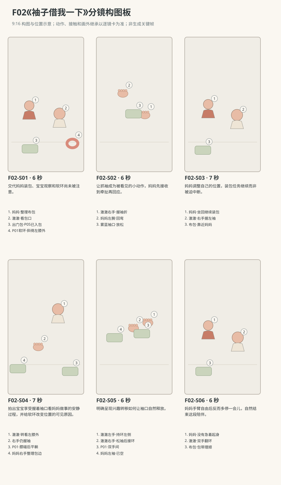

图示为构图位置示意；姿态、接触和画外继承以逐镜正文为准。

### 逐镜设计

#### F02-S01｜00—06 秒｜6 秒｜帧 [0, 144)

**镜头任务：**交代妈妈装包、宝宝观察和软环尚未被注意。

**景别、机位与构图：**中全景，南侧朝北略西，妈妈左、澈澈右，包在左下，软环在右下，后景北墙沙发。

**摄影机与理由：**固定，包口和袖口都留在构图内，为随后抓袖建立距离。

**焦点：**妈妈右手、包口和澈澈视线共同清晰。

**入态：**妈妈跪坐在澈澈西侧，右手拿P05，左手放膝上；澈澈右掌在右膝边、左掌撑垫，P01竖斜倚在澈澈左膝外，底缘接地垫。

**动作与表演：**

- 3 秒：妈妈右手把布书竖着放进开口的包，澈澈眼睛随书向下。

- 3 秒：妈妈右手按平布书露出的书角，左掌移到身旁地垫，身体稍前倾准备起身。

**声音：**棉布书擦过包衬的轻声、衣裤摩擦，无对白。

**出态：**P05已在包内；妈妈左掌撑垫、臀部尚未离开脚跟，澈澈看向她左袖。

**切点与承接：**在妈妈将开始抬臀时切接袖口关系。

**连续性：**布书去向、软环未动均画内可见；后镜继承包口敞开。

**开始画面母稿：**

9:16竖幅，原创三维生活动画，圆润而有重量的造型，棉布细纹、柔和皮肤层次与可读的小表情；动作按真实生活物理及婴儿当下能力展开，不用成人化算计表情。澈澈为圆脸、深棕眼、短黑绒发、额前一小撮向右弯的头发，穿奶油色棉连体衣。妈妈深棕低马尾，雾蓝棉上衣、米色长裤。本镜开始画面为单一瞬间：妈妈跪坐在澈澈西侧，右手拿P05，左手放膝上；澈澈右掌在右膝边、左掌撑垫，P01竖斜倚在澈澈左膝外，底缘接地垫。 场次方位与光位：L客厅北墙沙发、西窗、东走廊、中央地垫。澈澈在垫北半朝东南，妈妈位于其西侧也朝东南，布包工作区在妈妈膝前偏南。主摄影南侧朝北略西，妈妈左、宝宝右，西窗柔光由左入；道具当前位置只依本镜起态。 摄影构图：中全景，南侧朝北略西，妈妈左、澈澈右，包在左下，软环在右下，后景北墙沙发。 当前焦点：妈妈右手P05与敞开包口、澈澈看书的眼神。只呈现上述起态，不把后续动作拼入一张画面。

**视频变化母稿：**

9:16竖幅，原创三维生活动画，圆润而有重量的造型，棉布细纹、柔和皮肤层次与可读的小表情；动作按真实生活物理及婴儿当下能力展开，不用成人化算计表情。澈澈为圆脸、深棕眼、短黑绒发、额前一小撮向右弯的头发，穿奶油色棉连体衣。妈妈深棕低马尾，雾蓝棉上衣、米色长裤。制作一段6秒连续镜头。本段人物和能力：澈澈、妈妈，澈澈为R1。空间光位：L客厅北墙沙发、西窗、东走廊、中央地垫。澈澈在垫北半朝东南，妈妈位于其西侧也朝东南，布包工作区在妈妈膝前偏南。主摄影南侧朝北略西，妈妈左、宝宝右，西窗柔光由左入；道具当前位置只依本镜起态。 起态：妈妈跪坐在澈澈西侧，右手拿P05，左手放膝上；澈澈右掌在右膝边、左掌撑垫，P01竖斜倚在澈澈左膝外，底缘接地垫。 摄影：中全景，南侧朝北略西，妈妈左、澈澈右，包在左下，软环在右下，后景北墙沙发。 相机行为：固定，包口和袖口都留在构图内，为随后抓袖建立距离。 焦点：妈妈右手、包口和澈澈视线共同清晰。 时间过程：第1阶段3秒：妈妈右手把布书竖着放进开口的包，澈澈眼睛随书向下。；第2阶段3秒：妈妈右手按平布书露出的书角，左掌移到身旁地垫，身体稍前倾准备起身。。声音：棉布书擦过包衬的轻声、衣裤摩擦，无对白。 终态：P05已在包内；妈妈左掌撑垫、臀部尚未离开脚跟，澈澈看向她左袖。 连续性：布书去向、软环未动均画内可见；后镜继承包口敞开。 不加未写出的对白、人物或道具。

#### F02-S02｜06—12 秒｜6 秒｜帧 [144, 288)

**镜头任务：**让抓袖成为被看见的小动作，妈妈先接收到牵扯再回应。

**景别、机位与构图：**手部近景，南侧同轴，妈妈左袖从左上到中央，澈澈右手从右侧进入，地垫下方，妈妈左掌撑垫可见。

**摄影机与理由：**固定，不追妈妈起身上移，保留袖口与右指的受力关系。

**焦点：**澈澈右指闭合处及妈妈左腕布料褶皱。

**入态：**妈妈左掌撑垫、袖口松在左腕上方，澈澈右手离袖口约一小掌，右掌已抬起。

**动作与表演：**

- 2 秒：澈澈右指抓住袖口的一小折布，拇指压在布外侧。

- 2 秒：妈妈臀部微抬、左腕离垫一点，袖布轻绷，澈澈手臂只跟起一点。

- 2 秒：妈妈立刻停住并把左肘弯回，袖布重新松下来，澈澈仍握着。

**声音：**袖布被捏的细响，妈妈短促吸气后回到平稳呼吸；无对白。

**出态：**妈妈左肘已弯回，左掌不再承重，澈澈右手握袖无持续拉力。

**切点与承接：**在袖布重新松弛后切二人，观察妈妈选择坐回。

**连续性：**实际抓的是妈妈左袖而非皮肤或包带；澈澈左掌、P01与包在画外保持原位。

**开始画面母稿：**

9:16竖幅，原创三维生活动画，圆润而有重量的造型，棉布细纹、柔和皮肤层次与可读的小表情；动作按真实生活物理及婴儿当下能力展开，不用成人化算计表情。澈澈为圆脸、深棕眼、短黑绒发、额前一小撮向右弯的头发，穿奶油色棉连体衣。妈妈深棕低马尾，雾蓝棉上衣、米色长裤。本镜开始画面为单一瞬间：妈妈左掌撑垫、袖口松在左腕上方，澈澈右手离袖口约一小掌，右掌已抬起。 场次方位与光位：L客厅北墙沙发、西窗、东走廊、中央地垫。澈澈在垫北半朝东南，妈妈位于其西侧也朝东南，布包工作区在妈妈膝前偏南。主摄影南侧朝北略西，妈妈左、宝宝右，西窗柔光由左入；道具当前位置只依本镜起态。 摄影构图：手部近景，南侧同轴，妈妈左袖从左上到中央，澈澈右手从右侧进入，地垫下方，妈妈左掌撑垫可见。 当前焦点：澈澈抬起右指与妈妈左袖口之间尚未抓住的间隙。只呈现上述起态，不把后续动作拼入一张画面。

**视频变化母稿：**

9:16竖幅，原创三维生活动画，圆润而有重量的造型，棉布细纹、柔和皮肤层次与可读的小表情；动作按真实生活物理及婴儿当下能力展开，不用成人化算计表情。澈澈为圆脸、深棕眼、短黑绒发、额前一小撮向右弯的头发，穿奶油色棉连体衣。妈妈深棕低马尾，雾蓝棉上衣、米色长裤。制作一段6秒连续镜头。本段人物和能力：澈澈、妈妈，澈澈为R1。空间光位：L客厅北墙沙发、西窗、东走廊、中央地垫。澈澈在垫北半朝东南，妈妈位于其西侧也朝东南，布包工作区在妈妈膝前偏南。主摄影南侧朝北略西，妈妈左、宝宝右，西窗柔光由左入；道具当前位置只依本镜起态。 起态：妈妈左掌撑垫、袖口松在左腕上方，澈澈右手离袖口约一小掌，右掌已抬起。 摄影：手部近景，南侧同轴，妈妈左袖从左上到中央，澈澈右手从右侧进入，地垫下方，妈妈左掌撑垫可见。 相机行为：固定，不追妈妈起身上移，保留袖口与右指的受力关系。 焦点：澈澈右指闭合处及妈妈左腕布料褶皱。 时间过程：第1阶段2秒：澈澈右指抓住袖口的一小折布，拇指压在布外侧。；第2阶段2秒：妈妈臀部微抬、左腕离垫一点，袖布轻绷，澈澈手臂只跟起一点。；第3阶段2秒：妈妈立刻停住并把左肘弯回，袖布重新松下来，澈澈仍握着。。声音：袖布被捏的细响，妈妈短促吸气后回到平稳呼吸；无对白。 终态：妈妈左肘已弯回，左掌不再承重，澈澈右手握袖无持续拉力。 连续性：实际抓的是妈妈左袖而非皮肤或包带；澈澈左掌、P01与包在画外保持原位。 不加未写出的对白、人物或道具。

#### F02-S03｜12—19 秒｜7 秒｜帧 [288, 456)

**镜头任务：**妈妈调整自己的位置，装包任务继续而非被迫中断。

**景别、机位与构图：**二人中景，妈妈左、澈澈右，包口在左下，握袖点在画心略右。

**摄影机与理由：**缓慢下移少许，跟妈妈回坐的重心，让接地与靠近清楚。

**焦点：**妈妈看握袖点的眼神，再转澈澈看包口的眼神；握持始终可辨。

**入态：**妈妈半起身停住，左肘弯向澈澈，澈澈右手握左袖，左掌仍撑垫。

**动作与表演：**

- 3 秒：妈妈低头看袖口和澈澈的手，弯膝把臀部放回脚跟，左前臂松松落在身旁。

- 4 秒：妈妈把膝前的包用右手向自己拉近一点，继续拨正内袋；澈澈跟着右手看包口。

**声音：**妈妈坐回的一声轻呼气、裤布接垫声、布包拖动短声，无对白。

**出态：**妈妈已稳稳跪坐，左前臂在宝宝右侧可及处，右手在包口，宝宝握袖不变。

**切点与承接：**装包右手的动作延续到下一镜，保持日常节奏。

**连续性：**妈妈左袖从未被拽离；澈澈坐骨与左掌接地，未被带起；包只向西移动少许。

**开始画面母稿：**

9:16竖幅，原创三维生活动画，圆润而有重量的造型，棉布细纹、柔和皮肤层次与可读的小表情；动作按真实生活物理及婴儿当下能力展开，不用成人化算计表情。澈澈为圆脸、深棕眼、短黑绒发、额前一小撮向右弯的头发，穿奶油色棉连体衣。妈妈深棕低马尾，雾蓝棉上衣、米色长裤。本镜开始画面为单一瞬间：妈妈半起身停住，左肘弯向澈澈，澈澈右手握左袖，左掌仍撑垫。 场次方位与光位：L客厅北墙沙发、西窗、东走廊、中央地垫。澈澈在垫北半朝东南，妈妈位于其西侧也朝东南，布包工作区在妈妈膝前偏南。主摄影南侧朝北略西，妈妈左、宝宝右，西窗柔光由左入；道具当前位置只依本镜起态。 摄影构图：二人中景，妈妈左、澈澈右，包口在左下，握袖点在画心略右。 当前焦点：澈澈右指握妈妈左袖的接触处、妈妈察觉后的眼神。只呈现上述起态，不把后续动作拼入一张画面。

**视频变化母稿：**

9:16竖幅，原创三维生活动画，圆润而有重量的造型，棉布细纹、柔和皮肤层次与可读的小表情；动作按真实生活物理及婴儿当下能力展开，不用成人化算计表情。澈澈为圆脸、深棕眼、短黑绒发、额前一小撮向右弯的头发，穿奶油色棉连体衣。妈妈深棕低马尾，雾蓝棉上衣、米色长裤。制作一段7秒连续镜头。本段人物和能力：澈澈、妈妈，澈澈为R1。空间光位：L客厅北墙沙发、西窗、东走廊、中央地垫。澈澈在垫北半朝东南，妈妈位于其西侧也朝东南，布包工作区在妈妈膝前偏南。主摄影南侧朝北略西，妈妈左、宝宝右，西窗柔光由左入；道具当前位置只依本镜起态。 起态：妈妈半起身停住，左肘弯向澈澈，澈澈右手握左袖，左掌仍撑垫。 摄影：二人中景，妈妈左、澈澈右，包口在左下，握袖点在画心略右。 相机行为：缓慢下移少许，跟妈妈回坐的重心，让接地与靠近清楚。 焦点：妈妈看握袖点的眼神，再转澈澈看包口的眼神；握持始终可辨。 时间过程：第1阶段3秒：妈妈低头看袖口和澈澈的手，弯膝把臀部放回脚跟，左前臂松松落在身旁。；第2阶段4秒：妈妈把膝前的包用右手向自己拉近一点，继续拨正内袋；澈澈跟着右手看包口。。声音：妈妈坐回的一声轻呼气、裤布接垫声、布包拖动短声，无对白。 终态：妈妈已稳稳跪坐，左前臂在宝宝右侧可及处，右手在包口，宝宝握袖不变。 连续性：妈妈左袖从未被拽离；澈澈坐骨与左掌接地，未被带起；包只向西移动少许。 不加未写出的对白、人物或道具。

#### F02-S04｜19—26 秒｜7 秒｜帧 [456, 624)

**镜头任务：**拍出宝宝享受握着袖口看妈妈做事的安静过程，并给软环改变位置的可见原因。

**景别、机位与构图：**偏澈澈的中近景，南侧同轴，澈澈脸在右上，握袖点中央、包边左下、左膝与软环右下同框。

**摄影机与理由：**固定，让视线、搓布和轻碰软环均在一张画面中发生。

**焦点：**澈澈眼睛与握袖手；软环翻倒时缓缓移焦下方。

**入态：**澈澈右手握袖，妈妈右手在左下包口整理；P01竖斜倚在澈澈左膝外。

**动作与表演：**

- 3 秒：澈澈看妈妈右手压平包侧，右拇指在袖口布褶上轻搓，妈妈左臂随呼吸微动。

- 2 秒：澈澈调整左膝，膝外侧轻碰P01，软环从斜倚变成平躺。

- 2 秒：澈澈听见触垫轻响，头向左转，看见软环；右指仍握袖。

**声音：**包衬与袖口细摩擦先后可分；软环翻倒一声软扑，澈澈轻鼻音，无对白。

**出态：**澈澈头已转向左膝外软环，右手还握妈妈左袖，左掌准备离垫。

**切点与承接：**顺澈澈向下的目光切到拿环动作，不改变软环方位。

**连续性：**P01位置变化由左膝触碰产生；P05画外仍在包内，妈妈左臂未抽走。

**开始画面母稿：**

9:16竖幅，原创三维生活动画，圆润而有重量的造型，棉布细纹、柔和皮肤层次与可读的小表情；动作按真实生活物理及婴儿当下能力展开，不用成人化算计表情。澈澈为圆脸、深棕眼、短黑绒发、额前一小撮向右弯的头发，穿奶油色棉连体衣。妈妈深棕低马尾，雾蓝棉上衣、米色长裤。本镜开始画面为单一瞬间：澈澈右手握袖，妈妈右手在左下包口整理；P01竖斜倚在澈澈左膝外。 场次方位与光位：L客厅北墙沙发、西窗、东走廊、中央地垫。澈澈在垫北半朝东南，妈妈位于其西侧也朝东南，布包工作区在妈妈膝前偏南。主摄影南侧朝北略西，妈妈左、宝宝右，西窗柔光由左入；道具当前位置只依本镜起态。 摄影构图：偏澈澈的中近景，南侧同轴，澈澈脸在右上，握袖点中央、包边左下、左膝与软环右下同框。 当前焦点：澈澈右指搓袖的接触处与看包口的双眼。只呈现上述起态，不把后续动作拼入一张画面。

**视频变化母稿：**

9:16竖幅，原创三维生活动画，圆润而有重量的造型，棉布细纹、柔和皮肤层次与可读的小表情；动作按真实生活物理及婴儿当下能力展开，不用成人化算计表情。澈澈为圆脸、深棕眼、短黑绒发、额前一小撮向右弯的头发，穿奶油色棉连体衣。妈妈深棕低马尾，雾蓝棉上衣、米色长裤。制作一段7秒连续镜头。本段人物和能力：澈澈、妈妈，澈澈为R1。空间光位：L客厅北墙沙发、西窗、东走廊、中央地垫。澈澈在垫北半朝东南，妈妈位于其西侧也朝东南，布包工作区在妈妈膝前偏南。主摄影南侧朝北略西，妈妈左、宝宝右，西窗柔光由左入；道具当前位置只依本镜起态。 起态：澈澈右手握袖，妈妈右手在左下包口整理；P01竖斜倚在澈澈左膝外。 摄影：偏澈澈的中近景，南侧同轴，澈澈脸在右上，握袖点中央、包边左下、左膝与软环右下同框。 相机行为：固定，让视线、搓布和轻碰软环均在一张画面中发生。 焦点：澈澈眼睛与握袖手；软环翻倒时缓缓移焦下方。 时间过程：第1阶段3秒：澈澈看妈妈右手压平包侧，右拇指在袖口布褶上轻搓，妈妈左臂随呼吸微动。；第2阶段2秒：澈澈调整左膝，膝外侧轻碰P01，软环从斜倚变成平躺。；第3阶段2秒：澈澈听见触垫轻响，头向左转，看见软环；右指仍握袖。。声音：包衬与袖口细摩擦先后可分；软环翻倒一声软扑，澈澈轻鼻音，无对白。 终态：澈澈头已转向左膝外软环，右手还握妈妈左袖，左掌准备离垫。 连续性：P01位置变化由左膝触碰产生；P05画外仍在包内，妈妈左臂未抽走。 不加未写出的对白、人物或道具。

#### F02-S05｜26—32 秒｜6 秒｜帧 [624, 768)

**镜头任务：**明确呈现兴趣转移如何让袖口自然释放。

**景别、机位与构图：**双手与胸腹近景，南侧同轴，妈妈左袖在画左、澈澈双手中右、软环右下，脸下半缘可见。

**摄影机与理由：**固定，右手离袖到接环的整个路径不得切掉。

**焦点：**先左手抓环，再右指松袖；两接触点位于相近焦平面。

**入态：**澈澈右手握袖、左掌正离地垫，P01平躺在其左膝外，妈妈左前臂放松。

**动作与表演：**

- 2 秒：澈澈左手抓到软环外圈，把环抬到胸前。

- 2 秒：澈澈目光跟环上移，右指逐个放开袖布，袖口轻落回妈妈手腕。

- 2 秒：空出的右手靠向软环，双手各抓一侧，把环翻到边缘朝自己。

**声音：**软布环摩擦声、袖口松落细声，无对白无音乐。

**出态：**软环在澈澈双手中，妈妈左袖完全释放，左手仍停原处。

**切点与承接：**在袖口空下来的一拍切向妈妈，情绪反应建立在实际松手之后。

**连续性：**必须先左手持环、再右手松袖、最后右手碰环，不能同手双重占物。

**开始画面母稿：**

9:16竖幅，原创三维生活动画，圆润而有重量的造型，棉布细纹、柔和皮肤层次与可读的小表情；动作按真实生活物理及婴儿当下能力展开，不用成人化算计表情。澈澈为圆脸、深棕眼、短黑绒发、额前一小撮向右弯的头发，穿奶油色棉连体衣。妈妈深棕低马尾，雾蓝棉上衣、米色长裤。本镜开始画面为单一瞬间：澈澈右手握袖、左掌正离地垫，P01平躺在其左膝外，妈妈左前臂放松。 场次方位与光位：L客厅北墙沙发、西窗、东走廊、中央地垫。澈澈在垫北半朝东南，妈妈位于其西侧也朝东南，布包工作区在妈妈膝前偏南。主摄影南侧朝北略西，妈妈左、宝宝右，西窗柔光由左入；道具当前位置只依本镜起态。 摄影构图：双手与胸腹近景，南侧同轴，妈妈左袖在画左、澈澈双手中右、软环右下，脸下半缘可见。 当前焦点：澈澈左掌将离垫、右指仍握袖及左膝外平躺的P01。只呈现上述起态，不把后续动作拼入一张画面。

**视频变化母稿：**

9:16竖幅，原创三维生活动画，圆润而有重量的造型，棉布细纹、柔和皮肤层次与可读的小表情；动作按真实生活物理及婴儿当下能力展开，不用成人化算计表情。澈澈为圆脸、深棕眼、短黑绒发、额前一小撮向右弯的头发，穿奶油色棉连体衣。妈妈深棕低马尾，雾蓝棉上衣、米色长裤。制作一段6秒连续镜头。本段人物和能力：澈澈、妈妈，澈澈为R1。空间光位：L客厅北墙沙发、西窗、东走廊、中央地垫。澈澈在垫北半朝东南，妈妈位于其西侧也朝东南，布包工作区在妈妈膝前偏南。主摄影南侧朝北略西，妈妈左、宝宝右，西窗柔光由左入；道具当前位置只依本镜起态。 起态：澈澈右手握袖、左掌正离地垫，P01平躺在其左膝外，妈妈左前臂放松。 摄影：双手与胸腹近景，南侧同轴，妈妈左袖在画左、澈澈双手中右、软环右下，脸下半缘可见。 相机行为：固定，右手离袖到接环的整个路径不得切掉。 焦点：先左手抓环，再右指松袖；两接触点位于相近焦平面。 时间过程：第1阶段2秒：澈澈左手抓到软环外圈，把环抬到胸前。；第2阶段2秒：澈澈目光跟环上移，右指逐个放开袖布，袖口轻落回妈妈手腕。；第3阶段2秒：空出的右手靠向软环，双手各抓一侧，把环翻到边缘朝自己。。声音：软布环摩擦声、袖口松落细声，无对白无音乐。 终态：软环在澈澈双手中，妈妈左袖完全释放，左手仍停原处。 连续性：必须先左手持环、再右手松袖、最后右手碰环，不能同手双重占物。 不加未写出的对白、人物或道具。

#### F02-S06｜32—38 秒｜6 秒｜帧 [768, 912)

**镜头任务：**妈妈手臂自由后反而多停一会儿，自然结束这段陪伴。

**景别、机位与构图：**二人中景，与S03同机位，妈妈左、澈澈右、包左下，空袖口在两人之间。

**摄影机与理由：**固定，不推到泪眼；用妈妈没有立刻起身的全身事实表达。

**焦点：**妈妈从袖口到澈澈的视线；澈澈翻环保持清晰。

**入态：**妈妈左手停在身旁、袖口已空，右手扶包，澈澈双手在胸前翻P01。

**动作与表演：**

- 2 秒：妈妈看一眼松开的袖口，手腕轻轻翻回来。

- 2 秒：她抬眼看正研究软环的澈澈，笑意很小，臀部仍落在脚跟。

- 2 秒：妈妈用右手理顺包带，把左手放回膝上，继续坐在澈澈旁边。

**声音：**包带滑过棉布的短声、两人呼吸，安静结束；无对白。

**出态：**妈妈双手一扶包一落膝，澈澈双手持环，各自继续眼前的小事。

**切点与承接：**在妈妈左手落膝后结束，不补离开或依依不舍的告别。

**连续性：**袖口不再被抓；P01始终澈澈双手持有，P05仍在包内；无新增物件。

**开始画面母稿：**

9:16竖幅，原创三维生活动画，圆润而有重量的造型，棉布细纹、柔和皮肤层次与可读的小表情；动作按真实生活物理及婴儿当下能力展开，不用成人化算计表情。澈澈为圆脸、深棕眼、短黑绒发、额前一小撮向右弯的头发，穿奶油色棉连体衣。妈妈深棕低马尾，雾蓝棉上衣、米色长裤。本镜开始画面为单一瞬间：妈妈左手停在身旁、袖口已空，右手扶包，澈澈双手在胸前翻P01。 场次方位与光位：L客厅北墙沙发、西窗、东走廊、中央地垫。澈澈在垫北半朝东南，妈妈位于其西侧也朝东南，布包工作区在妈妈膝前偏南。主摄影南侧朝北略西，妈妈左、宝宝右，西窗柔光由左入；道具当前位置只依本镜起态。 摄影构图：二人中景，与S03同机位，妈妈左、澈澈右、包左下，空袖口在两人之间。 当前焦点：妈妈已经空下来的左袖口与澈澈双手中的P01。只呈现上述起态，不把后续动作拼入一张画面。

**视频变化母稿：**

9:16竖幅，原创三维生活动画，圆润而有重量的造型，棉布细纹、柔和皮肤层次与可读的小表情；动作按真实生活物理及婴儿当下能力展开，不用成人化算计表情。澈澈为圆脸、深棕眼、短黑绒发、额前一小撮向右弯的头发，穿奶油色棉连体衣。妈妈深棕低马尾，雾蓝棉上衣、米色长裤。制作一段6秒连续镜头。本段人物和能力：澈澈、妈妈，澈澈为R1。空间光位：L客厅北墙沙发、西窗、东走廊、中央地垫。澈澈在垫北半朝东南，妈妈位于其西侧也朝东南，布包工作区在妈妈膝前偏南。主摄影南侧朝北略西，妈妈左、宝宝右，西窗柔光由左入；道具当前位置只依本镜起态。 起态：妈妈左手停在身旁、袖口已空，右手扶包，澈澈双手在胸前翻P01。 摄影：二人中景，与S03同机位，妈妈左、澈澈右、包左下，空袖口在两人之间。 相机行为：固定，不推到泪眼；用妈妈没有立刻起身的全身事实表达。 焦点：妈妈从袖口到澈澈的视线；澈澈翻环保持清晰。 时间过程：第1阶段2秒：妈妈看一眼松开的袖口，手腕轻轻翻回来。；第2阶段2秒：她抬眼看正研究软环的澈澈，笑意很小，臀部仍落在脚跟。；第3阶段2秒：妈妈用右手理顺包带，把左手放回膝上，继续坐在澈澈旁边。。声音：包带滑过棉布的短声、两人呼吸，安静结束；无对白。 终态：妈妈双手一扶包一落膝，澈澈双手持环，各自继续眼前的小事。 连续性：袖口不再被抓；P01始终澈澈双手持有，P05仍在包内；无新增物件。 不加未写出的对白、人物或道具。

### 声音与剪辑

无对白无音乐。布书入包、棉袖被搓、包带滑落和软环轻触地垫的声音均短而低；妈妈坐回时自然呼气，结尾保留两人安静呼吸。

正式台词：无；保留镜头声音中已写明的自然发声。

### 连续性与试片

- 连续性：澈澈右手握妈妈左袖，不能左右手互换；妈妈右手全程承担装包。

- 连续性：P05从妈妈右手进入F02-X01后保持在包内，之后不凭空出现在地垫。

- 连续性：P01起始在澈澈左膝外偏东，先被左手拿起，右手必须释放袖口后才加入抓环。

- 连续性：妈妈起身只抬臀和伸膝一点，察觉牵扯立即回坐，不用拉扯宝宝前进制造笑点。

- 试片：F02-S02—S03试剪：先见袖口张力再见妈妈回坐，若妈妈尚未察觉就坐回或袖子拉长成橡皮则失败。

- 试片：F02-S04—S05：澈澈右手松袖到抓环需在可见动作里完成；若同一只手同时握袖和软环则失败。

- 试片：F02-S06静音观看：妈妈的停顿须是看袖口与宝宝后再理包带；若表演变成哭泣或强烈离别，则偏离本片。

**媒体待验证：**未生成媒体；待检验软袖口抓握形变、跪坐回落的衣裤接地、宝宝左右手接环与自然松手。

---

## F03《全家的静音比赛》

**55 秒｜坐姿与手部互动｜角色：澈澈、爸爸、妈妈｜场景 L**

### 剧情正文

客厅里，澈澈在停好的婴儿车中刚闭上眼。妈妈跪在地垫西边收出门包，爸爸抱着靠垫准备放回沙发。妈妈发现他闭眼，伸手示意爸爸轻一点，自己也放慢了拉拉链的速度。可拉链偏偏发出一声细响，她立刻停住，包夹在膝间，手还捏着拉头。爸爸侧身向沙发挪，靠垫擦过袖子，又赶紧把它托高，停成了一个举着胳膊的姿势。两人隔着地垫对看，都用空着的手示意对方先动，结果谁也没动成。妈妈一边护着包口，一边抬手让爸爸过去；爸爸歪着身子抱住靠垫，又把同样的手势还给她。澈澈已经睁开眼，先看妈妈张开的手掌，再抬眼看爸爸高高翘着的胳膊。他安静看了片刻，突然笑出一小声。两人同时转头，发现他正乐着。爸爸终于把靠垫放下，妈妈也松开夹包的膝盖，三个人的笑声先后挤出来。拉链这回正常拉完了，谁都没有再定住不动。

### 导演与空间

**观察任务：**由两位大人各自收拾时对安静的共同顾虑，长出一场无语言的小喜剧，宝宝的笑让紧绷姿态一起松开。

**空间与光位：**L客厅北墙沙发、西窗、东走廊。锁刹S01婴儿车在地垫东南边、朝西北，澈澈半躺于有支撑的布座。妈妈在垫西南边跪坐，面前F03-X02灰布拉链包、P05布书已放入；爸爸在垫西北边站着，双手抱F03-X01芥末色沙发靠垫，准备放回北沙发西端。摄影视点始终在东侧朝西北，妈妈画左下、爸爸画左后、澈澈画右；西窗光由左后漫入，不反打换边。

**人物表演：**妈妈要把出门包整理好，保留压平包角和操作拉链的独立过程；爸爸要把靠垫归位，保留转身、托住靠垫和寻找空处的任务。两人不是故意做戏逗宝宝，而是在怕弄响时用笨拙但可行的手势互相让路。澈澈半躺有背臀支撑，睁眼、寻声、短笑，身体不悬空坐起。

### 节拍覆盖

- **F03-b1**：三个人的任务与空间先成立，再从宝宝闭眼触发安静约定。 前态：澈澈半躺S01，眼睛将闭，妈妈右手扶灰包口，爸爸双手横抱靠垫准备转向沙发。 后态：妈妈双手在灰包上，爸爸抱垫面向沙发一半，澈澈仍闭眼半躺。 → F03-S01

- **F03-b2**：一个很小的拉链声使妈妈停在需要继续却不敢动的状态。 前态：妈妈左手压灰包角，右指捏拉头，P05已在包内，拉链尚开大半。 后态：妈妈右手悬在半拉的拉链上、包夹膝间，左掌半抬，目光投向爸爸。 → F03-S02

- **F03-b3**：爸爸继续自己的归位任务，靠垫摩擦令他的动作也暂时卡住。 前态：爸爸双手抱垫半转向北沙发，已看见妈妈左掌；双脚稳站地垫西北侧。 后态：爸爸左前臂托靠垫、左肘偏高，右掌向妈妈摊开，沙发尚未放垫。 → F03-S03

- **F03-b4**：两个独立任务短暂相互礼让，意外形成宝宝面前的可笑姿态。 前态：妈妈右手捏拉头、左掌半抬；爸爸左臂托靠垫、右掌摊向妈妈；澈澈闭眼。 后态：父母保持各自不对称的半动作，澈澈眼皮已松开一条缝。 → F03-S04

- **F03-b5**：宝宝清醒后先观察，再因熟悉大人的奇怪停姿发笑。 前态：澈澈头枕在支撑面，眼睛刚开一缝，车座和身体位置未变，父母仍保持半动作。 后态：澈澈睁眼笑着看父母，双肩已回落座面，仍半躺。 → F03-S05

- **F03-b6**：父母听见笑后各自完成一直悬着的动作，从紧张转为共同轻松。 前态：澈澈正在笑，妈妈右手捏拉头左掌抬着，爸爸左臂托垫右掌抬着。 后态：靠垫在沙发西端，灰包已闭合在垫上，父母双手都从冻结姿态解放。 → F03-S06

- **F03-b7**：让三个人真实地笑完，收束在各自放松而非追加笑料。 前态：妈妈跪坐灰包旁，爸爸站在已放好靠垫的沙发前，澈澈半躺笑，父母都已松开手势。 后态：爸爸坐沙发西端、妈妈坐垫西南、澈澈在锁刹车内睁眼，灰包与靠垫各已归位。 → F03-S07

### 分镜构图板

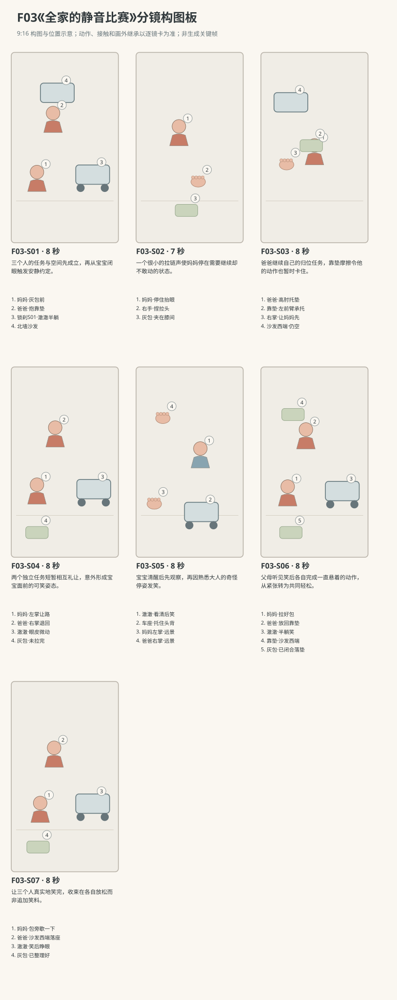

图示为构图位置示意；姿态、接触和画外继承以逐镜正文为准。

### 逐镜设计

#### F03-S01｜00—08 秒｜8 秒｜帧 [0, 192)

**镜头任务：**三个人的任务与空间先成立，再从宝宝闭眼触发安静约定。

**景别、机位与构图：**中全景，东侧朝西北，妈妈左下、爸爸左后靠沙发、婴儿车右中，完整车轮接地和三人目光可读。

**摄影机与理由：**固定，以同框交代每个人正在做自己的事。

**焦点：**三人均在可辨清晰范围，澈澈眼皮为视觉重心。

**入态：**澈澈半躺S01，眼睛将闭，妈妈右手扶灰包口，爸爸双手横抱靠垫准备转向沙发。

**动作与表演：**

- 3 秒：澈澈眼睛闭上，头仍落在布座支撑面；妈妈看见后停一下整理。

- 2 秒：妈妈抬左手，食指在自己唇前示意轻声，右手仍扶包；爸爸看见她点一点头。

- 3 秒：妈妈放下左手压平包角，爸爸放慢转身，两人分别继续原任务。

**声音：**衣料轻声、澈澈平稳呼吸，背景空气声；无对白无音乐。

**出态：**妈妈双手在灰包上，爸爸抱垫面向沙发一半，澈澈仍闭眼半躺。

**切点与承接：**由妈妈右手接近拉链切到包边，不跳过任务对象。

**连续性：**S01轮刹与承托画内建立；P05只露在包口，不再移出。

**开始画面母稿：**

9:16竖幅，原创三维生活动画，圆润而有重量的造型，棉布细纹、柔和皮肤层次与可读的小表情；动作按真实生活物理及婴儿当下能力展开，不用成人化算计表情。澈澈为圆脸、深棕眼、短黑绒发、额前一小撮向右弯的头发，穿奶油色棉连体衣。爸爸短黑发，砖陶色棉衬衫、深灰长裤；妈妈深棕低马尾，雾蓝棉上衣、米色长裤。本镜开始画面为单一瞬间：澈澈半躺S01，眼睛将闭，妈妈右手扶灰包口，爸爸双手横抱靠垫准备转向沙发。 场次方位与光位：L客厅北墙沙发、西窗、东走廊。锁刹S01车固定在地垫东南边朝西北，雾蓝布座、深灰框架，澈澈始终有头背臀支撑。妈妈活动区在西南、爸爸活动区在西北及沙发西端；摄影东侧朝西北，妈妈左下、爸爸左后、宝宝右，西窗光来自左后。灰包和靠垫的当前归属只依本镜起态。 摄影构图：中全景，东侧朝西北，妈妈左下、爸爸左后靠沙发、婴儿车右中，完整车轮接地和三人目光可读。 当前焦点：澈澈将闭的双眼及左右两个成人各自持物的手。只呈现上述起态，不把后续动作拼入一张画面。

**视频变化母稿：**

9:16竖幅，原创三维生活动画，圆润而有重量的造型，棉布细纹、柔和皮肤层次与可读的小表情；动作按真实生活物理及婴儿当下能力展开，不用成人化算计表情。澈澈为圆脸、深棕眼、短黑绒发、额前一小撮向右弯的头发，穿奶油色棉连体衣。爸爸短黑发，砖陶色棉衬衫、深灰长裤；妈妈深棕低马尾，雾蓝棉上衣、米色长裤。制作一段8秒连续镜头。本段人物和能力：澈澈、爸爸、妈妈，澈澈为R1。空间光位：L客厅北墙沙发、西窗、东走廊。锁刹S01车固定在地垫东南边朝西北，雾蓝布座、深灰框架，澈澈始终有头背臀支撑。妈妈活动区在西南、爸爸活动区在西北及沙发西端；摄影东侧朝西北，妈妈左下、爸爸左后、宝宝右，西窗光来自左后。灰包和靠垫的当前归属只依本镜起态。 起态：澈澈半躺S01，眼睛将闭，妈妈右手扶灰包口，爸爸双手横抱靠垫准备转向沙发。 摄影：中全景，东侧朝西北，妈妈左下、爸爸左后靠沙发、婴儿车右中，完整车轮接地和三人目光可读。 相机行为：固定，以同框交代每个人正在做自己的事。 焦点：三人均在可辨清晰范围，澈澈眼皮为视觉重心。 时间过程：第1阶段3秒：澈澈眼睛闭上，头仍落在布座支撑面；妈妈看见后停一下整理。；第2阶段2秒：妈妈抬左手，食指在自己唇前示意轻声，右手仍扶包；爸爸看见她点一点头。；第3阶段3秒：妈妈放下左手压平包角，爸爸放慢转身，两人分别继续原任务。。声音：衣料轻声、澈澈平稳呼吸，背景空气声；无对白无音乐。 终态：妈妈双手在灰包上，爸爸抱垫面向沙发一半，澈澈仍闭眼半躺。 连续性：S01轮刹与承托画内建立；P05只露在包口，不再移出。 不加未写出的对白、人物或道具。

#### F03-S02｜08—15 秒｜7 秒｜帧 [192, 360)

**镜头任务：**一个很小的拉链声使妈妈停在需要继续却不敢动的状态。

**景别、机位与构图：**妈妈半身中近景，东侧同向，包在下半画面、脸在左上，右后可见婴儿车局部不见全脸。

**摄影机与理由：**固定，拉链声发生时不震镜，避免把小声拍成惊吓。

**焦点：**右手拉头与包口；妈妈抬眼时轻移到眼睛。

**入态：**妈妈左手压灰包角，右指捏拉头，P05已在包内，拉链尚开大半。

**动作与表演：**

- 3 秒：妈妈慢慢拉过一小段，拉链发出一声短擦响；她当即停住。

- 2 秒：她把灰包轻夹在双膝之间，不让包侧晃，右手仍捏拉头。

- 2 秒：妈妈抬眼看澈澈，再看爸爸，左掌从包角抬起准备示意。

**声音：**第2—3秒一段短拉链擦声，随后立即留白；妈妈轻呼吸，无对白。

**出态：**妈妈右手悬在半拉的拉链上、包夹膝间，左掌半抬，目光投向爸爸。

**切点与承接：**跟她看爸爸的视线切过去，保持空间中的同侧方向。

**连续性：**妈妈右指不松拉头；画外澈澈仍闭眼、爸爸靠垫尚在双手，S01无位移。

**开始画面母稿：**

9:16竖幅，原创三维生活动画，圆润而有重量的造型，棉布细纹、柔和皮肤层次与可读的小表情；动作按真实生活物理及婴儿当下能力展开，不用成人化算计表情。澈澈为圆脸、深棕眼、短黑绒发、额前一小撮向右弯的头发，穿奶油色棉连体衣。爸爸短黑发，砖陶色棉衬衫、深灰长裤；妈妈深棕低马尾，雾蓝棉上衣、米色长裤。本镜开始画面为单一瞬间：妈妈左手压灰包角，右指捏拉头，P05已在包内，拉链尚开大半。 场次方位与光位：L客厅北墙沙发、西窗、东走廊。锁刹S01车固定在地垫东南边朝西北，雾蓝布座、深灰框架，澈澈始终有头背臀支撑。妈妈活动区在西南、爸爸活动区在西北及沙发西端；摄影东侧朝西北，妈妈左下、爸爸左后、宝宝右，西窗光来自左后。灰包和靠垫的当前归属只依本镜起态。 摄影构图：妈妈半身中近景，东侧同向，包在下半画面、脸在左上，右后可见婴儿车局部不见全脸。 当前焦点：妈妈右指捏住灰包拉头的接触处、左手压包角。只呈现上述起态，不把后续动作拼入一张画面。

**视频变化母稿：**

9:16竖幅，原创三维生活动画，圆润而有重量的造型，棉布细纹、柔和皮肤层次与可读的小表情；动作按真实生活物理及婴儿当下能力展开，不用成人化算计表情。澈澈为圆脸、深棕眼、短黑绒发、额前一小撮向右弯的头发，穿奶油色棉连体衣。爸爸短黑发，砖陶色棉衬衫、深灰长裤；妈妈深棕低马尾，雾蓝棉上衣、米色长裤。制作一段7秒连续镜头。本段人物和能力：澈澈、爸爸、妈妈，澈澈为R1。空间光位：L客厅北墙沙发、西窗、东走廊。锁刹S01车固定在地垫东南边朝西北，雾蓝布座、深灰框架，澈澈始终有头背臀支撑。妈妈活动区在西南、爸爸活动区在西北及沙发西端；摄影东侧朝西北，妈妈左下、爸爸左后、宝宝右，西窗光来自左后。灰包和靠垫的当前归属只依本镜起态。 起态：妈妈左手压灰包角，右指捏拉头，P05已在包内，拉链尚开大半。 摄影：妈妈半身中近景，东侧同向，包在下半画面、脸在左上，右后可见婴儿车局部不见全脸。 相机行为：固定，拉链声发生时不震镜，避免把小声拍成惊吓。 焦点：右手拉头与包口；妈妈抬眼时轻移到眼睛。 时间过程：第1阶段3秒：妈妈慢慢拉过一小段，拉链发出一声短擦响；她当即停住。；第2阶段2秒：她把灰包轻夹在双膝之间，不让包侧晃，右手仍捏拉头。；第3阶段2秒：妈妈抬眼看澈澈，再看爸爸，左掌从包角抬起准备示意。。声音：第2—3秒一段短拉链擦声，随后立即留白；妈妈轻呼吸，无对白。 终态：妈妈右手悬在半拉的拉链上、包夹膝间，左掌半抬，目光投向爸爸。 连续性：妈妈右指不松拉头；画外澈澈仍闭眼、爸爸靠垫尚在双手，S01无位移。 不加未写出的对白、人物或道具。

#### F03-S03｜15—23 秒｜8 秒｜帧 [360, 552)

**镜头任务：**爸爸继续自己的归位任务，靠垫摩擦令他的动作也暂时卡住。

**景别、机位与构图：**爸爸中景，东侧同向朝西北，爸爸居中央偏左，靠垫在胸侧，沙发西端在左后，妈妈抬起的左掌在左下前景边。

**摄影机与理由：**固定，爸爸只在机位内挪半步，不随他绕到反侧。

**焦点：**爸爸左前臂托垫接触与眼神，沙发接收位置可辨。

**入态：**爸爸双手抱垫半转向北沙发，已看见妈妈左掌；双脚稳站地垫西北侧。

**动作与表演：**

- 3 秒：爸爸轻挪半步靠近沙发，左前臂托垫、右手调整垫角；棉布擦过衬衫。

- 2 秒：听见摩擦声，他把靠垫稍抬离衣服，左肘抬到肩边，身体略向一侧歪但双脚踩稳。

- 3 秒：爸爸转眼看妈妈，右手从垫角松出，摊掌示意她先把包弄好，左前臂继续独自托垫。

**声音：**一次低而短的棉布摩擦；袜底挪地声，爸爸轻鼻息，无对白。

**出态：**爸爸左前臂托靠垫、左肘偏高，右掌向妈妈摊开，沙发尚未放垫。

**切点与承接：**在摊掌手势到位时切回三人空间，交代妈妈也在让他先动。

**连续性：**靠垫重量持续落在左前臂，右手可离开；双脚不悬起，妈妈握拉链在画外继承。

**开始画面母稿：**

9:16竖幅，原创三维生活动画，圆润而有重量的造型，棉布细纹、柔和皮肤层次与可读的小表情；动作按真实生活物理及婴儿当下能力展开，不用成人化算计表情。澈澈为圆脸、深棕眼、短黑绒发、额前一小撮向右弯的头发，穿奶油色棉连体衣。爸爸短黑发，砖陶色棉衬衫、深灰长裤；妈妈深棕低马尾，雾蓝棉上衣、米色长裤。本镜开始画面为单一瞬间：爸爸双手抱垫半转向北沙发，已看见妈妈左掌；双脚稳站地垫西北侧。 场次方位与光位：L客厅北墙沙发、西窗、东走廊。锁刹S01车固定在地垫东南边朝西北，雾蓝布座、深灰框架，澈澈始终有头背臀支撑。妈妈活动区在西南、爸爸活动区在西北及沙发西端；摄影东侧朝西北，妈妈左下、爸爸左后、宝宝右，西窗光来自左后。灰包和靠垫的当前归属只依本镜起态。 摄影构图：爸爸中景，东侧同向朝西北，爸爸居中央偏左，靠垫在胸侧，沙发西端在左后，妈妈抬起的左掌在左下前景边。 当前焦点：爸爸双手抱靠垫的接触、与妈妈掌势相接的眼神。只呈现上述起态，不把后续动作拼入一张画面。

**视频变化母稿：**

9:16竖幅，原创三维生活动画，圆润而有重量的造型，棉布细纹、柔和皮肤层次与可读的小表情；动作按真实生活物理及婴儿当下能力展开，不用成人化算计表情。澈澈为圆脸、深棕眼、短黑绒发、额前一小撮向右弯的头发，穿奶油色棉连体衣。爸爸短黑发，砖陶色棉衬衫、深灰长裤；妈妈深棕低马尾，雾蓝棉上衣、米色长裤。制作一段8秒连续镜头。本段人物和能力：澈澈、爸爸、妈妈，澈澈为R1。空间光位：L客厅北墙沙发、西窗、东走廊。锁刹S01车固定在地垫东南边朝西北，雾蓝布座、深灰框架，澈澈始终有头背臀支撑。妈妈活动区在西南、爸爸活动区在西北及沙发西端；摄影东侧朝西北，妈妈左下、爸爸左后、宝宝右，西窗光来自左后。灰包和靠垫的当前归属只依本镜起态。 起态：爸爸双手抱垫半转向北沙发，已看见妈妈左掌；双脚稳站地垫西北侧。 摄影：爸爸中景，东侧同向朝西北，爸爸居中央偏左，靠垫在胸侧，沙发西端在左后，妈妈抬起的左掌在左下前景边。 相机行为：固定，爸爸只在机位内挪半步，不随他绕到反侧。 焦点：爸爸左前臂托垫接触与眼神，沙发接收位置可辨。 时间过程：第1阶段3秒：爸爸轻挪半步靠近沙发，左前臂托垫、右手调整垫角；棉布擦过衬衫。；第2阶段2秒：听见摩擦声，他把靠垫稍抬离衣服，左肘抬到肩边，身体略向一侧歪但双脚踩稳。；第3阶段3秒：爸爸转眼看妈妈，右手从垫角松出，摊掌示意她先把包弄好，左前臂继续独自托垫。。声音：一次低而短的棉布摩擦；袜底挪地声，爸爸轻鼻息，无对白。 终态：爸爸左前臂托靠垫、左肘偏高，右掌向妈妈摊开，沙发尚未放垫。 连续性：靠垫重量持续落在左前臂，右手可离开；双脚不悬起，妈妈握拉链在画外继承。 不加未写出的对白、人物或道具。

#### F03-S04｜23—31 秒｜8 秒｜帧 [552, 744)

**镜头任务：**两个独立任务短暂相互礼让，意外形成宝宝面前的可笑姿态。

**景别、机位与构图：**三人中全景，与S01同轴，妈妈左下、爸爸左后、澈澈右中，父母空闲手的往返与身体姿态都不被遮挡。

**摄影机与理由：**固定；让一个手势被对方看见、再被退回，节奏来自人而非镜头。

**焦点：**父母手掌和脸在共同清晰区；澈澈车座保留可辨轮廓。

**入态：**妈妈右手捏拉头、左掌半抬；爸爸左臂托靠垫、右掌摊向妈妈；澈澈闭眼。

**动作与表演：**

- 3 秒：妈妈摇一下头，左掌朝沙发轻摆，示意爸爸先放好，右手和夹包膝盖没动。

- 3 秒：爸爸看她的手再看沙发，右掌又轻摆回来，左肘为托稳靠垫保持抬高；两人都停着。

- 2 秒：妈妈的左掌与爸爸右掌同时定在半空，两人抿住即将出来的笑；澈澈眼皮开始轻动。

**声音：**轻微袖布声后只留呼吸与环境底声，无对白；不加滑稽配乐。

**出态：**父母保持各自不对称的半动作，澈澈眼皮已松开一条缝。

**切点与承接：**切澈澈近景，接住从闭眼到看清面前人的过程。

**连续性：**妈妈右手、爸爸左前臂仍被各自任务占用；P05在包、车位、靠垫位置均不变。

**开始画面母稿：**

9:16竖幅，原创三维生活动画，圆润而有重量的造型，棉布细纹、柔和皮肤层次与可读的小表情；动作按真实生活物理及婴儿当下能力展开，不用成人化算计表情。澈澈为圆脸、深棕眼、短黑绒发、额前一小撮向右弯的头发，穿奶油色棉连体衣。爸爸短黑发，砖陶色棉衬衫、深灰长裤；妈妈深棕低马尾，雾蓝棉上衣、米色长裤。本镜开始画面为单一瞬间：妈妈右手捏拉头、左掌半抬；爸爸左臂托靠垫、右掌摊向妈妈；澈澈闭眼。 场次方位与光位：L客厅北墙沙发、西窗、东走廊。锁刹S01车固定在地垫东南边朝西北，雾蓝布座、深灰框架，澈澈始终有头背臀支撑。妈妈活动区在西南、爸爸活动区在西北及沙发西端；摄影东侧朝西北，妈妈左下、爸爸左后、宝宝右，西窗光来自左后。灰包和靠垫的当前归属只依本镜起态。 摄影构图：三人中全景，与S01同轴，妈妈左下、爸爸左后、澈澈右中，父母空闲手的往返与身体姿态都不被遮挡。 当前焦点：父母两只空闲手的停姿、各自仍被物件占用的另一只手。只呈现上述起态，不把后续动作拼入一张画面。

**视频变化母稿：**

9:16竖幅，原创三维生活动画，圆润而有重量的造型，棉布细纹、柔和皮肤层次与可读的小表情；动作按真实生活物理及婴儿当下能力展开，不用成人化算计表情。澈澈为圆脸、深棕眼、短黑绒发、额前一小撮向右弯的头发，穿奶油色棉连体衣。爸爸短黑发，砖陶色棉衬衫、深灰长裤；妈妈深棕低马尾，雾蓝棉上衣、米色长裤。制作一段8秒连续镜头。本段人物和能力：澈澈、爸爸、妈妈，澈澈为R1。空间光位：L客厅北墙沙发、西窗、东走廊。锁刹S01车固定在地垫东南边朝西北，雾蓝布座、深灰框架，澈澈始终有头背臀支撑。妈妈活动区在西南、爸爸活动区在西北及沙发西端；摄影东侧朝西北，妈妈左下、爸爸左后、宝宝右，西窗光来自左后。灰包和靠垫的当前归属只依本镜起态。 起态：妈妈右手捏拉头、左掌半抬；爸爸左臂托靠垫、右掌摊向妈妈；澈澈闭眼。 摄影：三人中全景，与S01同轴，妈妈左下、爸爸左后、澈澈右中，父母空闲手的往返与身体姿态都不被遮挡。 相机行为：固定；让一个手势被对方看见、再被退回，节奏来自人而非镜头。 焦点：父母手掌和脸在共同清晰区；澈澈车座保留可辨轮廓。 时间过程：第1阶段3秒：妈妈摇一下头，左掌朝沙发轻摆，示意爸爸先放好，右手和夹包膝盖没动。；第2阶段3秒：爸爸看她的手再看沙发，右掌又轻摆回来，左肘为托稳靠垫保持抬高；两人都停着。；第3阶段2秒：妈妈的左掌与爸爸右掌同时定在半空，两人抿住即将出来的笑；澈澈眼皮开始轻动。。声音：轻微袖布声后只留呼吸与环境底声，无对白；不加滑稽配乐。 终态：父母保持各自不对称的半动作，澈澈眼皮已松开一条缝。 连续性：妈妈右手、爸爸左前臂仍被各自任务占用；P05在包、车位、靠垫位置均不变。 不加未写出的对白、人物或道具。

#### F03-S05｜31—39 秒｜8 秒｜帧 [744, 936)

**镜头任务：**宝宝清醒后先观察，再因熟悉大人的奇怪停姿发笑。

**景别、机位与构图：**澈澈面部近景，东侧朝西北，车座弧线在左右下缘，画左远景保留父母高低两只手的虚影。

**摄影机与理由：**固定；把睁眼到笑的呼吸时间留完整。

**焦点：**澈澈双眼，脸颊和嘴角同平面；背景手势只作视线依据。

**入态：**澈澈头枕在支撑面，眼睛刚开一缝，车座和身体位置未变，父母仍保持半动作。

**动作与表演：**

- 3 秒：澈澈慢慢睁眼，先把视线放到左下妈妈的张掌，呼吸仍平稳。

- 2 秒：目光抬向左上爸爸的高肘与靠垫，嘴角先微微抬起。

- 3 秒：澈澈发出一声短笑，再连着笑两声，双肩轻动但背臀仍贴座面。

**声音：**先三秒安静呼吸，随后一声短笑及两声自然笑；父母此镜无笑声无对白。

**出态：**澈澈睁眼笑着看父母，双肩已回落座面，仍半躺。

**切点与承接：**第一串笑尾衔接父母一起转头的宽镜。

**连续性：**不可让宝宝突然直坐；父母手势与靠垫位置画外继承，不更换成其他鬼脸。

**开始画面母稿：**

9:16竖幅，原创三维生活动画，圆润而有重量的造型，棉布细纹、柔和皮肤层次与可读的小表情；动作按真实生活物理及婴儿当下能力展开，不用成人化算计表情。澈澈为圆脸、深棕眼、短黑绒发、额前一小撮向右弯的头发，穿奶油色棉连体衣。爸爸短黑发，砖陶色棉衬衫、深灰长裤；妈妈深棕低马尾，雾蓝棉上衣、米色长裤。本镜开始画面为单一瞬间：澈澈头枕在支撑面，眼睛刚开一缝，车座和身体位置未变，父母仍保持半动作。 场次方位与光位：L客厅北墙沙发、西窗、东走廊。锁刹S01车固定在地垫东南边朝西北，雾蓝布座、深灰框架，澈澈始终有头背臀支撑。妈妈活动区在西南、爸爸活动区在西北及沙发西端；摄影东侧朝西北，妈妈左下、爸爸左后、宝宝右，西窗光来自左后。灰包和靠垫的当前归属只依本镜起态。 摄影构图：澈澈面部近景，东侧朝西北，车座弧线在左右下缘，画左远景保留父母高低两只手的虚影。 当前焦点：澈澈半开的眼皮与车座头背支撑。只呈现上述起态，不把后续动作拼入一张画面。

**视频变化母稿：**

9:16竖幅，原创三维生活动画，圆润而有重量的造型，棉布细纹、柔和皮肤层次与可读的小表情；动作按真实生活物理及婴儿当下能力展开，不用成人化算计表情。澈澈为圆脸、深棕眼、短黑绒发、额前一小撮向右弯的头发，穿奶油色棉连体衣。爸爸短黑发，砖陶色棉衬衫、深灰长裤；妈妈深棕低马尾，雾蓝棉上衣、米色长裤。制作一段8秒连续镜头。本段人物和能力：澈澈、爸爸、妈妈，澈澈为R1。空间光位：L客厅北墙沙发、西窗、东走廊。锁刹S01车固定在地垫东南边朝西北，雾蓝布座、深灰框架，澈澈始终有头背臀支撑。妈妈活动区在西南、爸爸活动区在西北及沙发西端；摄影东侧朝西北，妈妈左下、爸爸左后、宝宝右，西窗光来自左后。灰包和靠垫的当前归属只依本镜起态。 起态：澈澈头枕在支撑面，眼睛刚开一缝，车座和身体位置未变，父母仍保持半动作。 摄影：澈澈面部近景，东侧朝西北，车座弧线在左右下缘，画左远景保留父母高低两只手的虚影。 相机行为：固定；把睁眼到笑的呼吸时间留完整。 焦点：澈澈双眼，脸颊和嘴角同平面；背景手势只作视线依据。 时间过程：第1阶段3秒：澈澈慢慢睁眼，先把视线放到左下妈妈的张掌，呼吸仍平稳。；第2阶段2秒：目光抬向左上爸爸的高肘与靠垫，嘴角先微微抬起。；第3阶段3秒：澈澈发出一声短笑，再连着笑两声，双肩轻动但背臀仍贴座面。。声音：先三秒安静呼吸，随后一声短笑及两声自然笑；父母此镜无笑声无对白。 终态：澈澈睁眼笑着看父母，双肩已回落座面，仍半躺。 连续性：不可让宝宝突然直坐；父母手势与靠垫位置画外继承，不更换成其他鬼脸。 不加未写出的对白、人物或道具。

#### F03-S06｜39—47 秒｜8 秒｜帧 [936, 1128)

**镜头任务：**父母听见笑后各自完成一直悬着的动作，从紧张转为共同轻松。

**景别、机位与构图：**三人中全景，东侧同机位，妈妈左下、爸爸左后、澈澈右中，沙发靠垫落点和灰包落点均在框。

**摄影机与理由：**固定，不能用切镜掩盖两个道具归位。

**焦点：**澈澈笑脸与父母转头同清晰；归位动作保持可读。

**入态：**澈澈正在笑，妈妈右手捏拉头左掌抬着，爸爸左臂托垫右掌抬着。

**动作与表演：**

- 2 秒：父母先后转头看澈澈，嘴角从绷住变成笑，手势都松下来。

- 3 秒：爸爸右手重新扶垫角、两手把靠垫放回北沙发西端，双脚不再挪；妈妈双膝放松，让灰包落回垫上。

- 3 秒：妈妈左手稳包、右手把拉链正常拉到底；爸爸双手落到身旁，看宝宝短笑。

**声音：**澈澈笑声持续后渐短，爸爸一声轻笑、妈妈轻笑接入；垫落沙发软扑、拉链完整短响，无对白。

**出态：**靠垫在沙发西端，灰包已闭合在垫上，父母双手都从冻结姿态解放。

**切点与承接：**在任务完成后留笑声，切稍近的共同休息状态。

**连续性：**两件道具的落点画内可见；宝宝始终S01，车轮不滚；三人的笑声不同步排队但不抢第一声。

**开始画面母稿：**

9:16竖幅，原创三维生活动画，圆润而有重量的造型，棉布细纹、柔和皮肤层次与可读的小表情；动作按真实生活物理及婴儿当下能力展开，不用成人化算计表情。澈澈为圆脸、深棕眼、短黑绒发、额前一小撮向右弯的头发，穿奶油色棉连体衣。爸爸短黑发，砖陶色棉衬衫、深灰长裤；妈妈深棕低马尾，雾蓝棉上衣、米色长裤。本镜开始画面为单一瞬间：澈澈正在笑，妈妈右手捏拉头左掌抬着，爸爸左臂托垫右掌抬着。 场次方位与光位：L客厅北墙沙发、西窗、东走廊。锁刹S01车固定在地垫东南边朝西北，雾蓝布座、深灰框架，澈澈始终有头背臀支撑。妈妈活动区在西南、爸爸活动区在西北及沙发西端；摄影东侧朝西北，妈妈左下、爸爸左后、宝宝右，西窗光来自左后。灰包和靠垫的当前归属只依本镜起态。 摄影构图：三人中全景，东侧同机位，妈妈左下、爸爸左后、澈澈右中，沙发靠垫落点和灰包落点均在框。 当前焦点：澈澈笑脸与父母尚未解开的持物姿态。只呈现上述起态，不把后续动作拼入一张画面。

**视频变化母稿：**

9:16竖幅，原创三维生活动画，圆润而有重量的造型，棉布细纹、柔和皮肤层次与可读的小表情；动作按真实生活物理及婴儿当下能力展开，不用成人化算计表情。澈澈为圆脸、深棕眼、短黑绒发、额前一小撮向右弯的头发，穿奶油色棉连体衣。爸爸短黑发，砖陶色棉衬衫、深灰长裤；妈妈深棕低马尾，雾蓝棉上衣、米色长裤。制作一段8秒连续镜头。本段人物和能力：澈澈、爸爸、妈妈，澈澈为R1。空间光位：L客厅北墙沙发、西窗、东走廊。锁刹S01车固定在地垫东南边朝西北，雾蓝布座、深灰框架，澈澈始终有头背臀支撑。妈妈活动区在西南、爸爸活动区在西北及沙发西端；摄影东侧朝西北，妈妈左下、爸爸左后、宝宝右，西窗光来自左后。灰包和靠垫的当前归属只依本镜起态。 起态：澈澈正在笑，妈妈右手捏拉头左掌抬着，爸爸左臂托垫右掌抬着。 摄影：三人中全景，东侧同机位，妈妈左下、爸爸左后、澈澈右中，沙发靠垫落点和灰包落点均在框。 相机行为：固定，不能用切镜掩盖两个道具归位。 焦点：澈澈笑脸与父母转头同清晰；归位动作保持可读。 时间过程：第1阶段2秒：父母先后转头看澈澈，嘴角从绷住变成笑，手势都松下来。；第2阶段3秒：爸爸右手重新扶垫角、两手把靠垫放回北沙发西端，双脚不再挪；妈妈双膝放松，让灰包落回垫上。；第3阶段3秒：妈妈左手稳包、右手把拉链正常拉到底；爸爸双手落到身旁，看宝宝短笑。。声音：澈澈笑声持续后渐短，爸爸一声轻笑、妈妈轻笑接入；垫落沙发软扑、拉链完整短响，无对白。 终态：靠垫在沙发西端，灰包已闭合在垫上，父母双手都从冻结姿态解放。 连续性：两件道具的落点画内可见；宝宝始终S01，车轮不滚；三人的笑声不同步排队但不抢第一声。 不加未写出的对白、人物或道具。

#### F03-S07｜47—55 秒｜8 秒｜帧 [1128, 1320)

**镜头任务：**让三个人真实地笑完，收束在各自放松而非追加笑料。

**景别、机位与构图：**三人中景，东侧略收近，妈妈画左前跪坐灰包旁，爸爸画左后站在沙发前，澈澈画右前在车内，三张脸均有独立空间；画左后保留爸爸由站立到落座的取景余量。

**摄影机与理由：**爸爸开始坐下时轻缓后移一点，给他的落座留空间，随后停稳。

**焦点：**三张脸在共同清晰范围，前后景不做夸张虚实切换。

**入态：**妈妈跪坐灰包旁，爸爸站在已放好靠垫的沙发前，澈澈半躺笑，父母都已松开手势。

**动作与表演：**

- 3 秒：爸爸顺势坐到沙发西端空座，双手落膝；妈妈把包带放平，抬眼再看爸爸。

- 3 秒：父母因刚才彼此让路的姿势又短笑，澈澈看看妈妈再看爸爸，跟着笑一小声。

- 2 秒：三人笑声慢下来，妈妈手扶灰包、爸爸靠回垫，澈澈安静睁眼看着他们。

**声音：**座垫受压轻声、三人渐缓的笑与呼吸，环境声回到可听；无对白无音乐。

**出态：**爸爸坐沙发西端、妈妈坐垫西南、澈澈在锁刹车内睁眼，灰包与靠垫各已归位。

**切点与承接：**在澈澈最后一次看回妈妈后结束，保留小笑余韵。

**连续性：**爸爸坐空座不坐靠垫边沿造成弹起；妈妈包未重开；宝宝全片姿态与朝向不变。

**开始画面母稿：**

9:16竖幅，原创三维生活动画，圆润而有重量的造型，棉布细纹、柔和皮肤层次与可读的小表情；动作按真实生活物理及婴儿当下能力展开，不用成人化算计表情。澈澈为圆脸、深棕眼、短黑绒发、额前一小撮向右弯的头发，穿奶油色棉连体衣。爸爸短黑发，砖陶色棉衬衫、深灰长裤；妈妈深棕低马尾，雾蓝棉上衣、米色长裤。本镜开始画面为单一瞬间：妈妈跪坐灰包旁，爸爸站在已放好靠垫的沙发前，澈澈半躺笑，父母都已松开手势。 场次方位与光位：L客厅北墙沙发、西窗、东走廊。锁刹S01车固定在地垫东南边朝西北，雾蓝布座、深灰框架，澈澈始终有头背臀支撑。妈妈活动区在西南、爸爸活动区在西北及沙发西端；摄影东侧朝西北，妈妈左下、爸爸左后、宝宝右，西窗光来自左后。灰包和靠垫的当前归属只依本镜起态。 摄影构图：三人中景，东侧略收近，妈妈画左前跪坐灰包旁，爸爸画左后站在沙发前，澈澈画右前在车内，三张脸均有独立空间；画左后保留爸爸由站立到落座的取景余量。 当前焦点：爸爸尚站在沙发前、妈妈包旁跪坐与宝宝笑脸。只呈现上述起态，不把后续动作拼入一张画面。

**视频变化母稿：**

9:16竖幅，原创三维生活动画，圆润而有重量的造型，棉布细纹、柔和皮肤层次与可读的小表情；动作按真实生活物理及婴儿当下能力展开，不用成人化算计表情。澈澈为圆脸、深棕眼、短黑绒发、额前一小撮向右弯的头发，穿奶油色棉连体衣。爸爸短黑发，砖陶色棉衬衫、深灰长裤；妈妈深棕低马尾，雾蓝棉上衣、米色长裤。制作一段8秒连续镜头。本段人物和能力：澈澈、爸爸、妈妈，澈澈为R1。空间光位：L客厅北墙沙发、西窗、东走廊。锁刹S01车固定在地垫东南边朝西北，雾蓝布座、深灰框架，澈澈始终有头背臀支撑。妈妈活动区在西南、爸爸活动区在西北及沙发西端；摄影东侧朝西北，妈妈左下、爸爸左后、宝宝右，西窗光来自左后。灰包和靠垫的当前归属只依本镜起态。 起态：妈妈跪坐灰包旁，爸爸站在已放好靠垫的沙发前，澈澈半躺笑，父母都已松开手势。 摄影：三人中景，东侧略收近，妈妈画左前跪坐灰包旁，爸爸画左后站在沙发前，澈澈画右前在车内，三张脸均有独立空间；画左后保留爸爸由站立到落座的取景余量。 相机行为：爸爸开始坐下时轻缓后移一点，给他的落座留空间，随后停稳。 焦点：三张脸在共同清晰范围，前后景不做夸张虚实切换。 时间过程：第1阶段3秒：爸爸顺势坐到沙发西端空座，双手落膝；妈妈把包带放平，抬眼再看爸爸。；第2阶段3秒：父母因刚才彼此让路的姿势又短笑，澈澈看看妈妈再看爸爸，跟着笑一小声。；第3阶段2秒：三人笑声慢下来，妈妈手扶灰包、爸爸靠回垫，澈澈安静睁眼看着他们。。声音：座垫受压轻声、三人渐缓的笑与呼吸，环境声回到可听；无对白无音乐。 终态：爸爸坐沙发西端、妈妈坐垫西南、澈澈在锁刹车内睁眼，灰包与靠垫各已归位。 连续性：爸爸坐空座不坐靠垫边沿造成弹起；妈妈包未重开；宝宝全片姿态与朝向不变。 不加未写出的对白、人物或道具。

### 声音与剪辑

无对白、无配乐。先有低环境声与缓慢呼吸；拉链擦响、棉靠垫摩擦应小而清楚，不做惊吓音效。澈澈第一声短笑打破静音，父母之后各自短笑，结尾拉链正常完成。

正式台词：无；保留镜头声音中已写明的自然发声。

### 连续性与试片

- 连续性：S01始终锁刹停在垫东南边朝西北，澈澈背、臀、腿在车座内承托，不滑座或悬空。

- 连续性：妈妈在西南、爸爸在西北，摄影在东侧；每个人视线与被看的具体人吻合。

- 连续性：P05已入灰包；妈妈右手捏拉链、左手打手势，爸爸左前臂托靠垫、右手打手势。

- 连续性：爸爸靠垫只能最终回到北墙沙发西端；妈妈包从膝间回地垫，不能切后换入爸爸手中。

- 试片：F03-S02—S04静音试看：须能分清妈妈装包、爸爸放靠垫两个任务；若两人只是同步摆怪姿势则失败。

- 试片：F03-S04—S05试剪：澈澈睁眼后有观察手掌与高肘的时间，再出现笑；若睡态直接跳到大笑则失败。

- 试片：F03-S06—S07：靠垫落沙发、灰包落垫与车架稳定须逐项连续；若宝宝随父母笑突然弹起离座则失败。

**媒体待验证：**未生成媒体；待验双成人不抢拍的手势时序、婴儿半躺头颈支撑、车架遮挡和安静场景下的低强度拟音。

---

## F04《全家福往哪看》

**45 秒｜坐姿与手部互动｜角色：澈澈、爸爸、妈妈｜场景 L**

### 剧情正文

客厅北墙沙发前，妈妈坐在澈澈左边，爸爸从另一边挪近，整理了一下自己的衣领，准备拍全家福。妈妈把手机举到前方，先看屏幕里的三张脸，再露出一个等拍照的笑。爸爸也抬眼看手机，澈澈却侧着头，一直望向西窗。妈妈按下快门，放低一点手机检查，随后看看澈澈，才发现他的目光根本不在镜头这里。爸爸轻轻挥一下手，想把他的注意引到手机上。澈澈看了手一瞬，又看回窗边。薄帘被风托起一小截，亮光缓慢滑过帘褶，澈澈的眼睛跟着走。爸爸循着他的视线望过去，自己也停住了。妈妈原本还想再招呼一次，见两人都看得专注，便重新把手机举好，身体不动，只把脸也转向窗边。她凭手感按了一下侧键。快门响起，画面留下三张朝着同一边的侧脸；薄帘还在他们视线尽头轻轻动着。

### 导演与空间

**观察任务：**父母从争取同一个镜头目光，转向接受宝宝正在看的事，让一张侧脸照自然成为全家福。

**空间与光位：**L客厅北墙沙发、西窗、东走廊、中央地垫。三人挨坐在垫北半，妈妈西侧、澈澈中央、爸爸东侧，均朝南；妈妈右手伸向南偏西举F04-X01手机自拍，左手落自己膝上。西窗薄帘在西侧轻摆，是澈澈看向的目标。主摄影始终在南侧，父母与宝宝画面从左到右保持妈妈、澈澈、爸爸；手机视点同在南偏西，不跨到北侧。

**人物表演：**妈妈负责取景、按实体音量键快门和查看预览，不拽宝宝下巴。爸爸负责挪好坐姿、让出宝宝的脸并短暂吸引注意，随后自己也被窗帘光影吸引。澈澈能稳坐，双掌在膝边可撑垫，对薄帘移动感兴趣，视线向自身右侧即房间西边。

### 节拍覆盖

- **F04-b1**：建立三人坐序与妈妈拍照、爸爸准备入镜的独立行动。 前态：妈妈右手把手机拿在胸前，澈澈双掌在膝外撑垫，爸爸在东侧正坐下，衣领一侧略翘。 后态：手机在妈妈右手前伸位置，父母准备看镜头，澈澈已转头看西窗。 → F04-S01

- **F04-b2**：第一张照片里父母看镜头、宝宝看别处的差异清楚可见。 前态：妈妈右臂前伸持手机，爸爸看手机镜头，澈澈双掌撑垫、脸转向西窗。 后态：第一张已拍，妈妈手机从前伸位降到肩前，澈澈仍看西窗。 → F04-S02

- **F04-b3**：父母发现问题并短暂试图吸引注意，但不把宝宝当需要纠正的对象。 前态：妈妈右手手机已降至肩前，爸爸坐东侧、双手在膝，澈澈脸向西。 后态：爸爸右手停在胸前将落，妈妈右手持手机胸前，澈澈重新看西窗。 → F04-S03

- **F04-b4**：把宝宝的兴趣对象具体化，并让爸爸真正加入观察。 前态：薄帘自然垂在西窗内侧，澈澈画右侧脸向窗；爸爸头还在从手机方向转来。 后态：帘脚回落仍轻摆，爸爸与澈澈共同朝西看；爸爸右手已落回膝。 → F04-S04

- **F04-b5**：妈妈改变拍照目标，重新取景并自然加入同一目光。 前态：爸爸与澈澈朝西窗看，妈妈右手手机在胸前，左手在膝，正观察他们。 后态：妈妈手机在南偏西自拍位，三人同时朝房间西侧看，准备按键。 → F04-S05

- **F04-b6**：以三人自然同看一处的侧脸照兑现全家福，不要求宝宝看镜头。 前态：妈妈右臂前伸举手机，三人身体朝南、脸朝西窗，澈澈双掌撑垫。 后态：定格就是本镜手机前摄快门时实际记录的非镜像三人西向侧脸帧，人物、眼神、手位与该瞬间完全一致。 → F04-S06

### 分镜构图板

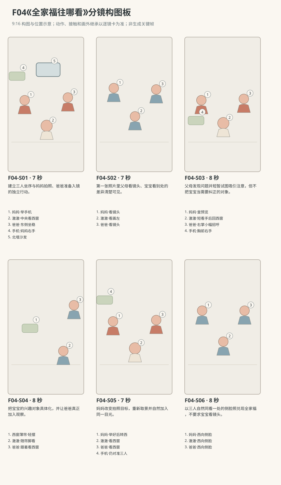

图示为构图位置示意；姿态、接触和画外继承以逐镜正文为准。

### 逐镜设计

#### F04-S01｜00—07 秒｜7 秒｜帧 [0, 168)

**镜头任务：**建立三人坐序与妈妈拍照、爸爸准备入镜的独立行动。

**景别、机位与构图：**中全景，南侧朝北，妈妈左、澈澈中、爸爸右，沙发后景；妈妈右手手机此刻位于胸前，画左前景留出右臂前伸的取景通道，薄帘只在画左边缘露出。

**摄影机与理由：**固定，给爸爸横向挪近保留空间，不裁掉宝宝坐姿。

**焦点：**三张脸与手机握持可辨，后景沙发稍柔。

**入态：**妈妈右手把手机拿在胸前，澈澈双掌在膝外撑垫，爸爸在东侧正坐下，衣领一侧略翘。

**动作与表演：**

- 3 秒：爸爸坐稳后拉平自己的衣领，向澈澈靠近一点又让开其脸前的空间。

- 4 秒：妈妈抬右臂把手机举到南偏西的自拍位，眼睛检查屏幕，左手留在膝上；澈澈看向画左窗帘。

**声音：**衣领、裤布与垫的摩擦声、远处空气声，无对白。

**出态：**手机在妈妈右手前伸位置，父母准备看镜头，澈澈已转头看西窗。

**切点与承接：**转到与手机同方向的正面三人镜，保留同一坐序。

**连续性：**手机一直妈妈右手，爸爸衣领已理平；澈澈双手不持物，坐骨稳定。

**开始画面母稿：**

9:16竖幅，原创三维生活动画，圆润而有重量的造型，棉布细纹、柔和皮肤层次与可读的小表情；动作按真实生活物理及婴儿当下能力展开，不用成人化算计表情。澈澈为圆脸、深棕眼、短黑绒发、额前一小撮向右弯的头发，穿奶油色棉连体衣。爸爸短黑发，砖陶色棉衬衫、深灰长裤；妈妈深棕低马尾，雾蓝棉上衣、米色长裤。本镜开始画面为单一瞬间：妈妈右手把手机拿在胸前，澈澈双掌在膝外撑垫，爸爸在东侧正坐下，衣领一侧略翘。 场次方位与光位：L客厅北墙沙发、西窗薄帘、东走廊、中央地垫。三人坐序从西到东为妈妈、澈澈、爸爸，身体朝南；手机始终只由妈妈右手操持。主摄影南侧、手机视点南偏西，均不跨北侧，妈妈画左、宝宝中央、爸爸右。西窗与轻摆薄帘固定在房间西侧，柔光来自画左；手机当前高度与人物头向以本镜起态为准。 摄影构图：中全景，南侧朝北，妈妈左、澈澈中、爸爸右，沙发后景；妈妈右手手机此刻位于胸前，画左前景留出右臂前伸的取景通道，薄帘只在画左边缘露出。 当前焦点：妈妈胸前右手手机、澈澈看窗的眼神与爸爸尚未理平的衣领。只呈现上述起态，不把后续动作拼入一张画面。

**视频变化母稿：**

9:16竖幅，原创三维生活动画，圆润而有重量的造型，棉布细纹、柔和皮肤层次与可读的小表情；动作按真实生活物理及婴儿当下能力展开，不用成人化算计表情。澈澈为圆脸、深棕眼、短黑绒发、额前一小撮向右弯的头发，穿奶油色棉连体衣。爸爸短黑发，砖陶色棉衬衫、深灰长裤；妈妈深棕低马尾，雾蓝棉上衣、米色长裤。制作一段7秒连续镜头。本段人物和能力：澈澈、爸爸、妈妈，澈澈为R1。空间光位：L客厅北墙沙发、西窗薄帘、东走廊、中央地垫。三人坐序从西到东为妈妈、澈澈、爸爸，身体朝南；手机始终只由妈妈右手操持。主摄影南侧、手机视点南偏西，均不跨北侧，妈妈画左、宝宝中央、爸爸右。西窗与轻摆薄帘固定在房间西侧，柔光来自画左；手机当前高度与人物头向以本镜起态为准。 起态：妈妈右手把手机拿在胸前，澈澈双掌在膝外撑垫，爸爸在东侧正坐下，衣领一侧略翘。 摄影：中全景，南侧朝北，妈妈左、澈澈中、爸爸右，沙发后景；妈妈右手手机此刻位于胸前，画左前景留出右臂前伸的取景通道，薄帘只在画左边缘露出。 相机行为：固定，给爸爸横向挪近保留空间，不裁掉宝宝坐姿。 焦点：三张脸与手机握持可辨，后景沙发稍柔。 时间过程：第1阶段3秒：爸爸坐稳后拉平自己的衣领，向澈澈靠近一点又让开其脸前的空间。；第2阶段4秒：妈妈抬右臂把手机举到南偏西的自拍位，眼睛检查屏幕，左手留在膝上；澈澈看向画左窗帘。。声音：衣领、裤布与垫的摩擦声、远处空气声，无对白。 终态：手机在妈妈右手前伸位置，父母准备看镜头，澈澈已转头看西窗。 连续性：手机一直妈妈右手，爸爸衣领已理平；澈澈双手不持物，坐骨稳定。 不加未写出的对白、人物或道具。

#### F04-S02｜07—14 秒｜7 秒｜帧 [168, 336)

**镜头任务：**第一张照片里父母看镜头、宝宝看别处的差异清楚可见。

**景别、机位与构图：**正面紧凑三人中景，南偏西朝东北，与手机前摄方向近似但保持主摄影非镜像坐序，三脸从左到右排列。

**摄影机与理由：**固定，让持自拍微小手臂稳定感来自人物，不做晃动特效。

**焦点：**三张脸共同清晰，澈澈侧向目光为差异中心。

**入态：**妈妈右臂前伸持手机，爸爸看手机镜头，澈澈双掌撑垫、脸转向西窗。

**动作与表演：**

- 3 秒：妈妈确认取景后也看镜头微笑，爸爸把头稍向中央靠近，澈澈只随窗帘轻抬眼。

- 2 秒：妈妈右指按手机侧键，短快门响起，澈澈不因快门立刻转头。

- 2 秒：妈妈笑容放松、开始降低手机，爸爸仍保持刚才的入镜坐姿。

**声音：**第4—5秒一次短快门，澈澈轻鼻息，衣料声；无对白。

**出态：**第一张已拍，妈妈手机从前伸位降到肩前，澈澈仍看西窗。

**切点与承接：**接妈妈降低手机查看结果的动作，不能切后手机突然换手。

**连续性：**第一快门时澈澈必须侧头；爸爸头靠近但不挡澈澈脸；手机在画外继承右手。

**开始画面母稿：**

9:16竖幅，原创三维生活动画，圆润而有重量的造型，棉布细纹、柔和皮肤层次与可读的小表情；动作按真实生活物理及婴儿当下能力展开，不用成人化算计表情。澈澈为圆脸、深棕眼、短黑绒发、额前一小撮向右弯的头发，穿奶油色棉连体衣。爸爸短黑发，砖陶色棉衬衫、深灰长裤；妈妈深棕低马尾，雾蓝棉上衣、米色长裤。本镜开始画面为单一瞬间：妈妈右臂前伸持手机，爸爸看手机镜头，澈澈双掌撑垫、脸转向西窗。 场次方位与光位：L客厅北墙沙发、西窗薄帘、东走廊、中央地垫。三人坐序从西到东为妈妈、澈澈、爸爸，身体朝南；手机始终只由妈妈右手操持。主摄影南侧、手机视点南偏西，均不跨北侧，妈妈画左、宝宝中央、爸爸右。西窗与轻摆薄帘固定在房间西侧，柔光来自画左；手机当前高度与人物头向以本镜起态为准。 摄影构图：正面紧凑三人中景，南偏西朝东北，与手机前摄方向近似但保持主摄影非镜像坐序，三脸从左到右排列。 当前焦点：三人当前面部：父母看镜头、澈澈看西窗。只呈现上述起态，不把后续动作拼入一张画面。

**视频变化母稿：**

9:16竖幅，原创三维生活动画，圆润而有重量的造型，棉布细纹、柔和皮肤层次与可读的小表情；动作按真实生活物理及婴儿当下能力展开，不用成人化算计表情。澈澈为圆脸、深棕眼、短黑绒发、额前一小撮向右弯的头发，穿奶油色棉连体衣。爸爸短黑发，砖陶色棉衬衫、深灰长裤；妈妈深棕低马尾，雾蓝棉上衣、米色长裤。制作一段7秒连续镜头。本段人物和能力：澈澈、爸爸、妈妈，澈澈为R1。空间光位：L客厅北墙沙发、西窗薄帘、东走廊、中央地垫。三人坐序从西到东为妈妈、澈澈、爸爸，身体朝南；手机始终只由妈妈右手操持。主摄影南侧、手机视点南偏西，均不跨北侧，妈妈画左、宝宝中央、爸爸右。西窗与轻摆薄帘固定在房间西侧，柔光来自画左；手机当前高度与人物头向以本镜起态为准。 起态：妈妈右臂前伸持手机，爸爸看手机镜头，澈澈双掌撑垫、脸转向西窗。 摄影：正面紧凑三人中景，南偏西朝东北，与手机前摄方向近似但保持主摄影非镜像坐序，三脸从左到右排列。 相机行为：固定，让持自拍微小手臂稳定感来自人物，不做晃动特效。 焦点：三张脸共同清晰，澈澈侧向目光为差异中心。 时间过程：第1阶段3秒：妈妈确认取景后也看镜头微笑，爸爸把头稍向中央靠近，澈澈只随窗帘轻抬眼。；第2阶段2秒：妈妈右指按手机侧键，短快门响起，澈澈不因快门立刻转头。；第3阶段2秒：妈妈笑容放松、开始降低手机，爸爸仍保持刚才的入镜坐姿。。声音：第4—5秒一次短快门，澈澈轻鼻息，衣料声；无对白。 终态：第一张已拍，妈妈手机从前伸位降到肩前，澈澈仍看西窗。 连续性：第一快门时澈澈必须侧头；爸爸头靠近但不挡澈澈脸；手机在画外继承右手。 不加未写出的对白、人物或道具。

#### F04-S03｜14—22 秒｜8 秒｜帧 [336, 528)

**镜头任务：**父母发现问题并短暂试图吸引注意，但不把宝宝当需要纠正的对象。

**景别、机位与构图：**中景，回南侧同机位，手机在妈妈肩前略偏左，爸爸双手此刻在膝上，画右至中央保留其右手朝手机方向抬到胸前的取景通道，宝宝居中。

**摄影机与理由：**固定，以二人的不同任务产生层次：妈妈查预览、爸爸尝试招呼。

**焦点：**先妈妈看屏幕的眼神，再落到宝宝对爸爸手的短暂追看；不要求读手机小字。

**入态：**妈妈右手手机已降至肩前，爸爸坐东侧、双手在膝，澈澈脸向西。

**动作与表演：**

- 3 秒：妈妈看一眼手机预览，再看澈澈的侧脸，笑着轻偏头确认他的注视方向。

- 3 秒：爸爸抬右掌在手机附近小幅挥一次，澈澈把眼睛移向这只手但头只稍回一点。

- 2 秒：爸爸手停下，澈澈重新转回西窗；妈妈没有继续招手。

**声音：**手臂衣袖短声、澈澈一声很轻的鼻音，无对白无音乐。

**出态：**爸爸右手停在胸前将落，妈妈右手持手机胸前，澈澈重新看西窗。

**切点与承接：**顺澈澈的西向视线切窗帘，交代他实际看见什么。

**连续性：**预览只需看出三人位置，不出现可读UI；爸爸右手未触宝宝，妈妈左手仍膝上。

**开始画面母稿：**

9:16竖幅，原创三维生活动画，圆润而有重量的造型，棉布细纹、柔和皮肤层次与可读的小表情；动作按真实生活物理及婴儿当下能力展开，不用成人化算计表情。澈澈为圆脸、深棕眼、短黑绒发、额前一小撮向右弯的头发，穿奶油色棉连体衣。爸爸短黑发，砖陶色棉衬衫、深灰长裤；妈妈深棕低马尾，雾蓝棉上衣、米色长裤。本镜开始画面为单一瞬间：妈妈右手手机已降至肩前，爸爸坐东侧、双手在膝，澈澈脸向西。 场次方位与光位：L客厅北墙沙发、西窗薄帘、东走廊、中央地垫。三人坐序从西到东为妈妈、澈澈、爸爸，身体朝南；手机始终只由妈妈右手操持。主摄影南侧、手机视点南偏西，均不跨北侧，妈妈画左、宝宝中央、爸爸右。西窗与轻摆薄帘固定在房间西侧，柔光来自画左；手机当前高度与人物头向以本镜起态为准。 摄影构图：中景，回南侧同机位，手机在妈妈肩前略偏左，爸爸双手此刻在膝上，画右至中央保留其右手朝手机方向抬到胸前的取景通道，宝宝居中。 当前焦点：妈妈肩前右手手机、宝宝西向侧脸、爸爸仍在膝上的右手。只呈现上述起态，不把后续动作拼入一张画面。

**视频变化母稿：**

9:16竖幅，原创三维生活动画，圆润而有重量的造型，棉布细纹、柔和皮肤层次与可读的小表情；动作按真实生活物理及婴儿当下能力展开，不用成人化算计表情。澈澈为圆脸、深棕眼、短黑绒发、额前一小撮向右弯的头发，穿奶油色棉连体衣。爸爸短黑发，砖陶色棉衬衫、深灰长裤；妈妈深棕低马尾，雾蓝棉上衣、米色长裤。制作一段8秒连续镜头。本段人物和能力：澈澈、爸爸、妈妈，澈澈为R1。空间光位：L客厅北墙沙发、西窗薄帘、东走廊、中央地垫。三人坐序从西到东为妈妈、澈澈、爸爸，身体朝南；手机始终只由妈妈右手操持。主摄影南侧、手机视点南偏西，均不跨北侧，妈妈画左、宝宝中央、爸爸右。西窗与轻摆薄帘固定在房间西侧，柔光来自画左；手机当前高度与人物头向以本镜起态为准。 起态：妈妈右手手机已降至肩前，爸爸坐东侧、双手在膝，澈澈脸向西。 摄影：中景，回南侧同机位，手机在妈妈肩前略偏左，爸爸双手此刻在膝上，画右至中央保留其右手朝手机方向抬到胸前的取景通道，宝宝居中。 相机行为：固定，以二人的不同任务产生层次：妈妈查预览、爸爸尝试招呼。 焦点：先妈妈看屏幕的眼神，再落到宝宝对爸爸手的短暂追看；不要求读手机小字。 时间过程：第1阶段3秒：妈妈看一眼手机预览，再看澈澈的侧脸，笑着轻偏头确认他的注视方向。；第2阶段3秒：爸爸抬右掌在手机附近小幅挥一次，澈澈把眼睛移向这只手但头只稍回一点。；第3阶段2秒：爸爸手停下，澈澈重新转回西窗；妈妈没有继续招手。。声音：手臂衣袖短声、澈澈一声很轻的鼻音，无对白无音乐。 终态：爸爸右手停在胸前将落，妈妈右手持手机胸前，澈澈重新看西窗。 连续性：预览只需看出三人位置，不出现可读UI；爸爸右手未触宝宝，妈妈左手仍膝上。 不加未写出的对白、人物或道具。

#### F04-S04｜22—30 秒｜8 秒｜帧 [528, 720)

**镜头任务：**把宝宝的兴趣对象具体化，并让爸爸真正加入观察。

**景别、机位与构图：**沿原南侧向西偏拍的中近景，薄帘在画左中、窗沿背景；画右保留澈澈右侧脸与爸爸向西转来的脸部边缘，不越到窗外。

**摄影机与理由：**缓慢向左摇小角度，由澈澈目光引出薄帘，停在帘褶与两张侧脸同框处。

**焦点：**前4秒薄帘移动及光影，后4秒转爸爸与澈澈的侧眼，窗帘仍可辨。

**入态：**薄帘自然垂在西窗内侧，澈澈画右侧脸向窗；爸爸头还在从手机方向转来。

**动作与表演：**

- 4 秒：轻风把帘脚托起一小截，亮光在褶面上滑动，澈澈眼睛跟着微微上移。

- 4 秒：爸爸循宝宝视线转向窗帘，看见帘脚又落回，自己也安静停住，不再挥手。

**声音：**薄帘轻擦窗边的声音、窗外远底声，爸爸短鼻息，无对白。

**出态：**帘脚回落仍轻摆，爸爸与澈澈共同朝西看；爸爸右手已落回膝。

**切点与承接：**切回三人构图，观察妈妈接收到他们共同注视的反应。

**连续性：**窗始终在西侧；妈妈手机在画外右手胸前、左手在膝，未拍第二张。

**开始画面母稿：**

9:16竖幅，原创三维生活动画，圆润而有重量的造型，棉布细纹、柔和皮肤层次与可读的小表情；动作按真实生活物理及婴儿当下能力展开，不用成人化算计表情。澈澈为圆脸、深棕眼、短黑绒发、额前一小撮向右弯的头发，穿奶油色棉连体衣。爸爸短黑发，砖陶色棉衬衫、深灰长裤；妈妈深棕低马尾，雾蓝棉上衣、米色长裤。本镜开始画面为单一瞬间：薄帘自然垂在西窗内侧，澈澈画右侧脸向窗；爸爸头还在从手机方向转来。 场次方位与光位：L客厅北墙沙发、西窗薄帘、东走廊、中央地垫。三人坐序从西到东为妈妈、澈澈、爸爸，身体朝南；手机始终只由妈妈右手操持。主摄影南侧、手机视点南偏西，均不跨北侧，妈妈画左、宝宝中央、爸爸右。西窗与轻摆薄帘固定在房间西侧，柔光来自画左；手机当前高度与人物头向以本镜起态为准。 摄影构图：沿原南侧向西偏拍的中近景，薄帘在画左中、窗沿背景；画右保留澈澈右侧脸与爸爸向西转来的脸部边缘，不越到窗外。 当前焦点：西窗垂落的薄帘、澈澈西向侧脸、爸爸刚开始转来的脸缘。只呈现上述起态，不把后续动作拼入一张画面。

**视频变化母稿：**

9:16竖幅，原创三维生活动画，圆润而有重量的造型，棉布细纹、柔和皮肤层次与可读的小表情；动作按真实生活物理及婴儿当下能力展开，不用成人化算计表情。澈澈为圆脸、深棕眼、短黑绒发、额前一小撮向右弯的头发，穿奶油色棉连体衣。爸爸短黑发，砖陶色棉衬衫、深灰长裤；妈妈深棕低马尾，雾蓝棉上衣、米色长裤。制作一段8秒连续镜头。本段人物和能力：澈澈、爸爸、妈妈，澈澈为R1。空间光位：L客厅北墙沙发、西窗薄帘、东走廊、中央地垫。三人坐序从西到东为妈妈、澈澈、爸爸，身体朝南；手机始终只由妈妈右手操持。主摄影南侧、手机视点南偏西，均不跨北侧，妈妈画左、宝宝中央、爸爸右。西窗与轻摆薄帘固定在房间西侧，柔光来自画左；手机当前高度与人物头向以本镜起态为准。 起态：薄帘自然垂在西窗内侧，澈澈画右侧脸向窗；爸爸头还在从手机方向转来。 摄影：沿原南侧向西偏拍的中近景，薄帘在画左中、窗沿背景；画右保留澈澈右侧脸与爸爸向西转来的脸部边缘，不越到窗外。 相机行为：缓慢向左摇小角度，由澈澈目光引出薄帘，停在帘褶与两张侧脸同框处。 焦点：前4秒薄帘移动及光影，后4秒转爸爸与澈澈的侧眼，窗帘仍可辨。 时间过程：第1阶段4秒：轻风把帘脚托起一小截，亮光在褶面上滑动，澈澈眼睛跟着微微上移。；第2阶段4秒：爸爸循宝宝视线转向窗帘，看见帘脚又落回，自己也安静停住，不再挥手。。声音：薄帘轻擦窗边的声音、窗外远底声，爸爸短鼻息，无对白。 终态：帘脚回落仍轻摆，爸爸与澈澈共同朝西看；爸爸右手已落回膝。 连续性：窗始终在西侧；妈妈手机在画外右手胸前、左手在膝，未拍第二张。 不加未写出的对白、人物或道具。

#### F04-S05｜30—37 秒｜7 秒｜帧 [720, 888)

**镜头任务：**妈妈改变拍照目标，重新取景并自然加入同一目光。

**景别、机位与构图：**三人中景，南侧朝北，妈妈左、澈澈中、爸爸右，妈妈右臂与手机前伸路径在左前景。

**摄影机与理由：**固定，让手机抬起不改变家庭坐序；镜头的任务是看妈妈的决定。

**焦点：**妈妈先看两人、再看手机的眼神，最后三人侧脸共同清晰。

**入态：**爸爸与澈澈朝西窗看，妈妈右手手机在胸前，左手在膝，正观察他们。

**动作与表演：**

- 3 秒：妈妈看两张同方向的侧脸，嘴角抬起，右臂重新伸到自拍位，确认三个人都在屏幕里。

- 2 秒：妈妈保持右手稳定，自己把脸转向西窗，左手仍落膝。

- 2 秒：三人都沿窗帘上一次起落的方向抬眼，身体仍各自坐稳。

**声音：**手机壳轻擦掌心、棉袖声，无快门无对白。

**出态：**妈妈手机在南偏西自拍位，三人同时朝房间西侧看，准备按键。

**切点与承接：**切与手机同方向的终局三人镜，接拍照而不是另摆姿势。

**连续性：**妈妈转头后手臂不跟着大幅转向，手机继续对准三人；澈澈不被抱起。

**开始画面母稿：**

9:16竖幅，原创三维生活动画，圆润而有重量的造型，棉布细纹、柔和皮肤层次与可读的小表情；动作按真实生活物理及婴儿当下能力展开，不用成人化算计表情。澈澈为圆脸、深棕眼、短黑绒发、额前一小撮向右弯的头发，穿奶油色棉连体衣。爸爸短黑发，砖陶色棉衬衫、深灰长裤；妈妈深棕低马尾，雾蓝棉上衣、米色长裤。本镜开始画面为单一瞬间：爸爸与澈澈朝西窗看，妈妈右手手机在胸前，左手在膝，正观察他们。 场次方位与光位：L客厅北墙沙发、西窗薄帘、东走廊、中央地垫。三人坐序从西到东为妈妈、澈澈、爸爸，身体朝南；手机始终只由妈妈右手操持。主摄影南侧、手机视点南偏西，均不跨北侧，妈妈画左、宝宝中央、爸爸右。西窗与轻摆薄帘固定在房间西侧，柔光来自画左；手机当前高度与人物头向以本镜起态为准。 摄影构图：三人中景，南侧朝北，妈妈左、澈澈中、爸爸右，妈妈右臂与手机前伸路径在左前景。 当前焦点：妈妈胸前手机与其观察父子共同西看时的眼神。只呈现上述起态，不把后续动作拼入一张画面。

**视频变化母稿：**

9:16竖幅，原创三维生活动画，圆润而有重量的造型，棉布细纹、柔和皮肤层次与可读的小表情；动作按真实生活物理及婴儿当下能力展开，不用成人化算计表情。澈澈为圆脸、深棕眼、短黑绒发、额前一小撮向右弯的头发，穿奶油色棉连体衣。爸爸短黑发，砖陶色棉衬衫、深灰长裤；妈妈深棕低马尾，雾蓝棉上衣、米色长裤。制作一段7秒连续镜头。本段人物和能力：澈澈、爸爸、妈妈，澈澈为R1。空间光位：L客厅北墙沙发、西窗薄帘、东走廊、中央地垫。三人坐序从西到东为妈妈、澈澈、爸爸，身体朝南；手机始终只由妈妈右手操持。主摄影南侧、手机视点南偏西，均不跨北侧，妈妈画左、宝宝中央、爸爸右。西窗与轻摆薄帘固定在房间西侧，柔光来自画左；手机当前高度与人物头向以本镜起态为准。 起态：爸爸与澈澈朝西窗看，妈妈右手手机在胸前，左手在膝，正观察他们。 摄影：三人中景，南侧朝北，妈妈左、澈澈中、爸爸右，妈妈右臂与手机前伸路径在左前景。 相机行为：固定，让手机抬起不改变家庭坐序；镜头的任务是看妈妈的决定。 焦点：妈妈先看两人、再看手机的眼神，最后三人侧脸共同清晰。 时间过程：第1阶段3秒：妈妈看两张同方向的侧脸，嘴角抬起，右臂重新伸到自拍位，确认三个人都在屏幕里。；第2阶段2秒：妈妈保持右手稳定，自己把脸转向西窗，左手仍落膝。；第3阶段2秒：三人都沿窗帘上一次起落的方向抬眼，身体仍各自坐稳。。声音：手机壳轻擦掌心、棉袖声，无快门无对白。 终态：妈妈手机在南偏西自拍位，三人同时朝房间西侧看，准备按键。 连续性：妈妈转头后手臂不跟着大幅转向，手机继续对准三人；澈澈不被抱起。 不加未写出的对白、人物或道具。

#### F04-S06｜37—45 秒｜8 秒｜帧 [888, 1080)

**镜头任务：**以三人自然同看一处的侧脸照兑现全家福，不要求宝宝看镜头。

**景别、机位与构图：**本镜直接采用妈妈右手手机前摄实际记录的非镜像视点，手机位于南偏西朝东北；竖幅三人中近景，三脸同向画左，画面从左到右妈妈、澈澈、爸爸，保留肩与宝宝双掌接地关系。不能用另一台主摄影的相似角度替代。

**摄影机与理由：**手机前摄随妈妈握持基本稳定，前6秒真实连续记录；按实体侧键触发快门所对应的前摄现场帧最后2秒定格，人物不得重新摆拍。

**焦点：**三张侧脸共同清晰，西侧柔光落在同一亮侧。

**入态：**妈妈右臂前伸举手机，三人身体朝南、脸朝西窗，澈澈双掌撑垫。

**动作与表演：**

- 3 秒：薄帘在画外再轻摆，澈澈眼睛随动，父母各带一点笑望向同一处。

- 3 秒：妈妈右指凭手感按侧键，快门短响；三人不立刻回看镜头，保持真实的注视。

- 2 秒：取快门瞬间对应的三人侧脸帧静止停留，环境声继续很轻，结束。

**声音：**第4秒一次短快门；帘声与呼吸随后降低，静帧不添加提示文字或配乐。

**出态：**定格就是本镜手机前摄快门时实际记录的非镜像三人西向侧脸帧，人物、眼神、手位与该瞬间完全一致。

**切点与承接：**末帧直接结束，无额外屏幕界面或字幕总结。

**连续性：**本镜视点已切为手机前摄，并非主摄影的近似位置；妈妈右手握手机在视点外、左手仍膝上。最终定格从本镜前摄帧截取，不替换另图，不交换父母坐序。

**开始画面母稿：**

9:16竖幅，原创三维生活动画，圆润而有重量的造型，棉布细纹、柔和皮肤层次与可读的小表情；动作按真实生活物理及婴儿当下能力展开，不用成人化算计表情。澈澈为圆脸、深棕眼、短黑绒发、额前一小撮向右弯的头发，穿奶油色棉连体衣。爸爸短黑发，砖陶色棉衬衫、深灰长裤；妈妈深棕低马尾，雾蓝棉上衣、米色长裤。本镜开始画面为单一瞬间：妈妈右臂前伸举手机，三人身体朝南、脸朝西窗，澈澈双掌撑垫。 场次方位与光位：L客厅北墙沙发、西窗薄帘、东走廊、中央地垫。三人坐序从西到东为妈妈、澈澈、爸爸，身体朝南；手机始终只由妈妈右手操持。主摄影南侧、手机视点南偏西，均不跨北侧，妈妈画左、宝宝中央、爸爸右。西窗与轻摆薄帘固定在房间西侧，柔光来自画左；手机当前高度与人物头向以本镜起态为准。 摄影构图：本镜直接采用妈妈右手手机前摄实际记录的非镜像视点，手机位于南偏西朝东北；竖幅三人中近景，三脸同向画左，画面从左到右妈妈、澈澈、爸爸，保留肩与宝宝双掌接地关系。不能用另一台主摄影的相似角度替代。 当前焦点：手机前摄实际记录的三张西向侧脸，三人的眼睛均清楚。只呈现上述起态，不把后续动作拼入一张画面。

**视频变化母稿：**

9:16竖幅，原创三维生活动画，圆润而有重量的造型，棉布细纹、柔和皮肤层次与可读的小表情；动作按真实生活物理及婴儿当下能力展开，不用成人化算计表情。澈澈为圆脸、深棕眼、短黑绒发、额前一小撮向右弯的头发，穿奶油色棉连体衣。爸爸短黑发，砖陶色棉衬衫、深灰长裤；妈妈深棕低马尾，雾蓝棉上衣、米色长裤。制作一段8秒连续镜头。本段人物和能力：澈澈、爸爸、妈妈，澈澈为R1。空间光位：L客厅北墙沙发、西窗薄帘、东走廊、中央地垫。三人坐序从西到东为妈妈、澈澈、爸爸，身体朝南；手机始终只由妈妈右手操持。主摄影南侧、手机视点南偏西，均不跨北侧，妈妈画左、宝宝中央、爸爸右。西窗与轻摆薄帘固定在房间西侧，柔光来自画左；手机当前高度与人物头向以本镜起态为准。 起态：妈妈右臂前伸举手机，三人身体朝南、脸朝西窗，澈澈双掌撑垫。 摄影：本镜直接采用妈妈右手手机前摄实际记录的非镜像视点，手机位于南偏西朝东北；竖幅三人中近景，三脸同向画左，画面从左到右妈妈、澈澈、爸爸，保留肩与宝宝双掌接地关系。不能用另一台主摄影的相似角度替代。 相机行为：手机前摄随妈妈握持基本稳定，前6秒真实连续记录；按实体侧键触发快门所对应的前摄现场帧最后2秒定格，人物不得重新摆拍。 焦点：三张侧脸共同清晰，西侧柔光落在同一亮侧。 时间过程：第1阶段3秒：薄帘在画外再轻摆，澈澈眼睛随动，父母各带一点笑望向同一处。；第2阶段3秒：妈妈右指凭手感按侧键，快门短响；三人不立刻回看镜头，保持真实的注视。；第3阶段2秒：取快门瞬间对应的三人侧脸帧静止停留，环境声继续很轻，结束。。声音：第4秒一次短快门；帘声与呼吸随后降低，静帧不添加提示文字或配乐。 终态：定格就是本镜手机前摄快门时实际记录的非镜像三人西向侧脸帧，人物、眼神、手位与该瞬间完全一致。 连续性：本镜视点已切为手机前摄，并非主摄影的近似位置；妈妈右手握手机在视点外、左手仍膝上。最终定格从本镜前摄帧截取，不替换另图，不交换父母坐序。 不加未写出的对白、人物或道具。

### 声音与剪辑

无对白无配乐。妈妈两次按实体键分别触发短快门声；靠近时棉布摩擦、薄帘轻动与很远的窗外底声。宝宝只可有轻鼻音，不加成人式感叹。

正式台词：无；保留镜头声音中已写明的自然发声。

### 连续性与试片

- 连续性：妈妈始终在西侧持手机右手，澈澈中央，爸爸东侧；自拍镜像如用于最终照片需统一，不能让房间窗门跟着互换。

- 连续性：澈澈看向房间西侧，即其自身右侧；主摄影中对应画左，爸爸和妈妈最后都转向同一西侧。

- 连续性：手机由妈妈右手握持，按侧键用右指，左手不跨越宝宝制造拍照动作。

- 连续性：薄帘轻摆是已交代的注视对象；不临时新增宠物、鸟或第四个人替代看点。

- 试片：F04-S01—S02试剪：三人位置与手机视点须一致；若自拍镜像与主镜头反复交换父母站位则失败。

- 试片：F04-S03—S05静音观看：澈澈目光应稳定指向西窗帘，父母要分别循视线发现；若只有旁白才能说明同看一物则失败。

- 试片：F04-S06合成预演：最终照片应真实保留三人侧脸且不新增表情/手；若用不相干摆拍照替代现场终态则失败。

**媒体待验证：**未生成媒体；待验竖幅自拍容纳三人的实际透视、手机指握和实体侧键接触、最后快门帧与现场头向一致的合成。

---

## F05《妈妈的舞伴》

**38 秒｜爬行与扶站｜角色：澈澈、妈妈｜场景 L**

### 剧情正文

西窗旁的小音箱响着轻快的乐段，妈妈站在地垫上，跟着节奏晃了两步。澈澈扶着北墙沙发，原本正盯着座垫的一道缝。他听见妈妈脚尖轻点地面，转头看过去。妈妈没有停，仍然换着重心，只在看见他时笑了一下。澈澈的膝盖也小小弯了弯，身体随之往下，再撑回来，双手却牢牢留在沙发上。妈妈留意到这一下，把自己的步子缩小，站到他能看见的位置，和他一前一后地晃起来。乐段走到最后，音箱安静了，妈妈也自然停住脚。澈澈却还在认真屈膝，停一下，又晃一下，像那段音乐还留在身体里。妈妈看着他，原本收住的肩膀又松开，重新轻点一次脚尖。没有音乐，两个人也继续了几拍。澈澈最后把膝盖伸直，靠稳沙发，妈妈也跟着停好，笑着轻轻呼出一口气。

### 导演与空间

**观察任务：**让妈妈自己的舞步被宝宝接住；音乐结束以后，陪伴通过继续的一小段身体节奏发生。

**空间与光位：**L客厅北墙固定沙发、西窗、东走廊、中央奶油地垫。澈澈站在沙发南侧前沿，双掌扶座垫前缘、朝北，双足在地垫上。妈妈站澈澈西南侧面朝东北，可与其转向西侧的目光相接；F05-X01小音箱在西窗台。摄影在两人连线南侧，妈妈画左、澈澈画右、沙发后景，窗光由画左漫入。

**人物表演：**妈妈原本随自己喜欢的音乐放松，动作只是换重心、脚尖轻点，不把宝宝当训练对象。澈澈已能扶物站立，双掌持续接触固定沙发，只做小幅屈膝与身体摆动，双足不离地追舞，不引出放手迈步。

### 节拍覆盖

- **F05-b1**：建立妈妈自己跳舞与宝宝独立扶沙发观察的日常状态。 前态：妈妈站西南侧双臂自然垂，澈澈朝北双掌扶沙发，双足分开小距离，眼睛看座垫缝。 后态：妈妈继续轻晃，澈澈双掌不动、头已朝妈妈方向转一半。 → F05-S01

- **F05-b2**：宝宝先看妈妈，再自行试出小幅度的同类节奏。 前态：澈澈双掌扶沙发、头转向西侧看妈妈，双膝基本伸直，双足全掌接地。 后态：澈澈已完成一次小屈伸，双掌双足仍在原接触点，注意力留在妈妈。 → F05-S02

- **F05-b3**：妈妈缩小自己的动作，形成一前一后的共同舞步而非命令模仿。 前态：妈妈仍随音乐小步，澈澈头朝她、双掌扶沙发，刚从第一次屈膝伸回。 后态：两人各自稳定，澈澈仍看妈妈，妈妈不再大步横移。 → F05-S03

- **F05-b4**：完整拍出乐段结束与妈妈停下，留下宝宝尚未停住的差异。 前态：全片第19秒，妈妈原地换重心，澈澈扶沙发小幅晃，原创乐段进入最后一乐句。 后态：妈妈已停，澈澈处于小幅屈膝最低点，手掌仍扶沙发。 → F05-S04

- **F05-b5**：宝宝在无音乐时仍认真晃动，妈妈看见后决定继续陪这一小段。 前态：妈妈双脚平放停住，澈澈膝盖小弯、双掌扶沙发，音箱已静音。 后态：妈妈已重新开始小幅轻晃，澈澈从屈膝中慢慢伸回。 → F05-S05

- **F05-b6**：两人一起把无声的几拍跳完，安静停稳就是收尾。 前态：妈妈小幅换重心，澈澈从屈膝伸回，两人都知道对方在看，音乐已停。 后态：澈澈双手扶沙发、双足着地，妈妈在西南站稳微笑，共同的小舞段完成。 → F05-S06

### 分镜构图板

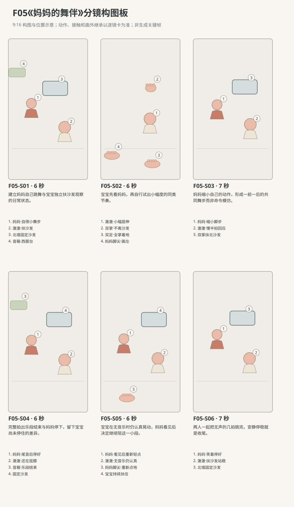

图示为构图位置示意；姿态、接触和画外继承以逐镜正文为准。

### 逐镜设计

#### F05-S01｜00—06 秒｜6 秒｜帧 [0, 144)

**镜头任务：**建立妈妈自己跳舞与宝宝独立扶沙发观察的日常状态。

**景别、机位与构图：**中全景，南侧朝北略西，妈妈左、澈澈右后、北沙发横后景，下缘保留双方双足，窗台音箱在左后。

**摄影机与理由：**固定，先看妈妈完整重心变化及宝宝稳定支撑。

**焦点：**妈妈身体节拍与澈澈手足均清晰。

**入态：**妈妈站西南侧双臂自然垂，澈澈朝北双掌扶沙发，双足分开小距离，眼睛看座垫缝。

**动作与表演：**

- 3 秒：妈妈随原创音乐把重心由左脚换到右脚，空出的脚尖轻点一次。

- 3 秒：她又换回重心，肩膀松动；澈澈听见轻点声，头开始向西转。

**声音：**音箱原创无歌词乐段、两次轻点地声、沙发布摩擦，无对白。

**出态：**妈妈继续轻晃，澈澈双掌不动、头已朝妈妈方向转一半。

**切点与承接：**沿澈澈转头接中近景，保持脚掌与扶手事实。

**连续性：**澈澈从未离开沙发，音箱在西窗台；妈妈不触碰宝宝。

**开始画面母稿：**

9:16竖幅，原创三维生活动画，圆润而有重量的造型，棉布细纹、柔和皮肤层次与可读的小表情；动作按真实生活物理及婴儿当下能力展开，不用成人化算计表情。澈澈为圆脸、深棕眼、短黑绒发、额前一小撮向右弯的头发，穿奶油色棉连体衣。妈妈深棕低马尾，雾蓝棉上衣、米色长裤。本镜开始画面为单一瞬间：妈妈站西南侧双臂自然垂，澈澈朝北双掌扶沙发，双足分开小距离，眼睛看座垫缝。 场次方位与光位：L客厅北墙固定沙发、西窗、东走廊、中央地垫。澈澈在沙发南侧朝北，双掌扶固定座垫前缘、双足在垫上；妈妈在其西南侧朝东北，音箱固定在西窗台。摄影在两人连线南侧，妈妈左、宝宝右、沙发后景，窗光来自画左。音乐的有无及动作进度只依本镜声音与起态。 摄影构图：中全景，南侧朝北略西，妈妈左、澈澈右后、北沙发横后景，下缘保留双方双足，窗台音箱在左后。 当前焦点：妈妈当前站姿与澈澈双掌扶沙发、双足接地的四个支点。只呈现上述起态，不把后续动作拼入一张画面。

**视频变化母稿：**

9:16竖幅，原创三维生活动画，圆润而有重量的造型，棉布细纹、柔和皮肤层次与可读的小表情；动作按真实生活物理及婴儿当下能力展开，不用成人化算计表情。澈澈为圆脸、深棕眼、短黑绒发、额前一小撮向右弯的头发，穿奶油色棉连体衣。妈妈深棕低马尾，雾蓝棉上衣、米色长裤。制作一段6秒连续镜头。本段人物和能力：澈澈、妈妈，澈澈为R2。空间光位：L客厅北墙固定沙发、西窗、东走廊、中央地垫。澈澈在沙发南侧朝北，双掌扶固定座垫前缘、双足在垫上；妈妈在其西南侧朝东北，音箱固定在西窗台。摄影在两人连线南侧，妈妈左、宝宝右、沙发后景，窗光来自画左。音乐的有无及动作进度只依本镜声音与起态。 起态：妈妈站西南侧双臂自然垂，澈澈朝北双掌扶沙发，双足分开小距离，眼睛看座垫缝。 摄影：中全景，南侧朝北略西，妈妈左、澈澈右后、北沙发横后景，下缘保留双方双足，窗台音箱在左后。 相机行为：固定，先看妈妈完整重心变化及宝宝稳定支撑。 焦点：妈妈身体节拍与澈澈手足均清晰。 时间过程：第1阶段3秒：妈妈随原创音乐把重心由左脚换到右脚，空出的脚尖轻点一次。；第2阶段3秒：她又换回重心，肩膀松动；澈澈听见轻点声，头开始向西转。。声音：音箱原创无歌词乐段、两次轻点地声、沙发布摩擦，无对白。 终态：妈妈继续轻晃，澈澈双掌不动、头已朝妈妈方向转一半。 连续性：澈澈从未离开沙发，音箱在西窗台；妈妈不触碰宝宝。 不加未写出的对白、人物或道具。

#### F05-S02｜06—12 秒｜6 秒｜帧 [144, 288)

**镜头任务：**宝宝先看妈妈，再自行试出小幅度的同类节奏。

**景别、机位与构图：**澈澈全身中景，机位在南侧略偏东，宝宝转向西的侧脸、双臂、双膝和双足全部留在画内，固定沙发接触面在上半；妈妈点地的小腿与脚在画左边缘。

**摄影机与理由：**固定，不跟头绕轴；把妈妈的脚留作宝宝视线下落依据。

**焦点：**澈澈眼睛、扶沙发双掌与双足均在清晰景深内，小幅屈伸与脚掌持续接地同框可读。

**入态：**澈澈双掌扶沙发、头转向西侧看妈妈，双膝基本伸直，双足全掌接地。

**动作与表演：**

- 2 秒：澈澈眼睛先看妈妈脸，再沿她身体落到轻点的脚。

- 2 秒：他把双膝轻弯，臀部稍降，双肘随之弯曲而掌心不滑。

- 2 秒：他把膝盖伸回，身体回原高度，脸仍朝向妈妈。

**声音：**音乐持续，沙发棉布受掌轻摩擦，澈澈一次轻鼻音，无对白。

**出态：**澈澈已完成一次小屈伸，双掌双足仍在原接触点，注意力留在妈妈。

**切点与承接：**切二人中景，让妈妈看见这一次动作后的回应清楚发生。

**连续性：**不把扶物动作变成蹲起训练；澈澈脚位不变，妈妈画外仍轻点。

**开始画面母稿：**

9:16竖幅，原创三维生活动画，圆润而有重量的造型，棉布细纹、柔和皮肤层次与可读的小表情；动作按真实生活物理及婴儿当下能力展开，不用成人化算计表情。澈澈为圆脸、深棕眼、短黑绒发、额前一小撮向右弯的头发，穿奶油色棉连体衣。妈妈深棕低马尾，雾蓝棉上衣、米色长裤。本镜开始画面为单一瞬间：澈澈双掌扶沙发、头转向西侧看妈妈，双膝基本伸直，双足全掌接地。 场次方位与光位：L客厅北墙固定沙发、西窗、东走廊、中央地垫。澈澈在沙发南侧朝北，双掌扶固定座垫前缘、双足在垫上；妈妈在其西南侧朝东北，音箱固定在西窗台。摄影在两人连线南侧，妈妈左、宝宝右、沙发后景，窗光来自画左。音乐的有无及动作进度只依本镜声音与起态。 摄影构图：澈澈全身中景，机位在南侧略偏东，宝宝转向西的侧脸、双臂、双膝和双足全部留在画内，固定沙发接触面在上半；妈妈点地的小腿与脚在画左边缘。 当前焦点：澈澈向西看妈妈的双眼、双掌扶沙发与双足全掌着地。只呈现上述起态，不把后续动作拼入一张画面。

**视频变化母稿：**

9:16竖幅，原创三维生活动画，圆润而有重量的造型，棉布细纹、柔和皮肤层次与可读的小表情；动作按真实生活物理及婴儿当下能力展开，不用成人化算计表情。澈澈为圆脸、深棕眼、短黑绒发、额前一小撮向右弯的头发，穿奶油色棉连体衣。妈妈深棕低马尾，雾蓝棉上衣、米色长裤。制作一段6秒连续镜头。本段人物和能力：澈澈、妈妈，澈澈为R2。空间光位：L客厅北墙固定沙发、西窗、东走廊、中央地垫。澈澈在沙发南侧朝北，双掌扶固定座垫前缘、双足在垫上；妈妈在其西南侧朝东北，音箱固定在西窗台。摄影在两人连线南侧，妈妈左、宝宝右、沙发后景，窗光来自画左。音乐的有无及动作进度只依本镜声音与起态。 起态：澈澈双掌扶沙发、头转向西侧看妈妈，双膝基本伸直，双足全掌接地。 摄影：澈澈全身中景，机位在南侧略偏东，宝宝转向西的侧脸、双臂、双膝和双足全部留在画内，固定沙发接触面在上半；妈妈点地的小腿与脚在画左边缘。 相机行为：固定，不跟头绕轴；把妈妈的脚留作宝宝视线下落依据。 焦点：澈澈眼睛、扶沙发双掌与双足均在清晰景深内，小幅屈伸与脚掌持续接地同框可读。 时间过程：第1阶段2秒：澈澈眼睛先看妈妈脸，再沿她身体落到轻点的脚。；第2阶段2秒：他把双膝轻弯，臀部稍降，双肘随之弯曲而掌心不滑。；第3阶段2秒：他把膝盖伸回，身体回原高度，脸仍朝向妈妈。。声音：音乐持续，沙发棉布受掌轻摩擦，澈澈一次轻鼻音，无对白。 终态：澈澈已完成一次小屈伸，双掌双足仍在原接触点，注意力留在妈妈。 连续性：不把扶物动作变成蹲起训练；澈澈脚位不变，妈妈画外仍轻点。 不加未写出的对白、人物或道具。

#### F05-S03｜12—19 秒｜7 秒｜帧 [288, 456)

**镜头任务：**妈妈缩小自己的动作，形成一前一后的共同舞步而非命令模仿。

**景别、机位与构图：**二人中全景，南侧同轴，妈妈左、澈澈右，妈妈脸、宝宝侧脸、双足和支撑面均见。

**摄影机与理由：**固定；动作幅度的改变由演员完成，不以镜头缩放模拟。

**焦点：**妈妈发现宝宝的眼神和澈澈接下来的屈伸共同清晰。

**入态：**妈妈仍随音乐小步，澈澈头朝她、双掌扶沙发，刚从第一次屈膝伸回。

**动作与表演：**

- 3 秒：妈妈看见澈澈的膝盖变化，笑一下，把脚步缩成原地换重心。

- 4 秒：澈澈又弯膝伸回，妈妈等他伸直后再轻点一下脚尖，两人的节奏错开半拍。

**声音：**音乐持续，妈妈一次细短笑气、脚尖轻点、沙发细摩擦，无对白。

**出态：**两人各自稳定，澈澈仍看妈妈，妈妈不再大步横移。

**切点与承接：**在最后乐句开始时切到同侧稍近画面，准备音乐自然结束。

**连续性：**妈妈未伸手扶宝宝；澈澈双掌持续接触、脚位稳定，允许节拍不整齐。

**开始画面母稿：**

9:16竖幅，原创三维生活动画，圆润而有重量的造型，棉布细纹、柔和皮肤层次与可读的小表情；动作按真实生活物理及婴儿当下能力展开，不用成人化算计表情。澈澈为圆脸、深棕眼、短黑绒发、额前一小撮向右弯的头发，穿奶油色棉连体衣。妈妈深棕低马尾，雾蓝棉上衣、米色长裤。本镜开始画面为单一瞬间：妈妈仍随音乐小步，澈澈头朝她、双掌扶沙发，刚从第一次屈膝伸回。 场次方位与光位：L客厅北墙固定沙发、西窗、东走廊、中央地垫。澈澈在沙发南侧朝北，双掌扶固定座垫前缘、双足在垫上；妈妈在其西南侧朝东北，音箱固定在西窗台。摄影在两人连线南侧，妈妈左、宝宝右、沙发后景，窗光来自画左。音乐的有无及动作进度只依本镜声音与起态。 摄影构图：二人中全景，南侧同轴，妈妈左、澈澈右，妈妈脸、宝宝侧脸、双足和支撑面均见。 当前焦点：妈妈观察澈澈的眼神、宝宝稳定的手足支撑。只呈现上述起态，不把后续动作拼入一张画面。

**视频变化母稿：**

9:16竖幅，原创三维生活动画，圆润而有重量的造型，棉布细纹、柔和皮肤层次与可读的小表情；动作按真实生活物理及婴儿当下能力展开，不用成人化算计表情。澈澈为圆脸、深棕眼、短黑绒发、额前一小撮向右弯的头发，穿奶油色棉连体衣。妈妈深棕低马尾，雾蓝棉上衣、米色长裤。制作一段7秒连续镜头。本段人物和能力：澈澈、妈妈，澈澈为R2。空间光位：L客厅北墙固定沙发、西窗、东走廊、中央地垫。澈澈在沙发南侧朝北，双掌扶固定座垫前缘、双足在垫上；妈妈在其西南侧朝东北，音箱固定在西窗台。摄影在两人连线南侧，妈妈左、宝宝右、沙发后景，窗光来自画左。音乐的有无及动作进度只依本镜声音与起态。 起态：妈妈仍随音乐小步，澈澈头朝她、双掌扶沙发，刚从第一次屈膝伸回。 摄影：二人中全景，南侧同轴，妈妈左、澈澈右，妈妈脸、宝宝侧脸、双足和支撑面均见。 相机行为：固定；动作幅度的改变由演员完成，不以镜头缩放模拟。 焦点：妈妈发现宝宝的眼神和澈澈接下来的屈伸共同清晰。 时间过程：第1阶段3秒：妈妈看见澈澈的膝盖变化，笑一下，把脚步缩成原地换重心。；第2阶段4秒：澈澈又弯膝伸回，妈妈等他伸直后再轻点一下脚尖，两人的节奏错开半拍。。声音：音乐持续，妈妈一次细短笑气、脚尖轻点、沙发细摩擦，无对白。 终态：两人各自稳定，澈澈仍看妈妈，妈妈不再大步横移。 连续性：妈妈未伸手扶宝宝；澈澈双掌持续接触、脚位稳定，允许节拍不整齐。 不加未写出的对白、人物或道具。

#### F05-S04｜19—25 秒｜6 秒｜帧 [456, 600)

**镜头任务：**完整拍出乐段结束与妈妈停下，留下宝宝尚未停住的差异。

**景别、机位与构图：**二人中景，南侧同轴略收紧，妈妈左半身至足、宝宝右全身，音箱可在左后边缘。

**摄影机与理由：**固定，音乐结束时不做转场，让观众确知同一时空。

**焦点：**两人的重心变化；音箱不需读出界面。

**入态：**全片第19秒，妈妈原地换重心，澈澈扶沙发小幅晃，原创乐段进入最后一乐句。

**动作与表演：**

- 4 秒：妈妈随尾句再轻点两次，澈澈较慢地弯膝伸回一次。

- 2 秒：最后音符自然落下，妈妈双脚平放、肩膀停住；澈澈刚开始下一次屈膝。

**声音：**原创乐段在本镜第6秒即全片25秒完全结束，最后一音自然衰减；无对白。

**出态：**妈妈已停，澈澈处于小幅屈膝最低点，手掌仍扶沙发。

**切点与承接：**在音乐留白中接宝宝继续伸回，不跳过膝盖终态。

**连续性：**声音终止与妈妈停步同镜完成；澈澈下一个动作尚在进行，无隐形节拍器。

**开始画面母稿：**

9:16竖幅，原创三维生活动画，圆润而有重量的造型，棉布细纹、柔和皮肤层次与可读的小表情；动作按真实生活物理及婴儿当下能力展开，不用成人化算计表情。澈澈为圆脸、深棕眼、短黑绒发、额前一小撮向右弯的头发，穿奶油色棉连体衣。妈妈深棕低马尾，雾蓝棉上衣、米色长裤。本镜开始画面为单一瞬间：全片第19秒，妈妈原地换重心，澈澈扶沙发小幅晃，原创乐段进入最后一乐句。 场次方位与光位：L客厅北墙固定沙发、西窗、东走廊、中央地垫。澈澈在沙发南侧朝北，双掌扶固定座垫前缘、双足在垫上；妈妈在其西南侧朝东北，音箱固定在西窗台。摄影在两人连线南侧，妈妈左、宝宝右、沙发后景，窗光来自画左。音乐的有无及动作进度只依本镜声音与起态。 摄影构图：二人中景，南侧同轴略收紧，妈妈左半身至足、宝宝右全身，音箱可在左后边缘。 当前焦点：两人的当前重心、宝宝双掌持续扶物与妈妈点地脚。只呈现上述起态，不把后续动作拼入一张画面。

**视频变化母稿：**

9:16竖幅，原创三维生活动画，圆润而有重量的造型，棉布细纹、柔和皮肤层次与可读的小表情；动作按真实生活物理及婴儿当下能力展开，不用成人化算计表情。澈澈为圆脸、深棕眼、短黑绒发、额前一小撮向右弯的头发，穿奶油色棉连体衣。妈妈深棕低马尾，雾蓝棉上衣、米色长裤。制作一段6秒连续镜头。本段人物和能力：澈澈、妈妈，澈澈为R2。空间光位：L客厅北墙固定沙发、西窗、东走廊、中央地垫。澈澈在沙发南侧朝北，双掌扶固定座垫前缘、双足在垫上；妈妈在其西南侧朝东北，音箱固定在西窗台。摄影在两人连线南侧，妈妈左、宝宝右、沙发后景，窗光来自画左。音乐的有无及动作进度只依本镜声音与起态。 起态：全片第19秒，妈妈原地换重心，澈澈扶沙发小幅晃，原创乐段进入最后一乐句。 摄影：二人中景，南侧同轴略收紧，妈妈左半身至足、宝宝右全身，音箱可在左后边缘。 相机行为：固定，音乐结束时不做转场，让观众确知同一时空。 焦点：两人的重心变化；音箱不需读出界面。 时间过程：第1阶段4秒：妈妈随尾句再轻点两次，澈澈较慢地弯膝伸回一次。；第2阶段2秒：最后音符自然落下，妈妈双脚平放、肩膀停住；澈澈刚开始下一次屈膝。。声音：原创乐段在本镜第6秒即全片25秒完全结束，最后一音自然衰减；无对白。 终态：妈妈已停，澈澈处于小幅屈膝最低点，手掌仍扶沙发。 连续性：声音终止与妈妈停步同镜完成；澈澈下一个动作尚在进行，无隐形节拍器。 不加未写出的对白、人物或道具。

#### F05-S05｜25—31 秒｜6 秒｜帧 [600, 744)

**镜头任务：**宝宝在无音乐时仍认真晃动，妈妈看见后决定继续陪这一小段。

**景别、机位与构图：**二人中景，南侧同轴，妈妈左、宝宝右，妈妈双脚和澈澈扶手接触在下/右缘可见。

**摄影机与理由：**固定，先等宝宝完成动作，再让妈妈重新动。

**焦点：**澈澈侧脸与膝盖先，随后妈妈看他的微笑，均保持可辨。

**入态：**妈妈双脚平放停住，澈澈膝盖小弯、双掌扶沙发，音箱已静音。

**动作与表演：**

- 2 秒：澈澈伸直膝盖，看妈妈一眼，停半拍。

- 2 秒：他又轻弯一下膝，自己认真继续；妈妈目光落到他的膝盖，嘴角扬起。

- 2 秒：妈妈重新换一下重心、脚尖轻点地面，动作比有音乐时更轻。

**声音：**无音乐；清楚保留一次脚尖轻点、衣料轻响和妈妈笑气，无对白。

**出态：**妈妈已重新开始小幅轻晃，澈澈从屈膝中慢慢伸回。

**切点与承接：**接两人无声继续的稍宽镜，兑现陪伴的结尾。

**连续性：**不能恢复BGM；澈澈掌心不离沙发，妈妈动作必须晚于宝宝再次屈膝。

**开始画面母稿：**

9:16竖幅，原创三维生活动画，圆润而有重量的造型，棉布细纹、柔和皮肤层次与可读的小表情；动作按真实生活物理及婴儿当下能力展开，不用成人化算计表情。澈澈为圆脸、深棕眼、短黑绒发、额前一小撮向右弯的头发，穿奶油色棉连体衣。妈妈深棕低马尾，雾蓝棉上衣、米色长裤。本镜开始画面为单一瞬间：妈妈双脚平放停住，澈澈膝盖小弯、双掌扶沙发，音箱已静音。 场次方位与光位：L客厅北墙固定沙发、西窗、东走廊、中央地垫。澈澈在沙发南侧朝北，双掌扶固定座垫前缘、双足在垫上；妈妈在其西南侧朝东北，音箱固定在西窗台。摄影在两人连线南侧，妈妈左、宝宝右、沙发后景，窗光来自画左。音乐的有无及动作进度只依本镜声音与起态。 摄影构图：二人中景，南侧同轴，妈妈左、宝宝右，妈妈双脚和澈澈扶手接触在下/右缘可见。 当前焦点：妈妈已经停住的双脚、宝宝仍微屈的双膝与扶物双掌。只呈现上述起态，不把后续动作拼入一张画面。

**视频变化母稿：**

9:16竖幅，原创三维生活动画，圆润而有重量的造型，棉布细纹、柔和皮肤层次与可读的小表情；动作按真实生活物理及婴儿当下能力展开，不用成人化算计表情。澈澈为圆脸、深棕眼、短黑绒发、额前一小撮向右弯的头发，穿奶油色棉连体衣。妈妈深棕低马尾，雾蓝棉上衣、米色长裤。制作一段6秒连续镜头。本段人物和能力：澈澈、妈妈，澈澈为R2。空间光位：L客厅北墙固定沙发、西窗、东走廊、中央地垫。澈澈在沙发南侧朝北，双掌扶固定座垫前缘、双足在垫上；妈妈在其西南侧朝东北，音箱固定在西窗台。摄影在两人连线南侧，妈妈左、宝宝右、沙发后景，窗光来自画左。音乐的有无及动作进度只依本镜声音与起态。 起态：妈妈双脚平放停住，澈澈膝盖小弯、双掌扶沙发，音箱已静音。 摄影：二人中景，南侧同轴，妈妈左、宝宝右，妈妈双脚和澈澈扶手接触在下/右缘可见。 相机行为：固定，先等宝宝完成动作，再让妈妈重新动。 焦点：澈澈侧脸与膝盖先，随后妈妈看他的微笑，均保持可辨。 时间过程：第1阶段2秒：澈澈伸直膝盖，看妈妈一眼，停半拍。；第2阶段2秒：他又轻弯一下膝，自己认真继续；妈妈目光落到他的膝盖，嘴角扬起。；第3阶段2秒：妈妈重新换一下重心、脚尖轻点地面，动作比有音乐时更轻。。声音：无音乐；清楚保留一次脚尖轻点、衣料轻响和妈妈笑气，无对白。 终态：妈妈已重新开始小幅轻晃，澈澈从屈膝中慢慢伸回。 连续性：不能恢复BGM；澈澈掌心不离沙发，妈妈动作必须晚于宝宝再次屈膝。 不加未写出的对白、人物或道具。

#### F05-S06｜31—38 秒｜7 秒｜帧 [744, 912)

**镜头任务：**两人一起把无声的几拍跳完，安静停稳就是收尾。

**景别、机位与构图：**二人中全景，同S03方向，母子与沙发、地垫接触完整，西窗暖反射保持。

**摄影机与理由：**轻缓后移一小步，给两人全身与共同停下留空间，最后3秒固定。

**焦点：**两人面部与手足同清晰，不再切焦。

**入态：**妈妈小幅换重心，澈澈从屈膝伸回，两人都知道对方在看，音乐已停。

**动作与表演：**

- 3 秒：妈妈轻点一次，澈澈过一拍才弯膝再伸回，彼此看一眼。

- 2 秒：澈澈双膝伸直，双掌向沙发压稳，身体不再上下动；妈妈随他一起站好。

- 2 秒：妈妈笑着轻呼气，澈澈抬眼看她，脚和手都仍稳稳落着。

**声音：**一次轻点与沙发布料声后回到呼吸，妈妈一声轻笑，无音乐无对白。

**出态：**澈澈双手扶沙发、双足着地，妈妈在西南站稳微笑，共同的小舞段完成。

**切点与承接：**末两秒留白后结束，不追加鼓掌、口号或迈步。

**连续性：**能力保持R2扶物站立，整片无放手；妈妈与宝宝仍在原相对位置。

**开始画面母稿：**

9:16竖幅，原创三维生活动画，圆润而有重量的造型，棉布细纹、柔和皮肤层次与可读的小表情；动作按真实生活物理及婴儿当下能力展开，不用成人化算计表情。澈澈为圆脸、深棕眼、短黑绒发、额前一小撮向右弯的头发，穿奶油色棉连体衣。妈妈深棕低马尾，雾蓝棉上衣、米色长裤。本镜开始画面为单一瞬间：妈妈小幅换重心，澈澈从屈膝伸回，两人都知道对方在看，音乐已停。 场次方位与光位：L客厅北墙固定沙发、西窗、东走廊、中央地垫。澈澈在沙发南侧朝北，双掌扶固定座垫前缘、双足在垫上；妈妈在其西南侧朝东北，音箱固定在西窗台。摄影在两人连线南侧，妈妈左、宝宝右、沙发后景，窗光来自画左。音乐的有无及动作进度只依本镜声音与起态。 摄影构图：二人中全景，同S03方向，母子与沙发、地垫接触完整，西窗暖反射保持。 当前焦点：母子当前微晃姿态、宝宝双手双足的稳定接触。只呈现上述起态，不把后续动作拼入一张画面。

**视频变化母稿：**

9:16竖幅，原创三维生活动画，圆润而有重量的造型，棉布细纹、柔和皮肤层次与可读的小表情；动作按真实生活物理及婴儿当下能力展开，不用成人化算计表情。澈澈为圆脸、深棕眼、短黑绒发、额前一小撮向右弯的头发，穿奶油色棉连体衣。妈妈深棕低马尾，雾蓝棉上衣、米色长裤。制作一段7秒连续镜头。本段人物和能力：澈澈、妈妈，澈澈为R2。空间光位：L客厅北墙固定沙发、西窗、东走廊、中央地垫。澈澈在沙发南侧朝北，双掌扶固定座垫前缘、双足在垫上；妈妈在其西南侧朝东北，音箱固定在西窗台。摄影在两人连线南侧，妈妈左、宝宝右、沙发后景，窗光来自画左。音乐的有无及动作进度只依本镜声音与起态。 起态：妈妈小幅换重心，澈澈从屈膝伸回，两人都知道对方在看，音乐已停。 摄影：二人中全景，同S03方向，母子与沙发、地垫接触完整，西窗暖反射保持。 相机行为：轻缓后移一小步，给两人全身与共同停下留空间，最后3秒固定。 焦点：两人面部与手足同清晰，不再切焦。 时间过程：第1阶段3秒：妈妈轻点一次，澈澈过一拍才弯膝再伸回，彼此看一眼。；第2阶段2秒：澈澈双膝伸直，双掌向沙发压稳，身体不再上下动；妈妈随他一起站好。；第3阶段2秒：妈妈笑着轻呼气，澈澈抬眼看她，脚和手都仍稳稳落着。。声音：一次轻点与沙发布料声后回到呼吸，妈妈一声轻笑，无音乐无对白。 终态：澈澈双手扶沙发、双足着地，妈妈在西南站稳微笑，共同的小舞段完成。 连续性：能力保持R2扶物站立，整片无放手；妈妈与宝宝仍在原相对位置。 不加未写出的对白、人物或道具。

### 声音与剪辑

小音箱内原创无歌词轻快乐段从片头持续至第25秒自然收尾，不使用现成商业歌曲。脚尖轻点、棉袖与沙发布摩擦为前景。第25秒后音乐完全消失，保留两人无声继续时的呼吸与轻点声，不人为续播。

正式台词：无；保留镜头声音中已写明的自然发声。

### 连续性与试片

- 连续性：澈澈双掌始终扶固定沙发座垫前缘，脚掌持续落在同一小区域，不跳跃、不放手站立。

- 连续性：妈妈在西南侧，澈澈朝北扶物，头转向西侧看妈妈；摄影持续在南侧，窗门不反。

- 连续性：唯一音乐源F05-X01在西窗台，乐段第25秒终止，S05—S06不可凭空恢复音乐。

- 连续性：妈妈小步不进入澈澈两脚之间，不牵手或抱起改变能力任务。

- 试片：F05-S02—S04试片：屈膝、脚底与双掌接触必须共同可读；若脚底滑移、膝盖反折或手脱离沙发仍悬站，则失败。

- 试片：F05-S04—S05试听：第25秒音乐须结束，宝宝的继续动作先于妈妈重新起步；若仍靠背景节拍强迫同步则失败。

- 试片：F05-S06静音看片：须看出妈妈是回应而非教动作，若不断口型数拍或拉拽宝宝肢体则失败。

**媒体待验证：**未生成媒体；待验扶沙发承重、双足摩擦和婴儿小幅屈膝，及音乐停后七秒无对白节奏是否自然。

---

## F06《收拾的方向不一样》

**55 秒｜坐姿与手部互动｜角色：澈澈、爸爸｜场景 L**

### 剧情正文

客厅地垫上还散着两块软积木，爸爸右手已拿起另一块，把浅木玩具盒拉到手边，澈澈坐在盒旁看。他把第一块放进去，伸手去拿第二块。澈澈却从盒里拿出刚放好的那块，转一下，摆在自己面前。爸爸没有注意，第二块又轻轻落进盒里。澈澈看看盒子，伸手把它也取出来，放到第一块旁边，还用掌心慢慢推开一点距离。爸爸的右手已经拿起最后一块，悬在盒上方，却停住了。他看一眼宝宝面前的两块积木，又看见澈澈正在修正中间的小空隙，终于不再往盒里放。爸爸把盒子向后移一点，自己挪到旁边，将最后一块平托着递过去。澈澈先握住一角，另一只手也凑上来，爸爸等他拿稳才松开。他把积木放到队尾，又低头推了推，不很整齐的三块终于排成一小行。爸爸空着的手落回膝上，没有替他摆直。澈澈抬头看看爸爸，两人一起看着这份方向完全不同的“收拾”。

### 亲述来源与改编

原帖是家长自述，未独立核实。本片将生活机制改编为澈澈的原创故事。

- [TD07 · 一边装洗碗机一边被往外拿，改分工才顺下来](https://www.reddit.com/r/Mommit/comments/koo3ho/how_did_i_not_figure_this_out_sooner/)；作者自报年龄：2 year old（作者原话，精确月龄未注明）。

- **采用的生活过程：**只借鉴成人收进、孩子拿出导致任务相反，成人随后改变参与方式的关系机制。

- **本片原创改编：**原片软积木、浅木盒、爸爸停止收纳并改为平托递第三块、宝宝短暂排放均为本项目原创。

- **不作出的事实推断：**原帖是两岁幼儿参与洗碗机与餐具分类，不是婴儿摆积木的实录；不将两岁家务能力移给R1。

- **不作出的事实推断：**原帖的重新分工不等于本片婴儿已经理解收拾规则；不承诺任何育儿效果。

[查看原始过程与缺项](research/real-experiences/index.html#TD07)

### 导演与空间

**观察任务：**爸爸从把玩具收进盒子的单向任务，转而看懂宝宝正在摆放的另一项任务，通过递出下一块自然加入。

**空间与光位：**L客厅北墙沙发、西窗、东走廊、中央地垫。澈澈坐垫北半朝南，爸爸盘腿坐其西南侧朝东北，摄影始终在两人连线东南侧，爸爸画左、澈澈右。P07浅木玩具盒在澈澈右膝外偏西的可及处。三块P03同款鼠尾草软积木用制作编号A/B/C区分：A有圆形缝线、起始爸爸右手；B有方形缝线、起始爸爸左膝外；C有十字缝线、起始爸爸右膝前。宝宝面前南侧留一条东西向空位，最后从西到东为A/B/C。西窗柔光来自画左。

**人物表演：**爸爸确实想收拾，开始手法熟练；发现相反方向后先停手观察，再改变自己坐位与递物方式。澈澈专注把积木放在眼前，摆得不完全齐，不被写成故意捣乱；他能稳坐、短暂双手离垫，侧伸时有另一掌撑垫。

### 节拍覆盖

- **F06-b1**：交代爸爸的收纳目标、宝宝位置与三块积木的不同起点。 前态：爸爸盘腿坐着右手持A，左手在盒沿，澈澈双掌撑垫，B/C各在爸爸对应膝旁。 后态：A在爸爸右手盒口上方，B/C仍在地垫，澈澈注意盒口。 → F06-S01

- **F06-b2**：第一块确实被爸爸放进盒，宝宝随后才动手。 前态：爸爸右手持圆缝线A在盒口上方，澈澈左掌撑垫、右手在右膝边，盒内空。 后态：A仍在盒底，澈澈右指已抓上角，左掌撑垫；爸爸右手已空。 → F06-S02

- **F06-b3**：宝宝把取出的A放到自己的观看范围，显出另一个目标的雏形。 前态：澈澈右指握A上角、左掌撑垫，A尚在盒底，爸爸正看左膝外B。 后态：A在宝宝面前南侧偏西，B在爸爸左手，C仍右膝前；宝宝右手空。 → F06-S03

- **F06-b4**：第二块也被搬出并排到A旁，爸爸尚未完成的收纳由此被打断。 前态：爸爸左手拿方缝线B在空盒旁，宝宝右手空放A旁，左掌撑垫，C在爸爸右膝前。 后态：A西、B东在宝宝面前，C爸爸右手，盒空；宝宝右掌仍按B上。 → F06-S04

- **F06-b5**：爸爸看懂宝宝摆放而改变自己的下一步，不能靠一句解释完成转折。 前态：爸爸右手持C准备去盒上方，澈澈右掌按B，A/B已成一小行，盒空。 后态：盒在宝宝右后方，爸爸右掌平托C朝宝宝，A/B前方空位未被占。 → F06-S05

- **F06-b6**：用等待拿稳后的松手，具体表现爸爸加入宝宝的摆放活动。 前态：爸爸右掌平托十字缝线C在宝宝胸腹前，澈澈已坐正，右手抬起、左掌刚离垫。 后态：C在澈澈双手，爸爸右手已回膝，A/B在前方原位。 → F06-S06

- **F06-b7**：宝宝完成自己的排列，爸爸选择看而不纠正，关系自然落定。 前态：澈澈双手持C于胸前，A西B中在面前，爸爸双手落膝，空盒后移。 后态：三块从西到东A/B/C，宝宝双手已离块放膝边，爸爸未代摆，盒空在后方。 → F06-S07

### 分镜构图板

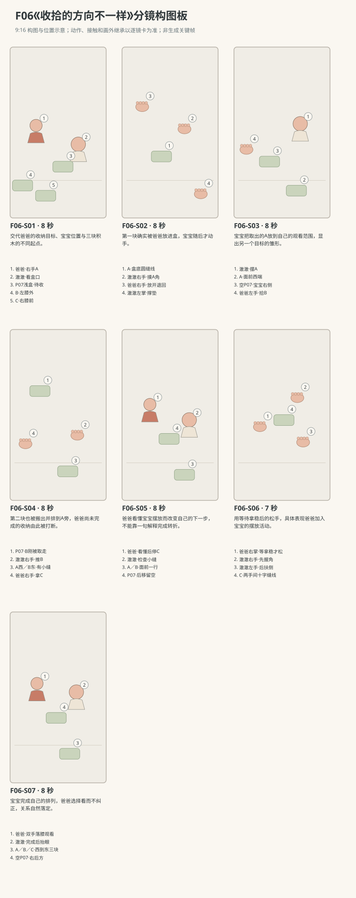

图示为构图位置示意；姿态、接触和画外继承以逐镜正文为准。

### 逐镜设计

#### F06-S01｜00—08 秒｜8 秒｜帧 [0, 192)

**镜头任务：**交代爸爸的收纳目标、宝宝位置与三块积木的不同起点。

**景别、机位与构图：**中全景，东南朝西北，爸爸左、宝宝右，木盒在两人间偏上，A右手、B左膝外、C右膝前均可见。

**摄影机与理由：**固定，先完整呈现散物与准备收纳的距离。

**焦点：**爸爸右手A和宝宝看盒的眼神，所有道具可辨。

**入态：**爸爸盘腿坐着右手持A，左手在盒沿，澈澈双掌撑垫，B/C各在爸爸对应膝旁。

**动作与表演：**

- 3 秒：爸爸左手把P07向澈澈右膝外可及处拉近一点，宝宝沿盒沿看进去。

- 5 秒：爸爸右手把A举到盒口正上方，稍停避免碰沿；左手离开盒沿准备拿左膝外B。

**声音：**木盒擦垫短声、积木布面擦掌声，无对白。

**出态：**A在爸爸右手盒口上方，B/C仍在地垫，澈澈注意盒口。

**切点与承接：**切近A落盒的动作，同时保留宝宝可及的盒沿。

**连续性：**三块全部画内建立；盒不装其他玩具，不新增第四块。

**开始画面母稿：**

9:16竖幅，原创三维生活动画，圆润而有重量的造型，棉布细纹、柔和皮肤层次与可读的小表情；动作按真实生活物理及婴儿当下能力展开，不用成人化算计表情。澈澈为圆脸、深棕眼、短黑绒发、额前一小撮向右弯的头发，穿奶油色棉连体衣。爸爸短黑发，砖陶色棉衬衫、深灰长裤。本镜开始画面为单一瞬间：爸爸盘腿坐着右手持A，左手在盒沿，澈澈双掌撑垫，B/C各在爸爸对应膝旁。 场次方位与光位：L客厅北墙沙发、西窗、东走廊、中央地垫。澈澈在垫北半朝南、爸爸在其西南朝东北，摄影始终在连线东南侧，爸爸左、宝宝右，窗光来自左。浅木盒P07与三块鼠尾草软积木共用：圆缝线A、方缝线B、十字缝线C，编号不印在实物上。道具当前归属与摆放只依本镜起态，不重置最初散放状态。 摄影构图：中全景，东南朝西北，爸爸左、宝宝右，木盒在两人间偏上，A右手、B左膝外、C右膝前均可见。 当前焦点：爸爸右手圆缝线A、浅木盒及宝宝注意盒口的双眼。只呈现上述起态，不把后续动作拼入一张画面。

**视频变化母稿：**

9:16竖幅，原创三维生活动画，圆润而有重量的造型，棉布细纹、柔和皮肤层次与可读的小表情；动作按真实生活物理及婴儿当下能力展开，不用成人化算计表情。澈澈为圆脸、深棕眼、短黑绒发、额前一小撮向右弯的头发，穿奶油色棉连体衣。爸爸短黑发，砖陶色棉衬衫、深灰长裤。制作一段8秒连续镜头。本段人物和能力：澈澈、爸爸，澈澈为R1。空间光位：L客厅北墙沙发、西窗、东走廊、中央地垫。澈澈在垫北半朝南、爸爸在其西南朝东北，摄影始终在连线东南侧，爸爸左、宝宝右，窗光来自左。浅木盒P07与三块鼠尾草软积木共用：圆缝线A、方缝线B、十字缝线C，编号不印在实物上。道具当前归属与摆放只依本镜起态，不重置最初散放状态。 起态：爸爸盘腿坐着右手持A，左手在盒沿，澈澈双掌撑垫，B/C各在爸爸对应膝旁。 摄影：中全景，东南朝西北，爸爸左、宝宝右，木盒在两人间偏上，A右手、B左膝外、C右膝前均可见。 相机行为：固定，先完整呈现散物与准备收纳的距离。 焦点：爸爸右手A和宝宝看盒的眼神，所有道具可辨。 时间过程：第1阶段3秒：爸爸左手把P07向澈澈右膝外可及处拉近一点，宝宝沿盒沿看进去。；第2阶段5秒：爸爸右手把A举到盒口正上方，稍停避免碰沿；左手离开盒沿准备拿左膝外B。。声音：木盒擦垫短声、积木布面擦掌声，无对白。 终态：A在爸爸右手盒口上方，B/C仍在地垫，澈澈注意盒口。 连续性：三块全部画内建立；盒不装其他玩具，不新增第四块。 不加未写出的对白、人物或道具。

#### F06-S02｜08—16 秒｜8 秒｜帧 [192, 384)

**镜头任务：**第一块确实被爸爸放进盒，宝宝随后才动手。

**景别、机位与构图：**手部中近景，东南同轴，盒居左中、澈澈右半身和右臂居右，爸爸右手从左上入框。

**摄影机与理由：**固定，盒内与盒沿同见，落下不能被整个遮挡。

**焦点：**A触盒底及澈澈右指靠近的先后。

**入态：**爸爸右手持圆缝线A在盒口上方，澈澈左掌撑垫、右手在右膝边，盒内空。

**动作与表演：**

- 3 秒：爸爸把A轻放到盒底，等接触后松右指，不抛落。

- 2 秒：爸爸空右手退回，目光移向散在地垫的其他块。

- 3 秒：澈澈稍向右侧倾，左掌压稳地垫，右手伸进盒口摸到A上角。

**声音：**A落盒底一声软扑、袖布声，无对白。

**出态：**A仍在盒底，澈澈右指已抓上角，左掌撑垫；爸爸右手已空。

**切点与承接：**接宝宝提A出盒的动作，保证落盒结果被看见后才取。

**连续性：**A未提前跳到宝宝手；B/C在画外原位，爸爸左手尚未拿B。

**开始画面母稿：**

9:16竖幅，原创三维生活动画，圆润而有重量的造型，棉布细纹、柔和皮肤层次与可读的小表情；动作按真实生活物理及婴儿当下能力展开，不用成人化算计表情。澈澈为圆脸、深棕眼、短黑绒发、额前一小撮向右弯的头发，穿奶油色棉连体衣。爸爸短黑发，砖陶色棉衬衫、深灰长裤。本镜开始画面为单一瞬间：爸爸右手持圆缝线A在盒口上方，澈澈左掌撑垫、右手在右膝边，盒内空。 场次方位与光位：L客厅北墙沙发、西窗、东走廊、中央地垫。澈澈在垫北半朝南、爸爸在其西南朝东北，摄影始终在连线东南侧，爸爸左、宝宝右，窗光来自左。浅木盒P07与三块鼠尾草软积木共用：圆缝线A、方缝线B、十字缝线C，编号不印在实物上。道具当前归属与摆放只依本镜起态，不重置最初散放状态。 摄影构图：手部中近景，东南同轴，盒居左中、澈澈右半身和右臂居右，爸爸右手从左上入框。 当前焦点：爸爸右手盒口上方的A、空盒底与宝宝尚未伸入的右手。只呈现上述起态，不把后续动作拼入一张画面。

**视频变化母稿：**

9:16竖幅，原创三维生活动画，圆润而有重量的造型，棉布细纹、柔和皮肤层次与可读的小表情；动作按真实生活物理及婴儿当下能力展开，不用成人化算计表情。澈澈为圆脸、深棕眼、短黑绒发、额前一小撮向右弯的头发，穿奶油色棉连体衣。爸爸短黑发，砖陶色棉衬衫、深灰长裤。制作一段8秒连续镜头。本段人物和能力：澈澈、爸爸，澈澈为R1。空间光位：L客厅北墙沙发、西窗、东走廊、中央地垫。澈澈在垫北半朝南、爸爸在其西南朝东北，摄影始终在连线东南侧，爸爸左、宝宝右，窗光来自左。浅木盒P07与三块鼠尾草软积木共用：圆缝线A、方缝线B、十字缝线C，编号不印在实物上。道具当前归属与摆放只依本镜起态，不重置最初散放状态。 起态：爸爸右手持圆缝线A在盒口上方，澈澈左掌撑垫、右手在右膝边，盒内空。 摄影：手部中近景，东南同轴，盒居左中、澈澈右半身和右臂居右，爸爸右手从左上入框。 相机行为：固定，盒内与盒沿同见，落下不能被整个遮挡。 焦点：A触盒底及澈澈右指靠近的先后。 时间过程：第1阶段3秒：爸爸把A轻放到盒底，等接触后松右指，不抛落。；第2阶段2秒：爸爸空右手退回，目光移向散在地垫的其他块。；第3阶段3秒：澈澈稍向右侧倾，左掌压稳地垫，右手伸进盒口摸到A上角。。声音：A落盒底一声软扑、袖布声，无对白。 终态：A仍在盒底，澈澈右指已抓上角，左掌撑垫；爸爸右手已空。 连续性：A未提前跳到宝宝手；B/C在画外原位，爸爸左手尚未拿B。 不加未写出的对白、人物或道具。

#### F06-S03｜16—24 秒｜8 秒｜帧 [384, 576)

**镜头任务：**宝宝把取出的A放到自己的观看范围，显出另一个目标的雏形。

**景别、机位与构图：**宝宝中景，东南同轴，盒在其画左、南侧空位在下缘，爸爸左手与地上B在左边缘。

**摄影机与理由：**固定，让A从盒到地垫的完整路径被看到。

**焦点：**宝宝右手与A，落垫后转宝宝检查的位置。

**入态：**澈澈右指握A上角、左掌撑垫，A尚在盒底，爸爸正看左膝外B。

**动作与表演：**

- 3 秒：澈澈右手把A提过盒沿，身体慢慢回正，A不碰盒沿穿过去。

- 3 秒：他把A放到面前偏西的地垫，掌心贴着布面轻转，使圆缝线朝上。

- 2 秒：澈澈松开A，低头看它；爸爸左手拾起B，仍未注意A被取出。

**声音：**爸爸拾B的轻衣料声、A落在地垫上的柔软布声；A提过盒沿时不接触盒沿，没有刮擦声，无对白。

**出态：**A在宝宝面前南侧偏西，B在爸爸左手，C仍右膝前；宝宝右手空。

**切点与承接：**接爸爸左手B入盒与宝宝再次取出的完整过程。

**连续性：**A保持圆缝线朝上，宝宝左掌一直稳定支撑；木盒此时再次为空。

**开始画面母稿：**

9:16竖幅，原创三维生活动画，圆润而有重量的造型，棉布细纹、柔和皮肤层次与可读的小表情；动作按真实生活物理及婴儿当下能力展开，不用成人化算计表情。澈澈为圆脸、深棕眼、短黑绒发、额前一小撮向右弯的头发，穿奶油色棉连体衣。爸爸短黑发，砖陶色棉衬衫、深灰长裤。本镜开始画面为单一瞬间：澈澈右指握A上角、左掌撑垫，A尚在盒底，爸爸正看左膝外B。 场次方位与光位：L客厅北墙沙发、西窗、东走廊、中央地垫。澈澈在垫北半朝南、爸爸在其西南朝东北，摄影始终在连线东南侧，爸爸左、宝宝右，窗光来自左。浅木盒P07与三块鼠尾草软积木共用：圆缝线A、方缝线B、十字缝线C，编号不印在实物上。道具当前归属与摆放只依本镜起态，不重置最初散放状态。 摄影构图：宝宝中景，东南同轴，盒在其画左、南侧空位在下缘，爸爸左手与地上B在左边缘。 当前焦点：宝宝右指握盒底A上角的接触处、撑垫左掌。只呈现上述起态，不把后续动作拼入一张画面。

**视频变化母稿：**

9:16竖幅，原创三维生活动画，圆润而有重量的造型，棉布细纹、柔和皮肤层次与可读的小表情；动作按真实生活物理及婴儿当下能力展开，不用成人化算计表情。澈澈为圆脸、深棕眼、短黑绒发、额前一小撮向右弯的头发，穿奶油色棉连体衣。爸爸短黑发，砖陶色棉衬衫、深灰长裤。制作一段8秒连续镜头。本段人物和能力：澈澈、爸爸，澈澈为R1。空间光位：L客厅北墙沙发、西窗、东走廊、中央地垫。澈澈在垫北半朝南、爸爸在其西南朝东北，摄影始终在连线东南侧，爸爸左、宝宝右，窗光来自左。浅木盒P07与三块鼠尾草软积木共用：圆缝线A、方缝线B、十字缝线C，编号不印在实物上。道具当前归属与摆放只依本镜起态，不重置最初散放状态。 起态：澈澈右指握A上角、左掌撑垫，A尚在盒底，爸爸正看左膝外B。 摄影：宝宝中景，东南同轴，盒在其画左、南侧空位在下缘，爸爸左手与地上B在左边缘。 相机行为：固定，让A从盒到地垫的完整路径被看到。 焦点：宝宝右手与A，落垫后转宝宝检查的位置。 时间过程：第1阶段3秒：澈澈右手把A提过盒沿，身体慢慢回正，A不碰盒沿穿过去。；第2阶段3秒：他把A放到面前偏西的地垫，掌心贴着布面轻转，使圆缝线朝上。；第3阶段2秒：澈澈松开A，低头看它；爸爸左手拾起B，仍未注意A被取出。。声音：爸爸拾B的轻衣料声、A落在地垫上的柔软布声；A提过盒沿时不接触盒沿，没有刮擦声，无对白。 终态：A在宝宝面前南侧偏西，B在爸爸左手，C仍右膝前；宝宝右手空。 连续性：A保持圆缝线朝上，宝宝左掌一直稳定支撑；木盒此时再次为空。 不加未写出的对白、人物或道具。

#### F06-S04｜24—32 秒｜8 秒｜帧 [576, 768)

**镜头任务：**第二块也被搬出并排到A旁，爸爸尚未完成的收纳由此被打断。

**景别、机位与构图：**偏俯二人手部中景，东南同侧，P07左上、A下中偏左、待放B路径与宝宝右手在右，爸爸一角身体在左。

**摄影机与理由：**固定，单镜容纳B的入盒、出盒和靠近A，保持动作空间小而清楚。

**焦点：**B始终为焦点，A和盒沿同清晰。

**入态：**爸爸左手拿方缝线B在空盒旁，宝宝右手空放A旁，左掌撑垫，C在爸爸右膝前。

**动作与表演：**

- 2 秒：爸爸左手把B放到盒底再松开，右手转去摸右膝前C。

- 3 秒：澈澈右手伸进盒，抓B边缘提过盒沿，再把身体回正。

- 3 秒：他把B放在A东侧留一个小缝，掌心轻推B让两块不相碰；爸爸右手已拿起C。

**声音：**B两次软触声、右掌推动布块的细摩擦，无对白。

**出态：**A西、B东在宝宝面前，C爸爸右手，盒空；宝宝右掌仍按B上。

**切点与承接：**切到爸爸持C停住的脸与手，观看意图改变。

**连续性：**B从左手入盒到宝宝右手出盒全程可见；A不位移，C不能提前入盒。

**开始画面母稿：**

9:16竖幅，原创三维生活动画，圆润而有重量的造型，棉布细纹、柔和皮肤层次与可读的小表情；动作按真实生活物理及婴儿当下能力展开，不用成人化算计表情。澈澈为圆脸、深棕眼、短黑绒发、额前一小撮向右弯的头发，穿奶油色棉连体衣。爸爸短黑发，砖陶色棉衬衫、深灰长裤。本镜开始画面为单一瞬间：爸爸左手拿方缝线B在空盒旁，宝宝右手空放A旁，左掌撑垫，C在爸爸右膝前。 场次方位与光位：L客厅北墙沙发、西窗、东走廊、中央地垫。澈澈在垫北半朝南、爸爸在其西南朝东北，摄影始终在连线东南侧，爸爸左、宝宝右，窗光来自左。浅木盒P07与三块鼠尾草软积木共用：圆缝线A、方缝线B、十字缝线C，编号不印在实物上。道具当前归属与摆放只依本镜起态，不重置最初散放状态。 摄影构图：偏俯二人手部中景，东南同侧，P07左上、A下中偏左、待放B路径与宝宝右手在右，爸爸一角身体在左。 当前焦点：爸爸左手方缝线B、空盒及宝宝面前圆缝线A。只呈现上述起态，不把后续动作拼入一张画面。

**视频变化母稿：**

9:16竖幅，原创三维生活动画，圆润而有重量的造型，棉布细纹、柔和皮肤层次与可读的小表情；动作按真实生活物理及婴儿当下能力展开，不用成人化算计表情。澈澈为圆脸、深棕眼、短黑绒发、额前一小撮向右弯的头发，穿奶油色棉连体衣。爸爸短黑发，砖陶色棉衬衫、深灰长裤。制作一段8秒连续镜头。本段人物和能力：澈澈、爸爸，澈澈为R1。空间光位：L客厅北墙沙发、西窗、东走廊、中央地垫。澈澈在垫北半朝南、爸爸在其西南朝东北，摄影始终在连线东南侧，爸爸左、宝宝右，窗光来自左。浅木盒P07与三块鼠尾草软积木共用：圆缝线A、方缝线B、十字缝线C，编号不印在实物上。道具当前归属与摆放只依本镜起态，不重置最初散放状态。 起态：爸爸左手拿方缝线B在空盒旁，宝宝右手空放A旁，左掌撑垫，C在爸爸右膝前。 摄影：偏俯二人手部中景，东南同侧，P07左上、A下中偏左、待放B路径与宝宝右手在右，爸爸一角身体在左。 相机行为：固定，单镜容纳B的入盒、出盒和靠近A，保持动作空间小而清楚。 焦点：B始终为焦点，A和盒沿同清晰。 时间过程：第1阶段2秒：爸爸左手把B放到盒底再松开，右手转去摸右膝前C。；第2阶段3秒：澈澈右手伸进盒，抓B边缘提过盒沿，再把身体回正。；第3阶段3秒：他把B放在A东侧留一个小缝，掌心轻推B让两块不相碰；爸爸右手已拿起C。。声音：B两次软触声、右掌推动布块的细摩擦，无对白。 终态：A西、B东在宝宝面前，C爸爸右手，盒空；宝宝右掌仍按B上。 连续性：B从左手入盒到宝宝右手出盒全程可见；A不位移，C不能提前入盒。 不加未写出的对白、人物或道具。

#### F06-S05｜32—40 秒｜8 秒｜帧 [768, 960)

**镜头任务：**爸爸看懂宝宝摆放而改变自己的下一步，不能靠一句解释完成转折。

**景别、机位与构图：**二人中景，东南朝西北，爸爸左脸与持C右手、宝宝右脸和地上A/B同框，盒在两人之间偏后。

**摄影机与理由：**固定，爸爸看两处后再动手，给发现留时间。

**焦点：**先爸爸右手悬C，再移爸爸眼睛，最后兼顾宝宝推B的手。

**入态：**爸爸右手持C准备去盒上方，澈澈右掌按B，A/B已成一小行，盒空。

**动作与表演：**

- 3 秒：爸爸右手在盒上方停住，眼睛先看空盒，再沿宝宝的手落到A/B。

- 2 秒：澈澈把B往东推一点又停，认真检查缝隙；爸爸不插手。

- 3 秒：爸爸左手把空盒向北后移一小掌，自己略转向宝宝，右手C移到低处平托。

**声音：**观察前两秒留白，随后木盒擦垫短声、爸爸一次轻呼气，无对白。

**出态：**盒在宝宝右后方，爸爸右掌平托C朝宝宝，A/B前方空位未被占。

**切点与承接：**接平托C的交接近景，动作方向由盒子改为宝宝。

**连续性：**C始终爸爸右手，左手独自挪空盒；A/B不因挪盒移动，宝宝仍坐稳。

**开始画面母稿：**

9:16竖幅，原创三维生活动画，圆润而有重量的造型，棉布细纹、柔和皮肤层次与可读的小表情；动作按真实生活物理及婴儿当下能力展开，不用成人化算计表情。澈澈为圆脸、深棕眼、短黑绒发、额前一小撮向右弯的头发，穿奶油色棉连体衣。爸爸短黑发，砖陶色棉衬衫、深灰长裤。本镜开始画面为单一瞬间：爸爸右手持C准备去盒上方，澈澈右掌按B，A/B已成一小行，盒空。 场次方位与光位：L客厅北墙沙发、西窗、东走廊、中央地垫。澈澈在垫北半朝南、爸爸在其西南朝东北，摄影始终在连线东南侧，爸爸左、宝宝右，窗光来自左。浅木盒P07与三块鼠尾草软积木共用：圆缝线A、方缝线B、十字缝线C，编号不印在实物上。道具当前归属与摆放只依本镜起态，不重置最初散放状态。 摄影构图：二人中景，东南朝西北，爸爸左脸与持C右手、宝宝右脸和地上A/B同框，盒在两人之间偏后。 当前焦点：爸爸右手C、地垫上A和B的间隙与宝宝按B的右掌。只呈现上述起态，不把后续动作拼入一张画面。

**视频变化母稿：**

9:16竖幅，原创三维生活动画，圆润而有重量的造型，棉布细纹、柔和皮肤层次与可读的小表情；动作按真实生活物理及婴儿当下能力展开，不用成人化算计表情。澈澈为圆脸、深棕眼、短黑绒发、额前一小撮向右弯的头发，穿奶油色棉连体衣。爸爸短黑发，砖陶色棉衬衫、深灰长裤。制作一段8秒连续镜头。本段人物和能力：澈澈、爸爸，澈澈为R1。空间光位：L客厅北墙沙发、西窗、东走廊、中央地垫。澈澈在垫北半朝南、爸爸在其西南朝东北，摄影始终在连线东南侧，爸爸左、宝宝右，窗光来自左。浅木盒P07与三块鼠尾草软积木共用：圆缝线A、方缝线B、十字缝线C，编号不印在实物上。道具当前归属与摆放只依本镜起态，不重置最初散放状态。 起态：爸爸右手持C准备去盒上方，澈澈右掌按B，A/B已成一小行，盒空。 摄影：二人中景，东南朝西北，爸爸左脸与持C右手、宝宝右脸和地上A/B同框，盒在两人之间偏后。 相机行为：固定，爸爸看两处后再动手，给发现留时间。 焦点：先爸爸右手悬C，再移爸爸眼睛，最后兼顾宝宝推B的手。 时间过程：第1阶段3秒：爸爸右手在盒上方停住，眼睛先看空盒，再沿宝宝的手落到A/B。；第2阶段2秒：澈澈把B往东推一点又停，认真检查缝隙；爸爸不插手。；第3阶段3秒：爸爸左手把空盒向北后移一小掌，自己略转向宝宝，右手C移到低处平托。。声音：观察前两秒留白，随后木盒擦垫短声、爸爸一次轻呼气，无对白。 终态：盒在宝宝右后方，爸爸右掌平托C朝宝宝，A/B前方空位未被占。 连续性：C始终爸爸右手，左手独自挪空盒；A/B不因挪盒移动，宝宝仍坐稳。 不加未写出的对白、人物或道具。

#### F06-S06｜40—47 秒｜7 秒｜帧 [960, 1128)

**镜头任务：**用等待拿稳后的松手，具体表现爸爸加入宝宝的摆放活动。

**景别、机位与构图：**交接手部近景，东南同轴，爸爸右掌从左托C、澈澈右手从右先接、左手随后加入；后下缘A/B可辨。

**摄影机与理由：**固定，掌心、四指和积木角接触都在框内，不以切镜省略交接。

**焦点：**C两侧的接触和爸爸指尖由托到松的变化。

**入态：**爸爸右掌平托十字缝线C在宝宝胸腹前，澈澈已坐正，右手抬起、左掌刚离垫。

**动作与表演：**

- 2 秒：澈澈右指先握C近角，爸爸手掌仍托住重量。

- 3 秒：澈澈左手扶住另一侧，把C拉近胸前，爸爸等两手稳定才逐渐摊开右指。

- 2 秒：爸爸空右手缓退到膝，澈澈双手持C，低头看A/B东侧的空位。

**声音：**布块与手掌摩擦、澈澈轻鼻音，爸爸无对白。

**出态：**C在澈澈双手，爸爸右手已回膝，A/B在前方原位。

**切点与承接：**沿宝宝向下目光切到最终放置，不跳过拿稳状态。

**连续性：**交接有重叠持物时段但无瞬移；左掌离垫前已坐正，C十字缝线朝上。

**开始画面母稿：**

9:16竖幅，原创三维生活动画，圆润而有重量的造型，棉布细纹、柔和皮肤层次与可读的小表情；动作按真实生活物理及婴儿当下能力展开，不用成人化算计表情。澈澈为圆脸、深棕眼、短黑绒发、额前一小撮向右弯的头发，穿奶油色棉连体衣。爸爸短黑发，砖陶色棉衬衫、深灰长裤。本镜开始画面为单一瞬间：爸爸右掌平托十字缝线C在宝宝胸腹前，澈澈已坐正，右手抬起、左掌刚离垫。 场次方位与光位：L客厅北墙沙发、西窗、东走廊、中央地垫。澈澈在垫北半朝南、爸爸在其西南朝东北，摄影始终在连线东南侧，爸爸左、宝宝右，窗光来自左。浅木盒P07与三块鼠尾草软积木共用：圆缝线A、方缝线B、十字缝线C，编号不印在实物上。道具当前归属与摆放只依本镜起态，不重置最初散放状态。 摄影构图：交接手部近景，东南同轴，爸爸右掌从画左托住C，澈澈右手已抬起但与C仍有间隙，左掌刚离垫；后下缘A/B可辨。 当前焦点：爸爸右掌托十字缝线C、宝宝尚未接触的右指与两者间隙。只呈现上述起态，不把后续动作拼入一张画面。

**视频变化母稿：**

9:16竖幅，原创三维生活动画，圆润而有重量的造型，棉布细纹、柔和皮肤层次与可读的小表情；动作按真实生活物理及婴儿当下能力展开，不用成人化算计表情。澈澈为圆脸、深棕眼、短黑绒发、额前一小撮向右弯的头发，穿奶油色棉连体衣。爸爸短黑发，砖陶色棉衬衫、深灰长裤。制作一段7秒连续镜头。本段人物和能力：澈澈、爸爸，澈澈为R1。空间光位：L客厅北墙沙发、西窗、东走廊、中央地垫。澈澈在垫北半朝南、爸爸在其西南朝东北，摄影始终在连线东南侧，爸爸左、宝宝右，窗光来自左。浅木盒P07与三块鼠尾草软积木共用：圆缝线A、方缝线B、十字缝线C，编号不印在实物上。道具当前归属与摆放只依本镜起态，不重置最初散放状态。 起态：爸爸右掌平托十字缝线C在宝宝胸腹前，澈澈已坐正，右手抬起、左掌刚离垫。 摄影：交接手部近景，东南同轴，爸爸右掌从左托C、澈澈右手从右先接、左手随后加入；后下缘A/B可辨。 相机行为：固定，掌心、四指和积木角接触都在框内，不以切镜省略交接。 焦点：C两侧的接触和爸爸指尖由托到松的变化。 时间过程：第1阶段2秒：澈澈右指先握C近角，爸爸手掌仍托住重量。；第2阶段3秒：澈澈左手扶住另一侧，把C拉近胸前，爸爸等两手稳定才逐渐摊开右指。；第3阶段2秒：爸爸空右手缓退到膝，澈澈双手持C，低头看A/B东侧的空位。。声音：布块与手掌摩擦、澈澈轻鼻音，爸爸无对白。 终态：C在澈澈双手，爸爸右手已回膝，A/B在前方原位。 连续性：交接有重叠持物时段但无瞬移；左掌离垫前已坐正，C十字缝线朝上。 不加未写出的对白、人物或道具。

#### F06-S07｜47—55 秒｜8 秒｜帧 [1128, 1320)

**镜头任务：**宝宝完成自己的排列，爸爸选择看而不纠正，关系自然落定。

**景别、机位与构图：**二人中景带适度俯角，东南同侧，三块行在下前景、宝宝右中、爸爸左中；不切顶视反转东西。

**摄影机与理由：**C放下时轻缓下倾半个块高，随后固定，让三块和两张脸都保留。

**焦点：**先C落位与三块间隙，再回两人对视；三块持续可辨。

**入态：**澈澈双手持C于胸前，A西B中在面前，爸爸双手落膝，空盒后移。

**动作与表演：**

- 3 秒：澈澈把C放到B东侧，双掌轻贴一下顶面才松开。

- 3 秒：澈澈右手微推B，使三块之间留不完全相等的小缝；爸爸只看，右手仍在膝上。

- 2 秒：澈澈抬头看爸爸，爸爸回一个小笑，两人目光再落回短短的一行积木。

**声音：**C落垫软声、推B布声，爸爸一点笑气，结尾安静，无对白无音乐。

**出态：**三块从西到东A/B/C，宝宝双手已离块放膝边，爸爸未代摆，盒空在后方。

**切点与承接：**在两人共同看回排列的一拍结束，不加教育说明。

**连续性：**C只在东端，A无移动、B仅微调；爸爸双手可见不碰排列，三块底面均贴垫。

**开始画面母稿：**

9:16竖幅，原创三维生活动画，圆润而有重量的造型，棉布细纹、柔和皮肤层次与可读的小表情；动作按真实生活物理及婴儿当下能力展开，不用成人化算计表情。澈澈为圆脸、深棕眼、短黑绒发、额前一小撮向右弯的头发，穿奶油色棉连体衣。爸爸短黑发，砖陶色棉衬衫、深灰长裤。本镜开始画面为单一瞬间：澈澈双手持C于胸前，A西B中在面前，爸爸双手落膝，空盒后移。 场次方位与光位：L客厅北墙沙发、西窗、东走廊、中央地垫。澈澈在垫北半朝南、爸爸在其西南朝东北，摄影始终在连线东南侧，爸爸左、宝宝右，窗光来自左。浅木盒P07与三块鼠尾草软积木共用：圆缝线A、方缝线B、十字缝线C，编号不印在实物上。道具当前归属与摆放只依本镜起态，不重置最初散放状态。 摄影构图：二人中景带适度俯角，东南同侧，只有A/B在下前景，C仍由宝宝双手持于胸前；宝宝右中、爸爸左中；不切顶视反转东西。 当前焦点：宝宝双手持C的接触、地垫西侧A和中间B的当前位置。只呈现上述起态，不把后续动作拼入一张画面。

**视频变化母稿：**

9:16竖幅，原创三维生活动画，圆润而有重量的造型，棉布细纹、柔和皮肤层次与可读的小表情；动作按真实生活物理及婴儿当下能力展开，不用成人化算计表情。澈澈为圆脸、深棕眼、短黑绒发、额前一小撮向右弯的头发，穿奶油色棉连体衣。爸爸短黑发，砖陶色棉衬衫、深灰长裤。制作一段8秒连续镜头。本段人物和能力：澈澈、爸爸，澈澈为R1。空间光位：L客厅北墙沙发、西窗、东走廊、中央地垫。澈澈在垫北半朝南、爸爸在其西南朝东北，摄影始终在连线东南侧，爸爸左、宝宝右，窗光来自左。浅木盒P07与三块鼠尾草软积木共用：圆缝线A、方缝线B、十字缝线C，编号不印在实物上。道具当前归属与摆放只依本镜起态，不重置最初散放状态。 起态：澈澈双手持C于胸前，A西B中在面前，爸爸双手落膝，空盒后移。 摄影：二人中景带适度俯角，东南同侧，三块行在下前景、宝宝右中、爸爸左中；不切顶视反转东西。 相机行为：C放下时轻缓下倾半个块高，随后固定，让三块和两张脸都保留。 焦点：先C落位与三块间隙，再回两人对视；三块持续可辨。 时间过程：第1阶段3秒：澈澈把C放到B东侧，双掌轻贴一下顶面才松开。；第2阶段3秒：澈澈右手微推B，使三块之间留不完全相等的小缝；爸爸只看，右手仍在膝上。；第3阶段2秒：澈澈抬头看爸爸，爸爸回一个小笑，两人目光再落回短短的一行积木。。声音：C落垫软声、推B布声，爸爸一点笑气，结尾安静，无对白无音乐。 终态：三块从西到东A/B/C，宝宝双手已离块放膝边，爸爸未代摆，盒空在后方。 连续性：C只在东端，A无移动、B仅微调；爸爸双手可见不碰排列，三块底面均贴垫。 不加未写出的对白、人物或道具。

### 声音与剪辑

无对白、无配乐。软积木落木盒内为低软扑声，盒子滑垫为短木布摩擦，宝宝拖软块为更轻的布声。爸爸改变主意处保留一段安静，末尾一声轻笑气即可。

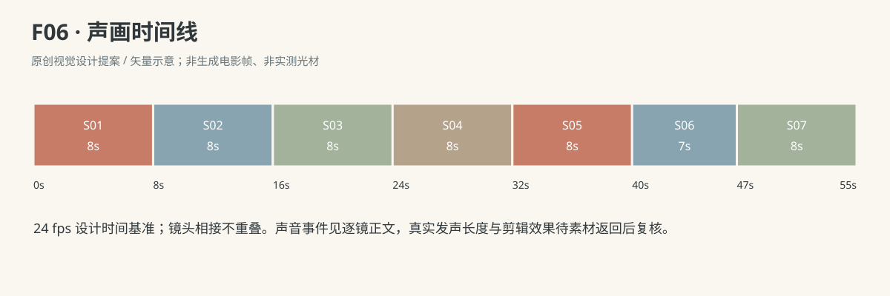

正式台词：无；保留镜头声音中已写明的自然发声。

### 连续性与试片

- 连续性：三块编号A/B/C仅供制作追踪，画面无字母；圆缝线A、方缝线B、十字缝线C，不复制增加。

- 连续性：A与B先后入P07又被取出，C始终爸爸右手持到递出；最终行从西到东A/B/C。

- 连续性：宝宝侧伸取积木时左掌撑垫、右手取物；最后接C时已坐正，可双手短暂持物。

- 连续性：爸爸先看见两块排列才移动盒并递C，盒最后在宝宝右后方，不能占据新排列。

- 连续性：趣味来自双方当前动作目标不同，不用故意捣乱或已懂收纳规则的表情；TD07只作关系机制灵感，软积木任务是原创。

- 试片：F06-S02—S04试剪：A/B必须分别入盒再出盒，若切后B凭空出现在行里或盒中仍有同款副本，则失败。

- 试片：F06-S05—S06：爸爸观察后才改为平托递物；若直接把积木塞进宝宝手或提前帮摆，则不成立。

- 试片：F06-S07俯拍预演：仅三块、东西顺序A/B/C，宝宝推块时底面贴垫；若块穿掌、弹跳或父亲自动排直，则失败。

**媒体待验证：**未生成媒体；待验盒沿取物遮挡、双手交接软块、三块同款资产身份连续、低摩擦推放与坐姿平衡。

---

## F07《爷爷的报纸后面》

**45 秒｜坐姿与手部互动｜角色：澈澈、爷爷｜场景 L**

### 剧情正文

西窗照着沙发西端，爷爷坐着读报，澈澈在他前方的地垫上，腿上放着一本蓝绿布书。爷爷翻页，把报纸举高，脸一下不见了。澈澈抬头看了一会儿，右手撑到垫上，脑袋往一边探。爷爷正要放低报纸，发现那双努力寻找的眼睛，便从纸边慢慢露出半张脸。澈澈看见他，嘴一下咧开。爷爷重新藏回去，停一拍，再从另一边出来。澈澈先看错了方向，转回来找见他，笑得肩膀轻晃。爷爷也笑了，终于把报纸折低到膝上，准备接着看。澈澈却低头摸到自己的布书，两只手把它举起来，挡在眼睛前面，露着额发和一点下巴。爷爷抬眼，面前的小脸换成了蓝绿书皮。他没有去拉书，只把身子往旁边探一点。布书也慢慢偏过去，仍想挡住他。爷爷从书边找到一只眼，澈澈便笑着把书放低。报纸还在爷爷膝上，读到的那一页暂时没有翻过去。

### 导演与空间

**观察任务：**从爷爷真实读报的遮挡关系变成两人轮流寻找，宝宝用布书接过游戏主动权。

**空间与光位：**L客厅北墙沙发、西窗、东走廊、中央地垫。爷爷坐沙发西端朝南，F07-X01无可读标题的报纸在双手；澈澈坐其南偏东地垫朝西北，P05蓝绿布书闭合放腿上。摄影固定在两人连线东南侧，爷爷画左上、宝宝画右下；西窗光由左侧，报纸与布书遮挡都发生在两人视线之间，不反打穿报纸。

**人物表演：**爷爷最初认真阅读一个版面，被宝宝寻找才放慢翻页，露面幅度小而不突然吓人。澈澈稳坐，探头时一只掌先撑垫，眼睛和头移动多于躯干；后半双手举布书，动作是邀请，并非理解规则后机械执行。

### 节拍覆盖

- **F07-b1**：先让读报本身成立，随后纸页自然挡住熟悉的脸。 前态：爷爷双手持报于胸口，脸露出；澈澈腿上放P05，双手落书边，抬头看爷爷。 后态：报纸挡住爷爷脸，双手各持一边；澈澈抬眼看纸上缘，布书仍在腿。 → F07-S01

- **F07-b2**：宝宝的寻找被爷爷接收到，第一次露面慢慢发生。 前态：报纸完全挡爷爷脸，澈澈双手在腿上布书边，身体坐正。 后态：爷爷半脸从报纸东边露出，澈澈右掌撑垫、左手在布书上，身体微侧。 → F07-S02

- **F07-b3**：第二次改边让游戏被宝宝继续参与，保留一拍找错再找见。 前态：爷爷头在报纸东边露出，澈澈已笑、右掌撑垫微侧坐。 后态：爷爷在报纸西边露脸，澈澈身体趋于坐正，右掌仍撑，书在腿。 → F07-S03

- **F07-b4**：爷爷准备回到读报，宝宝却接过游戏的主动权。 前态：爷爷脸在纸西边，澈澈右掌撑垫、左手在腿上布书，身体接近坐正。 后态：报纸折在爷爷膝上、双手轻按；布书澈澈双手举脸前，宝宝坐稳。 → F07-S04

- **F07-b5**：爷爷识别邀请后用探身来回应，宝宝的书也会慢慢跟着挡。 前态：爷爷看着宝宝脸前布书，报纸折在膝，宝宝两手抓书侧、书面大致竖直。 后态：爷爷从布书东边看见一只眼，书仍澈澈双手握住，双方都停一拍。 → F07-S05

- **F07-b6**：轮到宝宝被找到，读报暂缓但不被宣布成牺牲与道理。 前态：爷爷微向东探，澈澈书东边露一眼，双手仍持P05，爷爷双手按报。 后态：布书回宝宝腿上、报纸在爷爷膝上，两人对视，游戏自然歇一下。 → F07-S06

### 分镜构图板

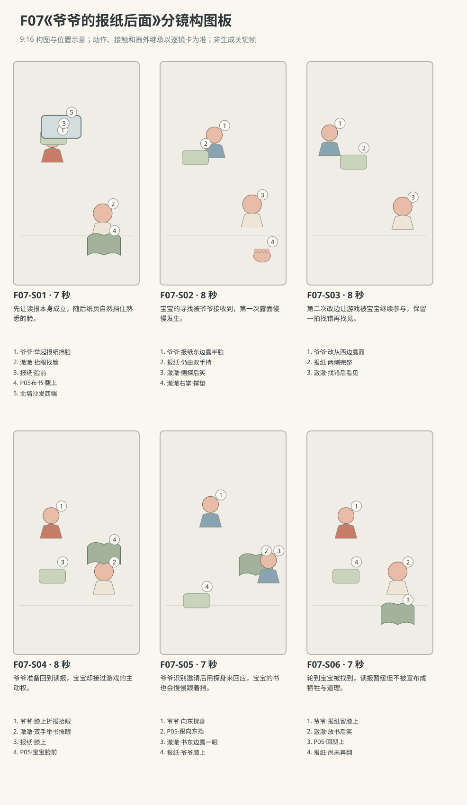

图示为构图位置示意；姿态、接触和画外继承以逐镜正文为准。

### 逐镜设计

#### F07-S01｜00—07 秒｜7 秒｜帧 [0, 168)

**镜头任务：**先让读报本身成立，随后纸页自然挡住熟悉的脸。

**景别、机位与构图：**二人中全景，东南朝西北，爷爷左上坐沙发，澈澈右下坐垫，布书在腿，报纸初在爷爷胸前。

**摄影机与理由：**固定，以高度差读出宝宝为什么需要抬眼找脸。

**焦点：**爷爷脸与宝宝抬眼同清晰，报纸边缘可辨。

**入态：**爷爷双手持报于胸口，脸露出；澈澈腿上放P05，双手落书边，抬头看爷爷。

**动作与表演：**

- 3 秒：爷爷眼睛沿报纸一栏慢慢下移，澈澈看他，自己右指轻摸布书角。

- 4 秒：爷爷翻页并把报纸举高，纸面逐渐挡住整张脸，澈澈目光停在刚才脸的位置。

**声音：**翻报纸的清晰轻响、棉衣摩擦、环境底声，无对白。

**出态：**报纸挡住爷爷脸，双手各持一边；澈澈抬眼看纸上缘，布书仍在腿。

**切点与承接：**接宝宝探头寻找的侧倾，保留脸确实被遮住的起态。

**连续性：**无印刷标题可读要求；纸不能透明看见爷爷五官，布书未被拿起。

**开始画面母稿：**

9:16竖幅，原创三维生活动画，圆润而有重量的造型，棉布细纹、柔和皮肤层次与可读的小表情；动作按真实生活物理及婴儿当下能力展开，不用成人化算计表情。澈澈为圆脸、深棕眼、短黑绒发、额前一小撮向右弯的头发，穿奶油色棉连体衣。爷爷灰短发，浅灰开衫、深蓝长裤。本镜开始画面为单一瞬间：爷爷双手持报于胸口，脸露出；澈澈腿上放P05，双手落书边，抬头看爷爷。 场次方位与光位：L客厅北墙沙发、西窗、东走廊、中央地垫。爷爷在沙发西端朝南，澈澈在其南偏东地垫朝西北。摄影始终在连线东南侧，爷爷左上、宝宝右下，窗光来自左。报纸与P05布书是两件不同物品，其高度与持物状态只依本镜起态。 摄影构图：二人中全景，东南朝西北，爷爷左上坐沙发，澈澈右下坐垫，布书在腿，报纸初在爷爷胸前。 当前焦点：爷爷露在胸前报纸上方的脸、宝宝抬眼及腿上P05。只呈现上述起态，不把后续动作拼入一张画面。

**视频变化母稿：**

9:16竖幅，原创三维生活动画，圆润而有重量的造型，棉布细纹、柔和皮肤层次与可读的小表情；动作按真实生活物理及婴儿当下能力展开，不用成人化算计表情。澈澈为圆脸、深棕眼、短黑绒发、额前一小撮向右弯的头发，穿奶油色棉连体衣。爷爷灰短发，浅灰开衫、深蓝长裤。制作一段7秒连续镜头。本段人物和能力：澈澈、爷爷，澈澈为R1。空间光位：L客厅北墙沙发、西窗、东走廊、中央地垫。爷爷在沙发西端朝南，澈澈在其南偏东地垫朝西北。摄影始终在连线东南侧，爷爷左上、宝宝右下，窗光来自左。报纸与P05布书是两件不同物品，其高度与持物状态只依本镜起态。 起态：爷爷双手持报于胸口，脸露出；澈澈腿上放P05，双手落书边，抬头看爷爷。 摄影：二人中全景，东南朝西北，爷爷左上坐沙发，澈澈右下坐垫，布书在腿，报纸初在爷爷胸前。 相机行为：固定，以高度差读出宝宝为什么需要抬眼找脸。 焦点：爷爷脸与宝宝抬眼同清晰，报纸边缘可辨。 时间过程：第1阶段3秒：爷爷眼睛沿报纸一栏慢慢下移，澈澈看他，自己右指轻摸布书角。；第2阶段4秒：爷爷翻页并把报纸举高，纸面逐渐挡住整张脸，澈澈目光停在刚才脸的位置。。声音：翻报纸的清晰轻响、棉衣摩擦、环境底声，无对白。 终态：报纸挡住爷爷脸，双手各持一边；澈澈抬眼看纸上缘，布书仍在腿。 连续性：无印刷标题可读要求；纸不能透明看见爷爷五官，布书未被拿起。 不加未写出的对白、人物或道具。

#### F07-S02｜07—15 秒｜8 秒｜帧 [168, 360)

**镜头任务：**宝宝的寻找被爷爷接收到，第一次露面慢慢发生。

**景别、机位与构图：**二人中景，东南同侧，报纸与爷爷坐姿占左半，澈澈右半，下缘见宝宝右掌可撑区域。

**摄影机与理由：**固定，纸边、宝宝视线和爷爷露脸必须同框读懂。

**焦点：**宝宝探看的眼睛与纸的东侧边缘，爷爷露面后共同清晰。

**入态：**报纸完全挡爷爷脸，澈澈双手在腿上布书边，身体坐正。

**动作与表演：**

- 3 秒：澈澈右掌从书边落到右膝外地垫，身体微向右侧倾，脑袋探向报纸东侧。

- 2 秒：爷爷稍放低纸边看见澈澈的寻找，目光与他对上。

- 3 秒：爷爷把头移向自身左侧、从报纸东边慢慢露半张脸，澈澈张嘴笑一小声。

**声音：**报纸微折响后才有宝宝短笑，爷爷轻呼气，无对白。

**出态：**爷爷半脸从报纸东边露出，澈澈右掌撑垫、左手在布书上，身体微侧。

**切点与承接：**在宝宝确认找到的目光上切稍近同侧，准备另边露面。

**连续性：**爷爷不是从纸中间穿出；澈澈右掌承重、布书留腿未落地。

**开始画面母稿：**

9:16竖幅，原创三维生活动画，圆润而有重量的造型，棉布细纹、柔和皮肤层次与可读的小表情；动作按真实生活物理及婴儿当下能力展开，不用成人化算计表情。澈澈为圆脸、深棕眼、短黑绒发、额前一小撮向右弯的头发，穿奶油色棉连体衣。爷爷灰短发，浅灰开衫、深蓝长裤。本镜开始画面为单一瞬间：报纸完全挡爷爷脸，澈澈双手在腿上布书边，身体坐正。 场次方位与光位：L客厅北墙沙发、西窗、东走廊、中央地垫。爷爷在沙发西端朝南，澈澈在其南偏东地垫朝西北。摄影始终在连线东南侧，爷爷左上、宝宝右下，窗光来自左。报纸与P05布书是两件不同物品，其高度与持物状态只依本镜起态。 摄影构图：二人中景，东南同侧，报纸与爷爷坐姿占左半，澈澈右半，下缘见宝宝右掌可撑区域。 当前焦点：真正被报纸遮住的脸区与宝宝将探头前的双眼。只呈现上述起态，不把后续动作拼入一张画面。

**视频变化母稿：**

9:16竖幅，原创三维生活动画，圆润而有重量的造型，棉布细纹、柔和皮肤层次与可读的小表情；动作按真实生活物理及婴儿当下能力展开，不用成人化算计表情。澈澈为圆脸、深棕眼、短黑绒发、额前一小撮向右弯的头发，穿奶油色棉连体衣。爷爷灰短发，浅灰开衫、深蓝长裤。制作一段8秒连续镜头。本段人物和能力：澈澈、爷爷，澈澈为R1。空间光位：L客厅北墙沙发、西窗、东走廊、中央地垫。爷爷在沙发西端朝南，澈澈在其南偏东地垫朝西北。摄影始终在连线东南侧，爷爷左上、宝宝右下，窗光来自左。报纸与P05布书是两件不同物品，其高度与持物状态只依本镜起态。 起态：报纸完全挡爷爷脸，澈澈双手在腿上布书边，身体坐正。 摄影：二人中景，东南同侧，报纸与爷爷坐姿占左半，澈澈右半，下缘见宝宝右掌可撑区域。 相机行为：固定，纸边、宝宝视线和爷爷露脸必须同框读懂。 焦点：宝宝探看的眼睛与纸的东侧边缘，爷爷露面后共同清晰。 时间过程：第1阶段3秒：澈澈右掌从书边落到右膝外地垫，身体微向右侧倾，脑袋探向报纸东侧。；第2阶段2秒：爷爷稍放低纸边看见澈澈的寻找，目光与他对上。；第3阶段3秒：爷爷把头移向自身左侧、从报纸东边慢慢露半张脸，澈澈张嘴笑一小声。。声音：报纸微折响后才有宝宝短笑，爷爷轻呼气，无对白。 终态：爷爷半脸从报纸东边露出，澈澈右掌撑垫、左手在布书上，身体微侧。 连续性：爷爷不是从纸中间穿出；澈澈右掌承重、布书留腿未落地。 不加未写出的对白、人物或道具。

#### F07-S03｜15—23 秒｜8 秒｜帧 [360, 552)

**镜头任务：**第二次改边让游戏被宝宝继续参与，保留一拍找错再找见。

**景别、机位与构图：**紧凑二人中景，东南同轴，报纸左右边缘都在框，澈澈侧脸在右下，爷爷头的移动不出上缘。

**摄影机与理由：**固定，不靠左右快速摇镜替爷爷玩躲猫猫。

**焦点：**先报纸东边宝宝等待处，随后平稳转向西边露出的爷爷脸。

**入态：**爷爷头在报纸东边露出，澈澈已笑、右掌撑垫微侧坐。

**动作与表演：**

- 2 秒：爷爷把头慢慢收回报纸后，澈澈仍盯东边等。

- 3 秒：停一拍后爷爷把头移向自身右侧，从报纸西边露脸，澈澈先望空的东边。

- 3 秒：澈澈抬眼绕过纸上缘看见西边的爷爷，身体回正一点，笑声短短接起来。

**声音：**纸边轻动、澈澈发现后两声笑，爷爷一声低短笑，无对白。

**出态：**爷爷在报纸西边露脸，澈澈身体趋于坐正，右掌仍撑，书在腿。

**切点与承接：**笑声延续到爷爷放低报纸的宽一点画面。

**连续性：**东到西的头部移动在纸后完成，纸不变尺寸；澈澈不站起追脸。

**开始画面母稿：**

9:16竖幅，原创三维生活动画，圆润而有重量的造型，棉布细纹、柔和皮肤层次与可读的小表情；动作按真实生活物理及婴儿当下能力展开，不用成人化算计表情。澈澈为圆脸、深棕眼、短黑绒发、额前一小撮向右弯的头发，穿奶油色棉连体衣。爷爷灰短发，浅灰开衫、深蓝长裤。本镜开始画面为单一瞬间：爷爷头在报纸东边露出，澈澈已笑、右掌撑垫微侧坐。 场次方位与光位：L客厅北墙沙发、西窗、东走廊、中央地垫。爷爷在沙发西端朝南，澈澈在其南偏东地垫朝西北。摄影始终在连线东南侧，爷爷左上、宝宝右下，窗光来自左。报纸与P05布书是两件不同物品，其高度与持物状态只依本镜起态。 摄影构图：紧凑二人中景，东南同轴，报纸左右边缘都在框，澈澈侧脸在右下，爷爷头的移动不出上缘。 当前焦点：爷爷在报纸东边露出的半张脸、宝宝看见后的眼神。只呈现上述起态，不把后续动作拼入一张画面。

**视频变化母稿：**

9:16竖幅，原创三维生活动画，圆润而有重量的造型，棉布细纹、柔和皮肤层次与可读的小表情；动作按真实生活物理及婴儿当下能力展开，不用成人化算计表情。澈澈为圆脸、深棕眼、短黑绒发、额前一小撮向右弯的头发，穿奶油色棉连体衣。爷爷灰短发，浅灰开衫、深蓝长裤。制作一段8秒连续镜头。本段人物和能力：澈澈、爷爷，澈澈为R1。空间光位：L客厅北墙沙发、西窗、东走廊、中央地垫。爷爷在沙发西端朝南，澈澈在其南偏东地垫朝西北。摄影始终在连线东南侧，爷爷左上、宝宝右下，窗光来自左。报纸与P05布书是两件不同物品，其高度与持物状态只依本镜起态。 起态：爷爷头在报纸东边露出，澈澈已笑、右掌撑垫微侧坐。 摄影：紧凑二人中景，东南同轴，报纸左右边缘都在框，澈澈侧脸在右下，爷爷头的移动不出上缘。 相机行为：固定，不靠左右快速摇镜替爷爷玩躲猫猫。 焦点：先报纸东边宝宝等待处，随后平稳转向西边露出的爷爷脸。 时间过程：第1阶段2秒：爷爷把头慢慢收回报纸后，澈澈仍盯东边等。；第2阶段3秒：停一拍后爷爷把头移向自身右侧，从报纸西边露脸，澈澈先望空的东边。；第3阶段3秒：澈澈抬眼绕过纸上缘看见西边的爷爷，身体回正一点，笑声短短接起来。。声音：纸边轻动、澈澈发现后两声笑，爷爷一声低短笑，无对白。 终态：爷爷在报纸西边露脸，澈澈身体趋于坐正，右掌仍撑，书在腿。 连续性：东到西的头部移动在纸后完成，纸不变尺寸；澈澈不站起追脸。 不加未写出的对白、人物或道具。

#### F07-S04｜23—31 秒｜8 秒｜帧 [552, 744)

**镜头任务：**爷爷准备回到读报，宝宝却接过游戏的主动权。

**景别、机位与构图：**二人中全景，东南同侧，爷爷双膝与宝宝腿上布书都可见，不裁遮道具转移。

**摄影机与理由：**固定，报纸降低与布书抬起都在同一时空进行。

**焦点：**先爷爷折报动作，再移澈澈双手与布书，成人脸保持可辨。

**入态：**爷爷脸在纸西边，澈澈右掌撑垫、左手在腿上布书，身体接近坐正。

**动作与表演：**

- 3 秒：爷爷把头回正、双手将报纸折低到膝上，自己低头准备看原来那栏。

- 2 秒：澈澈完全坐正，把右手从垫上收回布书右边，双手握住书侧。

- 3 秒：澈澈把布书慢慢举到眼前，遮住两眼和鼻上部，额发与下巴仍露；爷爷抬眼看见蓝绿书皮。

**声音：**折报声比布书摩擦稍清楚，宝宝轻鼻音，爷爷呼吸，无对白。

**出态：**报纸折在爷爷膝上、双手轻按；布书澈澈双手举脸前，宝宝坐稳。

**切点与承接：**切宝宝书前与爷爷目光关系的中近景，接成人回应。

**连续性：**右掌离垫前坐正过程可见；P05从腿上来，报纸不交换给宝宝。

**开始画面母稿：**

9:16竖幅，原创三维生活动画，圆润而有重量的造型，棉布细纹、柔和皮肤层次与可读的小表情；动作按真实生活物理及婴儿当下能力展开，不用成人化算计表情。澈澈为圆脸、深棕眼、短黑绒发、额前一小撮向右弯的头发，穿奶油色棉连体衣。爷爷灰短发，浅灰开衫、深蓝长裤。本镜开始画面为单一瞬间：爷爷脸在纸西边，澈澈右掌撑垫、左手在腿上布书，身体接近坐正。 场次方位与光位：L客厅北墙沙发、西窗、东走廊、中央地垫。爷爷在沙发西端朝南，澈澈在其南偏东地垫朝西北。摄影始终在连线东南侧，爷爷左上、宝宝右下，窗光来自左。报纸与P05布书是两件不同物品，其高度与持物状态只依本镜起态。 摄影构图：二人中全景，东南同侧，爷爷双膝与宝宝腿上布书都可见，不裁遮道具转移。 当前焦点：爷爷在报纸西边的脸、宝宝腿上布书与撑垫右掌。只呈现上述起态，不把后续动作拼入一张画面。

**视频变化母稿：**

9:16竖幅，原创三维生活动画，圆润而有重量的造型，棉布细纹、柔和皮肤层次与可读的小表情；动作按真实生活物理及婴儿当下能力展开，不用成人化算计表情。澈澈为圆脸、深棕眼、短黑绒发、额前一小撮向右弯的头发，穿奶油色棉连体衣。爷爷灰短发，浅灰开衫、深蓝长裤。制作一段8秒连续镜头。本段人物和能力：澈澈、爷爷，澈澈为R1。空间光位：L客厅北墙沙发、西窗、东走廊、中央地垫。爷爷在沙发西端朝南，澈澈在其南偏东地垫朝西北。摄影始终在连线东南侧，爷爷左上、宝宝右下，窗光来自左。报纸与P05布书是两件不同物品，其高度与持物状态只依本镜起态。 起态：爷爷脸在纸西边，澈澈右掌撑垫、左手在腿上布书，身体接近坐正。 摄影：二人中全景，东南同侧，爷爷双膝与宝宝腿上布书都可见，不裁遮道具转移。 相机行为：固定，报纸降低与布书抬起都在同一时空进行。 焦点：先爷爷折报动作，再移澈澈双手与布书，成人脸保持可辨。 时间过程：第1阶段3秒：爷爷把头回正、双手将报纸折低到膝上，自己低头准备看原来那栏。；第2阶段2秒：澈澈完全坐正，把右手从垫上收回布书右边，双手握住书侧。；第3阶段3秒：澈澈把布书慢慢举到眼前，遮住两眼和鼻上部，额发与下巴仍露；爷爷抬眼看见蓝绿书皮。。声音：折报声比布书摩擦稍清楚，宝宝轻鼻音，爷爷呼吸，无对白。 终态：报纸折在爷爷膝上、双手轻按；布书澈澈双手举脸前，宝宝坐稳。 连续性：右掌离垫前坐正过程可见；P05从腿上来，报纸不交换给宝宝。 不加未写出的对白、人物或道具。

#### F07-S05｜31—38 秒｜7 秒｜帧 [744, 912)

**镜头任务：**爷爷识别邀请后用探身来回应，宝宝的书也会慢慢跟着挡。

**景别、机位与构图：**二人中景，东南同侧，爷爷左上、蓝绿布书右下、宝宝露出的额发与下巴可见，爷爷膝上报纸在左下缘。

**摄影机与理由：**固定，让爷爷位移与书的跟随形成慢而可读的关系。

**焦点：**爷爷眼睛与布书边缘；不透书找宝宝眼睛。

**入态：**爷爷看着宝宝脸前布书，报纸折在膝，宝宝两手抓书侧、书面大致竖直。

**动作与表演：**

- 3 秒：爷爷嘴角上扬，身体朝自身左侧即房间东侧探一点，双手仍轻按膝上报纸。

- 2 秒：澈澈听见衣料声，双手把布书向同一东侧小移，仍想挡住脸。

- 2 秒：爷爷停住再微低头，恰好从书东边看见宝宝一只眼。

**声音：**爷爷开衫擦报纸的细声、布书轻响、澈澈忍笑的鼻音，无对白。

**出态：**爷爷从布书东边看见一只眼，书仍澈澈双手握住，双方都停一拍。

**切点与承接：**在目光重新对上的一拍接宝宝放低布书。

**连续性：**爷爷不掀书不伸手，纸仍膝上；书东移幅度小不遮掉宝宝额发方位。

**开始画面母稿：**

9:16竖幅，原创三维生活动画，圆润而有重量的造型，棉布细纹、柔和皮肤层次与可读的小表情；动作按真实生活物理及婴儿当下能力展开，不用成人化算计表情。澈澈为圆脸、深棕眼、短黑绒发、额前一小撮向右弯的头发，穿奶油色棉连体衣。爷爷灰短发，浅灰开衫、深蓝长裤。本镜开始画面为单一瞬间：爷爷看着宝宝脸前布书，报纸折在膝，宝宝两手抓书侧、书面大致竖直。 场次方位与光位：L客厅北墙沙发、西窗、东走廊、中央地垫。爷爷在沙发西端朝南，澈澈在其南偏东地垫朝西北。摄影始终在连线东南侧，爷爷左上、宝宝右下，窗光来自左。报纸与P05布书是两件不同物品，其高度与持物状态只依本镜起态。 摄影构图：二人中景，东南同侧，爷爷左上、蓝绿布书右下、宝宝露出的额发与下巴可见，爷爷膝上报纸在左下缘。 当前焦点：宝宝双手举在眼前的蓝绿书皮、爷爷膝上折报与回应眼神。只呈现上述起态，不把后续动作拼入一张画面。

**视频变化母稿：**

9:16竖幅，原创三维生活动画，圆润而有重量的造型，棉布细纹、柔和皮肤层次与可读的小表情；动作按真实生活物理及婴儿当下能力展开，不用成人化算计表情。澈澈为圆脸、深棕眼、短黑绒发、额前一小撮向右弯的头发，穿奶油色棉连体衣。爷爷灰短发，浅灰开衫、深蓝长裤。制作一段7秒连续镜头。本段人物和能力：澈澈、爷爷，澈澈为R1。空间光位：L客厅北墙沙发、西窗、东走廊、中央地垫。爷爷在沙发西端朝南，澈澈在其南偏东地垫朝西北。摄影始终在连线东南侧，爷爷左上、宝宝右下，窗光来自左。报纸与P05布书是两件不同物品，其高度与持物状态只依本镜起态。 起态：爷爷看着宝宝脸前布书，报纸折在膝，宝宝两手抓书侧、书面大致竖直。 摄影：二人中景，东南同侧，爷爷左上、蓝绿布书右下、宝宝露出的额发与下巴可见，爷爷膝上报纸在左下缘。 相机行为：固定，让爷爷位移与书的跟随形成慢而可读的关系。 焦点：爷爷眼睛与布书边缘；不透书找宝宝眼睛。 时间过程：第1阶段3秒：爷爷嘴角上扬，身体朝自身左侧即房间东侧探一点，双手仍轻按膝上报纸。；第2阶段2秒：澈澈听见衣料声，双手把布书向同一东侧小移，仍想挡住脸。；第3阶段2秒：爷爷停住再微低头，恰好从书东边看见宝宝一只眼。。声音：爷爷开衫擦报纸的细声、布书轻响、澈澈忍笑的鼻音，无对白。 终态：爷爷从布书东边看见一只眼，书仍澈澈双手握住，双方都停一拍。 连续性：爷爷不掀书不伸手，纸仍膝上；书东移幅度小不遮掉宝宝额发方位。 不加未写出的对白、人物或道具。

#### F07-S06｜38—45 秒｜7 秒｜帧 [912, 1080)

**镜头任务：**轮到宝宝被找到，读报暂缓但不被宣布成牺牲与道理。

**景别、机位与构图：**二人中景同轴，爷爷左上、宝宝右下，书下降路径及膝上报纸都完整入框。

**摄影机与理由：**轻缓向两人间收近少许，目的是听见小笑，不改变轴线。

**焦点：**宝宝露出的全脸和爷爷对视，书回腿仍可辨。

**入态：**爷爷微向东探，澈澈书东边露一眼，双手仍持P05，爷爷双手按报。

**动作与表演：**

- 3 秒：澈澈笑出声，把布书从眼前放低到胸口，爷爷跟着低短笑。

- 2 秒：澈澈把书放回自己腿上、双手仍搭书边，身体坐正；爷爷也回正坐姿。

- 2 秒：两人看着彼此留一点笑，爷爷没有立刻举起报纸。

**声音：**澈澈自然短笑、爷爷低笑，书触衣软声，最后呼吸留白，无对白无音乐。

**出态：**布书回宝宝腿上、报纸在爷爷膝上，两人对视，游戏自然歇一下。

**切点与承接：**在爷爷仍没翻页的小停顿结束，不做额外躲藏循环。

**连续性：**书纸各回原主人，不新增道具；宝宝全片稳坐，无伸手抓纸。

**开始画面母稿：**

9:16竖幅，原创三维生活动画，圆润而有重量的造型，棉布细纹、柔和皮肤层次与可读的小表情；动作按真实生活物理及婴儿当下能力展开，不用成人化算计表情。澈澈为圆脸、深棕眼、短黑绒发、额前一小撮向右弯的头发，穿奶油色棉连体衣。爷爷灰短发，浅灰开衫、深蓝长裤。本镜开始画面为单一瞬间：爷爷微向东探，澈澈书东边露一眼，双手仍持P05，爷爷双手按报。 场次方位与光位：L客厅北墙沙发、西窗、东走廊、中央地垫。爷爷在沙发西端朝南，澈澈在其南偏东地垫朝西北。摄影始终在连线东南侧，爷爷左上、宝宝右下，窗光来自左。报纸与P05布书是两件不同物品，其高度与持物状态只依本镜起态。 摄影构图：二人中景同轴，爷爷左上、宝宝右下，书下降路径及膝上报纸都完整入框。 当前焦点：宝宝从布书东边露出的一只眼与爷爷探身后的双眼。只呈现上述起态，不把后续动作拼入一张画面。

**视频变化母稿：**

9:16竖幅，原创三维生活动画，圆润而有重量的造型，棉布细纹、柔和皮肤层次与可读的小表情；动作按真实生活物理及婴儿当下能力展开，不用成人化算计表情。澈澈为圆脸、深棕眼、短黑绒发、额前一小撮向右弯的头发，穿奶油色棉连体衣。爷爷灰短发，浅灰开衫、深蓝长裤。制作一段7秒连续镜头。本段人物和能力：澈澈、爷爷，澈澈为R1。空间光位：L客厅北墙沙发、西窗、东走廊、中央地垫。爷爷在沙发西端朝南，澈澈在其南偏东地垫朝西北。摄影始终在连线东南侧，爷爷左上、宝宝右下，窗光来自左。报纸与P05布书是两件不同物品，其高度与持物状态只依本镜起态。 起态：爷爷微向东探，澈澈书东边露一眼，双手仍持P05，爷爷双手按报。 摄影：二人中景同轴，爷爷左上、宝宝右下，书下降路径及膝上报纸都完整入框。 相机行为：轻缓向两人间收近少许，目的是听见小笑，不改变轴线。 焦点：宝宝露出的全脸和爷爷对视，书回腿仍可辨。 时间过程：第1阶段3秒：澈澈笑出声，把布书从眼前放低到胸口，爷爷跟着低短笑。；第2阶段2秒：澈澈把书放回自己腿上、双手仍搭书边，身体坐正；爷爷也回正坐姿。；第3阶段2秒：两人看着彼此留一点笑，爷爷没有立刻举起报纸。。声音：澈澈自然短笑、爷爷低笑，书触衣软声，最后呼吸留白，无对白无音乐。 终态：布书回宝宝腿上、报纸在爷爷膝上，两人对视，游戏自然歇一下。 连续性：书纸各回原主人，不新增道具；宝宝全片稳坐，无伸手抓纸。 不加未写出的对白、人物或道具。

### 声音与剪辑

无语言对白和配乐。报纸翻页、折页声音与布书柔软擦响区分，笑声由发现露面后出现，爷爷低短笑不盖住澈澈。无突然扑出的惊吓音。

正式台词：无；保留镜头声音中已写明的自然发声。

### 连续性与试片

- 连续性：爷爷固定沙发西端，澈澈地垫南偏东；摄影在东南，爷爷左右露面按其自身方位记录。

- 连续性：爷爷双手持报，第一次从自身左侧即房间东侧露面，第二次从自身右侧即房间西侧露面，不穿纸。

- 连续性：P05从宝宝腿上到双手，再回腿上；报纸最后折在爷爷膝，始终未交给宝宝。

- 连续性：澈澈探头先右掌撑垫，举书前身体回正坐稳；书不能硬穿脸或变成纸报。

- 试片：F07-S02—S03静音试看：宝宝寻脸方向和爷爷两次露面边缘应真实相连；若报纸不挡脸却表现寻找，则失败。

- 试片：F07-S04—S05：布书须从腿上被双手举起，爷爷先见书再响应；若宝宝书突然贴脸或成人预先摆好则失败。

- 试片：F07-S06试片：爷爷探身、书向同侧偏、宝宝露一眼再放低应分阶段可辨；若变成突然掀书吓宝宝则失败。

**媒体待验证：**未生成媒体；待验报纸折叠拓扑、视线遮挡、宝宝侧倾支撑与软布书举在脸前的手指连续。

---

## F08《一家人的小合唱》

**45 秒｜坐姿与手部互动｜角色：澈澈、爸爸、妈妈｜场景 L**

### 剧情正文

客厅地垫上，妈妈摊着一块奶油色布巾，边对齐两角边轻轻哼歌。爸爸在澈澈另一边翻布书，听熟了小调，抬一下眼，也接进一条低低的和声。澈澈先看看妈妈的嘴，再看看爸爸，突然响亮地“啊”了一声。两条哼声一下停了，妈妈的布巾还夹在手里，爸爸的手指也留在翻了一半的书页上。两人都看着他，等下一声。可澈澈也不说了，轮流看他们，嘴巴微微张开，像也在等谁接下去。安静持续了一小会儿。妈妈吸了一点气，爸爸刚好把目光移回她那边，澈澈的胸口也轻轻鼓起来。三个人几乎同时出了声：两个“嗯”和一个“啊”挤在一起，谁也没听清谁。妈妈先笑，爸爸低着头笑出了气，澈澈被两张笑脸逗得跟着笑。等呼吸平下来，妈妈把最后一角布巾叠好，爸爸把布书页放平，三个人都还留着一点想接下一句的表情。

### 导演与空间

**观察任务：**用哼声、咿呀和互相等待的时间，表现三个人临时组成又笑散的小合唱，声音与目光同样承担叙事。

**空间与光位：**L客厅北墙沙发、西窗、东走廊、中央地垫。三人坐垫北半朝南，从西到东妈妈、澈澈、爸爸；妈妈跪坐，P04奶油布巾摊在膝上；爸爸盘腿，P05蓝绿布书打开在腿上；澈澈稳坐两人之间双手在膝边。摄影在南侧朝北，不跨三人东西连线；窗光由画左，三张嘴都可见。

**人物表演：**妈妈一边叠布巾一边哼自创小调，爸爸起初看书，被旋律吸引才加入低声；宝宝自己的发声让两人改变关注。三人都不是按指挥表演，等待时各自在观察别人的嘴与眼睛；同时发声后自然笑，不让宝宝唱出确定歌词或成人精准和声。

### 节拍覆盖

- **F08-b1**：妈妈自己的叠布巾与哼调成立，爸爸仍在看书，宝宝开始注意声音。 前态：妈妈双手拿布巾两角摊在膝上，爸爸左掌托P05右指放在一页边，澈澈双手在膝外撑垫。 后态：布巾半折妈妈手中，爸爸抬眼，宝宝看妈妈嘴，三人仍原坐序。 → F08-S01

- **F08-b2**：爸爸因为听见旋律而加入，宝宝轮流检查两个声源。 前态：妈妈捏半折布巾、准备下一句，爸爸眼睛抬向妈妈、右指仍在书页边，澈澈看妈妈。 后态：宝宝嘴微张，妈妈持布巾并延长末鼻音，爸爸右指提住半页、左掌托书也持续低鼻音，父母尚未收声。 → F08-S02

- **F08-b3**：宝宝发声让父母主动停下听，声音的轮流由此发生。 前态：澈澈嘴微张，妈妈持半折布巾、爸爸左掌托书右指提半页；父母仍在延续上一镜最后的轻鼻音，尚未停止。 后态：三人互相等待，妈妈布巾和爸爸半翻书页都在手中停稳，宝宝双手膝边。 → F08-S03

- **F08-b4**：三人都等别人先出声，静默本身成为可以读懂的小趣味。 前态：妈妈与爸爸看宝宝，澈澈刚看向爸爸，所有人都安静，物件保持上一镜。 后态：妈妈已吸气、爸爸看向妈妈、宝宝胸口轻起，三张嘴准备发声。 → F08-S04

- **F08-b5**：三人同时接句撞在一起，再因互相听见而笑散。 前态：三人都准备开口，妈妈捏半折P04、爸爸托P05半翻页、澈澈稳坐中间。 后态：三人都笑，爸爸右指仍托半翻页、妈妈仍持半折布巾，宝宝未离坐姿。 → F08-S05

- **F08-b6**：笑后回到各自的小事，留下还想接下一句的亲密余韵。 前态：三人笑声刚开始变短，妈妈持半折P04、爸爸托P05半翻页，澈澈坐中央双掌在膝外。 后态：P04叠好在妈妈膝上，P05落页在爸爸腿上，澈澈在两人间带笑，合唱暂歇。 → F08-S06

### 分镜构图板

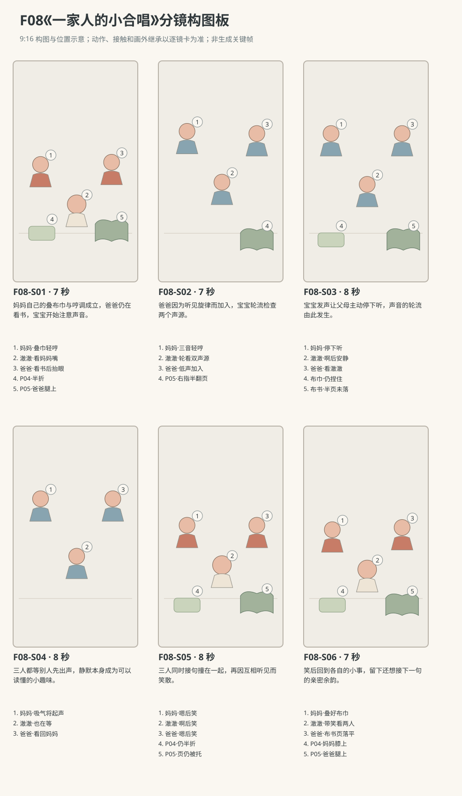

图示为构图位置示意；姿态、接触和画外继承以逐镜正文为准。

### 逐镜设计

#### F08-S01｜00—07 秒｜7 秒｜帧 [0, 168)

**镜头任务：**妈妈自己的叠布巾与哼调成立，爸爸仍在看书，宝宝开始注意声音。

**景别、机位与构图：**三人中全景，南侧朝北，妈妈左、宝宝中、爸爸右，布巾与布书在两端膝上，后景沙发不抢画面。

**摄影机与理由：**固定，容纳三个不同的初始注意对象。

**焦点：**妈妈嘴形与双手、爸爸书页、宝宝转向妈妈的眼神共同可辨。

**入态：**妈妈双手拿布巾两角摊在膝上，爸爸左掌托P05右指放在一页边，澈澈双手在膝外撑垫。

**动作与表演：**

- 2 秒：妈妈对齐布巾两角，爸爸低头看布书，澈澈看妈妈的手。

- 3 秒：妈妈开始轻哼原创三音小调，澈澈眼睛从布巾移到她嘴上。

- 2 秒：妈妈把布巾折成一半仍捏住上角，爸爸抬一点眼听见旋律。

**声音：**妈妈在第3—5秒哼“嗯——嗯、嗯”；另有布巾摩擦、轻书页声与环境声，爸爸宝宝不发声，无BGM。

**出态：**布巾半折妈妈手中，爸爸抬眼，宝宝看妈妈嘴，三人仍原坐序。

**切点与承接：**沿爸爸抬眼接二人嘴与宝宝的同框，开始低声加入。

**连续性：**P04/P05归属不换；宝宝双掌仍撑垫，哼声只来自妈妈。

**开始画面母稿：**

9:16竖幅，原创三维生活动画，圆润而有重量的造型，棉布细纹、柔和皮肤层次与可读的小表情；动作按真实生活物理及婴儿当下能力展开，不用成人化算计表情。澈澈为圆脸、深棕眼、短黑绒发、额前一小撮向右弯的头发，穿奶油色棉连体衣。爸爸短黑发，砖陶色棉衬衫、深灰长裤；妈妈深棕低马尾，雾蓝棉上衣、米色长裤。本镜开始画面为单一瞬间：妈妈双手拿布巾两角摊在膝上，爸爸左掌托P05右指放在一页边，澈澈双手在膝外撑垫。 场次方位与光位：L客厅北墙沙发、西窗、东走廊、中央地垫。三人自西到东为妈妈、澈澈、爸爸，均朝南；摄影南侧朝北，不越东西连线，窗光由画左。P04奶油布巾属于妈妈、P05蓝绿布书属于爸爸，折叠与翻页进度只依本镜起态，所有声音按本镜时间过程。 摄影构图：三人中全景，南侧朝北，妈妈左、宝宝中、爸爸右，布巾与布书在两端膝上，后景沙发不抢画面。 当前焦点：妈妈持P04的双手、爸爸P05书页与宝宝看妈妈的眼神。只呈现上述起态，不把后续动作拼入一张画面。

**视频变化母稿：**

9:16竖幅，原创三维生活动画，圆润而有重量的造型，棉布细纹、柔和皮肤层次与可读的小表情；动作按真实生活物理及婴儿当下能力展开，不用成人化算计表情。澈澈为圆脸、深棕眼、短黑绒发、额前一小撮向右弯的头发，穿奶油色棉连体衣。爸爸短黑发，砖陶色棉衬衫、深灰长裤；妈妈深棕低马尾，雾蓝棉上衣、米色长裤。制作一段7秒连续镜头。本段人物和能力：澈澈、爸爸、妈妈，澈澈为R1。空间光位：L客厅北墙沙发、西窗、东走廊、中央地垫。三人自西到东为妈妈、澈澈、爸爸，均朝南；摄影南侧朝北，不越东西连线，窗光由画左。P04奶油布巾属于妈妈、P05蓝绿布书属于爸爸，折叠与翻页进度只依本镜起态，所有声音按本镜时间过程。 起态：妈妈双手拿布巾两角摊在膝上，爸爸左掌托P05右指放在一页边，澈澈双手在膝外撑垫。 摄影：三人中全景，南侧朝北，妈妈左、宝宝中、爸爸右，布巾与布书在两端膝上，后景沙发不抢画面。 相机行为：固定，容纳三个不同的初始注意对象。 焦点：妈妈嘴形与双手、爸爸书页、宝宝转向妈妈的眼神共同可辨。 时间过程：第1阶段2秒：妈妈对齐布巾两角，爸爸低头看布书，澈澈看妈妈的手。；第2阶段3秒：妈妈开始轻哼原创三音小调，澈澈眼睛从布巾移到她嘴上。；第3阶段2秒：妈妈把布巾折成一半仍捏住上角，爸爸抬一点眼听见旋律。。声音：妈妈在第3—5秒哼“嗯——嗯、嗯”；另有布巾摩擦、轻书页声与环境声，爸爸宝宝不发声，无BGM。 终态：布巾半折妈妈手中，爸爸抬眼，宝宝看妈妈嘴，三人仍原坐序。 连续性：P04/P05归属不换；宝宝双掌仍撑垫，哼声只来自妈妈。 不加未写出的对白、人物或道具。

#### F08-S02｜07—14 秒｜7 秒｜帧 [168, 336)

**镜头任务：**爸爸因为听见旋律而加入，宝宝轮流检查两个声源。

**景别、机位与构图：**三人中景同轴稍紧，三张脸在上中，布巾和书在下缘，妈妈左爸爸右不镜像。

**摄影机与理由：**固定，不以声源切镜打断宝宝左右看人的完整过程。

**焦点：**三张嘴共同清晰，宝宝眼睛为中心。

**入态：**妈妈捏半折布巾、准备下一句，爸爸眼睛抬向妈妈、右指仍在书页边，澈澈看妈妈。

**动作与表演：**

- 2 秒：妈妈从本镜第1秒起再哼一次三音小调，手指压平布巾角；爸爸看她一眼、吸一点气，还未发声。

- 3 秒：爸爸在本镜第3秒加入较低的持续鼻音，右指慢慢抬起一页、左掌托书；妈妈把三音的最后一音轻轻延长，澈澈转眼看爸爸嘴。

- 2 秒：父母的轻鼻音继续保持，没有收尾；澈澈看回妈妈、嘴巴微张准备发声，两个成人尾音跨切进入下一镜。

**声音：**妈妈第1—7秒哼“嗯——嗯、嗯——”，末两秒保持最后一个鼻音；爸爸第3—7秒哼“嗯——”。两人的尾音跨切延续到S03，不能在此镜先停。另有低布声，无BGM。

**出态：**宝宝嘴微张，妈妈持布巾并延长末鼻音，爸爸右指提住半页、左掌托书也持续低鼻音，父母尚未收声。

**切点与承接：**在父母鼻音不中断的情况下直接接宝宝开口，宝宝的啊将触发下一镜的停声。

**连续性：**爸爸页仍半翻；妈妈最后鼻音与爸爸低鼻音以同一次呼吸跨镜到S03第2秒才收，不得用剪辑提前静音。

**开始画面母稿：**

9:16竖幅，原创三维生活动画，圆润而有重量的造型，棉布细纹、柔和皮肤层次与可读的小表情；动作按真实生活物理及婴儿当下能力展开，不用成人化算计表情。澈澈为圆脸、深棕眼、短黑绒发、额前一小撮向右弯的头发，穿奶油色棉连体衣。爸爸短黑发，砖陶色棉衬衫、深灰长裤；妈妈深棕低马尾，雾蓝棉上衣、米色长裤。本镜开始画面为单一瞬间：妈妈捏半折布巾、准备下一句，爸爸眼睛抬向妈妈、右指仍在书页边，澈澈看妈妈。 场次方位与光位：L客厅北墙沙发、西窗、东走廊、中央地垫。三人自西到东为妈妈、澈澈、爸爸，均朝南；摄影南侧朝北，不越东西连线，窗光由画左。P04奶油布巾属于妈妈、P05蓝绿布书属于爸爸，折叠与翻页进度只依本镜起态，所有声音按本镜时间过程。 摄影构图：三人中景同轴稍紧，三张脸在上中，布巾和书在下缘，妈妈左爸爸右不镜像。 当前焦点：三张脸与嘴的当前状态，爸爸右指仍在书页边。只呈现上述起态，不把后续动作拼入一张画面。

**视频变化母稿：**

9:16竖幅，原创三维生活动画，圆润而有重量的造型，棉布细纹、柔和皮肤层次与可读的小表情；动作按真实生活物理及婴儿当下能力展开，不用成人化算计表情。澈澈为圆脸、深棕眼、短黑绒发、额前一小撮向右弯的头发，穿奶油色棉连体衣。爸爸短黑发，砖陶色棉衬衫、深灰长裤；妈妈深棕低马尾，雾蓝棉上衣、米色长裤。制作一段7秒连续镜头。本段人物和能力：澈澈、爸爸、妈妈，澈澈为R1。空间光位：L客厅北墙沙发、西窗、东走廊、中央地垫。三人自西到东为妈妈、澈澈、爸爸，均朝南；摄影南侧朝北，不越东西连线，窗光由画左。P04奶油布巾属于妈妈、P05蓝绿布书属于爸爸，折叠与翻页进度只依本镜起态，所有声音按本镜时间过程。 起态：妈妈捏半折布巾、准备下一句，爸爸眼睛抬向妈妈、右指仍在书页边，澈澈看妈妈。 摄影：三人中景同轴稍紧，三张脸在上中，布巾和书在下缘，妈妈左爸爸右不镜像。 相机行为：固定，不以声源切镜打断宝宝左右看人的完整过程。 焦点：三张嘴共同清晰，宝宝眼睛为中心。 时间过程：第1阶段2秒：妈妈从本镜第1秒起再哼一次三音小调，手指压平布巾角；爸爸看她一眼、吸一点气，还未发声。；第2阶段3秒：爸爸在本镜第3秒加入较低的持续鼻音，右指慢慢抬起一页、左掌托书；妈妈把三音的最后一音轻轻延长，澈澈转眼看爸爸嘴。；第3阶段2秒：父母的轻鼻音继续保持，没有收尾；澈澈看回妈妈、嘴巴微张准备发声，两个成人尾音跨切进入下一镜。。声音：妈妈第1—7秒哼“嗯——嗯、嗯——”，末两秒保持最后一个鼻音；爸爸第3—7秒哼“嗯——”。两人的尾音跨切延续到S03，不能在此镜先停。另有低布声，无BGM。 终态：宝宝嘴微张，妈妈持布巾并延长末鼻音，爸爸右指提住半页、左掌托书也持续低鼻音，父母尚未收声。 连续性：爸爸页仍半翻；妈妈最后鼻音与爸爸低鼻音以同一次呼吸跨镜到S03第2秒才收，不得用剪辑提前静音。 不加未写出的对白、人物或道具。

#### F08-S03｜14—22 秒｜8 秒｜帧 [336, 528)

**镜头任务：**宝宝发声让父母主动停下听，声音的轮流由此发生。

**景别、机位与构图：**三人中景，南侧同轴，澈澈居中，两侧父母嘴与眼均见，下缘仍留任务物件。

**摄影机与理由：**固定，宝宝声音后父母分别停手停声的反应在同镜完成。

**焦点：**宝宝开口先，随后三人眼神共同清晰。

**入态：**澈澈嘴微张，妈妈持半折布巾、爸爸左掌托书右指提半页；父母仍在延续上一镜最后的轻鼻音，尚未停止。

**动作与表演：**

- 2 秒：澈澈在本镜第1秒突然发出自然的啊；父母先听见这声，再在第2秒收住正在持续的鼻音，宝宝双肩随呼气轻动。

- 3 秒：妈妈停住折角动作，爸爸用右指稳住未落下的书页，两人先后看向澈澈，留出听下一声的空白。

- 3 秒：澈澈也收声安静，看妈妈再看爸爸；父母没有立即替他接声，三人开始互等。

**声音：**开头延续妈妈“嗯——”和爸爸“嗯——”，澈澈第1—2秒发“啊”；父母听见啊后在本镜第2秒停止鼻音，后6秒只有呼吸与极轻布声，无新哼调无BGM。

**出态：**三人互相等待，妈妈布巾和爸爸半翻书页都在手中停稳，宝宝双手膝边。

**切点与承接：**在没有下一声的留白中切稍近，延续同一段等待而非换场。

**连续性：**父母进入此镜时确实仍在哼，宝宝的啊是收声刺激；两条尾音停止之后才形成安静。书页与布巾始终被手支撑，不悬浮。

**开始画面母稿：**

9:16竖幅，原创三维生活动画，圆润而有重量的造型，棉布细纹、柔和皮肤层次与可读的小表情；动作按真实生活物理及婴儿当下能力展开，不用成人化算计表情。澈澈为圆脸、深棕眼、短黑绒发、额前一小撮向右弯的头发，穿奶油色棉连体衣。爸爸短黑发，砖陶色棉衬衫、深灰长裤；妈妈深棕低马尾，雾蓝棉上衣、米色长裤。本镜开始画面为单一瞬间：澈澈嘴微张，妈妈持半折布巾、爸爸左掌托书右指提半页；父母仍在延续上一镜最后的轻鼻音，尚未停止。 场次方位与光位：L客厅北墙沙发、西窗、东走廊、中央地垫。三人自西到东为妈妈、澈澈、爸爸，均朝南；摄影南侧朝北，不越东西连线，窗光由画左。P04奶油布巾属于妈妈、P05蓝绿布书属于爸爸，折叠与翻页进度只依本镜起态，所有声音按本镜时间过程。 摄影构图：三人中景，南侧同轴，澈澈居中，两侧父母嘴与眼均见，下缘仍留任务物件。 当前焦点：宝宝刚要开口的嘴、父母仍在持续鼻音的嘴形。只呈现上述起态，不把后续动作拼入一张画面。

**视频变化母稿：**

9:16竖幅，原创三维生活动画，圆润而有重量的造型，棉布细纹、柔和皮肤层次与可读的小表情；动作按真实生活物理及婴儿当下能力展开，不用成人化算计表情。澈澈为圆脸、深棕眼、短黑绒发、额前一小撮向右弯的头发，穿奶油色棉连体衣。爸爸短黑发，砖陶色棉衬衫、深灰长裤；妈妈深棕低马尾，雾蓝棉上衣、米色长裤。制作一段8秒连续镜头。本段人物和能力：澈澈、爸爸、妈妈，澈澈为R1。空间光位：L客厅北墙沙发、西窗、东走廊、中央地垫。三人自西到东为妈妈、澈澈、爸爸，均朝南；摄影南侧朝北，不越东西连线，窗光由画左。P04奶油布巾属于妈妈、P05蓝绿布书属于爸爸，折叠与翻页进度只依本镜起态，所有声音按本镜时间过程。 起态：澈澈嘴微张，妈妈持半折布巾、爸爸左掌托书右指提半页；父母仍在延续上一镜最后的轻鼻音，尚未停止。 摄影：三人中景，南侧同轴，澈澈居中，两侧父母嘴与眼均见，下缘仍留任务物件。 相机行为：固定，宝宝声音后父母分别停手停声的反应在同镜完成。 焦点：宝宝开口先，随后三人眼神共同清晰。 时间过程：第1阶段2秒：澈澈在本镜第1秒突然发出自然的啊；父母先听见这声，再在第2秒收住正在持续的鼻音，宝宝双肩随呼气轻动。；第2阶段3秒：妈妈停住折角动作，爸爸用右指稳住未落下的书页，两人先后看向澈澈，留出听下一声的空白。；第3阶段3秒：澈澈也收声安静，看妈妈再看爸爸；父母没有立即替他接声，三人开始互等。。声音：开头延续妈妈“嗯——”和爸爸“嗯——”，澈澈第1—2秒发“啊”；父母听见啊后在本镜第2秒停止鼻音，后6秒只有呼吸与极轻布声，无新哼调无BGM。 终态：三人互相等待，妈妈布巾和爸爸半翻书页都在手中停稳，宝宝双手膝边。 连续性：父母进入此镜时确实仍在哼，宝宝的啊是收声刺激；两条尾音停止之后才形成安静。书页与布巾始终被手支撑，不悬浮。 不加未写出的对白、人物或道具。

#### F08-S04｜22—30 秒｜8 秒｜帧 [528, 720)

**镜头任务：**三人都等别人先出声，静默本身成为可以读懂的小趣味。

**景别、机位与构图：**紧凑三人近景，南侧同方向，妈妈左、宝宝中央略低、爸爸右，嘴与眼均不裁；物件在下缘露持握角。

**摄影机与理由：**固定，拒绝快切抢走互相等待的时间。

**焦点：**三人面部同在清晰区；视线变化不靠拉焦代替。

**入态：**妈妈与爸爸看宝宝，澈澈刚看向爸爸，所有人都安静，物件保持上一镜。

**动作与表演：**

- 3 秒：澈澈嘴微张看爸爸，爸爸也张一点嘴但没有出声，目光软软等他。

- 3 秒：妈妈看父子互等，抿一下笑，再轻吸一口气；爸爸眼睛移向妈妈。

- 2 秒：澈澈也看向妈妈，自己吸气，三人都处在将开口未开口的时刻。

**声音：**本镜没有哼声、元音或对白；保留三人错开的轻吸气和房间底声，不加心跳或配乐。

**出态：**妈妈已吸气、爸爸看向妈妈、宝宝胸口轻起，三张嘴准备发声。

**切点与承接：**在共同准备的停顿上切略宽，同步起声随后发生。

**连续性：**父母手持物件画外继承，书页不落、布巾不折完；宝宝不出现说词口型。

**开始画面母稿：**

9:16竖幅，原创三维生活动画，圆润而有重量的造型，棉布细纹、柔和皮肤层次与可读的小表情；动作按真实生活物理及婴儿当下能力展开，不用成人化算计表情。澈澈为圆脸、深棕眼、短黑绒发、额前一小撮向右弯的头发，穿奶油色棉连体衣。爸爸短黑发，砖陶色棉衬衫、深灰长裤；妈妈深棕低马尾，雾蓝棉上衣、米色长裤。本镜开始画面为单一瞬间：妈妈与爸爸看宝宝，澈澈刚看向爸爸，所有人都安静，物件保持上一镜。 场次方位与光位：L客厅北墙沙发、西窗、东走廊、中央地垫。三人自西到东为妈妈、澈澈、爸爸，均朝南；摄影南侧朝北，不越东西连线，窗光由画左。P04奶油布巾属于妈妈、P05蓝绿布书属于爸爸，折叠与翻页进度只依本镜起态，所有声音按本镜时间过程。 摄影构图：紧凑三人近景，南侧同方向，妈妈左、宝宝中央略低、爸爸右，嘴与眼均不裁；物件在下缘露持握角。 当前焦点：三人安静互等的眼睛与嘴，父母持物角仍有实体支撑。只呈现上述起态，不把后续动作拼入一张画面。

**视频变化母稿：**

9:16竖幅，原创三维生活动画，圆润而有重量的造型，棉布细纹、柔和皮肤层次与可读的小表情；动作按真实生活物理及婴儿当下能力展开，不用成人化算计表情。澈澈为圆脸、深棕眼、短黑绒发、额前一小撮向右弯的头发，穿奶油色棉连体衣。爸爸短黑发，砖陶色棉衬衫、深灰长裤；妈妈深棕低马尾，雾蓝棉上衣、米色长裤。制作一段8秒连续镜头。本段人物和能力：澈澈、爸爸、妈妈，澈澈为R1。空间光位：L客厅北墙沙发、西窗、东走廊、中央地垫。三人自西到东为妈妈、澈澈、爸爸，均朝南；摄影南侧朝北，不越东西连线，窗光由画左。P04奶油布巾属于妈妈、P05蓝绿布书属于爸爸，折叠与翻页进度只依本镜起态，所有声音按本镜时间过程。 起态：妈妈与爸爸看宝宝，澈澈刚看向爸爸，所有人都安静，物件保持上一镜。 摄影：紧凑三人近景，南侧同方向，妈妈左、宝宝中央略低、爸爸右，嘴与眼均不裁；物件在下缘露持握角。 相机行为：固定，拒绝快切抢走互相等待的时间。 焦点：三人面部同在清晰区；视线变化不靠拉焦代替。 时间过程：第1阶段3秒：澈澈嘴微张看爸爸，爸爸也张一点嘴但没有出声，目光软软等他。；第2阶段3秒：妈妈看父子互等，抿一下笑，再轻吸一口气；爸爸眼睛移向妈妈。；第3阶段2秒：澈澈也看向妈妈，自己吸气，三人都处在将开口未开口的时刻。。声音：本镜没有哼声、元音或对白；保留三人错开的轻吸气和房间底声，不加心跳或配乐。 终态：妈妈已吸气、爸爸看向妈妈、宝宝胸口轻起，三张嘴准备发声。 连续性：父母手持物件画外继承，书页不落、布巾不折完；宝宝不出现说词口型。 不加未写出的对白、人物或道具。

#### F08-S05｜30—38 秒｜8 秒｜帧 [720, 912)

**镜头任务：**三人同时接句撞在一起，再因互相听见而笑散。

**景别、机位与构图：**三人中景，南侧同轴，三张嘴清晰，父母膝上布巾布书完整，宝宝双手可见。

**摄影机与理由：**固定，合声时不推镜，笑声扩开才轻收近一点以亲近声源。

**焦点：**起声时三嘴共同清晰，笑时保持三张脸。

**入态：**三人都准备开口，妈妈捏半折P04、爸爸托P05半翻页、澈澈稳坐中间。

**动作与表演：**

- 3 秒：妈妈看澈澈，爸爸嘴微张，澈澈眼睛在两人间移，三人呼吸凑到同一拍。

- 2 秒：本镜第4秒三人同时起声，妈妈与爸爸各哼持续嗯，澈澈发啊，约一秒后一起察觉声音挤在同一处。

- 3 秒：妈妈先笑气漏出，爸爸低头短笑，澈澈看见两张笑脸也咯咯笑；各自手仍稳住物件。

**声音：**第4秒同时出现妈妈“嗯——”、爸爸“嗯——”、澈澈“啊”，持续约1秒后止；随后依次妈妈笑气、爸爸短笑、澈澈笑，其他无词无BGM。

**出态：**三人都笑，爸爸右指仍托半翻页、妈妈仍持半折布巾，宝宝未离坐姿。

**切点与承接：**笑声越过切点，转回完成手头任务的稍宽画面。

**连续性：**同时起声来自相同真实一拍，不能把三声从不同时间拼贴；双手物件无瞬移。

**开始画面母稿：**

9:16竖幅，原创三维生活动画，圆润而有重量的造型，棉布细纹、柔和皮肤层次与可读的小表情；动作按真实生活物理及婴儿当下能力展开，不用成人化算计表情。澈澈为圆脸、深棕眼、短黑绒发、额前一小撮向右弯的头发，穿奶油色棉连体衣。爸爸短黑发，砖陶色棉衬衫、深灰长裤；妈妈深棕低马尾，雾蓝棉上衣、米色长裤。本镜开始画面为单一瞬间：三人都准备开口，妈妈捏半折P04、爸爸托P05半翻页、澈澈稳坐中间。 场次方位与光位：L客厅北墙沙发、西窗、东走廊、中央地垫。三人自西到东为妈妈、澈澈、爸爸，均朝南；摄影南侧朝北，不越东西连线，窗光由画左。P04奶油布巾属于妈妈、P05蓝绿布书属于爸爸，折叠与翻页进度只依本镜起态，所有声音按本镜时间过程。 摄影构图：三人中景，南侧同轴，三张嘴清晰，父母膝上布巾布书完整，宝宝双手可见。 当前焦点：三人将要发声前的口形与呼吸姿态，尚未出现笑态。只呈现上述起态，不把后续动作拼入一张画面。

**视频变化母稿：**

9:16竖幅，原创三维生活动画，圆润而有重量的造型，棉布细纹、柔和皮肤层次与可读的小表情；动作按真实生活物理及婴儿当下能力展开，不用成人化算计表情。澈澈为圆脸、深棕眼、短黑绒发、额前一小撮向右弯的头发，穿奶油色棉连体衣。爸爸短黑发，砖陶色棉衬衫、深灰长裤；妈妈深棕低马尾，雾蓝棉上衣、米色长裤。制作一段8秒连续镜头。本段人物和能力：澈澈、爸爸、妈妈，澈澈为R1。空间光位：L客厅北墙沙发、西窗、东走廊、中央地垫。三人自西到东为妈妈、澈澈、爸爸，均朝南；摄影南侧朝北，不越东西连线，窗光由画左。P04奶油布巾属于妈妈、P05蓝绿布书属于爸爸，折叠与翻页进度只依本镜起态，所有声音按本镜时间过程。 起态：三人都准备开口，妈妈捏半折P04、爸爸托P05半翻页、澈澈稳坐中间。 摄影：三人中景，南侧同轴，三张嘴清晰，父母膝上布巾布书完整，宝宝双手可见。 相机行为：固定，合声时不推镜，笑声扩开才轻收近一点以亲近声源。 焦点：起声时三嘴共同清晰，笑时保持三张脸。 时间过程：第1阶段3秒：妈妈看澈澈，爸爸嘴微张，澈澈眼睛在两人间移，三人呼吸凑到同一拍。；第2阶段2秒：本镜第4秒三人同时起声，妈妈与爸爸各哼持续嗯，澈澈发啊，约一秒后一起察觉声音挤在同一处。；第3阶段3秒：妈妈先笑气漏出，爸爸低头短笑，澈澈看见两张笑脸也咯咯笑；各自手仍稳住物件。。声音：第4秒同时出现妈妈“嗯——”、爸爸“嗯——”、澈澈“啊”，持续约1秒后止；随后依次妈妈笑气、爸爸短笑、澈澈笑，其他无词无BGM。 终态：三人都笑，爸爸右指仍托半翻页、妈妈仍持半折布巾，宝宝未离坐姿。 连续性：同时起声来自相同真实一拍，不能把三声从不同时间拼贴；双手物件无瞬移。 不加未写出的对白、人物或道具。

#### F08-S06｜38—45 秒｜7 秒｜帧 [912, 1080)

**镜头任务：**笑后回到各自的小事，留下还想接下一句的亲密余韵。

**景别、机位与构图：**三人中全景，同S01方向与坐序，手中物件和地垫接触都可辨，背景沙发稳定。

**摄影机与理由：**微后移恢复初始距离，最后3秒停稳，让生活继续的尺度回来。

**焦点：**父母完成折巾翻页和宝宝看他们的眼神都清晰。

**入态：**三人笑声刚开始变短，妈妈持半折P04、爸爸托P05半翻页，澈澈坐中央双掌在膝外。

**动作与表演：**

- 3 秒：妈妈轻呼气，把最后一角布巾折到位；爸爸笑着把那页慢慢落平。

- 2 秒：澈澈先看妈妈手里的方布，再看爸爸落下的书页，嘴角仍扬。

- 2 秒：父母各抬眼看他，三个人静静停一拍，谁都没有抢着开新的一句。

**声音：**笑声自然落回呼吸，布巾压平与布书落页声，末尾静默；无新增哼声无对白无音乐。

**出态：**P04叠好在妈妈膝上，P05落页在爸爸腿上，澈澈在两人间带笑，合唱暂歇。

**切点与承接：**在三人安静对看处结束，避免为了循环再逼出一声啊。

**连续性：**只有此镜完成叠巾和落页，之前的暂停动作实际收尾；全部道具原归属不换。

**开始画面母稿：**

9:16竖幅，原创三维生活动画，圆润而有重量的造型，棉布细纹、柔和皮肤层次与可读的小表情；动作按真实生活物理及婴儿当下能力展开，不用成人化算计表情。澈澈为圆脸、深棕眼、短黑绒发、额前一小撮向右弯的头发，穿奶油色棉连体衣。爸爸短黑发，砖陶色棉衬衫、深灰长裤；妈妈深棕低马尾，雾蓝棉上衣、米色长裤。本镜开始画面为单一瞬间：三人笑声刚开始变短，妈妈持半折P04、爸爸托P05半翻页，澈澈坐中央双掌在膝外。 场次方位与光位：L客厅北墙沙发、西窗、东走廊、中央地垫。三人自西到东为妈妈、澈澈、爸爸，均朝南；摄影南侧朝北，不越东西连线，窗光由画左。P04奶油布巾属于妈妈、P05蓝绿布书属于爸爸，折叠与翻页进度只依本镜起态，所有声音按本镜时间过程。 摄影构图：三人中全景，同S01方向与坐序，手中物件和地垫接触都可辨，背景沙发稳定。 当前焦点：三人的当前笑脸、妈妈半折布巾与爸爸半翻书页。只呈现上述起态，不把后续动作拼入一张画面。

**视频变化母稿：**

9:16竖幅，原创三维生活动画，圆润而有重量的造型，棉布细纹、柔和皮肤层次与可读的小表情；动作按真实生活物理及婴儿当下能力展开，不用成人化算计表情。澈澈为圆脸、深棕眼、短黑绒发、额前一小撮向右弯的头发，穿奶油色棉连体衣。爸爸短黑发，砖陶色棉衬衫、深灰长裤；妈妈深棕低马尾，雾蓝棉上衣、米色长裤。制作一段7秒连续镜头。本段人物和能力：澈澈、爸爸、妈妈，澈澈为R1。空间光位：L客厅北墙沙发、西窗、东走廊、中央地垫。三人自西到东为妈妈、澈澈、爸爸，均朝南；摄影南侧朝北，不越东西连线，窗光由画左。P04奶油布巾属于妈妈、P05蓝绿布书属于爸爸，折叠与翻页进度只依本镜起态，所有声音按本镜时间过程。 起态：三人笑声刚开始变短，妈妈持半折P04、爸爸托P05半翻页，澈澈坐中央双掌在膝外。 摄影：三人中全景，同S01方向与坐序，手中物件和地垫接触都可辨，背景沙发稳定。 相机行为：微后移恢复初始距离，最后3秒停稳，让生活继续的尺度回来。 焦点：父母完成折巾翻页和宝宝看他们的眼神都清晰。 时间过程：第1阶段3秒：妈妈轻呼气，把最后一角布巾折到位；爸爸笑着把那页慢慢落平。；第2阶段2秒：澈澈先看妈妈手里的方布，再看爸爸落下的书页，嘴角仍扬。；第3阶段2秒：父母各抬眼看他，三个人静静停一拍，谁都没有抢着开新的一句。。声音：笑声自然落回呼吸，布巾压平与布书落页声，末尾静默；无新增哼声无对白无音乐。 终态：P04叠好在妈妈膝上，P05落页在爸爸腿上，澈澈在两人间带笑，合唱暂歇。 连续性：只有此镜完成叠巾和落页，之前的暂停动作实际收尾；全部道具原归属不换。 不加未写出的对白、人物或道具。

### 声音与剪辑

全部音乐性声音均由画内父母口鼻发出，原创无歌词三音小调，不另铺BGM。哼声各有呼吸，爸爸低于妈妈但不做录音棚齐整和声；宝宝元音保持自然不调成音准。中段的真实静默、书页与布巾摩擦不可被配乐填满。

- 妈妈：嗯——嗯、嗯（F08-S01；对自己轻哼原创三音小调，本镜第3—5秒；不是唱词。）

- 妈妈：嗯——嗯、嗯——（F08-S02；本镜第1—7秒哼原创三音小调，最后鼻音不断，跨切延续到S03第2秒才收。）

- 爸爸：嗯——（F08-S02；本镜第3—7秒加入较低持续鼻音，跨切延续到S03第2秒，听见宝宝啊后收。）

- 妈妈：嗯——（F08-S03；承S02末尾的同一个鼻音，本镜第1秒仍持续，听见澈澈啊后在第2秒收；不是重新起一句。）

- 爸爸：嗯——（F08-S03；承S02的同一个低鼻音，本镜第1秒仍持续，听见澈澈啊后在第2秒收；不是重新起一句。）

- 澈澈：啊（F08-S03；本镜第1—2秒一次自然开口元音，送向面前父母，不是单词。）

- 妈妈：嗯——（F08-S05；本镜第4秒起持续约1秒，与另外两人同起，随后笑开。）

- 爸爸：嗯——（F08-S05；本镜第4秒起低声持续约1秒，与另外两人同起，随后收气笑。）

- 澈澈：啊（F08-S05；本镜第4秒起短促自然元音，与父母同起，约1秒后转看他们。）

### 连续性与试片

- 连续性：妈妈西侧P04、爸爸东侧P05、澈澈中央，物件不互换；三人嘴与声源位置对应。

- 连续性：S03宝宝先发啊，父母才停；S04无任何声乐；S05第4秒三人同时起声。

- 连续性：P04妈妈双手折叠，P05爸爸左掌托书右指翻页；停住时不能页纸悬浮脱手。

- 连续性：宝宝只有自然元音与笑声，不配成人歌词、语义对白或精准复唱。

- 试片：F08-S02—S04试听：必须分清父母先哼、宝宝啊、三人安静的次序；若底乐续满静默则失败。

- 试片：F08-S04—S05试剪：能看见三人各自准备呼吸，再在同一时刻起声；若靠随机错配嘴型伪装同时发声则失败。

- 试片：F08-S05—S06：笑声应由眼神和呼吸自然接出，P04/P05仍在原主人手上；若笑声压住首次合声或道具凭空收好，则失败。

**媒体待验证：**未生成媒体；待验三声源定位、元音口型同步、静默时长的观看节奏，以及同声后不同人物笑声的呼吸重叠。

---

## F09《睡醒第一眼》

**30 秒｜仰卧与翻身探索｜角色：澈澈、爸爸｜场景 N**

### 剧情正文

午后的光落在休息角的婴儿床上，澈澈仰卧着，头朝西，爸爸坐在南侧低头看布书。澈澈已经醒了一会儿，正用左手碰右手背，轻轻咿呀。爸爸把半页放平，还没有察觉。他慢慢把目光移到床栏外那截衣袖，玩手停下来，眉心轻挤，发出一小声哼。爸爸听见，书页不再动；他抬眼、压好书，身体往床边靠近。熟悉的眼睛来到眼前，澈澈先看住，眉心松开，嘴角才慢慢展开。爸爸也笑了。澈澈抬起右手，手指张合；爸爸把右食指送到他掌前，停着等。小手碰到指尖，慢慢握住，爸爸就把手留在那里，没有摇，也没有向上拉。书仍在他的腿上，房间又安静下来。

### 亲述来源与改编

原帖是家长自述，未独立核实。本片将生活机制改编为澈澈的原创故事。

- [ZH02 · 醒来先玩自己的手，等人靠近对眼才笑](https://anyray0127.pixnet.net/blog/posts/7102979960)；作者自报年龄：同篇自报刚满5个月；作者把它写成这一时期常见的醒后过程，不是标明日期的单次记录。。

- **采用的生活过程：**先自己玩手、咿呀；成人发现并靠近；对眼后表情转开心。

- **本片原创改编：**选较长醒后过程的尾段，以三十秒表现；未呈现原帖五至十分钟或更长的全部等待。

- **本片原创改编：**具体来人确定为爸爸，加入其看布书的生活任务、一次短哼与最后轻握右食指。

- **不作出的事实推断：**不声称假哭、装哭或婴儿有意操控成人。

- **不作出的事实推断：**原帖为五个月时期习惯自述，未独立核实；本片不是原事件逐镜复现，也不据此给澈澈设统一月龄。

[查看原始过程与缺项](research/real-experiences/index.html#ZH02)

### 导演与空间

**观察任务：**保留醒后先玩手、成人真正靠近对眼后才笑的过程，再用轻握手指结束；短片只取较长醒后过程的尾部。

**空间与光位：**N休息角北墙婴儿床、西窗、东门，爸爸坐床南侧偏西的照顾者座位，身体朝北略东，肩部高于床栏。澈澈始终仰卧，头西脚东，右手在身体南侧靠爸爸、左手在北侧胸腹附近，头背臀均由平整床垫承托。P05蓝绿布书摊在爸爸腿上；爸爸左手托书，右手翻页后才空出。摄影只在父婴连线东侧至东南侧，床头画左、脚端画右，爸爸居左或左前景。午后西窗柔光由画左后漫入，暖墙反射填暗部，不镜像。

**人物表演：**澈澈先认真研究自己的手，短哼来自当前等待，不贴假哭标签；爸爸本来在看书，确实听见后才停页抬眼。两人对眼之后的微笑要小而渐进。

### 节拍覆盖

- **F09-b1**：先看见宝宝正在自己玩手，爸爸尚未注意到醒来。 前态：澈澈已经醒着，右手在胸前摊开、左手轻碰右指，目光落在自己的手；爸爸低头看腿上布书，左掌托底、右指压半页，没有看床内。 后态：澈澈仍看胸前两手，没有笑；爸爸右指已放平书页，目光仍在书，左手托书。 → F09-S01

- **F09-b2**：自己玩的声音变为一声短呼唤，让爸爸获得抬头的实际线索。 前态：澈澈仰卧看自己胸前两手，没有笑；爸爸在画外仍低头，右指已放平书页、左手托书。 后态：澈澈两手在胸腹附近，望南侧衣袖、表情等待，未笑；爸爸已听见，空右手已退膝旁、左掌继续按书，开始从书上抬眼，这些爸爸手位与抬眼属于画外承接。 → F09-S02

- **F09-b3**：爸爸真正看向宝宝并靠近，宝宝在对眼之后才微笑。 前态：爸爸正从书上抬眼，右手已空留膝旁、左掌托腿上书；澈澈仰卧望南侧，嘴角尚未上扬，两手在胸腹附近。 后态：父婴已经对眼微笑；澈澈右手在胸前、左手靠腹，爸爸右手空在膝旁，左掌按书。 → F09-S03

- **F09-b4**：微笑之后宝宝主动抬手，爸爸再将食指送到可及位置。 前态：父婴已经对眼微笑；澈澈右手胸前、左手靠腹，爸爸右手空在膝旁，左掌按腿上书。 后态：澈澈右掌张开悬于胸上方，爸爸右食指在掌前未接触；左掌仍按书，宝宝身体由床垫托住。 → F09-S04

- **F09-b5**：宝宝合拢手指，接触稳定后以安静结束。 前态：宝宝右掌悬胸上方张开，爸爸右食指停在掌前尚有小间隙；宝宝仰卧、左手腹前，爸爸左掌按腿上书均为画外继承。 后态：澈澈右手轻握爸爸右食指，双方手臂各自承托；宝宝身体落床垫、爸爸左掌稳书为画外继承。 → F09-S05

### 分镜构图板

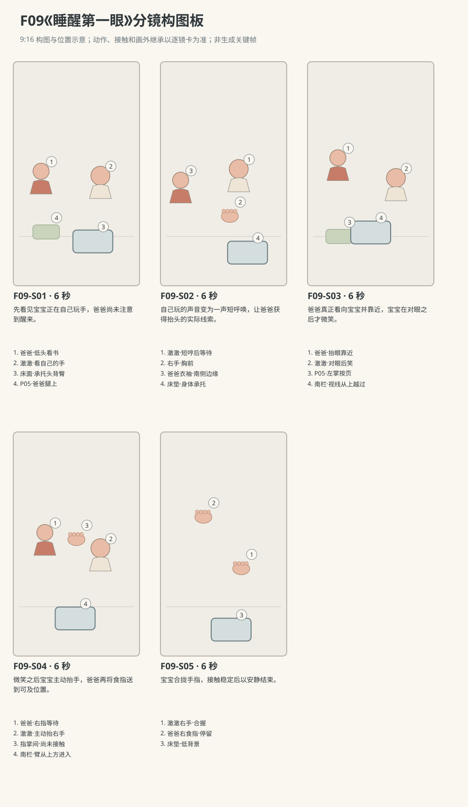

图示为构图位置示意；姿态、接触和画外继承以逐镜正文为准。

### 逐镜设计

#### F09-S01｜00—06 秒｜6 秒｜帧 [0, 144)

**镜头任务：**先看见宝宝正在自己玩手，爸爸尚未注意到醒来。

**景别、机位与构图：**东南朝西北的中全景，爸爸低头的侧脸在左前景，婴儿床与澈澈在右中景；床面和宝宝胸前双手可见，腿上布书在左下。

**摄影机与理由：**固定，保留同一空间里各做各事的关系，不用醒来即切成人笑脸。

**焦点：**宝宝眼睛与胸前两手清楚，爸爸低头和书页处在可辨景深。

**入态：**澈澈已经醒着，右手在胸前摊开、左手轻碰右指，目光落在自己的手；爸爸低头看腿上布书，左掌托底、右指压半页，没有看床内。

**动作与表演：**

- 3 秒：澈澈缓慢张合右指，左指碰一下右手背，嘴里轻轻咿呀，身体仍仰卧。

- 3 秒：爸爸右指把半页放平，仍看书；澈澈继续看手，暂时没有笑，也没有哭。

**声音：**宝宝自然低声咿呀、书页细声与室内底声，无对白无音乐。

**出态：**澈澈仍看胸前两手，没有笑；爸爸右指已放平书页，目光仍在书，左手托书。

**切点与承接：**切同轴稍紧宝宝覆盖，延续这段醒后自玩尾段；不把五至十分钟全部伪装为本片实时。

**连续性：**本片从一段自玩已进行后的尾部进入；宝宝眼睛开着，不重新演一次醒来。爸爸尚未注意，宝宝未对成人先笑。

**开始画面母稿：**

9:16竖幅，原创三维家庭生活动画，圆润而有重量的造型，柔和皮肤层次、哑光棉布与可读的小表情，动作遵循生活物理，不用成人式算计。澈澈暂拟圆润脸颊、深棕眼、短黑绒发、额前右弯小发撮。澈澈穿奶油色棉连体衣。爸爸暂拟短黑发、砖陶色棉衬衫、深灰长裤。人物与场景参考尚未提供，外观为可替换暂拟设计，未上传或绑定真实素材。本镜起始画面为单一瞬间：澈澈已经醒着，右手在胸前摊开、左手轻碰右指，目光落在自己的手；爸爸低头看腿上布书，左掌托底、右指压半页，没有看床内。 场次方位与光位：N休息角北墙婴儿床、西窗、东门，爸爸坐床南侧偏西的照顾者座位，身体朝北略东，肩部高于床栏。澈澈始终仰卧，头西脚东，右手在身体南侧靠爸爸、左手在北侧胸腹附近，头背臀均由平整床垫承托。P05蓝绿布书摊在爸爸腿上；爸爸左手托书，右手翻页后才空出。摄影只在父婴连线东侧至东南侧，床头画左、脚端画右，爸爸居左或左前景。午后西窗柔光由画左后漫入，暖墙反射填暗部，不镜像。 摄影构图：东南朝西北的中全景，爸爸低头的侧脸在左前景，婴儿床与澈澈在右中景；床面和宝宝胸前双手可见，腿上布书在左下。 当前焦点：宝宝眼睛与胸前两手清楚，爸爸低头和书页处在可辨景深。 只画这一刻，不拼入后续动作、轨迹、分格、字幕或不存在的持物状态。

**视频变化母稿：**

9:16竖幅，原创三维家庭生活动画，圆润而有重量的造型，柔和皮肤层次、哑光棉布与可读的小表情，动作遵循生活物理，不用成人式算计。澈澈暂拟圆润脸颊、深棕眼、短黑绒发、额前右弯小发撮。澈澈穿奶油色棉连体衣。爸爸暂拟短黑发、砖陶色棉衬衫、深灰长裤。人物与场景参考尚未提供，外观为可替换暂拟设计，未上传或绑定真实素材。制作一段6秒连续镜头。当前能力：R0仰卧抓握，头背臀由平整床垫承托，不独坐、不站立、不说完整句子。空间光位：N休息角北墙婴儿床、西窗、东门，爸爸坐床南侧偏西的照顾者座位，身体朝北略东，肩部高于床栏。澈澈始终仰卧，头西脚东，右手在身体南侧靠爸爸、左手在北侧胸腹附近，头背臀均由平整床垫承托。P05蓝绿布书摊在爸爸腿上；爸爸左手托书，右手翻页后才空出。摄影只在父婴连线东侧至东南侧，床头画左、脚端画右，爸爸居左或左前景。午后西窗柔光由画左后漫入，暖墙反射填暗部，不镜像。 起态：澈澈已经醒着，右手在胸前摊开、左手轻碰右指，目光落在自己的手；爸爸低头看腿上布书，左掌托底、右指压半页，没有看床内。 摄影：东南朝西北的中全景，爸爸低头的侧脸在左前景，婴儿床与澈澈在右中景；床面和宝宝胸前双手可见，腿上布书在左下。 相机行为：固定，保留同一空间里各做各事的关系，不用醒来即切成人笑脸。 焦点：宝宝眼睛与胸前两手清楚，爸爸低头和书页处在可辨景深。 时间过程：第1阶段3秒：澈澈缓慢张合右指，左指碰一下右手背，嘴里轻轻咿呀，身体仍仰卧。；第2阶段3秒：爸爸右指把半页放平，仍看书；澈澈继续看手，暂时没有笑，也没有哭。。声音：宝宝自然低声咿呀、书页细声与室内底声，无对白无音乐。 终态：澈澈仍看胸前两手，没有笑；爸爸右指已放平书页，目光仍在书，左手托书。 连续性：本片从一段自玩已进行后的尾部进入；宝宝眼睛开着，不重新演一次醒来。爸爸尚未注意，宝宝未对成人先笑。 按本镜完整过程到达终态，不在镜内另加切镜、人物、道具或未写出的台词、字幕与旁白。

#### F09-S02｜06—12 秒｜6 秒｜帧 [144, 288)

**镜头任务：**自己玩的声音变为一声短呼唤，让爸爸获得抬头的实际线索。

**景别、机位与构图：**床东略南朝西的宝宝中近景，澈澈脸、胸前双手与床垫清楚；爸爸雾化衣袖留画左边，爸爸面部在画外。

**摄影机与理由：**固定，关注声与口型的小变化，不把短促哼声夸成嚎哭。

**焦点：**澈澈嘴唇、眉间和右手，床垫保持清晰。

**入态：**澈澈仰卧看自己胸前两手，没有笑；爸爸在画外仍低头，右指已放平书页、左手托书。

**动作与表演：**

- 2 秒：澈澈的左指松开右手背，右手留胸前，视线从手移向南侧衣袖。

- 2 秒：他的眉心轻挤一下，张口发出一小声不满意的哼声，随后短吸气，不滚出眼泪或立刻大笑。

- 2 秒：爸爸听见后停止摩挲书页，右指离开书页、空右手退到膝旁，再开始抬头；这些手位在本特写画外继承，只有画左衣袖微动被看见。澈澈看着袖子所在方向等着。

**声音：**先轻咿呀收住，再一声短哼和换气；书页声听见后停住，没有成人台词、音乐或解释。

**出态：**澈澈两手在胸腹附近，望南侧衣袖、表情等待，未笑；爸爸已听见，空右手已退膝旁、左掌继续按书，开始从书上抬眼，这些爸爸手位与抬眼属于画外承接。

**切点与承接：**接爸爸抬眼靠近的共享镜，不重放短哼。

**连续性：**爸爸的听见由停止书页声和下一镜抬眼体现；本镜脸在画外，不能称已经看见其笑容。短哼不等于假哭或故意操纵。 爸爸右指在本镜画外离页退膝，下一共享镜才直接看到空右手在膝旁，不能把画外动作冒称本特写已可见。

**开始画面母稿：**

9:16竖幅，原创三维家庭生活动画，圆润而有重量的造型，柔和皮肤层次、哑光棉布与可读的小表情，动作遵循生活物理，不用成人式算计。澈澈暂拟圆润脸颊、深棕眼、短黑绒发、额前右弯小发撮。澈澈穿奶油色棉连体衣。爸爸暂拟短黑发、砖陶色棉衬衫、深灰长裤。人物与场景参考尚未提供，外观为可替换暂拟设计，未上传或绑定真实素材。本镜起始画面为单一瞬间：澈澈仰卧看自己胸前两手，没有笑；爸爸在画外仍低头，右指已放平书页、左手托书。 场次方位与光位：N休息角北墙婴儿床、西窗、东门，爸爸坐床南侧偏西的照顾者座位，身体朝北略东，肩部高于床栏。澈澈始终仰卧，头西脚东，右手在身体南侧靠爸爸、左手在北侧胸腹附近，头背臀均由平整床垫承托。P05蓝绿布书摊在爸爸腿上；爸爸左手托书，右手翻页后才空出。摄影只在父婴连线东侧至东南侧，床头画左、脚端画右，爸爸居左或左前景。午后西窗柔光由画左后漫入，暖墙反射填暗部，不镜像。 摄影构图：床东略南朝西的宝宝中近景，澈澈脸、胸前双手与床垫清楚；爸爸雾化衣袖留画左边，爸爸面部在画外。 当前焦点：澈澈嘴唇、眉间和右手，床垫保持清晰。 只画这一刻，不拼入后续动作、轨迹、分格、字幕或不存在的持物状态。

**视频变化母稿：**

9:16竖幅，原创三维家庭生活动画，圆润而有重量的造型，柔和皮肤层次、哑光棉布与可读的小表情，动作遵循生活物理，不用成人式算计。澈澈暂拟圆润脸颊、深棕眼、短黑绒发、额前右弯小发撮。澈澈穿奶油色棉连体衣。爸爸暂拟短黑发、砖陶色棉衬衫、深灰长裤。人物与场景参考尚未提供，外观为可替换暂拟设计，未上传或绑定真实素材。制作一段6秒连续镜头。当前能力：R0仰卧抓握，头背臀由平整床垫承托，不独坐、不站立、不说完整句子。空间光位：N休息角北墙婴儿床、西窗、东门，爸爸坐床南侧偏西的照顾者座位，身体朝北略东，肩部高于床栏。澈澈始终仰卧，头西脚东，右手在身体南侧靠爸爸、左手在北侧胸腹附近，头背臀均由平整床垫承托。P05蓝绿布书摊在爸爸腿上；爸爸左手托书，右手翻页后才空出。摄影只在父婴连线东侧至东南侧，床头画左、脚端画右，爸爸居左或左前景。午后西窗柔光由画左后漫入，暖墙反射填暗部，不镜像。 起态：澈澈仰卧看自己胸前两手，没有笑；爸爸在画外仍低头，右指已放平书页、左手托书。 摄影：床东略南朝西的宝宝中近景，澈澈脸、胸前双手与床垫清楚；爸爸雾化衣袖留画左边，爸爸面部在画外。 相机行为：固定，关注声与口型的小变化，不把短促哼声夸成嚎哭。 焦点：澈澈嘴唇、眉间和右手，床垫保持清晰。 时间过程：第1阶段2秒：澈澈的左指松开右手背，右手留胸前，视线从手移向南侧衣袖。；第2阶段2秒：他的眉心轻挤一下，张口发出一小声不满意的哼声，随后短吸气，不滚出眼泪或立刻大笑。；第3阶段2秒：爸爸听见后停止摩挲书页，右指离开书页、空右手退到膝旁，再开始抬头；这些手位在本特写画外继承，只有画左衣袖微动被看见。澈澈看着袖子所在方向等着。。声音：先轻咿呀收住，再一声短哼和换气；书页声听见后停住，没有成人台词、音乐或解释。 终态：澈澈两手在胸腹附近，望南侧衣袖、表情等待，未笑；爸爸已听见，空右手已退膝旁、左掌继续按书，开始从书上抬眼，这些爸爸手位与抬眼属于画外承接。 连续性：爸爸的听见由停止书页声和下一镜抬眼体现；本镜脸在画外，不能称已经看见其笑容。短哼不等于假哭或故意操纵。 爸爸右指在本镜画外离页退膝，下一共享镜才直接看到空右手在膝旁，不能把画外动作冒称本特写已可见。 按本镜完整过程到达终态，不在镜内另加切镜、人物、道具或未写出的台词、字幕与旁白。

#### F09-S03｜12—18 秒｜6 秒｜帧 [288, 432)

**镜头任务：**爸爸真正看向宝宝并靠近，宝宝在对眼之后才微笑。

**景别、机位与构图：**东南侧双人中景，爸爸画左、床内澈澈画右，两张脸视线通道越过南栏上方；爸爸腿上布书与按书左掌可辨。

**摄影机与理由：**固定，距离改变由爸爸上身轻靠完成；两张脸同框保留刺激和反应。

**焦点：**两人眼睛和澈澈嘴角保持同一可读纵深。

**入态：**爸爸正从书上抬眼，右手已空留膝旁、左掌托腿上书；澈澈仰卧望南侧，嘴角尚未上扬，两手在胸腹附近。

**动作与表演：**

- 2 秒：爸爸抬起眼，看清澈澈醒着，左掌把书页压平，上身向床边轻靠。

- 2 秒：爸爸的脸来到澈澈眼线前，目光落到宝宝眼睛；澈澈看住熟悉的眼睛，眉心慢慢松开。

- 2 秒：对眼后澈澈嘴角才轻轻展开，发出一点开心鼻音；爸爸也回一个小笑，右手仍不伸进床。

**声音：**短哼已结束，两人平稳呼吸，后两秒一点自然开心鼻音；无对白无配乐。

**出态：**父婴已经对眼微笑；澈澈右手在胸前、左手靠腹，爸爸右手空在膝旁，左掌按书。

**切点与承接：**从已对眼的小笑切到伸手回应，不能重做第二次抬头或早铺笑。

**连续性：**爸爸先靠近、宝宝确认对眼、嘴角后动；宝宝头背臀不离床垫。书左掌稳定，爸爸右手尚未越栏。

**开始画面母稿：**

9:16竖幅，原创三维家庭生活动画，圆润而有重量的造型，柔和皮肤层次、哑光棉布与可读的小表情，动作遵循生活物理，不用成人式算计。澈澈暂拟圆润脸颊、深棕眼、短黑绒发、额前右弯小发撮。澈澈穿奶油色棉连体衣。爸爸暂拟短黑发、砖陶色棉衬衫、深灰长裤。人物与场景参考尚未提供，外观为可替换暂拟设计，未上传或绑定真实素材。本镜起始画面为单一瞬间：爸爸正从书上抬眼，右手已空留膝旁、左掌托腿上书；澈澈仰卧望南侧，嘴角尚未上扬，两手在胸腹附近。 场次方位与光位：N休息角北墙婴儿床、西窗、东门，爸爸坐床南侧偏西的照顾者座位，身体朝北略东，肩部高于床栏。澈澈始终仰卧，头西脚东，右手在身体南侧靠爸爸、左手在北侧胸腹附近，头背臀均由平整床垫承托。P05蓝绿布书摊在爸爸腿上；爸爸左手托书，右手翻页后才空出。摄影只在父婴连线东侧至东南侧，床头画左、脚端画右，爸爸居左或左前景。午后西窗柔光由画左后漫入，暖墙反射填暗部，不镜像。 摄影构图：东南侧双人中景，爸爸画左、床内澈澈画右，两张脸视线通道越过南栏上方；爸爸腿上布书与按书左掌可辨。 当前焦点：两人眼睛和澈澈嘴角保持同一可读纵深。 只画这一刻，不拼入后续动作、轨迹、分格、字幕或不存在的持物状态。

**视频变化母稿：**

9:16竖幅，原创三维家庭生活动画，圆润而有重量的造型，柔和皮肤层次、哑光棉布与可读的小表情，动作遵循生活物理，不用成人式算计。澈澈暂拟圆润脸颊、深棕眼、短黑绒发、额前右弯小发撮。澈澈穿奶油色棉连体衣。爸爸暂拟短黑发、砖陶色棉衬衫、深灰长裤。人物与场景参考尚未提供，外观为可替换暂拟设计，未上传或绑定真实素材。制作一段6秒连续镜头。当前能力：R0仰卧抓握，头背臀由平整床垫承托，不独坐、不站立、不说完整句子。空间光位：N休息角北墙婴儿床、西窗、东门，爸爸坐床南侧偏西的照顾者座位，身体朝北略东，肩部高于床栏。澈澈始终仰卧，头西脚东，右手在身体南侧靠爸爸、左手在北侧胸腹附近，头背臀均由平整床垫承托。P05蓝绿布书摊在爸爸腿上；爸爸左手托书，右手翻页后才空出。摄影只在父婴连线东侧至东南侧，床头画左、脚端画右，爸爸居左或左前景。午后西窗柔光由画左后漫入，暖墙反射填暗部，不镜像。 起态：爸爸正从书上抬眼，右手已空留膝旁、左掌托腿上书；澈澈仰卧望南侧，嘴角尚未上扬，两手在胸腹附近。 摄影：东南侧双人中景，爸爸画左、床内澈澈画右，两张脸视线通道越过南栏上方；爸爸腿上布书与按书左掌可辨。 相机行为：固定，距离改变由爸爸上身轻靠完成；两张脸同框保留刺激和反应。 焦点：两人眼睛和澈澈嘴角保持同一可读纵深。 时间过程：第1阶段2秒：爸爸抬起眼，看清澈澈醒着，左掌把书页压平，上身向床边轻靠。；第2阶段2秒：爸爸的脸来到澈澈眼线前，目光落到宝宝眼睛；澈澈看住熟悉的眼睛，眉心慢慢松开。；第3阶段2秒：对眼后澈澈嘴角才轻轻展开，发出一点开心鼻音；爸爸也回一个小笑，右手仍不伸进床。。声音：短哼已结束，两人平稳呼吸，后两秒一点自然开心鼻音；无对白无配乐。 终态：父婴已经对眼微笑；澈澈右手在胸前、左手靠腹，爸爸右手空在膝旁，左掌按书。 连续性：爸爸先靠近、宝宝确认对眼、嘴角后动；宝宝头背臀不离床垫。书左掌稳定，爸爸右手尚未越栏。 按本镜完整过程到达终态，不在镜内另加切镜、人物、道具或未写出的台词、字幕与旁白。

#### F09-S04｜18—24 秒｜6 秒｜帧 [432, 576)

**镜头任务：**微笑之后宝宝主动抬手，爸爸再将食指送到可及位置。

**景别、机位与构图：**侧向双人中景，摄影仍在连线东侧，爸爸左、宝宝右；两只右手在南栏上方的路径无遮挡，脸和双手同读。

**摄影机与理由：**固定，给宝宝先伸、成人再回应的先后留时间，不用推镜代替靠近。

**焦点：**宝宝抬起的右手与双方目光清晰，食指进入后手部同清。

**入态：**父婴已经对眼微笑；澈澈右手胸前、左手靠腹，爸爸右手空在膝旁，左掌按腿上书。

**动作与表演：**

- 3 秒：澈澈带着小笑抬起右臂，右掌在胸上方张开再微合；左手仍留腹前。

- 3 秒：爸爸看见抬手，右前臂从南栏上方缓缓进入，把右食指停在右掌前一小指宽处，等待宝宝触碰。

**声音：**小笑鼻音自然收住，只有袖布轻声和呼吸，无对白。

**出态：**澈澈右掌张开悬于胸上方，爸爸右食指在掌前未接触；左掌仍按书，宝宝身体由床垫托住。

**切点与承接：**在尚有小间隙时切手部特写，下一镜完成首次触碰。

**连续性：**只提供爸爸右食指；不牵拉、不把食指塞入口中，不穿栏。左手及书在近景裁外部分按前镜继承。

**开始画面母稿：**

9:16竖幅，原创三维家庭生活动画，圆润而有重量的造型，柔和皮肤层次、哑光棉布与可读的小表情，动作遵循生活物理，不用成人式算计。澈澈暂拟圆润脸颊、深棕眼、短黑绒发、额前右弯小发撮。澈澈穿奶油色棉连体衣。爸爸暂拟短黑发、砖陶色棉衬衫、深灰长裤。人物与场景参考尚未提供，外观为可替换暂拟设计，未上传或绑定真实素材。本镜起始画面为单一瞬间：父婴已经对眼微笑；澈澈右手胸前、左手靠腹，爸爸右手空在膝旁，左掌按腿上书。 场次方位与光位：N休息角北墙婴儿床、西窗、东门，爸爸坐床南侧偏西的照顾者座位，身体朝北略东，肩部高于床栏。澈澈始终仰卧，头西脚东，右手在身体南侧靠爸爸、左手在北侧胸腹附近，头背臀均由平整床垫承托。P05蓝绿布书摊在爸爸腿上；爸爸左手托书，右手翻页后才空出。摄影只在父婴连线东侧至东南侧，床头画左、脚端画右，爸爸居左或左前景。午后西窗柔光由画左后漫入，暖墙反射填暗部，不镜像。 摄影构图：侧向双人中景，摄影仍在连线东侧，爸爸左、宝宝右；两只右手在南栏上方的路径无遮挡，脸和双手同读。 当前焦点：宝宝胸前右手、爸爸膝旁空右手与父婴已对眼的小笑处于清楚范围，成人手指尚未进入床内。 只画这一刻，不拼入后续动作、轨迹、分格、字幕或不存在的持物状态。

**视频变化母稿：**

9:16竖幅，原创三维家庭生活动画，圆润而有重量的造型，柔和皮肤层次、哑光棉布与可读的小表情，动作遵循生活物理，不用成人式算计。澈澈暂拟圆润脸颊、深棕眼、短黑绒发、额前右弯小发撮。澈澈穿奶油色棉连体衣。爸爸暂拟短黑发、砖陶色棉衬衫、深灰长裤。人物与场景参考尚未提供，外观为可替换暂拟设计，未上传或绑定真实素材。制作一段6秒连续镜头。当前能力：R0仰卧抓握，头背臀由平整床垫承托，不独坐、不站立、不说完整句子。空间光位：N休息角北墙婴儿床、西窗、东门，爸爸坐床南侧偏西的照顾者座位，身体朝北略东，肩部高于床栏。澈澈始终仰卧，头西脚东，右手在身体南侧靠爸爸、左手在北侧胸腹附近，头背臀均由平整床垫承托。P05蓝绿布书摊在爸爸腿上；爸爸左手托书，右手翻页后才空出。摄影只在父婴连线东侧至东南侧，床头画左、脚端画右，爸爸居左或左前景。午后西窗柔光由画左后漫入，暖墙反射填暗部，不镜像。 起态：父婴已经对眼微笑；澈澈右手胸前、左手靠腹，爸爸右手空在膝旁，左掌按腿上书。 摄影：侧向双人中景，摄影仍在连线东侧，爸爸左、宝宝右；两只右手在南栏上方的路径无遮挡，脸和双手同读。 相机行为：固定，给宝宝先伸、成人再回应的先后留时间，不用推镜代替靠近。 焦点：宝宝抬起的右手与双方目光清晰，食指进入后手部同清。 时间过程：第1阶段3秒：澈澈带着小笑抬起右臂，右掌在胸上方张开再微合；左手仍留腹前。；第2阶段3秒：爸爸看见抬手，右前臂从南栏上方缓缓进入，把右食指停在右掌前一小指宽处，等待宝宝触碰。。声音：小笑鼻音自然收住，只有袖布轻声和呼吸，无对白。 终态：澈澈右掌张开悬于胸上方，爸爸右食指在掌前未接触；左掌仍按书，宝宝身体由床垫托住。 连续性：只提供爸爸右食指；不牵拉、不把食指塞入口中，不穿栏。左手及书在近景裁外部分按前镜继承。 按本镜完整过程到达终态，不在镜内另加切镜、人物、道具或未写出的台词、字幕与旁白。

#### F09-S05｜24—30 秒｜6 秒｜帧 [576, 720)

**镜头任务：**宝宝合拢手指，接触稳定后以安静结束。

**景别、机位与构图：**床东略南的手部特写，爸爸右食指从画左上、宝宝右掌从画右下靠近，奶油衣料与平整床垫为背景；两张脸在画外。

**摄影机与理由：**固定，完整看清间隙消失、手指合拢与静止，不靠跳切完成握持。

**焦点：**宝宝四指和拇指接触爸爸食指的皮肤交界持续清楚。

**入态：**宝宝右掌悬胸上方张开，爸爸右食指停在掌前尚有小间隙；宝宝仰卧、左手腹前，爸爸左掌按腿上书均为画外继承。

**动作与表演：**

- 2 秒：澈澈右手微伸，指尖先碰到爸爸右食指侧面，爸爸保持手位。

- 2 秒：宝宝右指慢慢合拢，拇指贴住食指另一侧，手腕自然放松。

- 2 秒：爸爸不抬高手、不摇动，宝宝保持轻握；只看见手背随自然呼吸微动。

**声音：**近处轻呼吸、极细衣料声，末两秒安静，无对白无音乐。

**出态：**澈澈右手轻握爸爸右食指，双方手臂各自承托；宝宝身体落床垫、爸爸左掌稳书为画外继承。

**切点与承接：**在轻握稳定的末帧结束，不加抱起或突然入睡。

**连续性：**握指是本片原创尾声，非原帖记录。画外面部只继承上一镜状态，不宣称本镜直接看到笑脸；手指数量清楚，不融合、不向上牵拉。

**开始画面母稿：**

9:16竖幅，原创三维家庭生活动画，圆润而有重量的造型，柔和皮肤层次、哑光棉布与可读的小表情，动作遵循生活物理，不用成人式算计。澈澈暂拟圆润脸颊、深棕眼、短黑绒发、额前右弯小发撮。澈澈穿奶油色棉连体衣。爸爸暂拟短黑发、砖陶色棉衬衫、深灰长裤。人物与场景参考尚未提供，外观为可替换暂拟设计，未上传或绑定真实素材。本镜起始画面为单一瞬间：宝宝右掌悬胸上方张开，爸爸右食指停在掌前尚有小间隙；宝宝仰卧、左手腹前，爸爸左掌按腿上书均为画外继承。 场次方位与光位：N休息角北墙婴儿床、西窗、东门，爸爸坐床南侧偏西的照顾者座位，身体朝北略东，肩部高于床栏。澈澈始终仰卧，头西脚东，右手在身体南侧靠爸爸、左手在北侧胸腹附近，头背臀均由平整床垫承托。P05蓝绿布书摊在爸爸腿上；爸爸左手托书，右手翻页后才空出。摄影只在父婴连线东侧至东南侧，床头画左、脚端画右，爸爸居左或左前景。午后西窗柔光由画左后漫入，暖墙反射填暗部，不镜像。 摄影构图：床东略南的手部特写，爸爸右食指从画左上、宝宝右掌从画右下靠近，奶油衣料与平整床垫为背景；两张脸在画外。 当前焦点：宝宝张开的右掌与爸爸右食指之间的小间隙清楚，双方尚未接触。 只画这一刻，不拼入后续动作、轨迹、分格、字幕或不存在的持物状态。

**视频变化母稿：**

9:16竖幅，原创三维家庭生活动画，圆润而有重量的造型，柔和皮肤层次、哑光棉布与可读的小表情，动作遵循生活物理，不用成人式算计。澈澈暂拟圆润脸颊、深棕眼、短黑绒发、额前右弯小发撮。澈澈穿奶油色棉连体衣。爸爸暂拟短黑发、砖陶色棉衬衫、深灰长裤。人物与场景参考尚未提供，外观为可替换暂拟设计，未上传或绑定真实素材。制作一段6秒连续镜头。当前能力：R0仰卧抓握，头背臀由平整床垫承托，不独坐、不站立、不说完整句子。空间光位：N休息角北墙婴儿床、西窗、东门，爸爸坐床南侧偏西的照顾者座位，身体朝北略东，肩部高于床栏。澈澈始终仰卧，头西脚东，右手在身体南侧靠爸爸、左手在北侧胸腹附近，头背臀均由平整床垫承托。P05蓝绿布书摊在爸爸腿上；爸爸左手托书，右手翻页后才空出。摄影只在父婴连线东侧至东南侧，床头画左、脚端画右，爸爸居左或左前景。午后西窗柔光由画左后漫入，暖墙反射填暗部，不镜像。 起态：宝宝右掌悬胸上方张开，爸爸右食指停在掌前尚有小间隙；宝宝仰卧、左手腹前，爸爸左掌按腿上书均为画外继承。 摄影：床东略南的手部特写，爸爸右食指从画左上、宝宝右掌从画右下靠近，奶油衣料与平整床垫为背景；两张脸在画外。 相机行为：固定，完整看清间隙消失、手指合拢与静止，不靠跳切完成握持。 焦点：宝宝四指和拇指接触爸爸食指的皮肤交界持续清楚。 时间过程：第1阶段2秒：澈澈右手微伸，指尖先碰到爸爸右食指侧面，爸爸保持手位。；第2阶段2秒：宝宝右指慢慢合拢，拇指贴住食指另一侧，手腕自然放松。；第3阶段2秒：爸爸不抬高手、不摇动，宝宝保持轻握；只看见手背随自然呼吸微动。。声音：近处轻呼吸、极细衣料声，末两秒安静，无对白无音乐。 终态：澈澈右手轻握爸爸右食指，双方手臂各自承托；宝宝身体落床垫、爸爸左掌稳书为画外继承。 连续性：握指是本片原创尾声，非原帖记录。画外面部只继承上一镜状态，不宣称本镜直接看到笑脸；手指数量清楚，不融合、不向上牵拉。 按本镜完整过程到达终态，不在镜内另加切镜、人物、道具或未写出的台词、字幕与旁白。

### 声音与剪辑

无成人对白、无音乐。先有自玩咿呀、再一声短哼与换气，爸爸书页声听见后停；对眼之后才有开心鼻音，末段只有呼吸。不是把原帖五至十分钟完整压成三十秒实时。

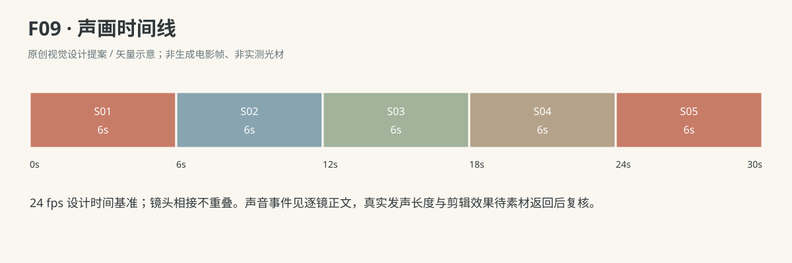

正式台词：无；保留镜头声音中已写明的自然发声。

### 连续性与试片

- 连续性：澈澈全片仰卧，头西脚东，右手位于身体南侧靠爸爸；左手留胸腹附近，不突然交换抓握手。

- 连续性：爸爸左手始终负责托或按住腿上P05，右手先持半页、放平后才越过南栏上方提供食指。

- 连续性：手臂从栏上方进入床内，不能穿栏杆缝；宝宝背、头、臀持续落在床垫，不抬身追手。

- 连续性：午后西窗与东门固定；不通过北面反打把熟悉脸和窗口方向互换。

- 连续性：宝宝第一次笑只能发生在爸爸抬眼靠近并实际对眼之后，不能在独自玩手或只看衣袖时先笑。

- 连续性：短哼不配假哭、装哭、拿捏大人的解释台词或字幕；本片取醒后自玩尾段，不声称原经历只持续三十秒。

- 试片：F09-S01—S03静音检查：先独自玩手，爸爸原先低头，听见短哼后停页抬眼靠近，对眼后宝宝才展笑；如果爸爸无触发已知道醒来，或宝宝预先对空处大笑，则失败。

- 试片：F09-S02—S03声音检查：只一声短哼及自然换气，不把哭声循环成逗笑音效；笑和开心鼻音不能早铺到对眼之前。

- 试片：F09-S04—S05接触检查：右食指先停在掌前，宝宝随后触碰合握，爸爸不牵拉，宝宝身体全程落床垫；书仍左掌稳定在腿上。

**媒体待验证：**本次交付为完整故事、分镜与提示词文字设计，未生成或审看实际图像、视频、音轨。人物和场景参考未提供；逐镜首帧、手指接触、面部表演、对白发音、身体平衡与相邻剪点均待实际素材核对，不以结构检查代替媒体质量。

---

## F10《爸爸回来以后》

**45 秒｜坐姿与手部互动｜角色：澈澈、爸爸｜场景 L**

### 剧情正文

客厅地垫上，澈澈坐着翻一只珊瑚色软环。东边走廊传来爸爸的声音：“澈澈，爸爸回来啦。”他的右手先停住，软环还握在指间。澈澈抬眼，转头往入口看，确认那张熟悉的脸以后，嘴角慢慢展开，左手离开地垫，在胸前兴奋地挥了两下。爸爸也笑了，没有站在门口再喊，只沿地垫边走近，在澈澈斜前方弯膝坐低。澈澈的左掌重新撑好，右手把软环放到面前，空出的手伸向爸爸的脸。爸爸稍稍凑近，让那只小手先碰到左脸颊。澈澈的手指贴着温热的脸颊上动了一下，认真看了看，又笑起来。爸爸的右掌落到自己身旁地垫，稳住前倾的身体，慢慢低下头。两人的额头轻轻挨了一下，又分开一点。澈澈没有被抱走，仍坐在原处，右手落回膝边；爸爸也留在他面前，和他看着彼此，把刚才没出完的笑一起笑完。

### 导演与空间

**观察任务：**把听见、确认、欢迎与靠近一层层拍清，让回来后的短短相认落在手掌和额头的轻触上。

**空间与光位：**L客厅北墙沙发、西窗、东侧走廊入口、中央奶油地垫。澈澈坐垫北半朝南，右手拿P01珊瑚软环、左掌在左膝外撑垫。爸爸由东走廊入口进来，沿地垫东边走到宝宝东南侧后跪坐，父婴连线为西北—东南；摄影始终在连线南侧，入口右后、澈澈画左、爸爸从右进。P01最后落在宝宝两膝前偏南的地垫。西窗柔光来自画左，爸爸进门不改变主光方向。

**人物表演：**爸爸刚回来，先轻声呼唤，等确认对视后才靠近，坐低而不从上方罩住宝宝。澈澈右手先停玩具、目光确认声音来源，再抬空着的左手轻挥；接近后先放下环腾出右手，右掌摸爸爸左颊。额头轻碰主要由爸爸控制靠近距离，宝宝保持稳坐与左掌支撑。

### 节拍覆盖

- **F10-b1**：由爸爸画外到画内的轻声回来触发宝宝停住自己的玩耍。 前态：澈澈坐地垫北半朝南，右手胸前翻P01、左掌撑垫，爸爸在东走廊入口刚露面，双手自然垂。 后态：澈澈右手持环停住、头转向入口，爸爸仍在右后入口等他看见。 → F10-S01

- **F10-b2**：宝宝看清是谁后才展开笑和欢迎动作。 前态：澈澈看向东入口、右手持P01不动、左掌撑垫，嘴角还未展开，爸爸在入口等着。 后态：宝宝笑着、左手还在胸前，右手持环，爸爸开始从入口靠近。 → F10-S02

- **F10-b3**：爸爸走近并主动降低高度，宝宝重新撑稳准备近距离接触。 前态：爸爸从东入口开始靠近，澈澈左手在胸前挥完、右手持环贴腿，稳坐垫北半。 后态：爸爸跪坐宝宝东南侧双手在膝，宝宝左掌已撑垫、右手持环，两人近距离对视。 → F10-S03

- **F10-b4**：宝宝腾出持环右手后主动摸脸，爸爸只调整距离让触碰成立。 前态：爸爸跪坐双手在自己膝上、脸在宝宝可看处；宝宝左掌撑垫、右手握P01贴腿。 后态：P01在宝宝两膝前，宝宝右掌贴爸爸左颊、左掌撑垫，爸爸双手仍在自己膝。 → F10-S04

- **F10-b5**：爸爸先稳住身体再低头，轻额触以真实接触而非碰撞完成。 前态：澈澈右掌在爸爸左颊、左掌撑垫，爸爸跪坐双手在膝，P01已落宝宝膝前。 后态：额头已分开小间隙，爸爸右掌撑垫、左手落膝，宝宝右手贴颊、左掌撑垫。 → F10-S05

- **F10-b6**：在宝宝原处把相认后的笑笑完，不用抱走或升华台词结束。 前态：额头已分开，宝宝右掌仍贴爸爸左颊、左掌撑垫，爸爸右掌撑自己右侧地垫、左手落膝。 后态：宝宝稳坐双手各在膝边及垫上，爸爸跪坐其东南侧，一掌撑垫一手落膝，P01原地。 → F10-S06

### 分镜构图板

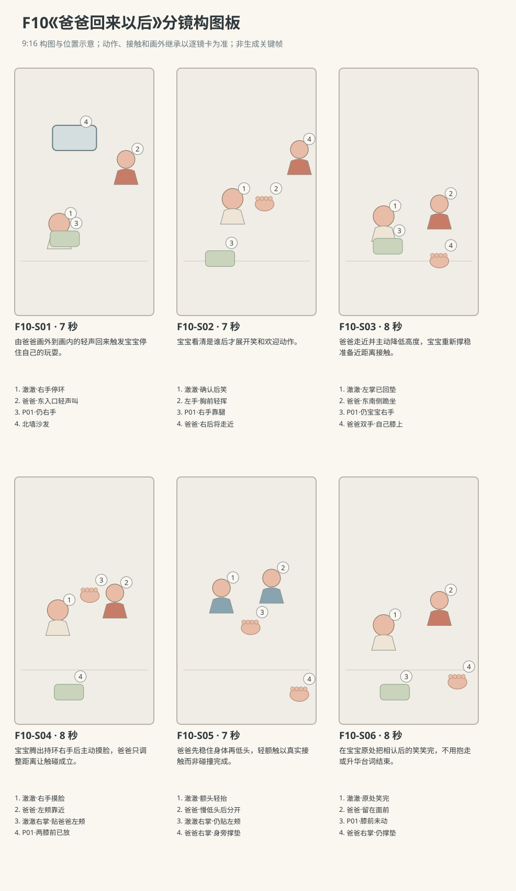

图示为构图位置示意；姿态、接触和画外继承以逐镜正文为准。

### 逐镜设计

#### F10-S01｜00—07 秒｜7 秒｜帧 [0, 168)

**镜头任务：**由爸爸画外到画内的轻声回来触发宝宝停住自己的玩耍。

**景别、机位与构图：**中全景，南侧朝北略东，澈澈画左中、东入口右后、爸爸刚在入口出现，地垫与北沙发建立空间。

**摄影机与理由：**固定，让声音来源在画内可确认，不用突然推镜。

**焦点：**澈澈右手软环先，爸爸入口脸保持可辨，随后看宝宝抬眼。

**入态：**澈澈坐地垫北半朝南，右手胸前翻P01、左掌撑垫，爸爸在东走廊入口刚露面，双手自然垂。

**动作与表演：**

- 2 秒：澈澈右手缓慢转软环，爸爸在入口看见他，脚步停一下。

- 3 秒：爸爸轻声说完整一句回来啦，澈澈右手先停止翻环，头先轻偏向声源。

- 2 秒：澈澈眼睛抬起、头转向东入口，软环仍在右手，左掌仍撑。

**声音：**爸爸第3—5秒说“澈澈，爸爸回来啦。”；之前一次走廊轻脚步，之后衣料与呼吸，无BGM。

**出态：**澈澈右手持环停住、头转向入口，爸爸仍在右后入口等他看见。

**切点与承接：**切澈澈确认脸的中景，承接看向画右的目光。

**连续性：**爸爸尚未走近，软环未松手；左掌仍接地，不提前挥。

**开始画面母稿：**

9:16竖幅，原创三维生活动画，圆润而有重量的造型，棉布细纹、柔和皮肤层次与可读的小表情；动作按真实生活物理及婴儿当下能力展开，不用成人化算计表情。澈澈为圆脸、深棕眼、短黑绒发、额前一小撮向右弯的头发，穿奶油色棉连体衣。爸爸短黑发，砖陶色棉衬衫、深灰长裤。本镜开始画面为单一瞬间：澈澈坐地垫北半朝南，右手胸前翻P01、左掌撑垫，爸爸在东走廊入口刚露面，双手自然垂。 场次方位与光位：L客厅北墙沙发、西窗、东侧走廊入口、中央地垫。澈澈在地垫北半，爸爸从东走廊沿地垫东缘来到其东南侧；摄影始终在连线南侧，入口画右后、宝宝画左、爸爸从右进入。西窗柔光来自画左，P01软环的当前归属只依本镜起态，爸爸面向与坐姿随当前动作改变。 摄影构图：中全景，南侧朝北略东，澈澈画左中、东入口右后、爸爸刚在入口出现，地垫与北沙发建立空间。 当前焦点：宝宝右手P01与东走廊入口爸爸的脸。只呈现上述起态，不把后续动作拼入一张画面。

**视频变化母稿：**

9:16竖幅，原创三维生活动画，圆润而有重量的造型，棉布细纹、柔和皮肤层次与可读的小表情；动作按真实生活物理及婴儿当下能力展开，不用成人化算计表情。澈澈为圆脸、深棕眼、短黑绒发、额前一小撮向右弯的头发，穿奶油色棉连体衣。爸爸短黑发，砖陶色棉衬衫、深灰长裤。制作一段7秒连续镜头。本段人物和能力：澈澈、爸爸，澈澈为R1。空间光位：L客厅北墙沙发、西窗、东侧走廊入口、中央地垫。澈澈在地垫北半，爸爸从东走廊沿地垫东缘来到其东南侧；摄影始终在连线南侧，入口画右后、宝宝画左、爸爸从右进入。西窗柔光来自画左，P01软环的当前归属只依本镜起态，爸爸面向与坐姿随当前动作改变。 起态：澈澈坐地垫北半朝南，右手胸前翻P01、左掌撑垫，爸爸在东走廊入口刚露面，双手自然垂。 摄影：中全景，南侧朝北略东，澈澈画左中、东入口右后、爸爸刚在入口出现，地垫与北沙发建立空间。 相机行为：固定，让声音来源在画内可确认，不用突然推镜。 焦点：澈澈右手软环先，爸爸入口脸保持可辨，随后看宝宝抬眼。 时间过程：第1阶段2秒：澈澈右手缓慢转软环，爸爸在入口看见他，脚步停一下。；第2阶段3秒：爸爸轻声说完整一句回来啦，澈澈右手先停止翻环，头先轻偏向声源。；第3阶段2秒：澈澈眼睛抬起、头转向东入口，软环仍在右手，左掌仍撑。。声音：爸爸第3—5秒说“澈澈，爸爸回来啦。”；之前一次走廊轻脚步，之后衣料与呼吸，无BGM。 终态：澈澈右手持环停住、头转向入口，爸爸仍在右后入口等他看见。 连续性：爸爸尚未走近，软环未松手；左掌仍接地，不提前挥。 不加未写出的对白、人物或道具。

#### F10-S02｜07—14 秒｜7 秒｜帧 [168, 336)

**镜头任务：**宝宝看清是谁后才展开笑和欢迎动作。

**景别、机位与构图：**澈澈中近景带下身，南侧同轴，宝宝居左中，右画缘保留爸爸入口身影，左掌到胸前的路径完整。

**摄影机与理由：**固定，把表情从查看到认出的变化留在一镜。

**焦点：**宝宝双眼与嘴角；左手挥动不抢脸部焦点。

**入态：**澈澈看向东入口、右手持P01不动、左掌撑垫，嘴角还未展开，爸爸在入口等着。

**动作与表演：**

- 3 秒：澈澈认真看爸爸脸，眼睛对焦后嘴角缓慢扬起，右手把软环贴近自己腿上。

- 2 秒：澈澈左掌离垫，左前臂在胸前小幅挥一下，身体坐骨仍稳。

- 2 秒：左前臂再兴奋地晃一下，澈澈看着爸爸笑，爸爸身影开始朝前迈步。

**声音：**澈澈轻短笑与衣袖声，爸爸一次轻脚步开始，无对白。

**出态：**宝宝笑着、左手还在胸前，右手持环，爸爸开始从入口靠近。

**切点与承接：**用爸爸迈步的动作接宽镜，完整走到宝宝旁边。

**连续性：**挥的是空左手，P01一直在右手；宝宝不站起来迎接。

**开始画面母稿：**

9:16竖幅，原创三维生活动画，圆润而有重量的造型，棉布细纹、柔和皮肤层次与可读的小表情；动作按真实生活物理及婴儿当下能力展开，不用成人化算计表情。澈澈为圆脸、深棕眼、短黑绒发、额前一小撮向右弯的头发，穿奶油色棉连体衣。爸爸短黑发，砖陶色棉衬衫、深灰长裤。本镜开始画面为单一瞬间：澈澈看向东入口、右手持P01不动、左掌撑垫，嘴角还未展开，爸爸在入口等着。 场次方位与光位：L客厅北墙沙发、西窗、东侧走廊入口、中央地垫。澈澈在地垫北半，爸爸从东走廊沿地垫东缘来到其东南侧；摄影始终在连线南侧，入口画右后、宝宝画左、爸爸从右进入。西窗柔光来自画左，P01软环的当前归属只依本镜起态，爸爸面向与坐姿随当前动作改变。 摄影构图：澈澈中近景带下身，南侧同轴，宝宝居左中，右画缘保留爸爸入口身影，左掌到胸前的路径完整。 当前焦点：宝宝看向入口的确认眼神、右手P01与撑垫左掌。只呈现上述起态，不把后续动作拼入一张画面。

**视频变化母稿：**

9:16竖幅，原创三维生活动画，圆润而有重量的造型，棉布细纹、柔和皮肤层次与可读的小表情；动作按真实生活物理及婴儿当下能力展开，不用成人化算计表情。澈澈为圆脸、深棕眼、短黑绒发、额前一小撮向右弯的头发，穿奶油色棉连体衣。爸爸短黑发，砖陶色棉衬衫、深灰长裤。制作一段7秒连续镜头。本段人物和能力：澈澈、爸爸，澈澈为R1。空间光位：L客厅北墙沙发、西窗、东侧走廊入口、中央地垫。澈澈在地垫北半，爸爸从东走廊沿地垫东缘来到其东南侧；摄影始终在连线南侧，入口画右后、宝宝画左、爸爸从右进入。西窗柔光来自画左，P01软环的当前归属只依本镜起态，爸爸面向与坐姿随当前动作改变。 起态：澈澈看向东入口、右手持P01不动、左掌撑垫，嘴角还未展开，爸爸在入口等着。 摄影：澈澈中近景带下身，南侧同轴，宝宝居左中，右画缘保留爸爸入口身影，左掌到胸前的路径完整。 相机行为：固定，把表情从查看到认出的变化留在一镜。 焦点：宝宝双眼与嘴角；左手挥动不抢脸部焦点。 时间过程：第1阶段3秒：澈澈认真看爸爸脸，眼睛对焦后嘴角缓慢扬起，右手把软环贴近自己腿上。；第2阶段2秒：澈澈左掌离垫，左前臂在胸前小幅挥一下，身体坐骨仍稳。；第3阶段2秒：左前臂再兴奋地晃一下，澈澈看着爸爸笑，爸爸身影开始朝前迈步。。声音：澈澈轻短笑与衣袖声，爸爸一次轻脚步开始，无对白。 终态：宝宝笑着、左手还在胸前，右手持环，爸爸开始从入口靠近。 连续性：挥的是空左手，P01一直在右手；宝宝不站起来迎接。 不加未写出的对白、人物或道具。

#### F10-S03｜14—22 秒｜8 秒｜帧 [336, 528)

**镜头任务：**爸爸走近并主动降低高度，宝宝重新撑稳准备近距离接触。

**景别、机位与构图：**二人中全景，南侧同轴，宝宝左、爸爸由右后向右前沿地垫东边进入，完整脚步、弯膝与膝落垫入框。

**摄影机与理由：**随爸爸前进轻向右摇小角度，仍留宝宝在左，不跨轴也不让爸爸遮满宝宝。

**焦点：**爸爸从走到跪坐的重心和宝宝左掌回垫，二人同清晰。

**入态：**爸爸从东入口开始靠近，澈澈左手在胸前挥完、右手持环贴腿，稳坐垫北半。

**动作与表演：**

- 3 秒：爸爸沿地垫东边走近，笑看澈澈，不再重复喊；澈澈左手慢慢放回左膝外地垫。

- 3 秒：爸爸在澈澈东南侧弯膝跪坐，双膝与臀依次稳定落下，双手先落自己膝上。

- 2 秒：爸爸把脸降到宝宝稍高一点的位置停住，澈澈抬眼近看他。

**声音：**两三步轻脚步、裤膝接垫布声、爸爸自然呼气，无对白无音乐。

**出态：**爸爸跪坐宝宝东南侧双手在膝，宝宝左掌已撑垫、右手持环，两人近距离对视。

**切点与承接：**切能看清环放下与手摸脸的同侧中景，开始亲密动作。

**连续性：**爸爸移动路径在东边，未穿地垫中央越过宝宝；宝宝左掌回垫全程可见。

**开始画面母稿：**

9:16竖幅，原创三维生活动画，圆润而有重量的造型，棉布细纹、柔和皮肤层次与可读的小表情；动作按真实生活物理及婴儿当下能力展开，不用成人化算计表情。澈澈为圆脸、深棕眼、短黑绒发、额前一小撮向右弯的头发，穿奶油色棉连体衣。爸爸短黑发，砖陶色棉衬衫、深灰长裤。本镜开始画面为单一瞬间：爸爸从东入口开始靠近，澈澈左手在胸前挥完、右手持环贴腿，稳坐垫北半。 场次方位与光位：L客厅北墙沙发、西窗、东侧走廊入口、中央地垫。澈澈在地垫北半，爸爸从东走廊沿地垫东缘来到其东南侧；摄影始终在连线南侧，入口画右后、宝宝画左、爸爸从右进入。西窗柔光来自画左，P01软环的当前归属只依本镜起态，爸爸面向与坐姿随当前动作改变。 摄影构图：二人中全景，南侧同轴，宝宝左、爸爸由右后向右前沿地垫东边进入，完整脚步、弯膝与膝落垫入框。 当前焦点：爸爸从入口开始靠近的身影、宝宝挥完未落的左手。只呈现上述起态，不把后续动作拼入一张画面。

**视频变化母稿：**

9:16竖幅，原创三维生活动画，圆润而有重量的造型，棉布细纹、柔和皮肤层次与可读的小表情；动作按真实生活物理及婴儿当下能力展开，不用成人化算计表情。澈澈为圆脸、深棕眼、短黑绒发、额前一小撮向右弯的头发，穿奶油色棉连体衣。爸爸短黑发，砖陶色棉衬衫、深灰长裤。制作一段8秒连续镜头。本段人物和能力：澈澈、爸爸，澈澈为R1。空间光位：L客厅北墙沙发、西窗、东侧走廊入口、中央地垫。澈澈在地垫北半，爸爸从东走廊沿地垫东缘来到其东南侧；摄影始终在连线南侧，入口画右后、宝宝画左、爸爸从右进入。西窗柔光来自画左，P01软环的当前归属只依本镜起态，爸爸面向与坐姿随当前动作改变。 起态：爸爸从东入口开始靠近，澈澈左手在胸前挥完、右手持环贴腿，稳坐垫北半。 摄影：二人中全景，南侧同轴，宝宝左、爸爸由右后向右前沿地垫东边进入，完整脚步、弯膝与膝落垫入框。 相机行为：随爸爸前进轻向右摇小角度，仍留宝宝在左，不跨轴也不让爸爸遮满宝宝。 焦点：爸爸从走到跪坐的重心和宝宝左掌回垫，二人同清晰。 时间过程：第1阶段3秒：爸爸沿地垫东边走近，笑看澈澈，不再重复喊；澈澈左手慢慢放回左膝外地垫。；第2阶段3秒：爸爸在澈澈东南侧弯膝跪坐，双膝与臀依次稳定落下，双手先落自己膝上。；第3阶段2秒：爸爸把脸降到宝宝稍高一点的位置停住，澈澈抬眼近看他。。声音：两三步轻脚步、裤膝接垫布声、爸爸自然呼气，无对白无音乐。 终态：爸爸跪坐宝宝东南侧双手在膝，宝宝左掌已撑垫、右手持环，两人近距离对视。 连续性：爸爸移动路径在东边，未穿地垫中央越过宝宝；宝宝左掌回垫全程可见。 不加未写出的对白、人物或道具。

#### F10-S04｜22—30 秒｜8 秒｜帧 [528, 720)

**镜头任务：**宝宝腾出持环右手后主动摸脸，爸爸只调整距离让触碰成立。

**景别、机位与构图：**紧凑二人中景，连线南侧，宝宝左、爸爸右，宝宝两膝前地垫在下缘，右手到爸爸左颊路径位于画心。

**摄影机与理由：**固定，放环与摸脸同镜，不让道具去向被剪掉。

**焦点：**先宝宝右手放P01，再移到右掌与爸爸左颊接触；两张脸可辨。

**入态：**爸爸跪坐双手在自己膝上、脸在宝宝可看处；宝宝左掌撑垫、右手握P01贴腿。

**动作与表演：**

- 3 秒：澈澈右手把P01放到两膝前偏南的垫上，松指看它落稳，再抬空手。

- 3 秒：澈澈右手向爸爸脸伸，爸爸微前倾，令自己的左颊停在小手前；宝宝指尖先碰颊，再掌心贴上。

- 2 秒：澈澈右指在脸颊轻动，眼睛查这次触感，爸爸眼角带笑保持不动。

**声音：**软环触垫低扑、皮肤与棉袖细声、澈澈一小声笑气，无对白。

**出态：**P01在宝宝两膝前，宝宝右掌贴爸爸左颊、左掌撑垫，爸爸双手仍在自己膝。

**切点与承接：**接爸爸将右手移到地垫支撑后低头的动作，保留右掌贴颊终态。

**连续性：**必须先松环后触脸；摸爸爸左颊不换成右颊，手指不穿眼鼻。

**开始画面母稿：**

9:16竖幅，原创三维生活动画，圆润而有重量的造型，棉布细纹、柔和皮肤层次与可读的小表情；动作按真实生活物理及婴儿当下能力展开，不用成人化算计表情。澈澈为圆脸、深棕眼、短黑绒发、额前一小撮向右弯的头发，穿奶油色棉连体衣。爸爸短黑发，砖陶色棉衬衫、深灰长裤。本镜开始画面为单一瞬间：爸爸跪坐双手在自己膝上、脸在宝宝可看处；宝宝左掌撑垫、右手握P01贴腿。 场次方位与光位：L客厅北墙沙发、西窗、东侧走廊入口、中央地垫。澈澈在地垫北半，爸爸从东走廊沿地垫东缘来到其东南侧；摄影始终在连线南侧，入口画右后、宝宝画左、爸爸从右进入。西窗柔光来自画左，P01软环的当前归属只依本镜起态，爸爸面向与坐姿随当前动作改变。 摄影构图：紧凑二人中景，连线南侧，宝宝左、爸爸右，宝宝两膝前地垫在下缘，右手到爸爸左颊路径位于画心。 当前焦点：宝宝右手仍握P01、撑垫左掌与爸爸停在可及距离的脸。只呈现上述起态，不把后续动作拼入一张画面。

**视频变化母稿：**

9:16竖幅，原创三维生活动画，圆润而有重量的造型，棉布细纹、柔和皮肤层次与可读的小表情；动作按真实生活物理及婴儿当下能力展开，不用成人化算计表情。澈澈为圆脸、深棕眼、短黑绒发、额前一小撮向右弯的头发，穿奶油色棉连体衣。爸爸短黑发，砖陶色棉衬衫、深灰长裤。制作一段8秒连续镜头。本段人物和能力：澈澈、爸爸，澈澈为R1。空间光位：L客厅北墙沙发、西窗、东侧走廊入口、中央地垫。澈澈在地垫北半，爸爸从东走廊沿地垫东缘来到其东南侧；摄影始终在连线南侧，入口画右后、宝宝画左、爸爸从右进入。西窗柔光来自画左，P01软环的当前归属只依本镜起态，爸爸面向与坐姿随当前动作改变。 起态：爸爸跪坐双手在自己膝上、脸在宝宝可看处；宝宝左掌撑垫、右手握P01贴腿。 摄影：紧凑二人中景，连线南侧，宝宝左、爸爸右，宝宝两膝前地垫在下缘，右手到爸爸左颊路径位于画心。 相机行为：固定，放环与摸脸同镜，不让道具去向被剪掉。 焦点：先宝宝右手放P01，再移到右掌与爸爸左颊接触；两张脸可辨。 时间过程：第1阶段3秒：澈澈右手把P01放到两膝前偏南的垫上，松指看它落稳，再抬空手。；第2阶段3秒：澈澈右手向爸爸脸伸，爸爸微前倾，令自己的左颊停在小手前；宝宝指尖先碰颊，再掌心贴上。；第3阶段2秒：澈澈右指在脸颊轻动，眼睛查这次触感，爸爸眼角带笑保持不动。。声音：软环触垫低扑、皮肤与棉袖细声、澈澈一小声笑气，无对白。 终态：P01在宝宝两膝前，宝宝右掌贴爸爸左颊、左掌撑垫，爸爸双手仍在自己膝。 连续性：必须先松环后触脸；摸爸爸左颊不换成右颊，手指不穿眼鼻。 不加未写出的对白、人物或道具。

#### F10-S05｜30—37 秒｜7 秒｜帧 [720, 888)

**镜头任务：**爸爸先稳住身体再低头，轻额触以真实接触而非碰撞完成。

**景别、机位与构图：**二人侧向近景，仍连线南侧，宝宝左、爸爸右，两张额头和宝宝右掌贴颊都见，下缘留爸爸右前臂撑垫方向。

**摄影机与理由：**固定，双方靠近路径都在画内；不在接触瞬间推镜或震动。

**焦点：**两额头之间缩短的间隙及宝宝眼睛；掌贴颊保持可辨。

**入态：**澈澈右掌在爸爸左颊、左掌撑垫，爸爸跪坐双手在膝，P01已落宝宝膝前。

**动作与表演：**

- 2 秒：爸爸右手从自己右膝移到身旁地垫，掌心落稳，左手仍在左膝。

- 3 秒：爸爸借右掌支撑缓慢低头，澈澈只微抬下巴不离坐姿，两额头轻轻接触一瞬。

- 2 秒：爸爸慢慢后退一小指宽，两额头分开，澈澈右掌仍贴颊，彼此嘴角扬起。

**声音：**爸爸手掌接垫微声、双方呼吸，一声很轻笑气；额头接触无夸张碰撞音，无对白。

**出态：**额头已分开小间隙，爸爸右掌撑垫、左手落膝，宝宝右手贴颊、左掌撑垫。

**切点与承接：**在分开后接稍宽，给两人笑完与宝宝回手留空间。

**连续性：**宝宝不抬臀、不悬空；爸爸先撑垫再低头，额头只软触，不发生头骨交叠。

**开始画面母稿：**

9:16竖幅，原创三维生活动画，圆润而有重量的造型，棉布细纹、柔和皮肤层次与可读的小表情；动作按真实生活物理及婴儿当下能力展开，不用成人化算计表情。澈澈为圆脸、深棕眼、短黑绒发、额前一小撮向右弯的头发，穿奶油色棉连体衣。爸爸短黑发，砖陶色棉衬衫、深灰长裤。本镜开始画面为单一瞬间：澈澈右掌在爸爸左颊、左掌撑垫，爸爸跪坐双手在膝，P01已落宝宝膝前。 场次方位与光位：L客厅北墙沙发、西窗、东侧走廊入口、中央地垫。澈澈在地垫北半，爸爸从东走廊沿地垫东缘来到其东南侧；摄影始终在连线南侧，入口画右后、宝宝画左、爸爸从右进入。西窗柔光来自画左，P01软环的当前归属只依本镜起态，爸爸面向与坐姿随当前动作改变。 摄影构图：二人侧向近景，仍连线南侧，宝宝左、爸爸右，两张额头和宝宝右掌贴颊都见，下缘留爸爸右前臂撑垫方向。 当前焦点：宝宝右掌贴爸爸左颊的接触、两人额头之间尚未缩短的间隙。只呈现上述起态，不把后续动作拼入一张画面。

**视频变化母稿：**

9:16竖幅，原创三维生活动画，圆润而有重量的造型，棉布细纹、柔和皮肤层次与可读的小表情；动作按真实生活物理及婴儿当下能力展开，不用成人化算计表情。澈澈为圆脸、深棕眼、短黑绒发、额前一小撮向右弯的头发，穿奶油色棉连体衣。爸爸短黑发，砖陶色棉衬衫、深灰长裤。制作一段7秒连续镜头。本段人物和能力：澈澈、爸爸，澈澈为R1。空间光位：L客厅北墙沙发、西窗、东侧走廊入口、中央地垫。澈澈在地垫北半，爸爸从东走廊沿地垫东缘来到其东南侧；摄影始终在连线南侧，入口画右后、宝宝画左、爸爸从右进入。西窗柔光来自画左，P01软环的当前归属只依本镜起态，爸爸面向与坐姿随当前动作改变。 起态：澈澈右掌在爸爸左颊、左掌撑垫，爸爸跪坐双手在膝，P01已落宝宝膝前。 摄影：二人侧向近景，仍连线南侧，宝宝左、爸爸右，两张额头和宝宝右掌贴颊都见，下缘留爸爸右前臂撑垫方向。 相机行为：固定，双方靠近路径都在画内；不在接触瞬间推镜或震动。 焦点：两额头之间缩短的间隙及宝宝眼睛；掌贴颊保持可辨。 时间过程：第1阶段2秒：爸爸右手从自己右膝移到身旁地垫，掌心落稳，左手仍在左膝。；第2阶段3秒：爸爸借右掌支撑缓慢低头，澈澈只微抬下巴不离坐姿，两额头轻轻接触一瞬。；第3阶段2秒：爸爸慢慢后退一小指宽，两额头分开，澈澈右掌仍贴颊，彼此嘴角扬起。。声音：爸爸手掌接垫微声、双方呼吸，一声很轻笑气；额头接触无夸张碰撞音，无对白。 终态：额头已分开小间隙，爸爸右掌撑垫、左手落膝，宝宝右手贴颊、左掌撑垫。 连续性：宝宝不抬臀、不悬空；爸爸先撑垫再低头，额头只软触，不发生头骨交叠。 不加未写出的对白、人物或道具。

#### F10-S06｜37—45 秒｜8 秒｜帧 [888, 1080)

**镜头任务：**在宝宝原处把相认后的笑笑完，不用抱走或升华台词结束。

**景别、机位与构图：**二人中景，南侧同轴稍宽，宝宝左、爸爸右，P01在下缘、双方支撑手与膝都可见，背景沙发固定。

**摄影机与理由：**缓慢后移一点恢复舒服距离，最后3秒停稳。

**焦点：**两张笑脸同清晰，手回位与软环也可辨。

**入态：**额头已分开，宝宝右掌仍贴爸爸左颊、左掌撑垫，爸爸右掌撑自己右侧地垫、左手落膝。

**动作与表演：**

- 3 秒：两人看彼此笑出声，宝宝右指从爸爸脸颊慢慢松开，右臂收向自己。

- 3 秒：宝宝右掌落回膝边，身体仍在原位；爸爸脸退到正常距离，右掌继续撑垫陪他看。

- 2 秒：笑声变成短鼻息，两人仍带笑对视，P01安静躺在宝宝两膝前。

**声音：**宝宝自然咯咯、爸爸低短笑，随后落回呼吸；无新增对白无音乐。

**出态：**宝宝稳坐双手各在膝边及垫上，爸爸跪坐其东南侧，一掌撑垫一手落膝，P01原地。

**切点与承接：**在最后一声笑气后结束，不补拥抱、挥手或旁白总结。

**连续性：**宝宝右手确实离开爸爸左颊回自己膝边；额头分开保持距离、P01不回手。

**开始画面母稿：**

9:16竖幅，原创三维生活动画，圆润而有重量的造型，棉布细纹、柔和皮肤层次与可读的小表情；动作按真实生活物理及婴儿当下能力展开，不用成人化算计表情。澈澈为圆脸、深棕眼、短黑绒发、额前一小撮向右弯的头发，穿奶油色棉连体衣。爸爸短黑发，砖陶色棉衬衫、深灰长裤。本镜开始画面为单一瞬间：额头已分开，宝宝右掌仍贴爸爸左颊、左掌撑垫，爸爸右掌撑自己右侧地垫、左手落膝。 场次方位与光位：L客厅北墙沙发、西窗、东侧走廊入口、中央地垫。澈澈在地垫北半，爸爸从东走廊沿地垫东缘来到其东南侧；摄影始终在连线南侧，入口画右后、宝宝画左、爸爸从右进入。西窗柔光来自画左，P01软环的当前归属只依本镜起态，爸爸面向与坐姿随当前动作改变。 摄影构图：二人中景，南侧同轴稍宽，宝宝左、爸爸右，P01在下缘、双方支撑手与膝都可见，背景沙发固定。 当前焦点：双人笑脸、宝宝右掌仍贴左颊与爸爸撑垫右掌。只呈现上述起态，不把后续动作拼入一张画面。

**视频变化母稿：**

9:16竖幅，原创三维生活动画，圆润而有重量的造型，棉布细纹、柔和皮肤层次与可读的小表情；动作按真实生活物理及婴儿当下能力展开，不用成人化算计表情。澈澈为圆脸、深棕眼、短黑绒发、额前一小撮向右弯的头发，穿奶油色棉连体衣。爸爸短黑发，砖陶色棉衬衫、深灰长裤。制作一段8秒连续镜头。本段人物和能力：澈澈、爸爸，澈澈为R1。空间光位：L客厅北墙沙发、西窗、东侧走廊入口、中央地垫。澈澈在地垫北半，爸爸从东走廊沿地垫东缘来到其东南侧；摄影始终在连线南侧，入口画右后、宝宝画左、爸爸从右进入。西窗柔光来自画左，P01软环的当前归属只依本镜起态，爸爸面向与坐姿随当前动作改变。 起态：额头已分开，宝宝右掌仍贴爸爸左颊、左掌撑垫，爸爸右掌撑自己右侧地垫、左手落膝。 摄影：二人中景，南侧同轴稍宽，宝宝左、爸爸右，P01在下缘、双方支撑手与膝都可见，背景沙发固定。 相机行为：缓慢后移一点恢复舒服距离，最后3秒停稳。 焦点：两张笑脸同清晰，手回位与软环也可辨。 时间过程：第1阶段3秒：两人看彼此笑出声，宝宝右指从爸爸脸颊慢慢松开，右臂收向自己。；第2阶段3秒：宝宝右掌落回膝边，身体仍在原位；爸爸脸退到正常距离，右掌继续撑垫陪他看。；第3阶段2秒：笑声变成短鼻息，两人仍带笑对视，P01安静躺在宝宝两膝前。。声音：宝宝自然咯咯、爸爸低短笑，随后落回呼吸；无新增对白无音乐。 终态：宝宝稳坐双手各在膝边及垫上，爸爸跪坐其东南侧，一掌撑垫一手落膝，P01原地。 连续性：宝宝右手确实离开爸爸左颊回自己膝边；额头分开保持距离、P01不回手。 不加未写出的对白、人物或道具。

### 声音与剪辑

仅一行爸爸对白。爸爸从走廊到地垫的轻脚步、裤膝接垫、软环放下与双方短笑依次前景化；无配乐，无额头碰撞夸张音效，不添加宝宝语义台词。

- 爸爸：澈澈，爸爸回来啦。（F10-S01；从东走廊入口向宝宝轻声说，本镜第3—5秒，带刚回家的自然呼气，不高声逗弄。）

### 连续性与试片

- 连续性：澈澈开始右手持P01、左掌撑垫；S02左手挥、S03左掌回垫；S04右手先放环再摸爸爸左颊。

- 连续性：爸爸始终从东入口画右到宝宝东南侧，不跨到宝宝西侧；最后右掌撑自己右侧地垫、左手在左膝。

- 连续性：额头相碰前爸爸右掌已稳定撑垫，宝宝左掌持续支撑；不以牵手吊起或突然抱起完成亲密动作。

- 连续性：P01放在宝宝两膝前偏南后全片保持，不自动回手；前后表情与轻笑留真实呼吸间隔。

- 试片：F10-S01—S02静音及有声双版：先停手、后确认脸、再笑挥，若一听声音就直接切大笑挥手省掉确认则失败。

- 试片：F10-S03—S04：左掌回垫、右手放环、右手摸左颊的顺序须逐项可见；若环悬浮或持环手同时摸脸则失败。

- 试片：F10-S05侧向试片：额头轻接触后分开有真实距离，二人身体都有支撑；若头部穿模、碰撞弹回或宝宝离垫，则失败。

**媒体待验证：**未生成媒体；待验宝宝挥臂与稳坐过渡、爸爸降低身高的重心、掌贴脸颊与额头微接触、双人近距离笑时的空间与呼吸。

---

## F11《还没露面就笑了》

**30 秒｜坐姿与手部互动｜角色：澈澈、妈妈｜场景 L**

### 剧情正文

客厅的西窗透进柔光，澈澈靠着低靠垫坐在地垫上，妈妈在西南侧陪他，双手抬到自己的脸旁。两只手合在脸前，熟悉的眉眼被藏住了，澈澈安静盯着掌边。妈妈把双掌向两侧打开，露出带笑的脸，轻声说：“在这儿！”澈澈先看住她的眼睛，嘴角一点点提起，随后才笑出声。小小的笑分成几声，中间停下来吸一口气；妈妈把手放回膝上，等他笑完。呼吸平稳下来，妈妈双手还在膝上，温柔地问：“再来？”说完才把双掌合到自己脸前。这回澈澈仍盯着掌边，嘴角先扬起来，脸还没露出，便漏出一声轻轻的期待笑。他停一下吸气，又短短笑了一声。妈妈听见了，肩膀轻动，掌后也漏出一点忍笑的气息，却没有立刻打开。双手终于向两侧分开时，她的眼角已经弯了。澈澈看见这张笑脸，又明亮地笑出两小声，妈妈也跟着笑。两个人把同一阵笑慢慢笑完，妈妈双手落回膝上，澈澈的小手也松在腿上，带着小笑安静看她。

### 亲述来源与改编

原帖是家长自述，未独立核实。本片将生活机制改编为澈澈的原创故事。

- [IN02 · 宝宝自己拉毯露脸，大人的夸张回应让游戏继续](https://www.reddit.com/r/NewParents/comments/18l1b3e/8_month_old_playing_peekaboo_can_she_be_more_cute/)；作者自报年龄：8个月。

- **采用的生活过程：**提取遮住与露面之间的等待，以及一方露面、另一方回应、笑声再反馈给成人的互相触发节奏。

- **本片原创改编：**原帖由宝宝拉毯子藏脸；本片改为妈妈只用双掌遮自己的脸，澈澈有靠坐在地垫，未使用毯子。

- **本片原创改编：**妈妈的逐字中文台词“在这儿！”和“再来？”、第二轮未露面先期待笑、手位和呼吸窗口均为原创。

- **不作出的事实推断：**不声称原帖发生了这两句台词、相同手势、相同轮数或明确停止游戏。

- **不作出的事实推断：**公开八个月亲述未独立证实，不以此保证所有宝宝都会有相同笑声或期待反应。

[查看原始过程与缺项](research/real-experiences/index.html#IN02)

### 导演与空间

**观察任务：**让亲子躲猫猫从看见才笑变成认出游戏后提前期待；笑点是两人互相感染与等待，不是吓唬婴儿、连续重复或成人解释发展道理。

**空间与光位：**L客厅北墙固定沙发、西窗、东侧走廊入口、中央奶油地垫。澈澈在地垫北半朝南有靠坐，稳固低靠垫承背、骨盆和双脚落垫，头自然偏向西南的妈妈；妈妈盘腿坐西南侧朝东北，把上身放低一点与宝宝玩。两人不互相碰触。摄影始终在两人连线的东南侧朝西北，不越轴；共享镜妈妈画左、澈澈画右，两张侧脸与母亲掌边留足尺寸。西窗漫射为唯一主光，落在世界西侧脸颊，暖墙填暗部，机位变化不交换窗门。没有布巾、报纸、布书或手持玩具。

**人物表演：**妈妈主动玩双掌遮自己脸再打开的游戏，第一轮给清楚的脸部显露，看到宝宝笑后等待他自然换气，再发起第二轮。遮脸时双掌并拢立在自己面前，掌心朝自己、手背朝宝宝，留呼吸空隙、不压鼻口，眉眼被遮便看不见宝宝，只能听。澈澈第一次先注视打开的眉眼与嘴角，随后才短笑；第一阵笑有吸气和停顿，笑收住之后第二轮才成立。第二次认出同样的双掌姿势，妈妈仍遮脸时先出现小声期待笑。妈妈先听见才忍笑，开掌露出笑眼后才能重新看宝宝。婴儿笑只带很小的肩胸起伏，背和骨盆留在支撑里，不靠夸张后仰或连续尖笑。妈妈只说两句自然普通话：首次双掌已完全打开后轻快轻声说“在这儿！”，宝宝仍先看见脸、下一镜才笑；第一阵笑尾已止、宝宝短吸气之后，妈妈双手仍膝上且嘴部可见时温柔带逗趣问“再来？”，说完才再次遮脸。两句的唇舌与下颌随中文自然发音，语毕放松收口，不闭唇说话；宝宝不说完整话。 成人的脸被看见后才触发第一阵笑，妈妈随后被澈澈的声音逗笑；第二次打开后，澈澈又接收到妈妈已经带笑的面部，笑才进一步明亮，反应不同时预演。

### 节拍覆盖

- **F11-b1**：从妈妈脸旁双手开始，在前三秒完成合掌遮自己脸及完整打开；宝宝先看见露出的脸，尚无笑声。 → F11-S01

- **F11-b2**：看见妈妈面部之后宝宝才发第一次短笑，笑间有吸气；成人不立即重复，先等待。 → F11-S02

- **F11-b3**：第一轮笑尾结束并恢复平稳呼吸，妈妈才从膝上抬手再次遮脸，建立第二轮清楚的起点。 → F11-S03

- **F11-b4**：同样的合掌仍遮着妈妈，宝宝注视后先出现期待笑；母亲只从声音知道他的变化，脸没有提前露出。 → F11-S04

- **F11-b5**：先让妈妈听见宝宝期待笑并忍笑，再完整开掌；宝宝接收到她已经弯起的笑眼和嘴角，第二阵笑才更明亮。 前态：妈妈双掌仍完全遮脸，已经听到宝宝的期待笑但尚未打开；澈澈双掌腿上，盯着掌边，期待笑的最后一声轻尾音未完，正要换气。 后态：妈妈面部已经完全露出，带笑看宝宝，分开的双手降到自己胸前；澈澈双掌仍腿上，已看见妈妈笑脸，第二阵较明亮的笑声仍有短尾，身体有靠。 → F11-S05

- **F11-b6**：共同笑尾逐渐变弱，母亲双手落膝，宝宝稳坐换气，结束于安静小笑，不开第三轮。 → F11-S06

### 分镜构图板

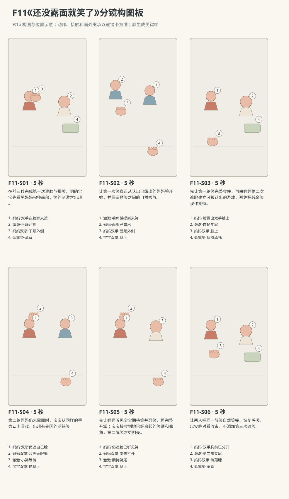

图示为构图位置示意；姿态、接触和画外继承以逐镜正文为准。

### 逐镜设计

#### F11-S01｜00—05 秒｜5 秒｜帧 [0, 120)

**镜头任务：**在前三秒完成第一次遮脸与揭脸，明确宝宝先看见妈妈完整面部，笑的刺激才出现。

**景别、机位与构图：**东南朝西北的固定双人中景，近宝宝眼高略俯，妈妈画左、澈澈画右，两张侧脸、妈妈双手和宝宝胸前都可读；北沙发稳住后景，低靠垫轮廓与宝宝坐骨区域在下部。妈妈双手当前悬在自己下颊外侧，未遮住眼鼻，宝宝双手各放腿上。

**摄影机与理由：**固定，把合掌遮脸与向两边打开的全过程留在同一画面，不切镜藏掉第一次显露；不推近制造惊吓。

**焦点：**妈妈当前露出的眉眼嘴角、脸旁双掌与宝宝注视的双眼都清楚，保持同一短纵深，不让手部虚化遮盖开合。

**入态：**澈澈背靠低靠垫坐稳，双掌各轻放自己腿上，平静看妈妈，没有笑声；妈妈双手悬在自己下颊外侧、掌心朝自己，脸完整露出，正看宝宝。

**动作与表演：**

- 1 秒：妈妈把两只手同时移到自己脸前，双掌并拢，手背朝宝宝，遮住自己的眉眼鼻口并留呼吸空隙；澈澈只看双掌，没有笑。

- 1 秒：妈妈双掌保持合拢，眉眼不从指缝偷露，也不假装还能看见宝宝；澈澈目光停在掌边，双手仍腿上。

- 1 秒：妈妈双掌向自己两侧分开，沿脸旁完整退到面颊外，露出眼睛、鼻子和带小笑的嘴；这一秒结束时脸已经全部打开，重新看向宝宝。

- 2 秒：妈妈在双掌已经完全打开、嘴部可见后，轻快轻声说“在这儿！”，口唇随普通话自然开合，语毕放松收口；澈澈看住露出的眼睛和嘴角，脸慢慢亮起来、嘴角略提，尚未发出笑声，妈妈双手仍停在面颊外侧。

**声音：**前3秒只有室内轻底声、妈妈双臂的一点衣料声和两人平稳呼吸，首次打开不配爆点声；镜内第3—5秒，双掌已完全打开、嘴部可见，妈妈对澈澈用轻快轻声的普通话准确说“在这儿！”，自然发音，语句在切出前完整收住。直到本镜结束都没有宝宝笑声；无其他对白、字幕、旁白或音乐。

**出态：**妈妈脸完整露出，双手分开停在自己面颊外侧，正看宝宝；澈澈双掌仍腿上，目光已对到妈妈眼鼻，嘴角略提但尚未发笑。

**切点与承接：**第一次揭脸已经完整结束，切稍紧的宝宝反应覆盖，延续这一次看见，不重演开掌。

**连续性：**画内看清双掌只遮妈妈自己、再向两侧打开，宝宝脸从未被挡或触摸；首次笑尚未起。低靠垫和骨盆支撑在共享镜可辨，后镜裁切部分只继承。

**开始画面母稿：**

9:16竖幅，原创三维家庭生活动画，圆润而有重量的造型，柔和皮肤层次、哑光棉布与可读的小表情；生活物理与婴儿当下能力真实，不用成人式算计。宝宝名叫澈澈，暂拟圆润脸颊、深棕眼、短黑绒发与额前右弯小发撮，奶油色棉连体衣；妈妈暂拟深棕低马尾、雾蓝棉上衣、米色长裤，外貌和服装以后续用户参考为准。人物、场景参考尚未提供，未绑定实际素材。本镜开始画面为单一瞬间：澈澈背靠低靠垫坐稳，双掌各轻放自己腿上，平静看妈妈，没有笑声；妈妈双手悬在自己下颊外侧、掌心朝自己，脸完整露出，正看宝宝。 场次方位与光位：L客厅北墙固定沙发、西窗、东侧走廊入口、中央奶油地垫。澈澈在地垫北半朝南有靠坐，头自然偏向西南的妈妈，稳固低靠垫承背、骨盆与双脚落垫，双掌轻放自己腿上；妈妈盘腿坐西南侧朝东北。摄影始终在两人连线东南侧朝西北，妈妈画左、宝宝画右，侧脸与掌边可读；西窗漫射为唯一主光，暖墙反射填暗部，地理不镜像。只有这两个人，没有布巾、报纸、布书、玩具或其他遮脸道具。妈妈遮脸时双掌只遮自己的脸，离自己面部留呼吸空隙、不压鼻口；遮住眉眼时她看不见宝宝，开掌露眼后才能重新对视。 摄影构图：东南朝西北的固定双人中景，近宝宝眼高略俯，妈妈画左、澈澈画右，两张侧脸、妈妈双手和宝宝胸前都可读；北沙发稳住后景，低靠垫轮廓与宝宝坐骨区域在下部。妈妈双手当前悬在自己下颊外侧，未遮住眼鼻，宝宝双手各放腿上。 当前焦点：妈妈当前露出的眉眼嘴角、脸旁双掌与宝宝注视的双眼都清楚，保持同一短纵深，不让手部虚化遮盖开合。只呈现上述起态，不把后续遮脸、开掌或新的笑容拼入一张画面；不绘动作轨迹、分格或文字。

**视频变化母稿：**

9:16竖幅，原创三维家庭生活动画，圆润而有重量的造型，柔和皮肤层次、哑光棉布与可读的小表情；生活物理与婴儿当下能力真实，不用成人式算计。宝宝名叫澈澈，暂拟圆润脸颊、深棕眼、短黑绒发与额前右弯小发撮，奶油色棉连体衣；妈妈暂拟深棕低马尾、雾蓝棉上衣、米色长裤，外貌和服装以后续用户参考为准。人物、场景参考尚未提供，未绑定实际素材。制作一段5秒连续镜头。本段人物和能力：澈澈、妈妈，澈澈为R1有靠坐，不据此设统一月龄。空间光位：L客厅北墙固定沙发、西窗、东侧走廊入口、中央奶油地垫。澈澈在地垫北半朝南有靠坐，头自然偏向西南的妈妈，稳固低靠垫承背、骨盆与双脚落垫，双掌轻放自己腿上；妈妈盘腿坐西南侧朝东北。摄影始终在两人连线东南侧朝西北，妈妈画左、宝宝画右，侧脸与掌边可读；西窗漫射为唯一主光，暖墙反射填暗部，地理不镜像。只有这两个人，没有布巾、报纸、布书、玩具或其他遮脸道具。妈妈遮脸时双掌只遮自己的脸，离自己面部留呼吸空隙、不压鼻口；遮住眉眼时她看不见宝宝，开掌露眼后才能重新对视。 起态：澈澈背靠低靠垫坐稳，双掌各轻放自己腿上，平静看妈妈，没有笑声；妈妈双手悬在自己下颊外侧、掌心朝自己，脸完整露出，正看宝宝。 摄影：东南朝西北的固定双人中景，近宝宝眼高略俯，妈妈画左、澈澈画右，两张侧脸、妈妈双手和宝宝胸前都可读；北沙发稳住后景，低靠垫轮廓与宝宝坐骨区域在下部。妈妈双手当前悬在自己下颊外侧，未遮住眼鼻，宝宝双手各放腿上。 相机行为：固定，把合掌遮脸与向两边打开的全过程留在同一画面，不切镜藏掉第一次显露；不推近制造惊吓。 焦点：妈妈当前露出的眉眼嘴角、脸旁双掌与宝宝注视的双眼都清楚，保持同一短纵深，不让手部虚化遮盖开合。 时间过程：第1阶段1秒：妈妈把两只手同时移到自己脸前，双掌并拢，手背朝宝宝，遮住自己的眉眼鼻口并留呼吸空隙；澈澈只看双掌，没有笑。；第2阶段1秒：妈妈双掌保持合拢，眉眼不从指缝偷露，也不假装还能看见宝宝；澈澈目光停在掌边，双手仍腿上。；第3阶段1秒：妈妈双掌向自己两侧分开，沿脸旁完整退到面颊外，露出眼睛、鼻子和带小笑的嘴；这一秒结束时脸已经全部打开，重新看向宝宝。；第4阶段2秒：妈妈在双掌已经完全打开、嘴部可见后，轻快轻声说“在这儿！”，口唇随普通话自然开合，语毕放松收口；澈澈看住露出的眼睛和嘴角，脸慢慢亮起来、嘴角略提，尚未发出笑声，妈妈双手仍停在面颊外侧。。声音：前3秒只有室内轻底声、妈妈双臂的一点衣料声和两人平稳呼吸，首次打开不配爆点声；镜内第3—5秒，双掌已完全打开、嘴部可见，妈妈对澈澈用轻快轻声的普通话准确说“在这儿！”，自然发音，语句在切出前完整收住。直到本镜结束都没有宝宝笑声；无其他对白、字幕、旁白或音乐。 终态：妈妈脸完整露出，双手分开停在自己面颊外侧，正看宝宝；澈澈双掌仍腿上，目光已对到妈妈眼鼻，嘴角略提但尚未发笑。 连续性：画内看清双掌只遮妈妈自己、再向两侧打开，宝宝脸从未被挡或触摸；首次笑尚未起。低靠垫和骨盆支撑在共享镜可辨，后镜裁切部分只继承。 按本镜完整过程到达终态，不在镜内另加切镜，不加未写出的对白、人物、道具或解释旁白。

#### F11-S02｜05—10 秒｜5 秒｜帧 [120, 240)

**镜头任务：**让第一次笑真正从认出已露出的妈妈脸开始，并保留短笑之间的自然吸气。

**景别、机位与构图：**同轴线东南侧稍紧的反应中近景，澈澈脸与上胸占画中右，双手和腿上缘在下部；妈妈已露出的近侧脸与分开双手留画左边缘。妈妈膝部在本镜裁切外，不为证明手归属强行压进脸部近景。

**摄影机与理由：**固定，略紧是为读宝宝从注视到短笑和吸气的过程；妈妈的脸一直露着，不用她再次打开来催笑。

**焦点：**宝宝当前略提的嘴角、眼睛与胸前呼吸区清楚，妈妈露出的面部轮廓可辨，保持目光指向而非只锁嘴。

**入态：**妈妈脸完整露出，双手分开停在自己面颊外侧，正看宝宝；澈澈双掌仍腿上，目光已对到妈妈眼鼻，嘴角略提但尚未发笑。

**动作与表演：**

- 1 秒：澈澈看着妈妈已露出的脸，嘴角展开，下巴轻松，呼出第一声短笑；妈妈接住他的目光，笑容也松开。

- 2 秒：宝宝又笑出两小声，中间有一次自然吸气，肩胸只轻轻起伏；妈妈放下分开的双手，双手沿自己的上身两侧下降，离开裁切后落回各自膝上。

- 2 秒：澈澈的笑逐渐变短，最后一声轻笑仍留短尾、尚未开始吸气，双掌仍轻落腿上；妈妈不再逗第二个动作，安静等他缓过这口气。

**声音：**本镜第一秒在宝宝看清脸之后才起第一声短笑，接两小声带空隙的自然婴儿笑与清楚吸气；不铺循环笑罐头。最后一声轻尾音延至下一镜开头，连续呼吸相位保留。妈妈只平稳呼吸，无台词。

**出态：**妈妈双手已落各自膝上，脸一直露出、看着宝宝；澈澈双掌腿上，首轮笑只剩最后一声轻尾音，正待下一口吸气，目光仍向妈妈。

**切点与承接：**在第一阵笑的尾声切回稍宽共享镜，同一次笑尾和吸气继续，不把第二轮笑提前拼进来。

**连续性：**画内直接见宝宝因露脸而笑、笑间换气及妈妈双手向下离开裁切；妈妈双手落膝为画外继承，由下一镜宽景确认。宝宝骨盆和靠垫下部在画外保持支撑，不因笑前扑。

**开始画面母稿：**

9:16竖幅，原创三维家庭生活动画，圆润而有重量的造型，柔和皮肤层次、哑光棉布与可读的小表情；生活物理与婴儿当下能力真实，不用成人式算计。宝宝名叫澈澈，暂拟圆润脸颊、深棕眼、短黑绒发与额前右弯小发撮，奶油色棉连体衣；妈妈暂拟深棕低马尾、雾蓝棉上衣、米色长裤，外貌和服装以后续用户参考为准。人物、场景参考尚未提供，未绑定实际素材。本镜开始画面为单一瞬间：妈妈脸完整露出，双手分开停在自己面颊外侧，正看宝宝；澈澈双掌仍腿上，目光已对到妈妈眼鼻，嘴角略提但尚未发笑。 场次方位与光位：L客厅北墙固定沙发、西窗、东侧走廊入口、中央奶油地垫。澈澈在地垫北半朝南有靠坐，头自然偏向西南的妈妈，稳固低靠垫承背、骨盆与双脚落垫，双掌轻放自己腿上；妈妈盘腿坐西南侧朝东北。摄影始终在两人连线东南侧朝西北，妈妈画左、宝宝画右，侧脸与掌边可读；西窗漫射为唯一主光，暖墙反射填暗部，地理不镜像。只有这两个人，没有布巾、报纸、布书、玩具或其他遮脸道具。妈妈遮脸时双掌只遮自己的脸，离自己面部留呼吸空隙、不压鼻口；遮住眉眼时她看不见宝宝，开掌露眼后才能重新对视。 摄影构图：同轴线东南侧稍紧的反应中近景，澈澈脸与上胸占画中右，双手和腿上缘在下部；妈妈已露出的近侧脸与分开双手留画左边缘。妈妈膝部在本镜裁切外，不为证明手归属强行压进脸部近景。 当前焦点：宝宝当前略提的嘴角、眼睛与胸前呼吸区清楚，妈妈露出的面部轮廓可辨，保持目光指向而非只锁嘴。只呈现上述起态，不把后续遮脸、开掌或新的笑容拼入一张画面；不绘动作轨迹、分格或文字。

**视频变化母稿：**

9:16竖幅，原创三维家庭生活动画，圆润而有重量的造型，柔和皮肤层次、哑光棉布与可读的小表情；生活物理与婴儿当下能力真实，不用成人式算计。宝宝名叫澈澈，暂拟圆润脸颊、深棕眼、短黑绒发与额前右弯小发撮，奶油色棉连体衣；妈妈暂拟深棕低马尾、雾蓝棉上衣、米色长裤，外貌和服装以后续用户参考为准。人物、场景参考尚未提供，未绑定实际素材。制作一段5秒连续镜头。本段人物和能力：澈澈、妈妈，澈澈为R1有靠坐，不据此设统一月龄。空间光位：L客厅北墙固定沙发、西窗、东侧走廊入口、中央奶油地垫。澈澈在地垫北半朝南有靠坐，头自然偏向西南的妈妈，稳固低靠垫承背、骨盆与双脚落垫，双掌轻放自己腿上；妈妈盘腿坐西南侧朝东北。摄影始终在两人连线东南侧朝西北，妈妈画左、宝宝画右，侧脸与掌边可读；西窗漫射为唯一主光，暖墙反射填暗部，地理不镜像。只有这两个人，没有布巾、报纸、布书、玩具或其他遮脸道具。妈妈遮脸时双掌只遮自己的脸，离自己面部留呼吸空隙、不压鼻口；遮住眉眼时她看不见宝宝，开掌露眼后才能重新对视。 起态：妈妈脸完整露出，双手分开停在自己面颊外侧，正看宝宝；澈澈双掌仍腿上，目光已对到妈妈眼鼻，嘴角略提但尚未发笑。 摄影：同轴线东南侧稍紧的反应中近景，澈澈脸与上胸占画中右，双手和腿上缘在下部；妈妈已露出的近侧脸与分开双手留画左边缘。妈妈膝部在本镜裁切外，不为证明手归属强行压进脸部近景。 相机行为：固定，略紧是为读宝宝从注视到短笑和吸气的过程；妈妈的脸一直露着，不用她再次打开来催笑。 焦点：宝宝当前略提的嘴角、眼睛与胸前呼吸区清楚，妈妈露出的面部轮廓可辨，保持目光指向而非只锁嘴。 时间过程：第1阶段1秒：澈澈看着妈妈已露出的脸，嘴角展开，下巴轻松，呼出第一声短笑；妈妈接住他的目光，笑容也松开。；第2阶段2秒：宝宝又笑出两小声，中间有一次自然吸气，肩胸只轻轻起伏；妈妈放下分开的双手，双手沿自己的上身两侧下降，离开裁切后落回各自膝上。；第3阶段2秒：澈澈的笑逐渐变短，最后一声轻笑仍留短尾、尚未开始吸气，双掌仍轻落腿上；妈妈不再逗第二个动作，安静等他缓过这口气。。声音：本镜第一秒在宝宝看清脸之后才起第一声短笑，接两小声带空隙的自然婴儿笑与清楚吸气；不铺循环笑罐头。最后一声轻尾音延至下一镜开头，连续呼吸相位保留。妈妈只平稳呼吸，无台词。 终态：妈妈双手已落各自膝上，脸一直露出、看着宝宝；澈澈双掌腿上，首轮笑只剩最后一声轻尾音，正待下一口吸气，目光仍向妈妈。 连续性：画内直接见宝宝因露脸而笑、笑间换气及妈妈双手向下离开裁切；妈妈双手落膝为画外继承，由下一镜宽景确认。宝宝骨盆和靠垫下部在画外保持支撑，不因笑前扑。 按本镜完整过程到达终态，不在镜内另加切镜，不加未写出的对白、人物、道具或解释旁白。

#### F11-S03｜10—15 秒｜5 秒｜帧 [240, 360)

**镜头任务：**先让第一轮笑完整收住，再由妈妈第二次遮脸建立可被认出的游戏，避免把残余笑误作期待。

**景别、机位与构图：**东南侧双人中景，妈妈画左、澈澈画右，妈妈当前双手落膝、面部露出，宝宝两手和低靠垫清楚；面部到膝上的手部通道都在取景内，背景沙发不换边。

**摄影机与理由：**固定、略宽于前镜，完整看到妈妈双手从膝上抬到自己的脸前；第二次遮脸不靠切镜凭空完成。

**焦点：**当前妈妈膝上双手、已露出的面部和宝宝笑尾中的口眼可读，维持足够清楚范围，不只追成人抬手。

**入态：**妈妈双手已落各自膝上，脸一直露出、看着宝宝；澈澈双掌腿上，首轮笑只剩最后一声轻尾音，正待下一口吸气，目光仍向妈妈。

**动作与表演：**

- 1 秒：上一镜最后一声笑尾先自然结束，澈澈随后吸一小口气，肩膀慢慢放松；妈妈双手仍膝上，没有马上重复。

- 1 秒：宝宝已完成短吸气，恢复平稳呼吸，只留小笑容；妈妈双手仍在各自膝上、脸完整露出，温柔带逗趣地用普通话问“再来？”，口唇自然开合，问完放松收口，再开始后面的抬手动作。

- 2 秒：妈妈双手从各自膝上抬起，掌心转向自己，再次并拢遮住自己的眉眼鼻口，离脸留小空隙，不伸向宝宝；澈澈的目光跟到同样的双掌姿势。

- 1 秒：妈妈双掌保持完全合拢，眉眼藏住，只听宝宝；澈澈继续看掌边，嘴角微提，仍没有第二轮笑声。

**声音：**开头承接上一镜同一声轻笑尾，尾音先在第一秒内结束，随即接一口短吸气；镜内第1—2秒，宝宝已经缓过这口气，妈妈双手仍膝上、嘴部可见，温柔带逗趣地用普通话准确问“再来？”，轻微询问上扬，问句完整结束后才抬手遮脸，随后才有轻衣料声。后半只留平稳呼吸，无新的宝宝笑声、其他台词或配乐，不加字幕、旁白。

**出态：**妈妈双掌合拢遮住自己的眉眼鼻口、离脸有呼吸空隙，看不见宝宝；澈澈双掌腿上，带小笑看着掌边，呼吸已经平稳，第二轮笑尚未起。

**切点与承接：**在遮脸已成立、首轮笑已结束的安静状态切稍紧共享镜，接同一次等待，不重新举手。

**连续性：**画内重新确认妈妈双手从膝上抬起并遮自己面部，宝宝脸始终无遮挡。第二轮开始前有完整安静呼吸，妈妈遮住眼睛后不能继续用眼线追宝宝。

**开始画面母稿：**

9:16竖幅，原创三维家庭生活动画，圆润而有重量的造型，柔和皮肤层次、哑光棉布与可读的小表情；生活物理与婴儿当下能力真实，不用成人式算计。宝宝名叫澈澈，暂拟圆润脸颊、深棕眼、短黑绒发与额前右弯小发撮，奶油色棉连体衣；妈妈暂拟深棕低马尾、雾蓝棉上衣、米色长裤，外貌和服装以后续用户参考为准。人物、场景参考尚未提供，未绑定实际素材。本镜开始画面为单一瞬间：妈妈双手已落各自膝上，脸一直露出、看着宝宝；澈澈双掌腿上，首轮笑只剩最后一声轻尾音，正待下一口吸气，目光仍向妈妈。 场次方位与光位：L客厅北墙固定沙发、西窗、东侧走廊入口、中央奶油地垫。澈澈在地垫北半朝南有靠坐，头自然偏向西南的妈妈，稳固低靠垫承背、骨盆与双脚落垫，双掌轻放自己腿上；妈妈盘腿坐西南侧朝东北。摄影始终在两人连线东南侧朝西北，妈妈画左、宝宝画右，侧脸与掌边可读；西窗漫射为唯一主光，暖墙反射填暗部，地理不镜像。只有这两个人，没有布巾、报纸、布书、玩具或其他遮脸道具。妈妈遮脸时双掌只遮自己的脸，离自己面部留呼吸空隙、不压鼻口；遮住眉眼时她看不见宝宝，开掌露眼后才能重新对视。 摄影构图：东南侧双人中景，妈妈画左、澈澈画右，妈妈当前双手落膝、面部露出，宝宝两手和低靠垫清楚；面部到膝上的手部通道都在取景内，背景沙发不换边。 当前焦点：当前妈妈膝上双手、已露出的面部和宝宝笑尾中的口眼可读，维持足够清楚范围，不只追成人抬手。只呈现上述起态，不把后续遮脸、开掌或新的笑容拼入一张画面；不绘动作轨迹、分格或文字。

**视频变化母稿：**

9:16竖幅，原创三维家庭生活动画，圆润而有重量的造型，柔和皮肤层次、哑光棉布与可读的小表情；生活物理与婴儿当下能力真实，不用成人式算计。宝宝名叫澈澈，暂拟圆润脸颊、深棕眼、短黑绒发与额前右弯小发撮，奶油色棉连体衣；妈妈暂拟深棕低马尾、雾蓝棉上衣、米色长裤，外貌和服装以后续用户参考为准。人物、场景参考尚未提供，未绑定实际素材。制作一段5秒连续镜头。本段人物和能力：澈澈、妈妈，澈澈为R1有靠坐，不据此设统一月龄。空间光位：L客厅北墙固定沙发、西窗、东侧走廊入口、中央奶油地垫。澈澈在地垫北半朝南有靠坐，头自然偏向西南的妈妈，稳固低靠垫承背、骨盆与双脚落垫，双掌轻放自己腿上；妈妈盘腿坐西南侧朝东北。摄影始终在两人连线东南侧朝西北，妈妈画左、宝宝画右，侧脸与掌边可读；西窗漫射为唯一主光，暖墙反射填暗部，地理不镜像。只有这两个人，没有布巾、报纸、布书、玩具或其他遮脸道具。妈妈遮脸时双掌只遮自己的脸，离自己面部留呼吸空隙、不压鼻口；遮住眉眼时她看不见宝宝，开掌露眼后才能重新对视。 起态：妈妈双手已落各自膝上，脸一直露出、看着宝宝；澈澈双掌腿上，首轮笑只剩最后一声轻尾音，正待下一口吸气，目光仍向妈妈。 摄影：东南侧双人中景，妈妈画左、澈澈画右，妈妈当前双手落膝、面部露出，宝宝两手和低靠垫清楚；面部到膝上的手部通道都在取景内，背景沙发不换边。 相机行为：固定、略宽于前镜，完整看到妈妈双手从膝上抬到自己的脸前；第二次遮脸不靠切镜凭空完成。 焦点：当前妈妈膝上双手、已露出的面部和宝宝笑尾中的口眼可读，维持足够清楚范围，不只追成人抬手。 时间过程：第1阶段1秒：上一镜最后一声笑尾先自然结束，澈澈随后吸一小口气，肩膀慢慢放松；妈妈双手仍膝上，没有马上重复。；第2阶段1秒：宝宝已完成短吸气，恢复平稳呼吸，只留小笑容；妈妈双手仍在各自膝上、脸完整露出，温柔带逗趣地用普通话问“再来？”，口唇自然开合，问完放松收口，再开始后面的抬手动作。；第3阶段2秒：妈妈双手从各自膝上抬起，掌心转向自己，再次并拢遮住自己的眉眼鼻口，离脸留小空隙，不伸向宝宝；澈澈的目光跟到同样的双掌姿势。；第4阶段1秒：妈妈双掌保持完全合拢，眉眼藏住，只听宝宝；澈澈继续看掌边，嘴角微提，仍没有第二轮笑声。。声音：开头承接上一镜同一声轻笑尾，尾音先在第一秒内结束，随即接一口短吸气；镜内第1—2秒，宝宝已经缓过这口气，妈妈双手仍膝上、嘴部可见，温柔带逗趣地用普通话准确问“再来？”，轻微询问上扬，问句完整结束后才抬手遮脸，随后才有轻衣料声。后半只留平稳呼吸，无新的宝宝笑声、其他台词或配乐，不加字幕、旁白。 终态：妈妈双掌合拢遮住自己的眉眼鼻口、离脸有呼吸空隙，看不见宝宝；澈澈双掌腿上，带小笑看着掌边，呼吸已经平稳，第二轮笑尚未起。 连续性：画内重新确认妈妈双手从膝上抬起并遮自己面部，宝宝脸始终无遮挡。第二轮开始前有完整安静呼吸，妈妈遮住眼睛后不能继续用眼线追宝宝。 按本镜完整过程到达终态，不在镜内另加切镜，不加未写出的对白、人物、道具或解释旁白。

#### F11-S04｜15—20 秒｜5 秒｜帧 [360, 480)

**镜头任务：**第二轮妈妈仍未露面时，宝宝从同样的手势认出游戏，出现有先因的期待笑。

**景别、机位与构图：**东南侧共享中近景，妈妈画左、澈澈画右，两张侧脸所在区域同框，妈妈面部完全藏在自己并拢双掌后，掌侧从本机位也挡住近侧眼睛，不留偷看的眼缝；宝宝脸和胸前清楚。双手都在妈妈面前，宝宝双掌仍腿上。

**摄影机与理由：**固定，等待宝宝自己的反应；母亲遮脸状态和宝宝表情始终同框，不用单独宝宝笑镜掩盖母亲是否提前开掌。

**焦点：**妈妈当前合拢的掌边、宝宝带小笑的眼睛嘴角与胸前呼吸区都清楚；母亲眉眼在掌后，此刻不要求看见她的眼神。

**入态：**妈妈双掌合拢遮住自己的眉眼鼻口、离脸有呼吸空隙，看不见宝宝；澈澈双掌腿上，带小笑看着掌边，呼吸已经平稳，第二轮笑尚未起。

**动作与表演：**

- 2 秒：澈澈盯着合拢的掌边，嘴角慢慢再提一点，目光没有转开；妈妈仍不打开，只听近处的呼吸，双掌不露缝。

- 1 秒：宝宝忽然从小笑容里漏出一声很轻的期待笑气，脸前没有新的显露；妈妈双手保持原位，尚不作可见反应。

- 2 秒：澈澈接一小声短笑、停一下吸气，又笑出轻尾音；妈妈继续合掌等待，已经听见宝宝，脸仍藏着，不提前分开手指。

**声音：**前两秒只有安静呼吸，第三秒才起一声轻期待笑气，之后一小声短笑、吸气、轻尾音，强度低于后续再次露脸的笑。尾音连续进入下一镜第一秒，不重放。妈妈此镜不发笑声，无台词。

**出态：**妈妈双掌仍完全遮脸，已经听到宝宝的期待笑但尚未打开；澈澈双掌腿上，盯着掌边，期待笑的最后一声轻尾音未完，正要换气。

**切点与承接：**保持同方向和近似构图切下镜，尾音不断，使妈妈随后忍笑与开掌确实由她已经听见的声音触发。

**连续性：**画内能同时证明母亲脸未显露、宝宝已经开始期待笑；妈妈的知识来自听觉，不写她隔着双掌看到宝宝。宝宝第一次看见的经验来自首轮妈妈露面后的互动，两轮之间已留安静间隔。

**开始画面母稿：**

9:16竖幅，原创三维家庭生活动画，圆润而有重量的造型，柔和皮肤层次、哑光棉布与可读的小表情；生活物理与婴儿当下能力真实，不用成人式算计。宝宝名叫澈澈，暂拟圆润脸颊、深棕眼、短黑绒发与额前右弯小发撮，奶油色棉连体衣；妈妈暂拟深棕低马尾、雾蓝棉上衣、米色长裤，外貌和服装以后续用户参考为准。人物、场景参考尚未提供，未绑定实际素材。本镜开始画面为单一瞬间：妈妈双掌合拢遮住自己的眉眼鼻口、离脸有呼吸空隙，看不见宝宝；澈澈双掌腿上，带小笑看着掌边，呼吸已经平稳，第二轮笑尚未起。 场次方位与光位：L客厅北墙固定沙发、西窗、东侧走廊入口、中央奶油地垫。澈澈在地垫北半朝南有靠坐，头自然偏向西南的妈妈，稳固低靠垫承背、骨盆与双脚落垫，双掌轻放自己腿上；妈妈盘腿坐西南侧朝东北。摄影始终在两人连线东南侧朝西北，妈妈画左、宝宝画右，侧脸与掌边可读；西窗漫射为唯一主光，暖墙反射填暗部，地理不镜像。只有这两个人，没有布巾、报纸、布书、玩具或其他遮脸道具。妈妈遮脸时双掌只遮自己的脸，离自己面部留呼吸空隙、不压鼻口；遮住眉眼时她看不见宝宝，开掌露眼后才能重新对视。 摄影构图：东南侧共享中近景，妈妈画左、澈澈画右，两张侧脸所在区域同框，妈妈面部完全藏在自己并拢双掌后，掌侧从本机位也挡住近侧眼睛，不留偷看的眼缝；宝宝脸和胸前清楚。双手都在妈妈面前，宝宝双掌仍腿上。 当前焦点：妈妈当前合拢的掌边、宝宝带小笑的眼睛嘴角与胸前呼吸区都清楚；母亲眉眼在掌后，此刻不要求看见她的眼神。只呈现上述起态，不把后续遮脸、开掌或新的笑容拼入一张画面；不绘动作轨迹、分格或文字。

**视频变化母稿：**

9:16竖幅，原创三维家庭生活动画，圆润而有重量的造型，柔和皮肤层次、哑光棉布与可读的小表情；生活物理与婴儿当下能力真实，不用成人式算计。宝宝名叫澈澈，暂拟圆润脸颊、深棕眼、短黑绒发与额前右弯小发撮，奶油色棉连体衣；妈妈暂拟深棕低马尾、雾蓝棉上衣、米色长裤，外貌和服装以后续用户参考为准。人物、场景参考尚未提供，未绑定实际素材。制作一段5秒连续镜头。本段人物和能力：澈澈、妈妈，澈澈为R1有靠坐，不据此设统一月龄。空间光位：L客厅北墙固定沙发、西窗、东侧走廊入口、中央奶油地垫。澈澈在地垫北半朝南有靠坐，头自然偏向西南的妈妈，稳固低靠垫承背、骨盆与双脚落垫，双掌轻放自己腿上；妈妈盘腿坐西南侧朝东北。摄影始终在两人连线东南侧朝西北，妈妈画左、宝宝画右，侧脸与掌边可读；西窗漫射为唯一主光，暖墙反射填暗部，地理不镜像。只有这两个人，没有布巾、报纸、布书、玩具或其他遮脸道具。妈妈遮脸时双掌只遮自己的脸，离自己面部留呼吸空隙、不压鼻口；遮住眉眼时她看不见宝宝，开掌露眼后才能重新对视。 起态：妈妈双掌合拢遮住自己的眉眼鼻口、离脸有呼吸空隙，看不见宝宝；澈澈双掌腿上，带小笑看着掌边，呼吸已经平稳，第二轮笑尚未起。 摄影：东南侧共享中近景，妈妈画左、澈澈画右，两张侧脸所在区域同框，妈妈面部完全藏在自己并拢双掌后，掌侧从本机位也挡住近侧眼睛，不留偷看的眼缝；宝宝脸和胸前清楚。双手都在妈妈面前，宝宝双掌仍腿上。 相机行为：固定，等待宝宝自己的反应；母亲遮脸状态和宝宝表情始终同框，不用单独宝宝笑镜掩盖母亲是否提前开掌。 焦点：妈妈当前合拢的掌边、宝宝带小笑的眼睛嘴角与胸前呼吸区都清楚；母亲眉眼在掌后，此刻不要求看见她的眼神。 时间过程：第1阶段2秒：澈澈盯着合拢的掌边，嘴角慢慢再提一点，目光没有转开；妈妈仍不打开，只听近处的呼吸，双掌不露缝。；第2阶段1秒：宝宝忽然从小笑容里漏出一声很轻的期待笑气，脸前没有新的显露；妈妈双手保持原位，尚不作可见反应。；第3阶段2秒：澈澈接一小声短笑、停一下吸气，又笑出轻尾音；妈妈继续合掌等待，已经听见宝宝，脸仍藏着，不提前分开手指。。声音：前两秒只有安静呼吸，第三秒才起一声轻期待笑气，之后一小声短笑、吸气、轻尾音，强度低于后续再次露脸的笑。尾音连续进入下一镜第一秒，不重放。妈妈此镜不发笑声，无台词。 终态：妈妈双掌仍完全遮脸，已经听到宝宝的期待笑但尚未打开；澈澈双掌腿上，盯着掌边，期待笑的最后一声轻尾音未完，正要换气。 连续性：画内能同时证明母亲脸未显露、宝宝已经开始期待笑；妈妈的知识来自听觉，不写她隔着双掌看到宝宝。宝宝第一次看见的经验来自首轮妈妈露面后的互动，两轮之间已留安静间隔。 按本镜完整过程到达终态，不在镜内另加切镜，不加未写出的对白、人物、道具或解释旁白。

#### F11-S05｜20—25 秒｜5 秒｜帧 [480, 600)

**镜头任务：**先让妈妈听见宝宝期待笑并忍笑，再完整开掌；宝宝接收到她已经弯起的笑眼和嘴角，第二阵笑才更明亮。

**景别、机位与构图：**沿用前镜东南侧共享中近景，妈妈画左、澈澈画右，妈妈双掌当前完全合拢挡住面部，双掌向两侧退出的通道完整，胸前有降手空间；宝宝的眼睛、嘴与上胸都可读。妈妈膝部在画外，不要求本镜把手降到膝上。

**摄影机与理由：**全镜固定，两掌分开、脸显露和宝宝加深的笑在同一镜头内完成，不用切镜、闪白或手掌溶解完成揭脸。

**焦点：**妈妈双掌边缘、两人面部所在的短纵深及宝宝口眼保持可读；起态母亲眼睛仍被掌挡住，不用切焦提前显示笑眼。

**入态：**妈妈双掌仍完全遮脸，已经听到宝宝的期待笑但尚未打开；澈澈双掌腿上，盯着掌边，期待笑的最后一声轻尾音未完，正要换气。

**动作与表演：**

- 1 秒：承接宝宝同一声期待笑尾，妈妈听见后肩膀轻动一下，掌后漏出一口忍笑的轻气，双掌仍不分开；她此时仍看不见宝宝。

- 2 秒：妈妈把双掌向两边分开、退到自己面颊外，完整露出面部；眼角已经弯起，眼睛露出之后才重新看宝宝。宝宝先短暂吸气，目光跟住显露的眼睛。

- 2 秒：看见妈妈笑着的脸，澈澈再笑出两小声较明亮的笑，中间留呼吸空隙；妈妈也笑出来，双手分开降到自己胸前，不去碰宝宝。

**声音：**开头第一秒延续前一镜同一声宝宝轻尾音并自然止住，妈妈随后一口忍笑轻气；中间宝宝短暂吸气，两掌打开不配提示声。脸显露后才起较明亮的两小声宝宝笑与妈妈柔和笑气，最后一阵笑尾接下一镜，不循环起声。

**出态：**妈妈面部已经完全露出，带笑看宝宝，分开的双手降到自己胸前；澈澈双掌仍腿上，已看见妈妈笑脸，第二阵较明亮的笑声仍有短尾，身体有靠。

**切点与承接：**在双掌已完整退出、两人已经共同发笑后切稍宽共享镜，继续这阵笑的消退与换气，不再开启第三轮。

**连续性：**画内顺序为宝宝笑尾被妈妈接收、妈妈先忍笑气、再完整开掌、露眼后才对视、宝宝看见后笑得更明显；双手只属于妈妈，不接触宝宝脸。膝部画外，因此只把本镜出态写到双手胸前。

**开始画面母稿：**

9:16竖幅，原创三维家庭生活动画，圆润而有重量的造型，柔和皮肤层次、哑光棉布与可读的小表情；生活物理与婴儿当下能力真实，不用成人式算计。宝宝名叫澈澈，暂拟圆润脸颊、深棕眼、短黑绒发与额前右弯小发撮，奶油色棉连体衣；妈妈暂拟深棕低马尾、雾蓝棉上衣、米色长裤，外貌和服装以后续用户参考为准。人物、场景参考尚未提供，未绑定实际素材。本镜开始画面为单一瞬间：妈妈双掌仍完全遮脸，已经听到宝宝的期待笑但尚未打开；澈澈双掌腿上，盯着掌边，期待笑的最后一声轻尾音未完，正要换气。 场次方位与光位：L客厅北墙固定沙发、西窗、东侧走廊入口、中央奶油地垫。澈澈在地垫北半朝南有靠坐，头自然偏向西南的妈妈，稳固低靠垫承背、骨盆与双脚落垫，双掌轻放自己腿上；妈妈盘腿坐西南侧朝东北。摄影始终在两人连线东南侧朝西北，妈妈画左、宝宝画右，侧脸与掌边可读；西窗漫射为唯一主光，暖墙反射填暗部，地理不镜像。只有这两个人，没有布巾、报纸、布书、玩具或其他遮脸道具。妈妈遮脸时双掌只遮自己的脸，离自己面部留呼吸空隙、不压鼻口；遮住眉眼时她看不见宝宝，开掌露眼后才能重新对视。 摄影构图：沿用前镜东南侧共享中近景，妈妈画左、澈澈画右，妈妈双掌当前完全合拢挡住面部，双掌向两侧退出的通道完整，胸前有降手空间；宝宝的眼睛、嘴与上胸都可读。妈妈膝部在画外，不要求本镜把手降到膝上。 当前焦点：妈妈双掌边缘、两人面部所在的短纵深及宝宝口眼保持可读；起态母亲眼睛仍被掌挡住，不用切焦提前显示笑眼。只呈现上述起态，不把后续遮脸、开掌或新的笑容拼入一张画面；不绘动作轨迹、分格或文字。

**视频变化母稿：**

9:16竖幅，原创三维家庭生活动画，圆润而有重量的造型，柔和皮肤层次、哑光棉布与可读的小表情；生活物理与婴儿当下能力真实，不用成人式算计。宝宝名叫澈澈，暂拟圆润脸颊、深棕眼、短黑绒发与额前右弯小发撮，奶油色棉连体衣；妈妈暂拟深棕低马尾、雾蓝棉上衣、米色长裤，外貌和服装以后续用户参考为准。人物、场景参考尚未提供，未绑定实际素材。制作一段5秒连续镜头。本段人物和能力：澈澈、妈妈，澈澈为R1有靠坐，不据此设统一月龄。空间光位：L客厅北墙固定沙发、西窗、东侧走廊入口、中央奶油地垫。澈澈在地垫北半朝南有靠坐，头自然偏向西南的妈妈，稳固低靠垫承背、骨盆与双脚落垫，双掌轻放自己腿上；妈妈盘腿坐西南侧朝东北。摄影始终在两人连线东南侧朝西北，妈妈画左、宝宝画右，侧脸与掌边可读；西窗漫射为唯一主光，暖墙反射填暗部，地理不镜像。只有这两个人，没有布巾、报纸、布书、玩具或其他遮脸道具。妈妈遮脸时双掌只遮自己的脸，离自己面部留呼吸空隙、不压鼻口；遮住眉眼时她看不见宝宝，开掌露眼后才能重新对视。 起态：妈妈双掌仍完全遮脸，已经听到宝宝的期待笑但尚未打开；澈澈双掌腿上，盯着掌边，期待笑的最后一声轻尾音未完，正要换气。 摄影：沿用前镜东南侧共享中近景，妈妈画左、澈澈画右，妈妈双掌当前完全合拢挡住面部，双掌向两侧退出的通道完整，胸前有降手空间；宝宝的眼睛、嘴与上胸都可读。妈妈膝部在画外，不要求本镜把手降到膝上。 相机行为：全镜固定，两掌分开、脸显露和宝宝加深的笑在同一镜头内完成，不用切镜、闪白或手掌溶解完成揭脸。 焦点：妈妈双掌边缘、两人面部所在的短纵深及宝宝口眼保持可读；起态母亲眼睛仍被掌挡住，不用切焦提前显示笑眼。 时间过程：第1阶段1秒：承接宝宝同一声期待笑尾，妈妈听见后肩膀轻动一下，掌后漏出一口忍笑的轻气，双掌仍不分开；她此时仍看不见宝宝。；第2阶段2秒：妈妈把双掌向两边分开、退到自己面颊外，完整露出面部；眼角已经弯起，眼睛露出之后才重新看宝宝。宝宝先短暂吸气，目光跟住显露的眼睛。；第3阶段2秒：看见妈妈笑着的脸，澈澈再笑出两小声较明亮的笑，中间留呼吸空隙；妈妈也笑出来，双手分开降到自己胸前，不去碰宝宝。。声音：开头第一秒延续前一镜同一声宝宝轻尾音并自然止住，妈妈随后一口忍笑轻气；中间宝宝短暂吸气，两掌打开不配提示声。脸显露后才起较明亮的两小声宝宝笑与妈妈柔和笑气，最后一阵笑尾接下一镜，不循环起声。 终态：妈妈面部已经完全露出，带笑看宝宝，分开的双手降到自己胸前；澈澈双掌仍腿上，已看见妈妈笑脸，第二阵较明亮的笑声仍有短尾，身体有靠。 连续性：画内顺序为宝宝笑尾被妈妈接收、妈妈先忍笑气、再完整开掌、露眼后才对视、宝宝看见后笑得更明显；双手只属于妈妈，不接触宝宝脸。膝部画外，因此只把本镜出态写到双手胸前。 按本镜完整过程到达终态，不在镜内另加切镜，不加未写出的对白、人物、道具或解释旁白。

#### F11-S06｜25—30 秒｜5 秒｜帧 [600, 720)

**镜头任务：**让两人把同一阵笑自然笑完、恢复呼吸，以安静对看收束，不添加第三次遮脸。

**景别、机位与构图：**东南侧稍宽双人中景，妈妈画左、澈澈画右，面部、上身到膝部均可读；妈妈双手分开在自己胸前，宝宝双掌腿上，低靠垫与坐骨区域在下部清楚，北沙发背景不变。

**摄影机与理由：**固定，放宽是为了完整看妈妈双手由胸前落回膝上和两人呼吸平复，不用拉远回避婴儿笑后的口型。

**焦点：**两人当前带笑的面部、妈妈胸前分开的双手与宝宝有支撑的上身可读；不切焦丢掉笑尾和吸气。

**入态：**妈妈面部已经完全露出，带笑看宝宝，分开的双手降到自己胸前；澈澈双掌仍腿上，已看见妈妈笑脸，第二阵较明亮的笑声仍有短尾，身体有靠。

**动作与表演：**

- 2 秒：两人延续上一镜同一阵短笑的尾声，间隔自然拉开；妈妈双手沿自己上身两侧落回各自膝上，澈澈肩胸只有轻小起伏。

- 2 秒：笑尾完全收住，宝宝松开嘴唇缓一口气，呼吸重新平稳；妈妈也轻呼气，双手留膝，只看着他。

- 1 秒：澈澈带着小笑看妈妈，腿上的手指放松；妈妈保持温和目光，谁都不再举手，安静停住。

**声音：**前两秒只延续前一镜同一阵笑的渐弱尾声，不重新加一轮笑；中间两秒笑声结束，只留一次自然换气、轻呼气和衣料声，最后一秒仅室内底声与平稳呼吸，无台词、音乐或片尾笑罐头。

**出态：**妈妈双手各落膝上、脸完全露出，澈澈双掌轻放腿上、背和骨盆有靠；两人带小笑互看，已经没有笑声，呼吸平稳。

**切点与承接：**在共同缓息后的安静互望中结束，不把母亲再抬手剪成循环。

**连续性：**画内看清妈妈双手从胸前落到各自膝上，宝宝始终有靠、不后仰失衡；笑声是前镜同一波逐渐结束，片尾没有新遮脸、无新笑声或道具。

**开始画面母稿：**

9:16竖幅，原创三维家庭生活动画，圆润而有重量的造型，柔和皮肤层次、哑光棉布与可读的小表情；生活物理与婴儿当下能力真实，不用成人式算计。宝宝名叫澈澈，暂拟圆润脸颊、深棕眼、短黑绒发与额前右弯小发撮，奶油色棉连体衣；妈妈暂拟深棕低马尾、雾蓝棉上衣、米色长裤，外貌和服装以后续用户参考为准。人物、场景参考尚未提供，未绑定实际素材。本镜开始画面为单一瞬间：妈妈面部已经完全露出，带笑看宝宝，分开的双手降到自己胸前；澈澈双掌仍腿上，已看见妈妈笑脸，第二阵较明亮的笑声仍有短尾，身体有靠。 场次方位与光位：L客厅北墙固定沙发、西窗、东侧走廊入口、中央奶油地垫。澈澈在地垫北半朝南有靠坐，头自然偏向西南的妈妈，稳固低靠垫承背、骨盆与双脚落垫，双掌轻放自己腿上；妈妈盘腿坐西南侧朝东北。摄影始终在两人连线东南侧朝西北，妈妈画左、宝宝画右，侧脸与掌边可读；西窗漫射为唯一主光，暖墙反射填暗部，地理不镜像。只有这两个人，没有布巾、报纸、布书、玩具或其他遮脸道具。妈妈遮脸时双掌只遮自己的脸，离自己面部留呼吸空隙、不压鼻口；遮住眉眼时她看不见宝宝，开掌露眼后才能重新对视。 摄影构图：东南侧稍宽双人中景，妈妈画左、澈澈画右，面部、上身到膝部均可读；妈妈双手分开在自己胸前，宝宝双掌腿上，低靠垫与坐骨区域在下部清楚，北沙发背景不变。 当前焦点：两人当前带笑的面部、妈妈胸前分开的双手与宝宝有支撑的上身可读；不切焦丢掉笑尾和吸气。只呈现上述起态，不把后续遮脸、开掌或新的笑容拼入一张画面；不绘动作轨迹、分格或文字。

**视频变化母稿：**

9:16竖幅，原创三维家庭生活动画，圆润而有重量的造型，柔和皮肤层次、哑光棉布与可读的小表情；生活物理与婴儿当下能力真实，不用成人式算计。宝宝名叫澈澈，暂拟圆润脸颊、深棕眼、短黑绒发与额前右弯小发撮，奶油色棉连体衣；妈妈暂拟深棕低马尾、雾蓝棉上衣、米色长裤，外貌和服装以后续用户参考为准。人物、场景参考尚未提供，未绑定实际素材。制作一段5秒连续镜头。本段人物和能力：澈澈、妈妈，澈澈为R1有靠坐，不据此设统一月龄。空间光位：L客厅北墙固定沙发、西窗、东侧走廊入口、中央奶油地垫。澈澈在地垫北半朝南有靠坐，头自然偏向西南的妈妈，稳固低靠垫承背、骨盆与双脚落垫，双掌轻放自己腿上；妈妈盘腿坐西南侧朝东北。摄影始终在两人连线东南侧朝西北，妈妈画左、宝宝画右，侧脸与掌边可读；西窗漫射为唯一主光，暖墙反射填暗部，地理不镜像。只有这两个人，没有布巾、报纸、布书、玩具或其他遮脸道具。妈妈遮脸时双掌只遮自己的脸，离自己面部留呼吸空隙、不压鼻口；遮住眉眼时她看不见宝宝，开掌露眼后才能重新对视。 起态：妈妈面部已经完全露出，带笑看宝宝，分开的双手降到自己胸前；澈澈双掌仍腿上，已看见妈妈笑脸，第二阵较明亮的笑声仍有短尾，身体有靠。 摄影：东南侧稍宽双人中景，妈妈画左、澈澈画右，面部、上身到膝部均可读；妈妈双手分开在自己胸前，宝宝双掌腿上，低靠垫与坐骨区域在下部清楚，北沙发背景不变。 相机行为：固定，放宽是为了完整看妈妈双手由胸前落回膝上和两人呼吸平复，不用拉远回避婴儿笑后的口型。 焦点：两人当前带笑的面部、妈妈胸前分开的双手与宝宝有支撑的上身可读；不切焦丢掉笑尾和吸气。 时间过程：第1阶段2秒：两人延续上一镜同一阵短笑的尾声，间隔自然拉开；妈妈双手沿自己上身两侧落回各自膝上，澈澈肩胸只有轻小起伏。；第2阶段2秒：笑尾完全收住，宝宝松开嘴唇缓一口气，呼吸重新平稳；妈妈也轻呼气，双手留膝，只看着他。；第3阶段1秒：澈澈带着小笑看妈妈，腿上的手指放松；妈妈保持温和目光，谁都不再举手，安静停住。。声音：前两秒只延续前一镜同一阵笑的渐弱尾声，不重新加一轮笑；中间两秒笑声结束，只留一次自然换气、轻呼气和衣料声，最后一秒仅室内底声与平稳呼吸，无台词、音乐或片尾笑罐头。 终态：妈妈双手各落膝上、脸完全露出，澈澈双掌轻放腿上、背和骨盆有靠；两人带小笑互看，已经没有笑声，呼吸平稳。 连续性：画内看清妈妈双手从胸前落到各自膝上，宝宝始终有靠、不后仰失衡；笑声是前镜同一波逐渐结束，片尾没有新遮脸、无新笑声或道具。 按本镜完整过程到达终态，不在镜内另加切镜，不加未写出的对白、人物、道具或解释旁白。

### 声音与剪辑

全片仅妈妈两句普通话现场台词：“在这儿！”和“再来？”，无字幕、旁白或音乐，片名不作口头台词。两句来自同一位妈妈的自然近距离声线：前句在首次脸完全露出后的第3—5秒轻快轻声说完；后句在第一阵笑尾已止、宝宝已短吸气后的第1—2秒温柔带逗趣问完，随后才再次遮脸。妈妈嘴部在发声时可见，口唇随中文自然发音，不闭唇配音；宝宝只保留自然笑与呼吸，不说成人式完整句子。婴儿笑按近距离真实婴儿的呼气短音、自然吸气、松口缓气与安静停顿设计，不拼接成人音色、不使用等间距循环笑罐头。母亲笑是柔和短笑气，先听宝宝再反应，遮脸时不从未显露的口型或眼神伪证反应。S01始终无宝宝笑；S02起首次笑，笑尾跨S02→S03并在S03第一秒内结束；S03后半无新笑；S04第三秒才起期待笑，轻尾音跨S04→S05第一秒；S05完整开掌后另起较明亮的笑，该笑尾跨S05→S06前两秒后消退，片尾只余呼吸与室内底声。笑声归属与换气相位不可在切镜后重置。

- 妈妈：在这儿！（F11-S01；镜内第3—5秒，首次双掌已完全向两侧打开、嘴部可见后对澈澈轻快轻声说；用自然普通话，口唇随发音开合，语句在本镜切出前完整结束，不抢先遮脸说或拖到下一镜笑声里。）

- 妈妈：再来？（F11-S03；镜内第1—2秒，前一笑尾已经结束且澈澈已短吸气，妈妈双手仍在各自膝上、脸和嘴部露出；温柔带逗趣的普通话轻问，句尾略上扬，问完收口，再用随后两秒举手遮自己脸。）

### 连续性与试片

- 连续性：宝宝正式名字澈澈，R1有靠坐是本条能力，不代表统一月龄；低靠垫承背、骨盆与双脚落垫全片保持，笑时不后仰离靠、前扑或抬臀。

- 连续性：妈妈遮脸时双掌只遮自己的脸，掌心朝自己、手背朝宝宝，离面部留呼吸空隙、不压鼻口；不碰触、捂住或突然贴近宝宝的脸，未使用布巾、报纸或布书。

- 连续性：S01先完整展示首次遮脸，再于第三秒结束前完整打开；宝宝先看清露出的眼鼻与嘴角，第一次笑只从S02开始，不能前铺笑声。“在这儿！”只在S01第3—5秒、双掌全开且嘴部可见后说完，不能遮脸或闭唇发这句。

- 连续性：S02笑尾在S03第一秒内结束，之后宝宝平稳换气；第二次遮脸从S03膝上双手抬起开始，S03末与S04全过程双掌保持合拢，不留偷看的眼缝。“再来？”只在S03第1—2秒、前一笑尾已止且宝宝短吸气后说，妈妈双手仍膝上、嘴部可见，完整说完再举手。

- 连续性：妈妈眉眼被遮时看不见宝宝，第二轮只听宝宝笑；S05先接收期待笑、再忍笑、再开掌，眼睛显露后才重新对视，不能提前展示笑眼。

- 连续性：宝宝双掌全片各轻放自己腿上，笑只带轻微肩胸起伏；妈妈双手的出入态依序为脸旁、初遮及打开、膝上、再遮、打开到胸前、最后膝上，没有第三轮。

- 连续性：摄影始终在两人连线东南侧朝西北，妈妈画左、澈澈画右；北墙沙发、西窗和世界西侧受光不反转。特写裁切外支撑与手位只作继承，不冒称直接可见。

- 连续性：笑声只随本条已写出的看见、记住游戏与听见而起；跨镜承接同一笑尾和换气，不循环笑声、不加吓人音效；宝宝不说成人式完整句子，妈妈只说两句已列中文台词，不额外旁白。人物／场景参考未提供，未声称实图或音轨已绑定。

- 试片：F11-S01—S02：静音试看须能依次指出妈妈合掌遮自己、第三秒内完整开掌、宝宝注视露出的眼鼻后才展笑；若用切镜藏开掌、宝宝在首次显露前已大笑或手盖到宝宝脸，则失败。另核S01“在这儿！”只能在双掌全开、嘴部可见的第3—5秒自然发音，切出前收句；若遮脸说、闭唇配音、改字或台词压到下一镜笑起点，则失败。

- 试片：F11-S02—S03：同一轮笑有可听吸气，笑尾只延到S03第一秒并结束，第二次遮脸前已恢复平稳呼吸；若切镜重放笑起声、连笑无换气或把残留第一轮笑当成期待，则失败。另核S03第1—2秒妈妈在宝宝短吸气完成后问“再来？”，嘴可见、双手膝上，问完才举手；若盖住呼吸、开场即发问、遮脸说或擅加第三句，则失败。

- 试片：F11-S03—S04：第二次遮脸须由膝上双手完整抬起，S04宝宝期待笑发生时妈妈眉眼鼻口仍被合拢双掌遮住；若先露眼缝才起笑、镜外已打开或妈妈仍用眼线追宝宝，则失败。

- 试片：F11-S04—S05：妈妈必须先听到期待笑，随后才出现掌后忍笑气及肩部反应；完整开掌后才能看到弯眼并重新对视。若笑眼在掌后直接可见、成人反应早于声音或揭脸靠溶解切换，则失败。

- 试片：F11-S05—S06：S05开掌显露后才起更明亮的新笑，S06仅承接同一笑尾，随后笑完全结束、双手落膝；若片尾追加第三次遮脸、重起笑罐头或突然静音截断吸气，则失败。

- 试片：F11全部静帧：S01脸未遮、S02脸已露、S03双手膝上、S04—S05脸仍遮、S06双手胸前且面部已露；若提前绘入该镜未来打开、期待笑或落膝动作，则失败。

- 试片：F11全部镜头：支撑始终可继承且关键宽镜可见，宝宝脸与鼻口从未被成人手触碰；若笑靠身体前扑、失衡后仰、手指穿脸或身份／光向镜像，则失败。

**媒体待验证：**已完成30秒六镜与十二份原生文字母稿，尚未生成画面、笑声或成片。待用户人物与场景参考核对遮脸时手掌大小、近侧眼睛的真实遮挡、宝宝有靠坐的身体比例与镜头裁切；待动态试片确认双掌开合完整、母亲遮眼时不追视、真实婴儿笑与呼吸的起止、期待笑和首次笑的可辨差异，以及三处声音跨镜接续；两句普通话的实际时长、清楚口型及与宝宝吸气／笑声让位关系也待音画联合核对。文字与时长检查不证明已获得自然笑声或可剪媒体。

---

## F12《先拍到一只手》

**36 秒｜仰卧与翻身探索｜角色：澈澈、妈妈｜场景 N**

### 剧情正文

休息角的西窗透着柔光，澈澈仰卧在婴儿床，右手刚从嘴边放下。妈妈坐在南侧，左手把手机举向自己眼前，想拍他的脸，空着的右手放松留在床栏内侧。澈澈看见近处的手，抬起右掌，握住妈妈的右食指，往自己下巴前带近一点。妈妈只好把手机降回胸前，低头看这次忽然开始的握手。指侧湿漉漉的，她微抬眉，等小手松一点，才把食指慢慢撤出来。澈澈随即把自己的右手送回嘴边，唇边贴着指关节，又微微移开，笑着看她。妈妈看看他，再看看自己的手指，没忍住一点笑。手机降到左腿上，她没有急着重新举起来。宝宝右指在下巴下张合，妈妈就靠在床边看着他。

### 亲述来源与改编

原帖是家长自述，未独立核实。本片将生活机制改编为澈澈的原创故事。

- [ZH01 · 想拍一张脸，先被湿漉漉的小手握住](https://anyray0127.pixnet.net/blog/posts/7102979960)；作者自报年龄：文章自报刚满5个月；这一小段没有另标具体日龄。。

- **采用的生活过程：**想拍宝宝脸、宝宝主动握手、成人感觉湿而撤手、宝宝把自己的手送回嘴里并看成人。

- **本片原创改编：**具体左手持手机、右食指被握、宝宝握手带近下巴但不入口、妈妈暂缓取景均为原创细节。

- **本片原创改编：**N休息角、三十六秒时长、首尾手位、表情与拍照没有完成的结尾是本项目补写。

- **不作出的事实推断：**原帖只写五个月孩子握手，没有写使用哪只手、哪根手指、是否拍照成功或握成人手靠近下巴。

- **不作出的事实推断：**不把作者幽默说法得逞当成婴儿故意把口水擦给成人的事实；公开亲述未独立核实。

[查看原始过程与缺项](research/real-experiences/index.html#ZH01)

### 导演与空间

**观察任务：**把准备拍脸、被小手握住、感到湿、撤手后看见宝宝继续吃手的完整动作链转为一条亲近的小误判。

**空间与光位：**N休息角北墙婴儿床、西窗、东门；澈澈R0仰卧，头西脚东、右手在南侧近妈妈、左手在北侧胸腹前，头背臀均由平整床垫承托。妈妈坐床南侧偏西，面朝北略东；手机只在妈妈左手，右手可从南栏上方进入床内，不穿栏。摄影在母婴连线东侧至东南侧，妈妈画左、宝宝画右，床头仍画左。西窗柔光从画左后入、暖墙反射填暗部。手机无可辨品牌和可读界面，未设闪光灯。

**人物表演：**妈妈确实在取景，握住时才转移注意；宝宝只是抓近处的手并继续探索自己的手，不偷笑示意计谋。手湿只以指侧小反光和妈妈反应读出，不做恶心夸张。

### 节拍覆盖

- **F12-b1**：交代妈妈准备拍宝宝脸，但宝宝正在研究自己的右手。 前态：澈澈仰卧，右指刚离嘴停在下巴下方、左手靠腹；妈妈左手竖持手机在胸前、镜头朝宝宝，右手空悬南栏内侧、离宝宝右掌一小掌远。 后态：妈妈左手手机已抬到自己下颊前、镜头仍朝宝宝，右手空留栏内；澈澈右掌已抬向妈妈右指但尚未接触、左手靠腹。 → F12-S01

- **F12-b2**：宝宝握住近处手指，妈妈的拍照动作被一个真实接触打断。 前态：宝宝右掌已抬向妈妈右指但尚未接触，左手靠腹；妈妈左手手机在自己下颊前，右手松开留在宝宝右掌前。 后态：宝宝右指握住妈妈右食指，停在宝宝下巴前、未碰嘴；妈妈左手手机已回胸前，正低头看握手。 → F12-S02

- **F12-b3**：妈妈感到潮湿而看一眼手指，等宝宝松一点才撤出。 前态：宝宝右指握妈妈右食指、停下巴前未触嘴；妈妈左手手机在胸前，右腕松着，低头看握手。 后态：妈妈右手已完全脱离宝宝右手、退至胸前，左手仍持手机；宝宝右手半合停下巴下、左手靠腹。 → F12-S03

- **F12-b4**：宝宝把自己的右手送到嘴边，给妈妈先前的疑惑一个可见答案。 前态：澈澈右手半合停下巴下、左手靠腹，成人右手已退出且在画外胸前，妈妈左手持手机为画外继承。 后态：澈澈右手在自己唇边微离、露出小笑；左手腹前，仰卧支撑不变，成人双手均画外继承。 → F12-S04

- **F12-b5**：妈妈看到宝宝继续吃手，明白刚才湿手的来源，反应落在亲近而非责怪。 前态：妈妈空右手停自己胸前，左手手机仍在胸前；澈澈右手微离唇边、露小笑，正看妈妈。 后态：手机仍在妈妈左手但已降到左腿，右手落右腿；澈澈右手下巴下、左手腹前，双方带小笑。 → F12-S05

- **F12-b6**：拍照暂缓，妈妈留在床边与宝宝对看。 前态：妈妈左手握手机靠左腿、空右手落右腿，带笑看宝宝；澈澈右手下巴下、左手腹前，仰卧看妈妈。 后态：妈妈仍左手持手机在左腿、右手空在右腿，澈澈仰卧、右手下巴下、左手腹前，安静对看。 → F12-S06

### 分镜构图板

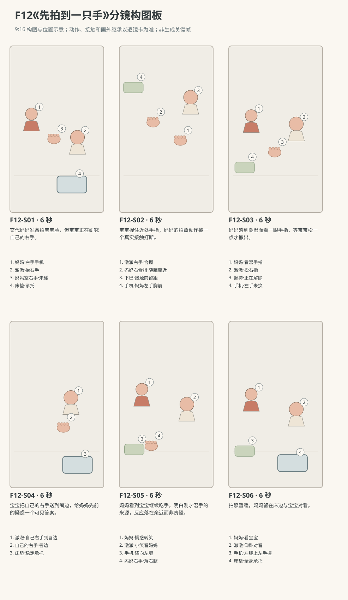

图示为构图位置示意；姿态、接触和画外继承以逐镜正文为准。

### 逐镜设计

#### F12-S01｜00—06 秒｜6 秒｜帧 [0, 144)

**镜头任务：**交代妈妈准备拍宝宝脸，但宝宝正在研究自己的右手。

**景别、机位与构图：**东南朝西北的双人中景，妈妈左、床内澈澈右；妈妈左手竖持手机在胸前、空右手在南栏上方，宝宝面部及两手清楚。

**摄影机与理由：**固定，先把手机和两只不同用途的成人手放清楚，为意外握手作准备。

**焦点：**妈妈左手手机、宝宝脸与近南侧右手同在可辨景深。

**入态：**澈澈仰卧，右指刚离嘴停在下巴下方、左手靠腹；妈妈左手竖持手机在胸前、镜头朝宝宝，右手空悬南栏内侧、离宝宝右掌一小掌远。

**动作与表演：**

- 3 秒：妈妈把左手手机稍抬向自己眼前，微偏手腕给宝宝脸取景；右手保持松开，没有碰脸。

- 3 秒：澈澈眼睛转到妈妈近处的右手，右指展开，右臂从胸前缓慢抬起。

**声音：**轻衣料声和宝宝呼吸，无快门声、对白或音乐。

**出态：**妈妈左手手机已抬到自己下颊前、镜头仍朝宝宝，右手空留栏内；澈澈右掌已抬向妈妈右指但尚未接触、左手靠腹。

**切点与承接：**切同侧近景看首次接触，不预先让成人手指已经在宝宝掌中。

**连续性：**右指刚离嘴为本片原创起态；手机一直属于妈妈左手，未按快门，宝宝身体不抬起。

**开始画面母稿：**

9:16竖幅，原创三维家庭生活动画，圆润而有重量的造型，柔和皮肤层次、哑光棉布与可读的小表情，动作遵循生活物理，不用成人式算计。澈澈暂拟圆润脸颊、深棕眼、短黑绒发、额前右弯小发撮。澈澈穿奶油色棉连体衣。妈妈暂拟深棕低马尾、雾蓝棉上衣、米色长裤。人物与场景参考尚未提供，外观为可替换暂拟设计，未上传或绑定真实素材。本镜起始画面为单一瞬间：澈澈仰卧，右指刚离嘴停在下巴下方、左手靠腹；妈妈左手竖持手机在胸前、镜头朝宝宝，右手空悬南栏内侧、离宝宝右掌一小掌远。 场次方位与光位：N休息角北墙婴儿床、西窗、东门；澈澈R0仰卧，头西脚东、右手在南侧近妈妈、左手在北侧胸腹前，头背臀均由平整床垫承托。妈妈坐床南侧偏西，面朝北略东；手机只在妈妈左手，右手可从南栏上方进入床内，不穿栏。摄影在母婴连线东侧至东南侧，妈妈画左、宝宝画右，床头仍画左。西窗柔光从画左后入、暖墙反射填暗部。手机无可辨品牌和可读界面，未设闪光灯。 摄影构图：东南朝西北的双人中景，妈妈左、床内澈澈右；妈妈左手竖持手机在胸前、空右手在南栏上方，宝宝面部及两手清楚。 当前焦点：妈妈左手手机、宝宝脸与近南侧右手同在可辨景深。 只画这一刻，不拼入后续动作、轨迹、分格、字幕或不存在的持物状态。

**视频变化母稿：**

9:16竖幅，原创三维家庭生活动画，圆润而有重量的造型，柔和皮肤层次、哑光棉布与可读的小表情，动作遵循生活物理，不用成人式算计。澈澈暂拟圆润脸颊、深棕眼、短黑绒发、额前右弯小发撮。澈澈穿奶油色棉连体衣。妈妈暂拟深棕低马尾、雾蓝棉上衣、米色长裤。人物与场景参考尚未提供，外观为可替换暂拟设计，未上传或绑定真实素材。制作一段6秒连续镜头。当前能力：R0仰卧抓握，头背臀由平整床垫承托，不独坐、不站立、不说完整句子。空间光位：N休息角北墙婴儿床、西窗、东门；澈澈R0仰卧，头西脚东、右手在南侧近妈妈、左手在北侧胸腹前，头背臀均由平整床垫承托。妈妈坐床南侧偏西，面朝北略东；手机只在妈妈左手，右手可从南栏上方进入床内，不穿栏。摄影在母婴连线东侧至东南侧，妈妈画左、宝宝画右，床头仍画左。西窗柔光从画左后入、暖墙反射填暗部。手机无可辨品牌和可读界面，未设闪光灯。 起态：澈澈仰卧，右指刚离嘴停在下巴下方、左手靠腹；妈妈左手竖持手机在胸前、镜头朝宝宝，右手空悬南栏内侧、离宝宝右掌一小掌远。 摄影：东南朝西北的双人中景，妈妈左、床内澈澈右；妈妈左手竖持手机在胸前、空右手在南栏上方，宝宝面部及两手清楚。 相机行为：固定，先把手机和两只不同用途的成人手放清楚，为意外握手作准备。 焦点：妈妈左手手机、宝宝脸与近南侧右手同在可辨景深。 时间过程：第1阶段3秒：妈妈把左手手机稍抬向自己眼前，微偏手腕给宝宝脸取景；右手保持松开，没有碰脸。；第2阶段3秒：澈澈眼睛转到妈妈近处的右手，右指展开，右臂从胸前缓慢抬起。。声音：轻衣料声和宝宝呼吸，无快门声、对白或音乐。 终态：妈妈左手手机已抬到自己下颊前、镜头仍朝宝宝，右手空留栏内；澈澈右掌已抬向妈妈右指但尚未接触、左手靠腹。 连续性：右指刚离嘴为本片原创起态；手机一直属于妈妈左手，未按快门，宝宝身体不抬起。 按本镜完整过程到达终态，不在镜内另加切镜、人物、道具或未写出的台词、字幕与旁白。

#### F12-S02｜06—12 秒｜6 秒｜帧 [144, 288)

**镜头任务：**宝宝握住近处手指，妈妈的拍照动作被一个真实接触打断。

**景别、机位与构图：**东侧手部中近景，妈妈右手从画左进入、宝宝右手从画右下抬起；下巴和胸前可见，手机左上边缘和妈妈嘴角入画。

**摄影机与理由：**固定，完整保留空隙到握住再移动的过程，接触不靠切镜。

**焦点：**宝宝右指与妈妈右食指的接触交界，口鼻与指间留距同清楚。

**入态：**宝宝右掌已抬向妈妈右指但尚未接触，左手靠腹；妈妈左手手机在自己下颊前，右手松开留在宝宝右掌前。

**动作与表演：**

- 2 秒：澈澈右指碰上妈妈右食指侧面，随即合拢握住；妈妈右腕放软。

- 2 秒：澈澈把握住的食指朝自己下巴带近一点，停在下巴前方，不送入口中；妈妈顺着这个短小动作让右腕跟随。

- 2 秒：妈妈左手手机降到胸前，视线从屏幕移到两人握着的手，嘴角从拍照笑变为一点疑惑。

**声音：**皮肤与袖口轻声、宝宝轻鼻音，无对白、快门或音乐。

**出态：**宝宝右指握住妈妈右食指，停在宝宝下巴前、未碰嘴；妈妈左手手机已回胸前，正低头看握手。

**切点与承接：**沿妈妈低头的视线接发现湿手的反应。

**连续性：**具体握哪根指与带近下巴是原创；只移一小段，不牵起宝宝上身、不碰鼻口；妈妈食指从未入口。

**开始画面母稿：**

9:16竖幅，原创三维家庭生活动画，圆润而有重量的造型，柔和皮肤层次、哑光棉布与可读的小表情，动作遵循生活物理，不用成人式算计。澈澈暂拟圆润脸颊、深棕眼、短黑绒发、额前右弯小发撮。澈澈穿奶油色棉连体衣。妈妈暂拟深棕低马尾、雾蓝棉上衣、米色长裤。人物与场景参考尚未提供，外观为可替换暂拟设计，未上传或绑定真实素材。本镜起始画面为单一瞬间：宝宝右掌已抬向妈妈右指但尚未接触，左手靠腹；妈妈左手手机在自己下颊前，右手松开留在宝宝右掌前。 场次方位与光位：N休息角北墙婴儿床、西窗、东门；澈澈R0仰卧，头西脚东、右手在南侧近妈妈、左手在北侧胸腹前，头背臀均由平整床垫承托。妈妈坐床南侧偏西，面朝北略东；手机只在妈妈左手，右手可从南栏上方进入床内，不穿栏。摄影在母婴连线东侧至东南侧，妈妈画左、宝宝画右，床头仍画左。西窗柔光从画左后入、暖墙反射填暗部。手机无可辨品牌和可读界面，未设闪光灯。 摄影构图：东侧手部中近景，妈妈右手从画左进入、宝宝右手从画右下抬起；下巴和胸前可见，手机左上边缘和妈妈嘴角入画。 当前焦点：宝宝右掌与妈妈右食指之间的间隙清楚，双方尚未接触，手指与宝宝口鼻仍有距离。 只画这一刻，不拼入后续动作、轨迹、分格、字幕或不存在的持物状态。

**视频变化母稿：**

9:16竖幅，原创三维家庭生活动画，圆润而有重量的造型，柔和皮肤层次、哑光棉布与可读的小表情，动作遵循生活物理，不用成人式算计。澈澈暂拟圆润脸颊、深棕眼、短黑绒发、额前右弯小发撮。澈澈穿奶油色棉连体衣。妈妈暂拟深棕低马尾、雾蓝棉上衣、米色长裤。人物与场景参考尚未提供，外观为可替换暂拟设计，未上传或绑定真实素材。制作一段6秒连续镜头。当前能力：R0仰卧抓握，头背臀由平整床垫承托，不独坐、不站立、不说完整句子。空间光位：N休息角北墙婴儿床、西窗、东门；澈澈R0仰卧，头西脚东、右手在南侧近妈妈、左手在北侧胸腹前，头背臀均由平整床垫承托。妈妈坐床南侧偏西，面朝北略东；手机只在妈妈左手，右手可从南栏上方进入床内，不穿栏。摄影在母婴连线东侧至东南侧，妈妈画左、宝宝画右，床头仍画左。西窗柔光从画左后入、暖墙反射填暗部。手机无可辨品牌和可读界面，未设闪光灯。 起态：宝宝右掌已抬向妈妈右指但尚未接触，左手靠腹；妈妈左手手机在自己下颊前，右手松开留在宝宝右掌前。 摄影：东侧手部中近景，妈妈右手从画左进入、宝宝右手从画右下抬起；下巴和胸前可见，手机左上边缘和妈妈嘴角入画。 相机行为：固定，完整保留空隙到握住再移动的过程，接触不靠切镜。 焦点：宝宝右指与妈妈右食指的接触交界，口鼻与指间留距同清楚。 时间过程：第1阶段2秒：澈澈右指碰上妈妈右食指侧面，随即合拢握住；妈妈右腕放软。；第2阶段2秒：澈澈把握住的食指朝自己下巴带近一点，停在下巴前方，不送入口中；妈妈顺着这个短小动作让右腕跟随。；第3阶段2秒：妈妈左手手机降到胸前，视线从屏幕移到两人握着的手，嘴角从拍照笑变为一点疑惑。。声音：皮肤与袖口轻声、宝宝轻鼻音，无对白、快门或音乐。 终态：宝宝右指握住妈妈右食指，停在宝宝下巴前、未碰嘴；妈妈左手手机已回胸前，正低头看握手。 连续性：具体握哪根指与带近下巴是原创；只移一小段，不牵起宝宝上身、不碰鼻口；妈妈食指从未入口。 按本镜完整过程到达终态，不在镜内另加切镜、人物、道具或未写出的台词、字幕与旁白。

#### F12-S03｜12—18 秒｜6 秒｜帧 [288, 432)

**镜头任务：**妈妈感到潮湿而看一眼手指，等宝宝松一点才撤出。

**景别、机位与构图：**东南双人中近景，妈妈低头脸画左、宝宝脸画右、相握的右手在中央下部，左手手机留左下。

**摄影机与理由：**固定，留出感到湿、短暂检查、宝宝松指与成人撤手的顺序，不做夸张甩手。

**焦点：**中央手指与妈妈轻抬的眉；宝宝嘴部仍可辨。

**入态：**宝宝右指握妈妈右食指、停下巴前未触嘴；妈妈左手手机在胸前，右腕松着，低头看握手。

**动作与表演：**

- 2 秒：妈妈感觉指侧潮湿，微抬眉，右食指轻转让指侧在窗光里露出一小片湿润光泽。

- 2 秒：澈澈右指松开一点、目光转向自己的指头；妈妈随松动缓缓把食指向南退出。

- 2 秒：妈妈空右手退到南栏外胸前，看一眼指侧；宝宝右掌停在下巴下，五指半合。

**声音：**一口很轻的疑惑鼻息和衣料声，不加黏腻音效、对白或音乐。

**出态：**妈妈右手已完全脱离宝宝右手、退至胸前，左手仍持手机；宝宝右手半合停下巴下、左手靠腹。

**切点与承接：**切宝宝自己把手送回嘴边，不用切镜把成人手换成宝宝手。

**连续性：**撤出前宝宝指头先松，不能硬掰或抽拉；一点湿润仅是表面反光，不形成夸张水滴。成人手已离开才让宝宝开始后续动作。

**开始画面母稿：**

9:16竖幅，原创三维家庭生活动画，圆润而有重量的造型，柔和皮肤层次、哑光棉布与可读的小表情，动作遵循生活物理，不用成人式算计。澈澈暂拟圆润脸颊、深棕眼、短黑绒发、额前右弯小发撮。澈澈穿奶油色棉连体衣。妈妈暂拟深棕低马尾、雾蓝棉上衣、米色长裤。人物与场景参考尚未提供，外观为可替换暂拟设计，未上传或绑定真实素材。本镜起始画面为单一瞬间：宝宝右指握妈妈右食指、停下巴前未触嘴；妈妈左手手机在胸前，右腕松着，低头看握手。 场次方位与光位：N休息角北墙婴儿床、西窗、东门；澈澈R0仰卧，头西脚东、右手在南侧近妈妈、左手在北侧胸腹前，头背臀均由平整床垫承托。妈妈坐床南侧偏西，面朝北略东；手机只在妈妈左手，右手可从南栏上方进入床内，不穿栏。摄影在母婴连线东侧至东南侧，妈妈画左、宝宝画右，床头仍画左。西窗柔光从画左后入、暖墙反射填暗部。手机无可辨品牌和可读界面，未设闪光灯。 摄影构图：东南双人中近景，妈妈低头脸画左、宝宝脸画右、相握的右手在中央下部，左手手机留左下。 当前焦点：中央相握手指与妈妈低头疑惑的面部清楚；眉毛尚未抬起，宝宝嘴部可辨。 只画这一刻，不拼入后续动作、轨迹、分格、字幕或不存在的持物状态。

**视频变化母稿：**

9:16竖幅，原创三维家庭生活动画，圆润而有重量的造型，柔和皮肤层次、哑光棉布与可读的小表情，动作遵循生活物理，不用成人式算计。澈澈暂拟圆润脸颊、深棕眼、短黑绒发、额前右弯小发撮。澈澈穿奶油色棉连体衣。妈妈暂拟深棕低马尾、雾蓝棉上衣、米色长裤。人物与场景参考尚未提供，外观为可替换暂拟设计，未上传或绑定真实素材。制作一段6秒连续镜头。当前能力：R0仰卧抓握，头背臀由平整床垫承托，不独坐、不站立、不说完整句子。空间光位：N休息角北墙婴儿床、西窗、东门；澈澈R0仰卧，头西脚东、右手在南侧近妈妈、左手在北侧胸腹前，头背臀均由平整床垫承托。妈妈坐床南侧偏西，面朝北略东；手机只在妈妈左手，右手可从南栏上方进入床内，不穿栏。摄影在母婴连线东侧至东南侧，妈妈画左、宝宝画右，床头仍画左。西窗柔光从画左后入、暖墙反射填暗部。手机无可辨品牌和可读界面，未设闪光灯。 起态：宝宝右指握妈妈右食指、停下巴前未触嘴；妈妈左手手机在胸前，右腕松着，低头看握手。 摄影：东南双人中近景，妈妈低头脸画左、宝宝脸画右、相握的右手在中央下部，左手手机留左下。 相机行为：固定，留出感到湿、短暂检查、宝宝松指与成人撤手的顺序，不做夸张甩手。 焦点：中央手指与妈妈轻抬的眉；宝宝嘴部仍可辨。 时间过程：第1阶段2秒：妈妈感觉指侧潮湿，微抬眉，右食指轻转让指侧在窗光里露出一小片湿润光泽。；第2阶段2秒：澈澈右指松开一点、目光转向自己的指头；妈妈随松动缓缓把食指向南退出。；第3阶段2秒：妈妈空右手退到南栏外胸前，看一眼指侧；宝宝右掌停在下巴下，五指半合。。声音：一口很轻的疑惑鼻息和衣料声，不加黏腻音效、对白或音乐。 终态：妈妈右手已完全脱离宝宝右手、退至胸前，左手仍持手机；宝宝右手半合停下巴下、左手靠腹。 连续性：撤出前宝宝指头先松，不能硬掰或抽拉；一点湿润仅是表面反光，不形成夸张水滴。成人手已离开才让宝宝开始后续动作。 按本镜完整过程到达终态，不在镜内另加切镜、人物、道具或未写出的台词、字幕与旁白。

#### F12-S04｜18—24 秒｜6 秒｜帧 [432, 576)

**镜头任务：**宝宝把自己的右手送到嘴边，给妈妈先前的疑惑一个可见答案。

**景别、机位与构图：**床东略南朝西的宝宝中近景，脸、自己右手和胸腹可见；妈妈空右手在画左外，手机由画外妈妈左手持有。

**摄影机与理由：**固定，完整看到宝宝自己手从下巴下移动到唇边，避免手掌瞬移。

**焦点：**宝宝自己的右指关节与唇边接触清楚，眼神仍向南侧妈妈。

**入态：**澈澈右手半合停下巴下、左手靠腹，成人右手已退出且在画外胸前，妈妈左手持手机为画外继承。

**动作与表演：**

- 2 秒：澈澈抬右腕，将自己的右手指关节缓慢送向嘴边。

- 2 秒：唇边轻贴自己的右指关节，嘴唇小幅活动，眼睛仍看南侧妈妈。

- 2 秒：他把右手微微移开一点，露出一点笑，左手仍松在腹前。

**声音：**宝宝轻小口腔声、鼻息与呼吸，无成人对白、音乐或夸张吮吸声。

**出态：**澈澈右手在自己唇边微离、露出小笑；左手腹前，仰卧支撑不变，成人双手均画外继承。

**切点与承接：**接妈妈反应的共享镜，宝宝手仍在唇边微离。

**连续性：**这只手始终是宝宝自己的右手，妈妈右手没有再进入；不凭此推断宝宝故意把湿手抹给妈妈。

**开始画面母稿：**

9:16竖幅，原创三维家庭生活动画，圆润而有重量的造型，柔和皮肤层次、哑光棉布与可读的小表情，动作遵循生活物理，不用成人式算计。澈澈暂拟圆润脸颊、深棕眼、短黑绒发、额前右弯小发撮。澈澈穿奶油色棉连体衣。妈妈暂拟深棕低马尾、雾蓝棉上衣、米色长裤。人物与场景参考尚未提供，外观为可替换暂拟设计，未上传或绑定真实素材。本镜起始画面为单一瞬间：澈澈右手半合停下巴下、左手靠腹，成人右手已退出且在画外胸前，妈妈左手持手机为画外继承。 场次方位与光位：N休息角北墙婴儿床、西窗、东门；澈澈R0仰卧，头西脚东、右手在南侧近妈妈、左手在北侧胸腹前，头背臀均由平整床垫承托。妈妈坐床南侧偏西，面朝北略东；手机只在妈妈左手，右手可从南栏上方进入床内，不穿栏。摄影在母婴连线东侧至东南侧，妈妈画左、宝宝画右，床头仍画左。西窗柔光从画左后入、暖墙反射填暗部。手机无可辨品牌和可读界面，未设闪光灯。 摄影构图：床东略南朝西的宝宝中近景，脸、自己右手和胸腹可见；妈妈空右手在画左外，手机由画外妈妈左手持有。 当前焦点：宝宝半合右手停在下巴下，与嘴唇间隙清楚；目光朝南侧妈妈，指关节尚未贴唇。 只画这一刻，不拼入后续动作、轨迹、分格、字幕或不存在的持物状态。

**视频变化母稿：**

9:16竖幅，原创三维家庭生活动画，圆润而有重量的造型，柔和皮肤层次、哑光棉布与可读的小表情，动作遵循生活物理，不用成人式算计。澈澈暂拟圆润脸颊、深棕眼、短黑绒发、额前右弯小发撮。澈澈穿奶油色棉连体衣。妈妈暂拟深棕低马尾、雾蓝棉上衣、米色长裤。人物与场景参考尚未提供，外观为可替换暂拟设计，未上传或绑定真实素材。制作一段6秒连续镜头。当前能力：R0仰卧抓握，头背臀由平整床垫承托，不独坐、不站立、不说完整句子。空间光位：N休息角北墙婴儿床、西窗、东门；澈澈R0仰卧，头西脚东、右手在南侧近妈妈、左手在北侧胸腹前，头背臀均由平整床垫承托。妈妈坐床南侧偏西，面朝北略东；手机只在妈妈左手，右手可从南栏上方进入床内，不穿栏。摄影在母婴连线东侧至东南侧，妈妈画左、宝宝画右，床头仍画左。西窗柔光从画左后入、暖墙反射填暗部。手机无可辨品牌和可读界面，未设闪光灯。 起态：澈澈右手半合停下巴下、左手靠腹，成人右手已退出且在画外胸前，妈妈左手持手机为画外继承。 摄影：床东略南朝西的宝宝中近景，脸、自己右手和胸腹可见；妈妈空右手在画左外，手机由画外妈妈左手持有。 相机行为：固定，完整看到宝宝自己手从下巴下移动到唇边，避免手掌瞬移。 焦点：宝宝自己的右指关节与唇边接触清楚，眼神仍向南侧妈妈。 时间过程：第1阶段2秒：澈澈抬右腕，将自己的右手指关节缓慢送向嘴边。；第2阶段2秒：唇边轻贴自己的右指关节，嘴唇小幅活动，眼睛仍看南侧妈妈。；第3阶段2秒：他把右手微微移开一点，露出一点笑，左手仍松在腹前。。声音：宝宝轻小口腔声、鼻息与呼吸，无成人对白、音乐或夸张吮吸声。 终态：澈澈右手在自己唇边微离、露出小笑；左手腹前，仰卧支撑不变，成人双手均画外继承。 连续性：这只手始终是宝宝自己的右手，妈妈右手没有再进入；不凭此推断宝宝故意把湿手抹给妈妈。 按本镜完整过程到达终态，不在镜内另加切镜、人物、道具或未写出的台词、字幕与旁白。

#### F12-S05｜24—30 秒｜6 秒｜帧 [576, 720)

**镜头任务：**妈妈看到宝宝继续吃手，明白刚才湿手的来源，反应落在亲近而非责怪。

**景别、机位与构图：**东南双人中景，妈妈左、澈澈右，两人眼线与各自右手同框，妈妈左手手机在胸前可见。

**摄影机与理由：**固定，保持宝宝小动作和妈妈反应在同一画面，不把笑变为夸张审判。

**焦点：**妈妈嘴角从疑惑转松、宝宝唇边右手与小笑都清楚。

**入态：**妈妈空右手停自己胸前，左手手机仍在胸前；澈澈右手微离唇边、露小笑，正看妈妈。

**动作与表演：**

- 2 秒：妈妈先看见宝宝唇边的右手，再看一眼自己指侧，眉头和肩膀同时松开。

- 2 秒：她抿一下笑，没有责怪或拨开宝宝手；澈澈右手自然落回下巴下，目光继续看她。

- 2 秒：妈妈把左手手机缓慢降向自己左腿，右手也落回右腿；宝宝嘴角留一点小笑。

**声音：**妈妈一点短笑气、衣料声，宝宝轻呼吸；无台词、快门声或配乐。

**出态：**手机仍在妈妈左手但已降到左腿，右手落右腿；澈澈右手下巴下、左手腹前，双方带小笑。

**切点与承接：**接稍宽收尾，看原本的拍照暂缓而目光留在宝宝身上。

**连续性：**妈妈先看见宝宝动作才转笑，手机不换手、不凭空落桌；尚未拍成照片，不把原帖未知结局补成成功自拍。

**开始画面母稿：**

9:16竖幅，原创三维家庭生活动画，圆润而有重量的造型，柔和皮肤层次、哑光棉布与可读的小表情，动作遵循生活物理，不用成人式算计。澈澈暂拟圆润脸颊、深棕眼、短黑绒发、额前右弯小发撮。澈澈穿奶油色棉连体衣。妈妈暂拟深棕低马尾、雾蓝棉上衣、米色长裤。人物与场景参考尚未提供，外观为可替换暂拟设计，未上传或绑定真实素材。本镜起始画面为单一瞬间：妈妈空右手停自己胸前，左手手机仍在胸前；澈澈右手微离唇边、露小笑，正看妈妈。 场次方位与光位：N休息角北墙婴儿床、西窗、东门；澈澈R0仰卧，头西脚东、右手在南侧近妈妈、左手在北侧胸腹前，头背臀均由平整床垫承托。妈妈坐床南侧偏西，面朝北略东；手机只在妈妈左手，右手可从南栏上方进入床内，不穿栏。摄影在母婴连线东侧至东南侧，妈妈画左、宝宝画右，床头仍画左。西窗柔光从画左后入、暖墙反射填暗部。手机无可辨品牌和可读界面，未设闪光灯。 摄影构图：东南双人中景，妈妈左、澈澈右，两人眼线与各自右手同框，妈妈左手手机在胸前可见。 当前焦点：妈妈嘴角从疑惑转松、宝宝唇边右手与小笑都清楚。 只画这一刻，不拼入后续动作、轨迹、分格、字幕或不存在的持物状态。

**视频变化母稿：**

9:16竖幅，原创三维家庭生活动画，圆润而有重量的造型，柔和皮肤层次、哑光棉布与可读的小表情，动作遵循生活物理，不用成人式算计。澈澈暂拟圆润脸颊、深棕眼、短黑绒发、额前右弯小发撮。澈澈穿奶油色棉连体衣。妈妈暂拟深棕低马尾、雾蓝棉上衣、米色长裤。人物与场景参考尚未提供，外观为可替换暂拟设计，未上传或绑定真实素材。制作一段6秒连续镜头。当前能力：R0仰卧抓握，头背臀由平整床垫承托，不独坐、不站立、不说完整句子。空间光位：N休息角北墙婴儿床、西窗、东门；澈澈R0仰卧，头西脚东、右手在南侧近妈妈、左手在北侧胸腹前，头背臀均由平整床垫承托。妈妈坐床南侧偏西，面朝北略东；手机只在妈妈左手，右手可从南栏上方进入床内，不穿栏。摄影在母婴连线东侧至东南侧，妈妈画左、宝宝画右，床头仍画左。西窗柔光从画左后入、暖墙反射填暗部。手机无可辨品牌和可读界面，未设闪光灯。 起态：妈妈空右手停自己胸前，左手手机仍在胸前；澈澈右手微离唇边、露小笑，正看妈妈。 摄影：东南双人中景，妈妈左、澈澈右，两人眼线与各自右手同框，妈妈左手手机在胸前可见。 相机行为：固定，保持宝宝小动作和妈妈反应在同一画面，不把笑变为夸张审判。 焦点：妈妈嘴角从疑惑转松、宝宝唇边右手与小笑都清楚。 时间过程：第1阶段2秒：妈妈先看见宝宝唇边的右手，再看一眼自己指侧，眉头和肩膀同时松开。；第2阶段2秒：她抿一下笑，没有责怪或拨开宝宝手；澈澈右手自然落回下巴下，目光继续看她。；第3阶段2秒：妈妈把左手手机缓慢降向自己左腿，右手也落回右腿；宝宝嘴角留一点小笑。。声音：妈妈一点短笑气、衣料声，宝宝轻呼吸；无台词、快门声或配乐。 终态：手机仍在妈妈左手但已降到左腿，右手落右腿；澈澈右手下巴下、左手腹前，双方带小笑。 连续性：妈妈先看见宝宝动作才转笑，手机不换手、不凭空落桌；尚未拍成照片，不把原帖未知结局补成成功自拍。 按本镜完整过程到达终态，不在镜内另加切镜、人物、道具或未写出的台词、字幕与旁白。

#### F12-S06｜30—36 秒｜6 秒｜帧 [720, 864)

**镜头任务：**拍照暂缓，妈妈留在床边与宝宝对看。

**景别、机位与构图：**东南稍宽中全景，妈妈脸到膝与床内宝宝全身有支撑的状态可读；手机在妈妈左腿上由左手握着。

**摄影机与理由：**固定，以完整承托和两人安静对看结束，不用相机界面替情绪下结论。

**焦点：**两人眼睛与手机左手归属清晰，宝宝右手下巴下保持可辨。

**入态：**妈妈左手握手机靠左腿、空右手落右腿，带笑看宝宝；澈澈右手下巴下、左手腹前，仰卧看妈妈。

**动作与表演：**

- 3 秒：妈妈没有再次举起手机，身体轻向床边靠一点，眼睛留在澈澈脸上。

- 3 秒：澈澈右指再轻轻张合，嘴角放松；妈妈随他小动作笑一下，保持双手各自位置。

**声音：**自然呼吸与一点笑气，无对白、快门、音乐或旁白。

**出态：**妈妈仍左手持手机在左腿、右手空在右腿，澈澈仰卧、右手下巴下、左手腹前，安静对看。

**切点与承接：**在未拍照的对看中结束，不追加手机里成片或已成功拍摄的画面。

**连续性：**从头到尾只有妈妈左手持手机；宝宝头背臀落床垫，没有拉坐、抬抱或新的接触。

**开始画面母稿：**

9:16竖幅，原创三维家庭生活动画，圆润而有重量的造型，柔和皮肤层次、哑光棉布与可读的小表情，动作遵循生活物理，不用成人式算计。澈澈暂拟圆润脸颊、深棕眼、短黑绒发、额前右弯小发撮。澈澈穿奶油色棉连体衣。妈妈暂拟深棕低马尾、雾蓝棉上衣、米色长裤。人物与场景参考尚未提供，外观为可替换暂拟设计，未上传或绑定真实素材。本镜起始画面为单一瞬间：妈妈左手握手机靠左腿、空右手落右腿，带笑看宝宝；澈澈右手下巴下、左手腹前，仰卧看妈妈。 场次方位与光位：N休息角北墙婴儿床、西窗、东门；澈澈R0仰卧，头西脚东、右手在南侧近妈妈、左手在北侧胸腹前，头背臀均由平整床垫承托。妈妈坐床南侧偏西，面朝北略东；手机只在妈妈左手，右手可从南栏上方进入床内，不穿栏。摄影在母婴连线东侧至东南侧，妈妈画左、宝宝画右，床头仍画左。西窗柔光从画左后入、暖墙反射填暗部。手机无可辨品牌和可读界面，未设闪光灯。 摄影构图：东南稍宽中全景，妈妈脸到膝与床内宝宝全身有支撑的状态可读；手机在妈妈左腿上由左手握着。 当前焦点：两人眼睛与手机左手归属清晰，宝宝右手下巴下保持可辨。 只画这一刻，不拼入后续动作、轨迹、分格、字幕或不存在的持物状态。

**视频变化母稿：**

9:16竖幅，原创三维家庭生活动画，圆润而有重量的造型，柔和皮肤层次、哑光棉布与可读的小表情，动作遵循生活物理，不用成人式算计。澈澈暂拟圆润脸颊、深棕眼、短黑绒发、额前右弯小发撮。澈澈穿奶油色棉连体衣。妈妈暂拟深棕低马尾、雾蓝棉上衣、米色长裤。人物与场景参考尚未提供，外观为可替换暂拟设计，未上传或绑定真实素材。制作一段6秒连续镜头。当前能力：R0仰卧抓握，头背臀由平整床垫承托，不独坐、不站立、不说完整句子。空间光位：N休息角北墙婴儿床、西窗、东门；澈澈R0仰卧，头西脚东、右手在南侧近妈妈、左手在北侧胸腹前，头背臀均由平整床垫承托。妈妈坐床南侧偏西，面朝北略东；手机只在妈妈左手，右手可从南栏上方进入床内，不穿栏。摄影在母婴连线东侧至东南侧，妈妈画左、宝宝画右，床头仍画左。西窗柔光从画左后入、暖墙反射填暗部。手机无可辨品牌和可读界面，未设闪光灯。 起态：妈妈左手握手机靠左腿、空右手落右腿，带笑看宝宝；澈澈右手下巴下、左手腹前，仰卧看妈妈。 摄影：东南稍宽中全景，妈妈脸到膝与床内宝宝全身有支撑的状态可读；手机在妈妈左腿上由左手握着。 相机行为：固定，以完整承托和两人安静对看结束，不用相机界面替情绪下结论。 焦点：两人眼睛与手机左手归属清晰，宝宝右手下巴下保持可辨。 时间过程：第1阶段3秒：妈妈没有再次举起手机，身体轻向床边靠一点，眼睛留在澈澈脸上。；第2阶段3秒：澈澈右指再轻轻张合，嘴角放松；妈妈随他小动作笑一下，保持双手各自位置。。声音：自然呼吸与一点笑气，无对白、快门、音乐或旁白。 终态：妈妈仍左手持手机在左腿、右手空在右腿，澈澈仰卧、右手下巴下、左手腹前，安静对看。 连续性：从头到尾只有妈妈左手持手机；宝宝头背臀落床垫，没有拉坐、抬抱或新的接触。 按本镜完整过程到达终态，不在镜内另加切镜、人物、道具或未写出的台词、字幕与旁白。

### 声音与剪辑

无对白、无音乐、无快门。只留手机衣料声、自然婴儿轻口腔声与呼吸，妈妈发现后一点笑气；不加口水夸张音效。

正式台词：无；保留镜头声音中已写明的自然发声。

### 连续性与试片

- 连续性：R0仰卧，头背臀持续由床垫承托；右手是抓握和回到嘴边的同一只，左手留腹前。

- 连续性：手机全片妈妈左手，妈妈右食指是唯一被握的成人指；成人食指始终未入口。

- 连续性：先宝宝松指、妈妈再撤手；成人手完全离开后宝宝自己的右手才到唇边，不做替换错手。

- 连续性：手湿不等于故意擦口水；不加得逞台词、挑眉计谋或故意恶作剧说明。

- 连续性：没有按快门或照片成片，拍照是否成功不作为来源事实；具体取景与暂停流程为原创。

- 试片：F12-S01—S03检查手机一直在妈妈左手，接触从无到有、握住、宝宝放松、妈妈撤出全程可追踪；若手指瞬移、硬掰或成人指入口则失败。

- 试片：F12-S03—S04检查妈妈右手完全退出后，宝宝自己的右手才从下巴下到唇边；四指与拇指数量清楚、嘴鼻未被捂。

- 试片：F12-S05—S06检查妈妈先看到宝宝动作才转笑，最终手机左腿未按快门；不能用原帖未知的拍照成功来收尾。

**媒体待验证：**本次交付为完整故事、分镜与提示词文字设计，未生成或审看实际图像、视频、音轨。人物和场景参考未提供；逐镜首帧、手指接触、面部表演、对白发音、身体平衡与相邻剪点均待实际素材核对，不以结构检查代替媒体质量。

---

## F13《妈妈的手要去哪》

**36 秒｜稳步行走与初语｜角色：澈澈、妈妈｜场景 L**

### 剧情正文

客厅沙发前的低桌上开着电脑，妈妈坐在西半边处理事情，澈澈在东南地垫上看两块软积木。他抬头望一眼妈妈的右手，走过来，左掌碰到她手腕，轻轻“嗯”一声，右手指回玩具。妈妈停下触控板，低头看他。小手握住她的右食指，往那边带一点。妈妈说：“等妈妈一下。”澈澈松开手，走回地垫，蹲下摸了摸积木，又放回去。他再看看妈妈，站起来又走回同一个地方，重新牵住那根食指。妈妈停住，看着他，空着的左手按一下键，慢慢把电脑合上。“走，陪你玩。”她双脚踩稳，自己站起来，澈澈等她起身才一起走。到了积木旁，他松开手。妈妈蹲低，他把软积木推到她面前；这回，那只手停在玩具旁边。

### 亲述来源与改编

原帖是家长自述，未独立核实。本片将生活机制改编为澈澈的原创故事。

- [RT06 · 妈妈一开电脑，就来牵手叫陪玩](https://feitravel.tw/p-5062220628/)；作者自报年龄：日记该条明确标1Y8M16D。

- **采用的生活过程：**妈妈打开电脑做事；孩子自己玩不久就走来牵妈妈的手求陪玩，并有反复发生。

- **本片原创改编：**用两次完整往返代表原帖多次牵手，精确手位、软积木、两句中文台词与每次成人回应均为原创。

- **本片原创改编：**妈妈合电脑、主动跟去玩，是为本片补写的原创结尾；原帖是儿歌跳舞节目开始后停止反复来牵手。

- **不作出的事实推断：**不声称原帖妈妈关电脑或逐次起身陪玩。

- **不作出的事实推断：**RT06自报1岁8个月16天，页面发布日期不能当作事件年份；公开亲述未独立核实。

- **不作出的事实推断：**不将节目转移注意或本片的陪玩选择写成保证有效的育儿方法。

[查看原始过程与缺项](research/real-experiences/index.html#RT06)

### 导演与空间

**观察任务：**从孩子反复来牵手的可见邀请，走到妈妈自主暂停工作、把注意转回共同游戏的原创结尾。

**空间与光位：**L客厅北墙沙发、西窗、东侧走廊，中央奶油地垫。成长后的澈澈为R4稳步行走与初语，不是R1有靠坐婴儿。妈妈坐沙发西半朝南，低桌在其膝前南侧，灰色笔记本电脑居桌面北半；妈妈操作电脑时左手用键盘、右手用触控板，双手具体位置按本镜起态。澈澈的软积木在地垫东南，距妈妈两三个幼儿短步，平地路线无遮挡。主摄影南侧朝北，妈妈画左、宝宝画右，电脑屏幕背向观众，西窗柔光来自画左。

**人物表演：**妈妈确有未完的电脑任务，第一次让孩子等；孩子回玩具后仍需要同伴，再次来找。邀请只用轻握与指向，不哭闹、不拖拽，不把母亲的迟延演成冷漠。第二次妈妈合盖是当下选择。

### 节拍覆盖

- **F13-b1**：把妈妈处理电脑与孩子独自玩的两项任务同时建立。 前态：妈妈左指在电脑键盘、右手在触控板，目光屏幕；澈澈站在东南地垫，双手空放身侧，两块软积木在脚前，正看积木。 后态：澈澈站妈妈右膝南侧、双手空，已看向妈妈右手；妈妈仍左手键盘右手触控板、目光屏幕。 → F13-S01

- **F13-b2**：孩子用牵手与指向表达邀请，妈妈确实先暂停右手才回应。 前态：孩子站妈妈右膝南侧、双手空，望妈妈右手；妈妈右手触控板、左手键盘，目光屏幕。 后态：孩子左手轻握妈妈右食指、右手指向积木；妈妈右手离电脑随腕让位、左手停键，低头看孩子，仍坐沙发。 → F13-S02

- **F13-b3**：妈妈短暂让孩子先等，孩子放手回到玩具，保留各自目标。 前态：孩子左手握妈妈右食指、右手指积木；妈妈右手离电脑，左手停在键盘边，低头看孩子。 后态：孩子站回东南积木旁、双手空、身体半朝妈妈；妈妈左右手回到电脑，目光屏幕，第一次牵手已解除。 → F13-S03

- **F13-b4**：孩子刚回到玩具又转向同一只手，让邀请的反复具体可见。 前态：孩子站东南积木旁、身体半朝妈妈、双手空；妈妈左手键盘右手触控板，正看屏幕。 后态：第二次邀请已成立：孩子左手轻握妈妈右食指、右手指积木；妈妈右手已离开电脑、低头看孩子，左手也停键。 → F13-S04

- **F13-b5**：妈妈选择暂停电脑，把原本被牵走的手主动交给孩子。 前态：孩子左手轻握妈妈右食指、右手指积木，妈妈右手离电脑随腕放松、左手停键，目光已在孩子。 后态：电脑合在桌上，妈妈双脚踏稳、身体前移准备起身，右食指仍被孩子左手轻握；孩子半转向地垫站稳等待。 → F13-S05

- **F13-b6**：两人来到原来的玩具区，妈妈真正参加孩子原先的活动。 前态：妈妈双脚踏稳正准备起身，右食指被孩子左手轻握；孩子半朝玩具站稳等她，电脑合在左后桌上。 后态：母子蹲在两块积木旁，孩子双手已松开成人，妈妈右手空停积木旁、左手近自己膝；合盖电脑留左后桌上。 → F13-S06

### 分镜构图板

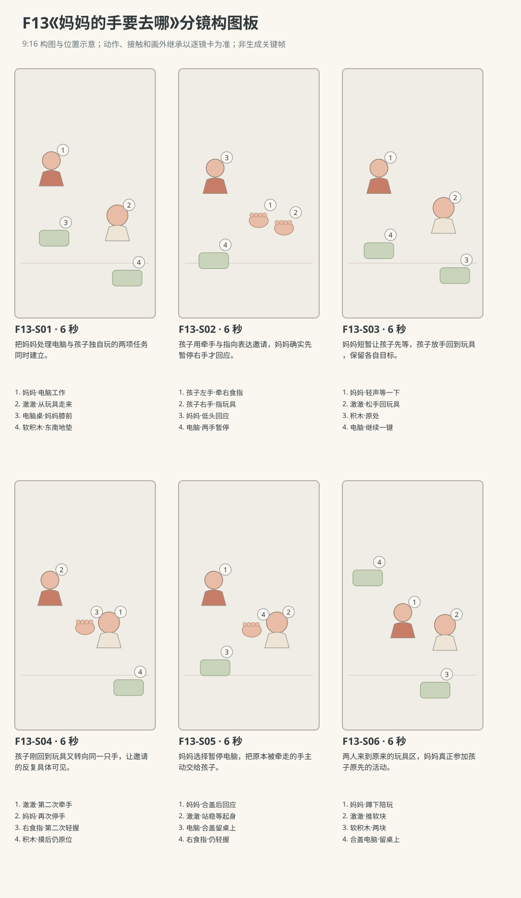

图示为构图位置示意；姿态、接触和画外继承以逐镜正文为准。

### 逐镜设计

#### F13-S01｜00—06 秒｜6 秒｜帧 [0, 144)

**镜头任务：**把妈妈处理电脑与孩子独自玩的两项任务同时建立。

**景别、机位与构图：**南侧朝北中全景，妈妈画左坐沙发、电脑桌在左前，澈澈画右在地垫，软积木在其脚前；两三步路线完整。

**摄影机与理由：**固定，先让观众看清孩子确实从玩具处过来，而非突然出现在成人腿边。

**焦点：**妈妈右手在触控板、孩子由积木抬起的眼睛与平地路线同清楚。

**入态：**妈妈左指在电脑键盘、右手在触控板，目光屏幕；澈澈站在东南地垫，双手空放身侧，两块软积木在脚前，正看积木。

**动作与表演：**

- 2 秒：妈妈左指按两下键，右指轻滑触控板，继续看屏幕。

- 2 秒：澈澈从积木抬眼看妈妈的右手，身体转向西北。

- 2 秒：他空着双手走两个短步到妈妈右膝南侧，在离桌角一小步处站稳。

**声音：**电脑轻键声、棉袜踩地垫声与呼吸，无对白或音乐。

**出态：**澈澈站妈妈右膝南侧、双手空，已看向妈妈右手；妈妈仍左手键盘右手触控板、目光屏幕。

**切点与承接：**接手部邀请，从尚未碰到成人手开始。

**连续性：**孩子为R4有行走能力，短步不过桌角，不攀桌或碰电脑；两块积木仍原地。

**开始画面母稿：**

9:16竖幅，原创三维家庭生活动画，圆润而有重量的造型，柔和皮肤层次、哑光棉布与可读的小表情，动作遵循生活物理，不用成人式算计。澈澈暂拟圆润脸颊、深棕眼、短黑绒发、额前右弯小发撮。成长后的幼儿澈澈穿奶油色棉上衣、鼠尾草色棉长裤。妈妈暂拟深棕低马尾、雾蓝棉上衣、米色长裤。人物与场景参考尚未提供，外观为可替换暂拟设计，未上传或绑定真实素材。本镜起始画面为单一瞬间：妈妈左指在电脑键盘、右手在触控板，目光屏幕；澈澈站在东南地垫，双手空放身侧，两块软积木在脚前，正看积木。 场次方位与光位：L客厅北墙沙发、西窗、东侧走廊，中央奶油地垫。成长后的澈澈为R4稳步行走与初语，不是R1有靠坐婴儿。妈妈坐沙发西半朝南，低桌在其膝前南侧，灰色笔记本电脑居桌面北半；妈妈操作电脑时左手用键盘、右手用触控板，双手具体位置按本镜起态。澈澈的软积木在地垫东南，距妈妈两三个幼儿短步，平地路线无遮挡。主摄影南侧朝北，妈妈画左、宝宝画右，电脑屏幕背向观众，西窗柔光来自画左。 摄影构图：南侧朝北中全景，妈妈画左坐沙发、电脑桌在左前，澈澈画右在地垫，软积木在其脚前；两三步路线完整。 当前焦点：妈妈触控板上的右手、看屏幕的脸与孩子正看积木的双眼处于清楚范围；孩子双手空在身侧。 只画这一刻，不拼入后续动作、轨迹、分格、字幕或不存在的持物状态。

**视频变化母稿：**

9:16竖幅，原创三维家庭生活动画，圆润而有重量的造型，柔和皮肤层次、哑光棉布与可读的小表情，动作遵循生活物理，不用成人式算计。澈澈暂拟圆润脸颊、深棕眼、短黑绒发、额前右弯小发撮。成长后的幼儿澈澈穿奶油色棉上衣、鼠尾草色棉长裤。妈妈暂拟深棕低马尾、雾蓝棉上衣、米色长裤。人物与场景参考尚未提供，外观为可替换暂拟设计，未上传或绑定真实素材。制作一段6秒连续镜头。当前能力：R4稳步行走与初语，只走短小平地路线、使用自然单音或短词，不把当前能力套给小月龄婴儿。空间光位：L客厅北墙沙发、西窗、东侧走廊，中央奶油地垫。成长后的澈澈为R4稳步行走与初语，不是R1有靠坐婴儿。妈妈坐沙发西半朝南，低桌在其膝前南侧，灰色笔记本电脑居桌面北半；妈妈操作电脑时左手用键盘、右手用触控板，双手具体位置按本镜起态。澈澈的软积木在地垫东南，距妈妈两三个幼儿短步，平地路线无遮挡。主摄影南侧朝北，妈妈画左、宝宝画右，电脑屏幕背向观众，西窗柔光来自画左。 起态：妈妈左指在电脑键盘、右手在触控板，目光屏幕；澈澈站在东南地垫，双手空放身侧，两块软积木在脚前，正看积木。 摄影：南侧朝北中全景，妈妈画左坐沙发、电脑桌在左前，澈澈画右在地垫，软积木在其脚前；两三步路线完整。 相机行为：固定，先让观众看清孩子确实从玩具处过来，而非突然出现在成人腿边。 焦点：妈妈右手在触控板、孩子由积木抬起的眼睛与平地路线同清楚。 时间过程：第1阶段2秒：妈妈左指按两下键，右指轻滑触控板，继续看屏幕。；第2阶段2秒：澈澈从积木抬眼看妈妈的右手，身体转向西北。；第3阶段2秒：他空着双手走两个短步到妈妈右膝南侧，在离桌角一小步处站稳。。声音：电脑轻键声、棉袜踩地垫声与呼吸，无对白或音乐。 终态：澈澈站妈妈右膝南侧、双手空，已看向妈妈右手；妈妈仍左手键盘右手触控板、目光屏幕。 连续性：孩子为R4有行走能力，短步不过桌角，不攀桌或碰电脑；两块积木仍原地。 按本镜完整过程到达终态，不在镜内另加切镜、人物、道具或未写出的台词、字幕与旁白。

#### F13-S02｜06—12 秒｜6 秒｜帧 [144, 288)

**镜头任务：**孩子用牵手与指向表达邀请，妈妈确实先暂停右手才回应。

**景别、机位与构图：**南偏东的双人中景，妈妈左、孩子右，妈妈右手到孩子左手的路径在中央；嘴、握指和桌边可读。

**摄影机与理由：**固定，保留右手从触控板离开、孩子才接到的全过程，不让牵拉承担电脑脱离。

**焦点：**妈妈右指与孩子左掌接触点，孩子指向积木的右手亦清楚。

**入态：**孩子站妈妈右膝南侧、双手空，望妈妈右手；妈妈右手触控板、左手键盘，目光屏幕。

**动作与表演：**

- 2 秒：澈澈左手轻碰妈妈右腕，抬脸发出自然短音“嗯”，右手指向东南地垫。

- 2 秒：妈妈看见触碰，右手离开触控板、左手也停键，低头看他。

- 2 秒：澈澈左指合住妈妈右食指，向积木方向轻带一小段；妈妈只随腕让位，没有被拖离座位。

**声音：**键声在触碰被接收后停，孩子一次自然邀请短音“嗯”、衣料声；无其他台词。

**出态：**孩子左手轻握妈妈右食指、右手指向积木；妈妈右手离电脑随腕让位、左手停键，低头看孩子，仍坐沙发。

**切点与承接：**接母亲回应与第一次松手回到玩具，不制造被拖走的失衡。

**连续性：**触碰是邀请，成人右手自己离开电脑再被握住；右指不被用力拉伸，妈妈身体不被孩子拖起。

**开始画面母稿：**

9:16竖幅，原创三维家庭生活动画，圆润而有重量的造型，柔和皮肤层次、哑光棉布与可读的小表情，动作遵循生活物理，不用成人式算计。澈澈暂拟圆润脸颊、深棕眼、短黑绒发、额前右弯小发撮。成长后的幼儿澈澈穿奶油色棉上衣、鼠尾草色棉长裤。妈妈暂拟深棕低马尾、雾蓝棉上衣、米色长裤。人物与场景参考尚未提供，外观为可替换暂拟设计，未上传或绑定真实素材。本镜起始画面为单一瞬间：孩子站妈妈右膝南侧、双手空，望妈妈右手；妈妈右手触控板、左手键盘，目光屏幕。 场次方位与光位：L客厅北墙沙发、西窗、东侧走廊，中央奶油地垫。成长后的澈澈为R4稳步行走与初语，不是R1有靠坐婴儿。妈妈坐沙发西半朝南，低桌在其膝前南侧，灰色笔记本电脑居桌面北半；妈妈操作电脑时左手用键盘、右手用触控板，双手具体位置按本镜起态。澈澈的软积木在地垫东南，距妈妈两三个幼儿短步，平地路线无遮挡。主摄影南侧朝北，妈妈画左、宝宝画右，电脑屏幕背向观众，西窗柔光来自画左。 摄影构图：南偏东的双人中景，妈妈左、孩子右，妈妈右手到孩子左手的路径在中央；妈妈闭合嘴部、尚未接触的双手和桌边可读。 当前焦点：妈妈触控板上的右手与孩子身侧空左掌之间的距离清楚；孩子右手尚未指向积木，双方尚未接触。 只画这一刻，不拼入后续动作、轨迹、分格、字幕或不存在的持物状态。

**视频变化母稿：**

9:16竖幅，原创三维家庭生活动画，圆润而有重量的造型，柔和皮肤层次、哑光棉布与可读的小表情，动作遵循生活物理，不用成人式算计。澈澈暂拟圆润脸颊、深棕眼、短黑绒发、额前右弯小发撮。成长后的幼儿澈澈穿奶油色棉上衣、鼠尾草色棉长裤。妈妈暂拟深棕低马尾、雾蓝棉上衣、米色长裤。人物与场景参考尚未提供，外观为可替换暂拟设计，未上传或绑定真实素材。制作一段6秒连续镜头。当前能力：R4稳步行走与初语，只走短小平地路线、使用自然单音或短词，不把当前能力套给小月龄婴儿。空间光位：L客厅北墙沙发、西窗、东侧走廊，中央奶油地垫。成长后的澈澈为R4稳步行走与初语，不是R1有靠坐婴儿。妈妈坐沙发西半朝南，低桌在其膝前南侧，灰色笔记本电脑居桌面北半；妈妈操作电脑时左手用键盘、右手用触控板，双手具体位置按本镜起态。澈澈的软积木在地垫东南，距妈妈两三个幼儿短步，平地路线无遮挡。主摄影南侧朝北，妈妈画左、宝宝画右，电脑屏幕背向观众，西窗柔光来自画左。 起态：孩子站妈妈右膝南侧、双手空，望妈妈右手；妈妈右手触控板、左手键盘，目光屏幕。 摄影：南偏东的双人中景，妈妈左、孩子右，妈妈右手到孩子左手的路径在中央；嘴、握指和桌边可读。 相机行为：固定，保留右手从触控板离开、孩子才接到的全过程，不让牵拉承担电脑脱离。 焦点：妈妈右指与孩子左掌接触点，孩子指向积木的右手亦清楚。 时间过程：第1阶段2秒：澈澈左手轻碰妈妈右腕，抬脸发出自然短音“嗯”，右手指向东南地垫。；第2阶段2秒：妈妈看见触碰，右手离开触控板、左手也停键，低头看他。；第3阶段2秒：澈澈左指合住妈妈右食指，向积木方向轻带一小段；妈妈只随腕让位，没有被拖离座位。。声音：键声在触碰被接收后停，孩子一次自然邀请短音“嗯”、衣料声；无其他台词。 终态：孩子左手轻握妈妈右食指、右手指向积木；妈妈右手离电脑随腕让位、左手停键，低头看孩子，仍坐沙发。 连续性：触碰是邀请，成人右手自己离开电脑再被握住；右指不被用力拉伸，妈妈身体不被孩子拖起。 按本镜完整过程到达终态，不在镜内另加切镜、人物、道具或未写出的台词、字幕与旁白。

#### F13-S03｜12—18 秒｜6 秒｜帧 [288, 432)

**镜头任务：**妈妈短暂让孩子先等，孩子放手回到玩具，保留各自目标。

**景别、机位与构图：**南侧双人中景，妈妈脸与两只手在左、孩子在右，脚下回玩具路线留在下部。

**摄影机与理由：**固定，让说话、指向与孩子放手的回应同框，不用旁白解释打断。

**焦点：**妈妈可见嘴部、孩子抬脸和左手的松开依次可读。

**入态：**孩子左手握妈妈右食指、右手指积木；妈妈右手离电脑，左手停在键盘边，低头看孩子。

**动作与表演：**

- 2 秒：妈妈看着澈澈，嘴部露出，用轻声普通话说“等妈妈一下。”，左手留桌边。

- 2 秒：澈澈看她一会儿，左指松开，右手放下；妈妈空右手自然退回触控板。

- 2 秒：澈澈转身走两个短步回到东南积木边，妈妈左指再按一键。

**声音：**妈妈只说“等妈妈一下。”，口型随自然普通话，语毕才松手回电脑；末尾一声轻键，无音乐。

**出态：**孩子站回东南积木旁、双手空、身体半朝妈妈；妈妈左右手回到电脑，目光屏幕，第一次牵手已解除。

**切点与承接：**切稍紧孩子再次回望，明确下一次是新邀请，非同一次重复镜头。

**连续性：**这句台词与妈妈回到电脑为原创即时回应，未声称原帖逐次如此。握持先解开才有孩子转身，手不跨距离持续牵着。

**开始画面母稿：**

9:16竖幅，原创三维家庭生活动画，圆润而有重量的造型，柔和皮肤层次、哑光棉布与可读的小表情，动作遵循生活物理，不用成人式算计。澈澈暂拟圆润脸颊、深棕眼、短黑绒发、额前右弯小发撮。成长后的幼儿澈澈穿奶油色棉上衣、鼠尾草色棉长裤。妈妈暂拟深棕低马尾、雾蓝棉上衣、米色长裤。人物与场景参考尚未提供，外观为可替换暂拟设计，未上传或绑定真实素材。本镜起始画面为单一瞬间：孩子左手握妈妈右食指、右手指积木；妈妈右手离电脑，左手停在键盘边，低头看孩子。 场次方位与光位：L客厅北墙沙发、西窗、东侧走廊，中央奶油地垫。成长后的澈澈为R4稳步行走与初语，不是R1有靠坐婴儿。妈妈坐沙发西半朝南，低桌在其膝前南侧，灰色笔记本电脑居桌面北半；妈妈操作电脑时左手用键盘、右手用触控板，双手具体位置按本镜起态。澈澈的软积木在地垫东南，距妈妈两三个幼儿短步，平地路线无遮挡。主摄影南侧朝北，妈妈画左、宝宝画右，电脑屏幕背向观众，西窗柔光来自画左。 摄影构图：南侧双人中景，妈妈脸与两只手在左、孩子在右，脚下回玩具路线留在下部。 当前焦点：妈妈可见且尚未发声的嘴部、孩子抬起的脸和仍握住成人食指的左手清楚。 只画这一刻，不拼入后续动作、轨迹、分格、字幕或不存在的持物状态。

**视频变化母稿：**

9:16竖幅，原创三维家庭生活动画，圆润而有重量的造型，柔和皮肤层次、哑光棉布与可读的小表情，动作遵循生活物理，不用成人式算计。澈澈暂拟圆润脸颊、深棕眼、短黑绒发、额前右弯小发撮。成长后的幼儿澈澈穿奶油色棉上衣、鼠尾草色棉长裤。妈妈暂拟深棕低马尾、雾蓝棉上衣、米色长裤。人物与场景参考尚未提供，外观为可替换暂拟设计，未上传或绑定真实素材。制作一段6秒连续镜头。当前能力：R4稳步行走与初语，只走短小平地路线、使用自然单音或短词，不把当前能力套给小月龄婴儿。空间光位：L客厅北墙沙发、西窗、东侧走廊，中央奶油地垫。成长后的澈澈为R4稳步行走与初语，不是R1有靠坐婴儿。妈妈坐沙发西半朝南，低桌在其膝前南侧，灰色笔记本电脑居桌面北半；妈妈操作电脑时左手用键盘、右手用触控板，双手具体位置按本镜起态。澈澈的软积木在地垫东南，距妈妈两三个幼儿短步，平地路线无遮挡。主摄影南侧朝北，妈妈画左、宝宝画右，电脑屏幕背向观众，西窗柔光来自画左。 起态：孩子左手握妈妈右食指、右手指积木；妈妈右手离电脑，左手停在键盘边，低头看孩子。 摄影：南侧双人中景，妈妈脸与两只手在左、孩子在右，脚下回玩具路线留在下部。 相机行为：固定，让说话、指向与孩子放手的回应同框，不用旁白解释打断。 焦点：妈妈可见嘴部、孩子抬脸和左手的松开依次可读。 时间过程：第1阶段2秒：妈妈看着澈澈，嘴部露出，用轻声普通话说“等妈妈一下。”，左手留桌边。；第2阶段2秒：澈澈看她一会儿，左指松开，右手放下；妈妈空右手自然退回触控板。；第3阶段2秒：澈澈转身走两个短步回到东南积木边，妈妈左指再按一键。。声音：妈妈只说“等妈妈一下。”，口型随自然普通话，语毕才松手回电脑；末尾一声轻键，无音乐。 终态：孩子站回东南积木旁、双手空、身体半朝妈妈；妈妈左右手回到电脑，目光屏幕，第一次牵手已解除。 连续性：这句台词与妈妈回到电脑为原创即时回应，未声称原帖逐次如此。握持先解开才有孩子转身，手不跨距离持续牵着。 按本镜完整过程到达终态，不在镜内另加切镜、人物、道具或未写出的台词、字幕与旁白。

#### F13-S04｜18—24 秒｜6 秒｜帧 [432, 576)

**镜头任务：**孩子刚回到玩具又转向同一只手，让邀请的反复具体可见。

**景别、机位与构图：**南侧中全景保持原轴线，电脑桌画左、积木区画右、平地路线居中；母子上身与脚步都可见。

**摄影机与理由：**固定，重复发生在人物行动上，画面不循环上一镜；次数只演两次。

**焦点：**孩子从积木到成人右手的视线、第二次行走及妈妈停手都清楚。

**入态：**孩子站东南积木旁、身体半朝妈妈、双手空；妈妈左手键盘右手触控板，正看屏幕。

**动作与表演：**

- 2 秒：澈澈蹲一下摸到一块软积木又放回原处，抬眼看妈妈，随即站稳。

- 2 秒：他再走两个短步到妈妈右膝南侧，左手伸到她右腕旁。

- 2 秒：孩子轻触右腕，妈妈先停触控板、自己把右手移离桌面再低头看他；他才合住妈妈右食指，右手仍指回玩具处。

**声音：**积木触垫软声、短步与电脑键声停止，无新对白或音乐。

**出态：**第二次邀请已成立：孩子左手轻握妈妈右食指、右手指积木；妈妈右手已离开电脑、低头看孩子，左手也停键。

**切点与承接：**接妈妈这次作出不同选择，不再用等待回到相同状态。

**连续性：**同一块积木摸后放回原处，孩子两次邀请之间已经松手回过玩具；第二次握持不能凭空延续第一次。

**开始画面母稿：**

9:16竖幅，原创三维家庭生活动画，圆润而有重量的造型，柔和皮肤层次、哑光棉布与可读的小表情，动作遵循生活物理，不用成人式算计。澈澈暂拟圆润脸颊、深棕眼、短黑绒发、额前右弯小发撮。成长后的幼儿澈澈穿奶油色棉上衣、鼠尾草色棉长裤。妈妈暂拟深棕低马尾、雾蓝棉上衣、米色长裤。人物与场景参考尚未提供，外观为可替换暂拟设计，未上传或绑定真实素材。本镜起始画面为单一瞬间：孩子站东南积木旁、身体半朝妈妈、双手空；妈妈左手键盘右手触控板，正看屏幕。 场次方位与光位：L客厅北墙沙发、西窗、东侧走廊，中央奶油地垫。成长后的澈澈为R4稳步行走与初语，不是R1有靠坐婴儿。妈妈坐沙发西半朝南，低桌在其膝前南侧，灰色笔记本电脑居桌面北半；妈妈操作电脑时左手用键盘、右手用触控板，双手具体位置按本镜起态。澈澈的软积木在地垫东南，距妈妈两三个幼儿短步，平地路线无遮挡。主摄影南侧朝北，妈妈画左、宝宝画右，电脑屏幕背向观众，西窗柔光来自画左。 摄影构图：南侧中全景保持原轴线，电脑桌画左、积木区画右、平地路线居中；母子上身与脚步都可见。 当前焦点：孩子站在积木边的双脚、身侧空双手与妈妈正在操作电脑的双手清楚；孩子尚未再次走来。 只画这一刻，不拼入后续动作、轨迹、分格、字幕或不存在的持物状态。

**视频变化母稿：**

9:16竖幅，原创三维家庭生活动画，圆润而有重量的造型，柔和皮肤层次、哑光棉布与可读的小表情，动作遵循生活物理，不用成人式算计。澈澈暂拟圆润脸颊、深棕眼、短黑绒发、额前右弯小发撮。成长后的幼儿澈澈穿奶油色棉上衣、鼠尾草色棉长裤。妈妈暂拟深棕低马尾、雾蓝棉上衣、米色长裤。人物与场景参考尚未提供，外观为可替换暂拟设计，未上传或绑定真实素材。制作一段6秒连续镜头。当前能力：R4稳步行走与初语，只走短小平地路线、使用自然单音或短词，不把当前能力套给小月龄婴儿。空间光位：L客厅北墙沙发、西窗、东侧走廊，中央奶油地垫。成长后的澈澈为R4稳步行走与初语，不是R1有靠坐婴儿。妈妈坐沙发西半朝南，低桌在其膝前南侧，灰色笔记本电脑居桌面北半；妈妈操作电脑时左手用键盘、右手用触控板，双手具体位置按本镜起态。澈澈的软积木在地垫东南，距妈妈两三个幼儿短步，平地路线无遮挡。主摄影南侧朝北，妈妈画左、宝宝画右，电脑屏幕背向观众，西窗柔光来自画左。 起态：孩子站东南积木旁、身体半朝妈妈、双手空；妈妈左手键盘右手触控板，正看屏幕。 摄影：南侧中全景保持原轴线，电脑桌画左、积木区画右、平地路线居中；母子上身与脚步都可见。 相机行为：固定，重复发生在人物行动上，画面不循环上一镜；次数只演两次。 焦点：孩子从积木到成人右手的视线、第二次行走及妈妈停手都清楚。 时间过程：第1阶段2秒：澈澈蹲一下摸到一块软积木又放回原处，抬眼看妈妈，随即站稳。；第2阶段2秒：他再走两个短步到妈妈右膝南侧，左手伸到她右腕旁。；第3阶段2秒：孩子轻触右腕，妈妈先停触控板、自己把右手移离桌面再低头看他；他才合住妈妈右食指，右手仍指回玩具处。。声音：积木触垫软声、短步与电脑键声停止，无新对白或音乐。 终态：第二次邀请已成立：孩子左手轻握妈妈右食指、右手指积木；妈妈右手已离开电脑、低头看孩子，左手也停键。 连续性：同一块积木摸后放回原处，孩子两次邀请之间已经松手回过玩具；第二次握持不能凭空延续第一次。 按本镜完整过程到达终态，不在镜内另加切镜、人物、道具或未写出的台词、字幕与旁白。

#### F13-S05｜24—30 秒｜6 秒｜帧 [576, 720)

**镜头任务：**妈妈选择暂停电脑，把原本被牵走的手主动交给孩子。

**景别、机位与构图：**南偏东双人中景，电脑全机和桌面在左下、妈妈露嘴的脸在左上、孩子及轻握手在右；电脑合盖路径无遮。

**摄影机与理由：**固定，完整保留一次按键、合盖和妈妈看回孩子回应的过程，最后电脑留在桌面。

**焦点：**妈妈左手与屏幕合盖、说话嘴部、孩子左手握持同清楚。

**入态：**孩子左手轻握妈妈右食指、右手指积木，妈妈右手离电脑随腕放松、左手停键，目光已在孩子。

**动作与表演：**

- 2 秒：妈妈先看孩子再转到电脑，用空左手按一下键、停一拍，把屏幕缓慢合上；右手仍给孩子轻握。

- 2 秒：合盖完成后妈妈看回澈澈，轻声说“走，陪你玩。”，嘴部完整可见。

- 2 秒：孩子右手放下，向地垫转半身但先等妈妈起身；妈妈双脚踏稳，身体前移准备站起，电脑留在桌上。

**声音：**一声轻键和合盖声，妈妈准确说“走，陪你玩。”，语毕自然收口；无音乐、旁白或孩子完整句子。

**出态：**电脑合在桌上，妈妈双脚踏稳、身体前移准备起身，右食指仍被孩子左手轻握；孩子半转向地垫站稳等待。

**切点与承接：**接稍宽全身镜完成起身与一起到玩具处，不靠幼儿牵拉让成人站立。

**连续性：**合盖与陪玩是明确原创结尾，原帖以节目播放后停止牵手结束。妈妈只用左手操作电脑，右指接触连续，孩子不拉起成人。

**开始画面母稿：**

9:16竖幅，原创三维家庭生活动画，圆润而有重量的造型，柔和皮肤层次、哑光棉布与可读的小表情，动作遵循生活物理，不用成人式算计。澈澈暂拟圆润脸颊、深棕眼、短黑绒发、额前右弯小发撮。成长后的幼儿澈澈穿奶油色棉上衣、鼠尾草色棉长裤。妈妈暂拟深棕低马尾、雾蓝棉上衣、米色长裤。人物与场景参考尚未提供，外观为可替换暂拟设计，未上传或绑定真实素材。本镜起始画面为单一瞬间：孩子左手轻握妈妈右食指、右手指积木，妈妈右手离电脑随腕放松、左手停键，目光已在孩子。 场次方位与光位：L客厅北墙沙发、西窗、东侧走廊，中央奶油地垫。成长后的澈澈为R4稳步行走与初语，不是R1有靠坐婴儿。妈妈坐沙发西半朝南，低桌在其膝前南侧，灰色笔记本电脑居桌面北半；妈妈操作电脑时左手用键盘、右手用触控板，双手具体位置按本镜起态。澈澈的软积木在地垫东南，距妈妈两三个幼儿短步，平地路线无遮挡。主摄影南侧朝北，妈妈画左、宝宝画右，电脑屏幕背向观众，西窗柔光来自画左。 摄影构图：南偏东双人中景，电脑全机和桌面在左下、妈妈露嘴的脸在左上、孩子及轻握手在右；电脑合盖路径无遮。 当前焦点：仍打开的电脑屏幕、妈妈停在键盘边的左手、可见嘴部和孩子左手握指状态清楚；电脑尚未合盖。 只画这一刻，不拼入后续动作、轨迹、分格、字幕或不存在的持物状态。

**视频变化母稿：**

9:16竖幅，原创三维家庭生活动画，圆润而有重量的造型，柔和皮肤层次、哑光棉布与可读的小表情，动作遵循生活物理，不用成人式算计。澈澈暂拟圆润脸颊、深棕眼、短黑绒发、额前右弯小发撮。成长后的幼儿澈澈穿奶油色棉上衣、鼠尾草色棉长裤。妈妈暂拟深棕低马尾、雾蓝棉上衣、米色长裤。人物与场景参考尚未提供，外观为可替换暂拟设计，未上传或绑定真实素材。制作一段6秒连续镜头。当前能力：R4稳步行走与初语，只走短小平地路线、使用自然单音或短词，不把当前能力套给小月龄婴儿。空间光位：L客厅北墙沙发、西窗、东侧走廊，中央奶油地垫。成长后的澈澈为R4稳步行走与初语，不是R1有靠坐婴儿。妈妈坐沙发西半朝南，低桌在其膝前南侧，灰色笔记本电脑居桌面北半；妈妈操作电脑时左手用键盘、右手用触控板，双手具体位置按本镜起态。澈澈的软积木在地垫东南，距妈妈两三个幼儿短步，平地路线无遮挡。主摄影南侧朝北，妈妈画左、宝宝画右，电脑屏幕背向观众，西窗柔光来自画左。 起态：孩子左手轻握妈妈右食指、右手指积木，妈妈右手离电脑随腕放松、左手停键，目光已在孩子。 摄影：南偏东双人中景，电脑全机和桌面在左下、妈妈露嘴的脸在左上、孩子及轻握手在右；电脑合盖路径无遮。 相机行为：固定，完整保留一次按键、合盖和妈妈看回孩子回应的过程，最后电脑留在桌面。 焦点：妈妈左手与屏幕合盖、说话嘴部、孩子左手握持同清楚。 时间过程：第1阶段2秒：妈妈先看孩子再转到电脑，用空左手按一下键、停一拍，把屏幕缓慢合上；右手仍给孩子轻握。；第2阶段2秒：合盖完成后妈妈看回澈澈，轻声说“走，陪你玩。”，嘴部完整可见。；第3阶段2秒：孩子右手放下，向地垫转半身但先等妈妈起身；妈妈双脚踏稳，身体前移准备站起，电脑留在桌上。。声音：一声轻键和合盖声，妈妈准确说“走，陪你玩。”，语毕自然收口；无音乐、旁白或孩子完整句子。 终态：电脑合在桌上，妈妈双脚踏稳、身体前移准备起身，右食指仍被孩子左手轻握；孩子半转向地垫站稳等待。 连续性：合盖与陪玩是明确原创结尾，原帖以节目播放后停止牵手结束。妈妈只用左手操作电脑，右指接触连续，孩子不拉起成人。 按本镜完整过程到达终态，不在镜内另加切镜、人物、道具或未写出的台词、字幕与旁白。

#### F13-S06｜30—36 秒｜6 秒｜帧 [720, 864)

**镜头任务：**两人来到原来的玩具区，妈妈真正参加孩子原先的活动。

**景别、机位与构图：**南侧稍宽全身镜，沙发与合盖电脑在左后景，东南玩具区在右前，妈妈与孩子站起、走两步、蹲下的空间全留。

**摄影机与理由：**固定，真实看清成人自己起身与短距同行，不用拉远掩盖握手状态。

**焦点：**两人脚步和交握的手持续可读，蹲下后焦点保持母子与两块积木。

**入态：**妈妈双脚踏稳正准备起身，右食指被孩子左手轻握；孩子半朝玩具站稳等她，电脑合在左后桌上。

**动作与表演：**

- 2 秒：妈妈靠自己的腿力站起，左手空在身侧，孩子只轻握右食指不承重。

- 2 秒：两人一起走两个短步来到东南积木边，停稳后孩子松左指，妈妈右手恢复空手。

- 2 秒：妈妈自己蹲低，孩子蹲在旁边把一块软积木推到她面前；她空右手停在块旁接入游戏，没有再看电脑。

**声音：**两人短步、衣料和软积木触垫声，妈妈一点呼气，无新对白无音乐。

**出态：**母子蹲在两块积木旁，孩子双手已松开成人，妈妈右手空停积木旁、左手近自己膝；合盖电脑留左后桌上。

**切点与承接：**在妈妈开始看玩具的时刻结束，不拍遥远未来或育儿成果。

**连续性：**孩子松指后双方才各自蹲下，无承重拉拽；原积木仍两块，电脑没有被孩子接触或移动。

**开始画面母稿：**

9:16竖幅，原创三维家庭生活动画，圆润而有重量的造型，柔和皮肤层次、哑光棉布与可读的小表情，动作遵循生活物理，不用成人式算计。澈澈暂拟圆润脸颊、深棕眼、短黑绒发、额前右弯小发撮。成长后的幼儿澈澈穿奶油色棉上衣、鼠尾草色棉长裤。妈妈暂拟深棕低马尾、雾蓝棉上衣、米色长裤。人物与场景参考尚未提供，外观为可替换暂拟设计，未上传或绑定真实素材。本镜起始画面为单一瞬间：妈妈双脚踏稳正准备起身，右食指被孩子左手轻握；孩子半朝玩具站稳等她，电脑合在左后桌上。 场次方位与光位：L客厅北墙沙发、西窗、东侧走廊，中央奶油地垫。成长后的澈澈为R4稳步行走与初语，不是R1有靠坐婴儿。妈妈坐沙发西半朝南，低桌在其膝前南侧，灰色笔记本电脑居桌面北半；妈妈操作电脑时左手用键盘、右手用触控板，双手具体位置按本镜起态。澈澈的软积木在地垫东南，距妈妈两三个幼儿短步，平地路线无遮挡。主摄影南侧朝北，妈妈画左、宝宝画右，电脑屏幕背向观众，西窗柔光来自画左。 摄影构图：南侧稍宽全身镜，沙发与合盖电脑在左后景，东南玩具区在右前，妈妈仍坐沙发前沿准备起身、孩子站在她身侧，平地与玩具区在同框完整留出。 当前焦点：妈妈仍坐沙发前沿、上身前移的姿态与踩稳的双脚清楚；孩子站稳轻握她右食指，电脑已经合盖。 只画这一刻，不拼入后续动作、轨迹、分格、字幕或不存在的持物状态。

**视频变化母稿：**

9:16竖幅，原创三维家庭生活动画，圆润而有重量的造型，柔和皮肤层次、哑光棉布与可读的小表情，动作遵循生活物理，不用成人式算计。澈澈暂拟圆润脸颊、深棕眼、短黑绒发、额前右弯小发撮。成长后的幼儿澈澈穿奶油色棉上衣、鼠尾草色棉长裤。妈妈暂拟深棕低马尾、雾蓝棉上衣、米色长裤。人物与场景参考尚未提供，外观为可替换暂拟设计，未上传或绑定真实素材。制作一段6秒连续镜头。当前能力：R4稳步行走与初语，只走短小平地路线、使用自然单音或短词，不把当前能力套给小月龄婴儿。空间光位：L客厅北墙沙发、西窗、东侧走廊，中央奶油地垫。成长后的澈澈为R4稳步行走与初语，不是R1有靠坐婴儿。妈妈坐沙发西半朝南，低桌在其膝前南侧，灰色笔记本电脑居桌面北半；妈妈操作电脑时左手用键盘、右手用触控板，双手具体位置按本镜起态。澈澈的软积木在地垫东南，距妈妈两三个幼儿短步，平地路线无遮挡。主摄影南侧朝北，妈妈画左、宝宝画右，电脑屏幕背向观众，西窗柔光来自画左。 起态：妈妈双脚踏稳正准备起身，右食指被孩子左手轻握；孩子半朝玩具站稳等她，电脑合在左后桌上。 摄影：南侧稍宽全身镜，沙发与合盖电脑在左后景，东南玩具区在右前，妈妈与孩子站起、走两步、蹲下的空间全留。 相机行为：固定，真实看清成人自己起身与短距同行，不用拉远掩盖握手状态。 焦点：两人脚步和交握的手持续可读，蹲下后焦点保持母子与两块积木。 时间过程：第1阶段2秒：妈妈靠自己的腿力站起，左手空在身侧，孩子只轻握右食指不承重。；第2阶段2秒：两人一起走两个短步来到东南积木边，停稳后孩子松左指，妈妈右手恢复空手。；第3阶段2秒：妈妈自己蹲低，孩子蹲在旁边把一块软积木推到她面前；她空右手停在块旁接入游戏，没有再看电脑。。声音：两人短步、衣料和软积木触垫声，妈妈一点呼气，无新对白无音乐。 终态：母子蹲在两块积木旁，孩子双手已松开成人，妈妈右手空停积木旁、左手近自己膝；合盖电脑留左后桌上。 连续性：孩子松指后双方才各自蹲下，无承重拉拽；原积木仍两块，电脑没有被孩子接触或移动。 按本镜完整过程到达终态，不在镜内另加切镜、人物、道具或未写出的台词、字幕与旁白。

### 声音与剪辑

允许两句妈妈普通话与孩子一次自然短音“嗯”。键声在触碰被接收后才停，合盖先于第二句，步声与握持相位连续；无配乐、字幕或教育旁白。

- 澈澈：嗯（F13-S02；一次自然邀请短音，不当作完整词句；左手轻碰妈妈右腕时发出。）

- 妈妈：等妈妈一下。（F13-S03；本镜前两秒，嘴部可见，看着澈澈轻声说完整句，语毕才退右手回电脑。）

- 妈妈：走，陪你玩。（F13-S05；本镜中间两秒，电脑已合盖、嘴部可见，看回孩子温和说完，再准备自己起身。）

### 连续性与试片

- 连续性：这是成长后的R4幼儿澈澈，稳步行走与初语，不用本条行动作为R0/R1婴儿能力。

- 连续性：孩子左手始终邀请妈妈右食指，右手指玩具；先触腕、妈妈自己离开触控板、再握指，不硬拖成人。

- 连续性：第一次松手回到玩具后，第二次重新接触成立，不把两次接触剪成一只手一直跨场牵着。

- 连续性：电脑只有妈妈操作：开始左键盘右触控板，合盖时左手操作、右手给孩子轻握；孩子不摸电脑或攀桌。

- 连续性：妈妈自己站起、双方仅轻握不承重；到玩具旁先松指再各自蹲下。

- 连续性：“等妈妈一下。”与“走，陪你玩。”逐字保留在各镜发声处，嘴部可见；孩子不说完整成人句子。

- 试片：F13-S01—S04检查两次邀请都有从玩具区走来、实际触腕、成人停电脑、轻握的顺序；第二次之前第一轮已松开，不能用循环镜头充当反复过程。

- 试片：F13-S03与S05中文台词逐字核对、嘴部可见、语句完整，合盖必须先于“走，陪你玩。”。

- 试片：F13-S05—S06检查成人自己起身、孩子不承重、不牵拉；到玩具旁先松指再蹲下，最终电脑留桌上合盖、积木仍两块。

**媒体待验证：**本次交付为完整故事、分镜与提示词文字设计，未生成或审看实际图像、视频、音轨。人物和场景参考未提供；逐镜首帧、手指接触、面部表演、对白发音、身体平衡与相邻剪点均待实际素材核对，不以结构检查代替媒体质量。

---

## F14《给你？再抱一会儿》

**36 秒｜稳步行走与初语｜角色：澈澈、妈妈、爸爸｜场景 L**

### 剧情正文

客厅东侧入口，爸爸把一个轻轻的纸包裹平放到地垫边，空手退回门内。成长后的澈澈走过来，双掌夹住包裹两侧，慢慢抱到胸下，低头看一眼前路，朝西走两小步。妈妈坐在地垫另一边，问：“给妈妈看看？”他停一拍，看她，再走近。妈妈把双掌送到下方等着。澈澈双肘向前，包裹慢慢离她掌心只剩一点空隙，却还没有松手。他看一眼纸包裹，又把双肘收回来，重新抱近胸口，转向东走了一步。妈妈看着两只仍空着的手，笑了一下，放回膝上，没有追。澈澈回头看她，又抱着自己的包裹继续走两小步，在地垫东半停下来研究一个纸角。包裹还在他怀里，这次交接就先停在这里。

### 亲述来源与改编

原帖是家长自述，未独立核实。本片将生活机制改编为澈澈的原创故事。

- [RT03 · 抱着包裹走来，却只是假递一下](https://yubingbing.wordpress.com/2008/01/08/%E7%8E%A9%E7%8E%A9%E6%9D%82%E4%BA%8B-2/)；作者自报年龄：同篇作者明确称孩子15个月，第一件事未单独标龄。

- **采用的生活过程：**爸爸把轻包裹放地；孩子抱着走；妈妈请求；走近做递出样子又抱回去、继续走。

- **本片原创改编：**具体东入口、软角空薄纸包裹、两次短步数、母亲等待双掌与一句“给妈妈看看？”为原创镜头设计。

- **本片原创改编：**妈妈空掌落回膝、微笑不追与最后看纸角为原创即时反应与收束，但不改最终仍未交出的状态。

- **不作出的事实推断：**同文第二件事明确十五个月，包裹事件未单独标龄；这里只标成长后的R4，不据此认定精确十五个月。

- **不作出的事实推断：**原帖没写妈妈最终是否接到，也未证明孩子有意戏弄成人；公开亲述未独立核实。

[查看原始过程与缺项](research/real-experiences/index.html#RT03)

### 导演与空间

**观察任务：**把以为即将交接而仍未松手的轻微期待差拍清楚，结尾仍由孩子抱着走，不补成原帖没有的最终交出。

**空间与光位：**L客厅北墙沙发、西窗、东侧走廊、中央奶油地垫。成长后的澈澈为R4稳步行走与初语；本片只抱一个体积约自己胸宽的空薄纸包裹，浅牛皮色、四角钝软，无提绳、钉子或可读地址，重量可轻抱，抱持和步行时位于胸下，脚前路线可见；落地、提起与持有状态按本镜起态。爸爸的活动区在东入口内，妈妈盘腿坐地垫西南侧朝东北。澈澈由东往西走两三步到妈妈面前，随后退回朝东，路线平整无遮挡。摄影始终在南侧朝北，妈妈左、澈澈右、爸爸右后，西窗柔光从画左入，不反轴。

**人物表演：**孩子专注于刚能自己抱着走的物件，回应妈妈时向前送一点，又重新收近；不写成故意戏弄、报复或恶意计谋。妈妈真以为要接到，落空之后才笑；爸爸有自己的放物退出任务，不全程围观表演。

### 节拍覆盖

- **F14-b1**：交代包裹确实由爸爸放到地上，孩子看到后才接近。 前态：爸爸双手托一个浅牛皮色空薄纸包裹在东入口内膝高，澈澈站其西南一短步处、双手空；妈妈盘腿坐西南地垫、双手膝上看过来。 后态：包裹在地垫东侧、底面接地，孩子双掌贴左右侧尚未提起；爸爸空手入口内、妈妈双手膝上。 → F14-S01

- **F14-b2**：看清幼儿抱起轻包裹并试短步行走，保持能力与重量可信。 前态：孩子双掌贴包裹左右侧、底仍接东侧地垫，双脚踏稳、膝微弯；爸爸空手在入口内、妈妈左画外双手膝上。 后态：包裹由孩子双手夹在胸下，已朝西走两步，在地垫中东部；妈妈仍左侧坐着，爸爸仍右后入口。 → F14-S02

- **F14-b3**：妈妈提出可听请求，孩子接收到后才向她走来。 前态：澈澈在地垫中东部双手抱包裹于胸下，身体朝西，尚看脚前；妈妈西南侧盘腿坐着、双手膝上，正看他。 后态：孩子站妈妈面前、双手夹包裹胸下，妈妈双掌向上停在包裹下方一小掌间距、尚未接触；爸爸右后空手。 → F14-S03

- **F14-b4**：包裹向成人手掌靠近，造成即将交接的期待，但孩子还未放手。 前态：澈澈双手夹包裹在胸下，妈妈双掌向上停包裹下方一小掌距、未接触；孩子站稳看妈妈。 后态：包裹正被孩子双手向自己收回、已离开妈妈掌心上方，尚未贴回胸下；妈妈双掌仍朝上且未接触。 → F14-S04

- **F14-b5**：孩子把轻包裹抱回去，妈妈看到落空才收手，喜剧落在动作差别。 前态：包裹正由孩子双掌向自己收回、尚未贴胸；妈妈双掌仍朝上没有接触，孩子站稳。 后态：孩子抱同一包裹朝东已走一小步、回头看妈妈；妈妈双手空落膝，爸爸仍右后入口。 → F14-S05

- **F14-b6**：仍抱着自己的发现继续短程走，母亲接受这次没有完成的交接。 前态：孩子抱包裹朝东已走一小步，正回头看妈妈；妈妈双手空放膝，爸爸入口内空手。 后态：孩子仍双手持同一轻包裹站地垫东半，妈妈空手膝上、爸爸入口内空手；包裹没有交出。 → F14-S06

### 分镜构图板

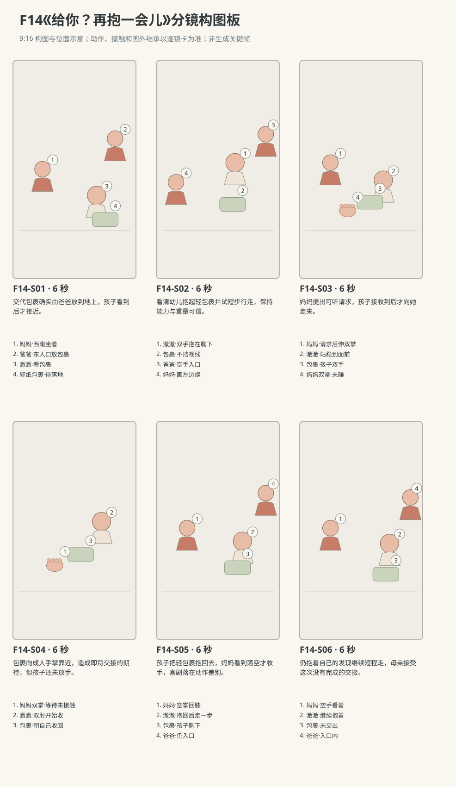

图示为构图位置示意；姿态、接触和画外继承以逐镜正文为准。

### 逐镜设计

#### F14-S01｜00—06 秒｜6 秒｜帧 [0, 144)

**镜头任务：**交代包裹确实由爸爸放到地上，孩子看到后才接近。

**景别、机位与构图：**南侧朝北中全景，妈妈坐左前地垫、爸爸在右后东入口，包裹放置点在右中，孩子右前朝向爸爸手里包裹；脚下路线完整。

**摄影机与理由：**固定，建立成人放物与孩子取物的先后，包装不凭空出现在孩子怀里。

**焦点：**爸爸双手与轻纸包裹、孩子目光和母亲位置都清楚。

**入态：**爸爸双手托一个浅牛皮色空薄纸包裹在东入口内膝高，澈澈站其西南一短步处、双手空；妈妈盘腿坐西南地垫、双手膝上看过来。

**动作与表演：**

- 2 秒：爸爸弯膝把包裹底面平放东侧地垫边，双手等底面接地再松开。

- 2 秒：爸爸空手退回入口半步，澈澈看住包裹，向前走一短步。

- 2 秒：孩子在包裹前站稳、膝微弯，双掌贴到包裹左右侧面，还未提起。

**声音：**纸包裹触垫轻声、爸爸衣料和短步声，无对白无音乐。

**出态：**包裹在地垫东侧、底面接地，孩子双掌贴左右侧尚未提起；爸爸空手入口内、妈妈双手膝上。

**切点与承接：**切同轴较紧看孩子从接触到提起，不漏包裹底离地。

**连续性：**纸包裹只有一个，爸爸放稳才松手；包装无真实住址，母亲一直坐着未伸手。

**开始画面母稿：**

9:16竖幅，原创三维家庭生活动画，圆润而有重量的造型，柔和皮肤层次、哑光棉布与可读的小表情，动作遵循生活物理，不用成人式算计。澈澈暂拟圆润脸颊、深棕眼、短黑绒发、额前右弯小发撮。成长后的幼儿澈澈穿奶油色棉上衣、鼠尾草色棉长裤。妈妈暂拟深棕低马尾、雾蓝棉上衣、米色长裤。爸爸暂拟短黑发、砖陶色棉衬衫、深灰长裤。人物与场景参考尚未提供，外观为可替换暂拟设计，未上传或绑定真实素材。本镜起始画面为单一瞬间：爸爸双手托一个浅牛皮色空薄纸包裹在东入口内膝高，澈澈站其西南一短步处、双手空；妈妈盘腿坐西南地垫、双手膝上看过来。 场次方位与光位：L客厅北墙沙发、西窗、东侧走廊、中央奶油地垫。成长后的澈澈为R4稳步行走与初语；本片只抱一个体积约自己胸宽的空薄纸包裹，浅牛皮色、四角钝软，无提绳、钉子或可读地址，重量可轻抱，抱持和步行时位于胸下，脚前路线可见；落地、提起与持有状态按本镜起态。爸爸的活动区在东入口内，妈妈盘腿坐地垫西南侧朝东北。澈澈由东往西走两三步到妈妈面前，随后退回朝东，路线平整无遮挡。摄影始终在南侧朝北，妈妈左、澈澈右、爸爸右后，西窗柔光从画左入，不反轴。 摄影构图：南侧朝北中全景，妈妈坐左前地垫、爸爸在右后东入口，包裹放置点在右中，孩子右前朝向爸爸手里包裹；脚下路线完整。 当前焦点：爸爸双手与轻纸包裹、孩子目光和母亲位置都清楚。 只画这一刻，不拼入后续动作、轨迹、分格、字幕或不存在的持物状态。

**视频变化母稿：**

9:16竖幅，原创三维家庭生活动画，圆润而有重量的造型，柔和皮肤层次、哑光棉布与可读的小表情，动作遵循生活物理，不用成人式算计。澈澈暂拟圆润脸颊、深棕眼、短黑绒发、额前右弯小发撮。成长后的幼儿澈澈穿奶油色棉上衣、鼠尾草色棉长裤。妈妈暂拟深棕低马尾、雾蓝棉上衣、米色长裤。爸爸暂拟短黑发、砖陶色棉衬衫、深灰长裤。人物与场景参考尚未提供，外观为可替换暂拟设计，未上传或绑定真实素材。制作一段6秒连续镜头。当前能力：R4稳步行走与初语，只走短小平地路线、使用自然单音或短词，不把当前能力套给小月龄婴儿。空间光位：L客厅北墙沙发、西窗、东侧走廊、中央奶油地垫。成长后的澈澈为R4稳步行走与初语；本片只抱一个体积约自己胸宽的空薄纸包裹，浅牛皮色、四角钝软，无提绳、钉子或可读地址，重量可轻抱，抱持和步行时位于胸下，脚前路线可见；落地、提起与持有状态按本镜起态。爸爸的活动区在东入口内，妈妈盘腿坐地垫西南侧朝东北。澈澈由东往西走两三步到妈妈面前，随后退回朝东，路线平整无遮挡。摄影始终在南侧朝北，妈妈左、澈澈右、爸爸右后，西窗柔光从画左入，不反轴。 起态：爸爸双手托一个浅牛皮色空薄纸包裹在东入口内膝高，澈澈站其西南一短步处、双手空；妈妈盘腿坐西南地垫、双手膝上看过来。 摄影：南侧朝北中全景，妈妈坐左前地垫、爸爸在右后东入口，包裹放置点在右中，孩子右前朝向爸爸手里包裹；脚下路线完整。 相机行为：固定，建立成人放物与孩子取物的先后，包装不凭空出现在孩子怀里。 焦点：爸爸双手与轻纸包裹、孩子目光和母亲位置都清楚。 时间过程：第1阶段2秒：爸爸弯膝把包裹底面平放东侧地垫边，双手等底面接地再松开。；第2阶段2秒：爸爸空手退回入口半步，澈澈看住包裹，向前走一短步。；第3阶段2秒：孩子在包裹前站稳、膝微弯，双掌贴到包裹左右侧面，还未提起。。声音：纸包裹触垫轻声、爸爸衣料和短步声，无对白无音乐。 终态：包裹在地垫东侧、底面接地，孩子双掌贴左右侧尚未提起；爸爸空手入口内、妈妈双手膝上。 连续性：纸包裹只有一个，爸爸放稳才松手；包装无真实住址，母亲一直坐着未伸手。 按本镜完整过程到达终态，不在镜内另加切镜、人物、道具或未写出的台词、字幕与旁白。

#### F14-S02｜06—12 秒｜6 秒｜帧 [144, 288)

**镜头任务：**看清幼儿抱起轻包裹并试短步行走，保持能力与重量可信。

**景别、机位与构图：**南偏东的孩子中全景，从头到双脚与包裹底面全在框，爸爸空手留右后，妈妈衣角在左边缘。

**摄影机与理由：**固定，包裹由地到怀再步行全程可读，不用夸张踉跄制造危险感。

**焦点：**孩子双掌接触、包裹底面离地与脚前路线持续清楚。

**入态：**孩子双掌贴包裹左右侧、底仍接东侧地垫，双脚踏稳、膝微弯；爸爸空手在入口内、妈妈左画外双手膝上。

**动作与表演：**

- 2 秒：澈澈两掌从两侧向内夹稳包裹，缓慢伸膝，将底面提离地垫。

- 2 秒：他把包裹收近胸下，双肘自然弯曲，脚前地面仍露出，低头看一眼前路。

- 2 秒：孩子朝西走两小步，脚步分开落稳，包裹随身体轻晃但不遮眼。

**声音：**薄纸轻揉、棉袜短步与孩子呼吸，无对白和配乐。

**出态：**包裹由孩子双手夹在胸下，已朝西走两步，在地垫中东部；妈妈仍左侧坐着，爸爸仍右后入口。

**切点与承接：**接同侧共享镜由妈妈出声提出请求，孩子听见后再看她。

**连续性：**只抱轻空薄纸包裹，不演重物举起；侧夹双掌不换成凭空底托，底角轻软不碰脚。

**开始画面母稿：**

9:16竖幅，原创三维家庭生活动画，圆润而有重量的造型，柔和皮肤层次、哑光棉布与可读的小表情，动作遵循生活物理，不用成人式算计。澈澈暂拟圆润脸颊、深棕眼、短黑绒发、额前右弯小发撮。成长后的幼儿澈澈穿奶油色棉上衣、鼠尾草色棉长裤。妈妈暂拟深棕低马尾、雾蓝棉上衣、米色长裤。爸爸暂拟短黑发、砖陶色棉衬衫、深灰长裤。人物与场景参考尚未提供，外观为可替换暂拟设计，未上传或绑定真实素材。本镜起始画面为单一瞬间：孩子双掌贴包裹左右侧、底仍接东侧地垫，双脚踏稳、膝微弯；爸爸空手在入口内、妈妈左画外双手膝上。 场次方位与光位：L客厅北墙沙发、西窗、东侧走廊、中央奶油地垫。成长后的澈澈为R4稳步行走与初语；本片只抱一个体积约自己胸宽的空薄纸包裹，浅牛皮色、四角钝软，无提绳、钉子或可读地址，重量可轻抱，抱持和步行时位于胸下，脚前路线可见；落地、提起与持有状态按本镜起态。爸爸的活动区在东入口内，妈妈盘腿坐地垫西南侧朝东北。澈澈由东往西走两三步到妈妈面前，随后退回朝东，路线平整无遮挡。摄影始终在南侧朝北，妈妈左、澈澈右、爸爸右后，西窗柔光从画左入，不反轴。 摄影构图：南偏东的孩子中全景，从头到双脚与包裹底面全在框，爸爸空手留右后，妈妈衣角在左边缘。 当前焦点：孩子双掌与包裹两侧接触、包裹底面仍接地和脚底落点清楚；包裹尚未提起。 只画这一刻，不拼入后续动作、轨迹、分格、字幕或不存在的持物状态。

**视频变化母稿：**

9:16竖幅，原创三维家庭生活动画，圆润而有重量的造型，柔和皮肤层次、哑光棉布与可读的小表情，动作遵循生活物理，不用成人式算计。澈澈暂拟圆润脸颊、深棕眼、短黑绒发、额前右弯小发撮。成长后的幼儿澈澈穿奶油色棉上衣、鼠尾草色棉长裤。妈妈暂拟深棕低马尾、雾蓝棉上衣、米色长裤。爸爸暂拟短黑发、砖陶色棉衬衫、深灰长裤。人物与场景参考尚未提供，外观为可替换暂拟设计，未上传或绑定真实素材。制作一段6秒连续镜头。当前能力：R4稳步行走与初语，只走短小平地路线、使用自然单音或短词，不把当前能力套给小月龄婴儿。空间光位：L客厅北墙沙发、西窗、东侧走廊、中央奶油地垫。成长后的澈澈为R4稳步行走与初语；本片只抱一个体积约自己胸宽的空薄纸包裹，浅牛皮色、四角钝软，无提绳、钉子或可读地址，重量可轻抱，抱持和步行时位于胸下，脚前路线可见；落地、提起与持有状态按本镜起态。爸爸的活动区在东入口内，妈妈盘腿坐地垫西南侧朝东北。澈澈由东往西走两三步到妈妈面前，随后退回朝东，路线平整无遮挡。摄影始终在南侧朝北，妈妈左、澈澈右、爸爸右后，西窗柔光从画左入，不反轴。 起态：孩子双掌贴包裹左右侧、底仍接东侧地垫，双脚踏稳、膝微弯；爸爸空手在入口内、妈妈左画外双手膝上。 摄影：南偏东的孩子中全景，从头到双脚与包裹底面全在框，爸爸空手留右后，妈妈衣角在左边缘。 相机行为：固定，包裹由地到怀再步行全程可读，不用夸张踉跄制造危险感。 焦点：孩子双掌接触、包裹底面离地与脚前路线持续清楚。 时间过程：第1阶段2秒：澈澈两掌从两侧向内夹稳包裹，缓慢伸膝，将底面提离地垫。；第2阶段2秒：他把包裹收近胸下，双肘自然弯曲，脚前地面仍露出，低头看一眼前路。；第3阶段2秒：孩子朝西走两小步，脚步分开落稳，包裹随身体轻晃但不遮眼。。声音：薄纸轻揉、棉袜短步与孩子呼吸，无对白和配乐。 终态：包裹由孩子双手夹在胸下，已朝西走两步，在地垫中东部；妈妈仍左侧坐着，爸爸仍右后入口。 连续性：只抱轻空薄纸包裹，不演重物举起；侧夹双掌不换成凭空底托，底角轻软不碰脚。 按本镜完整过程到达终态，不在镜内另加切镜、人物、道具或未写出的台词、字幕与旁白。

#### F14-S03｜12—18 秒｜6 秒｜帧 [288, 432)

**镜头任务：**妈妈提出可听请求，孩子接收到后才向她走来。

**景别、机位与构图：**南侧双人中全景，妈妈左、孩子右，双方脸、孩子包裹和脚下两步距离清楚；爸爸在右后入口。

**摄影机与理由：**固定，把请求、孩子转眼和实际走近留在同一画面，避免把抱着路过误读为回应。

**焦点：**妈妈说话嘴部、孩子转向她的眼睛和包裹双掌同时可读。

**入态：**澈澈在地垫中东部双手抱包裹于胸下，身体朝西，尚看脚前；妈妈西南侧盘腿坐着、双手膝上，正看他。

**动作与表演：**

- 2 秒：妈妈对着澈澈轻声说“给妈妈看看？”，发声时嘴部可见，双手仍在膝上。

- 2 秒：澈澈听见停一小拍，先转眼再转脸看妈妈，包裹仍贴胸下。

- 2 秒：他朝妈妈走两小步，在她面前留一小臂距离站稳；妈妈才把两只手掌心向上送到包裹下方，但未碰到。

**声音：**妈妈准确说“给妈妈看看？”，自然普通话轻问；孩子短步、纸面声，语毕留反应空隙，无其他对白。

**出态：**孩子站妈妈面前、双手夹包裹胸下，妈妈双掌向上停在包裹下方一小掌间距、尚未接触；爸爸右后空手。

**切点与承接：**切稍近共享镜看短暂向外递，不提前进入成人手里。

**连续性：**成人只提出请求，没有命令或硬抢；母亲露口发问，孩子先听见后转头。包裹仍孩子独持。

**开始画面母稿：**

9:16竖幅，原创三维家庭生活动画，圆润而有重量的造型，柔和皮肤层次、哑光棉布与可读的小表情，动作遵循生活物理，不用成人式算计。澈澈暂拟圆润脸颊、深棕眼、短黑绒发、额前右弯小发撮。成长后的幼儿澈澈穿奶油色棉上衣、鼠尾草色棉长裤。妈妈暂拟深棕低马尾、雾蓝棉上衣、米色长裤。爸爸暂拟短黑发、砖陶色棉衬衫、深灰长裤。人物与场景参考尚未提供，外观为可替换暂拟设计，未上传或绑定真实素材。本镜起始画面为单一瞬间：澈澈在地垫中东部双手抱包裹于胸下，身体朝西，尚看脚前；妈妈西南侧盘腿坐着、双手膝上，正看他。 场次方位与光位：L客厅北墙沙发、西窗、东侧走廊、中央奶油地垫。成长后的澈澈为R4稳步行走与初语；本片只抱一个体积约自己胸宽的空薄纸包裹，浅牛皮色、四角钝软，无提绳、钉子或可读地址，重量可轻抱，抱持和步行时位于胸下，脚前路线可见；落地、提起与持有状态按本镜起态。爸爸的活动区在东入口内，妈妈盘腿坐地垫西南侧朝东北。澈澈由东往西走两三步到妈妈面前，随后退回朝东，路线平整无遮挡。摄影始终在南侧朝北，妈妈左、澈澈右、爸爸右后，西窗柔光从画左入，不反轴。 摄影构图：南侧双人中全景，妈妈左、孩子右，双方脸、孩子包裹和脚下两步距离清楚；爸爸在右后入口。 当前焦点：妈妈闭合的嘴部、孩子正看脚前的眼睛与夹住包裹两侧的双掌清楚；妈妈双手仍在膝上。 只画这一刻，不拼入后续动作、轨迹、分格、字幕或不存在的持物状态。

**视频变化母稿：**

9:16竖幅，原创三维家庭生活动画，圆润而有重量的造型，柔和皮肤层次、哑光棉布与可读的小表情，动作遵循生活物理，不用成人式算计。澈澈暂拟圆润脸颊、深棕眼、短黑绒发、额前右弯小发撮。成长后的幼儿澈澈穿奶油色棉上衣、鼠尾草色棉长裤。妈妈暂拟深棕低马尾、雾蓝棉上衣、米色长裤。爸爸暂拟短黑发、砖陶色棉衬衫、深灰长裤。人物与场景参考尚未提供，外观为可替换暂拟设计，未上传或绑定真实素材。制作一段6秒连续镜头。当前能力：R4稳步行走与初语，只走短小平地路线、使用自然单音或短词，不把当前能力套给小月龄婴儿。空间光位：L客厅北墙沙发、西窗、东侧走廊、中央奶油地垫。成长后的澈澈为R4稳步行走与初语；本片只抱一个体积约自己胸宽的空薄纸包裹，浅牛皮色、四角钝软，无提绳、钉子或可读地址，重量可轻抱，抱持和步行时位于胸下，脚前路线可见；落地、提起与持有状态按本镜起态。爸爸的活动区在东入口内，妈妈盘腿坐地垫西南侧朝东北。澈澈由东往西走两三步到妈妈面前，随后退回朝东，路线平整无遮挡。摄影始终在南侧朝北，妈妈左、澈澈右、爸爸右后，西窗柔光从画左入，不反轴。 起态：澈澈在地垫中东部双手抱包裹于胸下，身体朝西，尚看脚前；妈妈西南侧盘腿坐着、双手膝上，正看他。 摄影：南侧双人中全景，妈妈左、孩子右，双方脸、孩子包裹和脚下两步距离清楚；爸爸在右后入口。 相机行为：固定，把请求、孩子转眼和实际走近留在同一画面，避免把抱着路过误读为回应。 焦点：妈妈说话嘴部、孩子转向她的眼睛和包裹双掌同时可读。 时间过程：第1阶段2秒：妈妈对着澈澈轻声说“给妈妈看看？”，发声时嘴部可见，双手仍在膝上。；第2阶段2秒：澈澈听见停一小拍，先转眼再转脸看妈妈，包裹仍贴胸下。；第3阶段2秒：他朝妈妈走两小步，在她面前留一小臂距离站稳；妈妈才把两只手掌心向上送到包裹下方，但未碰到。。声音：妈妈准确说“给妈妈看看？”，自然普通话轻问；孩子短步、纸面声，语毕留反应空隙，无其他对白。 终态：孩子站妈妈面前、双手夹包裹胸下，妈妈双掌向上停在包裹下方一小掌间距、尚未接触；爸爸右后空手。 连续性：成人只提出请求，没有命令或硬抢；母亲露口发问，孩子先听见后转头。包裹仍孩子独持。 按本镜完整过程到达终态，不在镜内另加切镜、人物、道具或未写出的台词、字幕与旁白。

#### F14-S04｜18—24 秒｜6 秒｜帧 [432, 576)

**镜头任务：**包裹向成人手掌靠近，造成即将交接的期待，但孩子还未放手。

**景别、机位与构图：**南偏东双人中景，妈妈左、孩子右，双方脸和包裹两侧夹握、下方等待的双掌全在框；底面与成人掌心空隙清楚。

**摄影机与理由：**固定，先让观众看到真实距离缩短，交接尚未完成不能靠切镜误导。

**焦点：**包裹底面与妈妈双掌之间的小间隙及孩子两侧手指清楚。

**入态：**澈澈双手夹包裹在胸下，妈妈双掌向上停包裹下方一小掌距、未接触；孩子站稳看妈妈。

**动作与表演：**

- 2 秒：澈澈双肘向前伸一点，把包裹朝妈妈掌心送近，底面仍由自己双掌夹持而非成人托住。

- 2 秒：包裹停在妈妈掌心上方一小指宽处，孩子看一眼包裹，再看妈妈；妈妈双掌保持原处等着。

- 2 秒：澈澈双肘开始往自己身侧收，包裹轻轻离开妈妈掌心正上方，尚未抱回胸下。

**声音：**薄纸微揉与呼吸，无交接落掌声、对白、搞怪提示音或音乐。

**出态：**包裹正被孩子双手向自己收回、已离开妈妈掌心上方，尚未贴回胸下；妈妈双掌仍朝上且未接触。

**切点与承接：**在回收动作已开始的相位切同侧稍宽镜，继续同一次收回，不重演递出。

**连续性：**全镜孩子未松指、妈妈未碰纸包裹，成人并未得到持有权；不凭空加妈妈抓住再被抢回的拉扯。

**开始画面母稿：**

9:16竖幅，原创三维家庭生活动画，圆润而有重量的造型，柔和皮肤层次、哑光棉布与可读的小表情，动作遵循生活物理，不用成人式算计。澈澈暂拟圆润脸颊、深棕眼、短黑绒发、额前右弯小发撮。成长后的幼儿澈澈穿奶油色棉上衣、鼠尾草色棉长裤。妈妈暂拟深棕低马尾、雾蓝棉上衣、米色长裤。爸爸暂拟短黑发、砖陶色棉衬衫、深灰长裤。人物与场景参考尚未提供，外观为可替换暂拟设计，未上传或绑定真实素材。本镜起始画面为单一瞬间：澈澈双手夹包裹在胸下，妈妈双掌向上停包裹下方一小掌距、未接触；孩子站稳看妈妈。 场次方位与光位：L客厅北墙沙发、西窗、东侧走廊、中央奶油地垫。成长后的澈澈为R4稳步行走与初语；本片只抱一个体积约自己胸宽的空薄纸包裹，浅牛皮色、四角钝软，无提绳、钉子或可读地址，重量可轻抱，抱持和步行时位于胸下，脚前路线可见；落地、提起与持有状态按本镜起态。爸爸的活动区在东入口内，妈妈盘腿坐地垫西南侧朝东北。澈澈由东往西走两三步到妈妈面前，随后退回朝东，路线平整无遮挡。摄影始终在南侧朝北，妈妈左、澈澈右、爸爸右后，西窗柔光从画左入，不反轴。 摄影构图：南偏东双人中景，妈妈左、孩子右，双方脸和包裹两侧夹握、下方等待的双掌全在框；底面与成人掌心空隙清楚。 当前焦点：包裹底面与妈妈双掌之间的小间隙及孩子两侧手指清楚。 只画这一刻，不拼入后续动作、轨迹、分格、字幕或不存在的持物状态。

**视频变化母稿：**

9:16竖幅，原创三维家庭生活动画，圆润而有重量的造型，柔和皮肤层次、哑光棉布与可读的小表情，动作遵循生活物理，不用成人式算计。澈澈暂拟圆润脸颊、深棕眼、短黑绒发、额前右弯小发撮。成长后的幼儿澈澈穿奶油色棉上衣、鼠尾草色棉长裤。妈妈暂拟深棕低马尾、雾蓝棉上衣、米色长裤。爸爸暂拟短黑发、砖陶色棉衬衫、深灰长裤。人物与场景参考尚未提供，外观为可替换暂拟设计，未上传或绑定真实素材。制作一段6秒连续镜头。当前能力：R4稳步行走与初语，只走短小平地路线、使用自然单音或短词，不把当前能力套给小月龄婴儿。空间光位：L客厅北墙沙发、西窗、东侧走廊、中央奶油地垫。成长后的澈澈为R4稳步行走与初语；本片只抱一个体积约自己胸宽的空薄纸包裹，浅牛皮色、四角钝软，无提绳、钉子或可读地址，重量可轻抱，抱持和步行时位于胸下，脚前路线可见；落地、提起与持有状态按本镜起态。爸爸的活动区在东入口内，妈妈盘腿坐地垫西南侧朝东北。澈澈由东往西走两三步到妈妈面前，随后退回朝东，路线平整无遮挡。摄影始终在南侧朝北，妈妈左、澈澈右、爸爸右后，西窗柔光从画左入，不反轴。 起态：澈澈双手夹包裹在胸下，妈妈双掌向上停包裹下方一小掌距、未接触；孩子站稳看妈妈。 摄影：南偏东双人中景，妈妈左、孩子右，双方脸和包裹两侧夹握、下方等待的双掌全在框；底面与成人掌心空隙清楚。 相机行为：固定，先让观众看到真实距离缩短，交接尚未完成不能靠切镜误导。 焦点：包裹底面与妈妈双掌之间的小间隙及孩子两侧手指清楚。 时间过程：第1阶段2秒：澈澈双肘向前伸一点，把包裹朝妈妈掌心送近，底面仍由自己双掌夹持而非成人托住。；第2阶段2秒：包裹停在妈妈掌心上方一小指宽处，孩子看一眼包裹，再看妈妈；妈妈双掌保持原处等着。；第3阶段2秒：澈澈双肘开始往自己身侧收，包裹轻轻离开妈妈掌心正上方，尚未抱回胸下。。声音：薄纸微揉与呼吸，无交接落掌声、对白、搞怪提示音或音乐。 终态：包裹正被孩子双手向自己收回、已离开妈妈掌心上方，尚未贴回胸下；妈妈双掌仍朝上且未接触。 连续性：全镜孩子未松指、妈妈未碰纸包裹，成人并未得到持有权；不凭空加妈妈抓住再被抢回的拉扯。 按本镜完整过程到达终态，不在镜内另加切镜、人物、道具或未写出的台词、字幕与旁白。

#### F14-S05｜24—30 秒｜6 秒｜帧 [576, 720)

**镜头任务：**孩子把轻包裹抱回去，妈妈看到落空才收手，喜剧落在动作差别。

**景别、机位与构图：**南侧共享中全景，妈妈左、孩子右，从表情到孩子脚部均可见，包裹回胸与转身的空间充分。

**摄影机与理由：**固定，承接同一次回收，妈妈反应后于落空，不快切放大孩子恶作剧意图。

**焦点：**包裹回胸与妈妈空掌、随后妈妈微松嘴角保持可读。

**入态：**包裹正由孩子双掌向自己收回、尚未贴胸；妈妈双掌仍朝上没有接触，孩子站稳。

**动作与表演：**

- 2 秒：澈澈把包裹重新收紧到胸下，双掌仍夹两侧，身体微转向东。

- 2 秒：妈妈看一眼仍空的双掌，再看包裹，嘴角松成一点笑，慢慢把空手落回膝上。

- 2 秒：澈澈朝东走一小步，回头看妈妈；她留着笑，没有追过去拿。

**声音：**一小步、纸面轻声，妈妈一点短笑气，无对白、胜利音效或音乐。

**出态：**孩子抱同一包裹朝东已走一小步、回头看妈妈；妈妈双手空落膝，爸爸仍右后入口。

**切点与承接：**接宽镜让孩子继续抱着走，保持未交出的来源结尾。

**连续性：**妈妈先发现没接到才收手，孩子没有做计谋挑眉、嘲笑或逃跑；不增加抢夺追逐。

**开始画面母稿：**

9:16竖幅，原创三维家庭生活动画，圆润而有重量的造型，柔和皮肤层次、哑光棉布与可读的小表情，动作遵循生活物理，不用成人式算计。澈澈暂拟圆润脸颊、深棕眼、短黑绒发、额前右弯小发撮。成长后的幼儿澈澈穿奶油色棉上衣、鼠尾草色棉长裤。妈妈暂拟深棕低马尾、雾蓝棉上衣、米色长裤。爸爸暂拟短黑发、砖陶色棉衬衫、深灰长裤。人物与场景参考尚未提供，外观为可替换暂拟设计，未上传或绑定真实素材。本镜起始画面为单一瞬间：包裹正由孩子双掌向自己收回、尚未贴胸；妈妈双掌仍朝上没有接触，孩子站稳。 场次方位与光位：L客厅北墙沙发、西窗、东侧走廊、中央奶油地垫。成长后的澈澈为R4稳步行走与初语；本片只抱一个体积约自己胸宽的空薄纸包裹，浅牛皮色、四角钝软，无提绳、钉子或可读地址，重量可轻抱，抱持和步行时位于胸下，脚前路线可见；落地、提起与持有状态按本镜起态。爸爸的活动区在东入口内，妈妈盘腿坐地垫西南侧朝东北。澈澈由东往西走两三步到妈妈面前，随后退回朝东，路线平整无遮挡。摄影始终在南侧朝北，妈妈左、澈澈右、爸爸右后，西窗柔光从画左入，不反轴。 摄影构图：南侧共享中全景，妈妈左、孩子右，从表情到孩子脚部均可见，包裹仍在两人之间、尚未贴回孩子胸下，妈妈双掌朝上未接触包裹。 当前焦点：包裹与孩子胸前仍有间距、妈妈朝上空双掌清楚；妈妈还未笑，也未把手放回膝上。 只画这一刻，不拼入后续动作、轨迹、分格、字幕或不存在的持物状态。

**视频变化母稿：**

9:16竖幅，原创三维家庭生活动画，圆润而有重量的造型，柔和皮肤层次、哑光棉布与可读的小表情，动作遵循生活物理，不用成人式算计。澈澈暂拟圆润脸颊、深棕眼、短黑绒发、额前右弯小发撮。成长后的幼儿澈澈穿奶油色棉上衣、鼠尾草色棉长裤。妈妈暂拟深棕低马尾、雾蓝棉上衣、米色长裤。爸爸暂拟短黑发、砖陶色棉衬衫、深灰长裤。人物与场景参考尚未提供，外观为可替换暂拟设计，未上传或绑定真实素材。制作一段6秒连续镜头。当前能力：R4稳步行走与初语，只走短小平地路线、使用自然单音或短词，不把当前能力套给小月龄婴儿。空间光位：L客厅北墙沙发、西窗、东侧走廊、中央奶油地垫。成长后的澈澈为R4稳步行走与初语；本片只抱一个体积约自己胸宽的空薄纸包裹，浅牛皮色、四角钝软，无提绳、钉子或可读地址，重量可轻抱，抱持和步行时位于胸下，脚前路线可见；落地、提起与持有状态按本镜起态。爸爸的活动区在东入口内，妈妈盘腿坐地垫西南侧朝东北。澈澈由东往西走两三步到妈妈面前，随后退回朝东，路线平整无遮挡。摄影始终在南侧朝北，妈妈左、澈澈右、爸爸右后，西窗柔光从画左入，不反轴。 起态：包裹正由孩子双掌向自己收回、尚未贴胸；妈妈双掌仍朝上没有接触，孩子站稳。 摄影：南侧共享中全景，妈妈左、孩子右，从表情到孩子脚部均可见，包裹回胸与转身的空间充分。 相机行为：固定，承接同一次回收，妈妈反应后于落空，不快切放大孩子恶作剧意图。 焦点：包裹回胸与妈妈空掌、随后妈妈微松嘴角保持可读。 时间过程：第1阶段2秒：澈澈把包裹重新收紧到胸下，双掌仍夹两侧，身体微转向东。；第2阶段2秒：妈妈看一眼仍空的双掌，再看包裹，嘴角松成一点笑，慢慢把空手落回膝上。；第3阶段2秒：澈澈朝东走一小步，回头看妈妈；她留着笑，没有追过去拿。。声音：一小步、纸面轻声，妈妈一点短笑气，无对白、胜利音效或音乐。 终态：孩子抱同一包裹朝东已走一小步、回头看妈妈；妈妈双手空落膝，爸爸仍右后入口。 连续性：妈妈先发现没接到才收手，孩子没有做计谋挑眉、嘲笑或逃跑；不增加抢夺追逐。 按本镜完整过程到达终态，不在镜内另加切镜、人物、道具或未写出的台词、字幕与旁白。

#### F14-S06｜30—36 秒｜6 秒｜帧 [720, 864)

**镜头任务：**仍抱着自己的发现继续短程走，母亲接受这次没有完成的交接。

**景别、机位与构图：**南侧中全景，妈妈左前坐着、孩子右中、爸爸右后在入口，原包裹起点在右下背景可辨；空地路线完整。

**摄影机与理由：**固定，结束在孩子继续自己的活动，成人不强行补一个成功交出的圆满。

**焦点：**包裹与孩子双手、妈妈空膝上手及孩子回头的脸均清楚。

**入态：**孩子抱包裹朝东已走一小步，正回头看妈妈；妈妈双手空放膝，爸爸入口内空手。

**动作与表演：**

- 2 秒：澈澈把脸转回前路，再向东走两个小步，包裹仍胸下，脚前无遮挡。

- 2 秒：他在地垫东半停住看包裹一角，双掌轻调一下夹握，不松手掉落。

- 2 秒：妈妈从原处看着他，指尖在膝上松开；爸爸也留在入口，谁都没有去接包裹。

**声音：**短步、纸面微揉与室内底声，末两秒自然安静，无新对白音乐。

**出态：**孩子仍双手持同一轻包裹站地垫东半，妈妈空手膝上、爸爸入口内空手；包裹没有交出。

**切点与承接：**在继续抱着包裹的状态结束，无偷补实际递交或原帖未知后续。

**连续性：**只有一个包裹，未到任何成人手中；成人不追不抢，R4短步行走能力与轻物重量保持。

**开始画面母稿：**

9:16竖幅，原创三维家庭生活动画，圆润而有重量的造型，柔和皮肤层次、哑光棉布与可读的小表情，动作遵循生活物理，不用成人式算计。澈澈暂拟圆润脸颊、深棕眼、短黑绒发、额前右弯小发撮。成长后的幼儿澈澈穿奶油色棉上衣、鼠尾草色棉长裤。妈妈暂拟深棕低马尾、雾蓝棉上衣、米色长裤。爸爸暂拟短黑发、砖陶色棉衬衫、深灰长裤。人物与场景参考尚未提供，外观为可替换暂拟设计，未上传或绑定真实素材。本镜起始画面为单一瞬间：孩子抱包裹朝东已走一小步，正回头看妈妈；妈妈双手空放膝，爸爸入口内空手。 场次方位与光位：L客厅北墙沙发、西窗、东侧走廊、中央奶油地垫。成长后的澈澈为R4稳步行走与初语；本片只抱一个体积约自己胸宽的空薄纸包裹，浅牛皮色、四角钝软，无提绳、钉子或可读地址，重量可轻抱，抱持和步行时位于胸下，脚前路线可见；落地、提起与持有状态按本镜起态。爸爸的活动区在东入口内，妈妈盘腿坐地垫西南侧朝东北。澈澈由东往西走两三步到妈妈面前，随后退回朝东，路线平整无遮挡。摄影始终在南侧朝北，妈妈左、澈澈右、爸爸右后，西窗柔光从画左入，不反轴。 摄影构图：南侧中全景，妈妈左前坐着、孩子右中、爸爸右后在入口，原包裹起点在右下背景可辨；空地路线完整。 当前焦点：包裹与孩子双手、妈妈空膝上手及孩子回头的脸均清楚。 只画这一刻，不拼入后续动作、轨迹、分格、字幕或不存在的持物状态。

**视频变化母稿：**

9:16竖幅，原创三维家庭生活动画，圆润而有重量的造型，柔和皮肤层次、哑光棉布与可读的小表情，动作遵循生活物理，不用成人式算计。澈澈暂拟圆润脸颊、深棕眼、短黑绒发、额前右弯小发撮。成长后的幼儿澈澈穿奶油色棉上衣、鼠尾草色棉长裤。妈妈暂拟深棕低马尾、雾蓝棉上衣、米色长裤。爸爸暂拟短黑发、砖陶色棉衬衫、深灰长裤。人物与场景参考尚未提供，外观为可替换暂拟设计，未上传或绑定真实素材。制作一段6秒连续镜头。当前能力：R4稳步行走与初语，只走短小平地路线、使用自然单音或短词，不把当前能力套给小月龄婴儿。空间光位：L客厅北墙沙发、西窗、东侧走廊、中央奶油地垫。成长后的澈澈为R4稳步行走与初语；本片只抱一个体积约自己胸宽的空薄纸包裹，浅牛皮色、四角钝软，无提绳、钉子或可读地址，重量可轻抱，抱持和步行时位于胸下，脚前路线可见；落地、提起与持有状态按本镜起态。爸爸的活动区在东入口内，妈妈盘腿坐地垫西南侧朝东北。澈澈由东往西走两三步到妈妈面前，随后退回朝东，路线平整无遮挡。摄影始终在南侧朝北，妈妈左、澈澈右、爸爸右后，西窗柔光从画左入，不反轴。 起态：孩子抱包裹朝东已走一小步，正回头看妈妈；妈妈双手空放膝，爸爸入口内空手。 摄影：南侧中全景，妈妈左前坐着、孩子右中、爸爸右后在入口，原包裹起点在右下背景可辨；空地路线完整。 相机行为：固定，结束在孩子继续自己的活动，成人不强行补一个成功交出的圆满。 焦点：包裹与孩子双手、妈妈空膝上手及孩子回头的脸均清楚。 时间过程：第1阶段2秒：澈澈把脸转回前路，再向东走两个小步，包裹仍胸下，脚前无遮挡。；第2阶段2秒：他在地垫东半停住看包裹一角，双掌轻调一下夹握，不松手掉落。；第3阶段2秒：妈妈从原处看着他，指尖在膝上松开；爸爸也留在入口，谁都没有去接包裹。。声音：短步、纸面微揉与室内底声，末两秒自然安静，无新对白音乐。 终态：孩子仍双手持同一轻包裹站地垫东半，妈妈空手膝上、爸爸入口内空手；包裹没有交出。 连续性：只有一个包裹，未到任何成人手中；成人不追不抢，R4短步行走能力与轻物重量保持。 按本镜完整过程到达终态，不在镜内另加切镜、人物、道具或未写出的台词、字幕与旁白。

### 声音与剪辑

妈妈只有“给妈妈看看？”一句自然普通话。纸面声按夹握微动，成人掌心从未接触所以不能加交接落掌声；不加胜利、失败或恶作剧提示音，不配乐。

- 妈妈：给妈妈看看？（F14-S03；本镜前两秒，对澈澈轻声自然普通话发问，嘴部可见；先说完再等他转眼走来，之后才把双掌送到下方。）

### 连续性与试片

- 连续性：成长后的R4幼儿可稳步行走、抱轻物；本片空薄纸包裹胸宽且轻、底在胸下不挡前路，不用沉重真实快递。

- 连续性：只有一个包裹，爸爸先放地松手、孩子后夹起；孩子始终双手夹侧不松开，妈妈全片没有接触或持有包裹。

- 连续性：妈妈双掌只是等待，包裹与掌心始终有可读间隙；不能改成抢夺、扯回、成人先抓到再丢手。

- 连续性：向前送、开始收回、抱回胸下跨镜连续，F14-S04出点已经收回中，下一镜不重演递出。

- 连续性：“给妈妈看看？”逐字在F14-S03嘴部可见处说完，孩子先听到才看向妈妈；不加故意、不给你、骗到你了等心理解释。

- 连续性：结尾仍抱着走；原帖没有最终妈妈接到的结果，不补作来源事实。

- 试片：F14-S01—S02检查包裹放地后才到孩子手中，只有一个；站起与行走从脚到包裹都可见，不能举重般拉扯或脚下失衡。

- 试片：F14-S03—S05静音检查请求后的走近、成人伸掌、包裹靠近、未接触即收回、母亲发现空掌后笑的先后；若成人已经接住或突然换持有者则失败。

- 试片：F14-S04—S06检查回收相位不重放、无拉扯、最后孩子仍双手抱同一包裹；原帖未知的最后交出不在片尾偷偷补上。

**媒体待验证：**本次交付为完整故事、分镜与提示词文字设计，未生成或审看实际图像、视频、音轨。人物和场景参考未提供；逐镜首帧、手指接触、面部表演、对白发音、身体平衡与相邻剪点均待实际素材核对，不以结构检查代替媒体质量。

---

## G01《原来是我的脚》

**36 秒｜仰卧与翻身探索｜角色：澈澈、爸爸｜场景 L**

### 剧情正文

西窗的柔光落在客厅地垫上。澈澈仰躺在中央，爸爸跪坐北侧，手里拿着珊瑚色软布环，正想逗他伸手。澈澈蹬了一下腿，右手背偶然擦过抬起的右脚。小手停住，脚却落回去，他低下视线，看向刚才碰到的地方。右膝又慢慢弯起，脚出现在眼前；他张开手去够，先摸到裤腿，再往前挪一点，终于握住自己的脚掌外侧。爸爸举到一半的软环停在旁边，没插进两者之间。澈澈看着手和脚，手指松开，脚落低了一点。他等它停住，重新看准，再伸手握上去。这次没有惊讶，只专心地摸了摸。爸爸也低头看着，软环安静留在自己手里。

### 导演与空间

**观察任务：**把偶然触脚变成看准后主动再抓一次；爸爸学会暂缓自己准备好的玩具。

**空间与光位：**澈澈仰卧中央地垫，头朝西、脚朝东，身体南侧是解剖右侧；爸爸跪坐北侧偏西，P01珊瑚软布环在爸爸左手。所有机位在地垫南侧，面向北或东北；西窗保持物理西侧，地垫与躯干形成稳定横轴。

**人物表演：**澈澈只做仰卧屈腿与手部探索，后背、后脑和骨盆由地垫支撑；不突然坐起。爸爸本想递P01，发现新兴趣后收住动作，继续握住软环陪看。

### 节拍覆盖

- **G01-b1**：前态：澈澈仰卧，双腿自然弯曲落在垫上，双手在胸口附近；爸爸左手握P01，右手撑自己膝侧。 过程：爸爸看一眼软环，再看澈澈右手，左腕向前送少许。澈澈视线未跟软环，右腿轻蹬后屈回，右手松松落向腹部；爸爸的递物停在可见半途。 后态：右膝略高于左膝，右手靠近腹部，软环仍在爸爸左手距宝宝一臂之外。 观众观察：交代仰卧支撑、脚的位置与爸爸原本的递物任务。 → G01-S01

- **G01-b2**：前态：右手背朝外停在腹部右侧，右膝正在屈起，裸右脚尚离手背一小段距离。 过程：右脚随屈膝缓慢靠近，脚掌外侧擦到右手背，手指一顿。右手没有握合，右腿轻放低，脚离开手背。右手留在原处张开，澈澈下巴微收，视线落到空出的手背旁。 后态：右脚已落低，右手张开悬于腹部右侧；宝宝眼睛朝右脚方向。 观众观察：让观众看清偶然触脚发生在主动寻找之前。 → G01-S02

- **G01-b3**：前态：澈澈眼睛望向右脚，右手在腹部上方张开，右脚落在较低位置。 过程：澈澈先看右脚，右膝重新屈起，把脚带到腹部上方。右手伸去先碰到右小腿的棉裤，手指沿裤腿停住。他看着裸脚，把右手再向足外侧移一小段，手掌尚未闭合。 后态：右掌已贴到右足外侧，手指张开；爸爸的软环保持在背景边缘。 观众观察：把偶然事件变成看准目标的下一次尝试。 → G01-S03

- **G01-b4**：前态：右掌贴右足外侧但手指仍张开，脚趾自然弯曲。 过程：右手指腹沿足外侧慢慢收拢，拇指停在足背一侧，形成松握。右脚趾轻动，手指跟着略调整，右膝保持屈曲。手与脚一起轻晃后停住，不把脚拉到嘴边。 后态：右手松握右足外侧，足趾与每根手指可区分，小腿仍自然弯向骨盆。 观众观察：真正完成第一次抓住，呈现软组织接触而非手脚融合。 → G01-S04

- **G01-b5**：前态：宝宝右手握着右脚，爸爸左手持环停在半途，看着这次抓握。 过程：爸爸的目光从软环移到宝宝手脚，肩膀放松。他把左手软环缓缓收回自己膝上，右手继续撑地，不碰宝宝。宝宝看了一会儿，右手指逐渐张开，右脚随膝略放低但不落出画。 后态：右手已离脚，右膝仍屈着，右脚在腹部偏右上方；爸爸左手与软环落在膝上。 观众观察：爸爸放弃干预，让宝宝继续观察自己的发现。 → G01-S05

- **G01-b6**：前态：右手张开，右脚仍随屈膝停在腹部右上方，宝宝视线先落在脚上。 过程：澈澈看准脚的位置，右手向足外侧移动，不再先摸裤腿。右手再度松握足外侧，脚趾轻动；宝宝眼睛在手与脚间来回看。他用拇指轻轻蹭一下足背，爸爸保持安静，画面停在这一小段专注上。 后态：右手重新握住右脚，爸爸仍在后景，软环画外继承膝上左手持有。 观众观察：以看准后的重抓收尾，成长落在动作变化上。 → G01-S06

### 分镜构图板

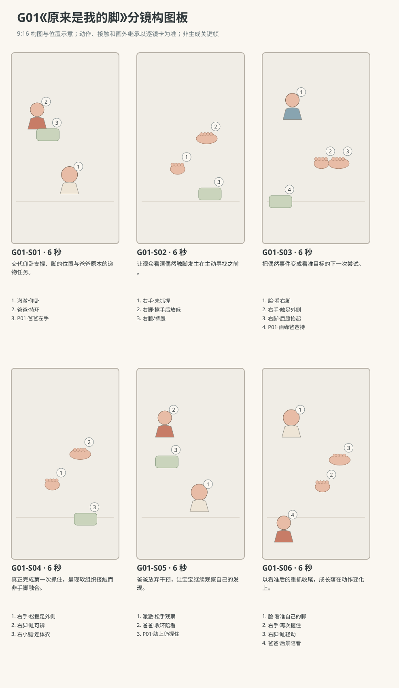

图示为构图位置示意；姿态、接触和画外继承以逐镜正文为准。

### 逐镜设计

#### G01-S01｜00—06 秒｜6 秒｜帧 [0, 144)

**镜头任务：**交代仰卧支撑、脚的位置与爸爸原本的递物任务。

**景别、机位与构图：**中全景，南侧35厘米高轻俯拍；澈澈头在画左、脚在画右，爸爸居后景左上，软环在爸爸胸前，不遮宝宝腿。

**摄影机与理由：**固定机位，让动作本身改变画面；不推拉遮盖接触。

**焦点：**焦点覆盖澈澈的眼睛、行动手与目标物；关键接触始终可辨。

**入态：**澈澈仰卧，双腿自然弯曲落在垫上，双手在胸口附近；爸爸左手握P01，右手撑自己膝侧。

**动作与表演：**

- 2 秒：爸爸看一眼软环，再看澈澈右手，左腕向前送少许。

- 4 秒：澈澈视线未跟软环，右腿轻蹬后屈回，右手松松落向腹部；爸爸的递物停在可见半途。

**声音：**无对白、无音乐；西窗外极轻鸟声作底，前景保留连体衣摩擦与婴儿呼吸，动作触碰同步发声。

**出态：**右膝略高于左膝，右手靠近腹部，软环仍在爸爸左手距宝宝一臂之外。

**切点与承接：**顺着右腿将再次抬起的趋势切近，不省略偶然接触。

**连续性：**画内可见宝宝全身支撑与爸爸持环；画外没有第二位成人或其他道具。

**开始画面母稿：**

9:16竖幅，原创圆润三维生活动画，柔软棉布与自然皮肤质感，生活物理，无文字标语。澈澈深棕眼、短黑绒发、额前一撮向右弯，奶油色棉连体衣；身体按本条能力阶段呈现，表情与动作保留婴儿的专注和不熟练。 本条澈澈处于R0仰卧探索能力阶段。爸爸短黑发、砖陶色棉衬衫、深灰长裤；近景只呈现构图所需身体部分。 白天客厅西窗提供柔和漫射主光，暖墙反射补光；北墙固定沙发，东侧走廊，中央奶油地垫。 中全景，南侧35厘米高轻俯拍；澈澈头在画左、脚在画右，爸爸居后景左上，软环在爸爸胸前，不遮宝宝腿。 单一开始瞬间：澈澈仰卧，双腿自然弯曲落在垫上，双手在胸口附近；爸爸左手握P01，右手撑自己膝侧。 画面清楚呈现起态中已存在的支撑、视线与道具归属；不把后续动作叠画。

**视频变化母稿：**

9:16竖幅，原创圆润三维生活动画，柔软棉布与自然皮肤质感，生活物理，无文字标语。澈澈深棕眼、短黑绒发、额前一撮向右弯，奶油色棉连体衣；身体按本条能力阶段呈现，表情与动作保留婴儿的专注和不熟练。 本条澈澈处于R0仰卧探索能力阶段。爸爸短黑发、砖陶色棉衬衫、深灰长裤；近景只呈现构图所需身体部分。 白天客厅西窗提供柔和漫射主光，暖墙反射补光；北墙固定沙发，东侧走廊，中央奶油地垫。 本镜6秒，中全景，南侧35厘米高轻俯拍；澈澈头在画左、脚在画右，爸爸居后景左上，软环在爸爸胸前，不遮宝宝腿。 起态：澈澈仰卧，双腿自然弯曲落在垫上，双手在胸口附近；爸爸左手握P01，右手撑自己膝侧。 阶段1，持续2秒：爸爸看一眼软环，再看澈澈右手，左腕向前送少许。 阶段2，持续4秒：澈澈视线未跟软环，右腿轻蹬后屈回，右手松松落向腹部；爸爸的递物停在可见半途。 摄影：固定机位，让动作本身改变画面；不推拉遮盖接触。 焦点：焦点覆盖澈澈的眼睛、行动手与目标物；关键接触始终可辨。 声音：无对白、无音乐；西窗外极轻鸟声作底，前景保留连体衣摩擦与婴儿呼吸，动作触碰同步发声。 终态：右膝略高于左膝，右手靠近腹部，软环仍在爸爸左手距宝宝一臂之外。 连续性：画内可见宝宝全身支撑与爸爸持环；画外没有第二位成人或其他道具。

#### G01-S02｜06—12 秒｜6 秒｜帧 [144, 288)

**镜头任务：**让观众看清偶然触脚发生在主动寻找之前。

**景别、机位与构图：**手脚中近景，南侧45厘米高斜俯；右手在画左下、右脚在右上，画内保留腹部和右膝，爸爸不入画。

**摄影机与理由：**固定机位，让动作本身改变画面；不推拉遮盖接触。

**焦点：**固定在手背与足外侧接触平面，腹部稍虚但腿的连接仍可读。

**入态：**右手背朝外停在腹部右侧，右膝正在屈起，裸右脚尚离手背一小段距离。

**动作与表演：**

- 2 秒：右脚随屈膝缓慢靠近，脚掌外侧擦到右手背，手指一顿。

- 2 秒：右手没有握合，右腿轻放低，脚离开手背。

- 2 秒：右手留在原处张开，澈澈下巴微收，视线落到空出的手背旁。

**声音：**无对白、无音乐；西窗外极轻鸟声作底，前景保留连体衣摩擦与婴儿呼吸，动作触碰同步发声。

**出态：**右脚已落低，右手张开悬于腹部右侧；宝宝眼睛朝右脚方向。

**切点与承接：**触脚和分离均发生后，切眼神与腿部同框，承接寻找。

**连续性：**画内右手右腿连续连接到躯干；爸爸与P01画外继承北侧原位，不参与触脚。

**开始画面母稿：**

9:16竖幅，原创圆润三维生活动画，柔软棉布与自然皮肤质感，生活物理，无文字标语。澈澈深棕眼、短黑绒发、额前一撮向右弯，奶油色棉连体衣；身体按本条能力阶段呈现，表情与动作保留婴儿的专注和不熟练。 本条澈澈处于R0仰卧探索能力阶段。爸爸短黑发、砖陶色棉衬衫、深灰长裤；近景只呈现构图所需身体部分。 白天客厅西窗提供柔和漫射主光，暖墙反射补光；北墙固定沙发，东侧走廊，中央奶油地垫。 手脚中近景，南侧45厘米高斜俯；右手在画左下、右脚在右上，画内保留腹部和右膝，爸爸不入画。 单一开始瞬间：右手背朝外停在腹部右侧，右膝正在屈起，裸右脚尚离手背一小段距离。 画面清楚呈现起态中已存在的支撑、视线与道具归属；不把后续动作叠画。

**视频变化母稿：**

9:16竖幅，原创圆润三维生活动画，柔软棉布与自然皮肤质感，生活物理，无文字标语。澈澈深棕眼、短黑绒发、额前一撮向右弯，奶油色棉连体衣；身体按本条能力阶段呈现，表情与动作保留婴儿的专注和不熟练。 本条澈澈处于R0仰卧探索能力阶段。爸爸短黑发、砖陶色棉衬衫、深灰长裤；近景只呈现构图所需身体部分。 白天客厅西窗提供柔和漫射主光，暖墙反射补光；北墙固定沙发，东侧走廊，中央奶油地垫。 本镜6秒，手脚中近景，南侧45厘米高斜俯；右手在画左下、右脚在右上，画内保留腹部和右膝，爸爸不入画。 起态：右手背朝外停在腹部右侧，右膝正在屈起，裸右脚尚离手背一小段距离。 阶段1，持续2秒：右脚随屈膝缓慢靠近，脚掌外侧擦到右手背，手指一顿。 阶段2，持续2秒：右手没有握合，右腿轻放低，脚离开手背。 阶段3，持续2秒：右手留在原处张开，澈澈下巴微收，视线落到空出的手背旁。 摄影：固定机位，让动作本身改变画面；不推拉遮盖接触。 焦点：固定在手背与足外侧接触平面，腹部稍虚但腿的连接仍可读。 声音：无对白、无音乐；西窗外极轻鸟声作底，前景保留连体衣摩擦与婴儿呼吸，动作触碰同步发声。 终态：右脚已落低，右手张开悬于腹部右侧；宝宝眼睛朝右脚方向。 连续性：画内右手右腿连续连接到躯干；爸爸与P01画外继承北侧原位，不参与触脚。

#### G01-S03｜12—18 秒｜6 秒｜帧 [288, 432)

**镜头任务：**把偶然事件变成看准目标的下一次尝试。

**景别、机位与构图：**中近景，南侧50厘米高，脸在左上、右手居中、屈起右脚在右侧；爸爸左手与软环仅在后景边缘。

**摄影机与理由：**固定机位，让动作本身改变画面；不推拉遮盖接触。

**焦点：**焦点覆盖澈澈的眼睛、行动手与目标物；关键接触始终可辨。

**入态：**澈澈眼睛望向右脚，右手在腹部上方张开，右脚落在较低位置。

**动作与表演：**

- 2 秒：澈澈先看右脚，右膝重新屈起，把脚带到腹部上方。

- 2 秒：右手伸去先碰到右小腿的棉裤，手指沿裤腿停住。

- 2 秒：他看着裸脚，把右手再向足外侧移一小段，手掌尚未闭合。

**声音：**无对白、无音乐；西窗外极轻鸟声作底，前景保留连体衣摩擦与婴儿呼吸，动作触碰同步发声。

**出态：**右掌已贴到右足外侧，手指张开；爸爸的软环保持在背景边缘。

**切点与承接：**在尚未闭合的手掌上切更近，下一镜必须从同一接触起态开始。

**连续性：**右脚由自身屈膝抬起；右手从裤腿移到裸足，P01无位置跳变。

**开始画面母稿：**

9:16竖幅，原创圆润三维生活动画，柔软棉布与自然皮肤质感，生活物理，无文字标语。澈澈深棕眼、短黑绒发、额前一撮向右弯，奶油色棉连体衣；身体按本条能力阶段呈现，表情与动作保留婴儿的专注和不熟练。 本条澈澈处于R0仰卧探索能力阶段。爸爸短黑发、砖陶色棉衬衫、深灰长裤；近景只呈现构图所需身体部分。 白天客厅西窗提供柔和漫射主光，暖墙反射补光；北墙固定沙发，东侧走廊，中央奶油地垫。 中近景，南侧50厘米高；宝宝脸在左上、右手居中张开，右脚在画右较低位置；爸爸左手与软环仅在后景边缘。 单一开始瞬间：澈澈眼睛望向右脚，右手在腹部上方张开，右脚落在较低位置。 本图焦点固定在：宝宝看向右脚的眼睛、腹上张开的右掌与较低的右脚。 仅呈现这一瞬间的身体支撑、视线与物件归属，不把未来阶段或相机路径叠画。

**视频变化母稿：**

9:16竖幅，原创圆润三维生活动画，柔软棉布与自然皮肤质感，生活物理，无文字标语。澈澈深棕眼、短黑绒发、额前一撮向右弯，奶油色棉连体衣；身体按本条能力阶段呈现，表情与动作保留婴儿的专注和不熟练。 本条澈澈处于R0仰卧探索能力阶段。爸爸短黑发、砖陶色棉衬衫、深灰长裤；近景只呈现构图所需身体部分。 白天客厅西窗提供柔和漫射主光，暖墙反射补光；北墙固定沙发，东侧走廊，中央奶油地垫。 本镜6秒，中近景，南侧50厘米高，脸在左上、右手居中、屈起右脚在右侧；爸爸左手与软环仅在后景边缘。 起态：澈澈眼睛望向右脚，右手在腹部上方张开，右脚落在较低位置。 阶段1，持续2秒：澈澈先看右脚，右膝重新屈起，把脚带到腹部上方。 阶段2，持续2秒：右手伸去先碰到右小腿的棉裤，手指沿裤腿停住。 阶段3，持续2秒：他看着裸脚，把右手再向足外侧移一小段，手掌尚未闭合。 摄影：固定机位，让动作本身改变画面；不推拉遮盖接触。 焦点：焦点覆盖澈澈的眼睛、行动手与目标物；关键接触始终可辨。 声音：无对白、无音乐；西窗外极轻鸟声作底，前景保留连体衣摩擦与婴儿呼吸，动作触碰同步发声。 终态：右掌已贴到右足外侧，手指张开；爸爸的软环保持在背景边缘。 连续性：右脚由自身屈膝抬起；右手从裤腿移到裸足，P01无位置跳变。

#### G01-S04｜18—24 秒｜6 秒｜帧 [432, 576)

**镜头任务：**真正完成第一次抓住，呈现软组织接触而非手脚融合。

**景别、机位与构图：**右手右脚特写，南侧斜俯；脚趾向画右上，手掌从左下承托足外侧，画缘保留小腿连接。

**摄影机与理由：**固定机位，让动作本身改变画面；不推拉遮盖接触。

**焦点：**焦点锁定手指与足外侧，脚趾同在可辨景深内。

**入态：**右掌贴右足外侧但手指仍张开，脚趾自然弯曲。

**动作与表演：**

- 2 秒：右手指腹沿足外侧慢慢收拢，拇指停在足背一侧，形成松握。

- 2 秒：右脚趾轻动，手指跟着略调整，右膝保持屈曲。

- 2 秒：手与脚一起轻晃后停住，不把脚拉到嘴边。

**声音：**无对白无音乐；棉布轻擦，手指触皮肤仅极轻干声，宝宝短促吸气后安静呼吸。

**出态：**右手松握右足外侧，足趾与每根手指可区分，小腿仍自然弯向骨盆。

**切点与承接：**接触稳定后切回中景，让爸爸的停手反应进入同一事件。

**连续性：**仅右手持右脚；裸脚不穿过掌心，衣裤边界固定在脚踝上方。

**开始画面母稿：**

9:16竖幅，原创圆润三维生活动画，柔软棉布与自然皮肤质感，生活物理，无文字标语。澈澈深棕眼、短黑绒发、额前一撮向右弯，奶油色棉连体衣；身体按本条能力阶段呈现，表情与动作保留婴儿的专注和不熟练。 本条澈澈处于R0仰卧探索能力阶段。爸爸短黑发、砖陶色棉衬衫、深灰长裤；近景只呈现构图所需身体部分。 白天客厅西窗提供柔和漫射主光，暖墙反射补光；北墙固定沙发，东侧走廊，中央奶油地垫。 右手右脚特写，南侧斜俯；脚趾向画右上，手掌从左下承托足外侧，画缘保留小腿连接。 单一开始瞬间：右掌贴右足外侧但手指仍张开，脚趾自然弯曲。 画面清楚呈现起态中已存在的支撑、视线与道具归属；不把后续动作叠画。

**视频变化母稿：**

9:16竖幅，原创圆润三维生活动画，柔软棉布与自然皮肤质感，生活物理，无文字标语。澈澈深棕眼、短黑绒发、额前一撮向右弯，奶油色棉连体衣；身体按本条能力阶段呈现，表情与动作保留婴儿的专注和不熟练。 本条澈澈处于R0仰卧探索能力阶段。爸爸短黑发、砖陶色棉衬衫、深灰长裤；近景只呈现构图所需身体部分。 白天客厅西窗提供柔和漫射主光，暖墙反射补光；北墙固定沙发，东侧走廊，中央奶油地垫。 本镜6秒，右手右脚特写，南侧斜俯；脚趾向画右上，手掌从左下承托足外侧，画缘保留小腿连接。 起态：右掌贴右足外侧但手指仍张开，脚趾自然弯曲。 阶段1，持续2秒：右手指腹沿足外侧慢慢收拢，拇指停在足背一侧，形成松握。 阶段2，持续2秒：右脚趾轻动，手指跟着略调整，右膝保持屈曲。 阶段3，持续2秒：手与脚一起轻晃后停住，不把脚拉到嘴边。 摄影：固定机位，让动作本身改变画面；不推拉遮盖接触。 焦点：焦点锁定手指与足外侧，脚趾同在可辨景深内。 声音：无对白无音乐；棉布轻擦，手指触皮肤仅极轻干声，宝宝短促吸气后安静呼吸。 终态：右手松握右足外侧，足趾与每根手指可区分，小腿仍自然弯向骨盆。 连续性：仅右手持右脚；裸脚不穿过掌心，衣裤边界固定在脚踝上方。

#### G01-S05｜24—30 秒｜6 秒｜帧 [576, 720)

**镜头任务：**爸爸放弃干预，让宝宝继续观察自己的发现。

**景别、机位与构图：**中景，南侧35厘米高；澈澈横于下半画幅，爸爸在左上，P01清晰留在爸爸左掌。

**摄影机与理由：**固定机位，让动作本身改变画面；不推拉遮盖接触。

**焦点：**焦点覆盖澈澈的眼睛、行动手与目标物；关键接触始终可辨。

**入态：**宝宝右手握着右脚，爸爸左手持环停在半途，看着这次抓握。

**动作与表演：**

- 2 秒：爸爸的目光从软环移到宝宝手脚，肩膀放松。

- 2 秒：他把左手软环缓缓收回自己膝上，右手继续撑地，不碰宝宝。

- 2 秒：宝宝看了一会儿，右手指逐渐张开，右脚随膝略放低但不落出画。

**声音：**无对白、无音乐；西窗外极轻鸟声作底，前景保留连体衣摩擦与婴儿呼吸，动作触碰同步发声。

**出态：**右手已离脚，右膝仍屈着，右脚在腹部偏右上方；爸爸左手与软环落在膝上。

**切点与承接：**在脚仍可找到的空隙切回宝宝，给第二次主动抓握完整时间。

**连续性：**本镜画内清楚完成爸爸收环与宝宝松手；下镜不可恢复到爸爸递物状态。

**开始画面母稿：**

9:16竖幅，原创圆润三维生活动画，柔软棉布与自然皮肤质感，生活物理，无文字标语。澈澈深棕眼、短黑绒发、额前一撮向右弯，奶油色棉连体衣；身体按本条能力阶段呈现，表情与动作保留婴儿的专注和不熟练。 本条澈澈处于R0仰卧探索能力阶段。爸爸短黑发、砖陶色棉衬衫、深灰长裤；近景只呈现构图所需身体部分。 白天客厅西窗提供柔和漫射主光，暖墙反射补光；北墙固定沙发，东侧走廊，中央奶油地垫。 中景，南侧35厘米高；澈澈横于下半画幅，爸爸在左上，P01清晰留在爸爸左掌。 单一开始瞬间：宝宝右手握着右脚，爸爸左手持环停在半途，看着这次抓握。 画面清楚呈现起态中已存在的支撑、视线与道具归属；不把后续动作叠画。

**视频变化母稿：**

9:16竖幅，原创圆润三维生活动画，柔软棉布与自然皮肤质感，生活物理，无文字标语。澈澈深棕眼、短黑绒发、额前一撮向右弯，奶油色棉连体衣；身体按本条能力阶段呈现，表情与动作保留婴儿的专注和不熟练。 本条澈澈处于R0仰卧探索能力阶段。爸爸短黑发、砖陶色棉衬衫、深灰长裤；近景只呈现构图所需身体部分。 白天客厅西窗提供柔和漫射主光，暖墙反射补光；北墙固定沙发，东侧走廊，中央奶油地垫。 本镜6秒，中景，南侧35厘米高；澈澈横于下半画幅，爸爸在左上，P01清晰留在爸爸左掌。 起态：宝宝右手握着右脚，爸爸左手持环停在半途，看着这次抓握。 阶段1，持续2秒：爸爸的目光从软环移到宝宝手脚，肩膀放松。 阶段2，持续2秒：他把左手软环缓缓收回自己膝上，右手继续撑地，不碰宝宝。 阶段3，持续2秒：宝宝看了一会儿，右手指逐渐张开，右脚随膝略放低但不落出画。 摄影：固定机位，让动作本身改变画面；不推拉遮盖接触。 焦点：焦点覆盖澈澈的眼睛、行动手与目标物；关键接触始终可辨。 声音：无对白、无音乐；西窗外极轻鸟声作底，前景保留连体衣摩擦与婴儿呼吸，动作触碰同步发声。 终态：右手已离脚，右膝仍屈着，右脚在腹部偏右上方；爸爸左手与软环落在膝上。 连续性：本镜画内清楚完成爸爸收环与宝宝松手；下镜不可恢复到爸爸递物状态。

#### G01-S06｜30—36 秒｜6 秒｜帧 [720, 864)

**镜头任务：**以看准后的重抓收尾，成长落在动作变化上。

**景别、机位与构图：**中近景，南侧50厘米高斜俯，宝宝脸、右掌和右脚组成三角，爸爸只保留后景安静的半张脸。

**摄影机与理由：**固定；让目光、手和脚的距离在同一画面中闭合，结尾不推近庆功。

**焦点：**焦点覆盖澈澈的眼睛、行动手与目标物；关键接触始终可辨。

**入态：**右手张开，右脚仍随屈膝停在腹部右上方，宝宝视线先落在脚上。

**动作与表演：**

- 2 秒：澈澈看准脚的位置，右手向足外侧移动，不再先摸裤腿。

- 2 秒：右手再度松握足外侧，脚趾轻动；宝宝眼睛在手与脚间来回看。

- 2 秒：他用拇指轻轻蹭一下足背，爸爸保持安静，画面停在这一小段专注上。

**声音：**无对白、无音乐；西窗外极轻鸟声作底，前景保留连体衣摩擦与婴儿呼吸，动作触碰同步发声。

**出态：**右手重新握住右脚，爸爸仍在后景，软环画外继承膝上左手持有。

**切点与承接：**手指小动作结束后留半秒自然呼吸，直接结束，不用成功字幕。

**连续性：**重抓发生在镜内，不靠切镜替换抓握；仰卧支撑与裸脚左右一致。

**开始画面母稿：**

9:16竖幅，原创圆润三维生活动画，柔软棉布与自然皮肤质感，生活物理，无文字标语。澈澈深棕眼、短黑绒发、额前一撮向右弯，奶油色棉连体衣；身体按本条能力阶段呈现，表情与动作保留婴儿的专注和不熟练。 本条澈澈处于R0仰卧探索能力阶段。爸爸短黑发、砖陶色棉衬衫、深灰长裤；近景只呈现构图所需身体部分。 白天客厅西窗提供柔和漫射主光，暖墙反射补光；北墙固定沙发，东侧走廊，中央奶油地垫。 中近景，南侧50厘米高斜俯，宝宝脸、右掌和右脚组成三角，爸爸只保留后景安静的半张脸。 单一开始瞬间：右手张开，右脚仍随屈膝停在腹部右上方，宝宝视线先落在脚上。 画面清楚呈现起态中已存在的支撑、视线与道具归属；不把后续动作叠画。

**视频变化母稿：**

9:16竖幅，原创圆润三维生活动画，柔软棉布与自然皮肤质感，生活物理，无文字标语。澈澈深棕眼、短黑绒发、额前一撮向右弯，奶油色棉连体衣；身体按本条能力阶段呈现，表情与动作保留婴儿的专注和不熟练。 本条澈澈处于R0仰卧探索能力阶段。爸爸短黑发、砖陶色棉衬衫、深灰长裤；近景只呈现构图所需身体部分。 白天客厅西窗提供柔和漫射主光，暖墙反射补光；北墙固定沙发，东侧走廊，中央奶油地垫。 本镜6秒，中近景，南侧50厘米高斜俯，宝宝脸、右掌和右脚组成三角，爸爸只保留后景安静的半张脸。 起态：右手张开，右脚仍随屈膝停在腹部右上方，宝宝视线先落在脚上。 阶段1，持续2秒：澈澈看准脚的位置，右手向足外侧移动，不再先摸裤腿。 阶段2，持续2秒：右手再度松握足外侧，脚趾轻动；宝宝眼睛在手与脚间来回看。 阶段3，持续2秒：他用拇指轻轻蹭一下足背，爸爸保持安静，画面停在这一小段专注上。 摄影：固定；让目光、手和脚的距离在同一画面中闭合，结尾不推近庆功。 焦点：焦点覆盖澈澈的眼睛、行动手与目标物；关键接触始终可辨。 声音：无对白、无音乐；西窗外极轻鸟声作底，前景保留连体衣摩擦与婴儿呼吸，动作触碰同步发声。 终态：右手重新握住右脚，爸爸仍在后景，软环画外继承膝上左手持有。 连续性：重抓发生在镜内，不靠切镜替换抓握；仰卧支撑与裸脚左右一致。

### 声音与剪辑

以衣料摩擦、脚掌擦过手背和轻呼吸组织节奏；不加发现成功的提示音或成人解释。室外鸟声只作连续空间底声。

正式台词：无；保留镜头声音中已写明的自然发声。

### 连续性与试片

- 连续性：澈澈双脚裸露，右手与右脚为唯一抓握组合；左手没有暗换抓脚。

- 连续性：后脑、背部与骨盆始终在垫上，屈膝抬脚不能带出坐起能力。

- 连续性：P01始终在爸爸左手，未递到宝宝手里；爸爸在北侧，不跨过脚部探索区。

- 连续性：所有镜保持头西脚东及南侧观察方向，近景不得镜像。

- 试片：G01-S02到S04：第一次手背触脚、脚落低、右手改抓右脚必须可区分；手脚数量变化、裤腿变成脚或直接跳到握住则失败。

- 试片：G01-S05到S06：必须看见右手松开、右脚仍以屈膝支撑悬起、再抓住的过程；靠定格或跳切完成第二次抓握则失败。

- 试片：全片静音试剪：观众能指出爸爸手中的软环始终没递出，宝宝从偶然碰到变成看准重抓；读成爸爸摆好脚则失败。

**媒体待验证：**尚无媒体。重点待验证裸脚形状、手指与足外侧接触、仰卧屈腿的骨盆稳定及爸爸停手的自然表演。

---

## G02《这次抓住了》

**42 秒｜仰卧与翻身探索｜角色：澈澈、妈妈｜场景 L**

### 剧情正文

客厅地垫上，澈澈仰躺着，眼前悬着一只珊瑚色软布环。妈妈坐在他脚边，用左手捏着环的上缘，把下缘留在小手够得到的地方。澈澈伸出右手，手背擦过软环，环晃了晃，他却抓了个空。妈妈刚抬起右手，想帮他扶一下手腕，发现他没有移开视线，便停下来。澈澈把右手收回胸口，先看自己的手，再重新盯住环的下缘。这次小手放慢一点，指腹贴上布面，手指一根根收住。妈妈等他握稳，才松开左手。软环轻轻压低他的右腕，他又把它举回来，眼睛认真看着。妈妈空出的手还停在旁边，片刻后悄悄放回膝上。澈澈没看见这个动作，只顾着摸那块终于留在手里的软布。

### 导演与空间

**观察任务：**同一软环不移动，宝宝经历碰偏、重看、抓住；妈妈准备帮忙却及时让出动作。

**空间与光位：**澈澈仰卧中央地垫，头西脚东，右侧临南；妈妈跪坐地垫东南角。妈妈左手捏P01上缘，让软环下缘停在宝宝右掌自然够到处、胸口上方；机位始终南侧，脸在画左、环在中右。

**人物表演：**宝宝背、后脑、骨盆落垫，只练仰卧手眼接近；妈妈左手提供稳定目标，右手原本想帮助宝宝手臂但最终不接触，不晃环诱导。

### 节拍覆盖

- **G02-b1**：前态：澈澈仰卧看P01，妈妈左手捏环上缘，环下缘距宝宝张开的右手很近；妈妈右掌落膝。 过程：妈妈把环下缘缓缓停稳，不再左右摇晃；宝宝眼睛跟到环下缘。宝宝右肘离垫，掌心向环伸去，左手留在胸前；后脑和背没有离垫。 后态：右手接近软环下缘但尚未接触，妈妈左指仍捏上缘。 观众观察：建立够得到的目标和成人持物，不让软环悬空。 → G02-S01

- **G02-b2**：前态：宝宝右掌张开向环下缘，妈妈左指保持上缘固定。 过程：宝宝右手略偏外，手背擦到环的南侧边缘。软环围绕妈妈左指轻摆，宝宝手指此时才闭合，掌心没有环。宝宝看空拳，再张开右掌收回胸前；软环摆幅逐渐减小。 后态：右掌在胸前重新张开，P01仍由妈妈左手持着，摇摆将停。 观众观察：展示第一次接近落空，并让宝宝发现差一点。 → G02-S02

- **G02-b3**：前态：宝宝右手收胸，眼睛仍看P01；妈妈左手持环，右手刚离膝。 过程：妈妈右手靠向宝宝右手腕附近，但停在未接触的位置。宝宝眼睛从自己张开的右掌转回环下缘，下巴稍收。妈妈看见这次对准，右手停住不再靠近；宝宝再抬右肘，把掌心朝环送出。 后态：宝宝右掌正对P01下缘，妈妈帮助的右手停在旁侧，未碰宝宝。 观众观察：妈妈看见宝宝仍在尝试，于是停止帮助。 → G02-S03

- **G02-b4**：前态：宝宝右掌距软环下缘一指宽，手指舒展；妈妈左指仍捏上缘。 过程：右手指腹先碰到环下缘，布面微微压扁。宝宝四指与拇指在下缘两侧缓慢合拢，环在双手之间停稳。妈妈确认下缘没有滑动，再张开左指退离上缘；环全重移到宝宝右手。 后态：P01只在宝宝右手中，妈妈左指已经退出环上方，宝宝右腕略向下沉。 观众观察：在一个镜头内完成接触、抓稳、成人释放。 → G02-S04

- **G02-b5**：前态：宝宝右手握P01，右腕受软环重量略低；妈妈双手已空，右手仍停在旁边。 过程：宝宝右肘弯一点，把下沉的软环重新带到视线前，目光追着它。妈妈右手慢慢收回，左手也回到膝上，不牵动宝宝。宝宝停止挥动，左手仍贴胸，眼睛盯住环的布纹。 后态：软环稳定在宝宝右手，妈妈双手放膝，宝宝全身继续仰卧。 观众观察：宝宝自己调整拿住后的姿态，妈妈彻底退出帮助。 → G02-S05

- **G02-b6**：前态：宝宝安静仰卧，右手握P01下缘举在右胸上方，目光落在布面。 过程：宝宝轻轻转右腕，软环露出另一面，他眼睛跟着移动。右拇指蹭一下软布，握持没有松开；宝宝吐出很轻的气。他把环停在眼前，继续看；背景妈妈的肩膀随安静呼吸轻动。 后态：右手持续握环，宝宝目光稳定，妈妈在旁陪候。 观众观察：以抓到后的认真观察而非成人评价完成小变化。 → G02-S06

### 分镜构图板

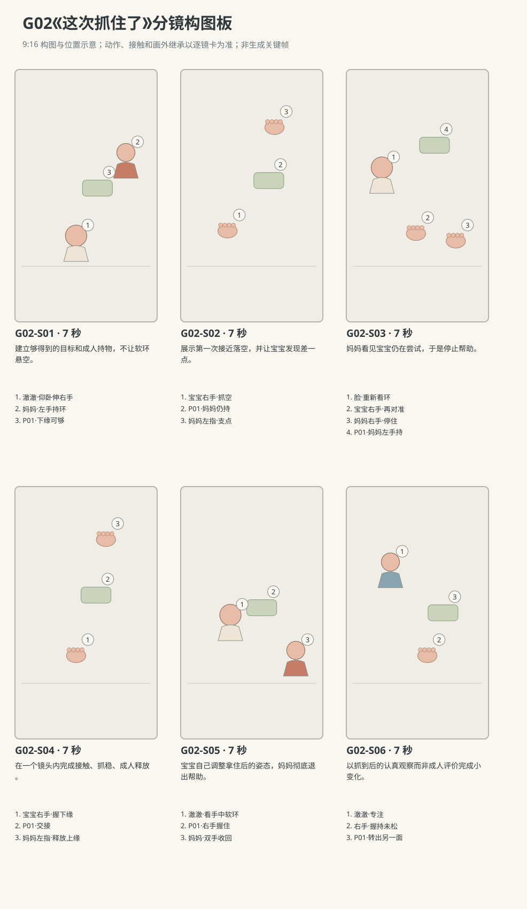

图示为构图位置示意；姿态、接触和画外继承以逐镜正文为准。

### 逐镜设计

#### G02-S01｜00—07 秒｜7 秒｜帧 [0, 168)

**镜头任务：**建立够得到的目标和成人持物，不让软环悬空。

**景别、机位与构图：**中景，南侧40厘米高轻俯；宝宝头画左、脚画右，妈妈坐右上，左手和软环在宝宝右胸前方。

**摄影机与理由：**固定机位，让动作本身改变画面；不推拉遮盖接触。

**焦点：**焦点覆盖澈澈的眼睛、行动手与目标物；关键接触始终可辨。

**入态：**澈澈仰卧看P01，妈妈左手捏环上缘，环下缘距宝宝张开的右手很近；妈妈右掌落膝。

**动作与表演：**

- 3 秒：妈妈把环下缘缓缓停稳，不再左右摇晃；宝宝眼睛跟到环下缘。

- 4 秒：宝宝右肘离垫，掌心向环伸去，左手留在胸前；后脑和背没有离垫。

**声音：**无对白、无音乐；西窗外极轻鸟声作底，前景保留连体衣摩擦与婴儿呼吸，动作触碰同步发声。

**出态：**右手接近软环下缘但尚未接触，妈妈左指仍捏上缘。

**切点与承接：**在指尖距离尚可辨时切近，保留碰偏的实际过程。

**连续性：**全身支撑与持环者同框；P01未交接，妈妈右手仍空。

**开始画面母稿：**

9:16竖幅，原创圆润三维生活动画，柔软棉布与自然皮肤质感，生活物理，无文字标语。澈澈深棕眼、短黑绒发、额前一撮向右弯，奶油色棉连体衣；身体按本条能力阶段呈现，表情与动作保留婴儿的专注和不熟练。 澈澈为R0仰卧伸手阶段；妈妈深棕低马尾、雾蓝棉上衣、米色长裤。 白天客厅西窗提供柔和漫射主光，暖墙反射补光；北墙固定沙发，东侧走廊，中央奶油地垫。 中景，南侧40厘米高轻俯；宝宝头画左、脚画右，妈妈坐右上，左手和软环在宝宝右胸前方。 单一开始瞬间：澈澈仰卧看P01，妈妈左手捏环上缘，环下缘距宝宝张开的右手很近；妈妈右掌落膝。 画面清楚呈现起态中已存在的支撑、视线与道具归属；不把后续动作叠画。

**视频变化母稿：**

9:16竖幅，原创圆润三维生活动画，柔软棉布与自然皮肤质感，生活物理，无文字标语。澈澈深棕眼、短黑绒发、额前一撮向右弯，奶油色棉连体衣；身体按本条能力阶段呈现，表情与动作保留婴儿的专注和不熟练。 澈澈为R0仰卧伸手阶段；妈妈深棕低马尾、雾蓝棉上衣、米色长裤。 白天客厅西窗提供柔和漫射主光，暖墙反射补光；北墙固定沙发，东侧走廊，中央奶油地垫。 本镜7秒，中景，南侧40厘米高轻俯；宝宝头画左、脚画右，妈妈坐右上，左手和软环在宝宝右胸前方。 起态：澈澈仰卧看P01，妈妈左手捏环上缘，环下缘距宝宝张开的右手很近；妈妈右掌落膝。 阶段1，持续3秒：妈妈把环下缘缓缓停稳，不再左右摇晃；宝宝眼睛跟到环下缘。 阶段2，持续4秒：宝宝右肘离垫，掌心向环伸去，左手留在胸前；后脑和背没有离垫。 摄影：固定机位，让动作本身改变画面；不推拉遮盖接触。 焦点：焦点覆盖澈澈的眼睛、行动手与目标物；关键接触始终可辨。 声音：无对白、无音乐；西窗外极轻鸟声作底，前景保留连体衣摩擦与婴儿呼吸，动作触碰同步发声。 终态：右手接近软环下缘但尚未接触，妈妈左指仍捏上缘。 连续性：全身支撑与持环者同框；P01未交接，妈妈右手仍空。

#### G02-S02｜07—14 秒｜7 秒｜帧 [168, 336)

**镜头任务：**展示第一次接近落空，并让宝宝发现差一点。

**景别、机位与构图：**手与环近景，南侧45厘米高；右手从左下进入，P01居中，妈妈左指在上缘，宝宝眼睛在左上画缘。

**摄影机与理由：**固定机位，让动作本身改变画面；不推拉遮盖接触。

**焦点：**环下缘和宝宝指尖同平面清楚，保持到空掌张开。

**入态：**宝宝右掌张开向环下缘，妈妈左指保持上缘固定。

**动作与表演：**

- 2 秒：宝宝右手略偏外，手背擦到环的南侧边缘。

- 2 秒：软环围绕妈妈左指轻摆，宝宝手指此时才闭合，掌心没有环。

- 3 秒：宝宝看空拳，再张开右掌收回胸前；软环摆幅逐渐减小。

**声音：**无对白、无音乐；西窗外极轻鸟声作底，前景保留连体衣摩擦与婴儿呼吸，动作触碰同步发声。

**出态：**右掌在胸前重新张开，P01仍由妈妈左手持着，摇摆将停。

**切点与承接：**保持环的摆动声，切到妈妈右手将起的反应，不跳到成功。

**连续性：**右手没有拿到环，镜内全程有妈妈左指作为悬挂支点。

**开始画面母稿：**

9:16竖幅，原创圆润三维生活动画，柔软棉布与自然皮肤质感，生活物理，无文字标语。澈澈深棕眼、短黑绒发、额前一撮向右弯，奶油色棉连体衣；身体按本条能力阶段呈现，表情与动作保留婴儿的专注和不熟练。 澈澈为R0仰卧伸手阶段；妈妈深棕低马尾、雾蓝棉上衣、米色长裤。 白天客厅西窗提供柔和漫射主光，暖墙反射补光；北墙固定沙发，东侧走廊，中央奶油地垫。 手与环近景，南侧45厘米高；右手从左下进入，P01居中，妈妈左指在上缘，宝宝眼睛在左上画缘。 单一开始瞬间：宝宝右掌张开向环下缘，妈妈左指保持上缘固定。 画面清楚呈现起态中已存在的支撑、视线与道具归属；不把后续动作叠画。

**视频变化母稿：**

9:16竖幅，原创圆润三维生活动画，柔软棉布与自然皮肤质感，生活物理，无文字标语。澈澈深棕眼、短黑绒发、额前一撮向右弯，奶油色棉连体衣；身体按本条能力阶段呈现，表情与动作保留婴儿的专注和不熟练。 澈澈为R0仰卧伸手阶段；妈妈深棕低马尾、雾蓝棉上衣、米色长裤。 白天客厅西窗提供柔和漫射主光，暖墙反射补光；北墙固定沙发，东侧走廊，中央奶油地垫。 本镜7秒，手与环近景，南侧45厘米高；右手从左下进入，P01居中，妈妈左指在上缘，宝宝眼睛在左上画缘。 起态：宝宝右掌张开向环下缘，妈妈左指保持上缘固定。 阶段1，持续2秒：宝宝右手略偏外，手背擦到环的南侧边缘。 阶段2，持续2秒：软环围绕妈妈左指轻摆，宝宝手指此时才闭合，掌心没有环。 阶段3，持续3秒：宝宝看空拳，再张开右掌收回胸前；软环摆幅逐渐减小。 摄影：固定机位，让动作本身改变画面；不推拉遮盖接触。 焦点：环下缘和宝宝指尖同平面清楚，保持到空掌张开。 声音：无对白、无音乐；西窗外极轻鸟声作底，前景保留连体衣摩擦与婴儿呼吸，动作触碰同步发声。 终态：右掌在胸前重新张开，P01仍由妈妈左手持着，摇摆将停。 连续性：右手没有拿到环，镜内全程有妈妈左指作为悬挂支点。

#### G02-S03｜14—21 秒｜7 秒｜帧 [336, 504)

**镜头任务：**妈妈看见宝宝仍在尝试，于是停止帮助。

**景别、机位与构图：**中近景，南侧35厘米高；宝宝脸左下，右手中央，妈妈的右手由右下抬起，左手持环位于右上。

**摄影机与理由：**固定机位，让动作本身改变画面；不推拉遮盖接触。

**焦点：**焦点覆盖澈澈的眼睛、行动手与目标物；关键接触始终可辨。

**入态：**宝宝右手收胸，眼睛仍看P01；妈妈左手持环，右手刚离膝。

**动作与表演：**

- 2 秒：妈妈右手靠向宝宝右手腕附近，但停在未接触的位置。

- 2 秒：宝宝眼睛从自己张开的右掌转回环下缘，下巴稍收。

- 3 秒：妈妈看见这次对准，右手停住不再靠近；宝宝再抬右肘，把掌心朝环送出。

**声音：**无对白、无音乐；西窗外极轻鸟声作底，前景保留连体衣摩擦与婴儿呼吸，动作触碰同步发声。

**出态：**宝宝右掌正对P01下缘，妈妈帮助的右手停在旁侧，未碰宝宝。

**切点与承接：**沿宝宝右手前进方向切接触近景，妈妈右手停留位置画外继承。

**连续性：**妈妈左手未换手持环；她右手没有替宝宝摆姿，宝宝背仍在垫上。

**开始画面母稿：**

9:16竖幅，原创圆润三维生活动画，柔软棉布与自然皮肤质感，生活物理，无文字标语。澈澈深棕眼、短黑绒发、额前一撮向右弯，奶油色棉连体衣；身体按本条能力阶段呈现，表情与动作保留婴儿的专注和不熟练。 澈澈为R0仰卧伸手阶段；妈妈深棕低马尾、雾蓝棉上衣、米色长裤。 白天客厅西窗提供柔和漫射主光，暖墙反射补光；北墙固定沙发，东侧走廊，中央奶油地垫。 中近景，南侧35厘米高；宝宝脸左下、右手收在胸前，妈妈右手在画右下刚离膝，左手持环位于右上。 单一开始瞬间：宝宝右手收胸，眼睛仍看P01；妈妈左手持环，右手刚离膝。 本图焦点固定在：宝宝看环的双眼、妈妈左指持环处与尚未接触宝宝的右手。 仅呈现这一瞬间的身体支撑、视线与物件归属，不把未来阶段或相机路径叠画。

**视频变化母稿：**

9:16竖幅，原创圆润三维生活动画，柔软棉布与自然皮肤质感，生活物理，无文字标语。澈澈深棕眼、短黑绒发、额前一撮向右弯，奶油色棉连体衣；身体按本条能力阶段呈现，表情与动作保留婴儿的专注和不熟练。 澈澈为R0仰卧伸手阶段；妈妈深棕低马尾、雾蓝棉上衣、米色长裤。 白天客厅西窗提供柔和漫射主光，暖墙反射补光；北墙固定沙发，东侧走廊，中央奶油地垫。 本镜7秒，中近景，南侧35厘米高；宝宝脸左下，右手中央，妈妈的右手由右下抬起，左手持环位于右上。 起态：宝宝右手收胸，眼睛仍看P01；妈妈左手持环，右手刚离膝。 阶段1，持续2秒：妈妈右手靠向宝宝右手腕附近，但停在未接触的位置。 阶段2，持续2秒：宝宝眼睛从自己张开的右掌转回环下缘，下巴稍收。 阶段3，持续3秒：妈妈看见这次对准，右手停住不再靠近；宝宝再抬右肘，把掌心朝环送出。 摄影：固定机位，让动作本身改变画面；不推拉遮盖接触。 焦点：焦点覆盖澈澈的眼睛、行动手与目标物；关键接触始终可辨。 声音：无对白、无音乐；西窗外极轻鸟声作底，前景保留连体衣摩擦与婴儿呼吸，动作触碰同步发声。 终态：宝宝右掌正对P01下缘，妈妈帮助的右手停在旁侧，未碰宝宝。 连续性：妈妈左手未换手持环；她右手没有替宝宝摆姿，宝宝背仍在垫上。

#### G02-S04｜21—28 秒｜7 秒｜帧 [504, 672)

**镜头任务：**在一个镜头内完成接触、抓稳、成人释放。

**景别、机位与构图：**手部特写，南侧斜俯，宝宝右手从下方托向环下缘，妈妈左指在上方，两个持物点不重叠。

**摄影机与理由：**固定机位，让动作本身改变画面；不推拉遮盖接触。

**焦点：**接触下缘保持锐利，妈妈上缘释放也在可辨景深内。

**入态：**宝宝右掌距软环下缘一指宽，手指舒展；妈妈左指仍捏上缘。

**动作与表演：**

- 2 秒：右手指腹先碰到环下缘，布面微微压扁。

- 3 秒：宝宝四指与拇指在下缘两侧缓慢合拢，环在双手之间停稳。

- 2 秒：妈妈确认下缘没有滑动，再张开左指退离上缘；环全重移到宝宝右手。

**声音：**无对白、无音乐；西窗外极轻鸟声作底，前景保留连体衣摩擦与婴儿呼吸，动作触碰同步发声。

**出态：**P01只在宝宝右手中，妈妈左指已经退出环上方，宝宝右腕略向下沉。

**切点与承接：**抓握已成立后切中近景，继续看小重量的结果而非庆祝。

**连续性：**妈妈释放在宝宝闭合之后；环始终一个，不能瞬间变成硬塑料。

**开始画面母稿：**

9:16竖幅，原创圆润三维生活动画，柔软棉布与自然皮肤质感，生活物理，无文字标语。澈澈深棕眼、短黑绒发、额前一撮向右弯，奶油色棉连体衣；身体按本条能力阶段呈现，表情与动作保留婴儿的专注和不熟练。 澈澈为R0仰卧伸手阶段；妈妈深棕低马尾、雾蓝棉上衣、米色长裤。 白天客厅西窗提供柔和漫射主光，暖墙反射补光；北墙固定沙发，东侧走廊，中央奶油地垫。 手部特写，南侧斜俯，宝宝右手从下方托向环下缘，妈妈左指在上方，两个持物点不重叠。 单一开始瞬间：宝宝右掌距软环下缘一指宽，手指舒展；妈妈左指仍捏上缘。 画面清楚呈现起态中已存在的支撑、视线与道具归属；不把后续动作叠画。

**视频变化母稿：**

9:16竖幅，原创圆润三维生活动画，柔软棉布与自然皮肤质感，生活物理，无文字标语。澈澈深棕眼、短黑绒发、额前一撮向右弯，奶油色棉连体衣；身体按本条能力阶段呈现，表情与动作保留婴儿的专注和不熟练。 澈澈为R0仰卧伸手阶段；妈妈深棕低马尾、雾蓝棉上衣、米色长裤。 白天客厅西窗提供柔和漫射主光，暖墙反射补光；北墙固定沙发，东侧走廊，中央奶油地垫。 本镜7秒，手部特写，南侧斜俯，宝宝右手从下方托向环下缘，妈妈左指在上方，两个持物点不重叠。 起态：宝宝右掌距软环下缘一指宽，手指舒展；妈妈左指仍捏上缘。 阶段1，持续2秒：右手指腹先碰到环下缘，布面微微压扁。 阶段2，持续3秒：宝宝四指与拇指在下缘两侧缓慢合拢，环在双手之间停稳。 阶段3，持续2秒：妈妈确认下缘没有滑动，再张开左指退离上缘；环全重移到宝宝右手。 摄影：固定机位，让动作本身改变画面；不推拉遮盖接触。 焦点：接触下缘保持锐利，妈妈上缘释放也在可辨景深内。 声音：无对白、无音乐；西窗外极轻鸟声作底，前景保留连体衣摩擦与婴儿呼吸，动作触碰同步发声。 终态：P01只在宝宝右手中，妈妈左指已经退出环上方，宝宝右腕略向下沉。 连续性：妈妈释放在宝宝闭合之后；环始终一个，不能瞬间变成硬塑料。

#### G02-S05｜28—35 秒｜7 秒｜帧 [672, 840)

**镜头任务：**宝宝自己调整拿住后的姿态，妈妈彻底退出帮助。

**景别、机位与构图：**中近景，南侧45厘米高，宝宝脸左上、右掌与软环在中央；妈妈两只空手出现在画右边缘。

**摄影机与理由：**固定机位，让动作本身改变画面；不推拉遮盖接触。

**焦点：**焦点覆盖澈澈的眼睛、行动手与目标物；关键接触始终可辨。

**入态：**宝宝右手握P01，右腕受软环重量略低；妈妈双手已空，右手仍停在旁边。

**动作与表演：**

- 3 秒：宝宝右肘弯一点，把下沉的软环重新带到视线前，目光追着它。

- 2 秒：妈妈右手慢慢收回，左手也回到膝上，不牵动宝宝。

- 2 秒：宝宝停止挥动，左手仍贴胸，眼睛盯住环的布纹。

**声音：**无对白、无音乐；西窗外极轻鸟声作底，前景保留连体衣摩擦与婴儿呼吸，动作触碰同步发声。

**出态：**软环稳定在宝宝右手，妈妈双手放膝，宝宝全身继续仰卧。

**切点与承接：**在动作由大变小时切更贴脸的收尾，延续专注。

**连续性：**P01只由宝宝右掌握下缘，妈妈空手必须可见；左手没有接棒。

**开始画面母稿：**

9:16竖幅，原创圆润三维生活动画，柔软棉布与自然皮肤质感，生活物理，无文字标语。澈澈深棕眼、短黑绒发、额前一撮向右弯，奶油色棉连体衣；身体按本条能力阶段呈现，表情与动作保留婴儿的专注和不熟练。 澈澈为R0仰卧伸手阶段；妈妈深棕低马尾、雾蓝棉上衣、米色长裤。 白天客厅西窗提供柔和漫射主光，暖墙反射补光；北墙固定沙发，东侧走廊，中央奶油地垫。 中近景，南侧45厘米高，宝宝脸左上、右掌与软环在中央；妈妈两只空手出现在画右边缘。 单一开始瞬间：宝宝右手握P01，右腕受软环重量略低；妈妈双手已空，右手仍停在旁边。 画面清楚呈现起态中已存在的支撑、视线与道具归属；不把后续动作叠画。

**视频变化母稿：**

9:16竖幅，原创圆润三维生活动画，柔软棉布与自然皮肤质感，生活物理，无文字标语。澈澈深棕眼、短黑绒发、额前一撮向右弯，奶油色棉连体衣；身体按本条能力阶段呈现，表情与动作保留婴儿的专注和不熟练。 澈澈为R0仰卧伸手阶段；妈妈深棕低马尾、雾蓝棉上衣、米色长裤。 白天客厅西窗提供柔和漫射主光，暖墙反射补光；北墙固定沙发，东侧走廊，中央奶油地垫。 本镜7秒，中近景，南侧45厘米高，宝宝脸左上、右掌与软环在中央；妈妈两只空手出现在画右边缘。 起态：宝宝右手握P01，右腕受软环重量略低；妈妈双手已空，右手仍停在旁边。 阶段1，持续3秒：宝宝右肘弯一点，把下沉的软环重新带到视线前，目光追着它。 阶段2，持续2秒：妈妈右手慢慢收回，左手也回到膝上，不牵动宝宝。 阶段3，持续2秒：宝宝停止挥动，左手仍贴胸，眼睛盯住环的布纹。 摄影：固定机位，让动作本身改变画面；不推拉遮盖接触。 焦点：焦点覆盖澈澈的眼睛、行动手与目标物；关键接触始终可辨。 声音：无对白、无音乐；西窗外极轻鸟声作底，前景保留连体衣摩擦与婴儿呼吸，动作触碰同步发声。 终态：软环稳定在宝宝右手，妈妈双手放膝，宝宝全身继续仰卧。 连续性：P01只由宝宝右掌握下缘，妈妈空手必须可见；左手没有接棒。

#### G02-S06｜35—42 秒｜7 秒｜帧 [840, 1008)

**镜头任务：**以抓到后的认真观察而非成人评价完成小变化。

**景别、机位与构图：**脸手近景，南侧50厘米高，眼睛在左上、软环在右下；背景仅见妈妈雾蓝衣料，不展示完整成人。

**摄影机与理由：**固定机位，让动作本身改变画面；不推拉遮盖接触。

**焦点：**宝宝双眼与软环表面同在可辨景深，背景妈妈柔虚。

**入态：**宝宝安静仰卧，右手握P01下缘举在右胸上方，目光落在布面。

**动作与表演：**

- 3 秒：宝宝轻轻转右腕，软环露出另一面，他眼睛跟着移动。

- 2 秒：右拇指蹭一下软布，握持没有松开；宝宝吐出很轻的气。

- 2 秒：他把环停在眼前，继续看；背景妈妈的肩膀随安静呼吸轻动。

**声音：**无对白、无音乐；西窗外极轻鸟声作底，前景保留连体衣摩擦与婴儿呼吸，动作触碰同步发声。

**出态：**右手持续握环，宝宝目光稳定，妈妈在旁陪候。

**切点与承接：**留在新获得的稳定握持上结束，不加台词、字幕或成就音。

**连续性：**握持与仰卧连续；近景外的妈妈仍在东南、双手在膝上。

**开始画面母稿：**

9:16竖幅，原创圆润三维生活动画，柔软棉布与自然皮肤质感，生活物理，无文字标语。澈澈深棕眼、短黑绒发、额前一撮向右弯，奶油色棉连体衣；身体按本条能力阶段呈现，表情与动作保留婴儿的专注和不熟练。 澈澈为R0仰卧伸手阶段；妈妈深棕低马尾、雾蓝棉上衣、米色长裤。 白天客厅西窗提供柔和漫射主光，暖墙反射补光；北墙固定沙发，东侧走廊，中央奶油地垫。 脸手近景，南侧50厘米高，眼睛在左上、软环在右下；背景仅见妈妈雾蓝衣料，不展示完整成人。 单一开始瞬间：宝宝安静仰卧，右手握P01下缘举在右胸上方，目光落在布面。 画面清楚呈现起态中已存在的支撑、视线与道具归属；不把后续动作叠画。

**视频变化母稿：**

9:16竖幅，原创圆润三维生活动画，柔软棉布与自然皮肤质感，生活物理，无文字标语。澈澈深棕眼、短黑绒发、额前一撮向右弯，奶油色棉连体衣；身体按本条能力阶段呈现，表情与动作保留婴儿的专注和不熟练。 澈澈为R0仰卧伸手阶段；妈妈深棕低马尾、雾蓝棉上衣、米色长裤。 白天客厅西窗提供柔和漫射主光，暖墙反射补光；北墙固定沙发，东侧走廊，中央奶油地垫。 本镜7秒，脸手近景，南侧50厘米高，眼睛在左上、软环在右下；背景仅见妈妈雾蓝衣料，不展示完整成人。 起态：宝宝安静仰卧，右手握P01下缘举在右胸上方，目光落在布面。 阶段1，持续3秒：宝宝轻轻转右腕，软环露出另一面，他眼睛跟着移动。 阶段2，持续2秒：右拇指蹭一下软布，握持没有松开；宝宝吐出很轻的气。 阶段3，持续2秒：他把环停在眼前，继续看；背景妈妈的肩膀随安静呼吸轻动。 摄影：固定机位，让动作本身改变画面；不推拉遮盖接触。 焦点：宝宝双眼与软环表面同在可辨景深，背景妈妈柔虚。 声音：无对白、无音乐；西窗外极轻鸟声作底，前景保留连体衣摩擦与婴儿呼吸，动作触碰同步发声。 终态：右手持续握环，宝宝目光稳定，妈妈在旁陪候。 连续性：握持与仰卧连续；近景外的妈妈仍在东南、双手在膝上。

### 声音与剪辑

软环布面摩擦与第一次轻摆、婴儿轻呼气构成节奏；妈妈无口头鼓励，成功后也不加音效。

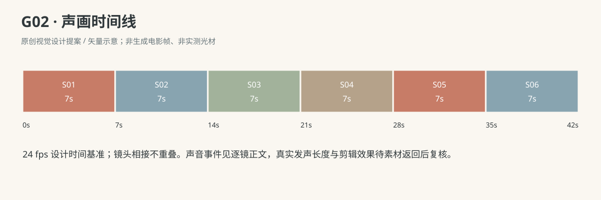

正式台词：无；保留镜头声音中已写明的自然发声。

### 连续性与试片

- 连续性：P01起初由妈妈左手捏上缘，下缘是宝宝唯一抓取目标；直到S04确定抓稳才释放。

- 连续性：宝宝只用右手抓P01，左手贴胸；镜头不镜像交换手。

- 连续性：妈妈右手全片不握宝宝手腕，停手距离始终可见。

- 连续性：R0仰卧承托不变，不以突然坐起或抬背解决够取距离。

- 试片：G02-S02：必须看见右手擦过软环但未抓住，P01仍由妈妈左手持有；碰偏后凭空出现在宝宝掌中则失败。

- 试片：G02-S03到S04：右手再次对准、触布、闭合、妈妈松手有先后顺序；松手前环悬空或双方手指融合则失败。

- 试片：G02-S05到S06：妈妈帮助之手没有碰上宝宝，宝宝自己承受环的小幅重量且保留仰卧；若读成妈妈把环塞进手里则失败。

**媒体待验证：**尚无媒体；待验证软环形变、双手交接帧、婴儿右腕受力与重看目标的微表演。

---

## G03《翻过去，世界换了一面》

**54 秒｜仰卧与翻身探索｜角色：澈澈、妈妈｜场景 L**

### 剧情正文

地垫北边放着一只芥末色布球，旁边正好是窗光照亮的缝线。澈澈仰躺着，头朝布球偏过去，右手越过胸前去够。肩膀转了一点，肚子和腿却还留在原处；手指离球始终差一小段，他慢慢回到仰卧。坐在西北角的妈妈把自己膝边的布巾收好，停下来等。澈澈再看看球，屈起腿，左臂先往头侧舒展开，右手又向北边伸去。这次肩膀转动后，腰和骨盆也跟着滚过去，脚尖擦着地垫，身体终于落成俯卧。他用前臂撑住，抬起脸，看到原本横在视线侧面的布球，现在就在面前。妈妈俯低身体，脸出现在他的新视野里。澈澈先怔怔看她，随后腾出右手碰一下球，球只滚了一小截。他没有再追，只趴着看那一点新距离。

### 导演与空间

**观察任务：**让翻身前后的视野变化可见，完整呈现肩、躯干、骨盆与腿跟随，而非以切镜完成翻转。

**空间与光位：**澈澈头西脚东仰卧；P02芥末布球放在其身体北侧、左肩略前的位置，始终在同一地垫缝旁。妈妈跪坐西北角，不占北侧翻身落点。相机在南至西南侧，沿头脚轴同侧观察；主翻身镜升至60厘米斜俯以看全身。

**人物表演：**宝宝先肩转而骨盆未跟上，回落后再尝试；第二次左侧滚转到俯卧，左前臂预先向头侧伸开并落垫，右手最后腾出碰球。妈妈只近旁守候、事后降低视线，不推肩或提腿。

### 节拍覆盖

- **G03-b1**：前态：澈澈仰卧，左臂松放身侧，双腿微弯；P02在北侧左肩略前地垫缝旁，妈妈跪坐西北角握P04。 过程：妈妈把P04折到自己膝边，视线转向宝宝。宝宝头慢慢偏向北侧布球，右手抬到胸前，眼睛追到球上。 后态：宝宝视线指向北侧球，右手在胸前，妈妈双手落自己膝边。 观众观察：交代北侧球、仰卧宝宝和空出的翻身区域。 → G03-S01

- **G03-b2**：前态：宝宝右手已抬胸前，目光看北侧球，肩背和骨盆仍平贴垫面。 过程：右手跨过胸前伸向北侧，头和右肩跟着抬转，左肩成为较低接触点。骨盆还留在仰卧位置，手指停在离球一掌远处，没有碰球。宝宝右手收回，肩背慢慢落垫，头仍朝球偏着。 后态：肩背回到垫上，骨盆未滚转，P02原位未动。 观众观察：呈现第一次只转肩、尚不能够到球的尝试。 → G03-S02

- **G03-b3**：前态：宝宝已仰卧回稳，右手胸前，左臂在身体北侧，布球未动。 过程：宝宝停下来呼吸，眼睛仍看球；妈妈身体略前倾但双手保持膝上。宝宝双膝缓慢屈起，左前臂往头侧舒展，掌和前臂落在头左前方垫面。右手再跨胸向球伸去，肩开始朝北侧转，骨盆尚未翻过。 后态：左前臂已前伸落垫，双膝屈着，右肩刚离垫，右手指向布球。 观众观察：交代下一次尝试之前左臂与腿的位置准备。 → G03-S03

- **G03-b4**：前态：左前臂在头侧垫上，右肩刚抬转，双膝屈着，骨盆仍贴垫。 过程：右手向北伸带动上身转向左侧，左肩与侧胸先受垫承托，左臂仍留在头前。躯干继续转，骨盆跟随侧滚，屈着的腿沿垫移动，没有突然交换左右。腹部和骨盆逐渐落成俯卧，双腿舒开，右前臂落到胸前侧共同承托，翻转结束。 后态：宝宝已俯卧，两前臂在胸前垫上，腹部与骨盆接地，脸侧向北侧球但尚未抬高。 观众观察：完整看到第二次肩、躯干、骨盆和腿连成一次翻转。 → G03-S04

- **G03-b5**：前态：澈澈俯卧，两前臂承托上身，腹部骨盆贴垫，脸还低着，球在视线前方。 过程：宝宝以前臂承托微抬胸口和下巴，眼睛慢慢抬到布球高度。视线从地垫缝转到球，再向球后的妈妈方向看，嘴微张。妈妈在远处开始俯低身体，但还没有进入宝宝近处。 后态：宝宝抬脸稳定，球完整进入其前方视野，妈妈正降低到相近视线高度。 观众观察：让新视线从低处抬起，证明翻身改变了世界。 → G03-S05

- **G03-b6**：前态：宝宝由两前臂撑着看向妈妈；妈妈跪地身体下俯，手在自己膝旁。 过程：妈妈慢慢把脸降到宝宝能直接看见的位置，停住，轻轻笑一下。宝宝先愣着看妈妈，再把目光落回两人之间的球。宝宝重心留在左前臂与腹部，右手肘稍向前松出，为碰球腾出空间。 后态：妈妈与宝宝视线相遇后都看向球；宝宝左前臂稳定，右掌开始离垫。 观众观察：妈妈进入宝宝的新视野，回应先于庆祝。 → G03-S06

- **G03-b7**：前态：宝宝左前臂撑垫，腹部骨盆贴垫，右掌朝球伸出但尚未碰到。 过程：右掌向前触到布球侧面，指腹让软布略凹。球在掌推下滚过一小段地垫缝，右掌随后回落到垫上。宝宝恢复双前臂支撑，抬眼看停住的球；妈妈保持陪看，轻呼吸。 后态：宝宝稳定俯卧，球停在原位前方约一掌处，右手已经回垫。 观众观察：小成功落在新姿势下碰到同一个球。 → G03-S07

### 分镜构图板

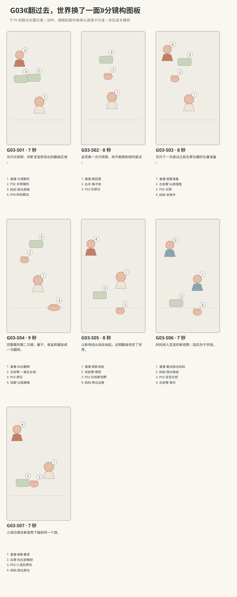

图示为构图位置示意；姿态、接触和画外继承以逐镜正文为准。

### 逐镜设计

#### G03-S01｜00—07 秒｜7 秒｜帧 [0, 168)

**镜头任务：**交代北侧球、仰卧宝宝和空出的翻身区域。

**景别、机位与构图：**中全景，南侧55厘米高轻俯；澈澈横在中下，头左脚右，布球在其身体后方偏左，妈妈居左上，北侧落点完整可见。

**摄影机与理由：**固定机位，让动作本身改变画面；不推拉遮盖接触。

**焦点：**焦点覆盖澈澈的眼睛、行动手与目标物；关键接触始终可辨。

**入态：**澈澈仰卧，左臂松放身侧，双腿微弯；P02在北侧左肩略前地垫缝旁，妈妈跪坐西北角握P04。

**动作与表演：**

- 3 秒：妈妈把P04折到自己膝边，视线转向宝宝。

- 4 秒：宝宝头慢慢偏向北侧布球，右手抬到胸前，眼睛追到球上。

**声音：**无对白、无音乐；西窗外极轻鸟声作底，前景保留连体衣摩擦与婴儿呼吸，动作触碰同步发声。

**出态：**宝宝视线指向北侧球，右手在胸前，妈妈双手落自己膝边。

**切点与承接：**沿宝宝越胸前的右手切到较近全身景，保留球的位置参照。

**连续性：**画内明确北侧翻身空间无成人膝盖阻挡；P04属于妈妈，不参与翻身。

**开始画面母稿：**

9:16竖幅，原创圆润三维生活动画，柔软棉布与自然皮肤质感，生活物理，无文字标语。澈澈深棕眼、短黑绒发、额前一撮向右弯，奶油色棉连体衣；身体按本条能力阶段呈现，表情与动作保留婴儿的专注和不熟练。 澈澈为R0仰卧到俯卧的翻身片段，奶油连体衣；妈妈低马尾、雾蓝上衣、米色长裤。 白天客厅西窗提供柔和漫射主光，暖墙反射补光；北墙固定沙发，东侧走廊，中央奶油地垫。 中全景，南侧55厘米高轻俯；澈澈横在中下，头左脚右，布球在其身体后方偏左，妈妈居左上，北侧落点完整可见。 单一开始瞬间：澈澈仰卧，左臂松放身侧，双腿微弯；P02在北侧左肩略前地垫缝旁，妈妈跪坐西北角握P04。 画面清楚呈现起态中已存在的支撑、视线与道具归属；不把后续动作叠画。

**视频变化母稿：**

9:16竖幅，原创圆润三维生活动画，柔软棉布与自然皮肤质感，生活物理，无文字标语。澈澈深棕眼、短黑绒发、额前一撮向右弯，奶油色棉连体衣；身体按本条能力阶段呈现，表情与动作保留婴儿的专注和不熟练。 澈澈为R0仰卧到俯卧的翻身片段，奶油连体衣；妈妈低马尾、雾蓝上衣、米色长裤。 白天客厅西窗提供柔和漫射主光，暖墙反射补光；北墙固定沙发，东侧走廊，中央奶油地垫。 本镜7秒，中全景，南侧55厘米高轻俯；澈澈横在中下，头左脚右，布球在其身体后方偏左，妈妈居左上，北侧落点完整可见。 起态：澈澈仰卧，左臂松放身侧，双腿微弯；P02在北侧左肩略前地垫缝旁，妈妈跪坐西北角握P04。 阶段1，持续3秒：妈妈把P04折到自己膝边，视线转向宝宝。 阶段2，持续4秒：宝宝头慢慢偏向北侧布球，右手抬到胸前，眼睛追到球上。 摄影：固定机位，让动作本身改变画面；不推拉遮盖接触。 焦点：焦点覆盖澈澈的眼睛、行动手与目标物；关键接触始终可辨。 声音：无对白、无音乐；西窗外极轻鸟声作底，前景保留连体衣摩擦与婴儿呼吸，动作触碰同步发声。 终态：宝宝视线指向北侧球，右手在胸前，妈妈双手落自己膝边。 连续性：画内明确北侧翻身空间无成人膝盖阻挡；P04属于妈妈，不参与翻身。

#### G03-S02｜07—15 秒｜8 秒｜帧 [168, 360)

**镜头任务：**呈现第一次只转肩、尚不能够到球的尝试。

**景别、机位与构图：**全身近景，西南侧50厘米高斜俯，头左上脚右下，北侧球在上方；腰、骨盆和双腿全留画。

**摄影机与理由：**固定机位，让动作本身改变画面；不推拉遮盖接触。

**焦点：**焦点覆盖澈澈的眼睛、行动手与目标物；关键接触始终可辨。

**入态：**宝宝右手已抬胸前，目光看北侧球，肩背和骨盆仍平贴垫面。

**动作与表演：**

- 3 秒：右手跨过胸前伸向北侧，头和右肩跟着抬转，左肩成为较低接触点。

- 2 秒：骨盆还留在仰卧位置，手指停在离球一掌远处，没有碰球。

- 3 秒：宝宝右手收回，肩背慢慢落垫，头仍朝球偏着。

**声音：**无对白、无音乐；西窗外极轻鸟声作底，前景保留连体衣摩擦与婴儿呼吸，动作触碰同步发声。

**出态：**肩背回到垫上，骨盆未滚转，P02原位未动。

**切点与承接：**等第一次回落完成再切，不能把未完成的动作剪成成功。

**连续性：**第一次仅肩转，左右腿仍能从骨盆连续看到；妈妈画外继承西北角未伸手。

**开始画面母稿：**

9:16竖幅，原创圆润三维生活动画，柔软棉布与自然皮肤质感，生活物理，无文字标语。澈澈深棕眼、短黑绒发、额前一撮向右弯，奶油色棉连体衣；身体按本条能力阶段呈现，表情与动作保留婴儿的专注和不熟练。 澈澈为R0仰卧到俯卧的翻身片段，奶油连体衣；妈妈低马尾、雾蓝上衣、米色长裤。 白天客厅西窗提供柔和漫射主光，暖墙反射补光；北墙固定沙发，东侧走廊，中央奶油地垫。 全身近景，西南侧50厘米高斜俯，头左上脚右下，北侧球在上方；腰、骨盆和双腿全留画。 单一开始瞬间：宝宝右手已抬胸前，目光看北侧球，肩背和骨盆仍平贴垫面。 画面清楚呈现起态中已存在的支撑、视线与道具归属；不把后续动作叠画。

**视频变化母稿：**

9:16竖幅，原创圆润三维生活动画，柔软棉布与自然皮肤质感，生活物理，无文字标语。澈澈深棕眼、短黑绒发、额前一撮向右弯，奶油色棉连体衣；身体按本条能力阶段呈现，表情与动作保留婴儿的专注和不熟练。 澈澈为R0仰卧到俯卧的翻身片段，奶油连体衣；妈妈低马尾、雾蓝上衣、米色长裤。 白天客厅西窗提供柔和漫射主光，暖墙反射补光；北墙固定沙发，东侧走廊，中央奶油地垫。 本镜8秒，全身近景，西南侧50厘米高斜俯，头左上脚右下，北侧球在上方；腰、骨盆和双腿全留画。 起态：宝宝右手已抬胸前，目光看北侧球，肩背和骨盆仍平贴垫面。 阶段1，持续3秒：右手跨过胸前伸向北侧，头和右肩跟着抬转，左肩成为较低接触点。 阶段2，持续2秒：骨盆还留在仰卧位置，手指停在离球一掌远处，没有碰球。 阶段3，持续3秒：宝宝右手收回，肩背慢慢落垫，头仍朝球偏着。 摄影：固定机位，让动作本身改变画面；不推拉遮盖接触。 焦点：焦点覆盖澈澈的眼睛、行动手与目标物；关键接触始终可辨。 声音：无对白、无音乐；西窗外极轻鸟声作底，前景保留连体衣摩擦与婴儿呼吸，动作触碰同步发声。 终态：肩背回到垫上，骨盆未滚转，P02原位未动。 连续性：第一次仅肩转，左右腿仍能从骨盆连续看到；妈妈画外继承西北角未伸手。

#### G03-S03｜15—23 秒｜8 秒｜帧 [360, 552)

**镜头任务：**交代下一次尝试之前左臂与腿的位置准备。

**景别、机位与构图：**中全景，南侧60厘米高，身体与布球同画，妈妈只在西北边缘，左臂朝头侧的空隙清楚。

**摄影机与理由：**固定机位，让动作本身改变画面；不推拉遮盖接触。

**焦点：**焦点覆盖澈澈的眼睛、行动手与目标物；关键接触始终可辨。

**入态：**宝宝已仰卧回稳，右手胸前，左臂在身体北侧，布球未动。

**动作与表演：**

- 2 秒：宝宝停下来呼吸，眼睛仍看球；妈妈身体略前倾但双手保持膝上。

- 3 秒：宝宝双膝缓慢屈起，左前臂往头侧舒展，掌和前臂落在头左前方垫面。

- 3 秒：右手再跨胸向球伸去，肩开始朝北侧转，骨盆尚未翻过。

**声音：**无对白、无音乐；西窗外极轻鸟声作底，前景保留连体衣摩擦与婴儿呼吸，动作触碰同步发声。

**出态：**左前臂已前伸落垫，双膝屈着，右肩刚离垫，右手指向布球。

**切点与承接：**从刚开始的肩转接入不中断的全身翻身镜，左臂落点严格匹配。

**连续性：**左臂移位在本镜可见，非翻过后凭空抽出；P02仍在缝旁。

**开始画面母稿：**

9:16竖幅，原创圆润三维生活动画，柔软棉布与自然皮肤质感，生活物理，无文字标语。澈澈深棕眼、短黑绒发、额前一撮向右弯，奶油色棉连体衣；身体按本条能力阶段呈现，表情与动作保留婴儿的专注和不熟练。 澈澈为R0仰卧到俯卧的翻身片段，奶油连体衣；妈妈低马尾、雾蓝上衣、米色长裤。 白天客厅西窗提供柔和漫射主光，暖墙反射补光；北墙固定沙发，东侧走廊，中央奶油地垫。 中全景，南侧60厘米高，身体与布球同画，妈妈只在西北边缘，左臂朝头侧的空隙清楚。 单一开始瞬间：宝宝已仰卧回稳，右手胸前，左臂在身体北侧，布球未动。 画面清楚呈现起态中已存在的支撑、视线与道具归属；不把后续动作叠画。

**视频变化母稿：**

9:16竖幅，原创圆润三维生活动画，柔软棉布与自然皮肤质感，生活物理，无文字标语。澈澈深棕眼、短黑绒发、额前一撮向右弯，奶油色棉连体衣；身体按本条能力阶段呈现，表情与动作保留婴儿的专注和不熟练。 澈澈为R0仰卧到俯卧的翻身片段，奶油连体衣；妈妈低马尾、雾蓝上衣、米色长裤。 白天客厅西窗提供柔和漫射主光，暖墙反射补光；北墙固定沙发，东侧走廊，中央奶油地垫。 本镜8秒，中全景，南侧60厘米高，身体与布球同画，妈妈只在西北边缘，左臂朝头侧的空隙清楚。 起态：宝宝已仰卧回稳，右手胸前，左臂在身体北侧，布球未动。 阶段1，持续2秒：宝宝停下来呼吸，眼睛仍看球；妈妈身体略前倾但双手保持膝上。 阶段2，持续3秒：宝宝双膝缓慢屈起，左前臂往头侧舒展，掌和前臂落在头左前方垫面。 阶段3，持续3秒：右手再跨胸向球伸去，肩开始朝北侧转，骨盆尚未翻过。 摄影：固定机位，让动作本身改变画面；不推拉遮盖接触。 焦点：焦点覆盖澈澈的眼睛、行动手与目标物；关键接触始终可辨。 声音：无对白、无音乐；西窗外极轻鸟声作底，前景保留连体衣摩擦与婴儿呼吸，动作触碰同步发声。 终态：左前臂已前伸落垫，双膝屈着，右肩刚离垫，右手指向布球。 连续性：左臂移位在本镜可见，非翻过后凭空抽出；P02仍在缝旁。

#### G03-S04｜23—32 秒｜9 秒｜帧 [552, 768)

**镜头任务：**完整看到第二次肩、躯干、骨盆和腿连成一次翻转。

**景别、机位与构图：**全身动作主镜，南侧60厘米高斜俯固定，头脚与球均不裁切；北侧落点在画上半，保留手臂避让空间。

**摄影机与理由：**固定机位，让动作本身改变画面；不推拉遮盖接触。

**焦点：**保持全身较深景深，肩、骨盆、双腿与前臂落点同时清楚。

**入态：**左前臂在头侧垫上，右肩刚抬转，双膝屈着，骨盆仍贴垫。

**动作与表演：**

- 3 秒：右手向北伸带动上身转向左侧，左肩与侧胸先受垫承托，左臂仍留在头前。

- 3 秒：躯干继续转，骨盆跟随侧滚，屈着的腿沿垫移动，没有突然交换左右。

- 3 秒：腹部和骨盆逐渐落成俯卧，双腿舒开，右前臂落到胸前侧共同承托，翻转结束。

**声音：**无对白无音乐；侧胸、衣腹与垫面的摩擦依次出现，双腿舒开时轻擦垫，翻定后短呼气。

**出态：**宝宝已俯卧，两前臂在胸前垫上，腹部与骨盆接地，脸侧向北侧球但尚未抬高。

**切点与承接：**翻转完全结束并有稳定接触后才切，下一镜从俯卧承托继续。

**连续性：**翻身整程可见，无成人手入画；左前臂未被身体穿过，球始终未触未滚。

**开始画面母稿：**

9:16竖幅，原创圆润三维生活动画，柔软棉布与自然皮肤质感，生活物理，无文字标语。澈澈深棕眼、短黑绒发、额前一撮向右弯，奶油色棉连体衣；身体按本条能力阶段呈现，表情与动作保留婴儿的专注和不熟练。 澈澈为R0仰卧到俯卧的翻身片段，奶油连体衣；妈妈低马尾、雾蓝上衣、米色长裤。 白天客厅西窗提供柔和漫射主光，暖墙反射补光；北墙固定沙发，东侧走廊，中央奶油地垫。 全身动作主镜，南侧60厘米高斜俯固定，头脚与球均不裁切；北侧落点在画上半，保留手臂避让空间。 单一开始瞬间：左前臂在头侧垫上，右肩刚抬转，双膝屈着，骨盆仍贴垫。 画面清楚呈现起态中已存在的支撑、视线与道具归属；不把后续动作叠画。

**视频变化母稿：**

9:16竖幅，原创圆润三维生活动画，柔软棉布与自然皮肤质感，生活物理，无文字标语。澈澈深棕眼、短黑绒发、额前一撮向右弯，奶油色棉连体衣；身体按本条能力阶段呈现，表情与动作保留婴儿的专注和不熟练。 澈澈为R0仰卧到俯卧的翻身片段，奶油连体衣；妈妈低马尾、雾蓝上衣、米色长裤。 白天客厅西窗提供柔和漫射主光，暖墙反射补光；北墙固定沙发，东侧走廊，中央奶油地垫。 本镜9秒，全身动作主镜，南侧60厘米高斜俯固定，头脚与球均不裁切；北侧落点在画上半，保留手臂避让空间。 起态：左前臂在头侧垫上，右肩刚抬转，双膝屈着，骨盆仍贴垫。 阶段1，持续3秒：右手向北伸带动上身转向左侧，左肩与侧胸先受垫承托，左臂仍留在头前。 阶段2，持续3秒：躯干继续转，骨盆跟随侧滚，屈着的腿沿垫移动，没有突然交换左右。 阶段3，持续3秒：腹部和骨盆逐渐落成俯卧，双腿舒开，右前臂落到胸前侧共同承托，翻转结束。 摄影：固定机位，让动作本身改变画面；不推拉遮盖接触。 焦点：保持全身较深景深，肩、骨盆、双腿与前臂落点同时清楚。 声音：无对白无音乐；侧胸、衣腹与垫面的摩擦依次出现，双腿舒开时轻擦垫，翻定后短呼气。 终态：宝宝已俯卧，两前臂在胸前垫上，腹部与骨盆接地，脸侧向北侧球但尚未抬高。 连续性：翻身整程可见，无成人手入画；左前臂未被身体穿过，球始终未触未滚。

#### G03-S05｜32—40 秒｜8 秒｜帧 [768, 960)

**镜头任务：**让新视线从低处抬起，证明翻身改变了世界。

**景别、机位与构图：**低位中近景，西南侧离垫18厘米向东北观察；宝宝头在中右、身体向右后延伸，北西侧的布球在左前，妈妈仍在左上远景西北角，前臂与腹部承托留画。

**摄影机与理由：**固定机位，让动作本身改变画面；不推拉遮盖接触。

**焦点：**焦点覆盖澈澈的眼睛、行动手与目标物；关键接触始终可辨。

**入态：**澈澈俯卧，两前臂承托上身，腹部骨盆贴垫，脸还低着，球在视线前方。

**动作与表演：**

- 3 秒：宝宝以前臂承托微抬胸口和下巴，眼睛慢慢抬到布球高度。

- 3 秒：视线从地垫缝转到球，再向球后的妈妈方向看，嘴微张。

- 2 秒：妈妈在远处开始俯低身体，但还没有进入宝宝近处。

**声音：**无对白、无音乐；西窗外极轻鸟声作底，前景保留连体衣摩擦与婴儿呼吸，动作触碰同步发声。

**出态：**宝宝抬脸稳定，球完整进入其前方视野，妈妈正降低到相近视线高度。

**切点与承接：**沿宝宝看妈妈的眼线切双人同框，保持南侧而不反打换窗。

**连续性：**前臂与腹部共同承托可见；抬脸不演成俯卧撑或胸腹全悬空。

**开始画面母稿：**

9:16竖幅，原创圆润三维生活动画，柔软棉布与自然皮肤质感，生活物理，无文字标语。澈澈深棕眼、短黑绒发、额前一撮向右弯，奶油色棉连体衣；身体按本条能力阶段呈现，表情与动作保留婴儿的专注和不熟练。 澈澈为R0仰卧到俯卧的翻身片段，奶油连体衣；妈妈低马尾、雾蓝上衣、米色长裤。 白天客厅西窗提供柔和漫射主光，暖墙反射补光；北墙固定沙发，东侧走廊，中央奶油地垫。 低位中近景，西南侧离垫18厘米向东北观察；宝宝头在中右、身体向右后延伸，北西侧的布球在左前，妈妈仍在左上远景西北角，前臂与腹部承托留画。 单一开始瞬间：澈澈俯卧，两前臂承托上身，腹部骨盆贴垫，脸还低着，球在视线前方。 画面清楚呈现起态中已存在的支撑、视线与道具归属；不把后续动作叠画。

**视频变化母稿：**

9:16竖幅，原创圆润三维生活动画，柔软棉布与自然皮肤质感，生活物理，无文字标语。澈澈深棕眼、短黑绒发、额前一撮向右弯，奶油色棉连体衣；身体按本条能力阶段呈现，表情与动作保留婴儿的专注和不熟练。 澈澈为R0仰卧到俯卧的翻身片段，奶油连体衣；妈妈低马尾、雾蓝上衣、米色长裤。 白天客厅西窗提供柔和漫射主光，暖墙反射补光；北墙固定沙发，东侧走廊，中央奶油地垫。 本镜8秒，低位中近景，西南侧离垫18厘米向东北观察；宝宝头在中右、身体向右后延伸，北西侧的布球在左前，妈妈仍在左上远景西北角，前臂与腹部承托留画。 起态：澈澈俯卧，两前臂承托上身，腹部骨盆贴垫，脸还低着，球在视线前方。 阶段1，持续3秒：宝宝以前臂承托微抬胸口和下巴，眼睛慢慢抬到布球高度。 阶段2，持续3秒：视线从地垫缝转到球，再向球后的妈妈方向看，嘴微张。 阶段3，持续2秒：妈妈在远处开始俯低身体，但还没有进入宝宝近处。 摄影：固定机位，让动作本身改变画面；不推拉遮盖接触。 焦点：焦点覆盖澈澈的眼睛、行动手与目标物；关键接触始终可辨。 声音：无对白、无音乐；西窗外极轻鸟声作底，前景保留连体衣摩擦与婴儿呼吸，动作触碰同步发声。 终态：宝宝抬脸稳定，球完整进入其前方视野，妈妈正降低到相近视线高度。 连续性：前臂与腹部共同承托可见；抬脸不演成俯卧撑或胸腹全悬空。

#### G03-S06｜40—47 秒｜7 秒｜帧 [960, 1128)

**镜头任务：**妈妈进入宝宝的新视野，回应先于庆祝。

**景别、机位与构图：**双人近景，延续西南侧低机位朝东北；宝宝脸在右下，妈妈仍在西北角、脸在左上，P02在宝宝左前的画左下，机位未越过头脚轴。

**摄影机与理由：**固定机位，让动作本身改变画面；不推拉遮盖接触。

**焦点：**焦点覆盖澈澈的眼睛、行动手与目标物；关键接触始终可辨。

**入态：**宝宝由两前臂撑着看向妈妈；妈妈跪地身体下俯，手在自己膝旁。

**动作与表演：**

- 3 秒：妈妈慢慢把脸降到宝宝能直接看见的位置，停住，轻轻笑一下。

- 2 秒：宝宝先愣着看妈妈，再把目光落回两人之间的球。

- 2 秒：宝宝重心留在左前臂与腹部，右手肘稍向前松出，为碰球腾出空间。

**声音：**无对白、无音乐；西窗外极轻鸟声作底，前景保留连体衣摩擦与婴儿呼吸，动作触碰同步发声。

**出态：**妈妈与宝宝视线相遇后都看向球；宝宝左前臂稳定，右掌开始离垫。

**切点与承接：**从右掌刚离垫切到接触球的中近景，镜外妈妈继续俯低等待。

**连续性：**成人未托举宝宝；右手解放前已有左前臂与腹部的支撑关系。

**开始画面母稿：**

9:16竖幅，原创圆润三维生活动画，柔软棉布与自然皮肤质感，生活物理，无文字标语。澈澈深棕眼、短黑绒发、额前一撮向右弯，奶油色棉连体衣；身体按本条能力阶段呈现，表情与动作保留婴儿的专注和不熟练。 澈澈为R0仰卧到俯卧的翻身片段，奶油连体衣；妈妈低马尾、雾蓝上衣、米色长裤。 白天客厅西窗提供柔和漫射主光，暖墙反射补光；北墙固定沙发，东侧走廊，中央奶油地垫。 双人近景，延续西南侧低机位朝东北；宝宝脸在右下，妈妈仍在西北角、脸在左上，P02在宝宝左前的画左下，机位未越过头脚轴。 单一开始瞬间：宝宝由两前臂撑着看向妈妈；妈妈跪地身体下俯，手在自己膝旁。 画面清楚呈现起态中已存在的支撑、视线与道具归属；不把后续动作叠画。

**视频变化母稿：**

9:16竖幅，原创圆润三维生活动画，柔软棉布与自然皮肤质感，生活物理，无文字标语。澈澈深棕眼、短黑绒发、额前一撮向右弯，奶油色棉连体衣；身体按本条能力阶段呈现，表情与动作保留婴儿的专注和不熟练。 澈澈为R0仰卧到俯卧的翻身片段，奶油连体衣；妈妈低马尾、雾蓝上衣、米色长裤。 白天客厅西窗提供柔和漫射主光，暖墙反射补光；北墙固定沙发，东侧走廊，中央奶油地垫。 本镜7秒，双人近景，延续西南侧低机位朝东北；宝宝脸在右下，妈妈仍在西北角、脸在左上，P02在宝宝左前的画左下，机位未越过头脚轴。 起态：宝宝由两前臂撑着看向妈妈；妈妈跪地身体下俯，手在自己膝旁。 阶段1，持续3秒：妈妈慢慢把脸降到宝宝能直接看见的位置，停住，轻轻笑一下。 阶段2，持续2秒：宝宝先愣着看妈妈，再把目光落回两人之间的球。 阶段3，持续2秒：宝宝重心留在左前臂与腹部，右手肘稍向前松出，为碰球腾出空间。 摄影：固定机位，让动作本身改变画面；不推拉遮盖接触。 焦点：焦点覆盖澈澈的眼睛、行动手与目标物；关键接触始终可辨。 声音：无对白、无音乐；西窗外极轻鸟声作底，前景保留连体衣摩擦与婴儿呼吸，动作触碰同步发声。 终态：妈妈与宝宝视线相遇后都看向球；宝宝左前臂稳定，右掌开始离垫。 连续性：成人未托举宝宝；右手解放前已有左前臂与腹部的支撑关系。

#### G03-S07｜47—54 秒｜7 秒｜帧 [1128, 1296)

**镜头任务：**小成功落在新姿势下碰到同一个球。

**景别、机位与构图：**中近景，西南侧35厘米高斜俯向东北；宝宝上身位于画右，P02在左前，右掌由右向左接近球；左前臂与腹部接触下缘可见，妈妈留左上西北后景柔虚。

**摄影机与理由：**固定机位，让动作本身改变画面；不推拉遮盖接触。

**焦点：**焦点覆盖澈澈的眼睛、行动手与目标物；关键接触始终可辨。

**入态：**宝宝左前臂撑垫，腹部骨盆贴垫，右掌朝球伸出但尚未碰到。

**动作与表演：**

- 2 秒：右掌向前触到布球侧面，指腹让软布略凹。

- 2 秒：球在掌推下滚过一小段地垫缝，右掌随后回落到垫上。

- 3 秒：宝宝恢复双前臂支撑，抬眼看停住的球；妈妈保持陪看，轻呼吸。

**声音：**无对白、无音乐；西窗外极轻鸟声作底，前景保留连体衣摩擦与婴儿呼吸，动作触碰同步发声。

**出态：**宝宝稳定俯卧，球停在原位前方约一掌处，右手已经回垫。

**切点与承接：**球停止、宝宝目光落稳后结束，不追加追爬新事件。

**连续性：**球直到本镜实际接触才滚；不赋予R0爬行能力，妈妈与P04继续原位画外继承。

**开始画面母稿：**

9:16竖幅，原创圆润三维生活动画，柔软棉布与自然皮肤质感，生活物理，无文字标语。澈澈深棕眼、短黑绒发、额前一撮向右弯，奶油色棉连体衣；身体按本条能力阶段呈现，表情与动作保留婴儿的专注和不熟练。 澈澈为R0仰卧到俯卧的翻身片段，奶油连体衣；妈妈低马尾、雾蓝上衣、米色长裤。 白天客厅西窗提供柔和漫射主光，暖墙反射补光；北墙固定沙发，东侧走廊，中央奶油地垫。 中近景，西南侧35厘米高斜俯向东北；宝宝上身位于画右，P02在左前，右掌伸在球旁但仍有间隙；左前臂与腹部接垫下缘可见，妈妈留左上西北后景柔虚。 单一开始瞬间：宝宝左前臂撑垫，腹部骨盆贴垫，右掌朝球伸出但尚未碰到。 本图焦点固定在：右掌与球之间尚未闭合的间隙、左前臂及腹部的承托。 仅呈现这一瞬间的身体支撑、视线与物件归属，不把未来阶段或相机路径叠画。

**视频变化母稿：**

9:16竖幅，原创圆润三维生活动画，柔软棉布与自然皮肤质感，生活物理，无文字标语。澈澈深棕眼、短黑绒发、额前一撮向右弯，奶油色棉连体衣；身体按本条能力阶段呈现，表情与动作保留婴儿的专注和不熟练。 澈澈为R0仰卧到俯卧的翻身片段，奶油连体衣；妈妈低马尾、雾蓝上衣、米色长裤。 白天客厅西窗提供柔和漫射主光，暖墙反射补光；北墙固定沙发，东侧走廊，中央奶油地垫。 本镜7秒，中近景，西南侧35厘米高斜俯向东北；宝宝上身位于画右，P02在左前，右掌由右向左接近球；左前臂与腹部接触下缘可见，妈妈留左上西北后景柔虚。 起态：宝宝左前臂撑垫，腹部骨盆贴垫，右掌朝球伸出但尚未碰到。 阶段1，持续2秒：右掌向前触到布球侧面，指腹让软布略凹。 阶段2，持续2秒：球在掌推下滚过一小段地垫缝，右掌随后回落到垫上。 阶段3，持续3秒：宝宝恢复双前臂支撑，抬眼看停住的球；妈妈保持陪看，轻呼吸。 摄影：固定机位，让动作本身改变画面；不推拉遮盖接触。 焦点：焦点覆盖澈澈的眼睛、行动手与目标物；关键接触始终可辨。 声音：无对白、无音乐；西窗外极轻鸟声作底，前景保留连体衣摩擦与婴儿呼吸，动作触碰同步发声。 终态：宝宝稳定俯卧，球停在原位前方约一掌处，右手已经回垫。 连续性：球直到本镜实际接触才滚；不赋予R0爬行能力，妈妈与P04继续原位画外继承。

### 声音与剪辑

棉布、前臂和膝足与地垫的摩擦需要随受力先后变化；妈妈收布巾后空间安静，翻过后宝宝短呼气。无教学旁白。

正式台词：无；保留镜头声音中已写明的自然发声。

### 连续性与试片

- 连续性：P02固定在北侧同一缝线附近，直到最后右手触碰才小滚；不得为够到而自动移球。

- 连续性：第二次翻转向身体左侧/空间北侧；左前臂先移至头侧，不能压在胸下瞬间穿出。

- 连续性：妈妈在西北角，不用画外手推背或抬腿；宝宝身体由地垫连续承托。

- 连续性：主翻身在S04整镜完成，S03仍是仰卧，S05开始已俯卧，不以剪辑掩盖过程。

- 试片：G03-S04逐帧：肩→胸腹→骨盆→腿的翻转可连续追踪，左臂未穿胸、脚未换边；凭空翻面或成人画外推转则失败。

- 试片：G03-S02及S04比较：第一次只有肩转、第二次骨盆跟随，区别可见；两镜都仅摆头却直接落成俯卧则失败。

- 试片：G03-S05到S07：先以前臂撑住再抬脸，右手碰球前剩余支撑可信；球在未接触前滚动或身体悬空则失败。

**媒体待验证：**尚无媒体；该条需先做全身翻转预演，验证骨盆接地、左臂避让、连体衣褶皱与翻后承托，再进行表情及质感制作。

---

## G04《空出来的一只手》

**42 秒｜坐姿与手部互动｜角色：澈澈、妈妈｜场景 L**

### 剧情正文

客厅中央，澈澈坐在奶油色地垫上，两只手撑在身前。妈妈在他身后折一块布巾，蓝绿色布书放在他右前方。澈澈盯住翘起的书角，右手刚离地，身体就轻轻朝右晃了一下。他立刻把手撑回去，书还在原处。妈妈放下布巾，身体靠近一点，双手停在可以照顾他的位置，没有替他把手挪过去。澈澈低头看看撑地的双手，左掌往身边收了一点，屁股重新坐实，停了一会儿。他又抬起右手，这次身体只轻轻摆动。右手一点点伸向布书，碰到书角，慢慢捏住。书角被提起，露出下面的一小片蓝色。澈澈看着自己的手，左掌仍稳稳撑地。妈妈伸到半途的手安静退回，拿起膝边的布巾，却先和他一起看了一会儿。

### 导演与空间

**观察任务：**先建立双手与骨盆的支撑，再让宝宝在小幅失衡后重新调整，腾右手捏住书角。

**空间与光位：**澈澈坐中央地垫面朝南，双腿自然向两侧屈开，妈妈跪坐其北后方偏东，一臂范围内近旁守候；P05布书在宝宝前方偏右、封面朝上，P04在妈妈膝上。相机全在南侧，宝宝解剖右侧在画左，书在画左下；西窗不变。

**人物表演：**宝宝起初骨盆与双掌形成支撑；第一次右掌抬起时身体轻晃，右掌自行回垫。第二次左掌略收近身体、骨盆坐稳，右手才到书角。妈妈收布巾的任务中断，双手停旁候而不把宝宝摆成坐稳。

### 节拍覆盖

- **G04-b1**：前态：澈澈面南坐垫，骨盆接地、双腿屈开，双掌在身前撑垫；妈妈在北后方折P04，P05位于宝宝右前方。 过程：妈妈把P04折成一半，眼睛余光照看宝宝。宝宝从双掌之间抬眼，视线转到右前方翘起的布书角，右手指轻动。 后态：宝宝眼睛锁住书角，双掌与骨盆仍维持原支撑。 观众观察：先交代双掌和骨盆的支撑，避免坐稳能力从空气出现。 → G04-S01

- **G04-b2**：前态：宝宝双掌撑地，右手离书角尚有一掌距离，眼睛看书。 过程：右掌慢慢抬起，手指向书角伸。上身随右手前伸向自身右侧轻晃，左掌留地，右手尚未够到书。宝宝停住伸手，右掌立刻回到身前垫面，身体晃幅减小。 后态：右掌已重新撑垫，宝宝身体回到双掌之间，P05未动。 观众观察：让腾手与小幅失衡的因果清楚。 → G04-S02

- **G04-b3**：前态：宝宝双掌撑垫回稳，妈妈刚放下P04在自己膝旁。 过程：妈妈身体略前倾，双手靠近宝宝躯干两侧但不接触。宝宝低头看撑地的左掌，左掌轻提后移近自己左膝，立即重新接地。宝宝骨盆坐实，胸口回到左掌与骨盆形成的稳定范围，妈妈的手保持旁候。 后态：左掌已收近并撑稳，右掌仍在垫上，骨盆接地，妈妈未碰。 观众观察：妈妈响应风险但让调整由宝宝完成。 → G04-S03

- **G04-b4**：前态：左掌与右掌均接地，骨盆坐实，眼睛看P05右上书角，妈妈双手旁候。 过程：宝宝右掌缓慢离地，躯干有小幅晃动但左掌和骨盆保持接触。右肘略弯，手掌一点点伸向书角，视线跟着指尖。右指腹碰到翘起书角，先贴住布面，还未提起。 后态：右指腹已贴书角，左掌与骨盆持续支撑，身体没有倒向书。 观众观察：从明确支撑开始第二次腾右手，并真实接近书角。 → G04-S04

- **G04-b5**：前态：右指腹贴P05翘角，拇指尚未合上；左掌在身体左前方稳撑。 过程：右拇指与食指慢慢捏住布书角，布料压出浅褶。右腕轻抬，书角离垫，书身大部分仍压在地垫上。右手停在小幅抬角位置，左掌轻微调压但没有移开。 后态：右手捏起一角，书身不离垫；左掌与骨盆仍提供支撑。 观众观察：捏住书角须有接触和布料形变，同时保留支撑证据。 → G04-S05

- **G04-b6**：前态：宝宝右指捏角、左掌撑垫，妈妈双手仍在旁边未接触。 过程：宝宝看一眼捏着的书角，嘴角轻张，身体有自然小晃。妈妈确认他保持住，把双手缓缓收回自己膝旁。她拿起P04却暂不折，和宝宝一起看书角；宝宝继续左掌撑地，右手轻捏不松。 后态：宝宝保持左掌加骨盆支撑，右手拥有书角；妈妈膝上拿布巾陪看。 观众观察：家长退出半途的帮助，留下宝宝保持新姿态的时间。 → G04-S06

### 分镜构图板

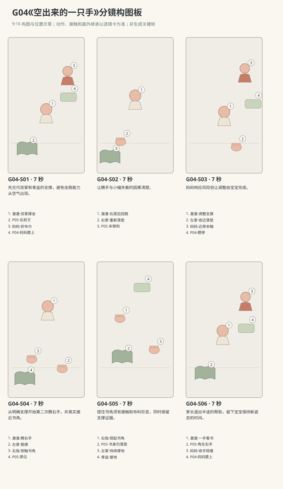

图示为构图位置示意；姿态、接触和画外继承以逐镜正文为准。

### 逐镜设计

#### G04-S01｜00—07 秒｜7 秒｜帧 [0, 168)

**镜头任务：**先交代双掌和骨盆的支撑，避免坐稳能力从空气出现。

**景别、机位与构图：**全身中景，正南离地30厘米；宝宝正面居中，双掌下方、骨盆与双腿均可见，布书画左下，妈妈在右上后景。

**摄影机与理由：**固定机位，让动作本身改变画面；不推拉遮盖接触。

**焦点：**焦点覆盖澈澈的眼睛、行动手与目标物；关键接触始终可辨。

**入态：**澈澈面南坐垫，骨盆接地、双腿屈开，双掌在身前撑垫；妈妈在北后方折P04，P05位于宝宝右前方。

**动作与表演：**

- 3 秒：妈妈把P04折成一半，眼睛余光照看宝宝。

- 4 秒：宝宝从双掌之间抬眼，视线转到右前方翘起的布书角，右手指轻动。

**声音：**无对白、无音乐；西窗外极轻鸟声作底，前景保留连体衣摩擦与婴儿呼吸，动作触碰同步发声。

**出态：**宝宝眼睛锁住书角，双掌与骨盆仍维持原支撑。

**切点与承接：**顺着视线切右手、书角及骨盆同框的较近镜头。

**连续性：**画内看得到身体三处支撑；妈妈的手均在布巾上，未托宝宝。

**开始画面母稿：**

9:16竖幅，原创圆润三维生活动画，柔软棉布与自然皮肤质感，生活物理，无文字标语。澈澈深棕眼、短黑绒发、额前一撮向右弯，奶油色棉连体衣；身体按本条能力阶段呈现，表情与动作保留婴儿的专注和不熟练。 澈澈为R1地垫坐姿探索阶段，圆润躯干与较短四肢；妈妈低马尾雾蓝上衣米色长裤。 白天客厅西窗提供柔和漫射主光，暖墙反射补光；北墙固定沙发，东侧走廊，中央奶油地垫。 全身中景，正南离地30厘米；宝宝正面居中，双掌下方、骨盆与双腿均可见，布书画左下，妈妈在右上后景。 单一开始瞬间：澈澈面南坐垫，骨盆接地、双腿屈开，双掌在身前撑垫；妈妈在北后方折P04，P05位于宝宝右前方。 画面清楚呈现起态中已存在的支撑、视线与道具归属；不把后续动作叠画。

**视频变化母稿：**

9:16竖幅，原创圆润三维生活动画，柔软棉布与自然皮肤质感，生活物理，无文字标语。澈澈深棕眼、短黑绒发、额前一撮向右弯，奶油色棉连体衣；身体按本条能力阶段呈现，表情与动作保留婴儿的专注和不熟练。 澈澈为R1地垫坐姿探索阶段，圆润躯干与较短四肢；妈妈低马尾雾蓝上衣米色长裤。 白天客厅西窗提供柔和漫射主光，暖墙反射补光；北墙固定沙发，东侧走廊，中央奶油地垫。 本镜7秒，全身中景，正南离地30厘米；宝宝正面居中，双掌下方、骨盆与双腿均可见，布书画左下，妈妈在右上后景。 起态：澈澈面南坐垫，骨盆接地、双腿屈开，双掌在身前撑垫；妈妈在北后方折P04，P05位于宝宝右前方。 阶段1，持续3秒：妈妈把P04折成一半，眼睛余光照看宝宝。 阶段2，持续4秒：宝宝从双掌之间抬眼，视线转到右前方翘起的布书角，右手指轻动。 摄影：固定机位，让动作本身改变画面；不推拉遮盖接触。 焦点：焦点覆盖澈澈的眼睛、行动手与目标物；关键接触始终可辨。 声音：无对白、无音乐；西窗外极轻鸟声作底，前景保留连体衣摩擦与婴儿呼吸，动作触碰同步发声。 终态：宝宝眼睛锁住书角，双掌与骨盆仍维持原支撑。 连续性：画内看得到身体三处支撑；妈妈的手均在布巾上，未托宝宝。

#### G04-S02｜07—14 秒｜7 秒｜帧 [168, 336)

**镜头任务：**让腾手与小幅失衡的因果清楚。

**景别、机位与构图：**中近全身景，南偏西仍在南侧轴线，右掌在画左下，书在左前缘；保留头、骨盆和双腿。

**摄影机与理由：**固定机位，让动作本身改变画面；不推拉遮盖接触。

**焦点：**焦点覆盖澈澈的眼睛、行动手与目标物；关键接触始终可辨。

**入态：**宝宝双掌撑地，右手离书角尚有一掌距离，眼睛看书。

**动作与表演：**

- 2 秒：右掌慢慢抬起，手指向书角伸。

- 2 秒：上身随右手前伸向自身右侧轻晃，左掌留地，右手尚未够到书。

- 3 秒：宝宝停住伸手，右掌立刻回到身前垫面，身体晃幅减小。

**声音：**无对白、无音乐；西窗外极轻鸟声作底，前景保留连体衣摩擦与婴儿呼吸，动作触碰同步发声。

**出态：**右掌已重新撑垫，宝宝身体回到双掌之间，P05未动。

**切点与承接：**右掌触垫的声音带到下镜，随后才给妈妈反应。

**连续性：**右掌没有抓书；左掌与骨盆始终接地，妈妈没伸入画托住。

**开始画面母稿：**

9:16竖幅，原创圆润三维生活动画，柔软棉布与自然皮肤质感，生活物理，无文字标语。澈澈深棕眼、短黑绒发、额前一撮向右弯，奶油色棉连体衣；身体按本条能力阶段呈现，表情与动作保留婴儿的专注和不熟练。 澈澈为R1地垫坐姿探索阶段，圆润躯干与较短四肢；妈妈低马尾雾蓝上衣米色长裤。 白天客厅西窗提供柔和漫射主光，暖墙反射补光；北墙固定沙发，东侧走廊，中央奶油地垫。 中近全身景，南偏西仍在南侧轴线，右掌在画左下，书在左前缘；保留头、骨盆和双腿。 单一开始瞬间：宝宝双掌撑地，右手离书角尚有一掌距离，眼睛看书。 画面清楚呈现起态中已存在的支撑、视线与道具归属；不把后续动作叠画。

**视频变化母稿：**

9:16竖幅，原创圆润三维生活动画，柔软棉布与自然皮肤质感，生活物理，无文字标语。澈澈深棕眼、短黑绒发、额前一撮向右弯，奶油色棉连体衣；身体按本条能力阶段呈现，表情与动作保留婴儿的专注和不熟练。 澈澈为R1地垫坐姿探索阶段，圆润躯干与较短四肢；妈妈低马尾雾蓝上衣米色长裤。 白天客厅西窗提供柔和漫射主光，暖墙反射补光；北墙固定沙发，东侧走廊，中央奶油地垫。 本镜7秒，中近全身景，南偏西仍在南侧轴线，右掌在画左下，书在左前缘；保留头、骨盆和双腿。 起态：宝宝双掌撑地，右手离书角尚有一掌距离，眼睛看书。 阶段1，持续2秒：右掌慢慢抬起，手指向书角伸。 阶段2，持续2秒：上身随右手前伸向自身右侧轻晃，左掌留地，右手尚未够到书。 阶段3，持续3秒：宝宝停住伸手，右掌立刻回到身前垫面，身体晃幅减小。 摄影：固定机位，让动作本身改变画面；不推拉遮盖接触。 焦点：焦点覆盖澈澈的眼睛、行动手与目标物；关键接触始终可辨。 声音：无对白、无音乐；西窗外极轻鸟声作底，前景保留连体衣摩擦与婴儿呼吸，动作触碰同步发声。 终态：右掌已重新撑垫，宝宝身体回到双掌之间，P05未动。 连续性：右掌没有抓书；左掌与骨盆始终接地，妈妈没伸入画托住。

#### G04-S03｜14—21 秒｜7 秒｜帧 [336, 504)

**镜头任务：**妈妈响应风险但让调整由宝宝完成。

**景别、机位与构图：**双人中景，正南30厘米，宝宝全身居中，妈妈在后景右侧，双手停在宝宝两侧外，不遮骨盆。

**摄影机与理由：**固定机位，让动作本身改变画面；不推拉遮盖接触。

**焦点：**焦点覆盖澈澈的眼睛、行动手与目标物；关键接触始终可辨。

**入态：**宝宝双掌撑垫回稳，妈妈刚放下P04在自己膝旁。

**动作与表演：**

- 2 秒：妈妈身体略前倾，双手靠近宝宝躯干两侧但不接触。

- 2 秒：宝宝低头看撑地的左掌，左掌轻提后移近自己左膝，立即重新接地。

- 3 秒：宝宝骨盆坐实，胸口回到左掌与骨盆形成的稳定范围，妈妈的手保持旁候。

**声音：**无对白、无音乐；西窗外极轻鸟声作底，前景保留连体衣摩擦与婴儿呼吸，动作触碰同步发声。

**出态：**左掌已收近并撑稳，右掌仍在垫上，骨盆接地，妈妈未碰。

**切点与承接：**在新支撑稳定后切下一次抬右手，不能把调整剪掉。

**连续性：**左掌移位时右掌未离地；妈妈双手只是守候，不出现看不见的托力。

**开始画面母稿：**

9:16竖幅，原创圆润三维生活动画，柔软棉布与自然皮肤质感，生活物理，无文字标语。澈澈深棕眼、短黑绒发、额前一撮向右弯，奶油色棉连体衣；身体按本条能力阶段呈现，表情与动作保留婴儿的专注和不熟练。 澈澈为R1地垫坐姿探索阶段，圆润躯干与较短四肢；妈妈低马尾雾蓝上衣米色长裤。 白天客厅西窗提供柔和漫射主光，暖墙反射补光；北墙固定沙发，东侧走廊，中央奶油地垫。 双人中景，正南30厘米；宝宝全身居中、双掌撑垫，妈妈在后景右侧，双手位于自己膝旁，P04已经放在膝旁，骨盆无遮挡。 单一开始瞬间：宝宝双掌撑垫回稳，妈妈刚放下P04在自己膝旁。 本图焦点固定在：宝宝双掌和骨盆的接地，以及妈妈尚未伸向宝宝的双手。 仅呈现这一瞬间的身体支撑、视线与物件归属，不把未来阶段或相机路径叠画。

**视频变化母稿：**

9:16竖幅，原创圆润三维生活动画，柔软棉布与自然皮肤质感，生活物理，无文字标语。澈澈深棕眼、短黑绒发、额前一撮向右弯，奶油色棉连体衣；身体按本条能力阶段呈现，表情与动作保留婴儿的专注和不熟练。 澈澈为R1地垫坐姿探索阶段，圆润躯干与较短四肢；妈妈低马尾雾蓝上衣米色长裤。 白天客厅西窗提供柔和漫射主光，暖墙反射补光；北墙固定沙发，东侧走廊，中央奶油地垫。 本镜7秒，双人中景，正南30厘米，宝宝全身居中，妈妈在后景右侧，双手停在宝宝两侧外，不遮骨盆。 起态：宝宝双掌撑垫回稳，妈妈刚放下P04在自己膝旁。 阶段1，持续2秒：妈妈身体略前倾，双手靠近宝宝躯干两侧但不接触。 阶段2，持续2秒：宝宝低头看撑地的左掌，左掌轻提后移近自己左膝，立即重新接地。 阶段3，持续3秒：宝宝骨盆坐实，胸口回到左掌与骨盆形成的稳定范围，妈妈的手保持旁候。 摄影：固定机位，让动作本身改变画面；不推拉遮盖接触。 焦点：焦点覆盖澈澈的眼睛、行动手与目标物；关键接触始终可辨。 声音：无对白、无音乐；西窗外极轻鸟声作底，前景保留连体衣摩擦与婴儿呼吸，动作触碰同步发声。 终态：左掌已收近并撑稳，右掌仍在垫上，骨盆接地，妈妈未碰。 连续性：左掌移位时右掌未离地；妈妈双手只是守候，不出现看不见的托力。

#### G04-S04｜21—28 秒｜7 秒｜帧 [504, 672)

**镜头任务：**从明确支撑开始第二次腾右手，并真实接近书角。

**景别、机位与构图：**中全近景，正南40厘米轻俯，宝宝脸居中上、左掌画右下、右手画左、书左下；成人只露衣袖边缘。

**摄影机与理由：**固定机位，让动作本身改变画面；不推拉遮盖接触。

**焦点：**焦点覆盖澈澈的眼睛、行动手与目标物；关键接触始终可辨。

**入态：**左掌与右掌均接地，骨盆坐实，眼睛看P05右上书角，妈妈双手旁候。

**动作与表演：**

- 2 秒：宝宝右掌缓慢离地，躯干有小幅晃动但左掌和骨盆保持接触。

- 3 秒：右肘略弯，手掌一点点伸向书角，视线跟着指尖。

- 2 秒：右指腹碰到翘起书角，先贴住布面，还未提起。

**声音：**无对白、无音乐；西窗外极轻鸟声作底，前景保留连体衣摩擦与婴儿呼吸，动作触碰同步发声。

**出态：**右指腹已贴书角，左掌与骨盆持续支撑，身体没有倒向书。

**切点与承接：**在触布后切手部近景，完整显示捏合与抬角。

**连续性：**左掌全镜不离地；书在触碰前未移动，妈妈没有扶手臂。

**开始画面母稿：**

9:16竖幅，原创圆润三维生活动画，柔软棉布与自然皮肤质感，生活物理，无文字标语。澈澈深棕眼、短黑绒发、额前一撮向右弯，奶油色棉连体衣；身体按本条能力阶段呈现，表情与动作保留婴儿的专注和不熟练。 澈澈为R1地垫坐姿探索阶段，圆润躯干与较短四肢；妈妈低马尾雾蓝上衣米色长裤。 白天客厅西窗提供柔和漫射主光，暖墙反射补光；北墙固定沙发，东侧走廊，中央奶油地垫。 中全近景，正南40厘米轻俯，宝宝脸居中上、左掌画右下、右手画左、书左下；成人只露衣袖边缘。 单一开始瞬间：左掌与右掌均接地，骨盆坐实，眼睛看P05右上书角，妈妈双手旁候。 画面清楚呈现起态中已存在的支撑、视线与道具归属；不把后续动作叠画。

**视频变化母稿：**

9:16竖幅，原创圆润三维生活动画，柔软棉布与自然皮肤质感，生活物理，无文字标语。澈澈深棕眼、短黑绒发、额前一撮向右弯，奶油色棉连体衣；身体按本条能力阶段呈现，表情与动作保留婴儿的专注和不熟练。 澈澈为R1地垫坐姿探索阶段，圆润躯干与较短四肢；妈妈低马尾雾蓝上衣米色长裤。 白天客厅西窗提供柔和漫射主光，暖墙反射补光；北墙固定沙发，东侧走廊，中央奶油地垫。 本镜7秒，中全近景，正南40厘米轻俯，宝宝脸居中上、左掌画右下、右手画左、书左下；成人只露衣袖边缘。 起态：左掌与右掌均接地，骨盆坐实，眼睛看P05右上书角，妈妈双手旁候。 阶段1，持续2秒：宝宝右掌缓慢离地，躯干有小幅晃动但左掌和骨盆保持接触。 阶段2，持续3秒：右肘略弯，手掌一点点伸向书角，视线跟着指尖。 阶段3，持续2秒：右指腹碰到翘起书角，先贴住布面，还未提起。 摄影：固定机位，让动作本身改变画面；不推拉遮盖接触。 焦点：焦点覆盖澈澈的眼睛、行动手与目标物；关键接触始终可辨。 声音：无对白、无音乐；西窗外极轻鸟声作底，前景保留连体衣摩擦与婴儿呼吸，动作触碰同步发声。 终态：右指腹已贴书角，左掌与骨盆持续支撑，身体没有倒向书。 连续性：左掌全镜不离地；书在触碰前未移动，妈妈没有扶手臂。

#### G04-S05｜28—35 秒｜7 秒｜帧 [672, 840)

**镜头任务：**捏住书角须有接触和布料形变，同时保留支撑证据。

**景别、机位与构图：**手部近景，正南斜俯；右指与书角画左，左掌画右，连体衣腹部及接地骨盆留上缘，不孤立成无主手。

**摄影机与理由：**固定机位，让动作本身改变画面；不推拉遮盖接触。

**焦点：**右指捏角与左掌支撑均清晰，景深覆盖两处接触。

**入态：**右指腹贴P05翘角，拇指尚未合上；左掌在身体左前方稳撑。

**动作与表演：**

- 3 秒：右拇指与食指慢慢捏住布书角，布料压出浅褶。

- 2 秒：右腕轻抬，书角离垫，书身大部分仍压在地垫上。

- 2 秒：右手停在小幅抬角位置，左掌轻微调压但没有移开。

**声音：**无对白、无音乐；西窗外极轻鸟声作底，前景保留连体衣摩擦与婴儿呼吸，动作触碰同步发声。

**出态：**右手捏起一角，书身不离垫；左掌与骨盆仍提供支撑。

**切点与承接：**布料轻响后切回脸与双手，确认这是宝宝自己腾出的手。

**连续性：**P05只有角被抬起，无整本漂浮；左右掌位置和衣裤褶皱延续。

**开始画面母稿：**

9:16竖幅，原创圆润三维生活动画，柔软棉布与自然皮肤质感，生活物理，无文字标语。澈澈深棕眼、短黑绒发、额前一撮向右弯，奶油色棉连体衣；身体按本条能力阶段呈现，表情与动作保留婴儿的专注和不熟练。 澈澈为R1地垫坐姿探索阶段，圆润躯干与较短四肢；妈妈低马尾雾蓝上衣米色长裤。 白天客厅西窗提供柔和漫射主光，暖墙反射补光；北墙固定沙发，东侧走廊，中央奶油地垫。 手部近景，正南斜俯；右指与书角画左，左掌画右，连体衣腹部及接地骨盆留上缘，不孤立成无主手。 单一开始瞬间：右指腹贴P05翘角，拇指尚未合上；左掌在身体左前方稳撑。 画面清楚呈现起态中已存在的支撑、视线与道具归属；不把后续动作叠画。

**视频变化母稿：**

9:16竖幅，原创圆润三维生活动画，柔软棉布与自然皮肤质感，生活物理，无文字标语。澈澈深棕眼、短黑绒发、额前一撮向右弯，奶油色棉连体衣；身体按本条能力阶段呈现，表情与动作保留婴儿的专注和不熟练。 澈澈为R1地垫坐姿探索阶段，圆润躯干与较短四肢；妈妈低马尾雾蓝上衣米色长裤。 白天客厅西窗提供柔和漫射主光，暖墙反射补光；北墙固定沙发，东侧走廊，中央奶油地垫。 本镜7秒，手部近景，正南斜俯；右指与书角画左，左掌画右，连体衣腹部及接地骨盆留上缘，不孤立成无主手。 起态：右指腹贴P05翘角，拇指尚未合上；左掌在身体左前方稳撑。 阶段1，持续3秒：右拇指与食指慢慢捏住布书角，布料压出浅褶。 阶段2，持续2秒：右腕轻抬，书角离垫，书身大部分仍压在地垫上。 阶段3，持续2秒：右手停在小幅抬角位置，左掌轻微调压但没有移开。 摄影：固定机位，让动作本身改变画面；不推拉遮盖接触。 焦点：右指捏角与左掌支撑均清晰，景深覆盖两处接触。 声音：无对白、无音乐；西窗外极轻鸟声作底，前景保留连体衣摩擦与婴儿呼吸，动作触碰同步发声。 终态：右手捏起一角，书身不离垫；左掌与骨盆仍提供支撑。 连续性：P05只有角被抬起，无整本漂浮；左右掌位置和衣裤褶皱延续。

#### G04-S06｜35—42 秒｜7 秒｜帧 [840, 1008)

**镜头任务：**家长退出半途的帮助，留下宝宝保持新姿态的时间。

**景别、机位与构图：**中景，正南30厘米，宝宝全身、书角和妈妈旁候的手都在画内，布书在左下。

**摄影机与理由：**固定机位，让动作本身改变画面；不推拉遮盖接触。

**焦点：**焦点覆盖澈澈的眼睛、行动手与目标物；关键接触始终可辨。

**入态：**宝宝右指捏角、左掌撑垫，妈妈双手仍在旁边未接触。

**动作与表演：**

- 2 秒：宝宝看一眼捏着的书角，嘴角轻张，身体有自然小晃。

- 2 秒：妈妈确认他保持住，把双手缓缓收回自己膝旁。

- 3 秒：她拿起P04却暂不折，和宝宝一起看书角；宝宝继续左掌撑地，右手轻捏不松。

**声音：**无对白、无音乐；西窗外极轻鸟声作底，前景保留连体衣摩擦与婴儿呼吸，动作触碰同步发声。

**出态：**宝宝保持左掌加骨盆支撑，右手拥有书角；妈妈膝上拿布巾陪看。

**切点与承接：**保留一秒稳定呼吸结束，不追加翻书或站起的新能力。

**连续性：**没有成人先扶住再撤掉的隐藏变化；P05仍只抬角，西窗光位不变。

**开始画面母稿：**

9:16竖幅，原创圆润三维生活动画，柔软棉布与自然皮肤质感，生活物理，无文字标语。澈澈深棕眼、短黑绒发、额前一撮向右弯，奶油色棉连体衣；身体按本条能力阶段呈现，表情与动作保留婴儿的专注和不熟练。 澈澈为R1地垫坐姿探索阶段，圆润躯干与较短四肢；妈妈低马尾雾蓝上衣米色长裤。 白天客厅西窗提供柔和漫射主光，暖墙反射补光；北墙固定沙发，东侧走廊，中央奶油地垫。 中景，正南30厘米，宝宝全身、书角和妈妈旁候的手都在画内，布书在左下。 单一开始瞬间：宝宝右指捏角、左掌撑垫，妈妈双手仍在旁边未接触。 画面清楚呈现起态中已存在的支撑、视线与道具归属；不把后续动作叠画。

**视频变化母稿：**

9:16竖幅，原创圆润三维生活动画，柔软棉布与自然皮肤质感，生活物理，无文字标语。澈澈深棕眼、短黑绒发、额前一撮向右弯，奶油色棉连体衣；身体按本条能力阶段呈现，表情与动作保留婴儿的专注和不熟练。 澈澈为R1地垫坐姿探索阶段，圆润躯干与较短四肢；妈妈低马尾雾蓝上衣米色长裤。 白天客厅西窗提供柔和漫射主光，暖墙反射补光；北墙固定沙发，东侧走廊，中央奶油地垫。 本镜7秒，中景，正南30厘米，宝宝全身、书角和妈妈旁候的手都在画内，布书在左下。 起态：宝宝右指捏角、左掌撑垫，妈妈双手仍在旁边未接触。 阶段1，持续2秒：宝宝看一眼捏着的书角，嘴角轻张，身体有自然小晃。 阶段2，持续2秒：妈妈确认他保持住，把双手缓缓收回自己膝旁。 阶段3，持续3秒：她拿起P04却暂不折，和宝宝一起看书角；宝宝继续左掌撑地，右手轻捏不松。 摄影：固定机位，让动作本身改变画面；不推拉遮盖接触。 焦点：焦点覆盖澈澈的眼睛、行动手与目标物；关键接触始终可辨。 声音：无对白、无音乐；西窗外极轻鸟声作底，前景保留连体衣摩擦与婴儿呼吸，动作触碰同步发声。 终态：宝宝保持左掌加骨盆支撑，右手拥有书角；妈妈膝上拿布巾陪看。 连续性：没有成人先扶住再撤掉的隐藏变化；P05仍只抬角，西窗光位不变。

### 声音与剪辑

掌根回垫、布书角捏动、妈妈放下布巾的拟音轻而明确；无对白与配乐，失败尝试不配滑稽音效。

正式台词：无；保留镜头声音中已写明的自然发声。

### 连续性与试片

- 连续性：宝宝面朝南，右侧与P05都在画左，所有镜头不镜像。

- 连续性：骨盆全程接地，双腿屈开；第一次失衡由右掌回垫恢复，没有画外成人扶正。

- 连续性：第二次右手取书前，左掌与骨盆支撑必须已建立；书角不自动飘入掌中。

- 连续性：P05右前方原位直到书角被提起；妈妈位于北后方偏东、未触宝宝。

- 试片：G04-S02到S03：右掌离地、身体右晃、右掌重新接地三步连续，若婴儿身体悬停或妈妈暗扶恢复则失败。

- 试片：G04-S04到S06：左掌和骨盆持续承担支撑，右手独立捏角；若两手同时离地或书角未碰即抬起则失败。

- 试片：静音看全片：能区分第一次晃回与第二次腾手成功，不能只看到一个始终稳定的坐姿。

**媒体待验证：**尚无媒体；先预演坐姿重心、掌根触垫与成人保护距离，再验证书角柔性和婴儿不完全熟练的动作。

---

## G05《左手接班》

**36 秒｜坐姿与手部互动｜角色：澈澈、爸爸｜场景 L**

### 剧情正文

澈澈坐在客厅地垫上，右手握着珊瑚色软布环。爸爸坐在旁边，把膝外的浅木盒转正。澈澈用左手来摸软环，先碰到自己的右手背。他停住，看看两只挤在一起的手，左指在右手背上轻轻动了动。软环被右腕转出一点空边，他再次伸来左手，这回指腹终于摸到布。两只手同时抓住环，他没有急着拉，先盯着看了一会儿。随后右手慢慢松开，环留在左掌里，轻轻往左边垂下。澈澈把空出的右手翻过来，张开掌心，再看左手里的环。爸爸也摊开自己的一只空掌，停在旁边。澈澈看见他的手，又低头看看自己的右掌，最后举起左手的软环。爸爸没接，只笑着继续陪他看。

### 导演与空间

**观察任务：**以右手持环、双手同时持环、右手释放的连续过程，让观众看到一次真正换手。

**空间与光位：**澈澈坐中央垫面朝南，骨盆双腿自然接地、躯干稳定；爸爸坐东侧，在画右后方，P07浅木盒在爸爸膝外。P01起初在宝宝右手、位于画左。相机全在南侧，宝宝右手画左、左手画右。

**人物表演：**宝宝已具备本条稳定坐姿，左右手慢而试探；左手第一次碰到右手背，第二次从软环空出的边缘抓入。爸爸本在整理空盒，发现换手后以张开的空掌回应，不代做。

### 节拍覆盖

- **G05-b1**：前态：澈澈稳坐垫上，右手握P01下缘放在胸前，左掌空着；爸爸东侧坐地，手扶P07边。 过程：爸爸把P07沿地垫转正，轻轻放稳。宝宝看右手里的环，左手抬起，掌心慢慢朝环靠近。 后态：左手来到右手附近，尚未接触，P01仍全由右手持着。 观众观察：建立软环属于右手，以及爸爸自己正在做的事。 → G05-S01

- **G05-b2**：前态：左掌张开靠近P01，右手包着环下缘，环的一侧被右手遮挡。 过程：左指伸向被遮住的环下缘，先落在右手背上。左手指在右手背轻摸，右手仍握紧软环，双方停住。左手退开少许，两手之间重新露出软环边缘。 后态：左手空着悬在环旁，右手仍持环，宝宝目光朝双手。 观众观察：第一下摸到的是自己的手，不是软环。 → G05-S02

- **G05-b3**：前态：宝宝看着两手，左手已经退开少许，右手握P01。 过程：宝宝视线停在环上，右腕慢慢转，使软环空出的外缘朝左掌。左手再次靠近，这次指腹碰到裸露的布边。左指贴布停住，拇指绕到边缘另一侧，尚未完全握合。 后态：左指与拇指在环的两侧，右手还握着原位置。 观众观察：右腕转出空边，让第二次抓握有可见路径。 → G05-S03

- **G05-b4**：前态：左拇指和其余手指分处软环边缘两侧，右手未松。 过程：左手指逐渐收拢，软环侧边轻轻压扁。两手同时握环，宝宝保持停顿，环没有离开任何一只手。右手抓力减轻，指节微舒展，但仍与布面接触。 后态：左手已握稳P01，右指刚开始放松，两手仍同时触环。 观众观察：形成清楚的双手共同持有过渡。 → G05-S04

- **G05-b5**：前态：左手握稳环，右指舒展仍触布，宝宝眼睛朝手中间。 过程：右指完全张开离开布面，环向左掌一侧微垂。宝宝把空右掌翻向自己看，右腕缓慢转动。眼睛从空右掌移到左手的软环，左手略抬把环带回视线。 后态：P01只在宝宝左手，右掌摊开朝自己，宝宝目光落左手。 观众观察：右手释放后，宝宝检查空掌与左手中的环。 → G05-S05

- **G05-b6**：前态：宝宝左手持环、右掌空着；爸爸看到换手，自己的双手已离P07。 过程：爸爸摊开空右掌，放在宝宝能看见却不碰环的位置。宝宝看一眼大手，再看自己空右掌，手指轻动。宝宝举高一点左手的环，爸爸不接，安静笑着看；P07留膝外。 后态：软环仍归宝宝左手，父子各有一只空掌可见，爸爸未接环。 观众观察：成人以空掌回应，使小变化落在共同观察上。 → G05-S06

### 分镜构图板

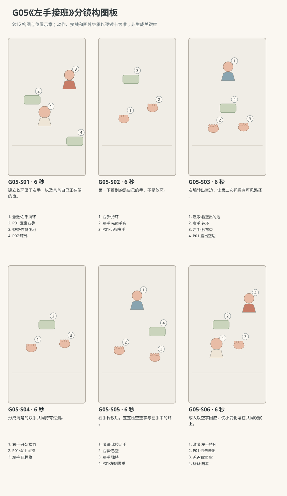

图示为构图位置示意；姿态、接触和画外继承以逐镜正文为准。

### 逐镜设计

#### G05-S01｜00—06 秒｜6 秒｜帧 [0, 144)

**镜头任务：**建立软环属于右手，以及爸爸自己正在做的事。

**景别、机位与构图：**中景，正南30厘米，宝宝坐于中央，右手持环在画左，爸爸在右上，浅木盒右下。

**摄影机与理由：**固定机位，让动作本身改变画面；不推拉遮盖接触。

**焦点：**焦点覆盖澈澈的眼睛、行动手与目标物；关键接触始终可辨。

**入态：**澈澈稳坐垫上，右手握P01下缘放在胸前，左掌空着；爸爸东侧坐地，手扶P07边。

**动作与表演：**

- 2 秒：爸爸把P07沿地垫转正，轻轻放稳。

- 4 秒：宝宝看右手里的环，左手抬起，掌心慢慢朝环靠近。

**声音：**无对白、无音乐；西窗外极轻鸟声作底，前景保留连体衣摩擦与婴儿呼吸，动作触碰同步发声。

**出态：**左手来到右手附近，尚未接触，P01仍全由右手持着。

**切点与承接：**沿两手相遇方向切近，留出第一次碰错的位置。

**连续性：**宝宝骨盆双腿可见接地；爸爸的盒子始终在其膝外，不是环的容器。

**开始画面母稿：**

9:16竖幅，原创圆润三维生活动画，柔软棉布与自然皮肤质感，生活物理，无文字标语。澈澈深棕眼、短黑绒发、额前一撮向右弯，奶油色棉连体衣；身体按本条能力阶段呈现，表情与动作保留婴儿的专注和不熟练。 澈澈为R1已能稳定坐姿抓握的阶段；爸爸短黑发砖陶色棉衬衫深灰长裤。 白天客厅西窗提供柔和漫射主光，暖墙反射补光；北墙固定沙发，东侧走廊，中央奶油地垫。 中景，正南30厘米，宝宝坐于中央，右手持环在画左，爸爸在右上，浅木盒右下。 单一开始瞬间：澈澈稳坐垫上，右手握P01下缘放在胸前，左掌空着；爸爸东侧坐地，手扶P07边。 画面清楚呈现起态中已存在的支撑、视线与道具归属；不把后续动作叠画。

**视频变化母稿：**

9:16竖幅，原创圆润三维生活动画，柔软棉布与自然皮肤质感，生活物理，无文字标语。澈澈深棕眼、短黑绒发、额前一撮向右弯，奶油色棉连体衣；身体按本条能力阶段呈现，表情与动作保留婴儿的专注和不熟练。 澈澈为R1已能稳定坐姿抓握的阶段；爸爸短黑发砖陶色棉衬衫深灰长裤。 白天客厅西窗提供柔和漫射主光，暖墙反射补光；北墙固定沙发，东侧走廊，中央奶油地垫。 本镜6秒，中景，正南30厘米，宝宝坐于中央，右手持环在画左，爸爸在右上，浅木盒右下。 起态：澈澈稳坐垫上，右手握P01下缘放在胸前，左掌空着；爸爸东侧坐地，手扶P07边。 阶段1，持续2秒：爸爸把P07沿地垫转正，轻轻放稳。 阶段2，持续4秒：宝宝看右手里的环，左手抬起，掌心慢慢朝环靠近。 摄影：固定机位，让动作本身改变画面；不推拉遮盖接触。 焦点：焦点覆盖澈澈的眼睛、行动手与目标物；关键接触始终可辨。 声音：无对白、无音乐；西窗外极轻鸟声作底，前景保留连体衣摩擦与婴儿呼吸，动作触碰同步发声。 终态：左手来到右手附近，尚未接触，P01仍全由右手持着。 连续性：宝宝骨盆双腿可见接地；爸爸的盒子始终在其膝外，不是环的容器。

#### G05-S02｜06—12 秒｜6 秒｜帧 [144, 288)

**镜头任务：**第一下摸到的是自己的手，不是软环。

**景别、机位与构图：**双手近景，正南略俯，右手在画左握环，左手由画右伸来；胸口与两腕连接在上缘。

**摄影机与理由：**固定机位，让动作本身改变画面；不推拉遮盖接触。

**焦点：**锁定左指与右手背的触点，保留软环露出的边缘。

**入态：**左掌张开靠近P01，右手包着环下缘，环的一侧被右手遮挡。

**动作与表演：**

- 2 秒：左指伸向被遮住的环下缘，先落在右手背上。

- 2 秒：左手指在右手背轻摸，右手仍握紧软环，双方停住。

- 2 秒：左手退开少许，两手之间重新露出软环边缘。

**声音：**无对白、无音乐；西窗外极轻鸟声作底，前景保留连体衣摩擦与婴儿呼吸，动作触碰同步发声。

**出态：**左手空着悬在环旁，右手仍持环，宝宝目光朝双手。

**切点与承接：**在手背与环边分开后切带脸的镜头，交代宝宝重新看。

**连续性：**本镜左手未取得环；右手手背、布面与左指边界必须分明。

**开始画面母稿：**

9:16竖幅，原创圆润三维生活动画，柔软棉布与自然皮肤质感，生活物理，无文字标语。澈澈深棕眼、短黑绒发、额前一撮向右弯，奶油色棉连体衣；身体按本条能力阶段呈现，表情与动作保留婴儿的专注和不熟练。 澈澈为R1已能稳定坐姿抓握的阶段；爸爸短黑发砖陶色棉衬衫深灰长裤。 白天客厅西窗提供柔和漫射主光，暖墙反射补光；北墙固定沙发，东侧走廊，中央奶油地垫。 双手近景，正南略俯；右手在画左握环，空左掌位于画右靠近环，尚未碰到右手背；胸口与两腕连接在上缘。 单一开始瞬间：左掌张开靠近P01，右手包着环下缘，环的一侧被右手遮挡。 本图焦点固定在：宝宝右手的握点与尚未接触右手背的左指。 仅呈现这一瞬间的身体支撑、视线与物件归属，不把未来阶段或相机路径叠画。

**视频变化母稿：**

9:16竖幅，原创圆润三维生活动画，柔软棉布与自然皮肤质感，生活物理，无文字标语。澈澈深棕眼、短黑绒发、额前一撮向右弯，奶油色棉连体衣；身体按本条能力阶段呈现，表情与动作保留婴儿的专注和不熟练。 澈澈为R1已能稳定坐姿抓握的阶段；爸爸短黑发砖陶色棉衬衫深灰长裤。 白天客厅西窗提供柔和漫射主光，暖墙反射补光；北墙固定沙发，东侧走廊，中央奶油地垫。 本镜6秒，双手近景，正南略俯，右手在画左握环，左手由画右伸来；胸口与两腕连接在上缘。 起态：左掌张开靠近P01，右手包着环下缘，环的一侧被右手遮挡。 阶段1，持续2秒：左指伸向被遮住的环下缘，先落在右手背上。 阶段2，持续2秒：左手指在右手背轻摸，右手仍握紧软环，双方停住。 阶段3，持续2秒：左手退开少许，两手之间重新露出软环边缘。 摄影：固定机位，让动作本身改变画面；不推拉遮盖接触。 焦点：锁定左指与右手背的触点，保留软环露出的边缘。 声音：无对白、无音乐；西窗外极轻鸟声作底，前景保留连体衣摩擦与婴儿呼吸，动作触碰同步发声。 终态：左手空着悬在环旁，右手仍持环，宝宝目光朝双手。 连续性：本镜左手未取得环；右手手背、布面与左指边界必须分明。

#### G05-S03｜12—18 秒｜6 秒｜帧 [288, 432)

**镜头任务：**右腕转出空边，让第二次抓握有可见路径。

**景别、机位与构图：**脸手中近景，正南40厘米；宝宝脸居中上，右手环在左下、空左手在右下。

**摄影机与理由：**固定机位，让动作本身改变画面；不推拉遮盖接触。

**焦点：**焦点覆盖澈澈的眼睛、行动手与目标物；关键接触始终可辨。

**入态：**宝宝看着两手，左手已经退开少许，右手握P01。

**动作与表演：**

- 2 秒：宝宝视线停在环上，右腕慢慢转，使软环空出的外缘朝左掌。

- 2 秒：左手再次靠近，这次指腹碰到裸露的布边。

- 2 秒：左指贴布停住，拇指绕到边缘另一侧，尚未完全握合。

**声音：**无对白、无音乐；西窗外极轻鸟声作底，前景保留连体衣摩擦与婴儿呼吸，动作触碰同步发声。

**出态：**左指与拇指在环的两侧，右手还握着原位置。

**切点与承接：**切双手特写，接下来握合与释放要在同一方向可追踪。

**连续性：**右腕转环而不是环自动转；两个握持位置相隔，避免双方手指融成一团。

**开始画面母稿：**

9:16竖幅，原创圆润三维生活动画，柔软棉布与自然皮肤质感，生活物理，无文字标语。澈澈深棕眼、短黑绒发、额前一撮向右弯，奶油色棉连体衣；身体按本条能力阶段呈现，表情与动作保留婴儿的专注和不熟练。 澈澈为R1已能稳定坐姿抓握的阶段；爸爸短黑发砖陶色棉衬衫深灰长裤。 白天客厅西窗提供柔和漫射主光，暖墙反射补光；北墙固定沙发，东侧走廊，中央奶油地垫。 脸手中近景，正南40厘米；宝宝脸居中上，右手环在左下、空左手在右下。 单一开始瞬间：宝宝看着两手，左手已经退开少许，右手握P01。 画面清楚呈现起态中已存在的支撑、视线与道具归属；不把后续动作叠画。

**视频变化母稿：**

9:16竖幅，原创圆润三维生活动画，柔软棉布与自然皮肤质感，生活物理，无文字标语。澈澈深棕眼、短黑绒发、额前一撮向右弯，奶油色棉连体衣；身体按本条能力阶段呈现，表情与动作保留婴儿的专注和不熟练。 澈澈为R1已能稳定坐姿抓握的阶段；爸爸短黑发砖陶色棉衬衫深灰长裤。 白天客厅西窗提供柔和漫射主光，暖墙反射补光；北墙固定沙发，东侧走廊，中央奶油地垫。 本镜6秒，脸手中近景，正南40厘米；宝宝脸居中上，右手环在左下、空左手在右下。 起态：宝宝看着两手，左手已经退开少许，右手握P01。 阶段1，持续2秒：宝宝视线停在环上，右腕慢慢转，使软环空出的外缘朝左掌。 阶段2，持续2秒：左手再次靠近，这次指腹碰到裸露的布边。 阶段3，持续2秒：左指贴布停住，拇指绕到边缘另一侧，尚未完全握合。 摄影：固定机位，让动作本身改变画面；不推拉遮盖接触。 焦点：焦点覆盖澈澈的眼睛、行动手与目标物；关键接触始终可辨。 声音：无对白、无音乐；西窗外极轻鸟声作底，前景保留连体衣摩擦与婴儿呼吸，动作触碰同步发声。 终态：左指与拇指在环的两侧，右手还握着原位置。 连续性：右腕转环而不是环自动转；两个握持位置相隔，避免双方手指融成一团。

#### G05-S04｜18—24 秒｜6 秒｜帧 [432, 576)

**镜头任务：**形成清楚的双手共同持有过渡。

**景别、机位与构图：**双手特写，正南斜俯；环居中，宝宝右手画左握下缘、左手画右握另一侧，腕部均连接胸前。

**摄影机与理由：**固定机位，让动作本身改变画面；不推拉遮盖接触。

**焦点：**两处握点同在清晰景深内，不只拍单侧手。

**入态：**左拇指和其余手指分处软环边缘两侧，右手未松。

**动作与表演：**

- 2 秒：左手指逐渐收拢，软环侧边轻轻压扁。

- 2 秒：两手同时握环，宝宝保持停顿，环没有离开任何一只手。

- 2 秒：右手抓力减轻，指节微舒展，但仍与布面接触。

**声音：**无对白、无音乐；西窗外极轻鸟声作底，前景保留连体衣摩擦与婴儿呼吸，动作触碰同步发声。

**出态：**左手已握稳P01，右指刚开始放松，两手仍同时触环。

**切点与承接：**在右指松开的起点切稍宽镜，继续追踪物件归属。

**连续性：**左掌握合先于右手释放，软环形状变化服从两处指腹，不增殖。

**开始画面母稿：**

9:16竖幅，原创圆润三维生活动画，柔软棉布与自然皮肤质感，生活物理，无文字标语。澈澈深棕眼、短黑绒发、额前一撮向右弯，奶油色棉连体衣；身体按本条能力阶段呈现，表情与动作保留婴儿的专注和不熟练。 澈澈为R1已能稳定坐姿抓握的阶段；爸爸短黑发砖陶色棉衬衫深灰长裤。 白天客厅西窗提供柔和漫射主光，暖墙反射补光；北墙固定沙发，东侧走廊，中央奶油地垫。 双手特写，正南斜俯；环居中，宝宝右手画左握下缘，空左手画右，左拇指和其余手指分处另一侧布边两面、尚未握合，两腕连接胸前。 单一开始瞬间：左拇指和其余手指分处软环边缘两侧，右手未松。 本图焦点固定在：右手现有握点与左指尚未合拢的布边。 仅呈现这一瞬间的身体支撑、视线与物件归属，不把未来阶段或相机路径叠画。

**视频变化母稿：**

9:16竖幅，原创圆润三维生活动画，柔软棉布与自然皮肤质感，生活物理，无文字标语。澈澈深棕眼、短黑绒发、额前一撮向右弯，奶油色棉连体衣；身体按本条能力阶段呈现，表情与动作保留婴儿的专注和不熟练。 澈澈为R1已能稳定坐姿抓握的阶段；爸爸短黑发砖陶色棉衬衫深灰长裤。 白天客厅西窗提供柔和漫射主光，暖墙反射补光；北墙固定沙发，东侧走廊，中央奶油地垫。 本镜6秒，双手特写，正南斜俯；环居中，宝宝右手画左握下缘、左手画右握另一侧，腕部均连接胸前。 起态：左拇指和其余手指分处软环边缘两侧，右手未松。 阶段1，持续2秒：左手指逐渐收拢，软环侧边轻轻压扁。 阶段2，持续2秒：两手同时握环，宝宝保持停顿，环没有离开任何一只手。 阶段3，持续2秒：右手抓力减轻，指节微舒展，但仍与布面接触。 摄影：固定机位，让动作本身改变画面；不推拉遮盖接触。 焦点：两处握点同在清晰景深内，不只拍单侧手。 声音：无对白、无音乐；西窗外极轻鸟声作底，前景保留连体衣摩擦与婴儿呼吸，动作触碰同步发声。 终态：左手已握稳P01，右指刚开始放松，两手仍同时触环。 连续性：左掌握合先于右手释放，软环形状变化服从两处指腹，不增殖。

#### G05-S05｜24—30 秒｜6 秒｜帧 [576, 720)

**镜头任务：**右手释放后，宝宝检查空掌与左手中的环。

**景别、机位与构图：**脸手中近景，正南40厘米，左右掌及脸都在画内，P01位于宝宝左手即画右下。

**摄影机与理由：**固定机位，让动作本身改变画面；不推拉遮盖接触。

**焦点：**焦点覆盖澈澈的眼睛、行动手与目标物；关键接触始终可辨。

**入态：**左手握稳环，右指舒展仍触布，宝宝眼睛朝手中间。

**动作与表演：**

- 2 秒：右指完全张开离开布面，环向左掌一侧微垂。

- 2 秒：宝宝把空右掌翻向自己看，右腕缓慢转动。

- 2 秒：眼睛从空右掌移到左手的软环，左手略抬把环带回视线。

**声音：**无对白、无音乐；西窗外极轻鸟声作底，前景保留连体衣摩擦与婴儿呼吸，动作触碰同步发声。

**出态：**P01只在宝宝左手，右掌摊开朝自己，宝宝目光落左手。

**切点与承接：**在宝宝看完空掌后切入爸爸的回应，不制造再一次交接。

**连续性：**环重量由左手承担，右手与环已分离；坐姿稳定，爸爸未参与换手。

**开始画面母稿：**

9:16竖幅，原创圆润三维生活动画，柔软棉布与自然皮肤质感，生活物理，无文字标语。澈澈深棕眼、短黑绒发、额前一撮向右弯，奶油色棉连体衣；身体按本条能力阶段呈现，表情与动作保留婴儿的专注和不熟练。 澈澈为R1已能稳定坐姿抓握的阶段；爸爸短黑发砖陶色棉衬衫深灰长裤。 白天客厅西窗提供柔和漫射主光，暖墙反射补光；北墙固定沙发，东侧走廊，中央奶油地垫。 脸手中近景，正南40厘米，左右掌及脸都在画内，P01位于宝宝左手即画右下。 单一开始瞬间：左手握稳环，右指舒展仍触布，宝宝眼睛朝手中间。 画面清楚呈现起态中已存在的支撑、视线与道具归属；不把后续动作叠画。

**视频变化母稿：**

9:16竖幅，原创圆润三维生活动画，柔软棉布与自然皮肤质感，生活物理，无文字标语。澈澈深棕眼、短黑绒发、额前一撮向右弯，奶油色棉连体衣；身体按本条能力阶段呈现，表情与动作保留婴儿的专注和不熟练。 澈澈为R1已能稳定坐姿抓握的阶段；爸爸短黑发砖陶色棉衬衫深灰长裤。 白天客厅西窗提供柔和漫射主光，暖墙反射补光；北墙固定沙发，东侧走廊，中央奶油地垫。 本镜6秒，脸手中近景，正南40厘米，左右掌及脸都在画内，P01位于宝宝左手即画右下。 起态：左手握稳环，右指舒展仍触布，宝宝眼睛朝手中间。 阶段1，持续2秒：右指完全张开离开布面，环向左掌一侧微垂。 阶段2，持续2秒：宝宝把空右掌翻向自己看，右腕缓慢转动。 阶段3，持续2秒：眼睛从空右掌移到左手的软环，左手略抬把环带回视线。 摄影：固定机位，让动作本身改变画面；不推拉遮盖接触。 焦点：焦点覆盖澈澈的眼睛、行动手与目标物；关键接触始终可辨。 声音：无对白、无音乐；西窗外极轻鸟声作底，前景保留连体衣摩擦与婴儿呼吸，动作触碰同步发声。 终态：P01只在宝宝左手，右掌摊开朝自己，宝宝目光落左手。 连续性：环重量由左手承担，右手与环已分离；坐姿稳定，爸爸未参与换手。

#### G05-S06｜30—36 秒｜6 秒｜帧 [720, 864)

**镜头任务：**成人以空掌回应，使小变化落在共同观察上。

**景别、机位与构图：**双人中景，正南30厘米；宝宝居左中、爸爸居右上，爸爸空右掌在两人之间，宝宝左手的环保持画内。

**摄影机与理由：**固定机位，让动作本身改变画面；不推拉遮盖接触。

**焦点：**焦点覆盖澈澈的眼睛、行动手与目标物；关键接触始终可辨。

**入态：**宝宝左手持环、右掌空着；爸爸看到换手，自己的双手已离P07。

**动作与表演：**

- 2 秒：爸爸摊开空右掌，放在宝宝能看见却不碰环的位置。

- 2 秒：宝宝看一眼大手，再看自己空右掌，手指轻动。

- 2 秒：宝宝举高一点左手的环，爸爸不接，安静笑着看；P07留膝外。

**声音：**无对白、无音乐；西窗外极轻鸟声作底，前景保留连体衣摩擦与婴儿呼吸，动作触碰同步发声。

**出态：**软环仍归宝宝左手，父子各有一只空掌可见，爸爸未接环。

**切点与承接：**停在两种手的大小对照上结束，不追加成人评价台词。

**连续性：**爸爸摊开的是右手且空着，宝宝左右手延续；P07仍在地面。

**开始画面母稿：**

9:16竖幅，原创圆润三维生活动画，柔软棉布与自然皮肤质感，生活物理，无文字标语。澈澈深棕眼、短黑绒发、额前一撮向右弯，奶油色棉连体衣；身体按本条能力阶段呈现，表情与动作保留婴儿的专注和不熟练。 澈澈为R1已能稳定坐姿抓握的阶段；爸爸短黑发砖陶色棉衬衫深灰长裤。 白天客厅西窗提供柔和漫射主光，暖墙反射补光；北墙固定沙发，东侧走廊，中央奶油地垫。 双人中景，正南30厘米；宝宝居左中、爸爸居右上，宝宝左手持环、右掌空着；爸爸双手已离P07、位于自己膝旁，右掌尚未举到两人之间。 单一开始瞬间：宝宝左手持环、右掌空着；爸爸看到换手，自己的双手已离P07。 本图焦点固定在：宝宝空右掌、左手中的环及爸爸尚未举起的右手。 仅呈现这一瞬间的身体支撑、视线与物件归属，不把未来阶段或相机路径叠画。

**视频变化母稿：**

9:16竖幅，原创圆润三维生活动画，柔软棉布与自然皮肤质感，生活物理，无文字标语。澈澈深棕眼、短黑绒发、额前一撮向右弯，奶油色棉连体衣；身体按本条能力阶段呈现，表情与动作保留婴儿的专注和不熟练。 澈澈为R1已能稳定坐姿抓握的阶段；爸爸短黑发砖陶色棉衬衫深灰长裤。 白天客厅西窗提供柔和漫射主光，暖墙反射补光；北墙固定沙发，东侧走廊，中央奶油地垫。 本镜6秒，双人中景，正南30厘米；宝宝居左中、爸爸居右上，爸爸空右掌在两人之间，宝宝左手的环保持画内。 起态：宝宝左手持环、右掌空着；爸爸看到换手，自己的双手已离P07。 阶段1，持续2秒：爸爸摊开空右掌，放在宝宝能看见却不碰环的位置。 阶段2，持续2秒：宝宝看一眼大手，再看自己空右掌，手指轻动。 阶段3，持续2秒：宝宝举高一点左手的环，爸爸不接，安静笑着看；P07留膝外。 摄影：固定机位，让动作本身改变画面；不推拉遮盖接触。 焦点：焦点覆盖澈澈的眼睛、行动手与目标物；关键接触始终可辨。 声音：无对白、无音乐；西窗外极轻鸟声作底，前景保留连体衣摩擦与婴儿呼吸，动作触碰同步发声。 终态：软环仍归宝宝左手，父子各有一只空掌可见，爸爸未接环。 连续性：爸爸摊开的是右手且空着，宝宝左右手延续；P07仍在地面。

### 声音与剪辑

软环受双手轻压的布响、空盒转正轻擦垫声、宝宝呼吸；没有换手提示旁白，爸爸回应无台词。

正式台词：无；保留镜头声音中已写明的自然发声。

### 连续性与试片

- 连续性：P01从宝宝右手转到左手；S04出现双方同时握住的明确过渡，右手不得在左手抓稳前释放。

- 连续性：宝宝面南，右手画左、左手画右；手部特写保留腕部连接，禁止镜像。

- 连续性：坐姿稳定依靠已有能力，骨盆腿接地；不安排突然爬行或站起。

- 连续性：爸爸始终空手回应，不接走软环；P07仅在东侧膝外，不进入宝宝抓握区。

- 试片：G05-S02到S04：第一次左手碰右手背与第二次碰布环必须可区分，若直接闪成换手成功则失败。

- 试片：G05-S04到S05：左掌握稳后右指逐渐放开，P01始终一个；环穿过手掌、复制或更换颜色则失败。

- 试片：G05-S06：爸爸摊的是空掌，P01仍在宝宝左手；若读成爸爸接物或宝宝成人式展示领奖则失败。

**媒体待验证：**尚无媒体；待验证双手交叠的指节遮挡、软环形变、右指释放顺序与空掌检查的眼神。

---

## G06《回头才发现爬远了》

**54 秒｜爬行与扶站｜角色：澈澈、爸爸｜场景 L**

### 剧情正文

地垫西半边，澈澈用手和膝盖撑着，眼睛盯住东边的芥末色布球。爸爸坐在北侧，布书摊在膝上，原本正跟他看图。澈澈先向前挪一只手，膝盖再跟过去，停住，确认球还在前面。他又爬一小段，连体衣在膝上堆起细褶，身体越过了原来压住的地垫缝。爸爸合上布书，没有把球推近，也没有跟着挪。澈澈终于碰到布球，掌心让球轻轻凹下。他放低身体，趴在球旁边，右手留在球上。安静下来后，他抬头，先调整前臂，让肩膀稍朝爸爸那边，再转脸看过去。爸爸已经离得比刚才远了，仍坐在原位，向他轻轻招手。澈澈看了看中间空出的地垫，又看爸爸，嘴角一点点张开。球还在掌下，他没有急着爬回去，只趴着回了一个笑。

### 导演与空间

**观察任务：**以地垫缝与爸爸不动的位置让距离累积可见，最后宝宝趴下回看，自己发现已经爬远。

**空间与光位：**宝宝在地垫西半面朝东，P02放东侧约一个宝宝身长外；爸爸跪坐北侧偏东，侧看宝宝，始终不随爬行挪动。相机位于南侧向北，宝宝头画右、脚画左，西窗照亮垫缝；回看时先把前臂及上胸稍朝北调整，目光便能转向北侧偏西的爸爸，不扭头180度。

**人物表演：**本条宝宝已有手膝爬行能力，但每次移手移膝仍有小停顿；受力从落地手膝转移后才前送另一肢。到球前放低腹部，右手留球、左前臂撑垫。爸爸原本拿P05看图，合上书留在原位招手。

### 节拍覆盖

- **G06-b1**：前态：澈澈手掌和双膝落垫、腹部离地，面东看P02；爸爸北侧偏东坐地，P05摊膝，P02在东侧缝旁。 过程：爸爸从布书抬眼看宝宝，手指停在书页边。宝宝盯住球，身体轻轻前后调重心，右手指在垫面张开，准备前移。 后态：四处手膝接地，宝宝重心稍前，球和爸爸都未移动。 观众观察：把起点、球和爸爸的固定位置一次交代清楚。 → G06-S01

- **G06-b2**：前态：宝宝四点撑地看东侧球，右手指已张开，腹部尚在起点缝上方。 过程：重心留在落地手膝上，右掌向前移一小段并落稳，左膝再跟入身下。另一只手向前落稳，另一膝随后前移，躯干随支撑整体向东。宝宝停住，四处手膝重新承托，抬眼确认球的位置。 后态：宝宝腹部已经越过起点缝，四点重新落稳，球距离缩短一小段。 观众观察：让第一段前进建立在手膝连续支撑上。 → G06-S02

- **G06-b3**：前态：宝宝停在越过第一条缝的位置，四点承托；爸爸膝上布书仍开着。 过程：爸爸把P05轻轻合上放在膝上，目光保持宝宝。宝宝再做一组慢的移掌、落掌、跟膝，身体向东越过下一段地垫。他停在离球一臂以内，头抬高一点，爸爸原位显得更靠后。 后态：球在宝宝右掌前方可够处，宝宝双膝与左掌稳稳落地，爸爸仍原位。 观众观察：继续前进的同时让距离在背景累积。 → G06-S03

- **G06-b4**：前态：宝宝双膝与左掌稳落垫，右掌在身体右前方，球在右掌前一点。 过程：宝宝保持左掌和双膝支撑，右掌前伸碰到球上侧，布球受轻压而没有被猛推。右掌留球，左肘缓缓弯下成为前臂承托，躯干降低，膝逐渐往后舒展。腹部与骨盆轻轻落垫，双腿伸松，右掌仍搭球，左前臂留头胸前。 后态：宝宝俯卧在球旁，右掌搭P02，左前臂和腹部骨盆接地，球仅轻扁原位。 观众观察：真正够到球，再从手膝支撑连续降低为俯卧。 → G06-S04

- **G06-b5**：前态：宝宝俯卧面东，右掌搭球、左前臂撑垫，爸爸在其北侧偏西方向。 过程：宝宝左前臂向北略挪后重新落稳，上胸随之稍转向东北，骨盆仍贴垫。他从球上抬眼，再沿肩膀打开的方向侧转头看北侧爸爸，不扭到正后方。目光找到爸爸，嘴微张，右掌仍留在球上。 后态：上胸略朝东北，宝宝侧脸看向爸爸，左前臂和腹部承托，右手仍搭球。 观众观察：回看先调整肩与前臂，保留自然活动范围。 → G06-S05

- **G06-b6**：前态：宝宝趴在东侧看爸爸，爸爸仍在最初坐地位置，P05合在膝上。 过程：宝宝目光从爸爸移到两人之间空出的地垫，停一下。爸爸举空右手轻轻招一招，左手压住膝上布书，身体不向宝宝挪。宝宝目光回到爸爸脸上，眼睛慢慢眯起。 后态：爸爸右手停在一次招手后，宝宝准备笑，距离与起点缝保持可见。 观众观察：让已增加的距离和爸爸不动的回应同时可见。 → G06-S06

- **G06-b7**：前态：宝宝侧头看爸爸，眼睛已微眯，右掌搭球，左前臂撑垫。 过程：宝宝嘴角张开，发一声很轻的笑，肩膀随呼吸小动。右手指轻压球一下，球略凹，没有另一次投掷。宝宝继续看爸爸，爸爸的招手落回膝旁，画面安静停住。 后态：宝宝保持俯卧回笑，右手仍在球上，爸爸仍在原处。 观众观察：以趴着回笑收尾，成长是被自己察觉的距离。 → G06-S07

### 分镜构图板

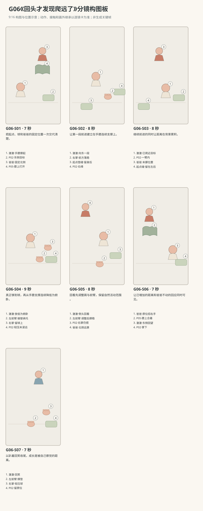

图示为构图位置示意；姿态、接触和画外继承以逐镜正文为准。

### 逐镜设计

#### G06-S01｜00—07 秒｜7 秒｜帧 [0, 168)

**镜头任务：**把起点、球和爸爸的固定位置一次交代清楚。

**景别、机位与构图：**中全景，南侧35厘米高向北；宝宝在画左下手膝撑起、头朝右，球在右下，爸爸在上方偏右，地垫两条缝清楚。

**摄影机与理由：**固定机位，让动作本身改变画面；不推拉遮盖接触。

**焦点：**焦点覆盖澈澈的眼睛、行动手与目标物；关键接触始终可辨。

**入态：**澈澈手掌和双膝落垫、腹部离地，面东看P02；爸爸北侧偏东坐地，P05摊膝，P02在东侧缝旁。

**动作与表演：**

- 3 秒：爸爸从布书抬眼看宝宝，手指停在书页边。

- 4 秒：宝宝盯住球，身体轻轻前后调重心，右手指在垫面张开，准备前移。

**声音：**无对白、无音乐；西窗外极轻鸟声作底，前景保留连体衣摩擦与婴儿呼吸，动作触碰同步发声。

**出态：**四处手膝接地，宝宝重心稍前，球和爸爸都未移动。

**切点与承接：**顺宝宝望球方向切南侧全身较近景，保留起点缝线。

**连续性：**手膝和骨盆位置全可见；P02不在成人手中，爸爸与书留原位。

**开始画面母稿：**

9:16竖幅，原创圆润三维生活动画，柔软棉布与自然皮肤质感，生活物理，无文字标语。澈澈深棕眼、短黑绒发、额前一撮向右弯，奶油色棉连体衣；身体按本条能力阶段呈现，表情与动作保留婴儿的专注和不熟练。 澈澈为R2能以手膝交替爬行的阶段；爸爸短黑发、砖陶衬衫、深灰长裤。 白天客厅西窗提供柔和漫射主光，暖墙反射补光；北墙固定沙发，东侧走廊，中央奶油地垫。 中全景，南侧35厘米高向北；宝宝在画左下手膝撑起、头朝右，球在右下，爸爸在上方偏右，地垫两条缝清楚。 单一开始瞬间：澈澈手掌和双膝落垫、腹部离地，面东看P02；爸爸北侧偏东坐地，P05摊膝，P02在东侧缝旁。 画面清楚呈现起态中已存在的支撑、视线与道具归属；不把后续动作叠画。

**视频变化母稿：**

9:16竖幅，原创圆润三维生活动画，柔软棉布与自然皮肤质感，生活物理，无文字标语。澈澈深棕眼、短黑绒发、额前一撮向右弯，奶油色棉连体衣；身体按本条能力阶段呈现，表情与动作保留婴儿的专注和不熟练。 澈澈为R2能以手膝交替爬行的阶段；爸爸短黑发、砖陶衬衫、深灰长裤。 白天客厅西窗提供柔和漫射主光，暖墙反射补光；北墙固定沙发，东侧走廊，中央奶油地垫。 本镜7秒，中全景，南侧35厘米高向北；宝宝在画左下手膝撑起、头朝右，球在右下，爸爸在上方偏右，地垫两条缝清楚。 起态：澈澈手掌和双膝落垫、腹部离地，面东看P02；爸爸北侧偏东坐地，P05摊膝，P02在东侧缝旁。 阶段1，持续3秒：爸爸从布书抬眼看宝宝，手指停在书页边。 阶段2，持续4秒：宝宝盯住球，身体轻轻前后调重心，右手指在垫面张开，准备前移。 摄影：固定机位，让动作本身改变画面；不推拉遮盖接触。 焦点：焦点覆盖澈澈的眼睛、行动手与目标物；关键接触始终可辨。 声音：无对白、无音乐；西窗外极轻鸟声作底，前景保留连体衣摩擦与婴儿呼吸，动作触碰同步发声。 终态：四处手膝接地，宝宝重心稍前，球和爸爸都未移动。 连续性：手膝和骨盆位置全可见；P02不在成人手中，爸爸与书留原位。

#### G06-S02｜07—15 秒｜8 秒｜帧 [168, 360)

**镜头任务：**让第一段前进建立在手膝连续支撑上。

**景别、机位与构图：**全身近景，南侧30厘米高平视略俯，宝宝横向头右脚左，起点垫缝在腹下，球只在右缘露出。

**摄影机与理由：**固定机位，让动作本身改变画面；不推拉遮盖接触。

**焦点：**全身及四处接地保持清楚，球可略虚但方位不能消失。

**入态：**宝宝四点撑地看东侧球，右手指已张开，腹部尚在起点缝上方。

**动作与表演：**

- 3 秒：重心留在落地手膝上，右掌向前移一小段并落稳，左膝再跟入身下。

- 3 秒：另一只手向前落稳，另一膝随后前移，躯干随支撑整体向东。

- 2 秒：宝宝停住，四处手膝重新承托，抬眼确认球的位置。

**声音：**无对白、无音乐；西窗外极轻鸟声作底，前景保留连体衣摩擦与婴儿呼吸，动作触碰同步发声。

**出态：**宝宝腹部已经越过起点缝，四点重新落稳，球距离缩短一小段。

**切点与承接：**停顿后切略宽镜，让爸爸与起点缝重新作参照。

**连续性：**每只手膝先落稳再换下一处；衣袖裤腿跟随肢体，不把脚当膝落地。

**开始画面母稿：**

9:16竖幅，原创圆润三维生活动画，柔软棉布与自然皮肤质感，生活物理，无文字标语。澈澈深棕眼、短黑绒发、额前一撮向右弯，奶油色棉连体衣；身体按本条能力阶段呈现，表情与动作保留婴儿的专注和不熟练。 澈澈为R2能以手膝交替爬行的阶段；爸爸短黑发、砖陶衬衫、深灰长裤。 白天客厅西窗提供柔和漫射主光，暖墙反射补光；北墙固定沙发，东侧走廊，中央奶油地垫。 全身近景，南侧30厘米高平视略俯，宝宝横向头右脚左，起点垫缝在腹下，球只在右缘露出。 单一开始瞬间：宝宝四点撑地看东侧球，右手指已张开，腹部尚在起点缝上方。 画面清楚呈现起态中已存在的支撑、视线与道具归属；不把后续动作叠画。

**视频变化母稿：**

9:16竖幅，原创圆润三维生活动画，柔软棉布与自然皮肤质感，生活物理，无文字标语。澈澈深棕眼、短黑绒发、额前一撮向右弯，奶油色棉连体衣；身体按本条能力阶段呈现，表情与动作保留婴儿的专注和不熟练。 澈澈为R2能以手膝交替爬行的阶段；爸爸短黑发、砖陶衬衫、深灰长裤。 白天客厅西窗提供柔和漫射主光，暖墙反射补光；北墙固定沙发，东侧走廊，中央奶油地垫。 本镜8秒，全身近景，南侧30厘米高平视略俯，宝宝横向头右脚左，起点垫缝在腹下，球只在右缘露出。 起态：宝宝四点撑地看东侧球，右手指已张开，腹部尚在起点缝上方。 阶段1，持续3秒：重心留在落地手膝上，右掌向前移一小段并落稳，左膝再跟入身下。 阶段2，持续3秒：另一只手向前落稳，另一膝随后前移，躯干随支撑整体向东。 阶段3，持续2秒：宝宝停住，四处手膝重新承托，抬眼确认球的位置。 摄影：固定机位，让动作本身改变画面；不推拉遮盖接触。 焦点：全身及四处接地保持清楚，球可略虚但方位不能消失。 声音：无对白、无音乐；西窗外极轻鸟声作底，前景保留连体衣摩擦与婴儿呼吸，动作触碰同步发声。 终态：宝宝腹部已经越过起点缝，四点重新落稳，球距离缩短一小段。 连续性：每只手膝先落稳再换下一处；衣袖裤腿跟随肢体，不把脚当膝落地。

#### G06-S03｜15—23 秒｜8 秒｜帧 [360, 552)

**镜头任务：**继续前进的同时让距离在背景累积。

**景别、机位与构图：**中全景，南侧35厘米高；宝宝头右脚左居中，爸爸仍在上方固定位置，球在右下，起点缝留画左。

**摄影机与理由：**固定较宽机位，通过宝宝相对垫缝与爸爸的位移交代爬远；不跟拍抹掉参照。

**焦点：**焦点覆盖澈澈的眼睛、行动手与目标物；关键接触始终可辨。

**入态：**宝宝停在越过第一条缝的位置，四点承托；爸爸膝上布书仍开着。

**动作与表演：**

- 2 秒：爸爸把P05轻轻合上放在膝上，目光保持宝宝。

- 4 秒：宝宝再做一组慢的移掌、落掌、跟膝，身体向东越过下一段地垫。

- 2 秒：他停在离球一臂以内，头抬高一点，爸爸原位显得更靠后。

**声音：**无对白、无音乐；西窗外极轻鸟声作底，前景保留连体衣摩擦与婴儿呼吸，动作触碰同步发声。

**出态：**球在宝宝右掌前方可够处，宝宝双膝与左掌稳稳落地，爸爸仍原位。

**切点与承接：**在宝宝看准球、尚未碰到时切较近全身，接触必须镜内发生。

**连续性：**相机固定，爸爸与沙发不漂移；两次停顿时手膝受力成立。

**开始画面母稿：**

9:16竖幅，原创圆润三维生活动画，柔软棉布与自然皮肤质感，生活物理，无文字标语。澈澈深棕眼、短黑绒发、额前一撮向右弯，奶油色棉连体衣；身体按本条能力阶段呈现，表情与动作保留婴儿的专注和不熟练。 澈澈为R2能以手膝交替爬行的阶段；爸爸短黑发、砖陶衬衫、深灰长裤。 白天客厅西窗提供柔和漫射主光，暖墙反射补光；北墙固定沙发，东侧走廊，中央奶油地垫。 中全景，南侧35厘米高；宝宝头右脚左居中，爸爸仍在上方固定位置，球在右下，起点缝留画左。 单一开始瞬间：宝宝停在越过第一条缝的位置，四点承托；爸爸膝上布书仍开着。 画面清楚呈现起态中已存在的支撑、视线与道具归属；不把后续动作叠画。

**视频变化母稿：**

9:16竖幅，原创圆润三维生活动画，柔软棉布与自然皮肤质感，生活物理，无文字标语。澈澈深棕眼、短黑绒发、额前一撮向右弯，奶油色棉连体衣；身体按本条能力阶段呈现，表情与动作保留婴儿的专注和不熟练。 澈澈为R2能以手膝交替爬行的阶段；爸爸短黑发、砖陶衬衫、深灰长裤。 白天客厅西窗提供柔和漫射主光，暖墙反射补光；北墙固定沙发，东侧走廊，中央奶油地垫。 本镜8秒，中全景，南侧35厘米高；宝宝头右脚左居中，爸爸仍在上方固定位置，球在右下，起点缝留画左。 起态：宝宝停在越过第一条缝的位置，四点承托；爸爸膝上布书仍开着。 阶段1，持续2秒：爸爸把P05轻轻合上放在膝上，目光保持宝宝。 阶段2，持续4秒：宝宝再做一组慢的移掌、落掌、跟膝，身体向东越过下一段地垫。 阶段3，持续2秒：他停在离球一臂以内，头抬高一点，爸爸原位显得更靠后。 摄影：固定较宽机位，通过宝宝相对垫缝与爸爸的位移交代爬远；不跟拍抹掉参照。 焦点：焦点覆盖澈澈的眼睛、行动手与目标物；关键接触始终可辨。 声音：无对白、无音乐；西窗外极轻鸟声作底，前景保留连体衣摩擦与婴儿呼吸，动作触碰同步发声。 终态：球在宝宝右掌前方可够处，宝宝双膝与左掌稳稳落地，爸爸仍原位。 连续性：相机固定，爸爸与沙发不漂移；两次停顿时手膝受力成立。

#### G06-S04｜23—32 秒｜9 秒｜帧 [552, 768)

**镜头任务：**真正够到球，再从手膝支撑连续降低为俯卧。

**景别、机位与构图：**全身中近景，南侧30厘米高略俯，头右、脚左、球最右，双膝和双掌都保留。

**摄影机与理由：**固定机位，让动作本身改变画面；不推拉遮盖接触。

**焦点：**焦点覆盖澈澈的眼睛、行动手与目标物；关键接触始终可辨。

**入态：**宝宝双膝与左掌稳落垫，右掌在身体右前方，球在右掌前一点。

**动作与表演：**

- 3 秒：宝宝保持左掌和双膝支撑，右掌前伸碰到球上侧，布球受轻压而没有被猛推。

- 3 秒：右掌留球，左肘缓缓弯下成为前臂承托，躯干降低，膝逐渐往后舒展。

- 3 秒：腹部与骨盆轻轻落垫，双腿伸松，右掌仍搭球，左前臂留头胸前。

**声音：**无对白无音乐；右掌压球的轻布响，左袖和腹部依次贴垫摩擦，宝宝落稳后呼出一口气。

**出态：**宝宝俯卧在球旁，右掌搭P02，左前臂和腹部骨盆接地，球仅轻扁原位。

**切点与承接：**下降完成后再切回看起态，不跳过从爬到趴的支撑转换。

**连续性：**球由右掌实际触压，左前臂接替左掌支撑；腹部落垫前不抽掉双膝。

**开始画面母稿：**

9:16竖幅，原创圆润三维生活动画，柔软棉布与自然皮肤质感，生活物理，无文字标语。澈澈深棕眼、短黑绒发、额前一撮向右弯，奶油色棉连体衣；身体按本条能力阶段呈现，表情与动作保留婴儿的专注和不熟练。 澈澈为R2能以手膝交替爬行的阶段；爸爸短黑发、砖陶衬衫、深灰长裤。 白天客厅西窗提供柔和漫射主光，暖墙反射补光；北墙固定沙发，东侧走廊，中央奶油地垫。 全身中近景，南侧30厘米高略俯，头右、脚左、球最右，双膝和双掌都保留。 单一开始瞬间：宝宝双膝与左掌稳落垫，右掌在身体右前方，球在右掌前一点。 画面清楚呈现起态中已存在的支撑、视线与道具归属；不把后续动作叠画。

**视频变化母稿：**

9:16竖幅，原创圆润三维生活动画，柔软棉布与自然皮肤质感，生活物理，无文字标语。澈澈深棕眼、短黑绒发、额前一撮向右弯，奶油色棉连体衣；身体按本条能力阶段呈现，表情与动作保留婴儿的专注和不熟练。 澈澈为R2能以手膝交替爬行的阶段；爸爸短黑发、砖陶衬衫、深灰长裤。 白天客厅西窗提供柔和漫射主光，暖墙反射补光；北墙固定沙发，东侧走廊，中央奶油地垫。 本镜9秒，全身中近景，南侧30厘米高略俯，头右、脚左、球最右，双膝和双掌都保留。 起态：宝宝双膝与左掌稳落垫，右掌在身体右前方，球在右掌前一点。 阶段1，持续3秒：宝宝保持左掌和双膝支撑，右掌前伸碰到球上侧，布球受轻压而没有被猛推。 阶段2，持续3秒：右掌留球，左肘缓缓弯下成为前臂承托，躯干降低，膝逐渐往后舒展。 阶段3，持续3秒：腹部与骨盆轻轻落垫，双腿伸松，右掌仍搭球，左前臂留头胸前。 摄影：固定机位，让动作本身改变画面；不推拉遮盖接触。 焦点：焦点覆盖澈澈的眼睛、行动手与目标物；关键接触始终可辨。 声音：无对白无音乐；右掌压球的轻布响，左袖和腹部依次贴垫摩擦，宝宝落稳后呼出一口气。 终态：宝宝俯卧在球旁，右掌搭P02，左前臂和腹部骨盆接地，球仅轻扁原位。 连续性：球由右掌实际触压，左前臂接替左掌支撑；腹部落垫前不抽掉双膝。

#### G06-S05｜32—40 秒｜8 秒｜帧 [768, 960)

**镜头任务：**回看先调整肩与前臂，保留自然活动范围。

**景别、机位与构图：**中近景，南偏西35厘米高斜俯，宝宝头在右中，左前臂下缘、右掌与球在右下；爸爸在北侧后景。

**摄影机与理由：**固定机位，让动作本身改变画面；不推拉遮盖接触。

**焦点：**焦点覆盖澈澈的眼睛、行动手与目标物；关键接触始终可辨。

**入态：**宝宝俯卧面东，右掌搭球、左前臂撑垫，爸爸在其北侧偏西方向。

**动作与表演：**

- 3 秒：宝宝左前臂向北略挪后重新落稳，上胸随之稍转向东北，骨盆仍贴垫。

- 3 秒：他从球上抬眼，再沿肩膀打开的方向侧转头看北侧爸爸，不扭到正后方。

- 2 秒：目光找到爸爸，嘴微张，右掌仍留在球上。

**声音：**无对白、无音乐；西窗外极轻鸟声作底，前景保留连体衣摩擦与婴儿呼吸，动作触碰同步发声。

**出态：**上胸略朝东北，宝宝侧脸看向爸爸，左前臂和腹部承托，右手仍搭球。

**切点与承接：**沿宝宝眼线切带完整距离的双人宽镜，让观众看到他发现了什么。

**连续性：**头先随肩调整再转动；右手没有离球撑向背后，腿仍舒展在垫上。

**开始画面母稿：**

9:16竖幅，原创圆润三维生活动画，柔软棉布与自然皮肤质感，生活物理，无文字标语。澈澈深棕眼、短黑绒发、额前一撮向右弯，奶油色棉连体衣；身体按本条能力阶段呈现，表情与动作保留婴儿的专注和不熟练。 澈澈为R2能以手膝交替爬行的阶段；爸爸短黑发、砖陶衬衫、深灰长裤。 白天客厅西窗提供柔和漫射主光，暖墙反射补光；北墙固定沙发，东侧走廊，中央奶油地垫。 中近景，南偏西35厘米高斜俯，宝宝头在右中，左前臂下缘、右掌与球在右下；爸爸在北侧后景。 单一开始瞬间：宝宝俯卧面东，右掌搭球、左前臂撑垫，爸爸在其北侧偏西方向。 画面清楚呈现起态中已存在的支撑、视线与道具归属；不把后续动作叠画。

**视频变化母稿：**

9:16竖幅，原创圆润三维生活动画，柔软棉布与自然皮肤质感，生活物理，无文字标语。澈澈深棕眼、短黑绒发、额前一撮向右弯，奶油色棉连体衣；身体按本条能力阶段呈现，表情与动作保留婴儿的专注和不熟练。 澈澈为R2能以手膝交替爬行的阶段；爸爸短黑发、砖陶衬衫、深灰长裤。 白天客厅西窗提供柔和漫射主光，暖墙反射补光；北墙固定沙发，东侧走廊，中央奶油地垫。 本镜8秒，中近景，南偏西35厘米高斜俯，宝宝头在右中，左前臂下缘、右掌与球在右下；爸爸在北侧后景。 起态：宝宝俯卧面东，右掌搭球、左前臂撑垫，爸爸在其北侧偏西方向。 阶段1，持续3秒：宝宝左前臂向北略挪后重新落稳，上胸随之稍转向东北，骨盆仍贴垫。 阶段2，持续3秒：他从球上抬眼，再沿肩膀打开的方向侧转头看北侧爸爸，不扭到正后方。 阶段3，持续2秒：目光找到爸爸，嘴微张，右掌仍留在球上。 摄影：固定机位，让动作本身改变画面；不推拉遮盖接触。 焦点：焦点覆盖澈澈的眼睛、行动手与目标物；关键接触始终可辨。 声音：无对白、无音乐；西窗外极轻鸟声作底，前景保留连体衣摩擦与婴儿呼吸，动作触碰同步发声。 终态：上胸略朝东北，宝宝侧脸看向爸爸，左前臂和腹部承托，右手仍搭球。 连续性：头先随肩调整再转动；右手没有离球撑向背后，腿仍舒展在垫上。

#### G06-S06｜40—47 秒｜7 秒｜帧 [960, 1128)

**镜头任务：**让已增加的距离和爸爸不动的回应同时可见。

**景别、机位与构图：**中全景，南侧35厘米高向北，宝宝和球在右下，爸爸在左上，两者之间留清楚的空地垫与缝线。

**摄影机与理由：**固定机位，让动作本身改变画面；不推拉遮盖接触。

**焦点：**焦点覆盖澈澈的眼睛、行动手与目标物；关键接触始终可辨。

**入态：**宝宝趴在东侧看爸爸，爸爸仍在最初坐地位置，P05合在膝上。

**动作与表演：**

- 2 秒：宝宝目光从爸爸移到两人之间空出的地垫，停一下。

- 3 秒：爸爸举空右手轻轻招一招，左手压住膝上布书，身体不向宝宝挪。

- 2 秒：宝宝目光回到爸爸脸上，眼睛慢慢眯起。

**声音：**无对白、无音乐；西窗外极轻鸟声作底，前景保留连体衣摩擦与婴儿呼吸，动作触碰同步发声。

**出态：**爸爸右手停在一次招手后，宝宝准备笑，距离与起点缝保持可见。

**切点与承接：**切侧脸近景延续笑的形成，右手搭球的状态需同框保留。

**连续性：**爸爸从未追近宝宝；宝宝没有爬回，球仍在东侧同一位置。

**开始画面母稿：**

9:16竖幅，原创圆润三维生活动画，柔软棉布与自然皮肤质感，生活物理，无文字标语。澈澈深棕眼、短黑绒发、额前一撮向右弯，奶油色棉连体衣；身体按本条能力阶段呈现，表情与动作保留婴儿的专注和不熟练。 澈澈为R2能以手膝交替爬行的阶段；爸爸短黑发、砖陶衬衫、深灰长裤。 白天客厅西窗提供柔和漫射主光，暖墙反射补光；北墙固定沙发，东侧走廊，中央奶油地垫。 中全景，南侧35厘米高向北，宝宝和球在右下，爸爸在左上，两者之间留清楚的空地垫与缝线。 单一开始瞬间：宝宝趴在东侧看爸爸，爸爸仍在最初坐地位置，P05合在膝上。 画面清楚呈现起态中已存在的支撑、视线与道具归属；不把后续动作叠画。

**视频变化母稿：**

9:16竖幅，原创圆润三维生活动画，柔软棉布与自然皮肤质感，生活物理，无文字标语。澈澈深棕眼、短黑绒发、额前一撮向右弯，奶油色棉连体衣；身体按本条能力阶段呈现，表情与动作保留婴儿的专注和不熟练。 澈澈为R2能以手膝交替爬行的阶段；爸爸短黑发、砖陶衬衫、深灰长裤。 白天客厅西窗提供柔和漫射主光，暖墙反射补光；北墙固定沙发，东侧走廊，中央奶油地垫。 本镜7秒，中全景，南侧35厘米高向北，宝宝和球在右下，爸爸在左上，两者之间留清楚的空地垫与缝线。 起态：宝宝趴在东侧看爸爸，爸爸仍在最初坐地位置，P05合在膝上。 阶段1，持续2秒：宝宝目光从爸爸移到两人之间空出的地垫，停一下。 阶段2，持续3秒：爸爸举空右手轻轻招一招，左手压住膝上布书，身体不向宝宝挪。 阶段3，持续2秒：宝宝目光回到爸爸脸上，眼睛慢慢眯起。 摄影：固定机位，让动作本身改变画面；不推拉遮盖接触。 焦点：焦点覆盖澈澈的眼睛、行动手与目标物；关键接触始终可辨。 声音：无对白、无音乐；西窗外极轻鸟声作底，前景保留连体衣摩擦与婴儿呼吸，动作触碰同步发声。 终态：爸爸右手停在一次招手后，宝宝准备笑，距离与起点缝保持可见。 连续性：爸爸从未追近宝宝；宝宝没有爬回，球仍在东侧同一位置。

#### G06-S07｜47—54 秒｜7 秒｜帧 [1128, 1296)

**镜头任务：**以趴着回笑收尾，成长是被自己察觉的距离。

**景别、机位与构图：**中近景，南偏西35厘米高，宝宝侧脸右上，右掌与球右下，左前臂和腹部留画，爸爸仅在左上柔虚。

**摄影机与理由：**固定机位，让动作本身改变画面；不推拉遮盖接触。

**焦点：**焦点覆盖澈澈的眼睛、行动手与目标物；关键接触始终可辨。

**入态：**宝宝侧头看爸爸，眼睛已微眯，右掌搭球，左前臂撑垫。

**动作与表演：**

- 3 秒：宝宝嘴角张开，发一声很轻的笑，肩膀随呼吸小动。

- 2 秒：右手指轻压球一下，球略凹，没有另一次投掷。

- 2 秒：宝宝继续看爸爸，爸爸的招手落回膝旁，画面安静停住。

**声音：**无对白、无音乐；西窗外极轻鸟声作底，前景保留连体衣摩擦与婴儿呼吸，动作触碰同步发声。

**出态：**宝宝保持俯卧回笑，右手仍在球上，爸爸仍在原处。

**切点与承接：**呼吸与笑声自然落下后结束，不加爬返程或成长字幕。

**连续性：**前臂、腹部支撑持续；球不离手、不换色，肩颈不再加大回转。

**开始画面母稿：**

9:16竖幅，原创圆润三维生活动画，柔软棉布与自然皮肤质感，生活物理，无文字标语。澈澈深棕眼、短黑绒发、额前一撮向右弯，奶油色棉连体衣；身体按本条能力阶段呈现，表情与动作保留婴儿的专注和不熟练。 澈澈为R2能以手膝交替爬行的阶段；爸爸短黑发、砖陶衬衫、深灰长裤。 白天客厅西窗提供柔和漫射主光，暖墙反射补光；北墙固定沙发，东侧走廊，中央奶油地垫。 中近景，南偏西35厘米高，宝宝侧脸右上，右掌与球右下，左前臂和腹部留画，爸爸仅在左上柔虚。 单一开始瞬间：宝宝侧头看爸爸，眼睛已微眯，右掌搭球，左前臂撑垫。 画面清楚呈现起态中已存在的支撑、视线与道具归属；不把后续动作叠画。

**视频变化母稿：**

9:16竖幅，原创圆润三维生活动画，柔软棉布与自然皮肤质感，生活物理，无文字标语。澈澈深棕眼、短黑绒发、额前一撮向右弯，奶油色棉连体衣；身体按本条能力阶段呈现，表情与动作保留婴儿的专注和不熟练。 澈澈为R2能以手膝交替爬行的阶段；爸爸短黑发、砖陶衬衫、深灰长裤。 白天客厅西窗提供柔和漫射主光，暖墙反射补光；北墙固定沙发，东侧走廊，中央奶油地垫。 本镜7秒，中近景，南偏西35厘米高，宝宝侧脸右上，右掌与球右下，左前臂和腹部留画，爸爸仅在左上柔虚。 起态：宝宝侧头看爸爸，眼睛已微眯，右掌搭球，左前臂撑垫。 阶段1，持续3秒：宝宝嘴角张开，发一声很轻的笑，肩膀随呼吸小动。 阶段2，持续2秒：右手指轻压球一下，球略凹，没有另一次投掷。 阶段3，持续2秒：宝宝继续看爸爸，爸爸的招手落回膝旁，画面安静停住。 摄影：固定机位，让动作本身改变画面；不推拉遮盖接触。 焦点：焦点覆盖澈澈的眼睛、行动手与目标物；关键接触始终可辨。 声音：无对白、无音乐；西窗外极轻鸟声作底，前景保留连体衣摩擦与婴儿呼吸，动作触碰同步发声。 终态：宝宝保持俯卧回笑，右手仍在球上，爸爸仍在原处。 连续性：前臂、腹部支撑持续；球不离手、不换色，肩颈不再加大回转。

### 声音与剪辑

掌根、膝部依受力顺序轻触地垫，爬行时棉衣摩擦，爸爸合布书一声轻响；结尾宝宝轻笑但不配成人评价或励志音乐。

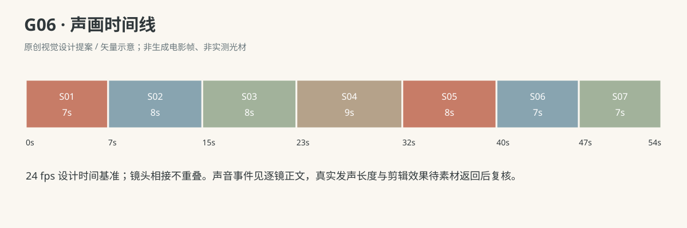

正式台词：无；保留镜头声音中已写明的自然发声。

### 连续性与试片

- 连续性：P02在东侧缝线旁保持原位，直到S04右掌碰到才受轻压；爸爸不得移球缩短距离。

- 连续性：宝宝自西向东，所有机位在南侧，垫缝与固定爸爸位置是距离参照，不随相机平移重置。

- 连续性：S04结束腹部已放低，S05先调整前臂和肩再回看，不做颈部180度旋转。

- 连续性：S07宝宝右掌搭球，左前臂与腹部承托；爸爸原位招的是右手，P05合在膝上。

- 试片：G06-S02到S04：每次移手移膝前后仍有落地支撑，身体确实相对缝线东移；原地滑步或肢体数量变化则失败。

- 试片：G06-S03及S06远景核对：爸爸与地垫边缘不动，中间距离增加；背景跟随宝宝平移造成假距离则失败。

- 试片：G06-S05到S07：回看由前臂/肩调整后完成，右掌不离球，左前臂和腹部承托可辨；脖颈过转、球自动滚走或身体悬空则失败。

**媒体待验证：**尚无媒体；待验证手膝交替、膝部衣褶、爬后降低腹部及回看时肩颈活动范围，先做全身低清动作预演。

---

## G07《你也拿一下》

**36 秒｜坐姿与手部互动｜角色：澈澈、爸爸｜场景 L**

### 剧情正文

澈澈坐在地垫上，右手抓着熟悉的珊瑚软布环，爸爸在旁边翻布书。澈澈先摸摸环边，忽然看向爸爸，把握环的右手伸过去。爸爸停住翻页，抬眼看他，再把空左掌摊在环下面。环的下缘碰到掌心，澈澈还握了一会儿，像在确认这个新地方，随后手指慢慢张开。软环留在爸爸掌上。他看看自己的空手，又盯住那只大手里的环。爸爸没有立即摇给他看，也没有放进玩具盒，只安静托着。澈澈张开右掌，朝爸爸伸去。爸爸用左手轻握环的一侧，把另一边送到那只小掌前。澈澈捏住布边，握牢，爸爸才松开。环回到右手，澈澈把它收在胸前，却仍看着爸爸。爸爸也没有再翻书，两人留在刚才那次小小的来回里。

### 亲述来源与改编

原帖是家长自述，未独立核实。本片将生活机制改编为澈澈的原创故事。

- [RT03 · 抱着包裹走来，却只是假递一下](https://yubingbing.wordpress.com/2008/01/08/%E7%8E%A9%E7%8E%A9%E6%9D%82%E4%BA%8B-2/)；作者自报年龄：同篇作者明确称孩子15个月，第一件事未单独标龄。

- **采用的生活过程：**仅迁移“把手中物送到成人面前，使观众等待交接结果”的动作结构。

- **本片原创改编：**RT03原文是会行走幼儿抱包裹假递后收回；本条保持原有稳定坐姿和软环，改为澈澈主动递给爸爸、爸爸确实接住再递回。

- **本片原创改编：**爸爸翻布书、两次先抓稳后松手、空掌邀请与安静对视均为原创澈澈剧情。

- **不作出的事实推断：**不称本条为RT03原家庭经过复现；原文没有真正交出包裹的结局。

- **不作出的事实推断：**家长公开亲述没有独立核实；本片不据此证明特定月龄必然会递物，也不与其他家庭拼作同一真实事件。

[查看原始过程与缺项](research/real-experiences/index.html#RT03)

### 导演与空间

**观察任务：**保留“递到成人面前”时观众对交接的期待，改写为宝宝主动真实递物：爸爸左掌已承托后才松手，再以空掌邀请拿回；与抱回物件的假递片段形成可见差别。

**空间与光位：**澈澈面南稳坐中央垫，爸爸东侧偏南坐地，两者距一个宝宝前臂可及。P01最初在宝宝右手，爸爸左掌作为接物掌；P05摊开在爸爸膝上，开场左指翻页，注意转向宝宝后停翻；爸爸右手与膝持续承托，不合书。机位南侧，宝宝画左、爸爸画右，交接区居中，不越两人视线轴。

**人物表演：**宝宝递物动作可犹豫，但不做成人式送礼仪式；手腕将环送向看得见的掌心。爸爸从翻书中停下，先摊左掌接，再等空掌邀请，返回时由宝宝抓稳才释放。

### 节拍覆盖

- **G07-b1**：前态：宝宝右手持P01，左手空搭腿上；爸爸右手扶P05、左指翻页，双方身体稳定落地。 过程：宝宝低头摸环边，爸爸翻到一半停在书页上。宝宝抬眼看爸爸，把右手里的环朝两人中间伸一点，目光跟到爸爸脸上。 后态：握环右手已经伸向爸爸，爸爸看见动作，P05仍在膝上。 观众观察：建立各自活动，再让宝宝主动改变互动。 → G07-S01

- **G07-b2**：前态：宝宝右手握P01伸在两人中间，爸爸左掌尚在书页上，右手稳住书。 过程：爸爸左手离开书页，掌心向上送到环下方，停稳。宝宝看掌心，将环下缘慢慢落到爸爸左掌。环已经受爸爸掌心承托，宝宝右指仍握着上侧边缘。 后态：环下缘在爸爸左掌，宝宝右指未松，两人短暂共同持有。 观众观察：让爸爸的左掌成为明确目标，宝宝递到而非扔去。 → G07-S02

- **G07-b3**：前态：P01下缘坐在爸爸左掌，宝宝右指握环上缘，视线画外指向交接点。 过程：宝宝右指逐一舒展，仍有指腹轻触布边。右手离开环，空掌收回胸前，爸爸左掌维持平托。爸爸左指略弯稳住环防止滑走，没有抬高或摇晃。 后态：P01仅在爸爸左掌，宝宝右掌已经空着并收在胸前，双方手完全分离。 观众观察：主动松开成立，物件留在别人手里。 → G07-S03

- **G07-b4**：前态：宝宝空右掌收在胸前，爸爸左掌托环停在中间，没有主动递回。 过程：宝宝先看空右掌，再看爸爸掌心的环。右掌慢慢张开朝爸爸伸去，眼睛看爸爸。爸爸看懂空掌，左指轻握环一侧，把空出的布边转向宝宝，但尚未送近。 后态：宝宝空右掌伸着，爸爸左手握环一侧、另一侧朝宝宝。 观众观察：宝宝先发现自己空手，再以空掌邀请递回。 → G07-S04

- **G07-b5**：前态：宝宝空右掌伸着，爸爸左手握P01一侧，环自由边缘离小掌尚有少许距离。 过程：爸爸左手把自由边缘慢慢送到宝宝右指腹。宝宝右指和拇指合拢，握住软环，双手短暂共同持有。爸爸左指张开退出，宝宝右手独持，手腕随重量轻沉。 后态：P01回到宝宝右手，爸爸左掌已空，双方分离。 观众观察：第二次交接同样要先抓稳、后松成人手。 → G07-S05

- **G07-b6**：前态：宝宝右手独持P01在两人中间，爸爸左掌空着，目光看宝宝。 过程：宝宝把握环右手收回胸前，左掌仍搭腿。他看看环，再抬眼看爸爸；爸爸空左手放回膝旁却没再翻书。两人安静对视，宝宝指腹轻捏布边，爸爸微笑。 后态：宝宝持环，爸爸书未继续，两人保持共同注意。 观众观察：来回后的关系变化是两人继续相看。 → G07-S06

### 分镜构图板

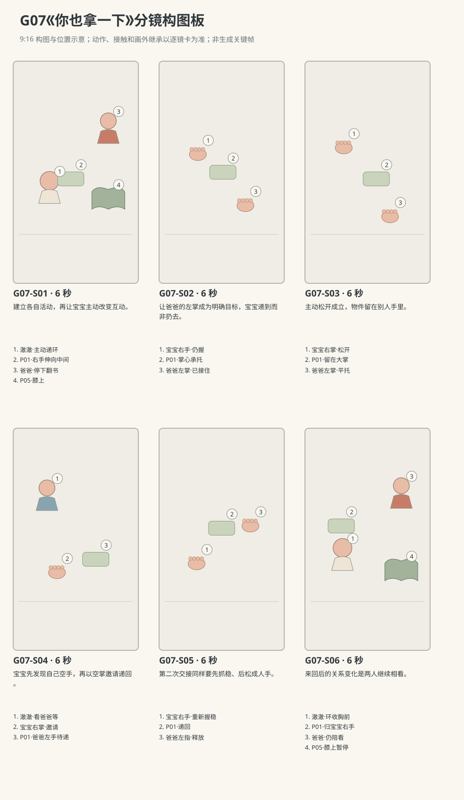

图示为构图位置示意；姿态、接触和画外继承以逐镜正文为准。

### 逐镜设计

#### G07-S01｜00—06 秒｜6 秒｜帧 [0, 144)

**镜头任务：**建立各自活动，再让宝宝主动改变互动。

**景别、机位与构图：**双人中景，南侧30厘米，宝宝画左稳坐，爸爸画右膝上翻P05，软环在宝宝右手靠画左胸前。

**摄影机与理由：**固定机位，让动作本身改变画面；不推拉遮盖接触。

**焦点：**焦点覆盖宝宝右手握点、软环和爸爸左指，交接平面保持清楚；两人眼睛在画外，目光向交接点的方向继承，不称此近景直接看见眼神。

**入态：**宝宝右手持P01，左手空搭腿上；爸爸右手扶P05、左指翻页，双方身体稳定落地。

**动作与表演：**

- 2 秒：宝宝低头摸环边，爸爸翻到一半停在书页上。

- 4 秒：宝宝抬眼看爸爸，把右手里的环朝两人中间伸一点，目光跟到爸爸脸上。

**声音：**无对白、无音乐；西窗外极轻鸟声作底，前景保留连体衣摩擦与婴儿呼吸，动作触碰同步发声。

**出态：**握环右手已经伸向爸爸，爸爸看见动作，P05仍在膝上。

**切点与承接：**切到双手交接区域，先给爸爸空掌进入再发生接触。

**连续性：**P01仍只归宝宝右手；爸爸左手离书前书由右手与膝承托。

**开始画面母稿：**

9:16竖幅，原创圆润三维生活动画，柔软棉布与自然皮肤质感，生活物理，无文字标语。澈澈深棕眼、短黑绒发、额前一撮向右弯，奶油色棉连体衣；身体按本条能力阶段呈现，表情与动作保留婴儿的专注和不熟练。 澈澈为R1稳定坐姿、能抓握和主动松手阶段；爸爸砖陶衬衫、深灰长裤、短黑发。 白天客厅西窗提供柔和漫射主光，暖墙反射补光；北墙固定沙发，东侧走廊，中央奶油地垫。 双人中景，南侧30厘米，宝宝画左稳坐，爸爸画右膝上翻P05，软环在宝宝右手靠画左胸前。 单一开始瞬间：宝宝右手持P01，左手空搭腿上；爸爸右手扶P05、左指翻页，双方身体稳定落地。 画面清楚呈现起态中已存在的支撑、视线与道具归属；不把后续动作叠画。

**视频变化母稿：**

9:16竖幅，原创圆润三维生活动画，柔软棉布与自然皮肤质感，生活物理，无文字标语。澈澈深棕眼、短黑绒发、额前一撮向右弯，奶油色棉连体衣；身体按本条能力阶段呈现，表情与动作保留婴儿的专注和不熟练。 澈澈为R1稳定坐姿、能抓握和主动松手阶段；爸爸砖陶衬衫、深灰长裤、短黑发。 白天客厅西窗提供柔和漫射主光，暖墙反射补光；北墙固定沙发，东侧走廊，中央奶油地垫。 本镜6秒，双人中景，南侧30厘米，宝宝画左稳坐，爸爸画右膝上翻P05，软环在宝宝右手靠画左胸前。 起态：宝宝右手持P01，左手空搭腿上；爸爸右手扶P05、左指翻页，双方身体稳定落地。 阶段1，持续2秒：宝宝低头摸环边，爸爸翻到一半停在书页上。 阶段2，持续4秒：宝宝抬眼看爸爸，把右手里的环朝两人中间伸一点，目光跟到爸爸脸上。 摄影：固定机位，让动作本身改变画面；不推拉遮盖接触。 焦点：焦点覆盖宝宝右手握点、软环和爸爸左指，交接平面保持清楚；两人眼睛在画外，目光向交接点的方向继承，不称此近景直接看见眼神。 声音：无对白、无音乐；西窗外极轻鸟声作底，前景保留连体衣摩擦与婴儿呼吸，动作触碰同步发声。 终态：握环右手已经伸向爸爸，爸爸看见动作，P05仍在膝上。 连续性：P01仍只归宝宝右手；爸爸左手离书前书由右手与膝承托。 硬锁：软环只有一只，所有交接均先由对方承托或握稳、再释放；按本镜列出的归属承接，不演成递到一半又收回。

#### G07-S02｜06—12 秒｜6 秒｜帧 [144, 288)

**镜头任务：**让爸爸的左掌成为明确目标，宝宝递到而非扔去。

**景别、机位与构图：**手与上身中近景，南侧35厘米，宝宝右手自左至中，爸爸左掌从右下伸入，环在两者之间。

**摄影机与理由：**固定机位，让动作本身改变画面；不推拉遮盖接触。

**焦点：**焦点覆盖宝宝右手握点、软环和爸爸左指，交接平面保持清楚；两人眼睛在画外，目光向交接点的方向继承，不称此近景直接看见眼神。

**入态：**宝宝右手握P01伸在两人中间，爸爸左掌尚在书页上，右手稳住书。

**动作与表演：**

- 2 秒：爸爸左手离开书页，掌心向上送到环下方，停稳。

- 2 秒：宝宝看掌心，将环下缘慢慢落到爸爸左掌。

- 2 秒：环已经受爸爸掌心承托，宝宝右指仍握着上侧边缘。

**声音：**无对白、无音乐；西窗外极轻鸟声作底，前景保留连体衣摩擦与婴儿呼吸，动作触碰同步发声。

**出态：**环下缘在爸爸左掌，宝宝右指未松，两人短暂共同持有。

**切点与承接：**在共同持有状态切更近，接下来释放必须实际可见。

**连续性：**爸爸左掌先出现再接触；宝宝没有把环甩出，身体不过度前探。

**开始画面母稿：**

9:16竖幅，原创圆润三维生活动画，柔软棉布与自然皮肤质感，生活物理，无文字标语。澈澈深棕眼、短黑绒发、额前一撮向右弯，奶油色棉连体衣；身体按本条能力阶段呈现，表情与动作保留婴儿的专注和不熟练。 澈澈为R1稳定坐姿、能抓握和主动松手阶段；爸爸砖陶衬衫、深灰长裤、短黑发。 白天客厅西窗提供柔和漫射主光，暖墙反射补光；北墙固定沙发，东侧走廊，中央奶油地垫。 手与上身中近景，南侧35厘米；宝宝右手持环伸到两人中间，爸爸左手仍在右下书页上，右手稳住膝上的布书。 单一开始瞬间：宝宝右手握P01伸在两人中间，爸爸左掌尚在书页上，右手稳住书。 本图焦点固定在：宝宝当前握环处、爸爸仍在书页上的左手与右手稳书处。 仅呈现这一瞬间的身体支撑、视线与物件归属，不把未来阶段或相机路径叠画。

**视频变化母稿：**

9:16竖幅，原创圆润三维生活动画，柔软棉布与自然皮肤质感，生活物理，无文字标语。澈澈深棕眼、短黑绒发、额前一撮向右弯，奶油色棉连体衣；身体按本条能力阶段呈现，表情与动作保留婴儿的专注和不熟练。 澈澈为R1稳定坐姿、能抓握和主动松手阶段；爸爸砖陶衬衫、深灰长裤、短黑发。 白天客厅西窗提供柔和漫射主光，暖墙反射补光；北墙固定沙发，东侧走廊，中央奶油地垫。 本镜6秒，手与上身中近景，南侧35厘米，宝宝右手自左至中，爸爸左掌从右下伸入，环在两者之间。 起态：宝宝右手握P01伸在两人中间，爸爸左掌尚在书页上，右手稳住书。 阶段1，持续2秒：爸爸左手离开书页，掌心向上送到环下方，停稳。 阶段2，持续2秒：宝宝看掌心，将环下缘慢慢落到爸爸左掌。 阶段3，持续2秒：环已经受爸爸掌心承托，宝宝右指仍握着上侧边缘。 摄影：固定机位，让动作本身改变画面；不推拉遮盖接触。 焦点：焦点覆盖宝宝右手握点、软环和爸爸左指，交接平面保持清楚；两人眼睛在画外，目光向交接点的方向继承，不称此近景直接看见眼神。 声音：无对白、无音乐；西窗外极轻鸟声作底，前景保留连体衣摩擦与婴儿呼吸，动作触碰同步发声。 终态：环下缘在爸爸左掌，宝宝右指未松，两人短暂共同持有。 连续性：爸爸左掌先出现再接触；宝宝没有把环甩出，身体不过度前探。 硬锁：软环只有一只，所有交接均先由对方承托或握稳、再释放；按本镜列出的归属承接，不演成递到一半又收回。

#### G07-S03｜12—18 秒｜6 秒｜帧 [288, 432)

**镜头任务：**主动松开成立，物件留在别人手里。

**景别、机位与构图：**双手特写，南侧斜俯；爸爸左掌平托环在右下，宝宝右指握上缘在左上，两腕连接留画。

**摄影机与理由：**固定机位，让动作本身改变画面；不推拉遮盖接触。

**焦点：**宝宝释放的指尖、环与成人掌心三层都清楚。

**入态：**P01下缘坐在爸爸左掌，宝宝右指握环上缘，视线画外指向交接点。

**动作与表演：**

- 2 秒：宝宝右指逐一舒展，仍有指腹轻触布边。

- 2 秒：右手离开环，空掌收回胸前，爸爸左掌维持平托。

- 2 秒：爸爸左指略弯稳住环防止滑走，没有抬高或摇晃。

**声音：**无对白、无音乐；西窗外极轻鸟声作底，前景保留连体衣摩擦与婴儿呼吸，动作触碰同步发声。

**出态：**P01仅在爸爸左掌，宝宝右掌已经空着并收在胸前，双方手完全分离。

**切点与承接：**环归属明确后切宝宝脸和空掌，让他检查变化。

**连续性：**环只有一个；爸爸左掌从下承托，不是隔空吸走；宝宝右手未从画外换环。

**开始画面母稿：**

9:16竖幅，原创圆润三维生活动画，柔软棉布与自然皮肤质感，生活物理，无文字标语。澈澈深棕眼、短黑绒发、额前一撮向右弯，奶油色棉连体衣；身体按本条能力阶段呈现，表情与动作保留婴儿的专注和不熟练。 澈澈为R1稳定坐姿、能抓握和主动松手阶段；爸爸砖陶衬衫、深灰长裤、短黑发。 白天客厅西窗提供柔和漫射主光，暖墙反射补光；北墙固定沙发，东侧走廊，中央奶油地垫。 双手特写，南侧斜俯；爸爸左掌平托环在右下，宝宝右指握上缘在左上，两腕连接留画。 单一开始瞬间：P01下缘坐在爸爸左掌，宝宝右指握环上缘，视线画外指向交接点。 画面清楚呈现起态中已存在的支撑、视线与道具归属；不把后续动作叠画。

**视频变化母稿：**

9:16竖幅，原创圆润三维生活动画，柔软棉布与自然皮肤质感，生活物理，无文字标语。澈澈深棕眼、短黑绒发、额前一撮向右弯，奶油色棉连体衣；身体按本条能力阶段呈现，表情与动作保留婴儿的专注和不熟练。 澈澈为R1稳定坐姿、能抓握和主动松手阶段；爸爸砖陶衬衫、深灰长裤、短黑发。 白天客厅西窗提供柔和漫射主光，暖墙反射补光；北墙固定沙发，东侧走廊，中央奶油地垫。 本镜6秒，双手特写，南侧斜俯；爸爸左掌平托环在右下，宝宝右指握上缘在左上，两腕连接留画。 起态：P01下缘坐在爸爸左掌，宝宝右指握环上缘，视线画外指向交接点。 阶段1，持续2秒：宝宝右指逐一舒展，仍有指腹轻触布边。 阶段2，持续2秒：右手离开环，空掌收回胸前，爸爸左掌维持平托。 阶段3，持续2秒：爸爸左指略弯稳住环防止滑走，没有抬高或摇晃。 摄影：固定机位，让动作本身改变画面；不推拉遮盖接触。 焦点：宝宝释放的指尖、环与成人掌心三层都清楚。 声音：无对白、无音乐；西窗外极轻鸟声作底，前景保留连体衣摩擦与婴儿呼吸，动作触碰同步发声。 终态：P01仅在爸爸左掌，宝宝右掌已经空着并收在胸前，双方手完全分离。 连续性：环只有一个；爸爸左掌从下承托，不是隔空吸走；宝宝右手未从画外换环。 硬锁：软环只有一只，所有交接均先由对方承托或握稳、再释放；按本镜列出的归属承接，不演成递到一半又收回。

#### G07-S04｜18—24 秒｜6 秒｜帧 [432, 576)

**镜头任务：**宝宝先发现自己空手，再以空掌邀请递回。

**景别、机位与构图：**脸与双掌中近景，南侧35厘米；宝宝脸左上、空右掌左下、爸爸持环左掌在右下，爸爸脸画外。

**摄影机与理由：**固定机位，让动作本身改变画面；不推拉遮盖接触。

**焦点：**焦点覆盖宝宝右手握点、软环和爸爸左指，交接平面保持清楚；两人眼睛在画外，目光向交接点的方向继承，不称此近景直接看见眼神。

**入态：**宝宝空右掌收在胸前，爸爸左掌托环停在中间，没有主动递回。

**动作与表演：**

- 2 秒：宝宝先看空右掌，再看爸爸掌心的环。

- 2 秒：右掌慢慢张开朝爸爸伸去，眼睛看爸爸。

- 2 秒：爸爸看懂空掌，左指轻握环一侧，把空出的布边转向宝宝，但尚未送近。

**声音：**无对白、无音乐；西窗外极轻鸟声作底，前景保留连体衣摩擦与婴儿呼吸，动作触碰同步发声。

**出态：**宝宝空右掌伸着，爸爸左手握环一侧、另一侧朝宝宝。

**切点与承接：**沿邀请与回应切实际返还动作，不能提前让环回宝宝手里。

**连续性：**返还由宝宝伸空掌触发；P01始终在爸爸左手，P05画外仍膝上。

**开始画面母稿：**

9:16竖幅，原创圆润三维生活动画，柔软棉布与自然皮肤质感，生活物理，无文字标语。澈澈深棕眼、短黑绒发、额前一撮向右弯，奶油色棉连体衣；身体按本条能力阶段呈现，表情与动作保留婴儿的专注和不熟练。 澈澈为R1稳定坐姿、能抓握和主动松手阶段；爸爸砖陶衬衫、深灰长裤、短黑发。 白天客厅西窗提供柔和漫射主光，暖墙反射补光；北墙固定沙发，东侧走廊，中央奶油地垫。 脸与双掌中近景，南侧35厘米；宝宝脸左上、空右掌左下、爸爸持环左掌在右下，爸爸脸画外。 单一开始瞬间：宝宝空右掌收在胸前，爸爸左掌托环停在中间，没有主动递回。 画面清楚呈现起态中已存在的支撑、视线与道具归属；不把后续动作叠画。

**视频变化母稿：**

9:16竖幅，原创圆润三维生活动画，柔软棉布与自然皮肤质感，生活物理，无文字标语。澈澈深棕眼、短黑绒发、额前一撮向右弯，奶油色棉连体衣；身体按本条能力阶段呈现，表情与动作保留婴儿的专注和不熟练。 澈澈为R1稳定坐姿、能抓握和主动松手阶段；爸爸砖陶衬衫、深灰长裤、短黑发。 白天客厅西窗提供柔和漫射主光，暖墙反射补光；北墙固定沙发，东侧走廊，中央奶油地垫。 本镜6秒，脸与双掌中近景，南侧35厘米；宝宝脸左上、空右掌左下、爸爸持环左掌在右下，爸爸脸画外。 起态：宝宝空右掌收在胸前，爸爸左掌托环停在中间，没有主动递回。 阶段1，持续2秒：宝宝先看空右掌，再看爸爸掌心的环。 阶段2，持续2秒：右掌慢慢张开朝爸爸伸去，眼睛看爸爸。 阶段3，持续2秒：爸爸看懂空掌，左指轻握环一侧，把空出的布边转向宝宝，但尚未送近。 摄影：固定机位，让动作本身改变画面；不推拉遮盖接触。 焦点：焦点覆盖宝宝右手握点、软环和爸爸左指，交接平面保持清楚；两人眼睛在画外，目光向交接点的方向继承，不称此近景直接看见眼神。 声音：无对白、无音乐；西窗外极轻鸟声作底，前景保留连体衣摩擦与婴儿呼吸，动作触碰同步发声。 终态：宝宝空右掌伸着，爸爸左手握环一侧、另一侧朝宝宝。 连续性：返还由宝宝伸空掌触发；P01始终在爸爸左手，P05画外仍膝上。 硬锁：软环只有一只，所有交接均先由对方承托或握稳、再释放；按本镜列出的归属承接，不演成递到一半又收回。

#### G07-S05｜24—30 秒｜6 秒｜帧 [576, 720)

**镜头任务：**第二次交接同样要先抓稳、后松成人手。

**景别、机位与构图：**双手近景，南侧斜俯；宝宝右掌画左，爸爸左手画右，环自由边缘朝左，两个握点分开。

**摄影机与理由：**固定机位，让动作本身改变画面；不推拉遮盖接触。

**焦点：**焦点覆盖宝宝右手握点、软环和爸爸左指，交接平面保持清楚；两人眼睛在画外，目光向交接点的方向继承，不称此近景直接看见眼神。

**入态：**宝宝空右掌伸着，爸爸左手握P01一侧，环自由边缘离小掌尚有少许距离。

**动作与表演：**

- 2 秒：爸爸左手把自由边缘慢慢送到宝宝右指腹。

- 2 秒：宝宝右指和拇指合拢，握住软环，双手短暂共同持有。

- 2 秒：爸爸左指张开退出，宝宝右手独持，手腕随重量轻沉。

**声音：**无对白、无音乐；西窗外极轻鸟声作底，前景保留连体衣摩擦与婴儿呼吸，动作触碰同步发声。

**出态：**P01回到宝宝右手，爸爸左掌已空，双方分离。

**切点与承接：**交接完成后切回双人，让宝宝收环与爸爸停书形成结尾。

**连续性：**宝宝握牢后才释放；环从爸爸左手回宝宝右手，没有落地与抛物。

**开始画面母稿：**

9:16竖幅，原创圆润三维生活动画，柔软棉布与自然皮肤质感，生活物理，无文字标语。澈澈深棕眼、短黑绒发、额前一撮向右弯，奶油色棉连体衣；身体按本条能力阶段呈现，表情与动作保留婴儿的专注和不熟练。 澈澈为R1稳定坐姿、能抓握和主动松手阶段；爸爸砖陶衬衫、深灰长裤、短黑发。 白天客厅西窗提供柔和漫射主光，暖墙反射补光；北墙固定沙发，东侧走廊，中央奶油地垫。 双手近景，南侧斜俯；宝宝右掌画左，爸爸左手画右，环自由边缘朝左，两个握点分开。 单一开始瞬间：宝宝空右掌伸着，爸爸左手握P01一侧，环自由边缘离小掌尚有少许距离。 画面清楚呈现起态中已存在的支撑、视线与道具归属；不把后续动作叠画。

**视频变化母稿：**

9:16竖幅，原创圆润三维生活动画，柔软棉布与自然皮肤质感，生活物理，无文字标语。澈澈深棕眼、短黑绒发、额前一撮向右弯，奶油色棉连体衣；身体按本条能力阶段呈现，表情与动作保留婴儿的专注和不熟练。 澈澈为R1稳定坐姿、能抓握和主动松手阶段；爸爸砖陶衬衫、深灰长裤、短黑发。 白天客厅西窗提供柔和漫射主光，暖墙反射补光；北墙固定沙发，东侧走廊，中央奶油地垫。 本镜6秒，双手近景，南侧斜俯；宝宝右掌画左，爸爸左手画右，环自由边缘朝左，两个握点分开。 起态：宝宝空右掌伸着，爸爸左手握P01一侧，环自由边缘离小掌尚有少许距离。 阶段1，持续2秒：爸爸左手把自由边缘慢慢送到宝宝右指腹。 阶段2，持续2秒：宝宝右指和拇指合拢，握住软环，双手短暂共同持有。 阶段3，持续2秒：爸爸左指张开退出，宝宝右手独持，手腕随重量轻沉。 摄影：固定机位，让动作本身改变画面；不推拉遮盖接触。 焦点：焦点覆盖宝宝右手握点、软环和爸爸左指，交接平面保持清楚；两人眼睛在画外，目光向交接点的方向继承，不称此近景直接看见眼神。 声音：无对白、无音乐；西窗外极轻鸟声作底，前景保留连体衣摩擦与婴儿呼吸，动作触碰同步发声。 终态：P01回到宝宝右手，爸爸左掌已空，双方分离。 连续性：宝宝握牢后才释放；环从爸爸左手回宝宝右手，没有落地与抛物。 硬锁：软环只有一只，所有交接均先由对方承托或握稳、再释放；按本镜列出的归属承接，不演成递到一半又收回。

#### G07-S06｜30—36 秒｜6 秒｜帧 [720, 864)

**镜头任务：**来回后的关系变化是两人继续相看。

**景别、机位与构图：**双人中景，南侧30厘米，宝宝左、爸爸右，P05停在爸爸膝上，P01从两人之间收回宝宝胸前的路径留画。

**摄影机与理由：**固定机位，让动作本身改变画面；不推拉遮盖接触。

**焦点：**焦点覆盖宝宝右手握点、软环和爸爸左指，交接平面保持清楚；两人眼睛在画外，目光向交接点的方向继承，不称此近景直接看见眼神。

**入态：**宝宝右手独持P01在两人中间，爸爸左掌空着，目光看宝宝。

**动作与表演：**

- 2 秒：宝宝把握环右手收回胸前，左掌仍搭腿。

- 2 秒：他看看环，再抬眼看爸爸；爸爸空左手放回膝旁却没再翻书。

- 2 秒：两人安静对视，宝宝指腹轻捏布边，爸爸微笑。

**声音：**无对白、无音乐；西窗外极轻鸟声作底，前景保留连体衣摩擦与婴儿呼吸，动作触碰同步发声。

**出态：**宝宝持环，爸爸书未继续，两人保持共同注意。

**切点与承接：**在一次完整递去和递回后结束，不追加第三次或总结台词。

**连续性：**环最终归宝宝右手；成人空掌、书和身体原位都可见。

**开始画面母稿：**

9:16竖幅，原创圆润三维生活动画，柔软棉布与自然皮肤质感，生活物理，无文字标语。澈澈深棕眼、短黑绒发、额前一撮向右弯，奶油色棉连体衣；身体按本条能力阶段呈现，表情与动作保留婴儿的专注和不熟练。 澈澈为R1稳定坐姿、能抓握和主动松手阶段；爸爸砖陶衬衫、深灰长裤、短黑发。 白天客厅西窗提供柔和漫射主光，暖墙反射补光；北墙固定沙发，东侧走廊，中央奶油地垫。 双人中景，南侧30厘米；宝宝左、爸爸右，P05停在爸爸膝上，P01仍在宝宝右手、位于两人之间；爸爸左掌已空。 单一开始瞬间：宝宝右手独持P01在两人中间，爸爸左掌空着，目光看宝宝。 本图焦点固定在：宝宝右手的环、空着的成人左掌与两人相望的眼睛。 仅呈现这一瞬间的身体支撑、视线与物件归属，不把未来阶段或相机路径叠画。

**视频变化母稿：**

9:16竖幅，原创圆润三维生活动画，柔软棉布与自然皮肤质感，生活物理，无文字标语。澈澈深棕眼、短黑绒发、额前一撮向右弯，奶油色棉连体衣；身体按本条能力阶段呈现，表情与动作保留婴儿的专注和不熟练。 澈澈为R1稳定坐姿、能抓握和主动松手阶段；爸爸砖陶衬衫、深灰长裤、短黑发。 白天客厅西窗提供柔和漫射主光，暖墙反射补光；北墙固定沙发，东侧走廊，中央奶油地垫。 本镜6秒，双人中景，南侧30厘米，宝宝左、爸爸右，P05停在爸爸膝上，P01从两人之间收回宝宝胸前的路径留画。 起态：宝宝右手独持P01在两人中间，爸爸左掌空着，目光看宝宝。 阶段1，持续2秒：宝宝把握环右手收回胸前，左掌仍搭腿。 阶段2，持续2秒：他看看环，再抬眼看爸爸；爸爸空左手放回膝旁却没再翻书。 阶段3，持续2秒：两人安静对视，宝宝指腹轻捏布边，爸爸微笑。 摄影：固定机位，让动作本身改变画面；不推拉遮盖接触。 焦点：焦点覆盖宝宝右手握点、软环和爸爸左指，交接平面保持清楚；两人眼睛在画外，目光向交接点的方向继承，不称此近景直接看见眼神。 声音：无对白、无音乐；西窗外极轻鸟声作底，前景保留连体衣摩擦与婴儿呼吸，动作触碰同步发声。 终态：宝宝持环，爸爸书未继续，两人保持共同注意。 连续性：环最终归宝宝右手；成人空掌、书和身体原位都可见。 硬锁：软环只有一只，所有交接均先由对方承托或握稳、再释放；按本镜列出的归属承接，不演成递到一半又收回。

### 声音与剪辑

P05翻到半途停下的布响，两次接触软环的轻摩擦，宝宝不成词的轻气声；无成人示范台词与音乐。

正式台词：无；保留镜头声音中已写明的自然发声。

### 连续性与试片

- 连续性：P01一只，先宝宝右手→爸爸左掌/左手→宝宝右手；两次释放均在对方已承托或握稳之后。

- 连续性：宝宝稳坐且骨盆双腿接地，右手送到一前臂可及处，不把躯干探成悬空。

- 连续性：爸爸始终坐东侧偏南，P05在膝上暂停，不出现P07或未交代家人。

- 连续性：此题没有向地面扔环；递物目标为爸爸看得见的左掌。

- 连续性：本条是真实递出，爸爸接住后澈澈才松手；宝宝不在接触前撤回。回递由宝宝空掌邀请触发，两次交接都在画内完成。

- 试片：G07-S02到S03：环先碰爸爸左掌、宝宝右指后松，交接在画内完整；未接住先掉或环自动传送则失败。

- 试片：G07-S04到S05：宝宝空右掌先伸出，爸爸才递回；若爸爸主动塞回而宝宝没有邀请则失去本题事件。

- 试片：G07-S05到S06：宝宝握稳后爸爸左指再释放，最终环确在原来的右手；左右暗换、双环或手指融合则失败。

- 试片：与假递素材区分：第一次交接后必须存在P01仅由爸爸左掌持有、宝宝右掌完全空着的清楚窗口；只有伸过去又收回则失败。

**媒体待验证：**尚无媒体；重点待验证两次双人交接、掌心承托与指尖释放，婴儿主动邀请的目光时序和稳定坐姿。

---

## G08《原来可以轮流说》

**36 秒｜坐姿与手部互动｜角色：澈澈、妈妈｜场景 L**

### 剧情正文

妈妈坐在客厅地垫旁，布书摊在膝上。澈澈看着她，忽然发出一声短短的“啊”。妈妈正在翻页的手停下，抬眼听，等那点声音落完，才轻声回一个“啊”。澈澈嘴还张着，却没有接着出声。他看妈妈的嘴，又看她的眼睛，安静了一会儿，才再发一次。妈妈仍等他停住，再回应，然后把接下来的空白留给他。窗外传来很远的一声鸟叫，两人都没有马上说话。澈澈先抿嘴，看看膝上的布书，又把视线移回妈妈，像在寻找刚才那句声音。妈妈没有急着填满安静，只微微偏头。澈澈望着她，小嘴轻动。妈妈终于又轻声“啊”了一下，停住等。澈澈的眼睛亮起来，吸了一小口气。镜头留在他的准备里，这段小小的对话还没有结束。

### 导演与空间

**观察任务：**通过真实停声和看对方，令声音从独自发出变成轮流回应；不赋予宝宝词句理解或成人对白。

**空间与光位：**澈澈稳坐地垫面南，妈妈坐其东南侧、身体俯低到相近视线；P05摊在妈妈膝上但交流时不翻。相机位于两人视线轴南侧，宝宝画左妈妈画右，近景不反转窗门。

**人物表演：**宝宝咿呀短而含混，每次声后都有听与等；妈妈用小音量相近元音回应，不夸张模仿口型。双方有自然眨眼、呼吸和微小身体调整，不演成精准节拍训练。

### 节拍覆盖

- **G08-b1**：前态：澈澈看妈妈，嘴自然合着；妈妈手指扶住P05页边，正要翻页。 过程：宝宝看着妈妈，胸口随吸气微起。宝宝嘴张成自然短元音，发出“啊”，妈妈翻页的手停住。宝宝声音落下，嘴慢慢收拢；妈妈抬眼看他，保持听的停顿。 后态：宝宝已经停声，妈妈与他相看，布书页边仍被妈妈扶住。 观众观察：宝宝先发声，妈妈原有的翻书任务因此停下。 → G08-S01

- **G08-b2**：前态：妈妈看着已停声的宝宝，嘴合着，指尖还扶P05页边。 过程：妈妈保持看宝宝的眼睛，没有立刻张嘴。妈妈小声回应“啊”，音量和嘴形都克制。她合上嘴停声，手指离页放松到膝上，眼睛继续看宝宝。 后态：妈妈停止发声、嘴合着，眼神留给宝宝；布书仍打开在膝上。 观众观察：妈妈等待后回应，并真的留下空白。 → G08-S02

- **G08-b3**：前态：宝宝嘴合拢，眼睛看妈妈，妈妈刚停声，布书画外保持膝上。 过程：宝宝目光先落妈妈嘴的位置，再抬到眼睛，自己不出声。宝宝吸气后发短“啊”，嘴和下巴小幅自然活动。声音停下，宝宝嘴角松开，仍看妈妈，双手轻挪但不离坐位。 后态：宝宝第二次元音已落，眼睛仍朝妈妈，等待空间成立。 观众观察：宝宝先看与听，再出现第二次声音。 → G08-S03

- **G08-b4**：前态：宝宝已经停声，妈妈嘴合着看宝宝，双方双手都在各自腿膝上。 过程：妈妈先保持听的姿态，确认宝宝声音结束。妈妈柔声回“啊”，随后闭嘴。妈妈微微偏头等待；宝宝目光跟着她，嘴轻张却未发声。 后态：妈妈停声等，宝宝也安静，双方看着对方。 观众观察：第二次回应后，妈妈主动把空白留给宝宝。 → G08-S04

- **G08-b5**：前态：妈妈微偏头等待，宝宝嘴轻张但没有发声，双手自然搭腿。 过程：宝宝慢慢抿嘴，目光落到妈妈膝上的书页。他再抬眼看妈妈，妈妈也保持看他，轻轻眨一次眼。宝宝小嘴轻动又停住，妈妈不抢着示范，脸上只是一点笑。 后态：宝宝重新看妈妈，双方都在等下一次声音，没有冻住表情。 观众观察：共同等待本身成为可读的小变化。 → G08-S05

- **G08-b6**：前态：宝宝抬眼看妈妈，妈妈轻偏头，双方嘴都合着。 过程：妈妈看见宝宝仍在等，头略回正。她轻声“啊”一下，随即停住，眼睛留在宝宝身上。宝宝眼睛亮一点，胸口随一小口吸气微起，小嘴准备张开，但还没有下一声。 后态：妈妈已停声，宝宝正准备接续，两人目光相连。 观众观察：收在下一次回应的准备，使轮流交流仍在继续。 → G08-S06

### 分镜构图板

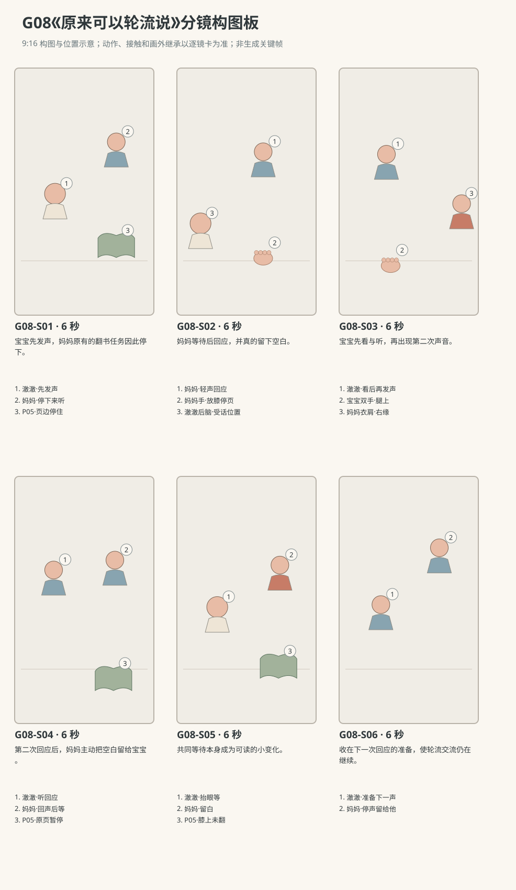

图示为构图位置示意；姿态、接触和画外继承以逐镜正文为准。

### 逐镜设计

#### G08-S01｜00—06 秒｜6 秒｜帧 [0, 144)

**镜头任务：**宝宝先发声，妈妈原有的翻书任务因此停下。

**景别、机位与构图：**双人中景，南侧30厘米，宝宝画左稳坐，妈妈右侧膝上布书打开，两张脸在相近高度。

**摄影机与理由：**固定机位，让动作本身改变画面；不推拉遮盖接触。

**焦点：**焦点覆盖澈澈的眼睛、行动手与目标物；关键接触始终可辨。

**入态：**澈澈看妈妈，嘴自然合着；妈妈手指扶住P05页边，正要翻页。

**动作与表演：**

- 1 秒：宝宝看着妈妈，胸口随吸气微起。

- 2 秒：宝宝嘴张成自然短元音，发出“啊”，妈妈翻页的手停住。

- 3 秒：宝宝声音落下，嘴慢慢收拢；妈妈抬眼看他，保持听的停顿。

**声音：**第2—3秒澈澈发一个短“啊”，声源在画左；前后只有呼吸，妈妈无声，书页轻响在元音前停住。

**出态：**宝宝已经停声，妈妈与他相看，布书页边仍被妈妈扶住。

**切点与承接：**宝宝声确实结束后切妈妈近景，回应从下一镜才开始。

**连续性：**画内两人嘴型均可辨，妈妈此镜不发声；宝宝全身坐姿稳定。

**开始画面母稿：**

9:16竖幅，原创圆润三维生活动画，柔软棉布与自然皮肤质感，生活物理，无文字标语。澈澈深棕眼、短黑绒发、额前一撮向右弯，奶油色棉连体衣；身体按本条能力阶段呈现，表情与动作保留婴儿的专注和不熟练。 澈澈为R1可稳定坐姿并发单个元音的能力阶段；妈妈雾蓝上衣、低马尾、米色长裤。 白天客厅西窗提供柔和漫射主光，暖墙反射补光；北墙固定沙发，东侧走廊，中央奶油地垫。 双人中景，南侧30厘米，宝宝画左稳坐，妈妈右侧膝上布书打开，两张脸在相近高度。 单一开始瞬间：澈澈看妈妈，嘴自然合着；妈妈手指扶住P05页边，正要翻页。 画面清楚呈现起态中已存在的支撑、视线与道具归属；不把后续动作叠画。

**视频变化母稿：**

9:16竖幅，原创圆润三维生活动画，柔软棉布与自然皮肤质感，生活物理，无文字标语。澈澈深棕眼、短黑绒发、额前一撮向右弯，奶油色棉连体衣；身体按本条能力阶段呈现，表情与动作保留婴儿的专注和不熟练。 澈澈为R1可稳定坐姿并发单个元音的能力阶段；妈妈雾蓝上衣、低马尾、米色长裤。 白天客厅西窗提供柔和漫射主光，暖墙反射补光；北墙固定沙发，东侧走廊，中央奶油地垫。 本镜6秒，双人中景，南侧30厘米，宝宝画左稳坐，妈妈右侧膝上布书打开，两张脸在相近高度。 起态：澈澈看妈妈，嘴自然合着；妈妈手指扶住P05页边，正要翻页。 阶段1，持续1秒：宝宝看着妈妈，胸口随吸气微起。 阶段2，持续2秒：宝宝嘴张成自然短元音，发出“啊”，妈妈翻页的手停住。 阶段3，持续3秒：宝宝声音落下，嘴慢慢收拢；妈妈抬眼看他，保持听的停顿。 摄影：固定机位，让动作本身改变画面；不推拉遮盖接触。 焦点：焦点覆盖澈澈的眼睛、行动手与目标物；关键接触始终可辨。 声音：第2—3秒澈澈发一个短“啊”，声源在画左；前后只有呼吸，妈妈无声，书页轻响在元音前停住。 终态：宝宝已经停声，妈妈与他相看，布书页边仍被妈妈扶住。 连续性：画内两人嘴型均可辨，妈妈此镜不发声；宝宝全身坐姿稳定。

#### G08-S02｜06—12 秒｜6 秒｜帧 [144, 288)

**镜头任务：**妈妈等待后回应，并真的留下空白。

**景别、机位与构图：**妈妈脸手近景，南侧偏西仍在视线轴南侧，妈妈脸画右上向左看，宝宝后脑仅在左下边缘，布书下缘可见。

**摄影机与理由：**固定机位，让动作本身改变画面；不推拉遮盖接触。

**焦点：**妈妈眼睛与嘴清楚；宝宝边缘柔虚但视线方位成立。

**入态：**妈妈看着已停声的宝宝，嘴合着，指尖还扶P05页边。

**动作与表演：**

- 1 秒：妈妈保持看宝宝的眼睛，没有立刻张嘴。

- 2 秒：妈妈小声回应“啊”，音量和嘴形都克制。

- 3 秒：她合上嘴停声，手指离页放松到膝上，眼睛继续看宝宝。

**声音：**第2—3秒妈妈轻声“啊”，声源画右；第4—6秒保持无人物发声，只有轻呼吸。

**出态：**妈妈停止发声、嘴合着，眼神留给宝宝；布书仍打开在膝上。

**切点与承接：**停声后留够安静再切宝宝，镜头不替她抢答。

**连续性：**宝宝画外没有同时咿呀；妈妈头朝左不反向，书页没有翻过。

**开始画面母稿：**

9:16竖幅，原创圆润三维生活动画，柔软棉布与自然皮肤质感，生活物理，无文字标语。澈澈深棕眼、短黑绒发、额前一撮向右弯，奶油色棉连体衣；身体按本条能力阶段呈现，表情与动作保留婴儿的专注和不熟练。 澈澈为R1可稳定坐姿并发单个元音的能力阶段；妈妈雾蓝上衣、低马尾、米色长裤。 白天客厅西窗提供柔和漫射主光，暖墙反射补光；北墙固定沙发，东侧走廊，中央奶油地垫。 妈妈脸手近景，南侧偏西仍在视线轴南侧，妈妈脸画右上向左看，宝宝后脑仅在左下边缘，布书下缘可见。 单一开始瞬间：妈妈看着已停声的宝宝，嘴合着，指尖还扶P05页边。 画面清楚呈现起态中已存在的支撑、视线与道具归属；不把后续动作叠画。

**视频变化母稿：**

9:16竖幅，原创圆润三维生活动画，柔软棉布与自然皮肤质感，生活物理，无文字标语。澈澈深棕眼、短黑绒发、额前一撮向右弯，奶油色棉连体衣；身体按本条能力阶段呈现，表情与动作保留婴儿的专注和不熟练。 澈澈为R1可稳定坐姿并发单个元音的能力阶段；妈妈雾蓝上衣、低马尾、米色长裤。 白天客厅西窗提供柔和漫射主光，暖墙反射补光；北墙固定沙发，东侧走廊，中央奶油地垫。 本镜6秒，妈妈脸手近景，南侧偏西仍在视线轴南侧，妈妈脸画右上向左看，宝宝后脑仅在左下边缘，布书下缘可见。 起态：妈妈看着已停声的宝宝，嘴合着，指尖还扶P05页边。 阶段1，持续1秒：妈妈保持看宝宝的眼睛，没有立刻张嘴。 阶段2，持续2秒：妈妈小声回应“啊”，音量和嘴形都克制。 阶段3，持续3秒：她合上嘴停声，手指离页放松到膝上，眼睛继续看宝宝。 摄影：固定机位，让动作本身改变画面；不推拉遮盖接触。 焦点：妈妈眼睛与嘴清楚；宝宝边缘柔虚但视线方位成立。 声音：第2—3秒妈妈轻声“啊”，声源画右；第4—6秒保持无人物发声，只有轻呼吸。 终态：妈妈停止发声、嘴合着，眼神留给宝宝；布书仍打开在膝上。 连续性：宝宝画外没有同时咿呀；妈妈头朝左不反向，书页没有翻过。

#### G08-S03｜12—18 秒｜6 秒｜帧 [288, 432)

**镜头任务：**宝宝先看与听，再出现第二次声音。

**景别、机位与构图：**宝宝脸胸近景，南侧偏东但仍同轴南侧；宝宝画左向右看，妈妈雾蓝衣肩在右缘，宝宝双手在腿上。

**摄影机与理由：**固定机位，让动作本身改变画面；不推拉遮盖接触。

**焦点：**宝宝双眼与嘴唇清楚，手部可略虚，视线保持指向妈妈。

**入态：**宝宝嘴合拢，眼睛看妈妈，妈妈刚停声，布书画外保持膝上。

**动作与表演：**

- 2 秒：宝宝目光先落妈妈嘴的位置，再抬到眼睛，自己不出声。

- 2 秒：宝宝吸气后发短“啊”，嘴和下巴小幅自然活动。

- 2 秒：声音停下，宝宝嘴角松开，仍看妈妈，双手轻挪但不离坐位。

**声音：**第3—4秒澈澈再次发短“啊”，前两秒是听的安静，后两秒停声；妈妈无对白。

**出态：**宝宝第二次元音已落，眼睛仍朝妈妈，等待空间成立。

**切点与承接：**让宝宝声落完再回双人镜，保留两次声音确实分开。

**连续性：**宝宝只能发元音，不把嘴形动画变成成人词句；妈妈画外不回应抢声。

**开始画面母稿：**

9:16竖幅，原创圆润三维生活动画，柔软棉布与自然皮肤质感，生活物理，无文字标语。澈澈深棕眼、短黑绒发、额前一撮向右弯，奶油色棉连体衣；身体按本条能力阶段呈现，表情与动作保留婴儿的专注和不熟练。 澈澈为R1可稳定坐姿并发单个元音的能力阶段；妈妈雾蓝上衣、低马尾、米色长裤。 白天客厅西窗提供柔和漫射主光，暖墙反射补光；北墙固定沙发，东侧走廊，中央奶油地垫。 宝宝脸胸近景，南侧偏东但仍同轴南侧；宝宝画左向右看，妈妈雾蓝衣肩在右缘，宝宝双手在腿上。 单一开始瞬间：宝宝嘴合拢，眼睛看妈妈，妈妈刚停声，布书画外保持膝上。 画面清楚呈现起态中已存在的支撑、视线与道具归属；不把后续动作叠画。

**视频变化母稿：**

9:16竖幅，原创圆润三维生活动画，柔软棉布与自然皮肤质感，生活物理，无文字标语。澈澈深棕眼、短黑绒发、额前一撮向右弯，奶油色棉连体衣；身体按本条能力阶段呈现，表情与动作保留婴儿的专注和不熟练。 澈澈为R1可稳定坐姿并发单个元音的能力阶段；妈妈雾蓝上衣、低马尾、米色长裤。 白天客厅西窗提供柔和漫射主光，暖墙反射补光；北墙固定沙发，东侧走廊，中央奶油地垫。 本镜6秒，宝宝脸胸近景，南侧偏东但仍同轴南侧；宝宝画左向右看，妈妈雾蓝衣肩在右缘，宝宝双手在腿上。 起态：宝宝嘴合拢，眼睛看妈妈，妈妈刚停声，布书画外保持膝上。 阶段1，持续2秒：宝宝目光先落妈妈嘴的位置，再抬到眼睛，自己不出声。 阶段2，持续2秒：宝宝吸气后发短“啊”，嘴和下巴小幅自然活动。 阶段3，持续2秒：声音停下，宝宝嘴角松开，仍看妈妈，双手轻挪但不离坐位。 摄影：固定机位，让动作本身改变画面；不推拉遮盖接触。 焦点：宝宝双眼与嘴唇清楚，手部可略虚，视线保持指向妈妈。 声音：第3—4秒澈澈再次发短“啊”，前两秒是听的安静，后两秒停声；妈妈无对白。 终态：宝宝第二次元音已落，眼睛仍朝妈妈，等待空间成立。 连续性：宝宝只能发元音，不把嘴形动画变成成人词句；妈妈画外不回应抢声。

#### G08-S04｜18—24 秒｜6 秒｜帧 [432, 576)

**镜头任务：**第二次回应后，妈妈主动把空白留给宝宝。

**景别、机位与构图：**双人近景，南侧30厘米，宝宝左妈妈右，P05在下方，二人眼睛与嘴同框。

**摄影机与理由：**固定机位，让动作本身改变画面；不推拉遮盖接触。

**焦点：**焦点覆盖澈澈的眼睛、行动手与目标物；关键接触始终可辨。

**入态：**宝宝已经停声，妈妈嘴合着看宝宝，双方双手都在各自腿膝上。

**动作与表演：**

- 1 秒：妈妈先保持听的姿态，确认宝宝声音结束。

- 2 秒：妈妈柔声回“啊”，随后闭嘴。

- 3 秒：妈妈微微偏头等待；宝宝目光跟着她，嘴轻张却未发声。

**声音：**第2—3秒妈妈柔声“啊”，宝宝无声；第4—6秒仅呼吸，远处鸟声在末尾极轻带入。

**出态：**妈妈停声等，宝宝也安静，双方看着对方。

**切点与承接：**不在停声时立刻切走，带着真正安静进入下一镜。

**连续性：**本镜只有妈妈一次元音，宝宝不得嘴型对应另一层配音；书仍原页。

**开始画面母稿：**

9:16竖幅，原创圆润三维生活动画，柔软棉布与自然皮肤质感，生活物理，无文字标语。澈澈深棕眼、短黑绒发、额前一撮向右弯，奶油色棉连体衣；身体按本条能力阶段呈现，表情与动作保留婴儿的专注和不熟练。 澈澈为R1可稳定坐姿并发单个元音的能力阶段；妈妈雾蓝上衣、低马尾、米色长裤。 白天客厅西窗提供柔和漫射主光，暖墙反射补光；北墙固定沙发，东侧走廊，中央奶油地垫。 双人近景，南侧30厘米，宝宝左妈妈右，P05在下方，二人眼睛与嘴同框。 单一开始瞬间：宝宝已经停声，妈妈嘴合着看宝宝，双方双手都在各自腿膝上。 画面清楚呈现起态中已存在的支撑、视线与道具归属；不把后续动作叠画。

**视频变化母稿：**

9:16竖幅，原创圆润三维生活动画，柔软棉布与自然皮肤质感，生活物理，无文字标语。澈澈深棕眼、短黑绒发、额前一撮向右弯，奶油色棉连体衣；身体按本条能力阶段呈现，表情与动作保留婴儿的专注和不熟练。 澈澈为R1可稳定坐姿并发单个元音的能力阶段；妈妈雾蓝上衣、低马尾、米色长裤。 白天客厅西窗提供柔和漫射主光，暖墙反射补光；北墙固定沙发，东侧走廊，中央奶油地垫。 本镜6秒，双人近景，南侧30厘米，宝宝左妈妈右，P05在下方，二人眼睛与嘴同框。 起态：宝宝已经停声，妈妈嘴合着看宝宝，双方双手都在各自腿膝上。 阶段1，持续1秒：妈妈先保持听的姿态，确认宝宝声音结束。 阶段2，持续2秒：妈妈柔声回“啊”，随后闭嘴。 阶段3，持续3秒：妈妈微微偏头等待；宝宝目光跟着她，嘴轻张却未发声。 摄影：固定机位，让动作本身改变画面；不推拉遮盖接触。 焦点：焦点覆盖澈澈的眼睛、行动手与目标物；关键接触始终可辨。 声音：第2—3秒妈妈柔声“啊”，宝宝无声；第4—6秒仅呼吸，远处鸟声在末尾极轻带入。 终态：妈妈停声等，宝宝也安静，双方看着对方。 连续性：本镜只有妈妈一次元音，宝宝不得嘴型对应另一层配音；书仍原页。

#### G08-S05｜24—30 秒｜6 秒｜帧 [576, 720)

**镜头任务：**共同等待本身成为可读的小变化。

**景别、机位与构图：**双人中景，南侧固定，宝宝左、妈妈右，两人之间留空，膝上布书仍可见。

**摄影机与理由：**固定机位，让动作本身改变画面；不推拉遮盖接触。

**焦点：**焦点覆盖澈澈的眼睛、行动手与目标物；关键接触始终可辨。

**入态：**妈妈微偏头等待，宝宝嘴轻张但没有发声，双手自然搭腿。

**动作与表演：**

- 2 秒：宝宝慢慢抿嘴，目光落到妈妈膝上的书页。

- 2 秒：他再抬眼看妈妈，妈妈也保持看他，轻轻眨一次眼。

- 2 秒：宝宝小嘴轻动又停住，妈妈不抢着示范，脸上只是一点笑。

**声音：**整镜无人物发声、无音乐；仅连续呼吸、远鸟声与极轻棉衣响，留足安静。

**出态：**宝宝重新看妈妈，双方都在等下一次声音，没有冻住表情。

**切点与承接：**在宝宝视线返回时切近一点的共同画面，下一声仍由妈妈轻柔给出。

**连续性：**六秒内人物均不发声；呼吸、眼睛与指尖有自然微动，非静帧替代听戏。

**开始画面母稿：**

9:16竖幅，原创圆润三维生活动画，柔软棉布与自然皮肤质感，生活物理，无文字标语。澈澈深棕眼、短黑绒发、额前一撮向右弯，奶油色棉连体衣；身体按本条能力阶段呈现，表情与动作保留婴儿的专注和不熟练。 澈澈为R1可稳定坐姿并发单个元音的能力阶段；妈妈雾蓝上衣、低马尾、米色长裤。 白天客厅西窗提供柔和漫射主光，暖墙反射补光；北墙固定沙发，东侧走廊，中央奶油地垫。 双人中景，南侧固定，宝宝左、妈妈右，两人之间留空，膝上布书仍可见。 单一开始瞬间：妈妈微偏头等待，宝宝嘴轻张但没有发声，双手自然搭腿。 画面清楚呈现起态中已存在的支撑、视线与道具归属；不把后续动作叠画。

**视频变化母稿：**

9:16竖幅，原创圆润三维生活动画，柔软棉布与自然皮肤质感，生活物理，无文字标语。澈澈深棕眼、短黑绒发、额前一撮向右弯，奶油色棉连体衣；身体按本条能力阶段呈现，表情与动作保留婴儿的专注和不熟练。 澈澈为R1可稳定坐姿并发单个元音的能力阶段；妈妈雾蓝上衣、低马尾、米色长裤。 白天客厅西窗提供柔和漫射主光，暖墙反射补光；北墙固定沙发，东侧走廊，中央奶油地垫。 本镜6秒，双人中景，南侧固定，宝宝左、妈妈右，两人之间留空，膝上布书仍可见。 起态：妈妈微偏头等待，宝宝嘴轻张但没有发声，双手自然搭腿。 阶段1，持续2秒：宝宝慢慢抿嘴，目光落到妈妈膝上的书页。 阶段2，持续2秒：他再抬眼看妈妈，妈妈也保持看他，轻轻眨一次眼。 阶段3，持续2秒：宝宝小嘴轻动又停住，妈妈不抢着示范，脸上只是一点笑。 摄影：固定机位，让动作本身改变画面；不推拉遮盖接触。 焦点：焦点覆盖澈澈的眼睛、行动手与目标物；关键接触始终可辨。 声音：整镜无人物发声、无音乐；仅连续呼吸、远鸟声与极轻棉衣响，留足安静。 终态：宝宝重新看妈妈，双方都在等下一次声音，没有冻住表情。 连续性：六秒内人物均不发声；呼吸、眼睛与指尖有自然微动，非静帧替代听戏。

#### G08-S06｜30—36 秒｜6 秒｜帧 [720, 864)

**镜头任务：**收在下一次回应的准备，使轮流交流仍在继续。

**景别、机位与构图：**脸部双人近景，南侧30厘米，宝宝脸左下、妈妈脸右上，视线相接，下缘保留宝宝稳定坐姿的一部分。

**摄影机与理由：**固定机位，让动作本身改变画面；不推拉遮盖接触。

**焦点：**焦点覆盖澈澈的眼睛、行动手与目标物；关键接触始终可辨。

**入态：**宝宝抬眼看妈妈，妈妈轻偏头，双方嘴都合着。

**动作与表演：**

- 1 秒：妈妈看见宝宝仍在等，头略回正。

- 2 秒：她轻声“啊”一下，随即停住，眼睛留在宝宝身上。

- 3 秒：宝宝眼睛亮一点，胸口随一小口吸气微起，小嘴准备张开，但还没有下一声。

**声音：**第2—3秒妈妈轻声“啊”；第4—6秒只有宝宝小口吸气与母婴呼吸，宝宝不追加有声词。

**出态：**妈妈已停声，宝宝正准备接续，两人目光相连。

**切点与承接：**结束在吸气准备的自然尾端，不加字幕解释轮流，也不剪成合唱。

**连续性：**宝宝最后没有实际发出元音；妈妈只有台词表这一声，身体位置不变。

**开始画面母稿：**

9:16竖幅，原创圆润三维生活动画，柔软棉布与自然皮肤质感，生活物理，无文字标语。澈澈深棕眼、短黑绒发、额前一撮向右弯，奶油色棉连体衣；身体按本条能力阶段呈现，表情与动作保留婴儿的专注和不熟练。 澈澈为R1可稳定坐姿并发单个元音的能力阶段；妈妈雾蓝上衣、低马尾、米色长裤。 白天客厅西窗提供柔和漫射主光，暖墙反射补光；北墙固定沙发，东侧走廊，中央奶油地垫。 脸部双人近景，南侧30厘米，宝宝脸左下、妈妈脸右上，视线相接，下缘保留宝宝稳定坐姿的一部分。 单一开始瞬间：宝宝抬眼看妈妈，妈妈轻偏头，双方嘴都合着。 画面清楚呈现起态中已存在的支撑、视线与道具归属；不把后续动作叠画。

**视频变化母稿：**

9:16竖幅，原创圆润三维生活动画，柔软棉布与自然皮肤质感，生活物理，无文字标语。澈澈深棕眼、短黑绒发、额前一撮向右弯，奶油色棉连体衣；身体按本条能力阶段呈现，表情与动作保留婴儿的专注和不熟练。 澈澈为R1可稳定坐姿并发单个元音的能力阶段；妈妈雾蓝上衣、低马尾、米色长裤。 白天客厅西窗提供柔和漫射主光，暖墙反射补光；北墙固定沙发，东侧走廊，中央奶油地垫。 本镜6秒，脸部双人近景，南侧30厘米，宝宝脸左下、妈妈脸右上，视线相接，下缘保留宝宝稳定坐姿的一部分。 起态：宝宝抬眼看妈妈，妈妈轻偏头，双方嘴都合着。 阶段1，持续1秒：妈妈看见宝宝仍在等，头略回正。 阶段2，持续2秒：她轻声“啊”一下，随即停住，眼睛留在宝宝身上。 阶段3，持续3秒：宝宝眼睛亮一点，胸口随一小口吸气微起，小嘴准备张开，但还没有下一声。 摄影：固定机位，让动作本身改变画面；不推拉遮盖接触。 焦点：焦点覆盖澈澈的眼睛、行动手与目标物；关键接触始终可辨。 声音：第2—3秒妈妈轻声“啊”；第4—6秒只有宝宝小口吸气与母婴呼吸，宝宝不追加有声词。 终态：妈妈已停声，宝宝正准备接续，两人目光相连。 连续性：宝宝最后没有实际发出元音；妈妈只有台词表这一声，身体位置不变。

### 声音与剪辑

只有五次列明的“啊”、真实呼吸、布书初始轻响与很远鸟声；保留S05完整安静，不用背景音乐填平停顿，不做成人儿语讲解。

- 澈澈：啊（G08-S01；第2—3秒面向妈妈的短元音，不成词；余时呼吸。）

- 妈妈：啊（G08-S02；第2—3秒，等宝宝声落完再柔声回应，随后真正停声。）

- 澈澈：啊（G08-S03；第3—4秒，再次看着妈妈发出短元音，不续成句。）

- 妈妈：啊（G08-S04；第2—3秒回应，随后保持安静等宝宝。）

- 妈妈：啊（G08-S06；第2—3秒轻声发出后停止，留给宝宝吸气准备而不立即重叠。）

### 连续性与试片

- 连续性：宝宝始终只有短元音“啊”，无隐含词句、配音解释或歌词；妈妈也只发台词表中的三次“啊”。

- 连续性：五次发声窗口不重叠；S05没有人物发声，S06结尾宝宝只吸气准备不发出第六次声。

- 连续性：P05一直在妈妈膝上，S01停页后不再翻动分散刺激。

- 连续性：宝宝骨盆双腿稳定接地，妈妈在东南侧，所有近景维持宝宝向右看、妈妈向左看。

- 试片：G08-S01到S04逐音检查：先前一人声音完整结束、对方停听后才回应；若嘴型和音源人物错配、元音叠音或多出词句则失败。

- 试片：G08-S05静音与有声对照：需要看出双方在等对方，仍有自然呼吸眼神；若只是冻住脸或由音乐提示情绪则失败。

- 试片：G08-S06：妈妈的“啊”结束后宝宝吸气而未完成下一声，收尾应像互动将继续；若强行同步合唱则与本题不同。

**媒体待验证：**尚无媒体；待验证婴儿元音音色、母婴轮流口型、停顿里的听戏，台词表窗口需实剪复核。

---

## G09《站起来看见的新世界》

**54 秒｜爬行与扶站｜角色：澈澈、妈妈｜场景 L**

### 剧情正文

北墙沙发前，澈澈跪在地垫上，双手抓着固定矮扶栏。沙发前沿挡住了座面，他仰着脸，只能看见上面露出的一点颜色。妈妈跪在东侧，把布巾放到自己膝边。澈澈低头看看膝盖，再抬眼往上看，双手没有松开。他先把右脚挪到身前，脚掌踩实，左膝仍在地垫上。停稳以后，右腿慢慢撑起，屁股升高，左腿跟着往前，左脚也落下来。妈妈双手停在身边可照顾的位置，没有向上提他。澈澈终于用两只脚站住，肚子仍靠近扶栏，双肘微弯。随着眼睛越过沙发前沿，一整块绿色软积木出现在他面前。他先睁大眼，再低头看看自己的脚，随后又抬眼确认积木。妈妈俯低身子，跟他望向同一个地方。澈澈握着栏边，指头轻轻收了一下，没急着伸手去拿。

### 导演与空间

**观察任务：**完整建立双手扶栏、半跪落足、双足承重后的站立，再让遮挡后的同一玩具进入视线。

**空间与光位：**北墙沙发前有固定在底座上的圆钝矮扶栏，宝宝在栏南侧面北，栏高允许跪姿双手握住、站立后肘仍略屈。P03绿色软积木在北侧沙发座面、前沿内侧，低跪视角被沙发前沿遮住。妈妈在宝宝东侧跪坐，双手旁候不拉拽。相机始终在南至西南侧，不越栏；侧面机位用于看握点、脚底与视线升高，西窗保持西侧。

**人物表演：**宝宝起态双膝、双手有支撑，先把右足踩平形成半跪，利用双手扶栏和右足逐渐提高骨盆，再移左足落稳；不演成双手悬挂拉起。妈妈先整理P04，见动作后近旁守候，站稳后才俯低一起看玩具。

### 节拍覆盖

- **G09-b1**：前态：澈澈双膝落垫、双手握固定栏，胸腹不悬挂；妈妈东侧跪坐，P04在膝边，P03在北侧沙发座面前沿内侧。 过程：妈妈把P04折好放在自己膝旁，眼睛转向宝宝。宝宝沿扶栏抬头看沙发前沿，双手轻收指，膝盖仍落地。 后态：宝宝仍跪着看上方，成人与固定栏、积木位置都已交代。 观众观察：从宽镜建立固定栏、双膝双手与被遮住玩具的位置。 → G09-S01

- **G09-b2**：前态：宝宝双膝在垫、双手握栏，视线被沙发前沿挡住，P03大部分不可见。 过程：宝宝仰脸看露出的一点绿色，嘴稍张，栏与沙发不动。他低头看自己的膝盖，双手保持握点。目光重新抬向绿色角，身体向栏靠近一点，准备挪脚。 后态：宝宝仍跪姿，双手原位，身体略靠近栏，右膝准备前移。 观众观察：证明起立的动力来自视线被挡，而非成人口令。 → G09-S02

- **G09-b3**：前态：双膝与双手承托宝宝，躯干靠近栏；妈妈已放好布巾。 过程：妈妈稍向前靠近，双手留在宝宝躯干两侧外，未接触。宝宝在双手和左膝支撑下，把右膝向前送，右脚落到身前垫面。右脚掌慢慢踩平，宝宝停住，保持左膝与右足、双手共同承托。 后态：宝宝形成右足踩平、左膝落地的半跪，双手仍握栏原位，妈妈未触。 观众观察：明确半跪之前和之后的支撑变化。 → G09-S03

- **G09-b4**：前态：右足已平踩身前、左膝接垫，宝宝双手握栏、肘略屈，骨盆较低。 过程：宝宝把重量慢慢转向右足，右腿开始伸展，双手只稳住向前晃的躯干，骨盆提高。左膝离垫，左腿向身下跟进，左足落在右足旁，双手握点不变。双脚逐渐踩实，双膝保留微屈，身体升到扶栏站姿；停一下让轻晃减小。 后态：宝宝双足落地扶栏站住，双膝微屈，肘仍略弯，骨盆不悬在双臂下；妈妈未触。 观众观察：在完整全身镜里完成起立，不以手臂吊起身体。 → G09-S04

- **G09-b5**：前态：宝宝已经扶栏站住，双手握栏，眼睛已朝向沙发上的P03；相机起在低于宝宝眼位的位置，因此观众仍见P03被沙发前沿少量遮住。 过程：宝宝只轻抬下巴看P03，相机缓升到宝宝已经达到的站姿眼位，让观众看见前沿后完整的绿色积木；宝宝双足与身高不再改变。他睁大眼看P03，双手不松，身体只做自然小摆。相机停稳，宝宝目光短暂往自己的脚方向落下，再抬回积木。 后态：P03完整出现在宝宝视线前，宝宝仍双手扶栏站立，脸上是安静的惊讶。 观众观察：同一固定场景通过视点升高揭示积木。 → G09-S05

- **G09-b6**：前态：宝宝站稳看积木，妈妈东侧跪地近旁，双手仍空停身前。 过程：妈妈确认宝宝双足站住后，把自己上身俯低到宝宝能侧眼看见的高度。她先看宝宝，再顺着目光看P03，轻轻笑一下。宝宝侧眼看看妈妈，仍握栏，随后把视线回到积木。 后态：两人都看着座面上的P03，宝宝双手双足状态未变，妈妈未碰。 观众观察：妈妈跟到新的视线高度一起看，不把成果说出口。 → G09-S06

- **G09-b7**：前态：宝宝双足平踩、膝微屈、双手握栏，妈妈俯低与他同看P03。 过程：宝宝手指在栏上轻轻收紧又放松，但握点不脱离。他低头看一眼自己的双足，脚没有挪动，再抬眼看绿色积木。妈妈安静跟随他的目光，宝宝保持站姿，呼吸慢慢平稳。 后态：宝宝以同一握点和双足站立，看着完整显露的P03，妈妈旁边陪看。 观众观察：结尾确认新的站立视野仍由真实支撑维持。 → G09-S07

### 分镜构图板

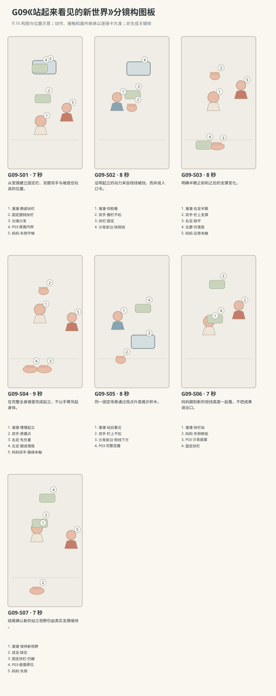

图示为构图位置示意；姿态、接触和画外继承以逐镜正文为准。

### 逐镜设计

#### G09-S01｜00—07 秒｜7 秒｜帧 [0, 168)

**镜头任务：**从宽镜建立固定栏、双膝双手与被遮住玩具的位置。

**景别、机位与构图：**中全景，西南侧60厘米高斜俯向东北；宝宝在中下背侧面朝北，扶栏横贯中部，沙发在上方，妈妈东侧画右，P03在沙发座面可见。

**摄影机与理由：**固定机位，让动作本身改变画面；不推拉遮盖接触。

**焦点：**焦点覆盖澈澈的眼睛、行动手与目标物；关键接触始终可辨。

**入态：**澈澈双膝落垫、双手握固定栏，胸腹不悬挂；妈妈东侧跪坐，P04在膝边，P03在北侧沙发座面前沿内侧。

**动作与表演：**

- 3 秒：妈妈把P04折好放在自己膝旁，眼睛转向宝宝。

- 4 秒：宝宝沿扶栏抬头看沙发前沿，双手轻收指，膝盖仍落地。

**声音：**无对白、无音乐；西窗外极轻鸟声作底，前景保留连体衣摩擦与婴儿呼吸，动作触碰同步发声。

**出态：**宝宝仍跪着看上方，成人与固定栏、积木位置都已交代。

**切点与承接：**切到宝宝眼高的侧面，显示同一玩具在低视点怎样被挡。

**连续性：**高机位给观众看见P03，不代表宝宝已经看见；双手双膝起态受力成立。

**开始画面母稿：**

9:16竖幅，原创圆润三维生活动画，柔软棉布与自然皮肤质感，生活物理，无文字标语。澈澈深棕眼、短黑绒发、额前一撮向右弯，奶油色棉连体衣；身体按本条能力阶段呈现，表情与动作保留婴儿的专注和不熟练。 澈澈为R2能扶固定支撑由跪姿起立的阶段；妈妈低马尾、雾蓝上衣、米色长裤。 白天客厅西窗提供柔和漫射主光，暖墙反射补光；北墙固定沙发，东侧走廊，中央奶油地垫。 中全景，西南侧60厘米高斜俯向东北；宝宝在中下背侧面朝北，扶栏横贯中部，沙发在上方，妈妈东侧画右，P03在沙发座面可见。 单一开始瞬间：澈澈双膝落垫、双手握固定栏，胸腹不悬挂；妈妈东侧跪坐，P04在膝边，P03在北侧沙发座面前沿内侧。 画面清楚呈现起态中已存在的支撑、视线与道具归属；不把后续动作叠画。

**视频变化母稿：**

9:16竖幅，原创圆润三维生活动画，柔软棉布与自然皮肤质感，生活物理，无文字标语。澈澈深棕眼、短黑绒发、额前一撮向右弯，奶油色棉连体衣；身体按本条能力阶段呈现，表情与动作保留婴儿的专注和不熟练。 澈澈为R2能扶固定支撑由跪姿起立的阶段；妈妈低马尾、雾蓝上衣、米色长裤。 白天客厅西窗提供柔和漫射主光，暖墙反射补光；北墙固定沙发，东侧走廊，中央奶油地垫。 本镜7秒，中全景，西南侧60厘米高斜俯向东北；宝宝在中下背侧面朝北，扶栏横贯中部，沙发在上方，妈妈东侧画右，P03在沙发座面可见。 起态：澈澈双膝落垫、双手握固定栏，胸腹不悬挂；妈妈东侧跪坐，P04在膝边，P03在北侧沙发座面前沿内侧。 阶段1，持续3秒：妈妈把P04折好放在自己膝旁，眼睛转向宝宝。 阶段2，持续4秒：宝宝沿扶栏抬头看沙发前沿，双手轻收指，膝盖仍落地。 摄影：固定机位，让动作本身改变画面；不推拉遮盖接触。 焦点：焦点覆盖澈澈的眼睛、行动手与目标物；关键接触始终可辨。 声音：无对白、无音乐；西窗外极轻鸟声作底，前景保留连体衣摩擦与婴儿呼吸，动作触碰同步发声。 终态：宝宝仍跪着看上方，成人与固定栏、积木位置都已交代。 连续性：高机位给观众看见P03，不代表宝宝已经看见；双手双膝起态受力成立。

#### G09-S02｜07—15 秒｜8 秒｜帧 [168, 360)

**镜头任务：**证明起立的动力来自视线被挡，而非成人口令。

**景别、机位与构图：**低位中近景，西南侧离垫25厘米斜看北；宝宝侧脸画左、握栏双手居中，沙发前沿横在视线上方，积木只露很小色角。

**摄影机与理由：**固定机位，让动作本身改变画面；不推拉遮盖接触。

**焦点：**宝宝眼睛、握栏处与沙发前沿清楚；仅露积木小角，不自动越过遮挡。

**入态：**宝宝双膝在垫、双手握栏，视线被沙发前沿挡住，P03大部分不可见。

**动作与表演：**

- 3 秒：宝宝仰脸看露出的一点绿色，嘴稍张，栏与沙发不动。

- 2 秒：他低头看自己的膝盖，双手保持握点。

- 3 秒：目光重新抬向绿色角，身体向栏靠近一点，准备挪脚。

**声音：**无对白、无音乐；西窗外极轻鸟声作底，前景保留连体衣摩擦与婴儿呼吸，动作触碰同步发声。

**出态：**宝宝仍跪姿，双手原位，身体略靠近栏，右膝准备前移。

**切点与承接：**从低头准备接入全身镜，必须在看得清的画面交代右足踩地。

**连续性：**画外妈妈仍东侧未触；P03被挡不是删掉，颜色角位置固定。

**开始画面母稿：**

9:16竖幅，原创圆润三维生活动画，柔软棉布与自然皮肤质感，生活物理，无文字标语。澈澈深棕眼、短黑绒发、额前一撮向右弯，奶油色棉连体衣；身体按本条能力阶段呈现，表情与动作保留婴儿的专注和不熟练。 澈澈为R2能扶固定支撑由跪姿起立的阶段；妈妈低马尾、雾蓝上衣、米色长裤。 白天客厅西窗提供柔和漫射主光，暖墙反射补光；北墙固定沙发，东侧走廊，中央奶油地垫。 低位中近景，西南侧离垫25厘米斜看北；宝宝侧脸画左、握栏双手居中，沙发前沿横在视线上方，积木只露很小色角。 单一开始瞬间：宝宝双膝在垫、双手握栏，视线被沙发前沿挡住，P03大部分不可见。 画面清楚呈现起态中已存在的支撑、视线与道具归属；不把后续动作叠画。

**视频变化母稿：**

9:16竖幅，原创圆润三维生活动画，柔软棉布与自然皮肤质感，生活物理，无文字标语。澈澈深棕眼、短黑绒发、额前一撮向右弯，奶油色棉连体衣；身体按本条能力阶段呈现，表情与动作保留婴儿的专注和不熟练。 澈澈为R2能扶固定支撑由跪姿起立的阶段；妈妈低马尾、雾蓝上衣、米色长裤。 白天客厅西窗提供柔和漫射主光，暖墙反射补光；北墙固定沙发，东侧走廊，中央奶油地垫。 本镜8秒，低位中近景，西南侧离垫25厘米斜看北；宝宝侧脸画左、握栏双手居中，沙发前沿横在视线上方，积木只露很小色角。 起态：宝宝双膝在垫、双手握栏，视线被沙发前沿挡住，P03大部分不可见。 阶段1，持续3秒：宝宝仰脸看露出的一点绿色，嘴稍张，栏与沙发不动。 阶段2，持续2秒：他低头看自己的膝盖，双手保持握点。 阶段3，持续3秒：目光重新抬向绿色角，身体向栏靠近一点，准备挪脚。 摄影：固定机位，让动作本身改变画面；不推拉遮盖接触。 焦点：宝宝眼睛、握栏处与沙发前沿清楚；仅露积木小角，不自动越过遮挡。 声音：无对白、无音乐；西窗外极轻鸟声作底，前景保留连体衣摩擦与婴儿呼吸，动作触碰同步发声。 终态：宝宝仍跪姿，双手原位，身体略靠近栏，右膝准备前移。 连续性：画外妈妈仍东侧未触；P03被挡不是删掉，颜色角位置固定。

#### G09-S03｜15—23 秒｜8 秒｜帧 [360, 552)

**镜头任务：**明确半跪之前和之后的支撑变化。

**景别、机位与构图：**全身中景，西南侧40厘米高，宝宝侧面头左上、脚下方，栏在上中，妈妈右后方双手旁候，右足落点无遮挡。

**摄影机与理由：**固定机位，让动作本身改变画面；不推拉遮盖接触。

**焦点：**焦点覆盖澈澈的眼睛、行动手与目标物；关键接触始终可辨。

**入态：**双膝与双手承托宝宝，躯干靠近栏；妈妈已放好布巾。

**动作与表演：**

- 2 秒：妈妈稍向前靠近，双手留在宝宝躯干两侧外，未接触。

- 3 秒：宝宝在双手和左膝支撑下，把右膝向前送，右脚落到身前垫面。

- 3 秒：右脚掌慢慢踩平，宝宝停住，保持左膝与右足、双手共同承托。

**声音：**无对白、无音乐；西窗外极轻鸟声作底，前景保留连体衣摩擦与婴儿呼吸，动作触碰同步发声。

**出态：**宝宝形成右足踩平、左膝落地的半跪，双手仍握栏原位，妈妈未触。

**切点与承接：**等右足真的踩稳后才切起立主镜，不用切镜完成负重转换。

**连续性：**右足从右膝下自然前送，不能从另一条裤腿穿出；左膝未提前离地。

**开始画面母稿：**

9:16竖幅，原创圆润三维生活动画，柔软棉布与自然皮肤质感，生活物理，无文字标语。澈澈深棕眼、短黑绒发、额前一撮向右弯，奶油色棉连体衣；身体按本条能力阶段呈现，表情与动作保留婴儿的专注和不熟练。 澈澈为R2能扶固定支撑由跪姿起立的阶段；妈妈低马尾、雾蓝上衣、米色长裤。 白天客厅西窗提供柔和漫射主光，暖墙反射补光；北墙固定沙发，东侧走廊，中央奶油地垫。 全身中景，西南侧40厘米高；宝宝在画中左侧面，双手握栏、双膝落垫，妈妈在右后方，双手位于自己膝旁、未触宝宝，右足尚未前送。 单一开始瞬间：双膝与双手承托宝宝，躯干靠近栏；妈妈已放好布巾。 本图焦点固定在：宝宝两膝和双手的现有支撑、仍在后方的右足及成人未接触的手。 仅呈现这一瞬间的身体支撑、视线与物件归属，不把未来阶段或相机路径叠画。

**视频变化母稿：**

9:16竖幅，原创圆润三维生活动画，柔软棉布与自然皮肤质感，生活物理，无文字标语。澈澈深棕眼、短黑绒发、额前一撮向右弯，奶油色棉连体衣；身体按本条能力阶段呈现，表情与动作保留婴儿的专注和不熟练。 澈澈为R2能扶固定支撑由跪姿起立的阶段；妈妈低马尾、雾蓝上衣、米色长裤。 白天客厅西窗提供柔和漫射主光，暖墙反射补光；北墙固定沙发，东侧走廊，中央奶油地垫。 本镜8秒，全身中景，西南侧40厘米高，宝宝侧面头左上、脚下方，栏在上中，妈妈右后方双手旁候，右足落点无遮挡。 起态：双膝与双手承托宝宝，躯干靠近栏；妈妈已放好布巾。 阶段1，持续2秒：妈妈稍向前靠近，双手留在宝宝躯干两侧外，未接触。 阶段2，持续3秒：宝宝在双手和左膝支撑下，把右膝向前送，右脚落到身前垫面。 阶段3，持续3秒：右脚掌慢慢踩平，宝宝停住，保持左膝与右足、双手共同承托。 摄影：固定机位，让动作本身改变画面；不推拉遮盖接触。 焦点：焦点覆盖澈澈的眼睛、行动手与目标物；关键接触始终可辨。 声音：无对白、无音乐；西窗外极轻鸟声作底，前景保留连体衣摩擦与婴儿呼吸，动作触碰同步发声。 终态：宝宝形成右足踩平、左膝落地的半跪，双手仍握栏原位，妈妈未触。 连续性：右足从右膝下自然前送，不能从另一条裤腿穿出；左膝未提前离地。

#### G09-S04｜23—32 秒｜9 秒｜帧 [552, 768)

**镜头任务：**在完整全身镜里完成起立，不以手臂吊起身体。

**景别、机位与构图：**全身动作主镜，西南侧40厘米高固定，头至双脚完整；栏握点、肘、右足与左膝都可读，妈妈双手在右缘不遮接触。

**摄影机与理由：**固定机位，让动作本身改变画面；不推拉遮盖接触。

**焦点：**全身景深覆盖肘、骨盆、膝和双足，不拉浅景深隐藏承重。

**入态：**右足已平踩身前、左膝接垫，宝宝双手握栏、肘略屈，骨盆较低。

**动作与表演：**

- 3 秒：宝宝把重量慢慢转向右足，右腿开始伸展，双手只稳住向前晃的躯干，骨盆提高。

- 3 秒：左膝离垫，左腿向身下跟进，左足落在右足旁，双手握点不变。

- 3 秒：双脚逐渐踩实，双膝保留微屈，身体升到扶栏站姿；停一下让轻晃减小。

**声音：**无对白无音乐；右足压垫、左裤腿与膝离垫轻擦、左足落垫先后清楚；栏无晃动声，宝宝站定后轻呼气。

**出态：**宝宝双足落地扶栏站住，双膝微屈，肘仍略弯，骨盆不悬在双臂下；妈妈未触。

**切点与承接：**双足承重与站稳停顿都完成后切眼高变化，不能在悬空中剪走。

**连续性：**右足不滑，左足从左腿接续；扶栏刚性不变，妈妈没有画外提衣服。

**开始画面母稿：**

9:16竖幅，原创圆润三维生活动画，柔软棉布与自然皮肤质感，生活物理，无文字标语。澈澈深棕眼、短黑绒发、额前一撮向右弯，奶油色棉连体衣；身体按本条能力阶段呈现，表情与动作保留婴儿的专注和不熟练。 澈澈为R2能扶固定支撑由跪姿起立的阶段；妈妈低马尾、雾蓝上衣、米色长裤。 白天客厅西窗提供柔和漫射主光，暖墙反射补光；北墙固定沙发，东侧走廊，中央奶油地垫。 全身动作主镜，西南侧40厘米高固定，头至双脚完整；栏握点、肘、右足与左膝都可读，妈妈双手在右缘不遮接触。 单一开始瞬间：右足已平踩身前、左膝接垫，宝宝双手握栏、肘略屈，骨盆较低。 画面清楚呈现起态中已存在的支撑、视线与道具归属；不把后续动作叠画。

**视频变化母稿：**

9:16竖幅，原创圆润三维生活动画，柔软棉布与自然皮肤质感，生活物理，无文字标语。澈澈深棕眼、短黑绒发、额前一撮向右弯，奶油色棉连体衣；身体按本条能力阶段呈现，表情与动作保留婴儿的专注和不熟练。 澈澈为R2能扶固定支撑由跪姿起立的阶段；妈妈低马尾、雾蓝上衣、米色长裤。 白天客厅西窗提供柔和漫射主光，暖墙反射补光；北墙固定沙发，东侧走廊，中央奶油地垫。 本镜9秒，全身动作主镜，西南侧40厘米高固定，头至双脚完整；栏握点、肘、右足与左膝都可读，妈妈双手在右缘不遮接触。 起态：右足已平踩身前、左膝接垫，宝宝双手握栏、肘略屈，骨盆较低。 阶段1，持续3秒：宝宝把重量慢慢转向右足，右腿开始伸展，双手只稳住向前晃的躯干，骨盆提高。 阶段2，持续3秒：左膝离垫，左腿向身下跟进，左足落在右足旁，双手握点不变。 阶段3，持续3秒：双脚逐渐踩实，双膝保留微屈，身体升到扶栏站姿；停一下让轻晃减小。 摄影：固定机位，让动作本身改变画面；不推拉遮盖接触。 焦点：全身景深覆盖肘、骨盆、膝和双足，不拉浅景深隐藏承重。 声音：无对白无音乐；右足压垫、左裤腿与膝离垫轻擦、左足落垫先后清楚；栏无晃动声，宝宝站定后轻呼气。 终态：宝宝双足落地扶栏站住，双膝微屈，肘仍略弯，骨盆不悬在双臂下；妈妈未触。 连续性：右足不滑，左足从左腿接续；扶栏刚性不变，妈妈没有画外提衣服。

#### G09-S05｜32—40 秒｜8 秒｜帧 [768, 960)

**镜头任务：**同一固定场景通过视点升高揭示积木。

**景别、机位与构图：**侧面近景，西南侧相机从低于宝宝眼位约15厘米缓升到站后的实际眼位；宝宝侧脸与握栏双手始终留画，P03的遮挡变化属于观众机位，不要求宝宝再长高。

**摄影机与理由：**由宝宝看向新视野触发相机缓升约15厘米，从低于其眼位移到实际站姿眼位后固定；起立已在上镜完成，本镜不再抬高宝宝。

**焦点：**先保宝宝眼睛与沙发前沿可辨，积木露全后焦点稍移P03，握栏双手仍有轮廓。

**入态：**宝宝已经扶栏站住，双手握栏，眼睛已朝向沙发上的P03；相机起在低于宝宝眼位的位置，因此观众仍见P03被沙发前沿少量遮住。

**动作与表演：**

- 3 秒：宝宝只轻抬下巴看P03，相机缓升到宝宝已经达到的站姿眼位，让观众看见前沿后完整的绿色积木；宝宝双足与身高不再改变。

- 3 秒：他睁大眼看P03，双手不松，身体只做自然小摆。

- 2 秒：相机停稳，宝宝目光短暂往自己的脚方向落下，再抬回积木。

**声音：**无对白、无音乐；西窗外极轻鸟声作底，前景保留连体衣摩擦与婴儿呼吸，动作触碰同步发声。

**出态：**P03完整出现在宝宝视线前，宝宝仍双手扶栏站立，脸上是安静的惊讶。

**切点与承接：**沿宝宝看积木的眼线切妈妈靠近的同侧画面，世界方位不反转。

**连续性：**P03与沙发从未移动；相机上移仅揭示眼位变化，不把宝宝再次凭空拉高。

**开始画面母稿：**

9:16竖幅，原创圆润三维生活动画，柔软棉布与自然皮肤质感，生活物理，无文字标语。澈澈深棕眼、短黑绒发、额前一撮向右弯，奶油色棉连体衣；身体按本条能力阶段呈现，表情与动作保留婴儿的专注和不熟练。 澈澈为R2能扶固定支撑由跪姿起立的阶段；妈妈低马尾、雾蓝上衣、米色长裤。 白天客厅西窗提供柔和漫射主光，暖墙反射补光；北墙固定沙发，东侧走廊，中央奶油地垫。 侧面近景，西南侧固定在低于宝宝站姿眼位约15厘米的位置；宝宝侧脸与握栏双手留画，P03仍有一小部分被沙发前沿遮住，宝宝双足已经落地站稳。 单一开始瞬间：宝宝已经扶栏站住，双手握栏，眼睛已朝向沙发上的P03；相机起在低于宝宝眼位的位置，因此观众仍见P03被沙发前沿少量遮住。 本图焦点固定在：宝宝已站稳的眼睛、双手握栏及当前仍被前沿略遮的P03。 仅呈现这一瞬间的身体支撑、视线与物件归属，不把未来阶段或相机路径叠画。

**视频变化母稿：**

9:16竖幅，原创圆润三维生活动画，柔软棉布与自然皮肤质感，生活物理，无文字标语。澈澈深棕眼、短黑绒发、额前一撮向右弯，奶油色棉连体衣；身体按本条能力阶段呈现，表情与动作保留婴儿的专注和不熟练。 澈澈为R2能扶固定支撑由跪姿起立的阶段；妈妈低马尾、雾蓝上衣、米色长裤。 白天客厅西窗提供柔和漫射主光，暖墙反射补光；北墙固定沙发，东侧走廊，中央奶油地垫。 本镜8秒，侧面近景，西南侧相机从低于宝宝眼位约15厘米缓升到站后的实际眼位；宝宝侧脸与握栏双手始终留画，P03的遮挡变化属于观众机位，不要求宝宝再长高。 起态：宝宝已经扶栏站住，双手握栏，眼睛已朝向沙发上的P03；相机起在低于宝宝眼位的位置，因此观众仍见P03被沙发前沿少量遮住。 阶段1，持续3秒：宝宝只轻抬下巴看P03，相机缓升到宝宝已经达到的站姿眼位，让观众看见前沿后完整的绿色积木；宝宝双足与身高不再改变。 阶段2，持续3秒：他睁大眼看P03，双手不松，身体只做自然小摆。 阶段3，持续2秒：相机停稳，宝宝目光短暂往自己的脚方向落下，再抬回积木。 摄影：由宝宝看向新视野触发相机缓升约15厘米，从低于其眼位移到实际站姿眼位后固定；起立已在上镜完成，本镜不再抬高宝宝。 焦点：先保宝宝眼睛与沙发前沿可辨，积木露全后焦点稍移P03，握栏双手仍有轮廓。 声音：无对白、无音乐；西窗外极轻鸟声作底，前景保留连体衣摩擦与婴儿呼吸，动作触碰同步发声。 终态：P03完整出现在宝宝视线前，宝宝仍双手扶栏站立，脸上是安静的惊讶。 连续性：P03与沙发从未移动；相机上移仅揭示眼位变化，不把宝宝再次凭空拉高。

#### G09-S06｜40—47 秒｜7 秒｜帧 [960, 1128)

**镜头任务：**妈妈跟到新的视线高度一起看，不把成果说出口。

**景别、机位与构图：**双人侧面中景，西南侧45厘米高，宝宝扶栏在左中，妈妈由画右东侧俯低，沙发与P03保持上后方。

**摄影机与理由：**固定机位，让动作本身改变画面；不推拉遮盖接触。

**焦点：**焦点覆盖澈澈的眼睛、行动手与目标物；关键接触始终可辨。

**入态：**宝宝站稳看积木，妈妈东侧跪地近旁，双手仍空停身前。

**动作与表演：**

- 3 秒：妈妈确认宝宝双足站住后，把自己上身俯低到宝宝能侧眼看见的高度。

- 2 秒：她先看宝宝，再顺着目光看P03，轻轻笑一下。

- 2 秒：宝宝侧眼看看妈妈，仍握栏，随后把视线回到积木。

**声音：**无对白、无音乐；西窗外极轻鸟声作底，前景保留连体衣摩擦与婴儿呼吸，动作触碰同步发声。

**出态：**两人都看着座面上的P03，宝宝双手双足状态未变，妈妈未碰。

**切点与承接：**在共同注意成立后切手脚与侧脸更完整的收尾，不增加取物事件。

**连续性：**妈妈在东侧下降而非绕到北侧；宝宝回看幅度小，不转体松手。

**开始画面母稿：**

9:16竖幅，原创圆润三维生活动画，柔软棉布与自然皮肤质感，生活物理，无文字标语。澈澈深棕眼、短黑绒发、额前一撮向右弯，奶油色棉连体衣；身体按本条能力阶段呈现，表情与动作保留婴儿的专注和不熟练。 澈澈为R2能扶固定支撑由跪姿起立的阶段；妈妈低马尾、雾蓝上衣、米色长裤。 白天客厅西窗提供柔和漫射主光，暖墙反射补光；北墙固定沙发，东侧走廊，中央奶油地垫。 双人侧面中景，西南侧45厘米高；宝宝扶栏在左中，妈妈在画右东侧跪地，躯干尚未向宝宝俯低，双手空停身前；沙发和P03在上后方。 单一开始瞬间：宝宝站稳看积木，妈妈东侧跪地近旁，双手仍空停身前。 本图焦点固定在：宝宝的眼睛与握栏处，以及东侧妈妈未俯低、未接触的起态。 仅呈现这一瞬间的身体支撑、视线与物件归属，不把未来阶段或相机路径叠画。

**视频变化母稿：**

9:16竖幅，原创圆润三维生活动画，柔软棉布与自然皮肤质感，生活物理，无文字标语。澈澈深棕眼、短黑绒发、额前一撮向右弯，奶油色棉连体衣；身体按本条能力阶段呈现，表情与动作保留婴儿的专注和不熟练。 澈澈为R2能扶固定支撑由跪姿起立的阶段；妈妈低马尾、雾蓝上衣、米色长裤。 白天客厅西窗提供柔和漫射主光，暖墙反射补光；北墙固定沙发，东侧走廊，中央奶油地垫。 本镜7秒，双人侧面中景，西南侧45厘米高，宝宝扶栏在左中，妈妈由画右东侧俯低，沙发与P03保持上后方。 起态：宝宝站稳看积木，妈妈东侧跪地近旁，双手仍空停身前。 阶段1，持续3秒：妈妈确认宝宝双足站住后，把自己上身俯低到宝宝能侧眼看见的高度。 阶段2，持续2秒：她先看宝宝，再顺着目光看P03，轻轻笑一下。 阶段3，持续2秒：宝宝侧眼看看妈妈，仍握栏，随后把视线回到积木。 摄影：固定机位，让动作本身改变画面；不推拉遮盖接触。 焦点：焦点覆盖澈澈的眼睛、行动手与目标物；关键接触始终可辨。 声音：无对白、无音乐；西窗外极轻鸟声作底，前景保留连体衣摩擦与婴儿呼吸，动作触碰同步发声。 终态：两人都看着座面上的P03，宝宝双手双足状态未变，妈妈未碰。 连续性：妈妈在东侧下降而非绕到北侧；宝宝回看幅度小，不转体松手。

#### G09-S07｜47—54 秒｜7 秒｜帧 [1128, 1296)

**镜头任务：**结尾确认新的站立视野仍由真实支撑维持。

**景别、机位与构图：**中全近景，西南侧40厘米，宝宝双足至脸完整在画左中，栏与P03在上方，妈妈半身在右缘。

**摄影机与理由：**固定机位，让动作本身改变画面；不推拉遮盖接触。

**焦点：**焦点覆盖澈澈的眼睛、行动手与目标物；关键接触始终可辨。

**入态：**宝宝双足平踩、膝微屈、双手握栏，妈妈俯低与他同看P03。

**动作与表演：**

- 2 秒：宝宝手指在栏上轻轻收紧又放松，但握点不脱离。

- 3 秒：他低头看一眼自己的双足，脚没有挪动，再抬眼看绿色积木。

- 2 秒：妈妈安静跟随他的目光，宝宝保持站姿，呼吸慢慢平稳。

**声音：**无对白、无音乐；西窗外极轻鸟声作底，前景保留连体衣摩擦与婴儿呼吸，动作触碰同步发声。

**出态：**宝宝以同一握点和双足站立，看着完整显露的P03，妈妈旁边陪看。

**切点与承接：**在稳定呼吸上结束；不松栏、不取积木，不把下一能力塞入本条。

**连续性：**脚、栏、沙发与P03都留画确认；妈妈无接触，站立不靠隐藏托举。

**开始画面母稿：**

9:16竖幅，原创圆润三维生活动画，柔软棉布与自然皮肤质感，生活物理，无文字标语。澈澈深棕眼、短黑绒发、额前一撮向右弯，奶油色棉连体衣；身体按本条能力阶段呈现，表情与动作保留婴儿的专注和不熟练。 澈澈为R2能扶固定支撑由跪姿起立的阶段；妈妈低马尾、雾蓝上衣、米色长裤。 白天客厅西窗提供柔和漫射主光，暖墙反射补光；北墙固定沙发，东侧走廊，中央奶油地垫。 中全近景，西南侧40厘米，宝宝双足至脸完整在画左中，栏与P03在上方，妈妈半身在右缘。 单一开始瞬间：宝宝双足平踩、膝微屈、双手握栏，妈妈俯低与他同看P03。 画面清楚呈现起态中已存在的支撑、视线与道具归属；不把后续动作叠画。

**视频变化母稿：**

9:16竖幅，原创圆润三维生活动画，柔软棉布与自然皮肤质感，生活物理，无文字标语。澈澈深棕眼、短黑绒发、额前一撮向右弯，奶油色棉连体衣；身体按本条能力阶段呈现，表情与动作保留婴儿的专注和不熟练。 澈澈为R2能扶固定支撑由跪姿起立的阶段；妈妈低马尾、雾蓝上衣、米色长裤。 白天客厅西窗提供柔和漫射主光，暖墙反射补光；北墙固定沙发，东侧走廊，中央奶油地垫。 本镜7秒，中全近景，西南侧40厘米，宝宝双足至脸完整在画左中，栏与P03在上方，妈妈半身在右缘。 起态：宝宝双足平踩、膝微屈、双手握栏，妈妈俯低与他同看P03。 阶段1，持续2秒：宝宝手指在栏上轻轻收紧又放松，但握点不脱离。 阶段2，持续3秒：他低头看一眼自己的双足，脚没有挪动，再抬眼看绿色积木。 阶段3，持续2秒：妈妈安静跟随他的目光，宝宝保持站姿，呼吸慢慢平稳。 摄影：固定机位，让动作本身改变画面；不推拉遮盖接触。 焦点：焦点覆盖澈澈的眼睛、行动手与目标物；关键接触始终可辨。 声音：无对白、无音乐；西窗外极轻鸟声作底，前景保留连体衣摩擦与婴儿呼吸，动作触碰同步发声。 终态：宝宝以同一握点和双足站立，看着完整显露的P03，妈妈旁边陪看。 连续性：脚、栏、沙发与P03都留画确认；妈妈无接触，站立不靠隐藏托举。

### 声音与剪辑

膝、脚掌、裤腿与垫的接触顺序必须听得到但不夸张；扶栏只允许极轻触摸声，不产生晃动吱响；无口令式对白、无成功配乐。

正式台词：无；保留镜头声音中已写明的自然发声。

### 连续性与试片

- 连续性：扶栏固定不移动、不弯曲；P03在沙发座面内侧，揭示来自视点升高而非玩具突然出现。

- 连续性：宝宝双手全程握同一段栏，握点约肩宽；右足先踩平，左膝离地后左足跟进，未双脚悬吊。

- 连续性：妈妈在东侧近旁，起立时没有抓宝宝手腕、衣领或腋下提起。

- 连续性：主起立S04全身连续完成；站后双脚和双肘状态延续，结尾不安排松手取物。

- 试片：G09-S03到S04：右足踩平、右腿负重、骨盆上升、左足跟落的顺序清楚，手与足有接地；双脚离地靠手挂栏或瞬间换站姿则失败。

- 试片：G09-S01、S02、S05对照：P03一直位于同一沙发座面，低视点被前沿遮挡，高视点才揭示；积木自动升高或沙发变形则失败。

- 试片：G09-S06到S07：妈妈只俯低相看，没有隐形托力；宝宝双手和双脚保持支撑，突然放手站稳或探身翻越栏则失败。

**媒体待验证：**尚无媒体；先预演固定扶栏、半跪到双足承重及眼位揭示的几何关系，验证宝宝与衣裤形变，质感与微表情后做。

---

## G10《这一小步》

**54 秒｜初步迈步｜角色：澈澈、爸爸、妈妈｜场景 L**

### 剧情正文

地垫中央，爸爸跪坐在澈澈身后，伸出两根食指让他握着。澈澈两只脚都踩在垫上，面前一步远是妈妈，她跪坐着，把双手摊开，安静等。澈澈先看妈妈，又低头看自己的脚。他松开左手，朝妈妈伸去，右手还抓着爸爸。爸爸没有把他向前送，只让空出的左手留在旁边。澈澈停一会儿，右指也慢慢张开。他的重心落在左脚，右脚抬起一小点，向前迈出去，脚掌落回地垫。身体随这一步靠近妈妈，她这才接住他的躯干。爸爸两只手都空着，仍停在原处。妈妈把他稳稳收近，让他坐到自己膝上，前臂托住屁股，另一手护着背。澈澈靠在怀里喘了口小气，随后转脸，看看爸爸和刚才站着的地方。爸爸坐在那儿笑，没有急着再来一次。澈澈也笑，手指在妈妈衣服上轻轻抓了一下。

### 导演与空间

**观察任务：**从成人手指支撑到宝宝短暂独立迈一步，再到妈妈接抱；每段接触、脚底负重与成人手的位置都可追踪。

**空间与光位：**中央地垫上澈澈面东，爸爸跪坐其西后方；爸爸双手从宝宝两侧送到下胸高度，宝宝右手握爸爸右食指、左手握爸爸左食指。妈妈在东侧一步距离跪坐朝西，双手开放但不先碰。相机全在南侧朝北，爸爸画左、宝宝中间、妈妈画右，东向步行不反轴；本条不用道具。

**人物表演：**宝宝最初双足落垫并握双食指，先松左手伸向妈妈，再松右手；重心留左足，右足短短前迈，右足落地后妈妈才以双掌稳住躯干。爸爸手留近旁但没有暗扶。妈妈接稳后屈肘收近，把宝宝缓慢安置到自己膝上，左前臂托臀右手托背；最后宝宝只是转头回望。

### 节拍覆盖

- **G10-b1**：前态：宝宝双足平踩地垫，右手握爸爸右食指、左手握爸爸左食指；爸爸跪坐西后，妈妈一步外东侧跪坐，空双掌在前。 过程：爸爸保持双指高度稳定，身体没有向前推；妈妈看宝宝，掌心开放。宝宝看妈妈，再低头看看双脚，身体轻晃由握指和双足共同支撑。 后态：宝宝仍双握双足支撑，视线回到妈妈，母亲双手尚离身体。 观众观察：先明确站立支撑来自爸爸双食指、双足和近处妈妈。 → G10-S01

- **G10-b2**：前态：宝宝两手仍握爸爸对应食指，妈妈双手开放在一步外，宝宝看妈妈。 过程：宝宝左指慢慢张开，离开爸爸左食指，左掌朝妈妈伸去。爸爸空出的左手停在宝宝侧后、不触背；宝宝右手仍握爸爸右食指，双足留地。宝宝停住，看看伸出去的左掌，再看妈妈。 后态：宝宝左掌空着伸向东，右手仍握爸爸右食指，双足不挪，爸爸左手空。 观众观察：先松一只手，保留另一只手与双足的支撑。 → G10-S02

- **G10-b3**：前态：宝宝左掌伸向妈妈，右手握爸爸右食指，双脚踩实，身体略朝东。 过程：宝宝轻轻弯膝再回到自然站高，把身体重量更多留在左脚，右脚仍接垫。右手指逐渐放松，爸爸右食指保持原位不抽走，妈妈双掌仍在前方等待。右手只剩指腹轻触爸爸食指，左掌向前，宝宝吸一小口气。 后态：右指将松未松、双足仍落垫，重心偏左足，妈妈爸爸都没有移动躯干。 观众观察：给出最后握持放松及重心准备，迈步不能从悬空开始。 → G10-S03

- **G10-b4**：前态：宝宝右指腹还轻触爸爸右食指，左掌已伸东，双足落垫，重心偏左足；妈妈双掌等待未触。 过程：宝宝右指完全张开离开爸爸食指，两手向妈妈；爸爸双手留侧后近旁但均未触，宝宝左足承重。宝宝右足抬离垫一小段，右膝自然前送，短短迈向东侧妈妈，左足仍在起点承担重量。右足脚底落回地垫，身体随这一步前移；妈妈随后才用双掌轻稳躯干两侧，宝宝身体靠近她，爸爸双手仍空。 后态：宝宝右足在前左足在后均接垫，妈妈双掌已稳住躯干，爸爸在西后方双手未触。 观众观察：真实看见放开支撑、短暂独立右步与妈妈随后接触。 → G10-S04

- **G10-b5**：前态：宝宝右足前左足后仍接垫，妈妈双掌稳住宝宝躯干两侧，自己跪坐在脚跟上。 过程：妈妈屈肘把宝宝稳稳收近，宝宝两掌碰到她胸前衣料；双足随身体靠近作小幅受控位置调整，不再独立跨步。妈妈保持双掌托稳躯干，缓缓降低宝宝到自己膝面，宝宝屈膝，臀部落到并拢的双膝上。臀部已有膝面支撑后，妈妈左前臂移到臀下、右掌留背，稳托着把宝宝缓慢转成胸口朝南偏西的侧坐，双腿随整体自然垂在膝前；全过程臀背都有承托。 后态：宝宝在妈妈膝上侧坐、胸口朝南偏西，臀部由膝面和左前臂支撑，右掌护背，双腿垂在膝前；爸爸仍在原地。 观众观察：接抱从站立接触连续过渡到妈妈膝上，而非瞬移。 → G10-S05

- **G10-b6**：前态：宝宝在妈妈膝上侧坐，胸口已朝南偏西，妈妈左前臂托臀、右掌护背，宝宝眼睛还看她胸前衣料。 过程：宝宝靠着妈妈呼出小气，双手轻放她胸前。他先转眼，再小幅转脸看西侧爸爸，妈妈躯干保持侧向让他无需拧颈到背后。爸爸留原位坐低，看看宝宝再看刚才的起点，轻轻笑。 后态：宝宝在有承托的怀里看向爸爸和原站位，爸爸仍坐西侧，妈妈手位不变。 观众观察：宝宝从怀里回望刚才起点，不把动作升级为再走。 → G10-S06

- **G10-b7**：前态：宝宝坐妈妈膝上看西侧爸爸，妈妈左前臂托臀、右掌护背，宝宝双掌贴她胸前衣料。 过程：宝宝看着爸爸笑一下，爸爸不伸手要求再走，只留在原处回应笑。宝宝右指轻轻抓住妈妈胸前一小片雾蓝衣料，身体靠回她怀里。妈妈右掌在背上保持稳定，不拍打催促；宝宝呼吸落稳，视线仍留爸爸方向。 后态：宝宝在妈妈膝上被稳稳承托，右手轻抓衣料、左掌贴胸，爸爸原位微笑。 观众观察：以回望与轻抓妈妈衣服收尾，承认一步已足够。 → G10-S07

### 分镜构图板

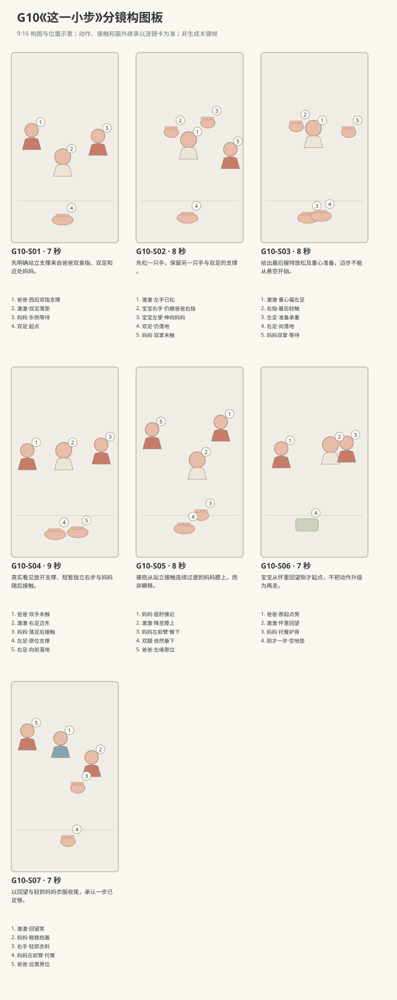

图示为构图位置示意；姿态、接触和画外继承以逐镜正文为准。

### 逐镜设计

#### G10-S01｜00—07 秒｜7 秒｜帧 [0, 168)

**镜头任务：**先明确站立支撑来自爸爸双食指、双足和近处妈妈。

**景别、机位与构图：**全身三人中景，南侧35厘米向北，爸爸左、宝宝中间面右、妈妈右；双手握点与双脚不裁切，三人间距清楚。

**摄影机与理由：**固定机位，让动作本身改变画面；不推拉遮盖接触。

**焦点：**焦点覆盖澈澈的眼睛、行动手与目标物；关键接触始终可辨。

**入态：**宝宝双足平踩地垫，右手握爸爸右食指、左手握爸爸左食指；爸爸跪坐西后，妈妈一步外东侧跪坐，空双掌在前。

**动作与表演：**

- 3 秒：爸爸保持双指高度稳定，身体没有向前推；妈妈看宝宝，掌心开放。

- 4 秒：宝宝看妈妈，再低头看看双脚，身体轻晃由握指和双足共同支撑。

**声音：**无对白、无音乐；西窗外极轻鸟声作底，前景保留连体衣摩擦与婴儿呼吸，动作触碰同步发声。

**出态：**宝宝仍双握双足支撑，视线回到妈妈，母亲双手尚离身体。

**切点与承接：**沿宝宝朝妈妈看的眼线切近支撑释放，空间方向不换。

**连续性：**全画明确三人位置、双指握点及双足接地；没有道具或未交代支撑。

**开始画面母稿：**

9:16竖幅，原创圆润三维生活动画，柔软棉布与自然皮肤质感，生活物理，无文字标语。澈澈深棕眼、短黑绒发、额前一撮向右弯，奶油色棉连体衣；身体按本条能力阶段呈现，表情与动作保留婴儿的专注和不熟练。 澈澈为R3能短暂放开支撑迈一步的故事能力阶段；爸爸短黑发砖陶上衣深灰裤，妈妈低马尾雾蓝上衣米色裤。 白天客厅西窗提供柔和漫射主光，暖墙反射补光；北墙固定沙发，东侧走廊，中央奶油地垫。 全身三人中景，南侧35厘米向北，爸爸左、宝宝中间面右、妈妈右；双手握点与双脚不裁切，三人间距清楚。 单一开始瞬间：宝宝双足平踩地垫，右手握爸爸右食指、左手握爸爸左食指；爸爸跪坐西后，妈妈一步外东侧跪坐，空双掌在前。 画面清楚呈现起态中已存在的支撑、视线与道具归属；不把后续动作叠画。

**视频变化母稿：**

9:16竖幅，原创圆润三维生活动画，柔软棉布与自然皮肤质感，生活物理，无文字标语。澈澈深棕眼、短黑绒发、额前一撮向右弯，奶油色棉连体衣；身体按本条能力阶段呈现，表情与动作保留婴儿的专注和不熟练。 澈澈为R3能短暂放开支撑迈一步的故事能力阶段；爸爸短黑发砖陶上衣深灰裤，妈妈低马尾雾蓝上衣米色裤。 白天客厅西窗提供柔和漫射主光，暖墙反射补光；北墙固定沙发，东侧走廊，中央奶油地垫。 本镜7秒，全身三人中景，南侧35厘米向北，爸爸左、宝宝中间面右、妈妈右；双手握点与双脚不裁切，三人间距清楚。 起态：宝宝双足平踩地垫，右手握爸爸右食指、左手握爸爸左食指；爸爸跪坐西后，妈妈一步外东侧跪坐，空双掌在前。 阶段1，持续3秒：爸爸保持双指高度稳定，身体没有向前推；妈妈看宝宝，掌心开放。 阶段2，持续4秒：宝宝看妈妈，再低头看看双脚，身体轻晃由握指和双足共同支撑。 摄影：固定机位，让动作本身改变画面；不推拉遮盖接触。 焦点：焦点覆盖澈澈的眼睛、行动手与目标物；关键接触始终可辨。 声音：无对白、无音乐；西窗外极轻鸟声作底，前景保留连体衣摩擦与婴儿呼吸，动作触碰同步发声。 终态：宝宝仍双握双足支撑，视线回到妈妈，母亲双手尚离身体。 连续性：全画明确三人位置、双指握点及双足接地；没有道具或未交代支撑。

#### G10-S02｜07—15 秒｜8 秒｜帧 [168, 360)

**镜头任务：**先松一只手，保留另一只手与双足的支撑。

**景别、机位与构图：**全身中近景，南侧35厘米，爸爸半身画左、宝宝中间、妈妈双掌画右；宝宝左右手、足底均可见。

**摄影机与理由：**固定机位，让动作本身改变画面；不推拉遮盖接触。

**焦点：**焦点覆盖澈澈的眼睛、行动手与目标物；关键接触始终可辨。

**入态：**宝宝两手仍握爸爸对应食指，妈妈双手开放在一步外，宝宝看妈妈。

**动作与表演：**

- 3 秒：宝宝左指慢慢张开，离开爸爸左食指，左掌朝妈妈伸去。

- 3 秒：爸爸空出的左手停在宝宝侧后、不触背；宝宝右手仍握爸爸右食指，双足留地。

- 2 秒：宝宝停住，看看伸出去的左掌，再看妈妈。

**声音：**无对白、无音乐；西窗外极轻鸟声作底，前景保留连体衣摩擦与婴儿呼吸，动作触碰同步发声。

**出态：**宝宝左掌空着伸向东，右手仍握爸爸右食指，双足不挪，爸爸左手空。

**切点与承接：**保留左掌伸出的方向，下一镜清楚看到最后右握怎样释放。

**连续性：**右握始终在画内，爸爸左手未换成背后托力；妈妈未触宝宝左掌。

**开始画面母稿：**

9:16竖幅，原创圆润三维生活动画，柔软棉布与自然皮肤质感，生活物理，无文字标语。澈澈深棕眼、短黑绒发、额前一撮向右弯，奶油色棉连体衣；身体按本条能力阶段呈现，表情与动作保留婴儿的专注和不熟练。 澈澈为R3能短暂放开支撑迈一步的故事能力阶段；爸爸短黑发砖陶上衣深灰裤，妈妈低马尾雾蓝上衣米色裤。 白天客厅西窗提供柔和漫射主光，暖墙反射补光；北墙固定沙发，东侧走廊，中央奶油地垫。 全身中近景，南侧35厘米，爸爸半身画左、宝宝中间、妈妈双掌画右；宝宝左右手、足底均可见。 单一开始瞬间：宝宝两手仍握爸爸对应食指，妈妈双手开放在一步外，宝宝看妈妈。 画面清楚呈现起态中已存在的支撑、视线与道具归属；不把后续动作叠画。

**视频变化母稿：**

9:16竖幅，原创圆润三维生活动画，柔软棉布与自然皮肤质感，生活物理，无文字标语。澈澈深棕眼、短黑绒发、额前一撮向右弯，奶油色棉连体衣；身体按本条能力阶段呈现，表情与动作保留婴儿的专注和不熟练。 澈澈为R3能短暂放开支撑迈一步的故事能力阶段；爸爸短黑发砖陶上衣深灰裤，妈妈低马尾雾蓝上衣米色裤。 白天客厅西窗提供柔和漫射主光，暖墙反射补光；北墙固定沙发，东侧走廊，中央奶油地垫。 本镜8秒，全身中近景，南侧35厘米，爸爸半身画左、宝宝中间、妈妈双掌画右；宝宝左右手、足底均可见。 起态：宝宝两手仍握爸爸对应食指，妈妈双手开放在一步外，宝宝看妈妈。 阶段1，持续3秒：宝宝左指慢慢张开，离开爸爸左食指，左掌朝妈妈伸去。 阶段2，持续3秒：爸爸空出的左手停在宝宝侧后、不触背；宝宝右手仍握爸爸右食指，双足留地。 阶段3，持续2秒：宝宝停住，看看伸出去的左掌，再看妈妈。 摄影：固定机位，让动作本身改变画面；不推拉遮盖接触。 焦点：焦点覆盖澈澈的眼睛、行动手与目标物；关键接触始终可辨。 声音：无对白、无音乐；西窗外极轻鸟声作底，前景保留连体衣摩擦与婴儿呼吸，动作触碰同步发声。 终态：宝宝左掌空着伸向东，右手仍握爸爸右食指，双足不挪，爸爸左手空。 连续性：右握始终在画内，爸爸左手未换成背后托力；妈妈未触宝宝左掌。

#### G10-S03｜15—23 秒｜8 秒｜帧 [360, 552)

**镜头任务：**给出最后握持放松及重心准备，迈步不能从悬空开始。

**景别、机位与构图：**全身侧面近景，南侧30厘米，宝宝居中面东、爸爸双手左缘、妈妈双掌右缘，双足及裤腿清楚。

**摄影机与理由：**固定机位，让动作本身改变画面；不推拉遮盖接触。

**焦点：**较深景深覆盖最后右指触点与双足，不能只聚焦表情。

**入态：**宝宝左掌伸向妈妈，右手握爸爸右食指，双脚踩实，身体略朝东。

**动作与表演：**

- 3 秒：宝宝轻轻弯膝再回到自然站高，把身体重量更多留在左脚，右脚仍接垫。

- 3 秒：右手指逐渐放松，爸爸右食指保持原位不抽走，妈妈双掌仍在前方等待。

- 2 秒：右手只剩指腹轻触爸爸食指，左掌向前，宝宝吸一小口气。

**声音：**无对白、无音乐；西窗外极轻鸟声作底，前景保留连体衣摩擦与婴儿呼吸，动作触碰同步发声。

**出态：**右指将松未松、双足仍落垫，重心偏左足，妈妈爸爸都没有移动躯干。

**切点与承接：**在最后接触尚存在时切同轴全身主镜，下一镜从这一指腹接触开始，不能省略脱离瞬间。

**连续性：**右足没有在有握持时先大步跨出；爸爸食指不拉人，妈妈双掌与衣服间有清楚空隙。

**开始画面母稿：**

9:16竖幅，原创圆润三维生活动画，柔软棉布与自然皮肤质感，生活物理，无文字标语。澈澈深棕眼、短黑绒发、额前一撮向右弯，奶油色棉连体衣；身体按本条能力阶段呈现，表情与动作保留婴儿的专注和不熟练。 澈澈为R3能短暂放开支撑迈一步的故事能力阶段；爸爸短黑发砖陶上衣深灰裤，妈妈低马尾雾蓝上衣米色裤。 白天客厅西窗提供柔和漫射主光，暖墙反射补光；北墙固定沙发，东侧走廊，中央奶油地垫。 全身侧面近景，南侧30厘米，宝宝居中面东、爸爸双手左缘、妈妈双掌右缘，双足及裤腿清楚。 单一开始瞬间：宝宝左掌伸向妈妈，右手握爸爸右食指，双脚踩实，身体略朝东。 画面清楚呈现起态中已存在的支撑、视线与道具归属；不把后续动作叠画。

**视频变化母稿：**

9:16竖幅，原创圆润三维生活动画，柔软棉布与自然皮肤质感，生活物理，无文字标语。澈澈深棕眼、短黑绒发、额前一撮向右弯，奶油色棉连体衣；身体按本条能力阶段呈现，表情与动作保留婴儿的专注和不熟练。 澈澈为R3能短暂放开支撑迈一步的故事能力阶段；爸爸短黑发砖陶上衣深灰裤，妈妈低马尾雾蓝上衣米色裤。 白天客厅西窗提供柔和漫射主光，暖墙反射补光；北墙固定沙发，东侧走廊，中央奶油地垫。 本镜8秒，全身侧面近景，南侧30厘米，宝宝居中面东、爸爸双手左缘、妈妈双掌右缘，双足及裤腿清楚。 起态：宝宝左掌伸向妈妈，右手握爸爸右食指，双脚踩实，身体略朝东。 阶段1，持续3秒：宝宝轻轻弯膝再回到自然站高，把身体重量更多留在左脚，右脚仍接垫。 阶段2，持续3秒：右手指逐渐放松，爸爸右食指保持原位不抽走，妈妈双掌仍在前方等待。 阶段3，持续2秒：右手只剩指腹轻触爸爸食指，左掌向前，宝宝吸一小口气。 摄影：固定机位，让动作本身改变画面；不推拉遮盖接触。 焦点：较深景深覆盖最后右指触点与双足，不能只聚焦表情。 声音：无对白、无音乐；西窗外极轻鸟声作底，前景保留连体衣摩擦与婴儿呼吸，动作触碰同步发声。 终态：右指将松未松、双足仍落垫，重心偏左足，妈妈爸爸都没有移动躯干。 连续性：右足没有在有握持时先大步跨出；爸爸食指不拉人，妈妈双掌与衣服间有清楚空隙。

#### G10-S04｜23—32 秒｜9 秒｜帧 [552, 768)

**镜头任务：**真实看见放开支撑、短暂独立右步与妈妈随后接触。

**景别、机位与构图：**全身动作主镜，南侧35厘米固定，爸爸双空手/宝宝全身/妈妈双掌都留画；不裁足、不切近、不慢镜掩盖。

**摄影机与理由：**固定机位，让动作本身改变画面；不推拉遮盖接触。

**焦点：**全身与两侧成人手保持同一可辨景深，特别保留脚底、最后握点脱离与接抱间隙。

**入态：**宝宝右指腹还轻触爸爸右食指，左掌已伸东，双足落垫，重心偏左足；妈妈双掌等待未触。

**动作与表演：**

- 2 秒：宝宝右指完全张开离开爸爸食指，两手向妈妈；爸爸双手留侧后近旁但均未触，宝宝左足承重。

- 3 秒：宝宝右足抬离垫一小段，右膝自然前送，短短迈向东侧妈妈，左足仍在起点承担重量。

- 4 秒：右足脚底落回地垫，身体随这一步前移；妈妈随后才用双掌轻稳躯干两侧，宝宝身体靠近她，爸爸双手仍空。

**声音：**无对白无音乐；第1—2秒右指离开轻衣擦、宝宝吸气；第3—5秒左足压垫轻响，第6秒附近右足落垫一声轻触，随后妈妈衣袖接近与宝宝呼气。

**出态：**宝宝右足在前左足在后均接垫，妈妈双掌已稳住躯干，爸爸在西后方双手未触。

**切点与承接：**右足落地和成人接触的先后都成立后再切接抱，不在空中切走。

**连续性：**独立窗口内双方成人与宝宝有空隙；只一步、无后推、无右脚滑行，衣裤腿和裸足对应连续。

**开始画面母稿：**

9:16竖幅，原创圆润三维生活动画，柔软棉布与自然皮肤质感，生活物理，无文字标语。澈澈深棕眼、短黑绒发、额前一撮向右弯，奶油色棉连体衣；身体按本条能力阶段呈现，表情与动作保留婴儿的专注和不熟练。 澈澈为R3能短暂放开支撑迈一步的故事能力阶段；爸爸短黑发砖陶上衣深灰裤，妈妈低马尾雾蓝上衣米色裤。 白天客厅西窗提供柔和漫射主光，暖墙反射补光；北墙固定沙发，东侧走廊，中央奶油地垫。 全身动作主镜起点，南侧35厘米高固定；爸爸画左、宝宝全身居中面东、妈妈双掌在右；宝宝右指腹仍轻触爸爸右食指，左掌已伸东，双足接垫，不裁足。 单一开始瞬间：宝宝右指腹还轻触爸爸右食指，左掌已伸东，双足落垫，重心偏左足；妈妈双掌等待未触。 本图焦点固定在：最后尚存的右指腹接触、左足负重与未离垫的右足，妈妈双掌与身体间的空隙。 仅呈现这一瞬间的身体支撑、视线与物件归属，不把未来阶段或相机路径叠画。

**视频变化母稿：**

9:16竖幅，原创圆润三维生活动画，柔软棉布与自然皮肤质感，生活物理，无文字标语。澈澈深棕眼、短黑绒发、额前一撮向右弯，奶油色棉连体衣；身体按本条能力阶段呈现，表情与动作保留婴儿的专注和不熟练。 澈澈为R3能短暂放开支撑迈一步的故事能力阶段；爸爸短黑发砖陶上衣深灰裤，妈妈低马尾雾蓝上衣米色裤。 白天客厅西窗提供柔和漫射主光，暖墙反射补光；北墙固定沙发，东侧走廊，中央奶油地垫。 本镜9秒，全身动作主镜，南侧35厘米固定，爸爸双空手/宝宝全身/妈妈双掌都留画；不裁足、不切近、不慢镜掩盖。 起态：宝宝右指腹还轻触爸爸右食指，左掌已伸东，双足落垫，重心偏左足；妈妈双掌等待未触。 阶段1，持续2秒：宝宝右指完全张开离开爸爸食指，两手向妈妈；爸爸双手留侧后近旁但均未触，宝宝左足承重。 阶段2，持续3秒：宝宝右足抬离垫一小段，右膝自然前送，短短迈向东侧妈妈，左足仍在起点承担重量。 阶段3，持续4秒：右足脚底落回地垫，身体随这一步前移；妈妈随后才用双掌轻稳躯干两侧，宝宝身体靠近她，爸爸双手仍空。 摄影：固定机位，让动作本身改变画面；不推拉遮盖接触。 焦点：全身与两侧成人手保持同一可辨景深，特别保留脚底、最后握点脱离与接抱间隙。 声音：无对白无音乐；第1—2秒右指离开轻衣擦、宝宝吸气；第3—5秒左足压垫轻响，第6秒附近右足落垫一声轻触，随后妈妈衣袖接近与宝宝呼气。 终态：宝宝右足在前左足在后均接垫，妈妈双掌已稳住躯干，爸爸在西后方双手未触。 连续性：独立窗口内双方成人与宝宝有空隙；只一步、无后推、无右脚滑行，衣裤腿和裸足对应连续。

#### G10-S05｜32—40 秒｜8 秒｜帧 [768, 960)

**镜头任务：**接抱从站立接触连续过渡到妈妈膝上，而非瞬移。

**景别、机位与构图：**全身双人中近景，南侧30厘米，宝宝在中右、妈妈右，爸爸空手留左缘；妈妈膝面与宝宝臀部、双足可见。

**摄影机与理由：**固定机位，让动作本身改变画面；不推拉遮盖接触。

**焦点：**优先让妈妈双掌、宝宝臀部落膝与腿脚受力转换清楚，再顾脸部。

**入态：**宝宝右足前左足后仍接垫，妈妈双掌稳住宝宝躯干两侧，自己跪坐在脚跟上。

**动作与表演：**

- 3 秒：妈妈屈肘把宝宝稳稳收近，宝宝两掌碰到她胸前衣料；双足随身体靠近作小幅受控位置调整，不再独立跨步。

- 2 秒：妈妈保持双掌托稳躯干，缓缓降低宝宝到自己膝面，宝宝屈膝，臀部落到并拢的双膝上。

- 3 秒：臀部已有膝面支撑后，妈妈左前臂移到臀下、右掌留背，稳托着把宝宝缓慢转成胸口朝南偏西的侧坐，双腿随整体自然垂在膝前；全过程臀背都有承托。

**声音：**无对白、无音乐；西窗外极轻鸟声作底，前景保留连体衣摩擦与婴儿呼吸，动作触碰同步发声。

**出态：**宝宝在妈妈膝上侧坐、胸口朝南偏西，臀部由膝面和左前臂支撑，右掌护背，双腿垂在膝前；爸爸仍在原地。

**切点与承接：**接抱链完成再切宝宝回望，保持臀部承托与背部手的位置。

**连续性：**妈妈不是先把宝宝吊离地；双掌稳躯干到臀部落膝后才换左前臂，脚离垫时已有明确膝面承托。

**开始画面母稿：**

9:16竖幅，原创圆润三维生活动画，柔软棉布与自然皮肤质感，生活物理，无文字标语。澈澈深棕眼、短黑绒发、额前一撮向右弯，奶油色棉连体衣；身体按本条能力阶段呈现，表情与动作保留婴儿的专注和不熟练。 澈澈为R3能短暂放开支撑迈一步的故事能力阶段；爸爸短黑发砖陶上衣深灰裤，妈妈低马尾雾蓝上衣米色裤。 白天客厅西窗提供柔和漫射主光，暖墙反射补光；北墙固定沙发，东侧走廊，中央奶油地垫。 全身双人中近景，南侧30厘米，宝宝在中右、妈妈右，爸爸空手留左缘；妈妈膝面与宝宝臀部、双足可见。 单一开始瞬间：宝宝右足前左足后仍接垫，妈妈双掌稳住宝宝躯干两侧，自己跪坐在脚跟上。 画面清楚呈现起态中已存在的支撑、视线与道具归属；不把后续动作叠画。

**视频变化母稿：**

9:16竖幅，原创圆润三维生活动画，柔软棉布与自然皮肤质感，生活物理，无文字标语。澈澈深棕眼、短黑绒发、额前一撮向右弯，奶油色棉连体衣；身体按本条能力阶段呈现，表情与动作保留婴儿的专注和不熟练。 澈澈为R3能短暂放开支撑迈一步的故事能力阶段；爸爸短黑发砖陶上衣深灰裤，妈妈低马尾雾蓝上衣米色裤。 白天客厅西窗提供柔和漫射主光，暖墙反射补光；北墙固定沙发，东侧走廊，中央奶油地垫。 本镜8秒，全身双人中近景，南侧30厘米，宝宝在中右、妈妈右，爸爸空手留左缘；妈妈膝面与宝宝臀部、双足可见。 起态：宝宝右足前左足后仍接垫，妈妈双掌稳住宝宝躯干两侧，自己跪坐在脚跟上。 阶段1，持续3秒：妈妈屈肘把宝宝稳稳收近，宝宝两掌碰到她胸前衣料；双足随身体靠近作小幅受控位置调整，不再独立跨步。 阶段2，持续2秒：妈妈保持双掌托稳躯干，缓缓降低宝宝到自己膝面，宝宝屈膝，臀部落到并拢的双膝上。 阶段3，持续3秒：臀部已有膝面支撑后，妈妈左前臂移到臀下、右掌留背，稳托着把宝宝缓慢转成胸口朝南偏西的侧坐，双腿随整体自然垂在膝前；全过程臀背都有承托。 摄影：固定机位，让动作本身改变画面；不推拉遮盖接触。 焦点：优先让妈妈双掌、宝宝臀部落膝与腿脚受力转换清楚，再顾脸部。 声音：无对白、无音乐；西窗外极轻鸟声作底，前景保留连体衣摩擦与婴儿呼吸，动作触碰同步发声。 终态：宝宝在妈妈膝上侧坐、胸口朝南偏西，臀部由膝面和左前臂支撑，右掌护背，双腿垂在膝前；爸爸仍在原地。 连续性：妈妈不是先把宝宝吊离地；双掌稳躯干到臀部落膝后才换左前臂，脚离垫时已有明确膝面承托。

#### G10-S06｜40—47 秒｜7 秒｜帧 [960, 1128)

**镜头任务：**宝宝从怀里回望刚才起点，不把动作升级为再走。

**景别、机位与构图：**三人中景，南侧35厘米，妈妈抱宝宝在右，爸爸原位左，中间空出刚才一步的地垫；母婴身体承托可见。

**摄影机与理由：**固定机位，让动作本身改变画面；不推拉遮盖接触。

**焦点：**焦点覆盖澈澈的眼睛、行动手与目标物；关键接触始终可辨。

**入态：**宝宝在妈妈膝上侧坐，胸口已朝南偏西，妈妈左前臂托臀、右掌护背，宝宝眼睛还看她胸前衣料。

**动作与表演：**

- 2 秒：宝宝靠着妈妈呼出小气，双手轻放她胸前。

- 3 秒：他先转眼，再小幅转脸看西侧爸爸，妈妈躯干保持侧向让他无需拧颈到背后。

- 2 秒：爸爸留原位坐低，看看宝宝再看刚才的起点，轻轻笑。

**声音：**无对白、无音乐；西窗外极轻鸟声作底，前景保留连体衣摩擦与婴儿呼吸，动作触碰同步发声。

**出态：**宝宝在有承托的怀里看向爸爸和原站位，爸爸仍坐西侧，妈妈手位不变。

**切点与承接：**沿宝宝视线切近母婴与远处爸爸，结尾只回应不重来。

**连续性：**宝宝躯干随坐膝姿朝西南，回看幅度自然；父母位置未换，双腿无新增迈步。

**开始画面母稿：**

9:16竖幅，原创圆润三维生活动画，柔软棉布与自然皮肤质感，生活物理，无文字标语。澈澈深棕眼、短黑绒发、额前一撮向右弯，奶油色棉连体衣；身体按本条能力阶段呈现，表情与动作保留婴儿的专注和不熟练。 澈澈为R3能短暂放开支撑迈一步的故事能力阶段；爸爸短黑发砖陶上衣深灰裤，妈妈低马尾雾蓝上衣米色裤。 白天客厅西窗提供柔和漫射主光，暖墙反射补光；北墙固定沙发，东侧走廊，中央奶油地垫。 三人中景，南侧35厘米，妈妈抱宝宝在右，爸爸原位左，中间空出刚才一步的地垫；母婴身体承托可见。 单一开始瞬间：宝宝在妈妈膝上侧坐，胸口已朝南偏西，妈妈左前臂托臀、右掌护背，宝宝眼睛还看她胸前衣料。 画面清楚呈现起态中已存在的支撑、视线与道具归属；不把后续动作叠画。

**视频变化母稿：**

9:16竖幅，原创圆润三维生活动画，柔软棉布与自然皮肤质感，生活物理，无文字标语。澈澈深棕眼、短黑绒发、额前一撮向右弯，奶油色棉连体衣；身体按本条能力阶段呈现，表情与动作保留婴儿的专注和不熟练。 澈澈为R3能短暂放开支撑迈一步的故事能力阶段；爸爸短黑发砖陶上衣深灰裤，妈妈低马尾雾蓝上衣米色裤。 白天客厅西窗提供柔和漫射主光，暖墙反射补光；北墙固定沙发，东侧走廊，中央奶油地垫。 本镜7秒，三人中景，南侧35厘米，妈妈抱宝宝在右，爸爸原位左，中间空出刚才一步的地垫；母婴身体承托可见。 起态：宝宝在妈妈膝上侧坐，胸口已朝南偏西，妈妈左前臂托臀、右掌护背，宝宝眼睛还看她胸前衣料。 阶段1，持续2秒：宝宝靠着妈妈呼出小气，双手轻放她胸前。 阶段2，持续3秒：他先转眼，再小幅转脸看西侧爸爸，妈妈躯干保持侧向让他无需拧颈到背后。 阶段3，持续2秒：爸爸留原位坐低，看看宝宝再看刚才的起点，轻轻笑。 摄影：固定机位，让动作本身改变画面；不推拉遮盖接触。 焦点：焦点覆盖澈澈的眼睛、行动手与目标物；关键接触始终可辨。 声音：无对白、无音乐；西窗外极轻鸟声作底，前景保留连体衣摩擦与婴儿呼吸，动作触碰同步发声。 终态：宝宝在有承托的怀里看向爸爸和原站位，爸爸仍坐西侧，妈妈手位不变。 连续性：宝宝躯干随坐膝姿朝西南，回看幅度自然；父母位置未换，双腿无新增迈步。

#### G10-S07｜47—54 秒｜7 秒｜帧 [1128, 1296)

**镜头任务：**以回望与轻抓妈妈衣服收尾，承认一步已足够。

**景别、机位与构图：**母婴近景，南侧35厘米，宝宝脸居中向左看，妈妈右侧，左前臂托臀留在下缘，爸爸在左后景柔虚。

**摄影机与理由：**固定机位，让动作本身改变画面；不推拉遮盖接触。

**焦点：**焦点覆盖澈澈的眼睛、行动手与目标物；关键接触始终可辨。

**入态：**宝宝坐妈妈膝上看西侧爸爸，妈妈左前臂托臀、右掌护背，宝宝双掌贴她胸前衣料。

**动作与表演：**

- 3 秒：宝宝看着爸爸笑一下，爸爸不伸手要求再走，只留在原处回应笑。

- 2 秒：宝宝右指轻轻抓住妈妈胸前一小片雾蓝衣料，身体靠回她怀里。

- 2 秒：妈妈右掌在背上保持稳定，不拍打催促；宝宝呼吸落稳，视线仍留爸爸方向。

**声音：**无对白无音乐；宝宝极轻笑气、右指捏棉布的一点摩擦、稳定呼吸，爸爸只微笑不另配词。

**出态：**宝宝在妈妈膝上被稳稳承托，右手轻抓衣料、左掌贴胸，爸爸原位微笑。

**切点与承接：**留在一步之后的安定里结束，无台词、奖杯音或再走一次的追加。

**连续性：**妈妈左右手与臀背承托连续，宝宝右手抓的是衣料而不是成人手指；全片只完成一小步。

**开始画面母稿：**

9:16竖幅，原创圆润三维生活动画，柔软棉布与自然皮肤质感，生活物理，无文字标语。澈澈深棕眼、短黑绒发、额前一撮向右弯，奶油色棉连体衣；身体按本条能力阶段呈现，表情与动作保留婴儿的专注和不熟练。 澈澈为R3能短暂放开支撑迈一步的故事能力阶段；爸爸短黑发砖陶上衣深灰裤，妈妈低马尾雾蓝上衣米色裤。 白天客厅西窗提供柔和漫射主光，暖墙反射补光；北墙固定沙发，东侧走廊，中央奶油地垫。 母婴近景，南侧35厘米，宝宝脸居中向左看，妈妈右侧，左前臂托臀留在下缘，爸爸在左后景柔虚。 单一开始瞬间：宝宝坐妈妈膝上看西侧爸爸，妈妈左前臂托臀、右掌护背，宝宝双掌贴她胸前衣料。 画面清楚呈现起态中已存在的支撑、视线与道具归属；不把后续动作叠画。

**视频变化母稿：**

9:16竖幅，原创圆润三维生活动画，柔软棉布与自然皮肤质感，生活物理，无文字标语。澈澈深棕眼、短黑绒发、额前一撮向右弯，奶油色棉连体衣；身体按本条能力阶段呈现，表情与动作保留婴儿的专注和不熟练。 澈澈为R3能短暂放开支撑迈一步的故事能力阶段；爸爸短黑发砖陶上衣深灰裤，妈妈低马尾雾蓝上衣米色裤。 白天客厅西窗提供柔和漫射主光，暖墙反射补光；北墙固定沙发，东侧走廊，中央奶油地垫。 本镜7秒，母婴近景，南侧35厘米，宝宝脸居中向左看，妈妈右侧，左前臂托臀留在下缘，爸爸在左后景柔虚。 起态：宝宝坐妈妈膝上看西侧爸爸，妈妈左前臂托臀、右掌护背，宝宝双掌贴她胸前衣料。 阶段1，持续3秒：宝宝看着爸爸笑一下，爸爸不伸手要求再走，只留在原处回应笑。 阶段2，持续2秒：宝宝右指轻轻抓住妈妈胸前一小片雾蓝衣料，身体靠回她怀里。 阶段3，持续2秒：妈妈右掌在背上保持稳定，不拍打催促；宝宝呼吸落稳，视线仍留爸爸方向。 摄影：固定机位，让动作本身改变画面；不推拉遮盖接触。 焦点：焦点覆盖澈澈的眼睛、行动手与目标物；关键接触始终可辨。 声音：无对白无音乐；宝宝极轻笑气、右指捏棉布的一点摩擦、稳定呼吸，爸爸只微笑不另配词。 终态：宝宝在妈妈膝上被稳稳承托，右手轻抓衣料、左掌贴胸，爸爸原位微笑。 连续性：妈妈左右手与臀背承托连续，宝宝右手抓的是衣料而不是成人手指；全片只完成一小步。

### 声音与剪辑

成人衣料与膝接垫的轻响、宝宝松握后小吸气、右足落垫的真实轻触、接抱后的呼气；不以脚步重击或胜利音乐放大动作，无口令对白。

正式台词：无；保留镜头声音中已写明的自然发声。

### 连续性与试片

- 连续性：最初宝宝右手握爸爸右食指、左手握爸爸左食指；先松左后松右，两处释放镜内可见。

- 连续性：独立一步向东，右足前迈、左足在原地承重；右足落地后妈妈双掌才接触，爸爸没有从后推。

- 连续性：妈妈接触先是双掌稳躯干，随后收近降低到膝上，左前臂承托臀部后右掌保持背部；不得瞬移到怀里。

- 连续性：父母始终在西/东两侧；近景不能抹掉双手是否接触的证据，主迈步全身镜不中断。

- 连续性：本条只迈这一小步，不把R3演成连续跑步、成人步幅或熟练转身走回。

- 试片：G10-S02到S04：左握释放、右握释放、短暂双方成人都未触、右足抬落四状态全部可见；成人推送、提前接住或跳切补成功则失败。

- 试片：G10-S04逐帧：左足承担迈步时重量、右腿连续并以短步落地，妈妈触躯干必须晚于右足落垫；漂浮、滑步、腿换位则失败。

- 试片：G10-S05：双掌稳定→身体收近降低→臀部落膝与左前臂承托→右手托背的接抱链成立；无承托抱起或瞬间切成坐怀则失败。

- 试片：G10-S06到S07：宝宝在妈妈怀里仅回望原起点，父母位置与宝宝双腿连续；把转头做成180度拧颈或再迈一步则失败。

**媒体待验证：**尚无媒体；此组最高接触风险，需先三维/骨骼预演双手释放、单足短暂承重和接抱，再审阅衣物、手指、脚趾及双方表情。

---

## G11《这样叫，也是爸爸》

**36 秒｜坐姿与手部互动｜角色：澈澈、妈妈、爸爸｜场景 L**

### 剧情正文

客厅里，澈澈坐在奶油色地垫中央，爸爸在西侧，妈妈坐在东侧陪他。妈妈等澈澈看向自己，轻轻问：“爸爸在哪儿？”澈澈先转动眼睛，再偏过脸，右手朝爸爸伸出去，食指略直，其余手指还松松蜷着。爸爸看见这只小手，才笑起来。澈澈把手收回腿上，又看看妈妈。妈妈这回换了家里已熟悉的称呼：“阿禾在哪儿？”家里平时也这样叫爸爸。澈澈停了片刻，仍把脸和右手转向同一位爸爸。爸爸没有换位置，笑意却比刚才更明显。妈妈顺着他的手看过去，轻声说：“还是爸爸呀。”澈澈看看两个大人的脸，右手慢慢放回腿上，也露出一点笑。

### 亲述来源与改编

原帖是家长自述，未独立核实。本片将生活机制改编为澈澈的原创故事。

- [RT05 · 换爸爸的名字再问，还是指同一个人](https://www.gzmama.com/thread-1457352-1-1.html)；作者自报年龄：原帖归在11—12个月记录；未给该日精确月龄。

- **采用的生活过程：**两次连续提问，先称爸爸、后换爸爸另一称呼，孩子两次都指向同一人。

- **采用的生活过程：**来源归在作者自报11—12个月分段，本片保留稳定坐姿，不倒算精确月龄。

- **本片原创改编：**角色换为澈澈家庭，房间方位、右手指认、爸爸等待及妈妈末句回应为原创。

- **本片原创改编：**“阿禾”及此前已熟悉这一昵称为可撤销剧情假设；它不是来源家庭或用户家庭的名字。

- **不作出的事实推断：**公开家长自述未独立核实；原文未记宝宝发声、具体手位或成人即时表情。

- **不作出的事实推断：**不称两称呼指认是所有11—12个月孩子应有能力，不把其他家庭反应并作原事件。

[查看原始过程与缺项](research/real-experiences/index.html#RT05)

### 导演与空间

**观察任务：**用两种熟悉称呼与两次相同指向，呈现宝宝对家人的认认与成人的意外；不让宝宝代替指认说完整句。

**空间与光位：**澈澈中央面南稳坐，妈妈东侧偏南坐地、画右；爸爸西侧偏北坐地、画左。妈妈与宝宝相距一前臂，爸爸在宝宝右前方看得见的位置。摄影机在南侧，右手指向西侧爸爸时画面向左，始终不镜像。北侧沙发为地理锚点；无手持道具。

**人物表演：**妈妈像日常聊天般问一次，等宝宝看清再问第二次，不连续催答。澈澈先转眼再随头肩小幅转向爸爸，伸右手指认，手型保留幼儿不熟练；爸爸不抢先招手提示，不用夸张装傻制造误导。

### 节拍覆盖

- **G11-b1**：前态：澈澈稳坐中央，双掌搭腿、目光在爸爸一侧；妈妈双掌在膝，爸爸双掌松放膝上。 过程：妈妈稍偏身等候，没有招手；澈澈把目光转到妈妈脸上。妈妈与澈澈相看，爸爸安静留在西侧，不指自己。 后态：宝宝已经看妈妈，三人手部均未指认。 观众观察：建立两个称呼将指向的同一位爸爸及稳定空间。 → G11-S01

- **G11-b2**：前态：澈澈双掌在腿上看妈妈，妈妈嘴合着、空双手在膝。 过程：妈妈面向宝宝用自然普通话说：“爸爸在哪儿？”嘴唇随问句开合，手仍在膝上。问句落完，澈澈先向画左转眼，再小幅转头找爸爸；右掌开始离腿但尚未完整伸出。 后态：宝宝脸已朝爸爸，右手刚抬，妈妈停声等待。 观众观察：让第一声称呼成为宝宝寻找目标的明确触发。 → G11-S02

- **G11-b3**：前态：宝宝头朝西侧爸爸，右掌已离腿，妈妈和爸爸均停声且空手在膝。 过程：澈澈右臂向爸爸伸出，食指略伸直、其余指松蜷，目光落爸爸脸。爸爸确认自己被指到，才嘴角上扬；双掌仍留膝，不替宝宝指认。宝宝把右手收回腿上，脸和眼睛转回妈妈。 后态：宝宝右手已回腿、重新看妈妈；爸爸原位微笑。 观众观察：把第一轮指认读清，并为第二轮真正重置空手状态。 → G11-S03

- **G11-b4**：前态：澈澈双掌已回腿、看妈妈；妈妈准备问第二句，爸爸画外西侧微笑。 过程：妈妈自然问：“阿禾在哪儿？”说完收口；不再补充爸爸的提示。澈澈停听一会儿，眼睛再次移到画左，头跟过去；右手在腿上开始抬起。 后态：宝宝第二次朝向同一位爸爸，右手刚离腿，妈妈安静等。 观众观察：换称呼而保持问题对象和空间，留出倾听。 → G11-S04

- **G11-b5**：前态：宝宝脸朝爸爸、右掌刚离腿；爸爸仍西侧同一位置，妈妈看着宝宝。 过程：宝宝右臂再次向画左爸爸伸出，手型略笨拙但目标清楚；爸爸不提前动手。爸爸看向那只小手，笑意加深；妈妈顺着右手看向爸爸，宝宝维持短暂指认。 后态：第二次右手仍指爸爸，三人看见同一对象，爸爸没有接近或挪位。 观众观察：让第二轮落到同一人，笑点由相同指向成立。 → G11-S05

- **G11-b6**：前态：宝宝右手指着爸爸，妈妈已顺指向看过爸爸，爸爸微笑。 过程：妈妈看回宝宝，轻柔带笑说：“还是爸爸呀。”手仍在膝，嘴部自然发音。宝宝把右手慢慢放回腿上，看看妈妈再看爸爸，嘴角出现小笑；爸爸只陪看不加问句。 后态：宝宝双掌回腿、骨盆双腿接地，父母原位陪笑。 观众观察：把成人的会意与宝宝收手后的笑放在同一段。 → G11-S06

### 分镜构图板

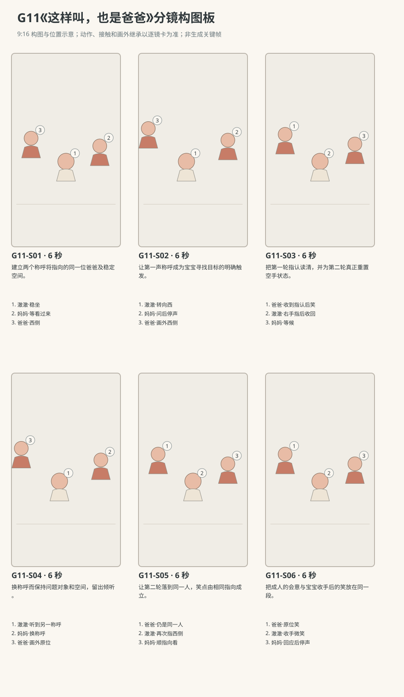

图示为构图位置示意；姿态、接触和画外继承以逐镜正文为准。

### 逐镜设计

#### G11-S01｜00—06 秒｜6 秒｜帧 [0, 144)

**镜头任务：**建立两个称呼将指向的同一位爸爸及稳定空间。

**景别、机位与构图：**三人中全景，南侧宝宝眼位略上；前景地垫，中景宝宝居中、妈妈画右、爸爸画左，后景北沙发。

**摄影机与理由：**固定南侧机位，让人物动作提供信息变化；不以推拉或切焦遮住接触。

**焦点：**保持本镜关键脸部与行动区域同时可读；不可见的画外状态只按连续性继承。

**入态：**澈澈稳坐中央，双掌搭腿、目光在爸爸一侧；妈妈双掌在膝，爸爸双掌松放膝上。

**动作与表演：**

- 3 秒：妈妈稍偏身等候，没有招手；澈澈把目光转到妈妈脸上。

- 3 秒：妈妈与澈澈相看，爸爸安静留在西侧，不指自己。

**声音：**无对白、无音乐；连续轻微室内底声，保留呼吸与衣料声；不添加解释旁白或笑声音效。

**出态：**宝宝已经看妈妈，三人手部均未指认。

**切点与承接：**切同侧共享中景，保留问话者嘴和宝宝的转头空间。

**连续性：**双腿骨盆落垫可见；无道具，不新增第四人。

**开始画面母稿：**

9:16竖幅，原创圆润三维生活动画，柔软棉布与自然皮肤质感，生活物理，无文字标语、无字幕。 澈澈深棕眼、短黑绒发、额前一撮向右弯，奶油色棉连体衣；外貌衣着为沿用母稿的可撤销暂拟，实际参考尚未绑定。 澈澈为R1稳定坐姿并能以手指认熟悉家人的阶段；不以精确月龄作普遍发展标准。 妈妈深棕短发、雾绿棉衬衫、深灰长裤；爸爸短黑发、砖陶衬衫、深灰长裤；外貌衣着为可撤销暂拟。 白天客厅西窗提供柔和漫射主光，暖墙反射补光；北墙固定沙发，东侧走廊，中央奶油地垫。 三人中全景，南侧宝宝眼位略上；前景地垫，中景宝宝居中、妈妈画右、爸爸画左，后景北沙发。 单一开始瞬间：澈澈稳坐中央，双掌搭腿、目光在爸爸一侧；妈妈双掌在膝，爸爸双掌松放膝上。  只画此刻的姿态、视线与道具归属，不把后续动作叠画。

**视频变化母稿：**

9:16竖幅，原创圆润三维生活动画，柔软棉布与自然皮肤质感，生活物理，无文字标语、无字幕。 澈澈深棕眼、短黑绒发、额前一撮向右弯，奶油色棉连体衣；外貌衣着为沿用母稿的可撤销暂拟，实际参考尚未绑定。 澈澈为R1稳定坐姿并能以手指认熟悉家人的阶段；不以精确月龄作普遍发展标准。 妈妈深棕短发、雾绿棉衬衫、深灰长裤；爸爸短黑发、砖陶衬衫、深灰长裤；外貌衣着为可撤销暂拟。 白天客厅西窗提供柔和漫射主光，暖墙反射补光；北墙固定沙发，东侧走廊，中央奶油地垫。 本镜6秒，三人中全景，南侧宝宝眼位略上；前景地垫，中景宝宝居中、妈妈画右、爸爸画左，后景北沙发。 起态：澈澈稳坐中央，双掌搭腿、目光在爸爸一侧；妈妈双掌在膝，爸爸双掌松放膝上。 阶段1，持续3秒：妈妈稍偏身等候，没有招手；澈澈把目光转到妈妈脸上。 阶段2，持续3秒：妈妈与澈澈相看，爸爸安静留在西侧，不指自己。 摄影：固定南侧机位，让人物动作提供信息变化；不以推拉或切焦遮住接触。 焦点：保持本镜关键脸部与行动区域同时可读；不可见的画外状态只按连续性继承。 声音：无对白、无音乐；连续轻微室内底声，保留呼吸与衣料声；不添加解释旁白或笑声音效。 终态：宝宝已经看妈妈，三人手部均未指认。 连续性：双腿骨盆落垫可见；无道具，不新增第四人。

#### G11-S02｜06—12 秒｜6 秒｜帧 [144, 288)

**镜头任务：**让第一声称呼成为宝宝寻找目标的明确触发。

**景别、机位与构图：**南侧双人中景，澈澈在画中偏左、妈妈在画右；爸爸西侧画外继承。

**摄影机与理由：**固定南侧机位，让人物动作提供信息变化；不以推拉或切焦遮住接触。

**焦点：**保持本镜关键脸部与行动区域同时可读；不可见的画外状态只按连续性继承。

**入态：**澈澈双掌在腿上看妈妈，妈妈嘴合着、空双手在膝。

**动作与表演：**

- 3 秒：妈妈面向宝宝用自然普通话说：“爸爸在哪儿？”嘴唇随问句开合，手仍在膝上。

- 3 秒：问句落完，澈澈先向画左转眼，再小幅转头找爸爸；右掌开始离腿但尚未完整伸出。

**声音：**妈妈{爸爸在哪儿？}，第1—3秒问完；之后无对白，保留宝宝呼吸，无音乐。

**出态：**宝宝脸已朝爸爸，右手刚抬，妈妈停声等待。

**切点与承接：**继续这一抬手相位切三人同侧中景，不重播转头。

**连续性：**爸爸画外仍西侧原坐位且未提示；宝宝不是看镜头回答。

**开始画面母稿：**

9:16竖幅，原创圆润三维生活动画，柔软棉布与自然皮肤质感，生活物理，无文字标语、无字幕。 澈澈深棕眼、短黑绒发、额前一撮向右弯，奶油色棉连体衣；外貌衣着为沿用母稿的可撤销暂拟，实际参考尚未绑定。 澈澈为R1稳定坐姿并能以手指认熟悉家人的阶段；不以精确月龄作普遍发展标准。 妈妈深棕短发、雾绿棉衬衫、深灰长裤；爸爸短黑发、砖陶衬衫、深灰长裤；外貌衣着为可撤销暂拟。 白天客厅西窗提供柔和漫射主光，暖墙反射补光；北墙固定沙发，东侧走廊，中央奶油地垫。 南侧双人中景，澈澈在画中偏左、妈妈在画右；爸爸西侧画外继承。 单一开始瞬间：澈澈双掌在腿上看妈妈，妈妈嘴合着、空双手在膝。  只画此刻的姿态、视线与道具归属，不把后续动作叠画。

**视频变化母稿：**

9:16竖幅，原创圆润三维生活动画，柔软棉布与自然皮肤质感，生活物理，无文字标语、无字幕。 澈澈深棕眼、短黑绒发、额前一撮向右弯，奶油色棉连体衣；外貌衣着为沿用母稿的可撤销暂拟，实际参考尚未绑定。 澈澈为R1稳定坐姿并能以手指认熟悉家人的阶段；不以精确月龄作普遍发展标准。 妈妈深棕短发、雾绿棉衬衫、深灰长裤；爸爸短黑发、砖陶衬衫、深灰长裤；外貌衣着为可撤销暂拟。 白天客厅西窗提供柔和漫射主光，暖墙反射补光；北墙固定沙发，东侧走廊，中央奶油地垫。 本镜6秒，南侧双人中景，澈澈在画中偏左、妈妈在画右；爸爸西侧画外继承。 起态：澈澈双掌在腿上看妈妈，妈妈嘴合着、空双手在膝。 阶段1，持续3秒：妈妈面向宝宝用自然普通话说：“爸爸在哪儿？”嘴唇随问句开合，手仍在膝上。 阶段2，持续3秒：问句落完，澈澈先向画左转眼，再小幅转头找爸爸；右掌开始离腿但尚未完整伸出。 摄影：固定南侧机位，让人物动作提供信息变化；不以推拉或切焦遮住接触。 焦点：保持本镜关键脸部与行动区域同时可读；不可见的画外状态只按连续性继承。 声音：妈妈{爸爸在哪儿？}，第1—3秒问完；之后无对白，保留宝宝呼吸，无音乐。 终态：宝宝脸已朝爸爸，右手刚抬，妈妈停声等待。 连续性：爸爸画外仍西侧原坐位且未提示；宝宝不是看镜头回答。

#### G11-S03｜12—18 秒｜6 秒｜帧 [288, 432)

**镜头任务：**把第一轮指认读清，并为第二轮真正重置空手状态。

**景别、机位与构图：**南侧三人中景，爸爸画左、宝宝居中、妈妈画右；宝宝右臂与爸爸面部在可读范围。

**摄影机与理由：**固定南侧机位，让人物动作提供信息变化；不以推拉或切焦遮住接触。

**焦点：**保持本镜关键脸部与行动区域同时可读；不可见的画外状态只按连续性继承。

**入态：**宝宝头朝西侧爸爸，右掌已离腿，妈妈和爸爸均停声且空手在膝。

**动作与表演：**

- 2 秒：澈澈右臂向爸爸伸出，食指略伸直、其余指松蜷，目光落爸爸脸。

- 2 秒：爸爸确认自己被指到，才嘴角上扬；双掌仍留膝，不替宝宝指认。

- 2 秒：宝宝把右手收回腿上，脸和眼睛转回妈妈。

**声音：**无对白、无音乐；连续轻微室内底声，保留呼吸与衣料声；不添加解释旁白或笑声音效。

**出态：**宝宝右手已回腿、重新看妈妈；爸爸原位微笑。

**切点与承接：**以右手落腿与回看妈妈完成为出点，切第二次问句。

**连续性：**第一轮指认在镜内完成并收手，爸爸全程原位。

**开始画面母稿：**

9:16竖幅，原创圆润三维生活动画，柔软棉布与自然皮肤质感，生活物理，无文字标语、无字幕。 澈澈深棕眼、短黑绒发、额前一撮向右弯，奶油色棉连体衣；外貌衣着为沿用母稿的可撤销暂拟，实际参考尚未绑定。 澈澈为R1稳定坐姿并能以手指认熟悉家人的阶段；不以精确月龄作普遍发展标准。 妈妈深棕短发、雾绿棉衬衫、深灰长裤；爸爸短黑发、砖陶衬衫、深灰长裤；外貌衣着为可撤销暂拟。 白天客厅西窗提供柔和漫射主光，暖墙反射补光；北墙固定沙发，东侧走廊，中央奶油地垫。 南侧三人中景，爸爸画左、宝宝居中、妈妈画右；宝宝右臂与爸爸面部在可读范围。 单一开始瞬间：宝宝头朝西侧爸爸，右掌已离腿，妈妈和爸爸均停声且空手在膝。  只画此刻的姿态、视线与道具归属，不把后续动作叠画。

**视频变化母稿：**

9:16竖幅，原创圆润三维生活动画，柔软棉布与自然皮肤质感，生活物理，无文字标语、无字幕。 澈澈深棕眼、短黑绒发、额前一撮向右弯，奶油色棉连体衣；外貌衣着为沿用母稿的可撤销暂拟，实际参考尚未绑定。 澈澈为R1稳定坐姿并能以手指认熟悉家人的阶段；不以精确月龄作普遍发展标准。 妈妈深棕短发、雾绿棉衬衫、深灰长裤；爸爸短黑发、砖陶衬衫、深灰长裤；外貌衣着为可撤销暂拟。 白天客厅西窗提供柔和漫射主光，暖墙反射补光；北墙固定沙发，东侧走廊，中央奶油地垫。 本镜6秒，南侧三人中景，爸爸画左、宝宝居中、妈妈画右；宝宝右臂与爸爸面部在可读范围。 起态：宝宝头朝西侧爸爸，右掌已离腿，妈妈和爸爸均停声且空手在膝。 阶段1，持续2秒：澈澈右臂向爸爸伸出，食指略伸直、其余指松蜷，目光落爸爸脸。 阶段2，持续2秒：爸爸确认自己被指到，才嘴角上扬；双掌仍留膝，不替宝宝指认。 阶段3，持续2秒：宝宝把右手收回腿上，脸和眼睛转回妈妈。 摄影：固定南侧机位，让人物动作提供信息变化；不以推拉或切焦遮住接触。 焦点：保持本镜关键脸部与行动区域同时可读；不可见的画外状态只按连续性继承。 声音：无对白、无音乐；连续轻微室内底声，保留呼吸与衣料声；不添加解释旁白或笑声音效。 终态：宝宝右手已回腿、重新看妈妈；爸爸原位微笑。 连续性：第一轮指认在镜内完成并收手，爸爸全程原位。

#### G11-S04｜18—24 秒｜6 秒｜帧 [432, 576)

**镜头任务：**换称呼而保持问题对象和空间，留出倾听。

**景别、机位与构图：**南侧双人中景，澈澈在画中偏左、妈妈在画右，妈妈嘴部与宝宝脸、双掌可见；爸爸西侧画外。

**摄影机与理由：**固定南侧机位，让人物动作提供信息变化；不以推拉或切焦遮住接触。

**焦点：**保持本镜关键脸部与行动区域同时可读；不可见的画外状态只按连续性继承。

**入态：**澈澈双掌已回腿、看妈妈；妈妈准备问第二句，爸爸画外西侧微笑。

**动作与表演：**

- 3 秒：妈妈自然问：“阿禾在哪儿？”说完收口；不再补充爸爸的提示。

- 3 秒：澈澈停听一会儿，眼睛再次移到画左，头跟过去；右手在腿上开始抬起。

**声音：**妈妈{阿禾在哪儿？}，第1—3秒说完；之后无对白、无提示音、无音乐。

**出态：**宝宝第二次朝向同一位爸爸，右手刚离腿，妈妈安静等。

**切点与承接：**继续第二次抬手切共享三人中景。

**连续性：**“阿禾”是片外已熟悉的可替换昵称；爸爸并未趁画外换位。

**开始画面母稿：**

9:16竖幅，原创圆润三维生活动画，柔软棉布与自然皮肤质感，生活物理，无文字标语、无字幕。 澈澈深棕眼、短黑绒发、额前一撮向右弯，奶油色棉连体衣；外貌衣着为沿用母稿的可撤销暂拟，实际参考尚未绑定。 澈澈为R1稳定坐姿并能以手指认熟悉家人的阶段；不以精确月龄作普遍发展标准。 妈妈深棕短发、雾绿棉衬衫、深灰长裤；爸爸短黑发、砖陶衬衫、深灰长裤；外貌衣着为可撤销暂拟。 白天客厅西窗提供柔和漫射主光，暖墙反射补光；北墙固定沙发，东侧走廊，中央奶油地垫。 南侧双人中景，澈澈在画中偏左、妈妈在画右，妈妈嘴部与宝宝脸、双掌可见；爸爸西侧画外。 单一开始瞬间：澈澈双掌已回腿、看妈妈；妈妈准备问第二句，爸爸画外西侧微笑。  只画此刻的姿态、视线与道具归属，不把后续动作叠画。

**视频变化母稿：**

9:16竖幅，原创圆润三维生活动画，柔软棉布与自然皮肤质感，生活物理，无文字标语、无字幕。 澈澈深棕眼、短黑绒发、额前一撮向右弯，奶油色棉连体衣；外貌衣着为沿用母稿的可撤销暂拟，实际参考尚未绑定。 澈澈为R1稳定坐姿并能以手指认熟悉家人的阶段；不以精确月龄作普遍发展标准。 妈妈深棕短发、雾绿棉衬衫、深灰长裤；爸爸短黑发、砖陶衬衫、深灰长裤；外貌衣着为可撤销暂拟。 白天客厅西窗提供柔和漫射主光，暖墙反射补光；北墙固定沙发，东侧走廊，中央奶油地垫。 本镜6秒，南侧双人中景，澈澈在画中偏左、妈妈在画右，妈妈嘴部与宝宝脸、双掌可见；爸爸西侧画外。 起态：澈澈双掌已回腿、看妈妈；妈妈准备问第二句，爸爸画外西侧微笑。 阶段1，持续3秒：妈妈自然问：“阿禾在哪儿？”说完收口；不再补充爸爸的提示。 阶段2，持续3秒：澈澈停听一会儿，眼睛再次移到画左，头跟过去；右手在腿上开始抬起。 摄影：固定南侧机位，让人物动作提供信息变化；不以推拉或切焦遮住接触。 焦点：保持本镜关键脸部与行动区域同时可读；不可见的画外状态只按连续性继承。 声音：妈妈{阿禾在哪儿？}，第1—3秒说完；之后无对白、无提示音、无音乐。 终态：宝宝第二次朝向同一位爸爸，右手刚离腿，妈妈安静等。 连续性：“阿禾”是片外已熟悉的可替换昵称；爸爸并未趁画外换位。

#### G11-S05｜24—30 秒｜6 秒｜帧 [576, 720)

**镜头任务：**让第二轮落到同一人，笑点由相同指向成立。

**景别、机位与构图：**南侧三人中景，爸爸画左、澈澈居中、妈妈画右；前景无遮挡，右手去向和爸爸脸同框。

**摄影机与理由：**固定南侧机位，让人物动作提供信息变化；不以推拉或切焦遮住接触。

**焦点：**保持本镜关键脸部与行动区域同时可读；不可见的画外状态只按连续性继承。

**入态：**宝宝脸朝爸爸、右掌刚离腿；爸爸仍西侧同一位置，妈妈看着宝宝。

**动作与表演：**

- 3 秒：宝宝右臂再次向画左爸爸伸出，手型略笨拙但目标清楚；爸爸不提前动手。

- 3 秒：爸爸看向那只小手，笑意加深；妈妈顺着右手看向爸爸，宝宝维持短暂指认。

**声音：**无对白、无音乐；连续轻微室内底声，保留呼吸与衣料声；不添加解释旁白或笑声音效。

**出态：**第二次右手仍指爸爸，三人看见同一对象，爸爸没有接近或挪位。

**切点与承接：**指认成立后切同侧稍宽结尾，允许宝宝随后收手。

**连续性：**这次为第二轮新抬手；两轮目标均为西侧爸爸；这一轮重新抬手指认，不能把同一次抬手重复剪接。

**开始画面母稿：**

9:16竖幅，原创圆润三维生活动画，柔软棉布与自然皮肤质感，生活物理，无文字标语、无字幕。 澈澈深棕眼、短黑绒发、额前一撮向右弯，奶油色棉连体衣；外貌衣着为沿用母稿的可撤销暂拟，实际参考尚未绑定。 澈澈为R1稳定坐姿并能以手指认熟悉家人的阶段；不以精确月龄作普遍发展标准。 妈妈深棕短发、雾绿棉衬衫、深灰长裤；爸爸短黑发、砖陶衬衫、深灰长裤；外貌衣着为可撤销暂拟。 白天客厅西窗提供柔和漫射主光，暖墙反射补光；北墙固定沙发，东侧走廊，中央奶油地垫。 南侧三人中景，爸爸画左、澈澈居中、妈妈画右；前景无遮挡，右手去向和爸爸脸同框。 单一开始瞬间：宝宝脸朝爸爸、右掌刚离腿；爸爸仍西侧同一位置，妈妈看着宝宝。  只画此刻的姿态、视线与道具归属，不把后续动作叠画。

**视频变化母稿：**

9:16竖幅，原创圆润三维生活动画，柔软棉布与自然皮肤质感，生活物理，无文字标语、无字幕。 澈澈深棕眼、短黑绒发、额前一撮向右弯，奶油色棉连体衣；外貌衣着为沿用母稿的可撤销暂拟，实际参考尚未绑定。 澈澈为R1稳定坐姿并能以手指认熟悉家人的阶段；不以精确月龄作普遍发展标准。 妈妈深棕短发、雾绿棉衬衫、深灰长裤；爸爸短黑发、砖陶衬衫、深灰长裤；外貌衣着为可撤销暂拟。 白天客厅西窗提供柔和漫射主光，暖墙反射补光；北墙固定沙发，东侧走廊，中央奶油地垫。 本镜6秒，南侧三人中景，爸爸画左、澈澈居中、妈妈画右；前景无遮挡，右手去向和爸爸脸同框。 起态：宝宝脸朝爸爸、右掌刚离腿；爸爸仍西侧同一位置，妈妈看着宝宝。 阶段1，持续3秒：宝宝右臂再次向画左爸爸伸出，手型略笨拙但目标清楚；爸爸不提前动手。 阶段2，持续3秒：爸爸看向那只小手，笑意加深；妈妈顺着右手看向爸爸，宝宝维持短暂指认。 摄影：固定南侧机位，让人物动作提供信息变化；不以推拉或切焦遮住接触。 焦点：保持本镜关键脸部与行动区域同时可读；不可见的画外状态只按连续性继承。 声音：无对白、无音乐；连续轻微室内底声，保留呼吸与衣料声；不添加解释旁白或笑声音效。 终态：第二次右手仍指爸爸，三人看见同一对象，爸爸没有接近或挪位。 连续性：这次为第二轮新抬手；两轮目标均为西侧爸爸；这一轮重新抬手指认，不能把同一次抬手重复剪接。

#### G11-S06｜30—36 秒｜6 秒｜帧 [720, 864)

**镜头任务：**把成人的会意与宝宝收手后的笑放在同一段。

**景别、机位与构图：**南侧三人中景，妈妈嘴部和宝宝脸可见，西侧爸爸留画左；北沙发和垫边固定。

**摄影机与理由：**固定南侧机位，让人物动作提供信息变化；不以推拉或切焦遮住接触。

**焦点：**保持本镜关键脸部与行动区域同时可读；不可见的画外状态只按连续性继承。

**入态：**宝宝右手指着爸爸，妈妈已顺指向看过爸爸，爸爸微笑。

**动作与表演：**

- 3 秒：妈妈看回宝宝，轻柔带笑说：“还是爸爸呀。”手仍在膝，嘴部自然发音。

- 3 秒：宝宝把右手慢慢放回腿上，看看妈妈再看爸爸，嘴角出现小笑；爸爸只陪看不加问句。

**声音：**妈妈{还是爸爸呀。}，第1—3秒，随后停声；宝宝只轻气声，无音乐、无字幕。

**出态：**宝宝双掌回腿、骨盆双腿接地，父母原位陪笑。

**切点与承接：**停在宝宝的小笑与三人共同注意，不追加第三次测验。

**连续性：**指向解除在镜内发生；没有成人纠正手型或让宝宝说完整话。

**开始画面母稿：**

9:16竖幅，原创圆润三维生活动画，柔软棉布与自然皮肤质感，生活物理，无文字标语、无字幕。 澈澈深棕眼、短黑绒发、额前一撮向右弯，奶油色棉连体衣；外貌衣着为沿用母稿的可撤销暂拟，实际参考尚未绑定。 澈澈为R1稳定坐姿并能以手指认熟悉家人的阶段；不以精确月龄作普遍发展标准。 妈妈深棕短发、雾绿棉衬衫、深灰长裤；爸爸短黑发、砖陶衬衫、深灰长裤；外貌衣着为可撤销暂拟。 白天客厅西窗提供柔和漫射主光，暖墙反射补光；北墙固定沙发，东侧走廊，中央奶油地垫。 南侧三人中景，妈妈嘴部和宝宝脸可见，西侧爸爸留画左；北沙发和垫边固定。 单一开始瞬间：宝宝右手指着爸爸，妈妈已顺指向看过爸爸，爸爸微笑。  只画此刻的姿态、视线与道具归属，不把后续动作叠画。

**视频变化母稿：**

9:16竖幅，原创圆润三维生活动画，柔软棉布与自然皮肤质感，生活物理，无文字标语、无字幕。 澈澈深棕眼、短黑绒发、额前一撮向右弯，奶油色棉连体衣；外貌衣着为沿用母稿的可撤销暂拟，实际参考尚未绑定。 澈澈为R1稳定坐姿并能以手指认熟悉家人的阶段；不以精确月龄作普遍发展标准。 妈妈深棕短发、雾绿棉衬衫、深灰长裤；爸爸短黑发、砖陶衬衫、深灰长裤；外貌衣着为可撤销暂拟。 白天客厅西窗提供柔和漫射主光，暖墙反射补光；北墙固定沙发，东侧走廊，中央奶油地垫。 本镜6秒，南侧三人中景，妈妈嘴部和宝宝脸可见，西侧爸爸留画左；北沙发和垫边固定。 起态：宝宝右手指着爸爸，妈妈已顺指向看过爸爸，爸爸微笑。 阶段1，持续3秒：妈妈看回宝宝，轻柔带笑说：“还是爸爸呀。”手仍在膝，嘴部自然发音。 阶段2，持续3秒：宝宝把右手慢慢放回腿上，看看妈妈再看爸爸，嘴角出现小笑；爸爸只陪看不加问句。 摄影：固定南侧机位，让人物动作提供信息变化；不以推拉或切焦遮住接触。 焦点：保持本镜关键脸部与行动区域同时可读；不可见的画外状态只按连续性继承。 声音：妈妈{还是爸爸呀。}，第1—3秒，随后停声；宝宝只轻气声，无音乐、无字幕。 终态：宝宝双掌回腿、骨盆双腿接地，父母原位陪笑。 连续性：指向解除在镜内发生；没有成人纠正手型或让宝宝说完整话。

### 声音与剪辑

三句妈妈的自然普通话互不重叠，问题结束后留足观察与指认空间。爸爸无对白，澈澈仅呼吸或非词轻气声；无音乐、无字幕。

- 妈妈：爸爸在哪儿？（G11-S02；镜内第1—3秒，嘴部可见、面向澈澈自然轻问；说完收口，后3秒留给宝宝转眼与转头。）

- 妈妈：阿禾在哪儿？（G11-S04；镜内第1—3秒，等澈澈看回自己后问；阿禾为已熟悉的暂拟爸爸称呼，不能演成第一次教新词；说完等待。）

- 妈妈：还是爸爸呀。（G11-S06；镜内第1—3秒，确认宝宝第二次已指向爸爸后才柔声说，语气带笑但嘴唇自然发音；后3秒停声看宝宝。）

### 连续性与试片

- 连续性：爸爸固定西侧、妈妈东侧，宝宝两次均用右手指向画左同一位爸爸；不因第二称呼换成别的角色。

- 连续性：“阿禾”仅是可撤销暂拟昵称，假设澈澈在片外已熟悉；不据此补造用户家庭姓名或声称宝宝当场学会。

- 连续性：R1为稳定坐姿和本片可见指认能力，骨盆双腿始终接地；不为够指向目标加入爬行或起立。

- 连续性：每次问句先完整结束，再有对应指认；爸爸在指认前不招手或指自己给答案。

- 连续性：澈澈不说爸爸、阿禾或成人完整句，只以目光、指向与轻气声回应。

- 试片：逐音核对三句妈妈台词及说话人，两个问题各在对应指认前结束；宝宝口型配成成人问句或两轮叠音则失败。

- 试片：G11-S03与S05对照：同一右手、同一西侧爸爸、固定沙发关系成立，第二轮不得切成另一人或镜像。

- 试片：S03→S04必须看见右手先收回腿上、视线回妈妈；S05才重新伸出，不能把一次指认重复剪两遍冒充两轮。

- 试片：无声试看片仍能看出问话者等待、宝宝两次看向并指向同一人；只有成人自我指点或靠字幕解释则失败。

**媒体待验证：**未生成媒体、未绑定人物或场景参考；两轮问答先后、手指自然程度、视线指向与昵称替换后的完整口型待实际试片。

---

## G12《换个办法也能钓到》

**42 秒｜稳步行走与初语｜角色：澈澈、妈妈｜场景 L**

### 剧情正文

白天客厅里，妈妈和澈澈坐在软托盘两侧。妈妈右手的短钓具下已经吸着一条大橙鱼；她把鱼放到盘里，左手轻压鱼身，右手抬走磁头，将短柄放在澈澈面前。澈澈用右手握住柄，把封闭大磁头移到鱼背上。碰稳以后，他往上一提，鱼跟着离开软盘。他盯住悬着的鱼，又把它放下，用左掌压住鱼，右手抬开磁头。鱼回到盘里，钓具仍在右手。这回他没有再用磁头去找鱼。右手把钓具停在面前，左手先碰了碰大鱼，随后直接把整条鱼拿起来。鱼背朝着磁头一点点挪过去，两者碰到，吸住了。澈澈左手松开，鱼仍挂在右手的钓具下面。他看看空左手，再把鱼稍微提起来。妈妈原本顺着钓具走的目光停住了，看见这条更直接的路线，才笑着说：“这样也行呀。”澈澈看向她，钓具和那条大鱼还连在一起。

### 亲述来源与改编

原帖是家长自述，未独立核实。本片将生活机制改编为澈澈的原创故事。

- [ZH04 · 钓鱼玩着玩着，改成拿鱼去碰磁铁](https://iamjane06.pixnet.net/blog/posts/12217834350)；作者自报年龄：作者自报1y2m时制作钓鱼教具；后来改玩法的具体月龄未注明。文章声明主体记录1岁—1岁9个月。。

- **采用的生活过程：**先用钓具找鱼，后来改用手把鱼凑到磁铁的动作方法变化。

- **本片原创改编：**原文1y2m开始制作教具，后来改玩法的具体月龄未知；本条抽取机制，原创为一个坐地互动场次，不称两次玩法原本同日发生。

- **本片原创改编：**封闭大磁头短硬柄、完整大鱼、唯一鱼和软盘、右手钓具左手送鱼、妈妈片尾反应与逐字台词均为原创。

- **不作出的事实推断：**家长亲述未独立核实；不称原文记录了妈妈即时笑容、台词或具体道具封装。

- **不作出的事实推断：**不声称这是1y2m当天发生的原始完整过程，也不把改玩法解读成存心作弊或认知测试结果。

[查看原始过程与缺项](research/real-experiences/index.html#ZH04)

### 导演与空间

**观察任务：**同一个磁吸目标出现两条路径：先移动钓具找鱼，再直接拿鱼找磁头；可见办法变化构成趣味，不给幼儿贴作弊标签。

**空间与光位：**澈澈中央偏西面东坐在垫上，妈妈东侧面西坐地，摄影机始终南侧。两人之间平铺浅蓝软托盘，只有一条橙色完整大鱼；短硬柄钓具末端为封闭大磁头，无长绳、无外露或可脱落的小磁件，大鱼背部封装可吸附片。鱼和磁头均以整件进入画面。

**人物表演：**澈澈是能协调双手、已有初语的幼儿，本片一直坐地。第一次认真移动右手钓具，成功后没有成人掌声打断；第二次左手把鱼搬向停住的磁头，眼睛在两个物件间找路线。妈妈看懂新方法后才说一句，不抢先示范。

### 节拍覆盖

- **G12-b1**：前态：妈妈右手握短硬柄钓具，大磁头已经吸着唯一橙色大鱼；鱼离托盘很低，宝宝双手空搭腿上看鱼。 过程：妈妈右手降低，让鱼身先落到托盘，钓具仍连着鱼。妈妈左掌轻压鱼身，右手向上抬开磁头；两件分离，鱼留盘中。妈妈把短柄平放到宝宝右手前，随后双手退回自己膝上。 后态：鱼独在盘里，钓具平放宝宝右手前，妈妈双手已退出。 观众观察：交代磁吸连接与解开，明确两人和唯一道具。 → G12-S01

- **G12-b2**：前态：短钓具平放宝宝右手前，鱼在盘里，宝宝双手空着，妈妈双掌在膝。 过程：澈澈右手包住短柄抬起，左掌仍搭腿，眼睛跟着大磁头。右手带磁头靠近并轻碰鱼背封装吸附区。确认接触后右腕向上抬，整鱼随磁头离盘少许，宝宝盯住连接处。 后态：宝宝右手提钓具，唯一大鱼挂在磁头下，左掌还空搭腿。 观众观察：清楚呈现先移动钓具找鱼的第一条路线。 → G12-S02

- **G12-b3**：前态：宝宝右手握短柄，鱼挂在低位磁头下，左掌空搭腿；妈妈画外膝上空手。 过程：右手降低钓具，让鱼腹先接软盘。宝宝左掌从腿上移到鱼身轻压，右手保持柄不换手。左掌压稳后，右手抬短柄让磁头与鱼背分离，再停在盘上方；左掌松开鱼留盘。 后态：鱼在盘里，右手持短柄让磁头停在盘上方，左手刚离鱼且空着。 观众观察：交代鱼回盘及两件重新分离，给第二路线真实起点。 → G12-S03

- **G12-b4**：前态：澈澈右手握短柄，磁头停在盘上方；左手空着，鱼躺在盘中央。 过程：宝宝看一眼右手的磁头，右腕不再带它追鱼，左手落到大鱼尾侧。左手沿鱼身摸到可包握的位置，手指合住鱼侧；右手仍把磁头留在眼前的低位。 后态：左手已握住整鱼侧面但鱼还贴盘，右手钓具低位保持。 观众观察：让观众先看到钓具停止，再看到宝宝把注意力转到鱼。 → G12-S04

- **G12-b5**：前态：宝宝左手握鱼侧且鱼腹贴盘，右手握短柄，大磁头停在盘上方低位。 过程：左手提起整条鱼，鱼腹离盘；右手保持短柄，磁头不追过去。左腕把鱼背转向大磁头，鱼和磁头之间仍有清楚空隙。左手带鱼缓慢靠近，鱼背刚碰到磁头，左手仍牢牢握鱼。 后态：鱼背与磁头已接触、左手仍持鱼，右手继续握柄。 观众观察：把“鱼去找磁头”的相反路径完整展示。 → G12-S05

- **G12-b6**：前态：鱼背已贴磁头，宝宝左手仍握鱼侧，右手握短柄；妈妈看连接处。 过程：宝宝右手维持柄的位置，左指慢慢张开，掌心离鱼。鱼仍挂在磁头下，左手退到胸前成为清楚空掌；宝宝眼睛从空掌看回鱼。右手再轻提短柄，鱼跟着升高一点，妈妈这才露出会意笑。 后态：左手完全空着在胸前，右手钓具下挂鱼；妈妈已看清第二条路线。 观众观察：让空左手证明新方法成功，而非左手一直托住鱼。 → G12-S06

- **G12-b7**：前态：澈澈右手持短柄挂鱼，左手空停胸前；妈妈已微笑、目光落连接处。 过程：宝宝抬眼看妈妈，右手保持钓具在低位。妈妈看回他，带笑轻声说：“这样也行呀。”嘴部自然发音，手不替他演示。妈妈停声，宝宝看看鱼又看看她，左手落回腿上，大鱼仍贴住磁头。 后态：幼儿坐姿不变，右手持钓具挂鱼，左手在腿，妈妈空手陪笑。 观众观察：把发现新办法后的亲子会意收住。 → G12-S07

### 分镜构图板

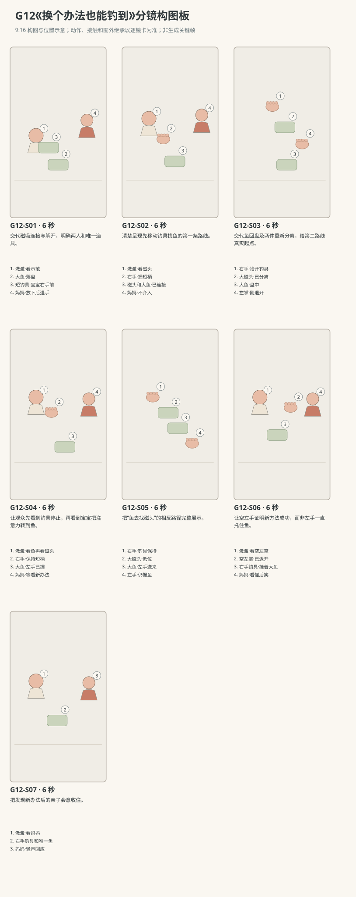

图示为构图位置示意；姿态、接触和画外继承以逐镜正文为准。

### 逐镜设计

#### G12-S01｜00—06 秒｜6 秒｜帧 [0, 144)

**镜头任务：**交代磁吸连接与解开，明确两人和唯一道具。

**景别、机位与构图：**南侧共享中全景，宝宝画左、妈妈画右，中间浅蓝软托盘；两双手与妈妈手下的大鱼完整可见。

**摄影机与理由：**固定南侧机位，让人物动作提供信息变化；不以推拉或切焦遮住接触。

**焦点：**保持本镜关键脸部与行动区域同时可读；不可见的画外状态只按连续性继承。

**入态：**妈妈右手握短硬柄钓具，大磁头已经吸着唯一橙色大鱼；鱼离托盘很低，宝宝双手空搭腿上看鱼。

**动作与表演：**

- 2 秒：妈妈右手降低，让鱼身先落到托盘，钓具仍连着鱼。

- 2 秒：妈妈左掌轻压鱼身，右手向上抬开磁头；两件分离，鱼留盘中。

- 2 秒：妈妈把短柄平放到宝宝右手前，随后双手退回自己膝上。

**声音：**无对白、无音乐；鱼落软盘轻闷声，磁头分离轻响和衣料声。

**出态：**鱼独在盘里，钓具平放宝宝右手前，妈妈双手已退出。

**切点与承接：**切同侧中近景，以宝宝伸右手接短柄为下一动作。

**连续性：**妈妈手持的唯一鱼只在落盘后解除吸附；无第二钓具或散落小件。

**开始画面母稿：**

9:16竖幅，原创圆润三维生活动画，柔软棉布与自然皮肤质感，生活物理，无文字标语、无字幕。 澈澈深棕眼、短黑绒发、额前一撮向右弯，奶油色棉连体衣；外貌衣着为沿用母稿的可撤销暂拟，实际参考尚未绑定。 澈澈为R4能协调双手与初语的幼儿阶段；本片全程坐地，不因阶段名称增加行走。 妈妈深棕短发、雾绿棉衬衫、深灰长裤；外貌衣着为可撤销暂拟。 白天客厅西窗提供柔和漫射主光，暖墙反射补光；北墙固定沙发，东侧走廊，中央奶油地垫。 南侧共享中全景，宝宝画左、妈妈画右，中间浅蓝软托盘；两双手与妈妈手下的大鱼完整可见。 单一开始瞬间：妈妈右手握短硬柄钓具，大磁头已经吸着唯一橙色大鱼；鱼离托盘很低，宝宝双手空搭腿上看鱼。  只画此刻的姿态、视线与道具归属，不把后续动作叠画。

**视频变化母稿：**

9:16竖幅，原创圆润三维生活动画，柔软棉布与自然皮肤质感，生活物理，无文字标语、无字幕。 澈澈深棕眼、短黑绒发、额前一撮向右弯，奶油色棉连体衣；外貌衣着为沿用母稿的可撤销暂拟，实际参考尚未绑定。 澈澈为R4能协调双手与初语的幼儿阶段；本片全程坐地，不因阶段名称增加行走。 妈妈深棕短发、雾绿棉衬衫、深灰长裤；外貌衣着为可撤销暂拟。 白天客厅西窗提供柔和漫射主光，暖墙反射补光；北墙固定沙发，东侧走廊，中央奶油地垫。 本镜6秒，南侧共享中全景，宝宝画左、妈妈画右，中间浅蓝软托盘；两双手与妈妈手下的大鱼完整可见。 起态：妈妈右手握短硬柄钓具，大磁头已经吸着唯一橙色大鱼；鱼离托盘很低，宝宝双手空搭腿上看鱼。 阶段1，持续2秒：妈妈右手降低，让鱼身先落到托盘，钓具仍连着鱼。 阶段2，持续2秒：妈妈左掌轻压鱼身，右手向上抬开磁头；两件分离，鱼留盘中。 阶段3，持续2秒：妈妈把短柄平放到宝宝右手前，随后双手退回自己膝上。 摄影：固定南侧机位，让人物动作提供信息变化；不以推拉或切焦遮住接触。 焦点：保持本镜关键脸部与行动区域同时可读；不可见的画外状态只按连续性继承。 声音：无对白、无音乐；鱼落软盘轻闷声，磁头分离轻响和衣料声。 终态：鱼独在盘里，钓具平放宝宝右手前，妈妈双手已退出。 连续性：妈妈手持的唯一鱼只在落盘后解除吸附；无第二钓具或散落小件。

#### G12-S02｜06—12 秒｜6 秒｜帧 [144, 288)

**镜头任务：**清楚呈现先移动钓具找鱼的第一条路线。

**景别、机位与构图：**南侧幼儿上身与托盘中近景，右腕、短柄、磁头和完整鱼同框；妈妈留画右边缘。

**摄影机与理由：**固定南侧机位，让人物动作提供信息变化；不以推拉或切焦遮住接触。

**焦点：**保持本镜关键脸部与行动区域同时可读；不可见的画外状态只按连续性继承。

**入态：**短钓具平放宝宝右手前，鱼在盘里，宝宝双手空着，妈妈双掌在膝。

**动作与表演：**

- 2 秒：澈澈右手包住短柄抬起，左掌仍搭腿，眼睛跟着大磁头。

- 2 秒：右手带磁头靠近并轻碰鱼背封装吸附区。

- 2 秒：确认接触后右腕向上抬，整鱼随磁头离盘少许，宝宝盯住连接处。

**声音：**无对白、无音乐；磁头碰鱼背后才轻闷响，鱼离盘后不加魔法音。

**出态：**宝宝右手提钓具，唯一大鱼挂在磁头下，左掌还空搭腿。

**切点与承接：**以成功连接状态切同侧手部覆盖，下一镜从鱼悬低处继续放下。

**连续性：**第一轮只有磁头主动接近盘内鱼；鱼在接触前不移动，右手左右不暗换。

**开始画面母稿：**

9:16竖幅，原创圆润三维生活动画，柔软棉布与自然皮肤质感，生活物理，无文字标语、无字幕。 澈澈深棕眼、短黑绒发、额前一撮向右弯，奶油色棉连体衣；外貌衣着为沿用母稿的可撤销暂拟，实际参考尚未绑定。 澈澈为R4能协调双手与初语的幼儿阶段；本片全程坐地，不因阶段名称增加行走。 妈妈深棕短发、雾绿棉衬衫、深灰长裤；外貌衣着为可撤销暂拟。 白天客厅西窗提供柔和漫射主光，暖墙反射补光；北墙固定沙发，东侧走廊，中央奶油地垫。 南侧幼儿上身与托盘中近景，右腕、短柄、磁头和完整鱼同框；妈妈留画右边缘。 单一开始瞬间：短钓具平放宝宝右手前，鱼在盘里，宝宝双手空着，妈妈双掌在膝。  只画此刻的姿态、视线与道具归属，不把后续动作叠画。

**视频变化母稿：**

9:16竖幅，原创圆润三维生活动画，柔软棉布与自然皮肤质感，生活物理，无文字标语、无字幕。 澈澈深棕眼、短黑绒发、额前一撮向右弯，奶油色棉连体衣；外貌衣着为沿用母稿的可撤销暂拟，实际参考尚未绑定。 澈澈为R4能协调双手与初语的幼儿阶段；本片全程坐地，不因阶段名称增加行走。 妈妈深棕短发、雾绿棉衬衫、深灰长裤；外貌衣着为可撤销暂拟。 白天客厅西窗提供柔和漫射主光，暖墙反射补光；北墙固定沙发，东侧走廊，中央奶油地垫。 本镜6秒，南侧幼儿上身与托盘中近景，右腕、短柄、磁头和完整鱼同框；妈妈留画右边缘。 起态：短钓具平放宝宝右手前，鱼在盘里，宝宝双手空着，妈妈双掌在膝。 阶段1，持续2秒：澈澈右手包住短柄抬起，左掌仍搭腿，眼睛跟着大磁头。 阶段2，持续2秒：右手带磁头靠近并轻碰鱼背封装吸附区。 阶段3，持续2秒：确认接触后右腕向上抬，整鱼随磁头离盘少许，宝宝盯住连接处。 摄影：固定南侧机位，让人物动作提供信息变化；不以推拉或切焦遮住接触。 焦点：保持本镜关键脸部与行动区域同时可读；不可见的画外状态只按连续性继承。 声音：无对白、无音乐；磁头碰鱼背后才轻闷响，鱼离盘后不加魔法音。 终态：宝宝右手提钓具，唯一大鱼挂在磁头下，左掌还空搭腿。 连续性：第一轮只有磁头主动接近盘内鱼；鱼在接触前不移动，右手左右不暗换。

#### G12-S03｜12—18 秒｜6 秒｜帧 [288, 432)

**镜头任务：**交代鱼回盘及两件重新分离，给第二路线真实起点。

**景别、机位与构图：**南侧斜俯手部中近景，宝宝两腕连上身，鱼、磁头和托盘整件入画。

**摄影机与理由：**固定南侧机位，让人物动作提供信息变化；不以推拉或切焦遮住接触。

**焦点：**焦点保留两手接触点和完整鱼背；宝宝视线画外继承向下看，不能称本特写看见眼睛。

**入态：**宝宝右手握短柄，鱼挂在低位磁头下，左掌空搭腿；妈妈画外膝上空手。

**动作与表演：**

- 2 秒：右手降低钓具，让鱼腹先接软盘。

- 2 秒：宝宝左掌从腿上移到鱼身轻压，右手保持柄不换手。

- 2 秒：左掌压稳后，右手抬短柄让磁头与鱼背分离，再停在盘上方；左掌松开鱼留盘。

**声音：**无对白、无音乐；鱼触盘、左掌擦鱼面、磁头脱开均随动作轻响。

**出态：**鱼在盘里，右手持短柄让磁头停在盘上方，左手刚离鱼且空着。

**切点与承接：**继续同一持柄状态切宝宝脸与双手，保留他换方法前的观察。

**连续性：**先有盘面与左掌承托，再解开吸附；画外妈妈始终未碰两件。

**开始画面母稿：**

9:16竖幅，原创圆润三维生活动画，柔软棉布与自然皮肤质感，生活物理，无文字标语、无字幕。 澈澈深棕眼、短黑绒发、额前一撮向右弯，奶油色棉连体衣；外貌衣着为沿用母稿的可撤销暂拟，实际参考尚未绑定。 澈澈为R4能协调双手与初语的幼儿阶段；本片全程坐地，不因阶段名称增加行走。 妈妈深棕短发、雾绿棉衬衫、深灰长裤；外貌衣着为可撤销暂拟。 白天客厅西窗提供柔和漫射主光，暖墙反射补光；北墙固定沙发，东侧走廊，中央奶油地垫。 南侧斜俯手部中近景，宝宝两腕连上身，鱼、磁头和托盘整件入画。 单一开始瞬间：宝宝右手握短柄，鱼挂在低位磁头下，左掌空搭腿；妈妈画外膝上空手。  只画此刻的姿态、视线与道具归属，不把后续动作叠画。

**视频变化母稿：**

9:16竖幅，原创圆润三维生活动画，柔软棉布与自然皮肤质感，生活物理，无文字标语、无字幕。 澈澈深棕眼、短黑绒发、额前一撮向右弯，奶油色棉连体衣；外貌衣着为沿用母稿的可撤销暂拟，实际参考尚未绑定。 澈澈为R4能协调双手与初语的幼儿阶段；本片全程坐地，不因阶段名称增加行走。 妈妈深棕短发、雾绿棉衬衫、深灰长裤；外貌衣着为可撤销暂拟。 白天客厅西窗提供柔和漫射主光，暖墙反射补光；北墙固定沙发，东侧走廊，中央奶油地垫。 本镜6秒，南侧斜俯手部中近景，宝宝两腕连上身，鱼、磁头和托盘整件入画。 起态：宝宝右手握短柄，鱼挂在低位磁头下，左掌空搭腿；妈妈画外膝上空手。 阶段1，持续2秒：右手降低钓具，让鱼腹先接软盘。 阶段2，持续2秒：宝宝左掌从腿上移到鱼身轻压，右手保持柄不换手。 阶段3，持续2秒：左掌压稳后，右手抬短柄让磁头与鱼背分离，再停在盘上方；左掌松开鱼留盘。 摄影：固定南侧机位，让人物动作提供信息变化；不以推拉或切焦遮住接触。 焦点：焦点保留两手接触点和完整鱼背；宝宝视线画外继承向下看，不能称本特写看见眼睛。 声音：无对白、无音乐；鱼触盘、左掌擦鱼面、磁头脱开均随动作轻响。 终态：鱼在盘里，右手持短柄让磁头停在盘上方，左手刚离鱼且空着。 连续性：先有盘面与左掌承托，再解开吸附；画外妈妈始终未碰两件。

#### G12-S04｜18—24 秒｜6 秒｜帧 [432, 576)

**镜头任务：**让观众先看到钓具停止，再看到宝宝把注意力转到鱼。

**景别、机位与构图：**南侧幼儿中景，脸、双手、盘和鱼均留画，妈妈在画右陪看；前景不设遮挡。

**摄影机与理由：**固定南侧机位，让人物动作提供信息变化；不以推拉或切焦遮住接触。

**焦点：**保持本镜关键脸部与行动区域同时可读；不可见的画外状态只按连续性继承。

**入态：**澈澈右手握短柄，磁头停在盘上方；左手空着，鱼躺在盘中央。

**动作与表演：**

- 3 秒：宝宝看一眼右手的磁头，右腕不再带它追鱼，左手落到大鱼尾侧。

- 3 秒：左手沿鱼身摸到可包握的位置，手指合住鱼侧；右手仍把磁头留在眼前的低位。

**声音：**无对白、无音乐；连续轻微室内底声，保留呼吸与衣料声；不添加解释旁白或笑声音效。

**出态：**左手已握住整鱼侧面但鱼还贴盘，右手钓具低位保持。

**切点与承接：**在左手将提鱼时切同侧手部中近景，继续提起相位。

**连续性：**左手先接触并抓住再提鱼；右手仍握短柄，钓具未凭空换位置。

**开始画面母稿：**

9:16竖幅，原创圆润三维生活动画，柔软棉布与自然皮肤质感，生活物理，无文字标语、无字幕。 澈澈深棕眼、短黑绒发、额前一撮向右弯，奶油色棉连体衣；外貌衣着为沿用母稿的可撤销暂拟，实际参考尚未绑定。 澈澈为R4能协调双手与初语的幼儿阶段；本片全程坐地，不因阶段名称增加行走。 妈妈深棕短发、雾绿棉衬衫、深灰长裤；外貌衣着为可撤销暂拟。 白天客厅西窗提供柔和漫射主光，暖墙反射补光；北墙固定沙发，东侧走廊，中央奶油地垫。 南侧幼儿中景，脸、双手、盘和鱼均留画，妈妈在画右陪看；前景不设遮挡。 单一开始瞬间：澈澈右手握短柄，磁头停在盘上方；左手空着，鱼躺在盘中央。  只画此刻的姿态、视线与道具归属，不把后续动作叠画。

**视频变化母稿：**

9:16竖幅，原创圆润三维生活动画，柔软棉布与自然皮肤质感，生活物理，无文字标语、无字幕。 澈澈深棕眼、短黑绒发、额前一撮向右弯，奶油色棉连体衣；外貌衣着为沿用母稿的可撤销暂拟，实际参考尚未绑定。 澈澈为R4能协调双手与初语的幼儿阶段；本片全程坐地，不因阶段名称增加行走。 妈妈深棕短发、雾绿棉衬衫、深灰长裤；外貌衣着为可撤销暂拟。 白天客厅西窗提供柔和漫射主光，暖墙反射补光；北墙固定沙发，东侧走廊，中央奶油地垫。 本镜6秒，南侧幼儿中景，脸、双手、盘和鱼均留画，妈妈在画右陪看；前景不设遮挡。 起态：澈澈右手握短柄，磁头停在盘上方；左手空着，鱼躺在盘中央。 阶段1，持续3秒：宝宝看一眼右手的磁头，右腕不再带它追鱼，左手落到大鱼尾侧。 阶段2，持续3秒：左手沿鱼身摸到可包握的位置，手指合住鱼侧；右手仍把磁头留在眼前的低位。 摄影：固定南侧机位，让人物动作提供信息变化；不以推拉或切焦遮住接触。 焦点：保持本镜关键脸部与行动区域同时可读；不可见的画外状态只按连续性继承。 声音：无对白、无音乐；连续轻微室内底声，保留呼吸与衣料声；不添加解释旁白或笑声音效。 终态：左手已握住整鱼侧面但鱼还贴盘，右手钓具低位保持。 连续性：左手先接触并抓住再提鱼；右手仍握短柄，钓具未凭空换位置。

#### G12-S05｜24—30 秒｜6 秒｜帧 [576, 720)

**镜头任务：**把“鱼去找磁头”的相反路径完整展示。

**景别、机位与构图：**南侧斜俯幼儿双手与上身中近景，右手钓具在画左、左手持鱼在画右；两腕和两个整件均留画。

**摄影机与理由：**固定南侧机位，让人物动作提供信息变化；不以推拉或切焦遮住接触。

**焦点：**固定清楚覆盖双手握点、鱼背与磁头，幼儿眼睛画外继承看连接处；不用浅景深隐藏间隙。

**入态：**宝宝左手握鱼侧且鱼腹贴盘，右手握短柄，大磁头停在盘上方低位。

**动作与表演：**

- 2 秒：左手提起整条鱼，鱼腹离盘；右手保持短柄，磁头不追过去。

- 2 秒：左腕把鱼背转向大磁头，鱼和磁头之间仍有清楚空隙。

- 2 秒：左手带鱼缓慢靠近，鱼背刚碰到磁头，左手仍牢牢握鱼。

**声音：**无对白、无音乐；左手提鱼摩擦，鱼背真正触磁头时才轻碰一声。

**出态：**鱼背与磁头已接触、左手仍持鱼，右手继续握柄。

**切点与承接：**在共同持有、刚吸附状态切同侧稍宽，让释放与后续结果可见。

**连续性：**只有左手带鱼走路径，磁头仍由右手定位；接触前不隔空吸鱼。

**开始画面母稿：**

9:16竖幅，原创圆润三维生活动画，柔软棉布与自然皮肤质感，生活物理，无文字标语、无字幕。 澈澈深棕眼、短黑绒发、额前一撮向右弯，奶油色棉连体衣；外貌衣着为沿用母稿的可撤销暂拟，实际参考尚未绑定。 澈澈为R4能协调双手与初语的幼儿阶段；本片全程坐地，不因阶段名称增加行走。 妈妈深棕短发、雾绿棉衬衫、深灰长裤；外貌衣着为可撤销暂拟。 白天客厅西窗提供柔和漫射主光，暖墙反射补光；北墙固定沙发，东侧走廊，中央奶油地垫。 南侧斜俯幼儿双手与上身中近景，右手钓具在画左、左手持鱼在画右；两腕和两个整件均留画。 单一开始瞬间：宝宝左手握鱼侧且鱼腹贴盘，右手握短柄，大磁头停在盘上方低位。  只画此刻的姿态、视线与道具归属，不把后续动作叠画。

**视频变化母稿：**

9:16竖幅，原创圆润三维生活动画，柔软棉布与自然皮肤质感，生活物理，无文字标语、无字幕。 澈澈深棕眼、短黑绒发、额前一撮向右弯，奶油色棉连体衣；外貌衣着为沿用母稿的可撤销暂拟，实际参考尚未绑定。 澈澈为R4能协调双手与初语的幼儿阶段；本片全程坐地，不因阶段名称增加行走。 妈妈深棕短发、雾绿棉衬衫、深灰长裤；外貌衣着为可撤销暂拟。 白天客厅西窗提供柔和漫射主光，暖墙反射补光；北墙固定沙发，东侧走廊，中央奶油地垫。 本镜6秒，南侧斜俯幼儿双手与上身中近景，右手钓具在画左、左手持鱼在画右；两腕和两个整件均留画。 起态：宝宝左手握鱼侧且鱼腹贴盘，右手握短柄，大磁头停在盘上方低位。 阶段1，持续2秒：左手提起整条鱼，鱼腹离盘；右手保持短柄，磁头不追过去。 阶段2，持续2秒：左腕把鱼背转向大磁头，鱼和磁头之间仍有清楚空隙。 阶段3，持续2秒：左手带鱼缓慢靠近，鱼背刚碰到磁头，左手仍牢牢握鱼。 摄影：固定南侧机位，让人物动作提供信息变化；不以推拉或切焦遮住接触。 焦点：固定清楚覆盖双手握点、鱼背与磁头，幼儿眼睛画外继承看连接处；不用浅景深隐藏间隙。 声音：无对白、无音乐；左手提鱼摩擦，鱼背真正触磁头时才轻碰一声。 终态：鱼背与磁头已接触、左手仍持鱼，右手继续握柄。 连续性：只有左手带鱼走路径，磁头仍由右手定位；接触前不隔空吸鱼。

#### G12-S06｜30—36 秒｜6 秒｜帧 [720, 864)

**镜头任务：**让空左手证明新方法成功，而非左手一直托住鱼。

**景别、机位与构图：**南侧幼儿中景，脸、双手和鱼完整留画；妈妈画右脸与膝上空手可见。

**摄影机与理由：**固定南侧机位，让人物动作提供信息变化；不以推拉或切焦遮住接触。

**焦点：**保持本镜关键脸部与行动区域同时可读；不可见的画外状态只按连续性继承。

**入态：**鱼背已贴磁头，宝宝左手仍握鱼侧，右手握短柄；妈妈看连接处。

**动作与表演：**

- 2 秒：宝宝右手维持柄的位置，左指慢慢张开，掌心离鱼。

- 2 秒：鱼仍挂在磁头下，左手退到胸前成为清楚空掌；宝宝眼睛从空掌看回鱼。

- 2 秒：右手再轻提短柄，鱼跟着升高一点，妈妈这才露出会意笑。

**声音：**无对白、无音乐；连续轻微室内底声，保留呼吸与衣料声；不添加解释旁白或笑声音效。

**出态：**左手完全空着在胸前，右手钓具下挂鱼；妈妈已看清第二条路线。

**切点与承接：**鱼仍连接时切共享中景结尾，不重新吸一次。

**连续性：**左手分离窗口清楚；整鱼重量由右手钓具通过磁头承接，妈妈未托。

**开始画面母稿：**

9:16竖幅，原创圆润三维生活动画，柔软棉布与自然皮肤质感，生活物理，无文字标语、无字幕。 澈澈深棕眼、短黑绒发、额前一撮向右弯，奶油色棉连体衣；外貌衣着为沿用母稿的可撤销暂拟，实际参考尚未绑定。 澈澈为R4能协调双手与初语的幼儿阶段；本片全程坐地，不因阶段名称增加行走。 妈妈深棕短发、雾绿棉衬衫、深灰长裤；外貌衣着为可撤销暂拟。 白天客厅西窗提供柔和漫射主光，暖墙反射补光；北墙固定沙发，东侧走廊，中央奶油地垫。 南侧幼儿中景，脸、双手和鱼完整留画；妈妈画右脸与膝上空手可见。 单一开始瞬间：鱼背已贴磁头，宝宝左手仍握鱼侧，右手握短柄；妈妈看连接处。  只画此刻的姿态、视线与道具归属，不把后续动作叠画。

**视频变化母稿：**

9:16竖幅，原创圆润三维生活动画，柔软棉布与自然皮肤质感，生活物理，无文字标语、无字幕。 澈澈深棕眼、短黑绒发、额前一撮向右弯，奶油色棉连体衣；外貌衣着为沿用母稿的可撤销暂拟，实际参考尚未绑定。 澈澈为R4能协调双手与初语的幼儿阶段；本片全程坐地，不因阶段名称增加行走。 妈妈深棕短发、雾绿棉衬衫、深灰长裤；外貌衣着为可撤销暂拟。 白天客厅西窗提供柔和漫射主光，暖墙反射补光；北墙固定沙发，东侧走廊，中央奶油地垫。 本镜6秒，南侧幼儿中景，脸、双手和鱼完整留画；妈妈画右脸与膝上空手可见。 起态：鱼背已贴磁头，宝宝左手仍握鱼侧，右手握短柄；妈妈看连接处。 阶段1，持续2秒：宝宝右手维持柄的位置，左指慢慢张开，掌心离鱼。 阶段2，持续2秒：鱼仍挂在磁头下，左手退到胸前成为清楚空掌；宝宝眼睛从空掌看回鱼。 阶段3，持续2秒：右手再轻提短柄，鱼跟着升高一点，妈妈这才露出会意笑。 摄影：固定南侧机位，让人物动作提供信息变化；不以推拉或切焦遮住接触。 焦点：保持本镜关键脸部与行动区域同时可读；不可见的画外状态只按连续性继承。 声音：无对白、无音乐；连续轻微室内底声，保留呼吸与衣料声；不添加解释旁白或笑声音效。 终态：左手完全空着在胸前，右手钓具下挂鱼；妈妈已看清第二条路线。 连续性：左手分离窗口清楚；整鱼重量由右手钓具通过磁头承接，妈妈未托。

#### G12-S07｜36—42 秒｜6 秒｜帧 [864, 1008)

**镜头任务：**把发现新办法后的亲子会意收住。

**景别、机位与构图：**南侧共享中景，宝宝画左、妈妈画右，短钓具与悬低大鱼居中可见，托盘仍在下方。

**摄影机与理由：**固定南侧机位，让人物动作提供信息变化；不以推拉或切焦遮住接触。

**焦点：**保持本镜关键脸部与行动区域同时可读；不可见的画外状态只按连续性继承。

**入态：**澈澈右手持短柄挂鱼，左手空停胸前；妈妈已微笑、目光落连接处。

**动作与表演：**

- 1 秒：宝宝抬眼看妈妈，右手保持钓具在低位。

- 3 秒：妈妈看回他，带笑轻声说：“这样也行呀。”嘴部自然发音，手不替他演示。

- 2 秒：妈妈停声，宝宝看看鱼又看看她，左手落回腿上，大鱼仍贴住磁头。

**声音：**妈妈{这样也行呀。}，第2—4秒；其余只轻呼吸和室内底声，无音乐、无字幕。

**出态：**幼儿坐姿不变，右手持钓具挂鱼，左手在腿，妈妈空手陪笑。

**切点与承接：**留在两人相看与鱼仍挂着的结果，结束前不加第三种玩法。

**连续性：**没有换手或额外鱼；妈妈的评价晚于实际第二次成功，无字幕与成人说教。

**开始画面母稿：**

9:16竖幅，原创圆润三维生活动画，柔软棉布与自然皮肤质感，生活物理，无文字标语、无字幕。 澈澈深棕眼、短黑绒发、额前一撮向右弯，奶油色棉连体衣；外貌衣着为沿用母稿的可撤销暂拟，实际参考尚未绑定。 澈澈为R4能协调双手与初语的幼儿阶段；本片全程坐地，不因阶段名称增加行走。 妈妈深棕短发、雾绿棉衬衫、深灰长裤；外貌衣着为可撤销暂拟。 白天客厅西窗提供柔和漫射主光，暖墙反射补光；北墙固定沙发，东侧走廊，中央奶油地垫。 南侧共享中景，宝宝画左、妈妈画右，短钓具与悬低大鱼居中可见，托盘仍在下方。 单一开始瞬间：澈澈右手持短柄挂鱼，左手空停胸前；妈妈已微笑、目光落连接处。  只画此刻的姿态、视线与道具归属，不把后续动作叠画。

**视频变化母稿：**

9:16竖幅，原创圆润三维生活动画，柔软棉布与自然皮肤质感，生活物理，无文字标语、无字幕。 澈澈深棕眼、短黑绒发、额前一撮向右弯，奶油色棉连体衣；外貌衣着为沿用母稿的可撤销暂拟，实际参考尚未绑定。 澈澈为R4能协调双手与初语的幼儿阶段；本片全程坐地，不因阶段名称增加行走。 妈妈深棕短发、雾绿棉衬衫、深灰长裤；外貌衣着为可撤销暂拟。 白天客厅西窗提供柔和漫射主光，暖墙反射补光；北墙固定沙发，东侧走廊，中央奶油地垫。 本镜6秒，南侧共享中景，宝宝画左、妈妈画右，短钓具与悬低大鱼居中可见，托盘仍在下方。 起态：澈澈右手持短柄挂鱼，左手空停胸前；妈妈已微笑、目光落连接处。 阶段1，持续1秒：宝宝抬眼看妈妈，右手保持钓具在低位。 阶段2，持续3秒：妈妈看回他，带笑轻声说：“这样也行呀。”嘴部自然发音，手不替他演示。 阶段3，持续2秒：妈妈停声，宝宝看看鱼又看看她，左手落回腿上，大鱼仍贴住磁头。 摄影：固定南侧机位，让人物动作提供信息变化；不以推拉或切焦遮住接触。 焦点：保持本镜关键脸部与行动区域同时可读；不可见的画外状态只按连续性继承。 声音：妈妈{这样也行呀。}，第2—4秒；其余只轻呼吸和室内底声，无音乐、无字幕。 终态：幼儿坐姿不变，右手持钓具挂鱼，左手在腿，妈妈空手陪笑。 连续性：没有换手或额外鱼；妈妈的评价晚于实际第二次成功，无字幕与成人说教。

### 声音与剪辑

磁头与封装鱼背接触只有轻轻一声闷碰，摩擦随触盘和提起发生；不加魔法吸附声。妈妈片尾一句普通话，幼儿只有非词轻气声；无音乐与字幕。

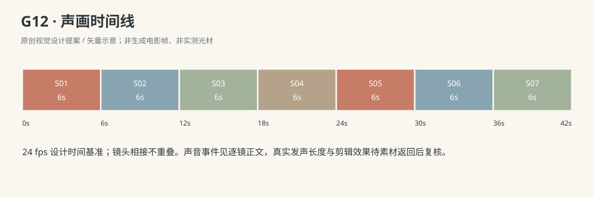

- 妈妈：这样也行呀。（G12-S07；第2—4秒，已看见鱼在左手松开后仍挂在磁头下，才面向澈澈带笑轻说；口部自然可见，不用教训或考试语气。）

### 连续性与试片

- 连续性：唯一一条大橙鱼、唯一短钓具；所有磁件封闭在大整件内部，画面不出现游离磁粒、外露尖件或长绳。

- 连续性：道具尺寸和封装结构为本片原创设计，不称原文教具实物或任何具体产品已验证。

- 连续性：澈澈全片坐地；自第二镜首次拿起钓具后，右手始终握短柄；第一轮鱼在托盘，第二轮由左手拿整鱼送向右手保持的磁头。

- 连续性：磁吸只在鱼背与磁头实际接触后发生；鱼不飞向磁头，不隔空悬浮。

- 连续性：左手释放前必须明确鱼背已吸住；右手提钓具后鱼才随动。妈妈不在第二轮暗扶鱼。

- 连续性：R4表示本片幼儿双手协调与初语能力，不要求本镜行走，也不标改变玩法的精确月龄。

- 试片：G12-S02：右手移动磁头、实际碰鱼背、鱼随提起的先后清楚；还未碰到鱼就自动上飞则失败。

- 试片：G12-S03：鱼先落盘且左手压稳，右手才抬离磁头；鱼和磁头复制、左手穿鱼或跳切解绑则失败。

- 试片：G12-S04到S06：右手短钓具位置基本不变，左手带整鱼靠近，先接触后左手松开；若仍由磁头追鱼则失去换方法的事件。

- 试片：S06→S07鱼仍吸在同一个磁头下，右手归属不换；成人评价不得早于第二次成功被看见。

**媒体待验证：**未生成媒体或绑定参考；待实片核验磁头/鱼背接触、封装完整、两种移动路径的区别与幼儿双手协调，文字设定不等于实物或媒体已验证。

---

## G13《这次，要鼓掌》

**58 秒｜幼儿拼图与短句｜角色：澈澈、妈妈｜场景 L**

### 剧情正文

第一天，客厅地垫上的七片房子拼图已经放好四片。澈澈拿着一片绿墙，转来转去，边缘总对不上。他皱起脸，把手边两片往垫上一推，丢下手里的那片：“不玩了！”妈妈先把三片捡回拼板旁，没有把整板替他完成。她拿起那片绿墙，转到对应方向，再把它放回澈澈掌中，陪他对准空位。澈澈压下去，卡进去了。余下两片也在妈妈指给他的轮廓里放好，妈妈等七片全部平齐，才轻轻拍手，澈澈抬脸听着。画面在这里溶接，明确省略了数日的日常和练习；沙发靠垫与布篮的位置已经变了。数日后，七片又全摆在拼板外，妈妈坐在稍远的东侧，双手搭膝。澈澈先放入橙色底座、左绿墙、右绿墙，再接着放红屋顶、黄门和两扇蓝窗，七片全由他的双手独自拿取、转向、放入；妈妈没有碰拼片。他低头按了按最后一片，抬头却发现妈妈还没有拍手。澈澈把双手伸到拼板两侧，平平端起，朝她挪近一小段。妈妈看清完整的房子，轻声说：“前几天还要一起拼，今天自己拼好啦。”澈澈等她说完，将拼板平放到两人之间，空出双手，朝妈妈伸出来：“鼓掌！”妈妈这才拍起手，澈澈也跟着拍了两下。拼板留在垫上，七片没有散，他笑着又低头确认了一遍。

### 亲述来源与改编

原帖是家长自述，未独立核实。本片将生活机制改编为澈澈的原创故事。

- [ZH06 · 七片拼图丢下后，几天后拿成品来要掌声](https://fishliao2005.pixnet.net/blog/posts/30405261)；作者自报年龄：标题自报满两岁七个月，正文称“这个月”；没有另列事件日龄。。

- **采用的生活过程：**作者自报2岁7个月；七片拼图受挫丢片、妈妈捡回陪做、完成后家人鼓掌，以及过几天自己完成拿来要掌声。

- **采用的生活过程：**保留跨几日的变化，不写成一次失败后数秒内学会。

- **本片原创改编：**七片房子图案、每片颜色与位置、初始四入三外、逐片帮助步骤及独立拼放顺序均为原创，原文没有这些细节。

- **本片原创改编：**妈妈具体台词、澈澈“鼓掌！”的逐字短句、沙发布置变化、双手平托和最后妈妈再次拍手为原创；原文只说最后要掌声，没交代家人再次拍掌。

- **不作出的事实推断：**公开家长亲述未独立核实；实际经过几次练习未知，本片中间数日不表示其间没有练习或其他成人帮助。

- **不作出的事实推断：**不使用原帖后半转载教养文章作为这次亲历，不把本片演成拼图训练成效或普遍月龄标准。

[查看原始过程与缺项](research/real-experiences/index.html#ZH06)

### 导演与空间

**观察任务：**把先前受挫后一起完成与数日后自己完成分开，让幼儿拿成品来要掌声成为主动分享时刻；成长经过不压成瞬间学会。

**空间与光位：**白天客厅中央地垫上，澈澈面南坐地，妈妈东侧面西南坐地，摄影机始终南侧。唯一浅木嵌板拼图有七块大图形，均非可互换的小碎片；原创房子图案：红屋顶、黄色门、两扇蓝窗、左右绿墙、橙色底座，一片一位。第一天北沙发靠垫靠西、布篮在垫东；数日后溶接到靠垫靠东、布篮收至沙发旁，拼板先以七片均外的状态重新建立。全片无字幕。

**人物表演：**第一天澈澈尝试不成后眉眼缩紧，把两片推落到软垫，短句说不玩了；妈妈先捡回物件，慢慢陪他对准，不责怪。数日后的独立拼放由头至尾覆盖，妈妈手始终在膝上。幼儿完成后用双手平托拼板短距离挪近，不拿会掉片的竖立姿势；要掌声是清楚的短句邀请。

### 节拍覆盖

- **G13-b1**：前态：第一天，拼板上红屋顶、黄门、左右蓝窗四片已入位；宝宝右手持左绿墙，右绿墙与橙底座在板旁，妈妈空手在膝。 过程：宝宝把左绿墙凑向对应空位，方向不对，边角顶住；他停下来皱眉，未用力硬压。他气恼说：“不玩了！”左手将板旁右绿墙与橙底座推到近处软垫，再把右手左绿墙放落到它们旁。三片均落在软垫上，双手退开，宝宝把脸偏开。 后态：板上仍四片，垫上三片；宝宝双手已空且偏脸，妈妈看见受挫。 观众观察：先让失败有真实的对不上，再出现不玩了与推片。 → G13-S01

- **G13-b2**：前态：板上四片未动、垫上三片，宝宝双手空搭腿，妈妈双手刚离膝。 过程：妈妈右手逐一把三片移回板旁，不改变板上四片。她拿左绿墙在对应空槽上方转正，停给宝宝看，再送到宝宝张开的右掌。宝宝右手握稳后妈妈先松开，再用左食指指空槽边缘；宝宝将左绿墙落入，妈妈指尖只在槽外轻引方向。 后态：左绿墙已由宝宝放入，板上五片；右绿墙和橙底座在外，妈妈手停槽边外、宝宝右手刚离片。 观众观察：妈妈先恢复可玩的物件，再给方向帮助，不直接替拼完。 → G13-S02

- **G13-b3**：前态：拼板已入五片，右绿墙与橙底座在外；宝宝右手空，妈妈左指在槽边外，右手空。 过程：妈妈先指橙底座空槽，宝宝右手拿橙底座、双手略转方向后放入；妈妈不拿片。妈妈再指右绿墙空槽，宝宝右手拿右绿墙放入并按平，七片完整；妈妈双手退出板边。妈妈确认最后一片平齐后轻拍两下，宝宝抬脸看她，肩膀放松。 后态：七片全在板，宝宝双手在板边、妈妈两次掌声已落，母子相看。 观众观察：完成第一次共同拼图，并将第一回掌声与成品绑定。 → G13-S03

- **G13-b4**：前态：经上一镜溶接明确已过数日；唯一七片全部摊在同一空拼板旁，宝宝双手空，妈妈坐东侧双掌搭膝。 过程：宝宝看空板与七片，妈妈只安静陪看；给七片均在外的状态一个可读瞬间。宝宝右手拿橙底座，左手扶板边，自行转正并放入底部槽。宝宝拿左绿墙转到左槽方向，放入并松手。宝宝拿右绿墙放入右槽，松手后看向余四片。 后态：橙底座、左右绿墙三片已入；红屋顶、黄门、左右蓝窗四片仍在板旁，妈妈手仍在膝。 观众观察：重建数日后七片全外的起点，并直接看到幼儿独放前三片。 → G13-S04

- **G13-b5**：前态：橙底座、左右绿墙三片已入；红屋顶、黄门、左右蓝窗四片在外，宝宝双手空，妈妈双手膝上。 过程：宝宝右手拿红屋顶、左手扶板，略转到尖角朝上后放入屋顶槽并松手。右手拿黄门对齐门槽，指腹放平后离开。右手拿左蓝窗，转到左窗方向后放入，左手始终扶板边。右手拿最后一片右蓝窗放入并按平，随后双手都离开拼片；宝宝低头核对整幅房子。 后态：七片全入、外面无余片，宝宝双手空停板边；妈妈从未碰片或板。 观众观察：不中断地完成余四片，证明后段是孩子独自做完。 → G13-S05

- **G13-b6**：前态：数日后七片完整嵌平，宝宝低头看成品、双手空在板边，妈妈东侧双手在膝。 过程：宝宝抬脸看妈妈，妈妈正安静看完整房子还未拍手。宝宝把左右手分别滑到拼板两侧下沿，双手承托后才低低抬起，板面近水平。他保持坐地，双脚和骨盆在垫上短短挪近妈妈，将水平板送到两人之间；妈妈低头看清成品。 后态：宝宝仍坐地、双手托板两侧、板面近水平在两人之间，妈妈已看见完整房子。 观众观察：孩子由完成转为主动分享，让端板动作有完整承托。 → G13-S06

- **G13-b7**：前态：妈妈已看见完整七片，宝宝仍双手托板两侧、坐地看她，妈妈双掌仍搭膝。 过程：妈妈看一眼房子再看宝宝，温柔说：“前几天还要一起拼，今天自己拼好啦。”嘴唇自然发音，不碰板也不提前拍掌。妈妈停声等，宝宝看着她，板仍平稳托在双手间。 后态：妈妈句尾完整结束、双手还在膝，宝宝坐地双手托板看妈妈。 观众观察：用自然亲子回应点明数日跨度，并留出孩子自己的请求。 → G13-S07

- **G13-b8**：前态：宝宝双手平托七片板在低位，妈妈上一句已完整结束、双手在膝，两人相看。 过程：宝宝把拼板慢慢降到两人中间软垫，板底落稳后双手离开、朝妈妈伸出。宝宝看妈妈清楚说：“鼓掌！”妈妈听完才抬起双手。妈妈先拍两下，宝宝看到后也拍两下；手掌相碰与分开完整，板留在垫上。宝宝停手笑，双手落回自己腿上，低头再确认完整房子；妈妈停止掌声、双手落回膝上陪他看。 后态：七片板平放地垫，宝宝双手已空放腿、妈妈双手回膝，幼儿笑着看自己的成品。 观众观察：先落板空手再要掌声，最后掌声由孩子主动邀请触发。 → G13-S08

### 分镜构图板

图示为构图位置示意；姿态、接触和画外继承以逐镜正文为准。

### 逐镜设计

#### G13-S01｜00—07 秒｜7 秒｜帧 [0, 168)

**镜头任务：**先让失败有真实的对不上，再出现不玩了与推片。

**景别、机位与构图：**南侧母子中景略俯，宝宝面南居中偏左、妈妈东侧画右；整拼板、七片归属和两人脸可读。

**摄影机与理由：**固定南侧机位，让人物动作提供信息变化；不以推拉或切焦遮住接触。

**焦点：**保持本镜关键脸部与行动区域同时可读；不可见的画外状态只按连续性继承。

**入态：**第一天，拼板上红屋顶、黄门、左右蓝窗四片已入位；宝宝右手持左绿墙，右绿墙与橙底座在板旁，妈妈空手在膝。

**动作与表演：**

- 3 秒：宝宝把左绿墙凑向对应空位，方向不对，边角顶住；他停下来皱眉，未用力硬压。

- 3 秒：他气恼说：“不玩了！”左手将板旁右绿墙与橙底座推到近处软垫，再把右手左绿墙放落到它们旁。

- 1 秒：三片均落在软垫上，双手退开，宝宝把脸偏开。

**声音：**澈澈{不玩了！}，第4—6秒；片落软垫有轻闷声，无音乐、无字幕。

**出态：**板上仍四片，垫上三片；宝宝双手已空且偏脸，妈妈看见受挫。

**切点与承接：**保持失败后的七片状态切妈妈捡片，不暗中复原。

**连续性：**推落是三大片落软垫，无散小零件；第一天靠垫靠西、布篮在垫东。

**开始画面母稿：**

9:16竖幅，原创圆润三维生活动画，柔软棉布与自然皮肤质感，生活物理，无文字标语、无字幕。 澈澈深棕眼、短黑绒发、额前一撮向右弯，奶油色棉连体衣；外貌衣着为沿用母稿的可撤销暂拟，实际参考尚未绑定。 澈澈为R5能操作大片拼图、坐地挪近与说短句的幼儿阶段；不是小月龄婴儿。 妈妈深棕短发、雾绿棉衬衫、深灰长裤；外貌衣着为可撤销暂拟。 白天客厅西窗提供柔和漫射主光，暖墙反射补光；北墙固定沙发，东侧走廊，中央奶油地垫。 南侧母子中景略俯，宝宝面南居中偏左、妈妈东侧画右；整拼板、七片归属和两人脸可读。 单一开始瞬间：第一天，拼板上红屋顶、黄门、左右蓝窗四片已入位；宝宝右手持左绿墙，右绿墙与橙底座在板旁，妈妈空手在膝。  只画此刻的姿态、视线与道具归属，不把后续动作叠画。

**视频变化母稿：**

9:16竖幅，原创圆润三维生活动画，柔软棉布与自然皮肤质感，生活物理，无文字标语、无字幕。 澈澈深棕眼、短黑绒发、额前一撮向右弯，奶油色棉连体衣；外貌衣着为沿用母稿的可撤销暂拟，实际参考尚未绑定。 澈澈为R5能操作大片拼图、坐地挪近与说短句的幼儿阶段；不是小月龄婴儿。 妈妈深棕短发、雾绿棉衬衫、深灰长裤；外貌衣着为可撤销暂拟。 白天客厅西窗提供柔和漫射主光，暖墙反射补光；北墙固定沙发，东侧走廊，中央奶油地垫。 本镜7秒，南侧母子中景略俯，宝宝面南居中偏左、妈妈东侧画右；整拼板、七片归属和两人脸可读。 起态：第一天，拼板上红屋顶、黄门、左右蓝窗四片已入位；宝宝右手持左绿墙，右绿墙与橙底座在板旁，妈妈空手在膝。 阶段1，持续3秒：宝宝把左绿墙凑向对应空位，方向不对，边角顶住；他停下来皱眉，未用力硬压。 阶段2，持续3秒：他气恼说：“不玩了！”左手将板旁右绿墙与橙底座推到近处软垫，再把右手左绿墙放落到它们旁。 阶段3，持续1秒：三片均落在软垫上，双手退开，宝宝把脸偏开。 摄影：固定南侧机位，让人物动作提供信息变化；不以推拉或切焦遮住接触。 焦点：保持本镜关键脸部与行动区域同时可读；不可见的画外状态只按连续性继承。 声音：澈澈{不玩了！}，第4—6秒；片落软垫有轻闷声，无音乐、无字幕。 终态：板上仍四片，垫上三片；宝宝双手已空且偏脸，妈妈看见受挫。 连续性：推落是三大片落软垫，无散小零件；第一天靠垫靠西、布篮在垫东。

#### G13-S02｜07—14 秒｜7 秒｜帧 [168, 336)

**镜头任务：**妈妈先恢复可玩的物件，再给方向帮助，不直接替拼完。

**景别、机位与构图：**南侧斜俯母子双手与上身中近景，整板和垫上三片可见，宝宝脸保留在画左上。

**摄影机与理由：**固定南侧机位，让人物动作提供信息变化；不以推拉或切焦遮住接触。

**焦点：**清楚覆盖拼板轮廓、妈妈指尖和宝宝持片掌；脸只保留受挫缓解的可读部分，不以浅景深遮手。

**入态：**板上四片未动、垫上三片，宝宝双手空搭腿，妈妈双手刚离膝。

**动作与表演：**

- 2 秒：妈妈右手逐一把三片移回板旁，不改变板上四片。

- 2 秒：她拿左绿墙在对应空槽上方转正，停给宝宝看，再送到宝宝张开的右掌。

- 3 秒：宝宝右手握稳后妈妈先松开，再用左食指指空槽边缘；宝宝将左绿墙落入，妈妈指尖只在槽外轻引方向。

**声音：**无对白、无音乐；大片轻碰木板、手指擦边及自然呼吸，妈妈不添加教养长句。

**出态：**左绿墙已由宝宝放入，板上五片；右绿墙和橙底座在外，妈妈手停槽边外、宝宝右手刚离片。

**切点与承接：**按五片已入、两片在外接下一次共同完成，不重放左绿墙。

**连续性：**转正、给宝宝、宝宝握稳后妈妈释放均可见；引导不是画外把三片一齐装满。

**开始画面母稿：**

9:16竖幅，原创圆润三维生活动画，柔软棉布与自然皮肤质感，生活物理，无文字标语、无字幕。 澈澈深棕眼、短黑绒发、额前一撮向右弯，奶油色棉连体衣；外貌衣着为沿用母稿的可撤销暂拟，实际参考尚未绑定。 澈澈为R5能操作大片拼图、坐地挪近与说短句的幼儿阶段；不是小月龄婴儿。 妈妈深棕短发、雾绿棉衬衫、深灰长裤；外貌衣着为可撤销暂拟。 白天客厅西窗提供柔和漫射主光，暖墙反射补光；北墙固定沙发，东侧走廊，中央奶油地垫。 南侧斜俯母子双手与上身中近景，整板和垫上三片可见，宝宝脸保留在画左上。 单一开始瞬间：板上四片未动、垫上三片，宝宝双手空搭腿，妈妈双手刚离膝。  只画此刻的姿态、视线与道具归属，不把后续动作叠画。

**视频变化母稿：**

9:16竖幅，原创圆润三维生活动画，柔软棉布与自然皮肤质感，生活物理，无文字标语、无字幕。 澈澈深棕眼、短黑绒发、额前一撮向右弯，奶油色棉连体衣；外貌衣着为沿用母稿的可撤销暂拟，实际参考尚未绑定。 澈澈为R5能操作大片拼图、坐地挪近与说短句的幼儿阶段；不是小月龄婴儿。 妈妈深棕短发、雾绿棉衬衫、深灰长裤；外貌衣着为可撤销暂拟。 白天客厅西窗提供柔和漫射主光，暖墙反射补光；北墙固定沙发，东侧走廊，中央奶油地垫。 本镜7秒，南侧斜俯母子双手与上身中近景，整板和垫上三片可见，宝宝脸保留在画左上。 起态：板上四片未动、垫上三片，宝宝双手空搭腿，妈妈双手刚离膝。 阶段1，持续2秒：妈妈右手逐一把三片移回板旁，不改变板上四片。 阶段2，持续2秒：她拿左绿墙在对应空槽上方转正，停给宝宝看，再送到宝宝张开的右掌。 阶段3，持续3秒：宝宝右手握稳后妈妈先松开，再用左食指指空槽边缘；宝宝将左绿墙落入，妈妈指尖只在槽外轻引方向。 摄影：固定南侧机位，让人物动作提供信息变化；不以推拉或切焦遮住接触。 焦点：清楚覆盖拼板轮廓、妈妈指尖和宝宝持片掌；脸只保留受挫缓解的可读部分，不以浅景深遮手。 声音：无对白、无音乐；大片轻碰木板、手指擦边及自然呼吸，妈妈不添加教养长句。 终态：左绿墙已由宝宝放入，板上五片；右绿墙和橙底座在外，妈妈手停槽边外、宝宝右手刚离片。 连续性：转正、给宝宝、宝宝握稳后妈妈释放均可见；引导不是画外把三片一齐装满。

#### G13-S03｜14—21 秒｜7 秒｜帧 [336, 504)

**镜头任务：**完成第一次共同拼图，并将第一回掌声与成品绑定。

**景别、机位与构图：**南侧母子中景略俯，整板与余两片在前景，两张脸在中景，北沙发靠垫靠西。

**摄影机与理由：**固定南侧机位，让人物动作提供信息变化；不以推拉或切焦遮住接触。

**焦点：**保持本镜关键脸部与行动区域同时可读；不可见的画外状态只按连续性继承。

**入态：**拼板已入五片，右绿墙与橙底座在外；宝宝右手空，妈妈左指在槽边外，右手空。

**动作与表演：**

- 3 秒：妈妈先指橙底座空槽，宝宝右手拿橙底座、双手略转方向后放入；妈妈不拿片。

- 2 秒：妈妈再指右绿墙空槽，宝宝右手拿右绿墙放入并按平，七片完整；妈妈双手退出板边。

- 2 秒：妈妈确认最后一片平齐后轻拍两下，宝宝抬脸看她，肩膀放松。

**声音：**无对白、无音乐；两次落片轻响，最后片平齐后才两下妈妈真实掌声，声尾不跨至数日后。

**出态：**七片全在板，宝宝双手在板边、妈妈两次掌声已落，母子相看。

**切点与承接：**此处明确跨数日溶接到S04，省略其间日常与练习；不要把S04当成连贯的立即重拼。

**连续性：**第一天共同完成；后镜须重建不同日期与七片均外状态，不能把本成品瞬间清空当连续动作。

**开始画面母稿：**

9:16竖幅，原创圆润三维生活动画，柔软棉布与自然皮肤质感，生活物理，无文字标语、无字幕。 澈澈深棕眼、短黑绒发、额前一撮向右弯，奶油色棉连体衣；外貌衣着为沿用母稿的可撤销暂拟，实际参考尚未绑定。 澈澈为R5能操作大片拼图、坐地挪近与说短句的幼儿阶段；不是小月龄婴儿。 妈妈深棕短发、雾绿棉衬衫、深灰长裤；外貌衣着为可撤销暂拟。 白天客厅西窗提供柔和漫射主光，暖墙反射补光；北墙固定沙发，东侧走廊，中央奶油地垫。 南侧母子中景略俯，整板与余两片在前景，两张脸在中景，北沙发靠垫靠西。 单一开始瞬间：拼板已入五片，右绿墙与橙底座在外；宝宝右手空，妈妈左指在槽边外，右手空。  只画此刻的姿态、视线与道具归属，不把后续动作叠画。

**视频变化母稿：**

9:16竖幅，原创圆润三维生活动画，柔软棉布与自然皮肤质感，生活物理，无文字标语、无字幕。 澈澈深棕眼、短黑绒发、额前一撮向右弯，奶油色棉连体衣；外貌衣着为沿用母稿的可撤销暂拟，实际参考尚未绑定。 澈澈为R5能操作大片拼图、坐地挪近与说短句的幼儿阶段；不是小月龄婴儿。 妈妈深棕短发、雾绿棉衬衫、深灰长裤；外貌衣着为可撤销暂拟。 白天客厅西窗提供柔和漫射主光，暖墙反射补光；北墙固定沙发，东侧走廊，中央奶油地垫。 本镜7秒，南侧母子中景略俯，整板与余两片在前景，两张脸在中景，北沙发靠垫靠西。 起态：拼板已入五片，右绿墙与橙底座在外；宝宝右手空，妈妈左指在槽边外，右手空。 阶段1，持续3秒：妈妈先指橙底座空槽，宝宝右手拿橙底座、双手略转方向后放入；妈妈不拿片。 阶段2，持续2秒：妈妈再指右绿墙空槽，宝宝右手拿右绿墙放入并按平，七片完整；妈妈双手退出板边。 阶段3，持续2秒：妈妈确认最后一片平齐后轻拍两下，宝宝抬脸看她，肩膀放松。 摄影：固定南侧机位，让人物动作提供信息变化；不以推拉或切焦遮住接触。 焦点：保持本镜关键脸部与行动区域同时可读；不可见的画外状态只按连续性继承。 声音：无对白、无音乐；两次落片轻响，最后片平齐后才两下妈妈真实掌声，声尾不跨至数日后。 终态：七片全在板，宝宝双手在板边、妈妈两次掌声已落，母子相看。 连续性：第一天共同完成；后镜须重建不同日期与七片均外状态，不能把本成品瞬间清空当连续动作。

#### G13-S04｜21—28 秒｜7 秒｜帧 [504, 672)

**镜头任务：**重建数日后七片全外的起点，并直接看到幼儿独放前三片。

**景别、机位与构图：**数日后南侧母子中景略俯，宝宝与整板在前中景，妈妈东侧坐得稍远且空双手在膝；靠垫靠东、布篮已收沙发旁。

**摄影机与理由：**固定南侧机位，让人物动作提供信息变化；不以推拉或切焦遮住接触。

**焦点：**整板、全部余片及妈妈膝上空手同时可读；不以移焦藏掉片数。

**入态：**经上一镜溶接明确已过数日；唯一七片全部摊在同一空拼板旁，宝宝双手空，妈妈坐东侧双掌搭膝。

**动作与表演：**

- 1 秒：宝宝看空板与七片，妈妈只安静陪看；给七片均在外的状态一个可读瞬间。

- 2 秒：宝宝右手拿橙底座，左手扶板边，自行转正并放入底部槽。

- 2 秒：宝宝拿左绿墙转到左槽方向，放入并松手。

- 2 秒：宝宝拿右绿墙放入右槽，松手后看向余四片。

**声音：**无对白、无音乐；独立取片、转片、落片声真实同步；前段掌声已结束，保留新的室内底声。

**出态：**橙底座、左右绿墙三片已入；红屋顶、黄门、左右蓝窗四片仍在板旁，妈妈手仍在膝。

**切点与承接：**继续同一次独立拼图切同侧斜俯覆盖，不省略任何余片放入。

**连续性：**本镜是数日后，非第一天马上重拼；三片均由宝宝操作，妈妈不触板或指槽。

**开始画面母稿：**

9:16竖幅，原创圆润三维生活动画，柔软棉布与自然皮肤质感，生活物理，无文字标语、无字幕。 澈澈深棕眼、短黑绒发、额前一撮向右弯，奶油色棉连体衣；外貌衣着为沿用母稿的可撤销暂拟，实际参考尚未绑定。 澈澈为R5能操作大片拼图、坐地挪近与说短句的幼儿阶段；不是小月龄婴儿。 妈妈深棕短发、雾绿棉衬衫、深灰长裤；外貌衣着为可撤销暂拟。 白天客厅西窗提供柔和漫射主光，暖墙反射补光；北墙固定沙发，东侧走廊，中央奶油地垫。 数日后南侧母子中景略俯，宝宝与整板在前中景，妈妈东侧坐得稍远且空双手在膝；靠垫靠东、布篮已收沙发旁。 单一开始瞬间：经上一镜溶接明确已过数日；唯一七片全部摊在同一空拼板旁，宝宝双手空，妈妈坐东侧双掌搭膝。 本静帧属于数日后的新时段；七片均在板外，靠垫与布篮位置已与第一天不同，不生成日期文字。 只画此刻的姿态、视线与道具归属，不把后续动作叠画。

**视频变化母稿：**

9:16竖幅，原创圆润三维生活动画，柔软棉布与自然皮肤质感，生活物理，无文字标语、无字幕。 澈澈深棕眼、短黑绒发、额前一撮向右弯，奶油色棉连体衣；外貌衣着为沿用母稿的可撤销暂拟，实际参考尚未绑定。 澈澈为R5能操作大片拼图、坐地挪近与说短句的幼儿阶段；不是小月龄婴儿。 妈妈深棕短发、雾绿棉衬衫、深灰长裤；外貌衣着为可撤销暂拟。 白天客厅西窗提供柔和漫射主光，暖墙反射补光；北墙固定沙发，东侧走廊，中央奶油地垫。 本镜7秒，数日后南侧母子中景略俯，宝宝与整板在前中景，妈妈东侧坐得稍远且空双手在膝；靠垫靠东、布篮已收沙发旁。 起态：经上一镜溶接明确已过数日；唯一七片全部摊在同一空拼板旁，宝宝双手空，妈妈坐东侧双掌搭膝。 阶段1，持续1秒：宝宝看空板与七片，妈妈只安静陪看；给七片均在外的状态一个可读瞬间。 阶段2，持续2秒：宝宝右手拿橙底座，左手扶板边，自行转正并放入底部槽。 阶段3，持续2秒：宝宝拿左绿墙转到左槽方向，放入并松手。 阶段4，持续2秒：宝宝拿右绿墙放入右槽，松手后看向余四片。 摄影：固定南侧机位，让人物动作提供信息变化；不以推拉或切焦遮住接触。 焦点：整板、全部余片及妈妈膝上空手同时可读；不以移焦藏掉片数。 声音：无对白、无音乐；独立取片、转片、落片声真实同步；前段掌声已结束，保留新的室内底声。 终态：橙底座、左右绿墙三片已入；红屋顶、黄门、左右蓝窗四片仍在板旁，妈妈手仍在膝。 连续性：本镜是数日后，非第一天马上重拼；三片均由宝宝操作，妈妈不触板或指槽。

#### G13-S05｜28—36 秒｜8 秒｜帧 [672, 864)

**镜头任务：**不中断地完成余四片，证明后段是孩子独自做完。

**景别、机位与构图：**南侧斜俯双手中近景，整拼板、四片在外和宝宝双腕完整入画；妈妈双掌在膝的边缘区域保留。

**摄影机与理由：**固定南侧机位，让人物动作提供信息变化；不以推拉或切焦遮住接触。

**焦点：**焦点覆盖七个槽位及所有外片，妈妈膝上空手仅边缘可辨；宝宝脸画外继承向下看，不能以此特写声称看到笑。

**入态：**橙底座、左右绿墙三片已入；红屋顶、黄门、左右蓝窗四片在外，宝宝双手空，妈妈双手膝上。

**动作与表演：**

- 2 秒：宝宝右手拿红屋顶、左手扶板，略转到尖角朝上后放入屋顶槽并松手。

- 2 秒：右手拿黄门对齐门槽，指腹放平后离开。

- 2 秒：右手拿左蓝窗，转到左窗方向后放入，左手始终扶板边。

- 2 秒：右手拿最后一片右蓝窗放入并按平，随后双手都离开拼片；宝宝低头核对整幅房子。

**声音：**无对白、无音乐；四次轻落片与衣料摩擦，妈妈不画外提示。

**出态：**七片全入、外面无余片，宝宝双手空停板边；妈妈从未碰片或板。

**切点与承接：**最后一片按平后切稍宽，先让成品完整可见再端起。

**连续性：**起态已有三片入板、四片在外，不新增片；四次拿取、调整、放下和松手都在本镜内可见，不用跳切补片。

**开始画面母稿：**

9:16竖幅，原创圆润三维生活动画，柔软棉布与自然皮肤质感，生活物理，无文字标语、无字幕。 澈澈深棕眼、短黑绒发、额前一撮向右弯，奶油色棉连体衣；外貌衣着为沿用母稿的可撤销暂拟，实际参考尚未绑定。 澈澈为R5能操作大片拼图、坐地挪近与说短句的幼儿阶段；不是小月龄婴儿。 妈妈深棕短发、雾绿棉衬衫、深灰长裤；外貌衣着为可撤销暂拟。 白天客厅西窗提供柔和漫射主光，暖墙反射补光；北墙固定沙发，东侧走廊，中央奶油地垫。 南侧斜俯双手中近景，整拼板、四片在外和宝宝双腕完整入画；妈妈双掌在膝的边缘区域保留。 单一开始瞬间：橙底座、左右绿墙三片已入；红屋顶、黄门、左右蓝窗四片在外，宝宝双手空，妈妈双手膝上。  只画此刻的姿态、视线与道具归属，不把后续动作叠画。

**视频变化母稿：**

9:16竖幅，原创圆润三维生活动画，柔软棉布与自然皮肤质感，生活物理，无文字标语、无字幕。 澈澈深棕眼、短黑绒发、额前一撮向右弯，奶油色棉连体衣；外貌衣着为沿用母稿的可撤销暂拟，实际参考尚未绑定。 澈澈为R5能操作大片拼图、坐地挪近与说短句的幼儿阶段；不是小月龄婴儿。 妈妈深棕短发、雾绿棉衬衫、深灰长裤；外貌衣着为可撤销暂拟。 白天客厅西窗提供柔和漫射主光，暖墙反射补光；北墙固定沙发，东侧走廊，中央奶油地垫。 本镜8秒，南侧斜俯双手中近景，整拼板、四片在外和宝宝双腕完整入画；妈妈双掌在膝的边缘区域保留。 起态：橙底座、左右绿墙三片已入；红屋顶、黄门、左右蓝窗四片在外，宝宝双手空，妈妈双手膝上。 阶段1，持续2秒：宝宝右手拿红屋顶、左手扶板，略转到尖角朝上后放入屋顶槽并松手。 阶段2，持续2秒：右手拿黄门对齐门槽，指腹放平后离开。 阶段3，持续2秒：右手拿左蓝窗，转到左窗方向后放入，左手始终扶板边。 阶段4，持续2秒：右手拿最后一片右蓝窗放入并按平，随后双手都离开拼片；宝宝低头核对整幅房子。 摄影：固定南侧机位，让人物动作提供信息变化；不以推拉或切焦遮住接触。 焦点：焦点覆盖七个槽位及所有外片，妈妈膝上空手仅边缘可辨；宝宝脸画外继承向下看，不能以此特写声称看到笑。 声音：无对白、无音乐；四次轻落片与衣料摩擦，妈妈不画外提示。 终态：七片全入、外面无余片，宝宝双手空停板边；妈妈从未碰片或板。 连续性：起态已有三片入板、四片在外，不新增片；四次拿取、调整、放下和松手都在本镜内可见，不用跳切补片。

#### G13-S06｜36—43 秒｜7 秒｜帧 [864, 1032)

**镜头任务：**孩子由完成转为主动分享，让端板动作有完整承托。

**景别、机位与构图：**南侧母子中全景，整板在前景、宝宝全身与妈妈近侧膝在画内；两人之间距离仅能坐地短挪。

**摄影机与理由：**固定南侧机位，让人物动作提供信息变化；不以推拉或切焦遮住接触。

**焦点：**保持本镜关键脸部与行动区域同时可读；不可见的画外状态只按连续性继承。

**入态：**数日后七片完整嵌平，宝宝低头看成品、双手空在板边，妈妈东侧双手在膝。

**动作与表演：**

- 2 秒：宝宝抬脸看妈妈，妈妈正安静看完整房子还未拍手。

- 2 秒：宝宝把左右手分别滑到拼板两侧下沿，双手承托后才低低抬起，板面近水平。

- 3 秒：他保持坐地，双脚和骨盆在垫上短短挪近妈妈，将水平板送到两人之间；妈妈低头看清成品。

**声音：**无对白、无音乐；连续轻微室内底声，保留呼吸与衣料声；不添加解释旁白或笑声音效。

**出态：**宝宝仍坐地、双手托板两侧、板面近水平在两人之间，妈妈已看见完整房子。

**切点与承接：**保持水平承托状态切同侧共享中景，让妈妈回应不丢板。

**连续性：**只有短距离坐地挪近，没有手持拼板站走；七片始终嵌在板内不悬空，双手未提前放开。

**开始画面母稿：**

9:16竖幅，原创圆润三维生活动画，柔软棉布与自然皮肤质感，生活物理，无文字标语、无字幕。 澈澈深棕眼、短黑绒发、额前一撮向右弯，奶油色棉连体衣；外貌衣着为沿用母稿的可撤销暂拟，实际参考尚未绑定。 澈澈为R5能操作大片拼图、坐地挪近与说短句的幼儿阶段；不是小月龄婴儿。 妈妈深棕短发、雾绿棉衬衫、深灰长裤；外貌衣着为可撤销暂拟。 白天客厅西窗提供柔和漫射主光，暖墙反射补光；北墙固定沙发，东侧走廊，中央奶油地垫。 南侧母子中全景，整板在前景、宝宝全身与妈妈近侧膝在画内；两人之间距离仅能坐地短挪。 单一开始瞬间：数日后七片完整嵌平，宝宝低头看成品、双手空在板边，妈妈东侧双手在膝。  只画此刻的姿态、视线与道具归属，不把后续动作叠画。

**视频变化母稿：**

9:16竖幅，原创圆润三维生活动画，柔软棉布与自然皮肤质感，生活物理，无文字标语、无字幕。 澈澈深棕眼、短黑绒发、额前一撮向右弯，奶油色棉连体衣；外貌衣着为沿用母稿的可撤销暂拟，实际参考尚未绑定。 澈澈为R5能操作大片拼图、坐地挪近与说短句的幼儿阶段；不是小月龄婴儿。 妈妈深棕短发、雾绿棉衬衫、深灰长裤；外貌衣着为可撤销暂拟。 白天客厅西窗提供柔和漫射主光，暖墙反射补光；北墙固定沙发，东侧走廊，中央奶油地垫。 本镜7秒，南侧母子中全景，整板在前景、宝宝全身与妈妈近侧膝在画内；两人之间距离仅能坐地短挪。 起态：数日后七片完整嵌平，宝宝低头看成品、双手空在板边，妈妈东侧双手在膝。 阶段1，持续2秒：宝宝抬脸看妈妈，妈妈正安静看完整房子还未拍手。 阶段2，持续2秒：宝宝把左右手分别滑到拼板两侧下沿，双手承托后才低低抬起，板面近水平。 阶段3，持续3秒：他保持坐地，双脚和骨盆在垫上短短挪近妈妈，将水平板送到两人之间；妈妈低头看清成品。 摄影：固定南侧机位，让人物动作提供信息变化；不以推拉或切焦遮住接触。 焦点：保持本镜关键脸部与行动区域同时可读；不可见的画外状态只按连续性继承。 声音：无对白、无音乐；连续轻微室内底声，保留呼吸与衣料声；不添加解释旁白或笑声音效。 终态：宝宝仍坐地、双手托板两侧、板面近水平在两人之间，妈妈已看见完整房子。 连续性：只有短距离坐地挪近，没有手持拼板站走；七片始终嵌在板内不悬空，双手未提前放开。

#### G13-S07｜43—50 秒｜7 秒｜帧 [1032, 1200)

**镜头任务：**用自然亲子回应点明数日跨度，并留出孩子自己的请求。

**景别、机位与构图：**南侧共享中景，妈妈画右嘴部清楚、宝宝画左端板，整幅房子在两人之间保持近水平。

**摄影机与理由：**固定南侧机位，让人物动作提供信息变化；不以推拉或切焦遮住接触。

**焦点：**保持本镜关键脸部与行动区域同时可读；不可见的画外状态只按连续性继承。

**入态：**妈妈已看见完整七片，宝宝仍双手托板两侧、坐地看她，妈妈双掌仍搭膝。

**动作与表演：**

- 6 秒：妈妈看一眼房子再看宝宝，温柔说：“前几天还要一起拼，今天自己拼好啦。”嘴唇自然发音，不碰板也不提前拍掌。

- 1 秒：妈妈停声等，宝宝看着她，板仍平稳托在双手间。

**声音：**妈妈{前几天还要一起拼，今天自己拼好啦。}，第1—6秒完整自然说完；宝宝仅呼吸，无音乐、无字幕。

**出态：**妈妈句尾完整结束、双手还在膝，宝宝坐地双手托板看妈妈。

**切点与承接：**延续端板状态到下一镜落板，不把话尾或拍掌声叠到请求前。

**连续性：**后段确为数日后，台词是原创提示时间的亲子短句；七片仍全在，板不靠空气承托。

**开始画面母稿：**

9:16竖幅，原创圆润三维生活动画，柔软棉布与自然皮肤质感，生活物理，无文字标语、无字幕。 澈澈深棕眼、短黑绒发、额前一撮向右弯，奶油色棉连体衣；外貌衣着为沿用母稿的可撤销暂拟，实际参考尚未绑定。 澈澈为R5能操作大片拼图、坐地挪近与说短句的幼儿阶段；不是小月龄婴儿。 妈妈深棕短发、雾绿棉衬衫、深灰长裤；外貌衣着为可撤销暂拟。 白天客厅西窗提供柔和漫射主光，暖墙反射补光；北墙固定沙发，东侧走廊，中央奶油地垫。 南侧共享中景，妈妈画右嘴部清楚、宝宝画左端板，整幅房子在两人之间保持近水平。 单一开始瞬间：妈妈已看见完整七片，宝宝仍双手托板两侧、坐地看她，妈妈双掌仍搭膝。  只画此刻的姿态、视线与道具归属，不把后续动作叠画。

**视频变化母稿：**

9:16竖幅，原创圆润三维生活动画，柔软棉布与自然皮肤质感，生活物理，无文字标语、无字幕。 澈澈深棕眼、短黑绒发、额前一撮向右弯，奶油色棉连体衣；外貌衣着为沿用母稿的可撤销暂拟，实际参考尚未绑定。 澈澈为R5能操作大片拼图、坐地挪近与说短句的幼儿阶段；不是小月龄婴儿。 妈妈深棕短发、雾绿棉衬衫、深灰长裤；外貌衣着为可撤销暂拟。 白天客厅西窗提供柔和漫射主光，暖墙反射补光；北墙固定沙发，东侧走廊，中央奶油地垫。 本镜7秒，南侧共享中景，妈妈画右嘴部清楚、宝宝画左端板，整幅房子在两人之间保持近水平。 起态：妈妈已看见完整七片，宝宝仍双手托板两侧、坐地看她，妈妈双掌仍搭膝。 阶段1，持续6秒：妈妈看一眼房子再看宝宝，温柔说：“前几天还要一起拼，今天自己拼好啦。”嘴唇自然发音，不碰板也不提前拍掌。 阶段2，持续1秒：妈妈停声等，宝宝看着她，板仍平稳托在双手间。 摄影：固定南侧机位，让人物动作提供信息变化；不以推拉或切焦遮住接触。 焦点：保持本镜关键脸部与行动区域同时可读；不可见的画外状态只按连续性继承。 声音：妈妈{前几天还要一起拼，今天自己拼好啦。}，第1—6秒完整自然说完；宝宝仅呼吸，无音乐、无字幕。 终态：妈妈句尾完整结束、双手还在膝，宝宝坐地双手托板看妈妈。 连续性：后段确为数日后，台词是原创提示时间的亲子短句；七片仍全在，板不靠空气承托。

#### G13-S08｜50—58 秒｜8 秒｜帧 [1200, 1392)

**镜头任务：**先落板空手再要掌声，最后掌声由孩子主动邀请触发。

**景别、机位与构图：**南侧母子共享中景略俯，地垫放板区、宝宝双手与母子两张脸均可见，妈妈空双手在膝。

**摄影机与理由：**固定南侧机位，让人物动作提供信息变化；不以推拉或切焦遮住接触。

**焦点：**保持本镜关键脸部与行动区域同时可读；不可见的画外状态只按连续性继承。

**入态：**宝宝双手平托七片板在低位，妈妈上一句已完整结束、双手在膝，两人相看。

**动作与表演：**

- 2 秒：宝宝把拼板慢慢降到两人中间软垫，板底落稳后双手离开、朝妈妈伸出。

- 1 秒：宝宝看妈妈清楚说：“鼓掌！”妈妈听完才抬起双手。

- 3 秒：妈妈先拍两下，宝宝看到后也拍两下；手掌相碰与分开完整，板留在垫上。

- 2 秒：宝宝停手笑，双手落回自己腿上，低头再确认完整房子；妈妈停止掌声、双手落回膝上陪他看。

**声音：**澈澈{鼓掌！}，第2—3秒；句尾后才妈妈两下掌声、宝宝随后两下掌声，各自同步真实碰掌；无音乐、无字幕。

**出态：**七片板平放地垫，宝宝双手已空放腿、妈妈双手回膝，幼儿笑着看自己的成品。

**切点与承接：**结束在成品与宝宝主动分享的结果；无额外教养结语。

**连续性：**板先承托到垫、双手空出再拍；最后一次妈妈掌声为原创结尾，不宣称来源原文已写。

**开始画面母稿：**

9:16竖幅，原创圆润三维生活动画，柔软棉布与自然皮肤质感，生活物理，无文字标语、无字幕。 澈澈深棕眼、短黑绒发、额前一撮向右弯，奶油色棉连体衣；外貌衣着为沿用母稿的可撤销暂拟，实际参考尚未绑定。 澈澈为R5能操作大片拼图、坐地挪近与说短句的幼儿阶段；不是小月龄婴儿。 妈妈深棕短发、雾绿棉衬衫、深灰长裤；外貌衣着为可撤销暂拟。 白天客厅西窗提供柔和漫射主光，暖墙反射补光；北墙固定沙发，东侧走廊，中央奶油地垫。 南侧母子共享中景略俯，地垫放板区、宝宝双手与母子两张脸均可见，妈妈空双手在膝。 单一开始瞬间：宝宝双手平托七片板在低位，妈妈上一句已完整结束、双手在膝，两人相看。  只画此刻的姿态、视线与道具归属，不把后续动作叠画。

**视频变化母稿：**

9:16竖幅，原创圆润三维生活动画，柔软棉布与自然皮肤质感，生活物理，无文字标语、无字幕。 澈澈深棕眼、短黑绒发、额前一撮向右弯，奶油色棉连体衣；外貌衣着为沿用母稿的可撤销暂拟，实际参考尚未绑定。 澈澈为R5能操作大片拼图、坐地挪近与说短句的幼儿阶段；不是小月龄婴儿。 妈妈深棕短发、雾绿棉衬衫、深灰长裤；外貌衣着为可撤销暂拟。 白天客厅西窗提供柔和漫射主光，暖墙反射补光；北墙固定沙发，东侧走廊，中央奶油地垫。 本镜8秒，南侧母子共享中景略俯，地垫放板区、宝宝双手与母子两张脸均可见，妈妈空双手在膝。 起态：宝宝双手平托七片板在低位，妈妈上一句已完整结束、双手在膝，两人相看。 阶段1，持续2秒：宝宝把拼板慢慢降到两人中间软垫，板底落稳后双手离开、朝妈妈伸出。 阶段2，持续1秒：宝宝看妈妈清楚说：“鼓掌！”妈妈听完才抬起双手。 阶段3，持续3秒：妈妈先拍两下，宝宝看到后也拍两下；手掌相碰与分开完整，板留在垫上。 阶段4，持续2秒：宝宝停手笑，双手落回自己腿上，低头再确认完整房子；妈妈停止掌声、双手落回膝上陪他看。 摄影：固定南侧机位，让人物动作提供信息变化；不以推拉或切焦遮住接触。 焦点：保持本镜关键脸部与行动区域同时可读；不可见的画外状态只按连续性继承。 声音：澈澈{鼓掌！}，第2—3秒；句尾后才妈妈两下掌声、宝宝随后两下掌声，各自同步真实碰掌；无音乐、无字幕。 终态：七片板平放地垫，宝宝双手已空放腿、妈妈双手回膝，幼儿笑着看自己的成品。 连续性：板先承托到垫、双手空出再拍；最后一次妈妈掌声为原创结尾，不宣称来源原文已写。

### 声音与剪辑

第一天短句“不玩了！”声音有受挫而非尖叫；拼片触软垫、木板轻响真实同步。数日后妈妈一句回望点明跨日，澈澈说“鼓掌！”，随后才有两人的真实拍掌声。全片无音乐、无字幕或画外教养解说。

- 澈澈：不玩了！（G13-S01；镜内第4—6秒，放弃本次尝试时用幼儿自然短句说，气恼但不成人讽刺；说完后嘴自然合上。）

- 妈妈：前几天还要一起拼，今天自己拼好啦。（G13-S07；第1—6秒，已看见七片独立拼好且澈澈端来后，温柔自然普通话；“前几天”清楚但不刻意旁白腔，句尾完整落在本镜内。）

- 澈澈：鼓掌！（G13-S08；第2—3秒，拼板先平放、双手已空后看妈妈发出清楚短句；等句尾落下，妈妈才拍掌。）

### 连续性与试片

- 连续性：共两段时间，S03→S04以溶接明确省略数日；同一日光客厅保持地理，靠垫和布篮布置变更，后段台词明确“前几天”。无字幕、无时间文字卡。

- 连续性：唯一拼板和唯一七大片，房子图案与一片一位连续：红屋顶、黄门、左蓝窗、右蓝窗、左绿墙、右绿墙、橙底座。不得复制拼片或以图案变形完成。

- 连续性：第一天开场已有四片在板、三片在外，S01推落与放下的仍为这三片；妈妈捡回后只引导，不让七片自动满板。

- 连续性：数日后S04起七片均在板外，S04由澈澈独放三片，S05独放余下四片；妈妈双手全程膝上，不以切镜替幼儿完成关键放片。

- 连续性：端拼板前七片已经全部嵌平；澈澈双手托板两侧、板面始终近水平，只坐地短距挪近，不加入站立端盘。

- 连续性：S08先把板平放地垫、双手脱离，再说“鼓掌！”并等待妈妈拍；不得一边手持悬空板一边双手拍掌。

- 连续性：R5为幼儿拼图与短句阶段，不把这条搬给小月龄婴儿，也不声称所有2岁7个月孩子有同样过程。

- 试片：核对S03→S04为跨数日省略而非连续动作：第一天成品与第二天七片重置、布置变化及S07“前几天”互相支持；若看成受挫后立刻独自学会则失败。

- 试片：逐片检查：S04从七片在外到三片已入、四片在外；S05从3入4外到7入0外。每片拿取、方向调整与落位实际可见，切镜后凭空多片入位则失败。

- 试片：第一天妈妈辅助的接触与后段不介入可区分；S04/S05妈妈双手在膝或依画外连续性保持，不能出现隐藏成人摆片。

- 试片：S06双手平托板、S07保持水平、S08板先落垫并双手离板再拍掌；拼片悬浮、手穿板、板突然消失或拍掌时仍悬在空中则失败。

- 试片：准确听审三句台词不重叠，最后掌声晚于“鼓掌！”请求；第二次掌声是原创结果，不称原文已写。

**媒体待验证：**未生成媒体、未绑定人物/场景或拼图参考。跨日可读性、七片全过程、两日辅助差别、幼儿短句与平托后放板拍手需实际试片；七片在短镜内的自然操作速度若不足，应延长采用或另拆覆盖，不加速或跳过接触冒充完成。