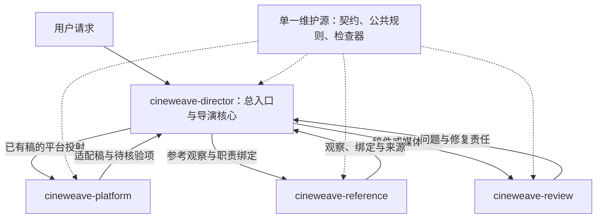

# CineWeave Skill 拆分与编排计划 · 2026-10-12

本计划采用“一主三专”：保留 `cineweave-director` 作为统一入口与导演核心，逐步增加 `cineweave-platform`、`cineweave-reference`、`cineweave-review`。先验证同一代理按需使用不同 Skill，再评估是否需要独立子代理。拆分依据是独立交付物、输入输出和权威边界；不把 12 条路由机械变成 12 个 Skill。

本轮完成研究、当前工作树依赖审计和实施计划；尚未创建、安装或运行上述三个新 Skill。除开发评测登记和文档导航外，当前产品与单 Skill 分发架构保持原样。用户当前请求是制定计划，后续实施和发布状态分别记录。

## 1. 研究范围、证据与结论

查阅日期均为 2026-10-12。OpenAI 文档通过官方文档 MCP 搜索后取正文；Agent Skills 与 Anthropic 使用官方网页；Higgsfield 使用固定源码。来源陈述、当前源码事实、本项目设计提案和待测效果分开记录。

| 来源 | 已查阅的关键内容 | 本项目采用的结论 |
| --- | --- | --- |
| [OpenAI Build skills](https://learn.chatgpt.com/docs/build-skills) | 名称／描述先进入发现目录，选中后读取完整入口；描述影响隐式激活；同名 Skill 不合并；插件支持多个 Skill | 为每个入口写清主交付物和相邻任务边界；测试实际激活与加载路径；新增目录不等于自动获得编排能力 |
| [OpenAI 插件 Skill 作者指南](https://developers.openai.com/plugins/build/skills) | 按不同触发、输入或成功标准分工作流；一个插件可包含一组相关 Skill；工具依赖不代替工作流说明 | 保留一个插件与市场条目；声明入口选择、交接、缺失恢复和验收，而非为每个入口创建插件 |
| [OpenAI 编排与交接](https://developers.openai.com/api/docs/guides/agents/orchestration) | manager 保留最终答复责任与 handoff 转移会话责任是不同模式；只在隔离能力／策略／指令有实质收益时增加 specialist | CineWeave 默认由导演收口，专业能力返回限定结果；不在一个作品中来回转移最终用户答复责任 |
| [OpenAI Subagents](https://learn.chatgpt.com/docs/agent-configuration/subagents) | 宿主可委派并汇总；子代理有独立模型／工具工作和成本；读多写少的并行比同时写同一对象更容易控制 | 独立研究和冻结稿件评审可并行；共享设定串行整合。当前不新增项目代理配置或变更模型设置 |
| [Agent Skills 规范](https://agentskills.io/specification)、[客户端集成](https://agentskills.io/client-implementation/adding-skills-support) | 最小目录、渐进加载、资源路径；子代理委派属于可选客户端模式，实验字段的支持因实现而异 | 以可移植 Skill 目录为底座；宿主委派另设能力检查，保持无子代理也可用的内联路径 |
| [Agent Skills 作者实践](https://agentskills.io/skill-creation/best-practices) | coherent unit of work；过细增加加载与冲突，过宽影响触发；内容预算是建议 | 按完整任务定界；现有入口已为 59 行、6,879 B，文件长度不是此次拆分的充分理由 |
| [触发优化](https://agentskills.io/skill-creation/optimizing-descriptions)、[技能输出评估](https://agentskills.io/skill-creation/evaluating-skills) | 检查正例和相邻负例，比较干净上下文中的实际输出、轨迹与成本 | 分别评发现、交付和编排；不把文件闭包通过当内容质量通过，不用字符数推算实际 token |
| [Anthropic Building effective agents](https://www.anthropic.com/engineering/building-effective-agents) | chaining、routing、parallelization、orchestrator-workers、evaluator-optimizer 各有前提 | 有依赖的创作链串行，独立只读任务并行；默认采用能完成任务的最简单流程 |
| [Anthropic 多代理研究系统](https://www.anthropic.com/engineering/multi-agent-research-system) | 大规模独立研究适合分工，强依赖及大量共享上下文增加协调成本；文中成本倍率属于特定系统 | 不把连续动作／镜头拆成彼此重新推演的代理；不将该文的倍率当 CineWeave 成本预测 |
| [Anthropic 技能作者指南](https://platform.claude.com/docs/en/agents-and-tools/agent-skills/best-practices)、[Claude Code Skill 扩展](https://code.claude.com/docs/en/skills#using-skill-frontmatter-outside-claude-code) | 创作自由与脆弱操作需要不同控制程度；Claude 有宿主扩展字段 | 创作判断用指导，机械闭合用检查器；不把 `context: fork`、`agent`、hooks 或动态命令注入当 Codex 通用机制 |
| [OpenAI 工作流评估](https://developers.openai.com/api/docs/guides/agent-evals) | 先检查实际轨迹，再建立可重复数据集与对照 | 每次运行绑定请求、源版本、完整回答、交接和实际检查结果；新架构默认切换由证据决定 |
| [Higgsfield 固定源码说明](https://github.com/higgsfield-ai/skills/blob/f83af0bc1d937c8119099a11f8ebbf5e6fb99819/CLAUDE.md) | 八个交付物入口、统一 CLI、内部按需参考、自包含与版本同步 | 吸收明确返回值和完整工作单元；CineWeave 仍提供中文创作、规划与只读检查，保持单向领域权威 |

关于描述文体，Agent Skills 触发指南偏向命令式，Anthropic 作者指南偏向第三人称；两者都不是开放格式硬约束。保持现有中文习惯，依据 Codex 触发用例选择表述，不全仓库机械改文体。具体研究见[标准与 Anthropic 证据](cineweave-split-standards-research-2026-10-12.md)。

### 对 Higgsfield 的选择性吸收

固定 Skills SHA 为 `f83af0bc1d937c8119099a11f8ebbf5e6fb99819`，CLI SHA 为 `dc7e2d2eac0b1fdad255de24d87552d1ba479037`；这不是对今日在线服务能力的断言。

完整 explainer 在一个 Skill 内完成旁白、视频和组装，website 也在一个入口内选择多种产品流程，说明紧密耦合的步骤仍可内部路由。公开快照中的跨 Skill 衔接主要是文档流程和返回值；未发现统一多 Skill 调度程序。CLI 快照以说明与安装材料为主，不能从 README 确认后端重试或 schema 执行效果。[固定 explainer](https://github.com/higgsfield-ai/skills/blob/f83af0bc1d937c8119099a11f8ebbf5e6fb99819/higgsfield-video-explainer/SKILL.md)、[固定 website](https://github.com/higgsfield-ai/skills/blob/f83af0bc1d937c8119099a11f8ebbf5e6fb99819/higgsfield-websites/SKILL.md)、[CLI 快照](https://github.com/higgsfield-ai/cli/tree/dc7e2d2eac0b1fdad255de24d87552d1ba479037)。

其 cookbook 有值得保留的反例：创始人广告流程训练的身份 ID 未进入展示的商品图命令；另一流程把同版目录中的静态图模型用于 60 秒视频。可确认文档交接缺口与不一致，不能据此判定今日 live API 的成败。本计划增加“生产者结果确实出现在消费者输入”和准确模式核对。[固定 cookbook](https://github.com/higgsfield-ai/skills/blob/f83af0bc1d937c8119099a11f8ebbf5e6fb99819/COOKBOOK.md#L7-L130)、[同版模型目录](https://github.com/higgsfield-ai/skills/blob/f83af0bc1d937c8119099a11f8ebbf5e6fb99819/higgsfield-generate/references/model-catalog.md#L24-L25)、[CLI 模型说明](https://github.com/higgsfield-ai/cli/blob/dc7e2d2eac0b1fdad255de24d87552d1ba479037/MODELS.md#L295-L307)。

其 CI 检查了部分元数据、版本和本地引用，没有验证触发碰撞、安装组合和真实内容效果。共享规则允许跨 Skill 漂移的做法也不适合 CineWeave。源层保留唯一维护位置，安装包副本由构建生成并校验字节一致。[固定 CI](https://github.com/higgsfield-ai/skills/blob/f83af0bc1d937c8119099a11f8ebbf5e6fb99819/.github/workflows/validate-skills.yml)、[自包含与版本约定](https://github.com/higgsfield-ai/skills/blob/f83af0bc1d937c8119099a11f8ebbf5e6fb99819/CLAUDE.md#L123-L147)。完整八 Skill 与实际检查边界见[Higgsfield 源码研究](cineweave-split-higgsfield-research-2026-10-12.md)。

## 2. 当前基线与拆分决策

本轮实读为 12 条路由、52 个唯一根 kind、54 schema（含两个支持定义）、52 规范示例、42 参考（4 core、12 routed、26 optional）和 161 分发文件。遍历 1,357 个 `$ref`，得到 46 条唯一跨 schema 边，未解析文件／fragment 为 0；这是依赖扫描结果，不代替完整验证。

当前工作树包含已完成但未提交的 Higgsfield 重构与入口精简。Git HEAD `0e476a7e96e43980bbfe8388c446c3f78fd06019` 是较早版本，不能直接作为本轮行为基线。此前 392 项回归和字节一致构建结果见[已完成的精简记录](cineweave-simplification-2026-10-12.md)；该记录不证明新架构已测试。

### 一主三专的目标归属

| Skill | 用户交付目标与触发 | 拥有的根产物 | 应保留的边界 |
| --- | --- | ---: | --- |
| `cineweave-director` | 新创作、单图／单镜、故事资产、连续场次或完整短片；跨阶段请求由此统一收口 | 43 | 世界、故事、人物、场景、风格、动作、镜头、分镜、平台中立提示词及非执行制作规划 |
| `cineweave-platform` | 将已有母稿适配指定平台、模型、界面和模式，检查参数、参考槽位与复制交接 | 1 | 只拥有 `cineweave_codex_prompt_projection_plan`；不重新创作上游故事／动作，不拥有能力档案或供应商执行 |
| `cineweave-reference` | 分析实际参考、区分参考职责、提炼可迁移内容及绑定材料 | 4 | ReferenceAsset、ReferenceObservation、ReferenceBindingSet、AssetAliasRegistry；缺素材时给条件设计，不声称已观察 |
| `cineweave-review` | 检查已有文本或实际媒体，形成问题、责任归属、修复计划及对照方案 | 4 | ControlBenchmark、ControlBenchmarkReview、CreativeReview、RepairPlan；上游修改回到责任领域，评审不能自行变成批准 |

43＋1＋4＋4＝52。保留原 12 个 route ID 和 kind 的领域 owner，另用开发目录声明“由哪个 Skill 实现该 kind”。`image_prompt` 必须按 kind 分：PromptRecord 与 ImagePrompt 留导演，PromptProjectionPlan 交适配。不能给整条 route 只有一个 implementationSkill，亦不能把 10 个 production_plan 产物整体搬到适配。

完整 52 kind、42 参考及源行号见[依赖审计](cineweave-split-dependency-audit-2026-10-12.md)与[机器依赖图](cineweave-split-dependency-map-2026-10-12.json)。下面是 12 路由的目标摘要：

| 当前领域路由 | 当前根 kind 数 | 目标实现归属 |
| --- | ---: | --- |
| brief_world | 3 | 导演 |
| story | 4 | 导演 |
| character | 5 | 导演 |
| scene | 5 | 导演 |
| style | 4 | 导演 |
| reference_evidence | 4 | 参考 |
| action | 1 | 导演 |
| shot_direction | 7 | 导演 |
| storyboard_rhythm | 2 | 导演 |
| image_prompt | 3 | 导演 2、适配 1 |
| production_plan | 10 | 导演 |
| review_repair | 4 | 评审 |

### 暂不单独拆故事、资产、动作和镜头

人物包含表演任务与 PerformanceTimeline；镜头消费准确动作节拍与接触阶段；分镜切点承接持有、位置、方向和运动相位；时间与声音不能离开同一镜头的状态链。将这些工作分别派给独立代理，会增加重新解释同一事实的机会。当前内部路由已能直接完成单项任务，独立安装收益需要另测。[当前工作模型](../../skills/cineweave-director/references/core/operating-model.md#架构与职责)、[动作路由](../../skills/cineweave-director/references/routes/action.md)、[分镜接口](../../skills/cineweave-director/references/routes/storyboard-rhythm.md#相邻剪辑接口)。

后续只有当故事／资产存在持续独立使用需求、能够交付足够完整的状态和依赖，并在同任务对照中减少误用或维护成本时，才再提取对应入口。文档较长、专业名称不同、JSON 类型较多，均不单独构成拆分理由。

## 3. 目标架构与调用责任



图中箭头是调用和结果归属，不代表已有自动调度运行时。按用户在执行期间的澄清，产品是统一入口工作流：所有请求从导演进入，内部专业能力按需执行并返回入口，导演统一核对原请求与答复。可独立分发用于兼容和恢复，不作为推荐的多入口使用方式。专业结果出现上游矛盾时，返回拥有该事实的领域，不由编排层另造 canon。

默认执行：同一代理根据目录选择 Skill，读取实际安装位置的入口，再按需读章节。只有独立研究、冻结稿件的独立审阅等任务需要隔离或并行时，才使用宿主提供的子代理能力。委派必须传入准确入口与最小输入，不能只说“找摄影专家”。缺该能力时采用同代理串行流程，注明未获得独立审阅证据。

OpenAI Agents SDK 的 manager／agents-as-tools 模式是责任设计参照，不是本项目当前依赖。此计划不把 CineWeave 改造成 SDK 应用；若未来确需持久运行、自动恢复、API traces 或供应商执行，再独立设计运行时和权限边界。

### 触发与主交付物选择

- 先识别请求主要要拿到的东西。原创剧情、图像或镜头稿归导演；既有母稿的平台方言转换归适配；观察与绑定归参考；检查已有结果归评审。
- 导演始终负责最终收口；最终交付物决定本次需要哪些内部能力及其依赖顺序。例如“分析两张服装参考并写人物稿”先取得参考观察与职责绑定，再由导演完成完整人物稿。
- 明确 `$skill` 调用时尊重该能力的交付范围，内部结果返回导演；跨阶段需求仍保留原请求，不能因返回了一个局部结果就声称完成全部任务。
- 用户明确统一入口后，仅导演保留 `allow_implicit_invocation: true`，内部三个 Skill 为 false，通过导演准确交接来执行。入口选择、实际叶能力及最终收口分别验证；这是产品工作流约束，旧多入口触发试验继续保留为历史能力证据，不冒充新入口流程已验证。
- 四个入口不是四种权限。授权继承当前任务，原创草拟和子代理委派均不扩大外部执行、素材权利或发布批准。
- 多个入口匹配不自动构成失败：真实组合任务可以使用多个 Skill。失败标准是主交付物被错误接管、重复生成同一事实、漏掉所需能力或导致指令冲突。

## 4. 共享源、分发与兼容

### 先保持当前权威位置

`skills/cineweave-director/contracts.json`、现有契约索引、公共规则及验证内核在试点期继续作为单一维护源。12 路由、52 根 kind、2.x 产物线版本、精确引用与 JCS 语义不因入口名字变化而重命名。`contracts.skill` 与 `index.skill` 当前是协议命名空间 `cineweave-director`，不能直接替换成子 Skill 名；新的实现归属只进入开发目录和交接记录。

现有 `ImagePrompt` 没有规范 ID／version，缺上游正文仍须保留未核验。引用 metadata、批准、权利、观察、测量和实际媒体不能相互提升。现有模拟示例继续明确为夹具，不能成为新 Skill 的真实批准记录。

### 源层与发布层分开

计划新增开发侧 `skill-catalog.json`，登记各阶段实际启用的 Skill、kind 实现 owner、所需输入类型、资源导出、共享来源与检查器。目标 owner 与当前启用 owner 分开，不能先把未构建的 Skill 登记为可调用。此目录是构建／开发数据，不是第 53 个规范产物，也不是 Agent Skills 标准的依赖字段。

新增专业入口的唯一作者源码可放在 `skill-sources/<skill-name>/`。当前导演源码路径保持兼容；构建读取目录清单，将必要资源物化到每个发布 Skill 内。具体拟议结构：

```text
skills/cineweave-director/          现有导演与共享规范的唯一维护源
skill-sources/cineweave-platform/   新适配入口和独有说明
skill-sources/cineweave-reference/  新参考入口和独有说明
skill-sources/cineweave-review/     新评审入口和独有说明
skill-catalog.json                开发侧实现与资源映射
.build/cineweave-director/
  .codex-plugin/plugin.json
  skills/
    cineweave-director/
    cineweave-platform/
    cineweave-reference/
    cineweave-review/
```

这些路径是实施目标，当前未创建。Skill 包内不依赖 `../sibling-skill`、源码工作目录或作者电脑的绝对路径；需要公共规则时读取本包派生副本。副本禁止手工维护，生成来源与哈希由清单记录。共享文字中的链接必须显式重定位或保留原目录结构，构建后重新验证所有本地章节引用。

单插件整包是默认交付，保持 `.codex-plugin/plugin.json` 的 `skills: "./skills/"` 和市场单插件身份。单个专业 Skill 的独立安装包作为另一个构建目标，必须实际隔离测试；插件级“一个安装包”与“包内四个 Skill”并不冲突。

### 所有权闭包不同于验证闭包

| 目标能力 | 拥有 root 数 | 只按 `$ref` 计算的 schema 闭包 | 实际计划 |
| --- | ---: | ---: | --- |
| 导演 | 43 | 46 | 保留聚合内核与完整共享规则 |
| 参考 | 4 | 5 | 输出 owner 为 4，不把依赖副本当新增 owner |
| 适配 | 1 | 4 | 还需实际母稿、能力／许可及上下文结构；不能只打包这 4 个 schema |
| 评审 | 4 | 5 | 需读取待审产物与准确来源，不能只检查评审外壳 |

适配的两种母稿及档案结构扩展闭包可达 12 schema；当前验证器还依据聚合索引查找上下文 kind。首轮独立包保留完整 54 schema、52 示例及现有聚合索引，按需读取，不预先做“最小 schema 包”。规范检查器保持开发／集成侧的共用内核；随包只读辅助器按实际使用登记，不把所有开发测试复制进 Skill。

在全包与独立安装均通过后，再依据 `$ref`、实际上下文输入、检查器导入与文本章节四种依赖计算最小包。若裁剪了可接受输入范围，应明确暴露支持边界并验证拒绝行为，不能用少了文件来伪装等价校验。

## 5. 编排交接协议

复用既有 WorkflowPlan 与正式产物；不先扩张 canonical kinds。普通草稿用简短工作说明即可，以下字段是拟议开发交接约定，不强迫用户填写 JSON。

| 交接信息 | 最小工作稿要求 | 正式／系统集成交接补充 |
| --- | --- | --- |
| 任务 | 原请求、当前子目标、所需交付物、同项目或独立项目范围 | 可追溯工作 ID、准确任务版本 |
| 输入 | 实际源文本／可访问素材、用户硬锁、已委托决定、假设和未知 | 原 kind、引用、版本、内容哈希及完整正文；不可解析 latest |
| 修改责任 | 本 Skill 的产物、可修改部分、不能改变的上游事实 | owner 与受影响消费者；来源改变后新版本和复查范围 |
| 能力 | 已提供平台／模型／界面／模式及证据日期，未知保持未知 | 准确 CapabilityProfile／LicenseProfile 等引用与正文 |
| 返回 | 完整可用稿件、实际发现、假设／未决项、下一步责任 | 产物版本、精确依赖、实际工具命令／原生退出码及检查结果 |
| 完成范围 | 哪部分已交付，哪部分仍待输入或复查 | 不把局部 valid、coverageComplete 或 reviewComplete 当整体请求或真实媒体通过 |

结果状态先采用工作流词汇“草稿完成／需修订／依赖待补／本阶段完成”，与现有正式状态枚举分开。不增加这些字符串到 schema 中，也不把本阶段完成自动提升为 canon 批准。

### 依赖、并行与回流

1. 总入口确定最小能力集合与当前来源，记录用户事实、授权设计、假设和观察的区别。
2. 上游未确定时先做不依赖它的工作；普通草稿声明假设继续，不为所有步骤重复确认。
3. 有事实依赖的链串行：共享设定／状态 → 动作与镜头 → 平台中立母稿 → 平台投射 → 制作规划 → 实际证据与评审。
4. 独立来源研究或同一冻结稿件的不同检查可并行，各自只返回本职责结果；不并行改同一人物、场景或镜头版本。
5. 专业能力可形成本领域候选；由导演按领域 owner、用户硬锁和来源选择整合，保留旧版本和未采用意见。共享状态只有一个整合写回点。
6. 评审发现编译遗漏，返回提示词责任；发现动作不可达，返回动作／场景责任。创建新版本后选择性重编译，沿用现有只读变更影响查询。[变更影响](../../skills/cineweave-director/references/optional/drafts-and-change-impact.md#只读变更影响查询)。
7. 只有综合设计／提示词评审、完整场次定稿和正式镜头组交接才执行完整六视角；Node 可用时整理并实际检查。六视角不要求六个代理。
8. 重试前须有新的来源、证据或确定修正；预算由具体任务定义，连续无新信息的循环停止并交付未决项，不自动更换硬锁、缩减原请求或重复运行相同检查。

现有辅助器的 stdout／stderr 和原生退出码分别保持现行接口，例如变更影响工具的 JSON 诊断在 stdout。标准中的一般脚本建议不能覆盖已经受测试保护的项目协议。

### 缺失与冲突恢复

| 情况 | 处理 |
| --- | --- |
| 专业 Skill 未安装／未被目录发现 | 不伪称调用成功；试点期用保留的导演内联等价路径完成可做部分，说明实际路径；不自动安装依赖 |
| 母稿或精确引用正文缺失 | 完成可审阅工作稿，正式绑定和依赖结论保留未核验；不凭标题或邻案重建事实 |
| 同名旧缓存与新源同时出现 | 按准确入口路径和版本选择，记录实际读入哈希；不假定宿主合并或总会选新版 |
| 源版本、哈希或 owner 冲突 | 使用现有准确引用规则拒绝矛盾绑定，返回责任来源；不偷偷解析 latest 或重写已批准父产物 |
| 专业结果互相矛盾 | 按用户硬锁、上游权威和场景目的解决；不投票平均，不新增平行 canon |
| 缺实际媒体或宿主不能访问 | 限于文本／声明一致性及条件诊断，媒体、时序和音画同步未知；不得声称已观察 |
| 独立子代理能力不可用 | 同代理串行读取专业 Skill，保留“未执行独立审阅”；不把它计入多代理效果对照 |

## 6. 分阶段实施与验收

该表记录分阶段实施顺序，实际进度与逐阶段审查以[执行记录](cineweave-split-execution-2026-10-12.md)为准。阶段通过才扩下一项能力；若未达标，修正本阶段或保留原默认架构。表中的 owner 数是阶段实际启用归属，不是预先启用目标目录。执行期间用户明确统一入口工作流，因此 P5 改为验证导演按需调用内部能力并统一交付；原可选委派对照未运行、不采用。

| 阶段 | 具体变更与交付 | 关键文件／模块 | 进入下一阶段的证据 | 回滚边界 |
| --- | --- | --- | --- | --- |
| P0 基线冻结 | 保存可重建的不可变当前工作树快照，覆盖完整分发、开发代码／测试／清单和必要未跟踪源；保存输入集与完整已知失败，按哈希核对。排除 Git 元数据、凭据、用户媒体与无关本地输出 | 本轮计划／证据；现有 evaluations；完整源快照及哈希清单 | 从快照独立重建／校验基线，知识与验证正文完整；SHA 清单或较早 HEAD 均不能替代源正文；输入与52唯一owner可复核 | 无产品改动，原工作树与本地输出不删除 |
| P1 目录与共享打包 | 建开发 catalog、kind 级实现映射、轻量交接；使检查／构建支持明确登记多个 Skill 和派生共享副本，仍只有导演入口启用 | `skill-catalog.json`；validate-repository；build-plugin-bundle；索引与说明；相关回归 | 当前单入口兼容；未知目录／重复 owner／坏路径／派生副本漂移全部被拒绝；现有契约语义不退化 | 保留原 registry、构建与完整核心来源，恢复本阶段文件即可 |
| P2 平台适配试点 | 增适配入口和 metadata，导出所需指南；当前 owner 为导演 51＋适配 1；导演保留等价内联恢复 | 新 platform 作者源；image-prompt 的适配章节；video-platform-adaptation；projection/context 测试 | 同一母稿得到忠实适配；准确 body／参数／参考闭合；独立安装与全插件两种路径通过；无供应商执行 | 移除适配激活项，导演内联继续使用相同规范 |
| P3 参考分析提取 | 增参考入口，区分身份／服装／场景／风格，返回观察和绑定；当前 owner 为导演 47＋适配 1＋参考 4 | 新 reference 作者源；reference-evidence-and-rights；reference 路由与角色绑定用例 | 实际素材与设计推断分开；不串脸、不把观察升级为权利或批准；缺素材仍保留可用草稿 | 恢复导演参考入口；公共引用与素材记录原样保留 |
| P4 评审提取与总入口收口 | 增评审入口，准确来源、修复责任及六视角保持；目标 owner 达到43＋1＋4＋4；目录指引完整单项／跨阶段路径 | 新 review 作者源；review-repair；diagnostics；ensemble 按职责章节导出；主入口 | 普通草稿无强制工作表；正式任务完整覆盖与实际检查；独立评审不反写硬锁；修订仅影响声明部分 | 保留核心评审恢复说明；撤回专业默认路由，不删除历史评审 |
| P5 统一入口工作流 | 导演作为唯一默认入口，按需执行内部 Skill、收回子结果并统一交付；内部三个 Skill 不隐式选用，默认同代理 | 四个入口及代理策略；共同工作模型；策略负向测试；原请求前向全文 | 全部 CineWeave 案从导演进入，所需内部结果返回入口；组合请求完成原目标，负例不激活；独立 review 核对首版与实际检查 | 恢复上一阶段源码快照；保留全部首版和审查，不添加委派运行或收益宣称 |
| P6 兼容发布与恢复 | 校验单插件、单叶安装、缓存版本、缺 Skill 恢复及中文完整稿；根据实际兼容结果确定新版本与发布说明 | manifest／marketplace／openai.yaml；README／CONTRIBUTING／CHANGELOG；CI／bundle smoke | 全工程门禁、独立前向对照、安装矩阵通过；准确发布 ref 与运行路径可追踪，用户原入口持续可用 | 恢复准确旧构建及旧发布配置，不移动旧标签，不抹除已有工作产物 |

先改变目录和打包，再拆能力，最后验证统一入口工作流与兼容性；默认同代理，原可选委派试验未运行、不采用。每阶段列出准确变更集合与恢复文件，保留受影响源稿和原评测。实际隔离安装仅发生在临时home，用于兼容及升级／回退验证；没有安装到用户profile，也未提交、推送或发布。

### 必须迁移的当前工程假设

以下位置以本轮依赖审计时源码为准；本轮追加评测清单会使开发脚本后续行号移动，实施时重新定位符号。

| 当前假设 | 实施应怎么改 |
| --- | --- |
| `validate-repository.mjs` 的 SKILL_PREFIX 与目录唯一检查 | 使用显式 catalog 的启用集合逐包验证；精确登记仍保留，不能改成文件系统里有什么就接受什么 |
| 同文件对 routed 资料、共享入口、agents metadata 的单包条件 | 区分唯一维护 owner 与派生分发副本；验证每包 metadata／引用闭包；导演主入口仍只有一个最终交付责任 |
| `generate-contract-index.mjs` 固定 core 路径 | 首轮保留聚合索引权威；对子包生成资源投影并核对完整上下文，不按输出 owner 直接过滤可验证 kind |
| `validate-output.mjs` 与 contract-context 的准确 index／contracts 查找 | 保留协议命名空间、已有限制与精确匹配；若引入包根参数必须验证准确 release 根，不能绕过防越界／符号链接检查 |
| 当前 build 只复制 inventory 文件 | 加显式 source→destination 派生映射，保留安全输出目录、源稳定后构建和字节一致；所有派生副本可追溯 |
| bundle smoke 的单 Skill 脚本位置 | 全包＋三叶包逐项在仓库外运行，验证相对 import、退出状态、输入与包只读；不暗含源码根存在 |
| CI 先源码校验再 npm test；固定 actions、权限与发布标签 | 顺序和完整门禁继续保留；扩多 Skill 验证目标，不引入未登记生命周期或额外执行权限 |
| 公共稿件中的单 Skill／内部路由措辞 | 仅到相应阶段通过后修改，说明当前主入口、专业能力、同代理读取与可选委派；不提前宣称新架构已上线 |

## 7. 对照评测与切换条件

### 三组隔离变量

- A：当前精简后的单 Skill，源版本冻结。
- B：四 Skill、同一代理按需读取，测拆包与入口边界的效果。
- C：与 B 相同的四 Skill，仅对规定独立任务使用宿主子代理，测委派的增量收益。

先比较 A/B，再比较 B/C。请求、必要原始素材、可用工具、模型与推理设置尽量相同；无法一致的环境差异必须记录。评测执行者只看到源 Skill、原始请求和最小原材料，不读答案、must/mustNot、旧回答或研究结论；审阅者在实际输出完成后再使用判断依据。

### 最小试点任务集

以下数量是本项目试点预算，非行业标准或统计保证。P2 从适配相关子集开始；四包目标完成后覆盖全表。

| 层次 | 定义的任务／反例 | 验证方式 |
| --- | --- | --- |
| 触发与主交付物 | 24 条查询：8 明确单项、8 隐含意图、8 相邻／组合／负例；每条记录允许的主负责人和必要辅助能力 | 当前宿主实际读取哪份入口；显式调用与隐式发现分开；保留未激活、重复接管和目录截断记录 |
| 八类内容对照 | 单图完整稿；无图的6秒I2V；连续两镜；已有母稿指定平台；身份／服装多参考；无来源的平台能力；完整六视角定稿；跨阶段局部修订 | 完整中文交付、硬锁、接触／出入态、角色绑定、源忠实度、未知项、修订范围；至少三次独立重复用于暴露不稳定，不推导普遍成功率 |
| 交接反例 | 丢失 source 正文、ID／版本错绑、母稿被适配改写、消费者未使用产出、独立场景串案、同项目授权丢失、旧评审被沿用、循环无进展 | 保存 producer 与 consumer 全文、实际轨迹和责任回流；不只匹配提示词中的字符串 |
| 工程反例 | 重复 owner、遗漏 kind、未登记目录、缺传递 schema／script、源／派生副本漂移、越界路径、同名旧版本、坏CLI状态处理 | 真实隔离包及现有验证器；准确拒绝，不引入永久整套测试源码副本 |
| 安装与发现 | 默认全插件；仅适配；仅参考；仅评审；director-only恢复；旧／新同名并存 | 包外目录与实际宿主两层分别测；静态入口存在不等于宿主成功发现或实际调用 |
| 实际媒体 | 身份／服饰、接触与空间、动作时序、跨镜连续、声音同步的最小试片 | 另按实际提供或生成的图像／视频／音频审阅；本计划没有媒体运行，该层全部待验 |

### 记录与决策

每个 run 保存：原请求与原始输入、真实加载路径／文件哈希、编排模式、完整首版与修订、输入输出交接、实际命令／原生退出码、独立审阅、澄清次数、未决项、可知模型设置、时延及模型／工具工作量。读取的文件字节只代表加载范围；无法获取 token 时为 null，不能换算估计后当实测。逐案报告失败，保留首版，不用汇总分数遮盖硬锁错误。

默认切换的必要条件：零已知未修复的硬锁、事实／来源、越权执行、虚构媒体和精确引用阻断问题；全部 kinds 有且仅有一个实现 owner；单叶与全包均闭合；正式六视角不退化；旧入口可完成原先单项任务。误触发、完整性、修订漂移和成本至少不出现未解释的退化，并在独立复用、路由或维护上出现具体可复核收益。

若 B 只改善维护与独立安装，但没有降低 token，也可据此采用；要说明真实收益。若 C 没有足以抵消额外工作量的质量或时延收益，保持 B 为默认。多个 Skill 不强制对应多个 Agent，三个对照组不能混算。

## 8. 风险、应对与后续首步

| 风险 | 具体应对与验收 |
| --- | --- |
| 拆分后共享设定漂移 | 单一维护源；准确正文和版本交接；同任务连续性对照；局部修改查影响 |
| 包变小但语义检查缺失 | 分开 owner、结构与语义依赖；首轮完整内核；在隔离包中投喂缺源及矛盾源反例 |
| 文档路径和章节迁移破坏既有入口 | 先导出完整目录或显式章节投影；保留必要锚点；全本地链接与旧工作流回归 |
| 发现描述重叠或旧缓存误选 | 测相邻任务、组合任务与同名目录；记录 actual path/hash；不靠禁用隐式调用绕开 |
| 总入口每次都启动全部专家 | 单项直达与最小能力集合；只在正式范围做完整评审；实际轨迹检查是否无谓加载 |
| 多代理共享文件竞写／过度成本 | 冻结输入、限定返回、单点整合；先测内联，再评委派；能力不足串行恢复 |
| 为了拆包改写所有业务协议 | 保留当前 kind、route、版本与 namespace；新增目录和工作记录不成为 canonical root |
| 把研究／打包测试当创作效果 | 工程、文字行为、实际媒体三级分别报告；预先定义 run 未执行状态 |

下一步先完成 P0 的完整源／输入冻结并从快照独立重建校验，再进入 P1 的开发 catalog 和多包派生／校验，保留现有导演行为；随后 P2 只提取平台适配并做同母稿对照。没有证据前不拆故事／资产、不移除核心恢复路径、不将子代理编排设为默认。

本轮执行范围、源清单、来源目录、原始研究报告哈希和计划审阅见[计划证据清单](cineweave-skill-split-evidence-2026-10-12.json)与[独立计划审阅](cineweave-split-plan-review-2026-10-12.md)。这些开发文件不随 Skill 分发。当前产品仍为单入口；本轮没有新的 Skill 行为对照、安装、供应商执行、媒体生成、提交或推送。

本轮最终复核：源码与 82 份 Markdown 的本地引用检查通过（849 链接、125 章节片段），契约索引检查通过，现有 161 文件构建包与当前产品源码仍一致，`git diff --check` 通过。81 项基线源／旧证据中80项字节未变；唯一变化是开发验证器增加本轮报告登记，移除这7项后可逐字节恢复原验证器。README仅增加计划导航。本轮未重跑392项全回归，该结果属于此前精简验收；没有把它计为本轮新架构证据。
