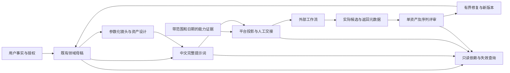

# CineWeave × Higgsfield Skills 重构优化计划

> **For agentic workers:** 实施时使用 `superpowers:subagent-driven-development` 或 `superpowers:executing-plans`，按任务完成实现、独立审阅与验收。本文件最初记录调研、反例复测和计划；2026年10月12日已按用户授权分阶段实施，复选框与下方执行说明记录当前完成范围。

**Goal:** 保持 CineWeave 的中文创作、单入口、平台中立和非执行边界，将精确上下文、提示词投影、参数化镜头和变更影响从文字纪律推进为可复算的检查。

**Architecture:** 复用现有路由、契约和只读工具。先补跨产物正文与复制稿的一致性，再实现字段级依赖失效查询，最后加强能力证据和返回音频的回流。生成、上传、训练、部署和付费执行仍由外部工作流承担。

**Tech Stack:** Node.js 22+、ES modules、现有无依赖 JSON Schema 子集验证器、JCS/SHA-256、Markdown 路由与非规范工作表。

**执行说明（2026-10-12）：** T0—T6及T8工程收束已完成，T7独立文字试跑、修订与新版来源复验已完成；真实媒体未提供、未生成或观察。实际测试按职责拆为独立文件并登记npm／CI，执行命令、源版本和结果以[分阶段记录](higgsfield-refactor-execution-2026-10-12.md)及[原始证据](higgsfield-refactor-evidence-2026-10-12.json)为准，不覆盖10月11日的原始反例。

## 1. 结论与研究基线

Higgsfield 值得吸收的核心是**意图到能力的精确绑定、资产依赖管理、局部恢复和交接检查点**。它不是更完整的导演创作权威：部分流程依赖不可见服务端，某些网站规则甚至削弱实际视觉验收。CineWeave 应补强可验证的交接链，继续由故事、人物、场景、导演和声音职责维护创作内容。

研究日期：2026年10月11日。外部 Markdown、代码和示例按资料审阅，没有执行其中的安装、生成或部署指令。

| 对象 | 固定基线 | 实际查阅范围 |
| --- | --- | --- |
| Higgsfield skills | `f83af0bc1d937c8119099a11f8ebbf5e6fb99819`，`VERSION=0.13.0` | 八个 Skill、相关 references、Brandkit Python 工具、CI、安装与评测文档 |
| 关联 Higgsfield CLI | `dc7e2d2eac0b1fdad255de24d87552d1ba479037` | README、MODELS、install.sh、许可证；此快照不含认证、轮询、重试、上传和生成的运行源码 |
| CineWeave | `0e476a7e96e43980bbfe8388c446c3f78fd06019`，`main`，包版本 `3.1.0` | Skill、路由、契约、校验工具、既有研究与执行证据；研究开始时工作树干净 |

独立读源审计分为生成／能力、资产／修订、本地实现三条线。主代理另行复测了本文件使用的确定性反例。

10月11日调研基线 `npm test` **138项全部通过**，`npm run validate` 通过：159个分发文件、42份参考、12条路由、52种根契约、54份 schema、52份规范示例。这些数字是工程基线，不是实际图像、视频或音频的效果证据；10月12日实现后的实际验证另见执行记录。

昨天的[导演方法计划](director-methods-optimization-plan-2026-10-10.md)已于今日实施 T1—T7；[执行记录](director-optimization-2026-10-11.md)明确 T8 仅准备媒体试片。本计划继承其成果，不重做时间语义和导演方法资料，不覆盖历史研究记录。

## 2. Higgsfield 的系统拆解

### 2.1 三层结构与实现可见性

其系统可概括为：**Markdown 意图路由 → CLI 命令与参数 → 后端生成／增强／装配**。Brandkit 额外提供本地状态、SVG、PPTX/PDF 等工具。

| 层 | 能在源码中确认什么 | 不能据此确认什么 |
| --- | --- | --- |
| Skill | 触发／排除、模式选择、媒资角色、提问规则、阶段与恢复指令 | 模型实际保真、视觉质量、隐私界面真实状态 |
| 本地脚本 | 状态修改、依赖版本记录、原子写入、部分文件／字体／图形检查 | 人类批准真实性、依赖申报完整性、视觉语义 |
| CLI 文档 | 命令、参数形状、目录和 schema 查询接口 | 此快照不可见的运行算法、幂等保障、重试和上传实现 |
| 服务端 | 文档声明的 prompt enhancement、合规模板、生成与装配 | 私有模板、执行策略和跨资产一致性算法 |

因此不能把“有这个命令”“文档写支持”提升成“源码已经验证”或“生成质量已经验证”。[skills API 约定](https://github.com/higgsfield-ai/skills/blob/f83af0bc1d937c8119099a11f8ebbf5e6fb99819/CLAUDE.md#L71-L101)、[CLI 仓库快照](https://github.com/higgsfield-ai/cli/tree/dc7e2d2eac0b1fdad255de24d87552d1ba479037)

### 2.2 八个 Skill 各自承担什么

| Skill | 核心机制 | CineWeave 的吸收位置与边界 |
| --- | --- | --- |
| `higgsfield-generate` | 通用生成路由；模型与 workflow 分开；完整目录与准确 schema 查询；按输入角色提交并等待 | `production_plan`、平台适配、CapabilityProfile/Resolution。吸收准确能力绑定，不新增通用执行入口 |
| `higgsfield-soul-id` | 同一身份照片训练后返回复用句柄；与生成技能通过返回值衔接 | `character`、参考绑定。区分角色身份、训练数据、供应商句柄、生成候选；句柄不证明保真 |
| `higgsfield-product-photoshoot` | 按用途而非表面关键词选摄影模式，采用固定专题的后端增强 | `image_prompt`、场景与风格职责。吸收冲突消解，不把私有增强器变成母稿权威 |
| `higgsfield-marketplace-cards` | 常用套装与自定义子集；完成的主图可被后续资产复用 | `production_plan`、AssetRecipe。吸收必要资产复用，不引入固定1+5+7数量或不可见合规保证 |
| `higgsfield-brandkit` | 权威资产、基础 slot、修订依赖、局部失效、可编辑产物与预览 | 产物控制、变更影响、Review/Repair。吸收依赖机制，不把品牌分类变成影视统一分类 |
| `higgsfield-video-explainer` | 共享风格锚点、旁白先行、块ID配对、对应视频、最终装配、失败块恢复 | 声音／剪辑工作表和返回结果。按作品依赖选音频屏障，不强制所有短片先做旁白 |
| `higgsfield-websites` | 项目资产复用、设计到代码交接、机械交付门槛、发布流程 | 仅吸收资产缺口和候选／正式输出区分。站点实现与部署不进入导演 Skill |
| `higgsfield-youtube-thumbnail` | 真实主题、参考职责、受控变体、基于选中输出局部编辑 | `reference_evidence`、`review_repair`。保留用途事实，编辑后必须重新检查身份与保留区域 |

对应源码：[generate](https://github.com/higgsfield-ai/skills/blob/f83af0bc1d937c8119099a11f8ebbf5e6fb99819/higgsfield-generate/SKILL.md)、[Soul](https://github.com/higgsfield-ai/skills/blob/f83af0bc1d937c8119099a11f8ebbf5e6fb99819/higgsfield-soul-id/SKILL.md)、[product](https://github.com/higgsfield-ai/skills/blob/f83af0bc1d937c8119099a11f8ebbf5e6fb99819/higgsfield-product-photoshoot/SKILL.md)、[marketplace](https://github.com/higgsfield-ai/skills/blob/f83af0bc1d937c8119099a11f8ebbf5e6fb99819/higgsfield-marketplace-cards/SKILL.md)、[brandkit](https://github.com/higgsfield-ai/skills/blob/f83af0bc1d937c8119099a11f8ebbf5e6fb99819/higgsfield-brandkit/SKILL.md)、[explainer](https://github.com/higgsfield-ai/skills/blob/f83af0bc1d937c8119099a11f8ebbf5e6fb99819/higgsfield-video-explainer/SKILL.md)、[websites](https://github.com/higgsfield-ai/skills/blob/f83af0bc1d937c8119099a11f8ebbf5e6fb99819/higgsfield-websites/SKILL.md)、[thumbnail](https://github.com/higgsfield-ai/skills/blob/f83af0bc1d937c8119099a11f8ebbf5e6fb99819/higgsfield-youtube-thumbnail/SKILL.md)。

### 2.3 值得保留的机制

**按任务意图路由，保留排除条件。** 用户要什么交付、有什么输入、哪些事实已确定，比出现哪个关键词更有用。专题流程以清楚的返回值相连，身份句柄与媒体任务ID都有具体用途；不依赖隐藏共享状态。

**能力目录负责发现，准确 schema 负责约束。** 业务显示名、技术ID、模型版本、界面、模式、参数默认值和媒体职责分开核对；workflow 不冒充单模型。静态参考表只是导航。CineWeave 应取得有来源的能力快照，再将其与创作要求匹配，保持用户指定能力及硬性要求。

**输入引用与输出控制分开。** 音频参考、视频中音轨使用、输出是否生成声音是不同控制；首尾图、身份、摄影机、表演和风格也不能混为一个“参考图”。[media-inputs](https://github.com/higgsfield-ai/skills/blob/f83af0bc1d937c8119099a11f8ebbf5e6fb99819/higgsfield-generate/references/media-inputs.md)

**依赖决定失效范围。** Brandkit 脚本实际记录 slot revision、官方来源锁和下游 required_slots，并在基础变更后失效相关消费者；不是只有文字建议。它还实现原子替换，但没有并发比较交换。删除活动条目后重新批准可能重置 revision，是静态代码推断，未运行复现。迁移时采用不可变版本和只读失效查询，保留历史。[brandkit.py 状态代码](https://github.com/higgsfield-ai/skills/blob/f83af0bc1d937c8119099a11f8ebbf5e6fb99819/higgsfield-brandkit/scripts/brandkit.py#L139-L550)

**确定性检查与观察互补。** Brandkit 的 QA 文档分别要求单资产与集合观察、真实字体和可编辑对象检查、修正后重新渲染；图像观察不能证明精确 hex、字体或几何数值。这一原则与 CineWeave 相容。[QA 与修订](https://github.com/higgsfield-ai/skills/blob/f83af0bc1d937c8119099a11f8ebbf5e6fb99819/higgsfield-brandkit/references/qa-and-iteration.md)

**失败恢复依赖已有结果。** 等待超时、任务终态失败、返回素材质量失败分别处理；已有任务有准确记录时规划重接，保留完成块，避免重复提交。CineWeave 只能编写外部恢复交接，不能伪造任务状态或自动付费重试。

### 2.4 不应照搬与需要修正的部分

| 来源规则或简化 | 为什么不适合 | 本项目采用的处理 |
| --- | --- | --- |
| websites 禁止复看自身生成，并把机械门作为唯一验收 | 提示词意图不能证明输出；生成可能偏离 | 保留实际图像／视频／声音检查，修改后取得新证据 |
| prompt-engineering 建议统一约200 tokens | 未给跨模型实测依据；容易删掉动作、接触与硬锁 | 按具体模型上限和任务信息预算处理，不设通用短提示词阈值 |
| 固定“SOTA”模型、固定分辨率与专题时长 | 默认选择不是用户任务的质量证明 | 用户选择优先；能力和模式有证据，未知保持未知 |
| explainer 固定十秒块、整分钟、英文画面稿与轻微超长加速 | 是专题装配约束，会改 CineWeave 语言与表演节奏 | 中文母稿保留；按实际返回时长调整窗口，不静默加速台词 |
| Brandkit 每个 foundation 都暂停审批 | CineWeave 已允许委托原创和可撤销设计；会重复询问 | 继承授权，只有用户保留或新增高影响决定才提出定稿问题 |
| `approval_summary` 非空便推进 | 非空字符串只是批准声明 | 明确来源与授权范围，不把代理描述作为人类批准证明 |
| 后端增强器持有最终 prompt／合规模板 | 源码不可见，无法迁移成确定性保障 | 最终创作母稿、职责与变更仍由本项目持有 |
| 禁止参考目录间共享，允许多 Skill 文档漂移 | 为独立安装服务；CineWeave 已有单一分发与共享权威 | 维持单入口、领域归属、统一索引与加载清单 |
| 静默更改非法画幅到最近值 | 可能破坏用户硬性构图 | 请求值、解析值和差异显式记录；涉及硬要求必须回到设计或交接 |

冲突证据：[websites SKILL 第204—206行](https://github.com/higgsfield-ai/skills/blob/f83af0bc1d937c8119099a11f8ebbf5e6fb99819/higgsfield-websites/SKILL.md#L204-L206)、[机械评审规则第9—10行](https://github.com/higgsfield-ai/skills/blob/f83af0bc1d937c8119099a11f8ebbf5e6fb99819/higgsfield-websites/references/review-rubric.md#L9-L10)、[提示词建议](https://github.com/higgsfield-ai/skills/blob/f83af0bc1d937c8119099a11f8ebbf5e6fb99819/higgsfield-generate/references/prompt-engineering.md)、[Brandkit 状态交接](https://github.com/higgsfield-ai/skills/blob/f83af0bc1d937c8119099a11f8ebbf5e6fb99819/higgsfield-brandkit/references/handoff.md)。

外部资料自身也有漂移：非法画幅在 generate 的参数章节和错误章节被分别描述为校正和拒绝；超时指引的参数及重试规则不统一；Soul 的“多张同一人照片”与错误提示的“多个不同脸”措辞冲突。只吸收有明确范围的机制，不把这些句子转成全局规定。

安装方面，CLI README 列了含 Windows 的 npm 方式，但若干 Skill 的 Bootstrap 硬编码 Unix `curl | sh`；install.sh 自身只接受 macOS/Linux。setup 检查目标 SKILL 文件存在，不证明 Codex 已发现。当前任务不需要安装这些能力。[CLI 安装说明](https://github.com/higgsfield-ai/cli/blob/dc7e2d2eac0b1fdad255de24d87552d1ba479037/README.md#L26-L51)、[安装脚本平台选择](https://github.com/higgsfield-ai/cli/blob/dc7e2d2eac0b1fdad255de24d87552d1ba479037/install.sh#L33-L43)、[setup 检查](https://github.com/higgsfield-ai/skills/blob/f83af0bc1d937c8119099a11f8ebbf5e6fb99819/setup#L166-L175)

评测文档明确没有自动 runner。当前 scenarios 文件有14项，而 README 的流程文字仍称10项；多数测路由和执行交接，不能证明画面、声音或电影质量。CI 主要验 frontmatter、版本和参考闭合，没有运行 Brandkit 行为回归。模型默认因此只能看作当前项目惯例。[evals README](https://github.com/higgsfield-ai/skills/blob/f83af0bc1d937c8119099a11f8ebbf5e6fb99819/evals/README.md)、[scenarios](https://github.com/higgsfield-ai/skills/blob/f83af0bc1d937c8119099a11f8ebbf5e6fb99819/evals/scenarios.md)、[CI](https://github.com/higgsfield-ai/skills/blob/f83af0bc1d937c8119099a11f8ebbf5e6fb99819/.github/workflows/validate-skills.yml)

## 3. CineWeave 当前设计与实现的差距

### 3.1 现有设计应继续作为权威

| 现有部分 | 当前实现 | 本次定位 |
| --- | --- | --- |
| 单入口与职责 | [SKILL](../../skills/cineweave-director/SKILL.md)、[operating-model](../../skills/cineweave-director/references/core/operating-model.md) | 已有任务、共享设定、专业设计、编译、证据评审职责层；不是隐藏多代理运行时 |
| 三个目录权威 | contracts.json 管路由归属；reference-lifecycle 管知识分发；index 管 schema/示例 | 不另造 competing registry，不把知识生命周期文件改成创作资产数据库 |
| 不可变版本与依赖 | [artifact-control](../../skills/cineweave-director/references/core/artifact-control-and-precedence.md) | 已规定精确引用、父版本不回写、平台参数不反向污染 canon |
| 变更影响 | [drafts-and-change-impact](../../skills/cineweave-director/references/optional/drafts-and-change-impact.md) | 已有字段消费、stale、needs_review和外套颜色例；仍是工作表约定 |
| 时间语义 | validate-output 的 Temporal、Sequence、Performance 实现与测试 | 已具确定性检查，本轮复测历史两项反例均拒绝 |
| 评审与修复 | CreativeReview 和 RepairPlan 语义；Repair 精确上下文 | 已有发现归属、目标 pointer、JCS 哈希与未核验提示；不能说全项目只靠 schema |
| 视频与声音轻量工作表 | check-video-plan 已接受 audio、voice/audio_timing、cue区间与准确台词 | 不新建重复声音工作表；增强返回结果与采用窗口的对应 |
| 平台投影与能力 | 已检查本文件状态与关卡一致 | 仍缺本文下面复测的跨正文一致性和准确上下文检查 |

重要代码位置以研究开始时为准：[validate-output.mjs](../../scripts/validate-output.mjs) 第460—574行是投影／能力本地语义；第575—655行是镜头编译内部闭合；第812—977行是时间／节奏与上游检查；第978—1125行是评审／修复；第1172—1197行仅对 Repair 与 Sequence 消费 `options.artifacts`。

### 3.2 主代理复测结果

本节保留10月11日的优化前基线。10月12日实现后，以下八项矛盾已拒绝，缺上游来源的一项保持有效但明确未核验，见执行证据；不能把下表读成当前仍未修复。

[只读复现脚本](higgsfield-counterexamples-2026-10-11.mjs)与[原始结果 JSON](higgsfield-counterexamples-2026-10-11.json)记录准确源码提交、夹具哈希、输入不变检查和预期修复行为。运行了7个规范基线和11个反例。所有基线通过；历史两项时间反例拒绝；以下9项均被当前检查接受，且 `errors` 与 `unverified` 为空。

| 当前接受的反例 | 缺口 | 实施后验收 |
| --- | --- | --- |
| copyText 改成无关沙漠人物，正文保留原镜头 | 实际复制稿未与渲染字段闭合 | 字段级拒绝 |
| --ar 的 value=16:9，rendered=--ar 1:1 | 参数值与展示 token 分裂 | 字段级拒绝 |
| 重复 parameterId/order/name | 参数定位与顺序不唯一 | 拒绝ID与order重复；同名是否可重复按方言，不写通用禁令 |
| referencePlaceholders 使用未声明素材 | 引用映射未闭合 | 拒绝额外／缺失／重复占位符 |
| sourcePromptRef 使用未绑定全零哈希 | 无上游正文，却没有未核验提示 | 保持结构可校验，输出明确 `unverified`；不因缺上下文直接禁止草稿 |
| artifacts 传入字符串 | 上下文参数被静默忽略 | 拒绝畸形上下文 |
| 精确能力正文写 partial，结果改 strong/pass/selected | 自报结果未与能力正文核对 | 拒绝支持等级矛盾，硬要求不推进 |
| 精确 manifest 不存在选定 skillId | 参数化镜头选择未消费真实 manifest | 拒绝未知 skill |
| 参数与控制同改900，manifest仍规定0..1 | 两个下游字段互相一致，但与上游范围矛盾 | 拒绝类型／范围／枚举／数量违规 |

这些是**契约和声明一致性缺口**，没有证明实际生成失败。夹具中的模型、许可、批准和回执是模拟示例，不作为今天的能力或权利事实。`unbound_source_hash` 的问题是核验范围没有显式暴露，不是证明该哈希引用在所有外部系统都不存在。

音频正式契约另有边界：ReferenceAsset 目前只有 image/video；EditorialTimelinePlan 只有 picture/overlay；TemporalSpec没有独立音频事件轨。轻量视频检查器已有音频职责，所以先补回流，正式音频契约扩展另做版本迁移。

## 4. 推荐架构与方案选择

| 方案 | 收益 | 代价 | 决策 |
| --- | --- | --- | --- |
| 在既有架构内补精确上下文、投影与失效查询 | 直接覆盖已复现缺口，复用52根契约，容易分批验收 | 需要逐契约描述语义范围与上下文未知项 | **推荐，作为本计划范围** |
| 拆成多个领域 Skill | 独立安装粒度更细 | 重复权威、共享信息和版本容易漂移；现有单入口目标被改变 | 不采用 |
| 复制 Higgsfield 执行栈，做生成与持久项目运行时 | 可连接供应商 | 认证、费用、幂等、任务、媒资与维护成为新系统，超出现有定位 | 当前不采用；未来需单独产品决策 |



图中的外部工作流是边界说明，不是要新增的 CineWeave 执行器。回流创建新版本，不反向改写已经哈希化的父产物。

实施优先级为 P1 正确性和交接可信度、P2 流程完整性与评测。本轮未发现须定义为P0的发布阻断；不把所有优化都提升成紧急项。

## 5. 实施任务与检查点

### T0：把当前反例转成真正失败的回归用例（P1，先行）

**文件：**修改 `tests/validate-output.test.mjs`；保留本次审计脚本和 JSON 作为历史证据。新增专项测试名使用 `projection integrity`、`exact capability context`、`exact manifest context`。

- [x] 用规范夹具正例和结构化克隆新增9项反例；把联合重复对象进一步拆成ID重复、order重复、方言允许同名正例。
- [x] 明确缺上下文正例：`valid` 可以为true，但必须包含对应 `unverified`；提供矛盾正文后才要求false。
- [x] 增加输入不变、对象键顺序不影响哈希、真实正文优于摘要、错误版本／哈希／kind／ID、重复注册项和合法边界正例。
- [x] 运行下面命令，确认新增矛盾用例在实现前确实失败；旧时间用例仍通过。

```powershell
node --test --test-name-pattern='projection integrity|exact capability context|exact manifest context' tests/validate-output.test.mjs
```

最小可复制回归，直接添加到已有测试文件并复用 `loadContractFixture`：

```javascript
test("projection integrity rejects a copyText disconnected from the body", async () => {
  const { schemaPath, payload } = await loadContractFixture("prompt-projection-plan");
  payload.renderedPrompt.copyText = "一个完全不同的人站在沙漠中。";
  const result = await validatePayload(schemaPath, payload);
  assert.equal(result.valid, false);
  assert.ok(result.errors.some((item) => item.includes("copyText")));
});
```

检查点：获得稳定失败证据后再改校验，不能修改夹具绕过矛盾或把全部状态强改为blocked。

### T1：复用精确正文上下文，补能力结果核对（P1，依赖T0）

**文件：**新建 `scripts/contract-context.mjs`；修改 `scripts/validate-output.mjs` 的上下文调度；修改 `tests/validate-output.test.mjs`、`scripts/validate-repository.mjs` 的源码文件清单。不把开发校验器全部塞进分发 Skill。

**接口：**沿用调用参数 `validatePayload(schemaPath, payload, { artifacts })`，其中 `artifacts` 仍是 `{ref, document}` 数组。模块内部暴露 `resolveExactArtifact(ref, { artifacts, idField, validateStructure, label })`，返回 `{status, document, errors, unverified}`，status只能为 `resolved/unavailable/invalid`；`validateStructure`由主验证器注入，避免循环 import 和递归上下文。

- [x] 从现有 Repair／Sequence 实现提取精确匹配、JCS哈希与可注入结构核验，先保留现有诊断及公开返回值。Repair既有有限目标正文／stub仍沿用其valid加unverified边界；Sequence严格完整分镜校验不得退化。
- [x] 新增的能力、manifest和projection上下文拒绝非数组、畸形binding、歧义重复项和摘要替代完整正文；不从ID猜版本，不解析latest。不能在提取公共函数时无意收紧Repair已接受的有限上下文，扩大其保证需要独立兼容性变更。
- [x] 路由与kind/schema关系读取既有 contracts/index；ID字段仅在受支持根类型的上下文模块映射，不另建全项目权威目录。
- [x] CapabilityResolutionPlan 对每个候选读取准确 CapabilityProfile，核对 capabilityId、support、适用scope、maxInputs及存在的数量限制；缺项进入未知，不能由结果表自填strong。
- [x] 数量和scope比较必须遵循各能力语义，不把所有maxInputs直接与同一个总输入数比较；不能用项目打分反推媒体保真。
- [x] 缺正文输出逐引用 `unverified`；有正文且结构／哈希／支持结果冲突则报错。注册表自报权威、许可真实性、账号可见性仍需外部证据。
- [x] 仅在新上下文行为验证后迁移Repair／Sequence的重复实现，检查其边界和诊断没有回退。

验收：精确partial档案不能提升strong；原有合法上下文不变；无上下文可以形成有明确未知项的工作稿；源码检查不会调用网络、写文件或供应商。

### T2：从结构字段确定性核对平台复制稿（P1，可与T1主体并行，最终依赖T1）

**文件：**新建 `scripts/validate-prompt-projection.mjs`；修改 `scripts/validate-output.mjs` 的投影语义接入和 `tests/validate-output.test.mjs`；更新 `scripts/validate-repository.mjs` 清单；完善 `references/optional/video-platform-adaptation.md`。

**接口：**模块暴露 `validateProjectionIntegrity(payload)`，返回 `{errors, unverified}`，两者为字符串数组，不改写输入。内部使用 `renderParameterToken(token)`，只处理当前已定义方言的字符串、有限数值和boolean flag；false/null只有方言明确支持其表示时才可渲染，否则报错。未知方言保持未核验，不能猜通用语法。

- [x] 检查 `promptBody === renderedPrompt.body`，按照明确空格连接规则核对 `parameterTail` 和 `copyText`；不进行Unicode归一化，不改指定台词和标点。
- [x] 按唯一order排序，核对parameterId唯一与每个token的name/value/rendered一致；同名重复由具体方言规则决定，不能全局禁止支持多值的参数。
- [x] 绑定槽位与renderedPrompt占位符集合准确闭合；检查额外、缺失、重复、互斥槽位，以及profile code存在性。隐私定位符声明不替代实际字符串检查。
- [x] 通过T1核对sourcePrompt、capability、许可和ReferenceObservation准确正文；平台特定措辞的合理改写需可追溯，不能要求母稿与投影全文相等。
- [x] baselineVariantId与variantId闭合、唯一baseline及changedVariable声明一致；自由文本的“只改一变量”无法自动证明时保留评审项，不做关键词伪检测。
- [x] 保留现有rights与ready状态校验。对未知能力只阻止依赖它的最终适配，不影响平台中立中文母稿交付。

确定性装配规则：无参数时复制稿为body；有参数时为body加一个ASCII空格再接parameterTail。比较针对投影内部结构，不把这种拼接规则扩大到所有平台界面。

验收：正文、参数值、重复ID/order、未知占位符四组反例拒绝；允许合法中文、空参数、明确支持的重复参数；错误字段可定位；source未绑定时明确未核验。

### T3：让参数化镜头真正消费 CinematicSkillManifest（P1，依赖T1）

**文件：**修改 `scripts/validate-output.mjs` 的ShotCompiler语义和上下文接入、`tests/validate-output.test.mjs`；按需新建 `scripts/validate-shot-compiler.mjs` 并同步源码清单；不新增CameraPreset根契约。

- [x] 准确解析manifest，选定skillId必须存在；已有12种原子镜头程序继续是既有根契约的内容，不变成12个Skill入口。
- [x] 逐parameter读取manifest定义，检查声明类型、min/max、options、必需值和重复项；parameterValues与controlSurface内部一致仍保留，但不能代替上游范围校验。
- [x] 核对bindingSlots的职责、必需项和cardinality，与准确AssetAliasRegistry绑定；provider句柄不冒充角色身份。
- [x] 对program、qualityChecks和handoff只做已定义字段与引用闭合，摄影机程序不能暗改表演、地理与时间权威。
- [x] source不全时返回明确manifest/binding未核验；准确上下文中未知skill和900越界拒绝。

验收：类型／范围／enum／slot正反例、未知skill反例、合法端点正例均具检查；镜头意图和中文细节不因参数化被压缩成术语摘要。

### T4：将字段级变更影响做成随包只读检查器（P1，依赖T0，工作表方案可并行）

**文件：**新建 `skills/cineweave-director/scripts/check-change-impact.mjs`；修改 `references/optional/drafts-and-change-impact.md`、`references/core/artifact-control-and-precedence.md`；修改 `tests/reliability.test.mjs`、`tests/bundle-smoke.test.mjs`、构建清单与 `scripts/validate-repository.mjs`。复用随包 `parse-json.mjs`，不引入Node依赖或第二份规范哈希算法。

**范围：**先用已有工作ID/revision和可选精确ref指向产物。下面为新的非规范检查输入约定；它只支持可靠的影响查询，不伪装成第53种根契约。正文注册的准确性仍由T1或调用方提供证据。

```json
{
  "format": "cineweave-change-impact",
  "canonical": false,
  "artifacts": [
    { "id": "appearance.courier", "revision": 1, "dependencyCoverage": "complete" },
    { "id": "shot.coat", "revision": 1, "dependencyCoverage": "complete" },
    { "id": "shot.face", "revision": 1, "dependencyCoverage": "complete" },
    { "id": "prompt.coat", "revision": 1, "dependencyCoverage": "complete" },
    { "id": "audio.ambience", "revision": 1, "dependencyCoverage": "complete" }
  ],
  "dependencies": [
    { "consumer": "shot.coat", "source": "appearance.courier", "sourceRevision": 1, "paths": ["/wardrobe/color"] },
    { "consumer": "shot.face", "source": "appearance.courier", "sourceRevision": 1, "paths": ["/face"] },
    { "consumer": "prompt.coat", "source": "shot.coat", "sourceRevision": 1, "paths": ["/promptHandoff"] }
  ],
  "changes": [
    { "source": "appearance.courier", "fromRevision": 1, "toRevision": 2, "paths": ["/wardrobe/color"], "reason": "用户将外套改为蓝色" }
  ]
}
```

**接口：**`checkChangeImpact(worksheet)`返回 `{valid, affected, unaffected, needsReview, errors, scope:"plan_only"}`；CLI只读、stdout JSON，退出0为输入有效且无未决依赖，1为输入非法，2为输入有效但依赖覆盖待审。`unaffected`仅指声明依赖内未发现影响，不能证明未声明关系不存在。

- [x] 检查ID/revision唯一、来源引用闭合、旧修订准确、单版本DAG无循环，以及JSON Pointer有效性；用解码后的pointer token比较祖先／后代，不能用字符串前缀误把 `/face` 匹配 `/faceColor`。
- [x] 变更path与直接消费者paths相交时标stale；只有记录细粒度输出影响映射才可收窄后代，默认保守传播给所有下游消费者。
- [x] 查询范围由本工作表artifacts明确列出：其中所有依赖覆盖partial/unknown的消费者都输出needsReview，即使图中没有可达边，不能把可能漏报的孤立节点归入unaffected。已显式stale的祖先必须传播；范围外产物不作无影响结论。
- [x] 对相同内容的重复“变更”不虚增修订；只读工具报告no-op或要求真实diff依据，不改上游状态。
- [x] 用户事实、已委托决定、暂定假设、观察、用户选定版本分别记录；不自动批准。红衣若是叙事线索，由领域评审提出冲突，图遍历不能自行推断戏剧意义。
- [x] 相同示例应仅影响shot.coat和prompt.coat，shot.face与audio.ambience在声明范围内不受影响；未知依赖、循环、错revision和pointer转义有正反例。
- [x] 修改后产生新版本、重新跑适用检查，旧版本与旧评审保留；普通单条提示词无需启动此工作表。

运行命令在实现后为：

```powershell
node skills/cineweave-director/scripts/check-change-impact.mjs impact.json
node --test --test-name-pattern='change impact' tests/reliability.test.mjs
```

本期不做自动项目存储。若未来需要写入ledger，单独设计追加记录、内容幂等、CAS和恢复，不复制Brandkit的删除历史或仅靠原子替换处理并发。

### T5：增强能力证据时效和外部恢复交接（P2，依赖T1/T2）

**文件：**修改 `references/optional/video-platform-adaptation.md`、`references/routes/production-plan.md`、`references/optional/generation-diagnostics.md`、`references/routes/review-repair.md` 和 `skills/cineweave-director/scripts/check-video-plan.mjs`；测试进入 `tests/check-delivery.test.mjs` 和 `tests/evaluations/cinematic-cases.json`。不安装CLI、不实现供应商执行器。

- [x] 能力记录分清静态目录、官方文档、账号／界面实际控制、返回结果；技术ID、modelVersion、surface、mode和查阅日期必须同域。
- [x] helper接口扩为 `validateVideoWorkbook(book, { evaluationDate } = {})`，保留原一参数调用。CLI新增可选 `--evaluation-date YYYY-MM-DD`，传到同一只读检查接口；不把上下文字段塞进规范契约。
- [x] 对提供evaluationDate的请求，先检查其历法有效性，再拒绝能力、durationPolicy或referenceLimits中晚于该日期的checkedAt；不提供时明确日期时效未核验，保持历史fixture可校验，禁止私取系统今天。过期复核由任务与provider变更条件决定，不硬编码所有能力30天过期；日期算术不会把capabilityVerified改为true。
- [x] 能力缺证据只影响对应适配，不能阻塞通用创作。结构一致不提升为当前服务实测支持或媒体质量。
- [x] 分类参数错误、输入错误、认证、限流、等待超时、终态失败和质量问题；等待超时优先规划重接已有任务，不能默认重新提交。
- [x] 外部返回清单记录请求值／解析值／实际值、准确媒体、take/shot/source关联和未知元数据。硬画幅、身份或时长受调整影响时返回设计，不静默降低要求。
- [x] 以相同根因重复失败为停止信号，给明确可撤销替代；不伪造任务ID、回执、花费或平台导入成功。

验收：同模型不同模式限制不串用，模型与workflow不混同，输入音频不冒充输出音频，静态目录不能被说成现场可用；用户已指定模型时不因另一schema更简单而降级。

### T6：在既有声音工作表上补返回时长与同步回流（P2，依赖T4/T5）

**文件：**修改 `references/optional/video-sound-and-delivery.md`、`video-timing-and-handles.md`、`video-performance-direction.md`、`skills/cineweave-director/scripts/check-video-plan.mjs` 与 `tests/check-delivery.test.mjs`。不新建重复音频指南或根契约。

- [x] 增加可选返回记录：准确audio/video来源、候选版本、测量工具／来源、实际时长、采用区间、对应cue/shot和同步锚点；planned长度与returned声明分开。
- [x] 测量记录即使与文件元数据绑定，也只能说明可核验元数据；没有解析或访问媒体时保持声明层。不得通过填写一个“measured=true”清除语音／媒体未核验。
- [x] 对明确采用“一块旁白对应一块视频”的模板检查有序配对、缺失和错配；允许BGM跨镜、音桥、循环和共享参考，不全局禁止复用ID。
- [x] 依据真实返回时长重新选有效视频采用区间及handles，不能静默裁台词、加速、补词或改变指定文案。
- [x] 保持区间约定：规范SequenceRhythm的帧窗端点包含，交付工作表是左闭右开。两个系统间转换显式处理末帧加一，不复制错误算法。
- [x] 实际媒体复查包括可懂度、口型／动作接点、音桥来源、突变与跨镜基线；算术检查不宣称声音质量通过。

验收：中文与英文时长差异、实际旁白超窗、错cue绑定、端点边界、共享BGM正例均有证据与检查；原有 `mediaVerified:false` 与非执行声明不能被元数据算术自动升级。

### T7：建立工程、行为、媒体三层验收（P2，贯穿各任务）

**文件：**修改现有 `tests/evaluations/cinematic-cases.json`；实施时新增独立原稿、反馈、修订稿和evidence记录到新的日期／轮次目录，注册源码清单；历史本轮JSON保留。使用 `tests/reliability.test.mjs` 验案例与证据结构。

- [x] 工程层运行本计划9个新反例、上下文正例、依赖图边界和声音算术；不能拿文字里的声明作为自动“艺术得分”。
- [x] 行为层在新会话独立试跑：未知能力仍交付通用稿；身份／服装／风格分工；同场变更局部影响；平台参数不改母稿；超时恢复；委托授权不重复询问；旁白错配与双语时长。
- [x] 评审绑定每轮准确源码、输入、原始全文、失败理由、修订变量和新证据。修订不覆盖原稿，不借重复随机候选扩大独立样本数。
- [ ] 媒体层先沿用T8已有试片边界，再增加外套变更保留、复杂动作接点、旁白同步、跨镜风格四类观察。需要实际可访问输出才开始媒体判断。
- [x] 单资产与集合双层检查：单镜合格不能自动让跨镜连续性通过；board合格不证明独立图完备；文件存在不证明可读或可听；修改后不能沿用旧review。

本轮不生成或验收媒体。后续媒体试跑是否完成，必须分别记录真实素材和观察范围；工程任务完成不能把媒体阶段标成通过。

### T8：兼容性、打包与交接收束（贯穿，最后执行）

**文件：**必要时更新 `scripts/validate-repository.mjs` 源码／分发清单、`scripts/build-plugin-bundle.mjs`、`tests/build-plugin-bundle.test.mjs`、`tests/bundle-smoke.test.mjs`、README/CONTRIBUTING；只在schema实际变化时运行索引生成。

- [x] T1—T7先保持12路由、52根契约和现有各自wire version。包版本、索引版本、根契约版本不同，不得一起强改成3.1.0。
- [x] 新的只读随包工具进入真实bundle与独立目录smoke test；开发上下文模块不自动进入产品流程。更新清单，不手改生成索引。
- [x] 内部模块拆分跟随修复后的回归，保持公开API、退出码、准确中文稿和未核验范围；不同时对九种语义做无关重写。
- [x] 运行下列最终门槛，检查输入及包未被只读工具修改，记录结果；只对新修改／失败再重复验证。

```powershell
npm test
npm run validate
npm run contracts:index:check
npm run build
npm run validate:bundle
npm run test:bundle
git diff --check
```

验收：基线138项无回退、新测试加入后全部通过；准确分发／引用／示例闭合；新工具脱离checkout运行；没有新增真实媒体或执行成功声明。实施的提交／推送按用户届时授权和原有范围约定完成，本次研究不提交推送。

## 6. 分期与依赖安排

| 阶段 | 任务 | 可并行部分 | 进入下一阶段的证据 |
| --- | --- | --- | --- |
| A：交接正确性 | T0、T1、T2 | 新反例稳定后，exact-context与投影内部检查可以分文件实现 | 7项投影／能力反例按各自预期处理、原时间／Repair保持、缺上下文明确未知 |
| B：设计与修订闭合 | T3、T4 | 参数化镜头上下文与只读依赖图独立开发，避免同时改主调度 | 另2项manifest反例关闭，范围与绑定正确；变更仅影响声明消费者，未知依赖待审 |
| C：能力与声音回流 | T5、T6 | 文档／行为案例可并行；声音计算仍顺序接入现有helper | 模式／角色不串用，真实返回与计划分开，声画配对可追溯 |
| D：整体验收 | T7、T8 | 行为试跑与工程检查分开记录 | 工程与文字证据齐备；媒体按可得素材单独判断 |

每个任务可独立形成可审阅提交，避免把目录重构、契约升级和生成集成揉成一个大改动。T2和T3都会接入主验证器，合并时顺序操作，不让多代理同时修改同一调度区域。

## 7. 正式音频契约与其它后续范围

正式音频能力值得补，但应作为**单独版本化扩展**：涉及 ReferenceAsset 的MIME/时长/采样、CapabilityProfile与Resolution的类别、EditorialTimeline的声音轨及源区间、必要时间／同步绑定。先确定权威归属与迁移，再改schema／示例／生成索引／校验器；旧契约版本和调用方继续有明确兼容路径。不因enum扩展看似简单就同版本暗改下游语义。

另外，本地独立审计发现AliasRegistry、BoardAssembly、EditorialTimeline、RenderPlan还值得专项语义复核。本轮主代理没有把这些额外项目纳入保存的反例集，所以它们只列后续核查范围，不作为本轮已独立复测的缺陷或首期承诺。

不引入第二Skill入口、总包WorldState、CameraPreset、自动审批、供应商运行时、持久状态守护进程或隐藏付费重试。需要时分别立项；当前52根契约和各领域职责已经能承载首期优化。

## 8. 研究阶段产物与边界（2026-10-11历史）

10月11日新增本计划、只读复现脚本和原始JSON；当日仓库校验器仅登记这三项研究文件，未实现T0—T8的新功能。外部代码仅静态阅读，优化前反例在内存中执行且所有输入保持不变。旧计划及原始创作证据完整保留；10月12日实现与分层验收已另行记录。

研究资料采用固定提交链接，避免以后把main变化误当成此次判断。若实施直接复制MIT源码的实质片段，应保留其许可证与版权说明；本计划优先按本项目契约自行实现，不复制未选择模板、角色、品牌风格、固定镜数或动作序列。[外部许可证](https://github.com/higgsfield-ai/skills/blob/f83af0bc1d937c8119099a11f8ebbf5e6fb99819/LICENSE)
